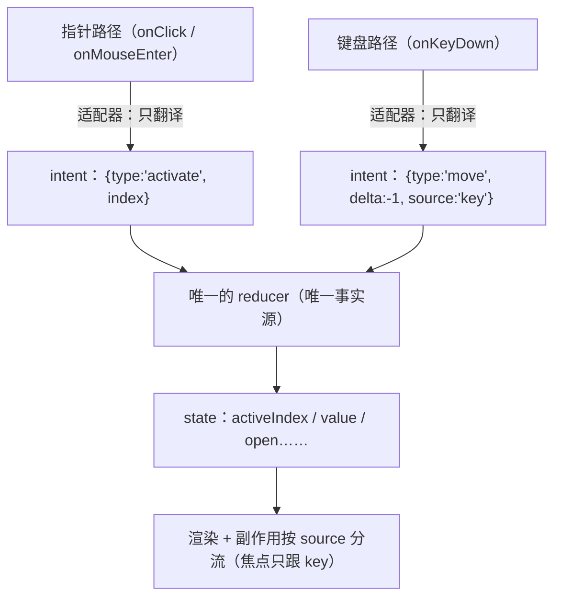

## Lv3 复杂交互组件（公认最考功力）

Lv1 考的是细节洁癖，Lv2 考的是弹层与焦点的地基，到了 Lv3，前面所有内功要**同时**发力：一个 Select 要同时处理键盘导航（A5）、弹层定位与失焦关闭（A2）、受控协议（A1）、长列表性能；一个 Table 表面上是渲染，骨子里是协议设计；一个 Tree 里藏着整个教程里最经典的联动算法。所以业界共识是：**弹层四件套写完只算入门，Lv3 能徒手写对，才算真的会写组件**。

本段按功力星级逐个展开 Select → DatePicker → Table → Tabs → Collapse → Tree → Cascader/TreeSelect/Transfer 七组组件。每个组件的展开结构固定为：**考点总览 → 逐考点实现（机制 + 完整代码）→ 常见坑（症状 → 根因 → 修法）**。所有代码 TypeScript + React 19 写法（`ref` 已是普通 prop，不再需要 `forwardRef`），可独立运行；antd 相关代码基于 v5 当前稳定版——若你的宿主应用是 React 19，antd v5 需要在入口补一行官方兼容包：

```ts
// React 19 + antd v5 官方兼容补丁（antd 文档「React 19 compatibility」小节）
import '@ant-design/v5-patch-for-react-19';
```

读本段有个建议：不要顺着读，挑一个组件**先合上文档自己写一遍**，写不动了再看对应考点。Lv3 的功力差距恰恰暴露在"以为自己会"和"真写对"之间——尤其是 Select 的键盘状态机、DatePicker 的日历生成、Tree 的三态传导这三处，是面试和实战的双重高发区。

---

### Select（★★★★）——键盘+a11y+长列表三合一考题

Select 之所以是三合一考题，是因为它同时踩三条最难的路：

1. **键盘 + a11y**：WAI-ARIA 的 combobox + listbox 模式要求"输入框是个 combobox，弹层是个 listbox，高亮项用 `aria-activedescendant` 关联"，键盘模型包括 ↑↓/Home/End/Enter/Esc/typeahead，一个都不能少。
2. **受控协议**：单选/多选/labelInValue/清空/后缀箭头，每一项都是一次 API 设计决策。
3. **长列表**：万级 options 直接渲染就是几万 DOM 节点，必须虚拟滚动；远程搜索又叠加防抖、loading、请求取消三件事。

考点清单（原文）：

- 高亮项与选中项分离；键盘全套（↑↓/Enter/Esc/typeahead）
- 受控非受控、labelInValue、清空、后缀箭头
- **万级 options 虚拟滚动**；远程搜索（防抖 + loading + 失焦取消）
- 多选：maxTag 溢出显示 "+2"、已选项被删除后的回显

#### 考点 1：高亮项（activeIndex）与选中项（value）为什么必须分离

先把这个 Select 里最容易被写错的设计决策讲透。一个下拉框里其实有两个"当前项"：

- **选中项（value）**：已经提交给业务方的数据，是受控协议的一部分，变了就要触发 `onChange`，下游可能跟着发请求、触发表单校验。
- **高亮项（activeIndex）**：键盘的"光标"。按 ↑↓ 移动的是它，Enter 才把它"提交"成 value。它纯属 UI 内部状态，永远不该触发 `onChange`。

两者一旦合并成一个 state，每按一次方向键就会触发一次 `onChange` → 一次网络请求/校验抖动，协议直接废掉。此外读屏语义也不同：`aria-activedescendant` 指向的是**高亮项**，`aria-selected` 标记的是**选中项**——两个概念在无障碍规范里就是两个 id、两个属性。

分离之后还有一条配套纪律：**打开面板时 activeIndex 要重置到选中项所在位置**（并滚动到可见），否则用户每次打开都从第 0 项开始，大列表里选中项在底部时体验极差。下面是包含完整键盘状态机的 Select 内核：

```tsx
import { useEffect, useRef, useState, useCallback } from 'react';

export interface Option {
  value: string;
  label: string;
  disabled?: boolean;
}

export function useSelectCore(options: Option[]) {
  // value：选中项（受控/非受控由外层决定，这里以非受控示例）
  const [value, setValue] = useState<string | null>(null);
  // activeIndex：高亮项索引——与 value 分离，是本考点的核心
  const [activeIndex, setActiveIndex] = useState(-1);
  const [open, setOpen] = useState(false);

  /** 打开时把高亮项对齐到选中项；没有选中则落回第一项可选项 */
  const openPanel = useCallback(() => {
    setOpen(true);
    const selectedIdx = options.findIndex((o) => o.value === value);
    const firstEnabled = options.findIndex((o) => !o.disabled);
    setActiveIndex(selectedIdx >= 0 ? selectedIdx : firstEnabled);
  }, [options, value]);

  /** 可选项之间移动：跳过 disabled（WAI-ARIA listbox 允许落在 disabled 上，但多数实现选择跳过） */
  const move = useCallback(
    (step: 1 | -1) => {
      if (!options.length) return;
      let next = activeIndex;
      for (let i = 0; i < options.length; i++) {
        next = (next + step + options.length) % options.length; // 环形移动，到达边界回绕
        if (!options[next].disabled) break;
      }
      setActiveIndex(next);
    },
    [activeIndex, options],
  );

  const selectActive = useCallback(() => {
    const opt = options[activeIndex];
    if (!opt || opt.disabled) return;
    setValue(opt.value);      // 只有 Enter / 点击才写 value —— onChange 只在这里发
    setOpen(false);
  }, [activeIndex, options]);

  /** 完整键盘模型：↑↓ 移动、Home/End 到首末、Enter 提交、Esc 关闭 */
  const onKeyDown = useCallback(
    (e: React.KeyboardEvent) => {
      switch (e.key) {
        case 'ArrowUp':   e.preventDefault(); move(-1); break;
        case 'ArrowDown': e.preventDefault(); move(1); break;
        case 'Home':      e.preventDefault(); setActiveIndex(options.findIndex((o) => !o.disabled)); break;
        case 'End':       e.preventDefault(); {
          for (let i = options.length - 1; i >= 0; i--) {
            if (!options[i].disabled) { setActiveIndex(i); break; }
          }
          break;
        }
        case 'Enter': e.preventDefault(); selectActive(); break;
        case 'Escape': e.preventDefault(); setOpen(false); break; // Esc 只关面板，value 不动
      }
    },
    [move, options, selectActive],
  );

  return { value, setValue, activeIndex, setActiveIndex, open, setOpen, openPanel, onKeyDown, move };
}
```

读屏关联部分，触发器与弹层的 aria 契约如下（combobox 模式）：

```tsx
import { useId } from 'react';

// 触发器：combobox；弹层：listbox；高亮项：aria-activedescendant
function SelectA11y({
  listId, activeId, open, onKeyDown,
}: { listId: string; activeId: string | null; open: boolean; onKeyDown: React.KeyboardEventHandler }) {
  const inputId = useId(); // React 19 的 useId：SSR 安全的唯一 id（见 Part A7）
  return (
    <>
      <input
        id={inputId}
        role="combobox"                  // 声明自己是 combobox（输入 + 弹出列表）
        aria-expanded={open}             // 弹层是否打开
        aria-controls={listId}           // 指向弹层列表
        aria-autocomplete="list"
        aria-activedescendant={open ? activeId ?? undefined : undefined} // 只在打开时指向高亮项
        onKeyDown={onKeyDown}
      />
      <ul id={listId} role="listbox" aria-labelledby={inputId}>
        {/* option 渲染见考点 3 */}
      </ul>
    </>
  );
}
```

#### 考点 2：typeahead（连按字母匹配，含超时重置）

typeahead 是"按住键盘不打开下拉也能跳转"的体验：连按 `s``h` 高亮到"上海"，停顿超过阈值（惯例 500ms）后缓冲清空，再按 `g` 就从 `g` 重新匹配。三个实现细节决定成败：

1. **缓冲要累积**：一次按键只匹配单字母，连打就废了；
2. **超时要重置**：每次按键都重置计时器，静默超过 500ms 清空缓冲——这是"输入会话"的边界；
3. **匹配策略分级**：先找前缀匹配，找不到再退化到包含匹配。

```tsx
import { useEffect, useRef, useCallback } from 'react';
import type { Option } from './useSelectCore'; // 与上一段代码同文件时可省略此 import

/**
 * typeahead：可打印字符累积进缓冲，前缀优先、包含兜底，500ms 静默重置。
 * onMatch 会拿到目标索引，调用方负责 setActiveIndex 并滚动到可见。
 */
export function useTypeahead(
  getOptions: () => Option[],
  onMatch: (index: number) => void,
  timeoutMs = 500,
) {
  const bufferRef = useRef('');          // 已敲入的字符缓冲
  const timerRef = useRef<number>(0);    // 静默重置计时器

  const onKeyDown = useCallback(
    (e: React.KeyboardEvent) => {
      // 只截获"单个可打印字符"，Ctrl/Cmd/Alt 组合键（快捷键）一律放行
      if (e.key.length !== 1 || e.ctrlKey || e.metaKey || e.altKey) return;
      bufferRef.current += e.key.toLowerCase();
      // 每次按键都重置倒计时：超时窗口是"距上次按键"而不是"距首次按键"
      window.clearTimeout(timerRef.current);
      timerRef.current = window.setTimeout(() => { bufferRef.current = ''; }, timeoutMs);

      const opts = getOptions().filter((o) => !o.disabled);
      const kw = bufferRef.current;
      const prefixIdx = opts.findIndex((o) => o.label.toLowerCase().startsWith(kw));
      const hitIdx = prefixIdx >= 0 ? prefixIdx : opts.findIndex((o) => o.label.toLowerCase().includes(kw));
      if (hitIdx >= 0) onMatch(hitIdx);
      e.preventDefault(); // 阻止字符进入输入框本体（Select 的输入框不真的收字符）
    },
    [getOptions, onMatch, timeoutMs],
  );

  // 卸载时清掉计时器，避免报错与内存泄漏
  useEffect(() => () => window.clearTimeout(timerRef.current), []);
  return { onKeyDown };
}
```

坑点预告：如果 Select 带**搜索输入框**（`showSearch`），typeahead 就不能再 `preventDefault` 抢字符了——此时输入框本身承担"输入 → 过滤"职责，typeahead 只在**无输入框**的形态下启用。antd 的处理就是按 `mode`/`showSearch` 分支切换这两套键盘逻辑。

#### 考点 3：受控/非受控 + labelInValue + 清空 + 后缀箭头

**双模式**是 Part A1 的 `useControllableState` 在 Select 上的落地：外部传了 `value` 就完全受控（内部不存、只回显），没传就用内部 state；`onChange` 无条件回调。这里给出独立可运行的 30 行实现，保证本片段自洽：

```tsx
import { useRef, useState, useEffect } from 'react';

/** 受控/非受控二合一（Part A1 同款思想的独立实现，供本片段所有示例复用） */
export function useControllable<T>({
  value,            // 外部受控值：传了（非 undefined）即受控
  defaultValue,     // 非受控初始值：惰性初始化，只在首帧消费一次
  onChange,         // 状态变化时永远回调（无论受控与否）
}: {
  value?: T;
  defaultValue?: T;
  onChange?: (next: T) => void;
}) {
  // 惰性初始化：defaultValue 若是昂贵计算结果，只在首渲染执行一次
  const [internal, setInternal] = useState<T | undefined>(defaultValue);
  const isControlled = value !== undefined;
  const merged = isControlled ? value : internal;

  const onChangeRef = useRef(onChange);
  onChangeRef.current = onChange;

  const setValue = (next: T) => {
    if (!isControlled) setInternal(next);       // 受控时不写内部状态，等外部回灌
    onChangeRef.current?.(next);                // 永远回调：受控方拿它去 setState 完成闭环
  };
  return [merged as T, setValue] as const;
}

/** 受控/非受控切换报警：开发期捕获"先受控后非受控"的不一致（症状见文末坑 6） */
export function useControlledWarn(value: unknown) {
  const wasControlled = useRef(value !== undefined);
  useEffect(() => {
    if (wasControlled.current && value === undefined) {
      console.warn('组件从受控切换为非受控，行为将不可预期，请检查 value 的传递。');
    }
    wasControlled.current = value !== undefined;
  }, [value]);
}
```

**labelInValue**：默认 `value` 只是 key（`'sh'`），业务方要展示 label 还得自己查一遍 options。当 options 是异步的、随时可能被删除（见考点 5 的脏数据问题），key 和 label 就该绑在一起走协议：`value = { value: 'sh', label: '上海' }`。antd 用 `labelInValue` 开启，我们自己的类型定义：

```ts
/** labelInValue 开启后的 value 形状：label 跟着值走，options 缺失也能回显 */
export interface LabeledValue<V = string> {
  value: V;
  label: string;
}
export type SingleValue<V> = V | LabeledValue<V> | undefined;
```

**清空**：清空是协议事件，不是"把输入框置空字符串"。正确语义是 `onChange(undefined)`（labelInValue 下是 `undefined` 而不是 `{ value: undefined, label: '' }`），antd 还提供独立的 `onClear` 钩子。**后缀箭头**：箭头图标随 `open` 旋转（CSS `transform: rotate(180deg)` + `transition`），它还是天然的开关按钮——点击箭头区域应切换面板而非仅作装饰。把这三件事拼进触发器：

```tsx
import { useState } from 'react';

interface SelectTriggerProps {
  displayLabel: string;                    // 回显文本（多选时为 tags，见考点 5）
  open: boolean;
  allowClear: boolean;
  onToggleOpen: () => void;
  onClear: () => void;
  placeholder?: string;
}

export function SelectTrigger({ displayLabel, open, allowClear, onToggleOpen, onClear, placeholder = '请选择' }: SelectTriggerProps) {
  const [hover, setHover] = useState(false);
  const showClear = allowClear && hover && displayLabel; // hover 才出现清空钮，避免与箭头争位
  return (
    <div
      className="select-trigger"
      onMouseEnter={() => setHover(true)}
      onMouseLeave={() => setHover(false)}
      onClick={onToggleOpen}
      style={{ display: 'inline-flex', alignItems: 'center', gap: 4, border: '1px solid #d9d9d9', padding: '4px 8px', minWidth: 160, cursor: 'pointer' }}
    >
      <span style={{ flex: 1, overflow: 'hidden', textOverflow: 'ellipsis', whiteSpace: 'nowrap', color: displayLabel ? undefined : '#bfbfbf' }}>
        {displayLabel || placeholder}
      </span>
      {showClear && (
        <span
          role="button"
          aria-label="清空"
          onClick={(e) => { e.stopPropagation(); onClear(); }} // 阻止冒泡：清空不能顺带开关面板
          style={{ cursor: 'pointer' }}
        >
          ×
        </span>
      )}
      <span
        aria-hidden
        style={{ transition: 'transform .2s', transform: open ? 'rotate(180deg)' : 'none' }} // 箭头随开合旋转
      >
        ▾
      </span>
    </div>
  );
}
```

antd 对应写法（不用造轮子时）：

```tsx
import { Select } from 'antd';

<Select
  allowClear                 // 清空钮 + onClear 回调
  onClear={() => form.resetFields(['city'])}
  labelInValue               // value/onChange 全部携带 { value, label }
  suffixIcon={<MyIcon />}    // 自定义后缀箭头
  options={[{ value: 'sh', label: '上海' }, { value: 'hz', label: '杭州' }]}
/>
```

#### 考点 4：万级 options 虚拟滚动（定高窗口化）

一万条 options 全量渲染 = 一万个 `<li>` = 首帧几秒、滚动掉帧。虚拟滚动的核心是**窗口化（windowing）**：只渲染视口内（加上下各一段 overscan 缓冲）的几十条，其余用一根等高"撑高条"占位。定高场景的数学极其简单：

```tsx
import { useState, useRef, useEffect, type ReactNode } from 'react';

const ITEM_HEIGHT = 32; // 定高假设：每项 32px——变高列表需要测量缓存，见后文 VirtualList 小节

/** 定高虚拟列表：撑高条 + translateY 偏移，万级数据只渲染 ~30 个 DOM */
export function VirtualList<T>({
  items, viewportHeight = 256, overscan = 6, renderItem, activeIndex,
}: {
  items: T[];
  viewportHeight?: number;
  overscan?: number;
  renderItem: (item: T, index: number) => ReactNode;
  activeIndex?: number; // 键盘高亮项：变化时保证它滚入视口（见文末坑 4）
}) {
  const [scrollTop, setScrollTop] = useState(0);
  const containerRef = useRef<HTMLDivElement>(null);

  // 窗口计算：起点向上多留 overscan 条缓冲，向下多留 viewport 一屏 + overscan
  const startIndex = Math.max(0, Math.floor(scrollTop / ITEM_HEIGHT) - overscan);
  const endIndex = Math.min(items.length, startIndex + Math.ceil(viewportHeight / ITEM_HEIGHT) + overscan * 2);
  const visible = items.slice(startIndex, endIndex);

  // 高亮项必须始终在 DOM 里，否则 aria-activedescendant 指向不存在的节点
  useEffect(() => {
    if (activeIndex == null || activeIndex < 0 || !containerRef.current) return;
    const top = activeIndex * ITEM_HEIGHT;
    const el = containerRef.current;
    if (top < el.scrollTop) el.scrollTop = top;                                       // 高于视口：贴顶
    else if (top + ITEM_HEIGHT > el.scrollTop + viewportHeight) el.scrollTop = top + ITEM_HEIGHT - viewportHeight; // 低于视口：贴底
  }, [activeIndex, viewportHeight]);

  return (
    <div
      ref={containerRef}
      style={{ height: viewportHeight, overflowY: 'auto' }}
      onScroll={(e) => setScrollTop(e.currentTarget.scrollTop)}
    >
      {/* 撑高条：总高度 = 条数 × 行高，让滚动条长度真实 */}
      <div style={{ height: items.length * ITEM_HEIGHT, position: 'relative' }}>
        {/* 窗口块整体位移到正确位置：transform 优于逐项 absolute top（合成层性能更好） */}
        <div style={{ transform: `translateY(${startIndex * ITEM_HEIGHT}px)` }}>
          {visible.map((item, i) => renderItem(item, startIndex + i))}
        </div>
      </div>
    </div>
  );
}
```

接到 Select 上——弹层列表换成 `VirtualList`，每项行高固定 32px，同时把高亮/选中两个状态分别落到 aria 和样式：

```tsx
import { useId } from 'react';
import { VirtualList } from './VirtualList';
import type { Option } from './useSelectCore';

export function SelectOptionList({
  options, activeIndex, value, onHover, onPick,
}: {
  options: Option[];
  activeIndex: number;
  value: string | null;
  onHover: (i: number) => void;
  onPick: (i: number) => void;
}) {
  const listId = useId();
  return (
    <VirtualList
      items={options}
      activeIndex={activeIndex}
      renderItem={(opt, i) => (
        <li
          key={opt.value}
          id={`${listId}-opt-${i}`}                        // aria-activedescendant 的指向目标
          role="option"
          aria-selected={opt.value === value}              // 选中项语义：与高亮项是两回事
          aria-disabled={opt.disabled}
          onMouseEnter={() => onHover(i)}                  // 鼠标悬停接管高亮（与键盘共用 activeIndex）
          onClick={() => onPick(i)}
          style={{
            height: 32, lineHeight: '32px', padding: '0 12px', cursor: 'pointer',
            background: i === activeIndex ? '#f5f5f5' : undefined,          // 高亮项
            fontWeight: opt.value === value ? 600 : undefined,             // 选中项用字重区分
            color: opt.disabled ? '#bfbfbf' : undefined,
          }}
        >
          {opt.label}
        </li>
      )}
    />
  );
}
```

antd 的 Select 默认就开着虚拟滚动（内部用独立的 `rc-virtual-list` 包），只有极端场景才需要 `virtual={false}` 关掉（例如选项高度不一旦不想做测量）。

#### 考点 5：远程搜索（防抖 + loading + 失焦取消）

远程搜索是"用户输入 → 300ms 防抖 → 发请求 → 更新 options"的流水线，加上两件最容易漏的事：**loading 状态**（触发器与弹层都要有）和**请求取消**（新请求发出时 abort 旧请求；失焦/卸载时 abort 在途请求）。竞态是这一考点的隐藏 boss：慢的旧响应比快的新响应后到，把新结果覆盖成旧结果—— AbortController 一并解决。

```tsx
import { useCallback, useEffect, useRef, useState } from 'react';
import type { Option } from './useSelectCore';

/** 远程搜索：防抖 300ms + AbortController 取消在途请求 + loading 状态 */
export function useRemoteSearch(fetcher: (kw: string, signal: AbortSignal) => Promise<Option[]>, debounceMs = 300) {
  const [options, setOptions] = useState<Option[]>([]);
  const [loading, setLoading] = useState(false);
  const timerRef = useRef<number>(0);                     // 防抖计时器
  const abortRef = useRef<AbortController | null>(null);  // 在途请求控制器

  const run = useCallback(async (kw: string) => {
    abortRef.current?.abort();                            // 新请求发出：先取消上一个
    const ac = new AbortController();
    abortRef.current = ac;
    setLoading(true);
    try {
      const data = await fetcher(kw, ac.signal);
      if (!ac.signal.aborted) setOptions(data);           // 只有无被取消才落地，杜绝竞态覆盖
    } catch (err) {
      // abort 触发的异常是预期内的流程，不是错误
      if (!(err instanceof DOMException && err.name === 'AbortError')) throw err;
    } finally {
      if (!ac.signal.aborted) setLoading(false);
    }
  }, [fetcher]);

  /** 输入回调：只做防抖，不直接请求 */
  const search = useCallback((kw: string) => {
    window.clearTimeout(timerRef.current);
    timerRef.current = window.setTimeout(() => void run(kw), debounceMs);
  }, [run]);

  /** 失焦/卸载：取消在途请求并清掉未发出的防抖 */
  const cancel = useCallback(() => {
    abortRef.current?.abort();
    window.clearTimeout(timerRef.current);
    setLoading(false);
  }, []);

  useEffect(() => cancel, [cancel]); // 卸载兜底

  return { options, loading, search, cancel };
}

// 使用：fetcher 里把 signal 传给 fetch，浏览器层面真正断流
const fetcher = (kw: string, signal: AbortSignal) =>
  fetch(`/api/users?q=${encodeURIComponent(kw)}`, { signal })
    .then((res) => res.json() as Promise<Option[]>);

// const { options, loading, search, cancel } = useRemoteSearch(fetcher);
// onBlur={cancel} onSearch={search} —— loading 同时驱动触发器 spinner 与弹层"加载中"占位
```

antd 侧的对应配置是三件套：`showSearch` + `filterOption={false}`（关掉本地过滤，交给服务端）+ `onSearch`（接防抖）+ `loading`（回显状态）。

#### 考点 6：多选——maxTag 溢出 "+2" 的渲染测量 + 脏数据回显

多选 Select 的 value 是数组，回显是一排 Tag。两个考点：

**（1）maxTag 溢出 "+2" 怎么算出"能放几个"？** 答案不是数个数（`maxTagCount={3}` 那种写死模式简单但浪费空间），而是**测量**：容器宽度固定，每个 Tag 宽度不定（文字长短不一），要放尽可能多的 Tag 再用 "+N" 收尾。antd 的 `maxTagCount="responsive"` 就是这个行为（内部由 `rc-overflow` 包做逐项测量与收纳）。自己实现的思路是两遍渲染：

```tsx
import { useLayoutEffect, useRef, useState } from 'react';

interface TagItem { value: string; label: string }

/**
 * 响应式 maxTag：先在隐藏层渲染全部 Tag 测宽，再贪心装入容器，剩下的显示 "+N"。
 * 这是 rc-overflow 的简化版：二分/增量注册等优化略，原理一致。
 */
export function ResponsiveTags({
  items, containerRef, onRemove,
}: {
  items: TagItem[];
  containerRef: React.RefObject<HTMLElement | null>; // 容器 ref：宽度随外层布局变化
  onRemove: (value: string) => void;
}) {
  const [fitCount, setFitCount] = useState(items.length);
  const measureRef = useRef<HTMLDivElement>(null); // 隐藏测量层

  useLayoutEffect(() => {
    const container = containerRef.current;
    const measureEl = measureRef.current;
    if (!container || !measureEl) return;

    // ResizeObserver：容器宽度变化（窗口缩放/布局变化）时重算
    const compute = () => {
      const containerWidth = container.clientWidth - 24 - 40; // 减去内边距与 "+N" 预留宽
      const tagEls = measureEl.children;
      let used = 0, fit = 0;
      for (let i = 0; i < items.length; i++) {
        const w = (tagEls[i] as HTMLElement).offsetWidth + 4 /* gap */;
        if (used + w > containerWidth) break; // 装不下下一个：到此为止，剩余全部进 "+N"
        used += w; fit++;
      }
      // 与上次相同则不 setState：防止"测量→渲染→测量"死循环（见文末坑 5）
      setFitCount((prev) => (prev === fit ? prev : fit));
    };
    compute();
    const ro = new ResizeObserver(compute); // 容器尺寸变化（响应式布局）自动重算
    ro.observe(container);
    return () => ro.disconnect();
  }, [items, containerRef]);

  const overflow = items.length - fitCount;
  return (
    <>
      {/* 隐藏测量层：真实渲染全部 Tag，仅供 offsetWidth，视觉上不可见 */}
      <div ref={measureRef} aria-hidden style={{ position: 'absolute', visibility: 'hidden', pointerEvents: 'none', whiteSpace: 'nowrap', left: -9999 }}>
        {items.map((t) => <span key={t.value} style={{ padding: '0 8px' }}>{t.label}</span>)}
      </div>
      {items.slice(0, fitCount).map((t) => (
        <span key={t.value} style={{ background: '#fafafa', border: '1px solid #d9d9d9', padding: '0 8px', borderRadius: 4 }}>
          {t.label}
          <span role="button" aria-label={`移除 ${t.label}`} onClick={() => onRemove(t.value)} style={{ cursor: 'pointer', paddingLeft: 4 }}>×</span>
        </span>
      ))}
      {overflow > 0 && (
        <span title={items.slice(fitCount).map((t) => t.label).join('、')} // 悬浮看完整清单
          style={{ background: '#fafafa', border: '1px solid #d9d9d9', padding: '0 8px', borderRadius: 4 }}>
          +{overflow}
        </span>
      )}
    </>
  );
}
```

antd 写法对照：

```tsx
import { Select } from 'antd';

<Select
  mode="multiple"
  maxTagCount="responsive"                                  // 测量式收纳（rc-overflow）
  maxTagPlaceholder={(omitted) => `+${omitted.length}...`}  // "+N" 文案可定制
  options={options}
/>
// 固定个数模式则用 maxTagCount={2}，行为是"永远只显示前 2 个 + +N"
```

**（2）已选项被删除后的回显脏数据。** 场景：用户昨天选了"张三"，今天管理员把"张三"从系统里删了，`options` 里已无此人，但表单的 `value` 还存着他的 key。如果渲染逻辑写成 `options.find(o => o.value === v).label`，直接抛 `TypeError: Cannot read properties of undefined`——白屏级事故。解法是**label 缓存**：只要某个 key 曾经出现过 label，就把它记进一个 ref 级 Map，渲染时 `options` 查不到就回落缓存，缓存也没有才显示 key 本身。antd 的 rc-select 内部就是这么维护已选值列表（mergedValues）的，所以 antd 里删掉的选项回显不会丢 label。

```tsx
import { useRef } from 'react';
import type { Option } from './useSelectCore';

/** label 缓存：options 丢失已选项时仍能回显其 label（脏数据防线） */
export function useLabelCache(options: Option[]) {
  const cacheRef = useRef(new Map<string, string>());

  // options 在场的项：实时刷新缓存（label 可能被服务端改名）
  for (const o of options) cacheRef.current.set(o.value, o.label);
  // 注意：在渲染期间往 ref 写缓存是安全的——写入是幂等的，不触发额外渲染

  const labelOf = (value: string): string =>
    options.find((o) => o.value === value)?.label   // 1. 优先取当前 options
      ?? cacheRef.current.get(value)                // 2. 已被删除：回落历史缓存
      ?? value;                                     // 3. 从未见过：显示 key 本身，绝不 undefined

  const remember = (value: string, label: string) => cacheRef.current.set(value, label); // onChange 时写入
  return { labelOf, remember };
}
```

配套的纪律：`onChange` 拿到的值在**提交那一刻**就 `remember(value, label)` 存档，此后无论 options 怎么变，回显链路都有兜底。

#### Select 常见坑（症状 → 根因 → 修法）

```text
坑 1
症状：按一下 ↓ 就发出一次 onChange，下游请求刷屏。
根因：把高亮项和选中项写进了同一个 state，键盘移动被当成"选择"。
修法：拆成 activeIndex（纯 UI）与 value（协议数据），只有 Enter/点击写 value（见考点 1）。

坑 2
症状：远程搜索结果偶尔"闪回"上一次的关键词结果。
根因：请求竞态——旧关键词响应慢、后到，覆盖了新结果。
修法：AbortController（新请求 abort 旧的 + 失焦/卸载 cancel），或请求序号守卫（见考点 5）。

坑 3
症状：点清空后出现一个空标签/表单校验不触发。
根因：清空回调给了 '' 或 { value: undefined, label: '' }，组件把空串当成"有一项"渲染。
修法：清空语义固定为 onChange(undefined)，渲染层对 undefined/null 直接显示 placeholder。

坑 4
症状：虚拟滚动 + 键盘导航时，按 ↓ 到视口外，读屏不播报、视觉也看不见高亮。
根因：高亮项不在窗口内，DOM 里根本没有这个节点，aria-activedescendant 指向了不存在的 id。
修法：activeIndex 变化的 effect 里把该项滚动进视口（VirtualList 已内置），保证高亮节点始终存在。

坑 5
症状：maxTagCount "responsive" 模式下无限重渲染/宽度抖动。
根因：测量写在渲染后的 effect 里，setState 又触发重测量，形成循环；或 ResizeObserver 回调高频触发。
修法：fitCount 与上次相同则不 setState；测量逻辑用同一帧的 rect 做完；必要时对 ResizeObserver 回调做 rAF 节流。

坑 6
症状：Select 从受控切到非受控后行为错乱（改不动/突然清空）。
根因：受控↔非受控中途切换，内部 state 从未初始化又被接管（Part A1 的经典警告）。
修法：全生命周期钉死一种模式；条件受控用 value={maybeX ?? undefined} 之外的中转组件包装，绝不让 value 在 undefined 与有值间"漂移"。

坑 7
症状：多选回显出现裸 key（如显示 "u_1024"）。
根因：options 已删项，渲染层 options.find(...).label 直接取空。
修法：useLabelCache 三级兜底：options → 缓存 → key（见考点 6）。
```

**对标小结**：antd 的 Select 内核是 rc-select + rc-virtual-list 两个包——前者负责触发器/键盘/受控协议/多选收纳，后者负责窗口化渲染，职责切面正好对应本节考点 1–3 与考点 4。更妙的是这个底座还能再长出两个组件：TreeSelect（树换掉平铺列表）与 Cascader（级联列换掉单列表）。这套"Select 外壳 × 不同列表内容 = 新组件"的分层，是后文 Cascader/TreeSelect 一节的伏笔。

---

### 补充：手势交互 × 状态原语——swipe / long-press / pinch 的状态机建模

**是什么**：Lv3 七组组件之外还有一类横切能力——指针手势。swipe（滑动）、long-press（长按）、pinch（捏合）是 Carousel、Drawer、图片查看器、下拉刷新的共用底座。事件接入层（`setPointerCapture`、`touch-action`、pointercancel 边界）在 [21-Carousel-Slider-Rate-ColorPicker.md](21-Carousel-Slider-Rate-ColorPicker.md) 已详述、系统打断与长按菜单在 [07-A6-事件边界.md](07-A6-事件边界.md) A6.6/A6.7 已详述，本节只讲它们都没讲的那一层：**把手势建模成显式状态机**。

**为什么难**：手势是"时间 × 空间"的模糊判定——按下后的一瞬间，你不知道用户要 tap、要滑、还是要长按；而"跟手"要求识别未定时就开始移动元素。这催生了手势特有的两阶段结构：**识别层（判定意图）→ 执行层（提交语义）**。多数手写实现把两层揉在事件回调里用布尔标志互相打补丁，最后谁也说不清"按下 300ms 后第二根手指落下"时组件处于什么状态。把隐式状态翻成显式转移表，正是 [04-A3-退出动画-难题-visible-mounted-双状态机.md](04-A3-退出动画-难题-visible-mounted-双状态机.md) A3.8 对退出动画做过的事，本节平移到手势域。

**机制**：

1. **识别层状态机**：`idle → assessing →（swiping | 长按触发 | 双指介入取消）→ committed | cancelled`。`assessing` 是灵魂——意图未定时只累积证据（位移/时长/触点数），越过阈值才迁移。
2. **跟手与提交分离**：`swiping` 的 dx/dy 直接驱动 `transform`（transition 必须关）；`committed` 才把方向交给业务。位移不够但速度快（flick 甩动）也要能提交——速度是第二证据维度。
3. **与 A3 双状态机的分工**：手势机管跟手（毫秒级 transform 跟随），A3 机管进出场（过渡与挂载时机）。交接点：手势 `commit` → `setVisible(false)` → A3 进 exit phase 播退出动画；`cancelled`（未达阈值）不进 A3，走本地回弹。两机绝不同时驱动同一 transform——"跟手期间 `transition: none`"就是这条纪律的落地。
4. **中断续接同族**：拖到一半松手 = 从中间值续接退场（A3.9 的中断续接）；`pointercancel`（系统手势/来电打断）= 判 `cancelled` 并保留 dx/dy 供回弹（A6 的经典边界）。

```ts
// gesture-machine.ts —— 识别层是纯 reducer，不碰 DOM，可直接单测
export type GesturePhase =
  | 'idle'        // 没有活跃指针
  | 'assessing'   // 已按下、意图未定（可能演化为 tap / swipe / long-press / pinch）
  | 'swiping'     // 位移越过阈值且轴已锁定——"跟手"阶段
  | 'committed'   // 抬指且满足提交条件：产出方向语义
  | 'cancelled';  // 终止但无语义：短按、未达阈值、系统打断、多指介入

export interface GestureState {
  phase: GesturePhase;
  startX: number; startY: number; startT: number;
  lastX: number; lastY: number; lastT: number; // 上一帧采样：算瞬时速度
  dx: number; dy: number;                      // 当前位移（CSS px）；cancelled 保留供回弹
  axis: 'x' | 'y' | null;                      // 轴锁：判定后只认主轴，副轴清零
  velocity: number;                            // px/ms
  dir: 'left' | 'right' | 'up' | 'down' | null;
}

export type GestureEvent =
  | { type: 'pointerdown'; x: number; y: number; t: number }
  | { type: 'pointermove'; x: number; y: number; t: number }
  | { type: 'pointerup'; t: number }
  | { type: 'pointercancel' } // 系统手势/来电打断（A6 详述）
  | { type: 'pointeradd' }    // 第二指落下：单指协议破坏，pinch 机接管
  | { type: 'reset' };        // 消费方读完终态后归位

export interface GestureConfig { moveTolerancePx: number; flickVelocity: number }
// moveTolerancePx：判定"这是滑动"的最小位移；flickVelocity：甩动阈值 px/ms（位移不够但甩得快也提交）
export const initialGestureState: GestureState = {
  phase: 'idle', startX: 0, startY: 0, startT: 0, lastX: 0, lastY: 0, lastT: 0,
  dx: 0, dy: 0, axis: null, velocity: 0, dir: null,
};

export function gestureReducer(s: GestureState, ev: GestureEvent, cfg: GestureConfig): GestureState {
  switch (ev.type) {
    case 'pointerdown':
      if (s.phase !== 'idle') return { ...initialGestureState, phase: 'cancelled' }; // 多指让位 pinch
      return { ...initialGestureState, phase: 'assessing', startX: ev.x, startY: ev.y, startT: ev.t };
    case 'pointermove': {
      if (s.phase !== 'assessing' && s.phase !== 'swiping') return s; // idle/终态不吃 move
      const dx = ev.x - s.startX, dy = ev.y - s.startY, dt = ev.t - s.lastT;
      const speed = dt > 0 ? Math.hypot(ev.x - s.lastX, ev.y - s.lastY) / dt : 0;
      if (s.phase === 'assessing') {
        if (Math.abs(dx) < cfg.moveTolerancePx && Math.abs(dy) < cfg.moveTolerancePx)
          return { ...s, dx, dy, velocity: speed, lastX: ev.x, lastY: ev.y, lastT: ev.t };
        const axis: 'x' | 'y' = Math.abs(dx) >= Math.abs(dy) ? 'x' : 'y'; // 位移大的轴为主轴
        return {
          ...s, phase: 'swiping', axis, velocity: speed,
          dx: axis === 'x' ? dx : 0, dy: axis === 'y' ? dy : 0,
          lastX: ev.x, lastY: ev.y, lastT: ev.t,
        };
      }
      return { ...s, dx: s.axis === 'x' ? dx : 0, dy: s.axis === 'y' ? dy : 0,
               velocity: speed, lastX: ev.x, lastY: ev.y, lastT: ev.t };
    }
    case 'pointerup': {
      if (s.phase === 'swiping') {
        const main = s.axis === 'x' ? s.dx : s.dy;
        // 提交条件二选一：位移足够（幅度证据）或甩动够快（速度证据）
        if (Math.abs(main) >= cfg.moveTolerancePx * 2 || s.velocity >= cfg.flickVelocity) {
          const dir = s.axis === 'x' ? (s.dx > 0 ? 'right' : 'left') : (s.dy > 0 ? 'down' : 'up');
          return { ...s, phase: 'committed', dir };
        }
      }
      return s.phase === 'idle' ? s : { ...s, phase: 'cancelled' }; // assessing 中抬指 = tap，无 swipe 语义
    }
    case 'pointercancel':
    case 'pointeradd': // 两组"外来打断"共用一个出口：保留 dx/dy 供回弹
      return s.phase === 'idle' ? s : { ...s, phase: 'cancelled' };
    case 'reset':
      return initialGestureState;
  }
}
```

```tsx
// useSwipe.ts —— React 接线（bind 对象模式）；捕获/触摸语义见 21 号文件
import { useCallback, useEffect, useReducer, useRef } from 'react';
import { gestureReducer, initialGestureState, type GestureConfig, type GestureState } from './gesture-machine';

export function useSwipe(
  cfg: GestureConfig = { moveTolerancePx: 10, flickVelocity: 0.5 },
  onCommit?: (dir: 'left' | 'right' | 'up' | 'down') => void,
) {
  const [state, dispatch] = useReducer(
    (s: GestureState, ev: Parameters<typeof gestureReducer>[1]) => gestureReducer(s, ev, cfg),
    initialGestureState,
  );
  const activeId = useRef<number | null>(null); // 只跟踪首根指针
  const onPointerDown = useCallback((e: React.PointerEvent<HTMLElement>) => {
    activeId.current = e.pointerId;
    e.currentTarget.setPointerCapture(e.pointerId); // 指针跑出元素也不断流（21 详述）
    dispatch({ type: 'pointerdown', x: e.clientX, y: e.clientY, t: e.timeStamp });
  }, []);
  const onPointerMove = useCallback((e: React.PointerEvent<HTMLElement>) => {
    if (activeId.current !== e.pointerId) return;
    dispatch({ type: 'pointermove', x: e.clientX, y: e.clientY, t: e.timeStamp });
  }, []);
  const release = useCallback((e: React.PointerEvent<HTMLElement>) => {
    if (activeId.current !== e.pointerId) return;
    activeId.current = null;
    dispatch({ type: 'pointerup', t: e.timeStamp });
  }, []);

  // 终态消费：dispatch 后要等下一次渲染 state 才可见，读终态的正确时机是 effect 监听 phase
  useEffect(() => {
    if (state.phase === 'committed') { onCommit?.(state.dir!); dispatch({ type: 'reset' }); }
    else if (state.phase === 'cancelled') dispatch({ type: 'reset' });
  }, [state.phase, state.dir, onCommit]);

  return {
    state,
    bind: {
      onPointerDown, onPointerMove, onPointerUp: release, onPointerCancel: release,
      style: { touchAction: 'none' } as const, // 纵向还要滚的容器改传 'pan-y'（21 的坑 4）
    },
  };
}
```

```tsx
// SwipeToClose.tsx —— 左滑关闭抽屉：手势机管跟手，A3 机管退出动画（两机的交接现场）
import { useState } from 'react';
import { useSwipe } from './useSwipe';

export function SwipeToClose({ onClose, children }: { onClose: () => void; children: React.ReactNode }) {
  const [closing, setClosing] = useState(false);
  const { state, bind } = useSwipe(
    { moveTolerancePx: 24, flickVelocity: 0.4 },
    (dir) => { if (dir === 'left') setClosing(true); }, // commit → 交给退出动画
  );
  const dragging = state.phase === 'swiping';
  return (
    <aside
      {...bind}
      style={{
        position: 'fixed', inset: '0 0 0 auto', width: 320, background: '#fff',
        // 两机互斥：跟手时 transition 关，提交后才交给过渡（A3 接管）
        transform: dragging ? `translateX(${Math.min(state.dx, 0)}px)` : closing ? 'translateX(-100%)' : 'none',
        transition: dragging ? 'none' : 'transform .25s ease',
      }}
      onTransitionEnd={() => closing && onClose()} // 动画落地才真正卸载（A3 的 mounted 纪律）
    >
      {children}
    </aside>
  );
}
```

另外两个原语是同一台识别机的变体。**长按** = 时间维度取证、位移超容忍度是反证；**pinch** 在 swipe 机的 `pointeradd` 分支处接管（单手指态取消、双指基线确立），因子 = 当前两指距离 / 基线距离，缩放锚点取两指中点，抬掉任一指即结束、基线作废（下次双指是新手势）——它的状态机建模已经浓缩在识别机的 pointeradd 分支与这句话里。长按的完整收口（定时器、容忍度、系统菜单）值得整段实现：

```tsx
// use-longpress.ts —— 定时器是证据，位移超容忍度是反证；打断与系统菜单都要收口
import { useCallback, useRef } from 'react';

export function useLongPress(onLongPress: () => void, { delayMs = 500, moveTolerancePx = 8 } = {}) {
  const timer = useRef<number>(0);
  const start = useRef({ x: 0, y: 0 });
  const fired = useRef(false);
  const clear = useCallback(() => window.clearTimeout(timer.current), []);
  return {
    bind: {
      onPointerDown: (e: React.PointerEvent<HTMLElement>) => {
        fired.current = false;
        start.current = { x: e.clientX, y: e.clientY };
        timer.current = window.setTimeout(() => {
          if (!fired.current) { fired.current = true; onLongPress(); } // assessing → longpressed
        }, delayMs);
      },
      // 移出容忍度 = 在拖动/滚动，不是长按 → 撤销证据
      onPointerMove: (e: React.PointerEvent<HTMLElement>) => {
        if (!fired.current && timer.current &&
            Math.hypot(e.clientX - start.current.x, e.clientY - start.current.y) > moveTolerancePx) clear();
      },
      onPointerUp: clear,
      onPointerCancel: clear, // 系统打断（A6.6 的拖出窗口/长按菜单场景）
      onContextMenu: (e: React.MouseEvent) => { if (fired.current) e.preventDefault(); }, // 抑制系统长按菜单
    },
  };
}
```

最小 Vitest（手势语义在无 DOM 环境穷举——A3.8 的纪律）：

```ts
// gesture-machine.test.ts
import { describe, it, expect } from 'vitest';
import { gestureReducer, initialGestureState, type GestureConfig } from './gesture-machine';

const cfg: GestureConfig = { moveTolerancePx: 10, flickVelocity: 0.5 };
const down = (x = 0, y = 0, t = 0) => ({ type: 'pointerdown' as const, x, y, t });
const move = (x: number, y: number, t: number) => ({ type: 'pointermove' as const, x, y, t });

describe('gestureReducer', () => {
  it('慢速大幅左滑 → committed / 方向 left / 轴锁吞掉纵向漂移；速度证据兜底提交', () => {
    let s = gestureReducer(initialGestureState, down(100, 100, 0), cfg);
    for (let i = 1; i <= 20; i++) s = gestureReducer(s, move(100 - i * 8, 100 + (i % 3), i * 16), cfg);
    s = gestureReducer(s, { type: 'pointerup', t: 320 }, cfg);
    expect(s.phase).toBe('committed');
    expect(s.dir).toBe('left');
    expect(s.dy).toBe(0); // 副轴位移被轴锁清零

    let f = gestureReducer(initialGestureState, down(0, 0, 0), cfg);
    f = gestureReducer(f, move(9, 0, 100), cfg);            // 9px < 10px：仍 assessing
    expect(f.phase).toBe('assessing');
    f = gestureReducer(f, move(14, 0, 106), cfg);           // 5px/6ms ≈ 0.83px/ms；幅度 14px < 20px 不够
    f = gestureReducer(f, { type: 'pointerup', t: 108 }, cfg); // 速度 0.83 > 0.5 兜底提交
    expect(f.phase).toBe('committed');
    expect(f.dir).toBe('right');
  });

  it('pointercancel / 第二指落下 → cancelled 且保留位移供回弹', () => {
    let s = gestureReducer(initialGestureState, down(0, 0, 0), cfg);
    s = gestureReducer(s, move(-40, 0, 100), cfg);
    s = gestureReducer(s, { type: 'pointercancel' }, cfg);
    expect(s.phase).toBe('cancelled');
    expect(s.dx).toBe(-40); // 回弹动画的起点
    const two = gestureReducer(gestureReducer(initialGestureState, down(), cfg), { type: 'pointeradd' }, cfg);
    expect(two.phase).toBe('cancelled'); // 多指：单手指态取消，让位 pinch
  });
});
```

**坑（症状 → 根因 → 修法）**：

```text
坑 8
症状：跟手阶段元素一顿一顿，松手后动画从错误位置飞出。
根因：跟手期间 transition 没关；跟手层与 A3 过渡层同时驱动 transform。
修法：dragging 时 transition: 'none'，committed 之后才开过渡——两台状态机互斥（见 SwipeToClose）。

坑 9
症状：移动端手势偶发"卡死"：元素停在半路，后续指针事件全部失灵。
根因：只监听 pointerup 没监听 pointercancel——系统手势打断后 up 永远不来。
修法：pointercancel 与 pointerup 走同一个 release/复位路径（A6.6）。

坑 10
症状：长按一触发，系统同时弹出"复制/粘贴"菜单或选区。
根因：没拦 contextmenu——移动端长按是系统手势。
修法：onContextMenu 里在已触发自定义长按时 preventDefault（见 useLongPress）。

坑 11
症状：移动端拖不动，或一拖页面就跟着滚。
根因：没设 touch-action，浏览器按默认策略消费触摸（竖滚/双击缩放）。
修法：手势元素 touch-action: none；横向手势但需竖滚的容器用 pan-y（21 号文件坑 4）。

```

### 补充：compound components 进阶——context 分桶、受控转发与泛型容器

**是什么**：compound 模式的基础（Context 总线、边界约束）在 [16-Tabs.md](16-Tabs.md) 考点 1 已完整展开。本节只讲三个**进阶设计决策**，它们决定一套 compound API 能否撑到几十个子组件、几百个消费者的规模：context 怎么拆、子组件的 props 怎么与 context 共存、类型泛型怎么穿过 Context。

**为什么难**：三个问题都有一版"能跑"的朴素答案（单一 context、props 直接覆盖、泛型 any），症状都要等规模上来才爆发——单一 context 让全子树陪着重渲染；props 与 context 双写打架让覆盖行为不可预测；`any` 落在 Provider 层让整棵树失去类型检查。[《高阶场景第二辑》06 §3.2.3](../react-高阶场景-第二辑/06-3-2-递归渲染-QueryGroup-QueryRow.md) 已在条件树语境把"Context 拆分 + memo 边界"讲透，[24-ConfigProvider-App-模式级.md](24-ConfigProvider-App-模式级.md) 的补充节是 Provider 侧同族问题；本节写组件库语境的增量。

**机制（1）context 按变化频率分桶**：单桶的问题不是"多一层 Provider 慢"，而是**订阅粒度**——任何一个字段变化，所有 `useContext` 的消费者全部重渲染。分桶依据是值的生命周期：高频状态 / 稳定动作 / 实例级配置，三桶分离：

```tsx
import { createContext, useMemo, useState, useRef, useId, type ReactNode } from 'react';

/* 三桶：按"值变化的频率"切 */
interface TabsState { active: string }   // 每次切换都变：只有渲染激活态的子组件该订阅
interface TabsActions {                  // 引用跨生命周期稳定：99% 的子组件只需要它
  select: (key: string) => void;
  register: (key: string, el: HTMLButtonElement | null) => void;
}
interface TabsConfig { baseId: string; loop: boolean } // 实例级常量

const StateCtx = createContext<TabsState | null>(null);
const ActionsCtx = createContext<TabsActions | null>(null);
const ConfigCtx = createContext<TabsConfig | null>(null);

export function Tabs({ defaultValue, loop = true, children }: {
  defaultValue: string; loop?: boolean; children: ReactNode;
}) {
  const [active, setActive] = useState(defaultValue);
  const baseId = useId();
  const refs = useRef(new Map<string, HTMLButtonElement | null>()).current;

  const actions = useMemo<TabsActions>(() => ({   // 空依赖级稳定：订阅动作桶的子组件对切换免疫
    select: (k) => setActive(k),
    register: (k, el) => { if (el) refs.set(k, el); else refs.delete(k); },
  }), [refs]);
  const config = useMemo(() => ({ baseId, loop }), [baseId, loop]);

  return (
    <ConfigCtx.Provider value={config}>
      <ActionsCtx.Provider value={actions}>
        <StateCtx.Provider value={{ active }}>{children}</StateCtx.Provider>
      </ActionsCtx.Provider>
    </ConfigCtx.Provider>
  );
}
// 消费侧：useContext(StateCtx/ActionsCtx/ConfigCtx) 各写一个带边界校验的 hook（16-Tabs 考点 1 同款），
// 子组件按需订阅——只取动作桶的子组件对高频变化免疫。
```

**机制（2）子组件受控转发**：子组件同时被两处喂值——自己的 props（局部）与 context（全局默认）。合并规则必须是**显式三层优先级**（local > context > fallback），且做成纯函数——它是文档、是测试对象、也是 review 时一眼可查的契约：

```tsx
// resolve-prop.ts —— 局部覆盖合并的显式契约 + 受控转发落地
export function resolveProp<T>(local: T | undefined, fromCtx: T | undefined, fallback: T): T {
  return local !== undefined ? local : fromCtx !== undefined ? fromCtx : fallback;
}

// 落地：Trigger 自身可被"局部受控"覆盖（如"保存中"页签用 forceActive 钉住激活态）。
// 显式优先级（forceActive > context 判定 > false）——不能用 ??，false 是合法值会被误跳过。
export function TabsTrigger({ value, forceActive, disabled, children, ctx }: {
  value: string; forceActive?: boolean; disabled?: boolean;
  children: ReactNode; ctx: { active: string }; // ctx 由 StateCtx 的消费 hook 提供（简化传参）
}) {
  const isActive = resolveProp(forceActive, ctx.active === value, false);
  return (
    <button type="button" role="tab" aria-selected={isActive} disabled={disabled}
            style={{ fontWeight: isActive ? 600 : 400 }}>
      {children}
    </button>
  );
}
```

**机制（3）泛型容器**：`createContext` 在模块加载期求值，`T` 是调用期才定的，所以 **context 的类型里放不下泛型参数**。出路一（首选）：泛型只在组件签名上，context 内部用 `unknown` 存取，断言收敛在 hook 边界一行：

```tsx
import { createContext, useContext, useMemo, type ReactNode } from 'react';

const ListboxCtx = createContext<{ value: unknown; select: (v: unknown) => void } | null>(null);

export function Listbox<T extends string | number>({ value, onChange, children }: {
  value: T; onChange: (v: T) => void; children: ReactNode;
}) {
  const ctx = useMemo(() => ({ value, select: (v: unknown) => onChange(v as T) }), [value, onChange]);
  return <ListboxCtx.Provider value={ctx}>{children}</ListboxCtx.Provider>;
}

export function useListbox<T extends string | number>() {
  const ctx = useContext(ListboxCtx);
  if (!ctx) throw new Error('Listbox 子组件必须渲染在 <Listbox> 内');
  return ctx as { value: T; select: (v: T) => void }; // 唯一的一处 as：T 由 Root 写入，此处恢复
}
```

出路二是**数据层泛型**——协议只约束"必须有 key"，业务负载随 T 透传（18-Tree 的 TreeNode 是它的特化）：

```ts
export interface TreeItem<T> {  // 协议只约束"必须有 key"，业务负载随 T 透传
  key: string;
  data: T;                      // TreeNode<T> 的 title 只是 data.title 的语法糖
  children?: TreeItem<T>[];
}

export function findItem<T>(nodes: TreeItem<T>[], key: string): TreeItem<T> | null {
  for (const n of nodes) {
    if (n.key === key) return n;
    const hit = n.children ? findItem(n.children, key) : null;
    if (hit) return hit;
  }
  return null;
}
```

出路三是 Radix 的 `createContextScope` 工厂——它解决的是**多包同名 context 冲突**而非泛型本身，读源码时按这个定位去看即可。

最小 Vitest（合并契约与数据泛型是纯函数）：

```ts
import { describe, it, expect } from 'vitest';
import { resolveProp } from './resolve-prop';
import { findItem, type TreeItem } from './tree-item';

describe('纯函数：resolveProp 优先级 / findItem 数据泛型', () => {
  it('local > context > fallback 依次回落（false 不被跳过）；findItem 命中深层且未命中为 null', () => {
    expect(resolveProp(true, false, false)).toBe(true);
    expect(resolveProp(undefined, false, true)).toBe(false);
    expect(resolveProp(undefined, undefined, 'x')).toBe('x');
    expect(resolveProp(false, true, true)).toBe(false); // ?? 会把 false 误当缺省
    const tree: TreeItem<{ size: number }>[] = [
      { key: 'a', data: { size: 1 }, children: [{ key: 'a1', data: { size: 2 } }] },
    ];
    expect(findItem(tree, 'a1')?.data.size).toBe(2);
    expect(findItem(tree, 'ghost')).toBeNull();
  });
});
```

**坑（症状 → 根因 → 修法）**：

```text
坑 12
症状：给某个 Trigger 加了个动画徽标，整排页签 + 所有 panel 一起重渲染，长列表卡顿。
根因：单一 context——徽标让 state 桶变化，所有 useContext 消费者连坐。
修法：按变化频率分桶（本节三桶），只订阅动作/配置桶的子组件对高频变化免疫（第二辑 06 §3.2.3 同款）。

坑 13
症状：桶拆了，性能没变。
根因：actions 对象内联在 render 里，每次渲染都是新引用——动作桶退化成高频桶。
修法：useMemo 包动作对象（依赖只有稳定的 ref/回调），或 useReducer 的 dispatch 天生稳定直接进桶。

坑 14
症状：消费者传 disabled={false} 想显式打开某个被全局禁用的页签，没生效。
根因：合并用了 ?? / || ——false/null 被当成"没传"跳过。
修法：resolveProp 用 !== undefined 判缺省（本节纯函数），并写进测试。

坑 15
症状：Listbox<T> 的子组件里 select('abc') 通过了类型检查，但运行时 value 是 number——类型撒谎。
根因：as 断言放在了 Provider（Root）内部，整棵树从 Provider 以下失去检查。
修法：Provider 侧存 unknown 不放断言；唯一断言收敛在 useListbox<T> 返回处一行。

```

### 补充：指针到键盘的双路线——交互意图在状态机层合流

**是什么**：同一个交互（激活一项、移动高亮、提交选择）有两条物理输入路径——指针路径（click/hover/drag）与键盘路径（Enter/方向键/Space）。"合流"指两条路径不各写一套状态逻辑，而是在**意图层（intent）汇成同一个 action 流，交给唯一的 reducer**。Select 考点 1 里"鼠标悬停接管高亮（onMouseEnter）与键盘 ↓ 共用 activeIndex"就是合流的最小实例；[06-A5-键盘导航与-ARIA.md](06-A5-键盘导航与-ARIA.md) A5.6 讲的是键盘侧的 roving tabindex 内功，本节讲两条路径在架构上怎么接成一条河。

**为什么难**：不合流的写法是"onClick 里 setValue 一份，onKeyDown 里再写一份"——两份逻辑 80% 相同，剩下 20%（焦点、hover 态、preventDefault、aria 播报）各自漂移，改键盘忘了改鼠标是组件库最高频的行为不一致 bug 来源。更深一层：合流**不等于同质化**——键盘路径的伴生副作用是焦点移动（A4/A5.6），指针路径的伴生副作用是 hover 高亮；状态要同源，副作用要按来源分流，这条"同与不同"的分界线正是本节的功力所在。

**机制**（三层结构，事件只在最外层出现一次）：



三条纪律：**适配器只翻译不决策**（事件对象进、intent 出，一行业务都不写）；**reducer 只认 intent 不认设备**（它无法区分这次 activate 来自鼠标还是键盘——这正是合流）；**副作用按 intent.source 分流**（focus 跟随仅对 `source: 'key'` 生效，否则鼠标路过一次列表，Tab 键焦点就被偷走）。还有一个反直觉的知识点：**浏览器本身就是键盘适配器**——`<button>` 聚焦后按 Enter/Space，浏览器自动合成一次 click，所以键盘适配器里往往**不该**再手写 Enter 分支，让合成 click 走指针路径的同一个 onClick，activate 天然只有一个入口；非 button 元素（`role="option"` 的 div）才需要自己接键盘。

```ts
// selection-machine.ts —— 意图层 reducer：不认识"鼠标""键盘"，只认识 intent
export interface SelectionState {
  activeIndex: number; // 高亮游标（Select 考点 1：与 value 分离）
  value: string | null;
}

export type SelectionSource = 'pointer' | 'key';

export type SelectionIntent =
  | { type: 'move'; delta: number; source: SelectionSource }      // 键盘 ↑↓
  | { type: 'hover'; index: number }                              // 指针悬停：与键盘共用 activeIndex
  | { type: 'activate'; index: number; source: SelectionSource }; // click 与 Enter(合成 click) 在此合流

export const initialSelection: SelectionState = { activeIndex: -1, value: null };

export function selectionReducer(
  state: SelectionState,
  intent: SelectionIntent,
  items: readonly { value: string }[],
): SelectionState {
  switch (intent.type) {
    case 'move': {
      if (!items.length) return state;
      const next = (state.activeIndex + intent.delta + items.length) % items.length; // 环形
      return { ...state, activeIndex: next };
    }
    case 'hover':
      return state.activeIndex === intent.index ? state : { ...state, activeIndex: intent.index };
    case 'activate': {
      const item = items[intent.index];
      if (!item) return state; // 边界：index 越界（列表刚变更）不炸、不改
      return { activeIndex: intent.index, value: item.value };
    }
  }
}
```

```tsx
// DualPathList.tsx —— 两条输入路径，一台状态机
import { useEffect, useReducer, useRef } from 'react';
import { selectionReducer, initialSelection, type SelectionIntent, type SelectionSource } from './selection-machine';

export function DualPathList({ items }: { items: { value: string; label: string }[] }) {
  const [state, dispatch] = useReducer(
    (s, intent: SelectionIntent) => selectionReducer(s, intent, items),
    initialSelection,
  );
  const rowRefs = useRef<(HTMLButtonElement | null)[]>([]);
  const lastSource = useRef<SelectionSource | null>(null);

  /* 指针适配器：只翻译。没有 onPointerEnter 里 focus 的代码——焦点不属于指针路径 */
  const pointerAdapter = {
    onClick: (i: number) => () => { lastSource.current = 'pointer'; dispatch({ type: 'activate', index: i, source: 'pointer' }); },
    onMouseEnter: (i: number) => () => dispatch({ type: 'hover', index: i }),
  };

  /* 键盘适配器：只翻译。Enter 不在这里——button 会把它合成为 click，走上面的同一条 activate */
  const keyAdapter = (e: React.KeyboardEvent) => {
    const step = e.key === 'ArrowDown' ? 1 : e.key === 'ArrowUp' ? -1 : 0;
    if (!step) return;
    e.preventDefault(); // 消费即阻止（A5）：方向键的默认行为是滚动页面
    lastSource.current = 'key';
    dispatch({ type: 'move', delta: step, source: 'key' });
  };

  /* 副作用层：焦点只跟随键盘来源的移动——合流后"同状态、分流副作用"的分界线 */
  useEffect(() => {
    if (state.activeIndex >= 0 && lastSource.current === 'key') {
      rowRefs.current[state.activeIndex]?.focus();
    }
  }, [state.activeIndex]);

  return (
    <ul role="listbox" onKeyDown={keyAdapter}>
      {items.map((item, i) => (
        <li key={item.value}>
          <button
            type="button"
            role="option"
            aria-selected={state.value === item.value}
            ref={(el) => { rowRefs.current[i] = el; }}
            onClick={pointerAdapter.onClick(i)}
            onMouseEnter={pointerAdapter.onMouseEnter(i)}
            style={{ display: 'block', width: '100%', background: i === state.activeIndex ? '#f5f5f5' : undefined }}
          >
            {item.label}
          </button>
        </li>
      ))}
    </ul>
  );
}
```

最小 Vitest——合流的直接验证就是**等效性测试**：两条路径的事件序列，必须到达同一个终态：

```ts
// selection-machine.test.ts
import { describe, it, expect } from 'vitest';
import { selectionReducer, initialSelection, type SelectionIntent, type SelectionState } from './selection-machine';

const items = [{ value: 'a' }, { value: 'b' }, { value: 'c' }];

describe('双路线等效性', () => {
  it('指针路径（悬停再点击）与键盘路径（↓ 再 Enter）终态一致', () => {
    const byPointer: SelectionIntent[] = [
      { type: 'hover', index: 1 },
      { type: 'activate', index: 1, source: 'pointer' },
    ];
    const byKeyboard: SelectionIntent[] = [
      { type: 'move', delta: 1, source: 'key' },
      { type: 'activate', index: 1, source: 'pointer' }, // Enter 被 button 合成为 click → 同一 intent
    ];
    const run = (seq: readonly SelectionIntent[]) =>
      seq.reduce<SelectionState>((s, i) => selectionReducer(s, i, items), initialSelection);
    expect(run(byPointer)).toEqual(run(byKeyboard)); // 合流的硬断言
  });

  it('hover/move 只动 activeIndex 不写 value；空列表与越界 index 是边界而非崩溃', () => {
    let s = selectionReducer(initialSelection, { type: 'hover', index: 2 }, items);
    s = selectionReducer(s, { type: 'move', delta: -1, source: 'key' }, items);
    expect(s.value).toBeNull();
    expect(s.activeIndex).toBe(1);
    expect(selectionReducer(initialSelection, { type: 'move', delta: 1, source: 'key' }, [])).toEqual(initialSelection);
    expect(selectionReducer(initialSelection, { type: 'activate', index: 99, source: 'pointer' }, items).value).toBeNull();
  });
});
```

**坑（症状 → 根因 → 修法）**：

```text
坑 16
症状：键盘单次 Enter 触发两次 onChange（下拉选完直接跳两条记录）。
根因：子项是 button，自己又在 onKeyDown 里处理了 Enter——浏览器合成 click + 手写分支双派发。
修法：button 元素不写 Enter/Space 分支，交给合成 click 走同一条 activate；非 button 元素才自己接。

坑 17
症状：鼠标扫过列表后按 Tab，焦点从页面顶部重新开始。
根因：合流做成了同质化——hover 也 focus()，指针路径偷走了键盘的焦点。
修法：intent 携带 source，focus 副作用只对 source:'key' 生效（状态同源、副作用分流）。

坑 18
症状：指针点击一个视口外的项，onChange 发了但 aria-activedescendant 指向旧节点/读屏不播报。
根因：点击路径直接写 value，跳过了 activeIndex 的迁移。
修法：activate 的 reducer 里同时落 activeIndex 与 value（本节实现即如此），高亮节点永远存在。

坑 19
症状：方向键翻页签时页面跟着滚。
根因：键盘适配器漏了 preventDefault——ArrowUp/Down/Space 的默认行为是滚动。
修法：适配器里对每个被消费的 key preventDefault（A5 的纪律：消费即阻止）。

```


---

## 附:ASCII 图替换清单

本文档图形化改版,原 ASCII 字符图与 Mermaid 图表对应关系如下:

| 原图位置 / 标题 | 处理结果 |
| --- | --- |
| 补充:指针到键盘的双路线——交互意图在状态机层合流(三层结构) | 替换为 flowchart(双路径合流) |
