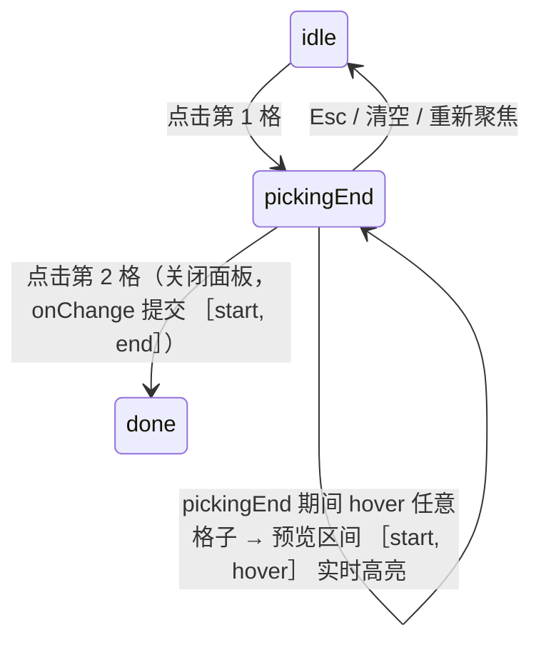
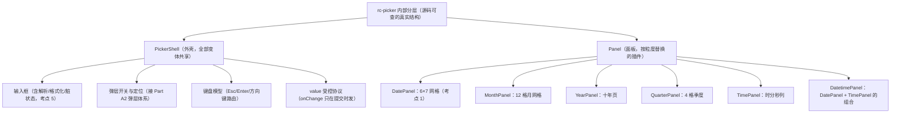

> 本文是《Lv3 复杂交互组件（公认最考功力）》按小节拆分后的续篇，上一部分见 [13-Lv3-复杂交互组件-公认最考功力.md](13-Lv3-复杂交互组件-公认最考功力.md)。

### DatePicker（★★★★★）——日历是最苦的组件

五星不是夸张。DatePicker 的苦不在代码量，在于它同时被四类问题夹击：**日期数学**（月长不齐、闰年、周起始日随 locale 变化）、**状态机**（范围选择的两段式 + hover 预览）、**双向同步**（手敲输入框与点面板是两条写 value 的路）、**i18n**（周起始日、月份名、今天的高亮、格式串全是 locale 相关）。面试里"写个日历"能筛掉八成候选人，筛的正是下面这七个考点。

考点清单（原文）：

- 日历生成算法：6×7 网格、前后月补齐、周起始日国际化
- 面板导航（月/年快捷切换）、范围选择（hover 实时预览区间）、禁用日期函数
- 键盘直接输入解析（dayjs parse 容错）、presets 快捷项
- 对标：antd DatePicker（看它怎么把"选择器"抽象成通用 PickerShell）

约定：本节统一用 dayjs（antd v5 的官方日期库），先做插件与 locale 初始化：

```ts
import dayjs, { type Dayjs } from 'dayjs';
import customParseFormat from 'dayjs/plugin/customParseFormat';
import localeData from 'dayjs/plugin/localeData';
import isSameOrBefore from 'dayjs/plugin/isSameOrBefore';
import 'dayjs/locale/zh-cn';

dayjs.extend(customParseFormat); // 支持 dayjs(text, format, true) 严格解析（考点 4）
dayjs.extend(localeData);        // 支持 .localeData().firstDayOfWeek()（考点 1）
dayjs.extend(isSameOrBefore);

dayjs.locale('zh-cn'); // 周一起始、一月二月……全部中文；运行时可切 'en'（周日起始）
```

#### 考点 1：日历生成算法（6×7 网格，完整代码）

设计决策先行：**为什么固定 6 行 7 列 = 42 格？** 一个月最长 31 天，最多前导 6 天偏移（首日是"周起始日的前一天"的极端情况），31 + 6 = 37 格，向上取整到完整周 = 6 行。固定 42 格换来的是**面板高度恒定**——从 2 月翻到 3 月面板不跳动，这是所有成熟日历的共识。前后月补齐后，格子里的日期分属三个月（上月尾巴/本月/下月头），渲染时用 `inCurrentMonth` 打灰。

周起始日国际化是第一处"想当然就错"的地方：`dayjs().day()` 返回 0–6（0 = 周日），但面板第一列显示周日还是周一，取决于 locale——`zh-cn` 周一开头，`en` 周日开头。偏移公式必须对 7 取模防负数：

```tsx
import dayjs, { type Dayjs } from 'dayjs';

export interface CalendarCell {
  date: Dayjs;
  inCurrentMonth: boolean; // 是否当月（前后月补齐的格子置灰）
  isToday: boolean;
}

/**
 * 生成 6×7 日历网格。
 * @param view     面板当前视图（任意位于该月的 Dayjs，内部 startOf('month') 归一）
 * @param weekStart 周起始日：0=周日（en），1=周一（zh-cn）。来自 dayjs().localeData().firstDayOfWeek()
 */
export function generateMonthMatrix(view: Dayjs, weekStart: number): CalendarCell[] {
  const firstOfMonth = view.startOf('month');                       // 当月 1 号（时间归零）
  // 首日偏移：firstOfMonth.day() 是"1 号是周几(0=周日)"，减去周起始日再对 7 取模
  // +7 再 %7 保证非负——漏掉这一步，周一体系下周日(0)会算出 -1，整月错位（见文末坑 2）
  const leadOffset = (firstOfMonth.day() - weekStart + 7) % 7;
  const gridStart = firstOfMonth.subtract(leadOffset, 'day');       // 网格左上角（可能是上月最后几天）
  const today = dayjs().startOf('day');                             // "今天"按日粒度比较，避免时分秒干扰

  return Array.from({ length: 42 }, (_, i) => {
    const date = gridStart.add(i, 'day');
    return {
      date,
      inCurrentMonth: date.month() === view.month() && date.year() === view.year(), // 同月判定要看年！12 月跨年补齐
      isToday: date.isSame(today, 'day'),
    };
  });
}

/** 周表头：同样按 weekStart 旋转。labels 下标 0 恒为"周日"，旋转由 (weekStart + i) % 7 完成 */
export function weekLabels(weekStart: number): string[] {
  const labels = ['日', '一', '二', '三', '四', '五', '六']; // dayjs .day() 的语义顺序
  return Array.from({ length: 7 }, (_, i) => labels[(weekStart + i) % 7]);
}

// 用法：周起始日不要硬编码，从 locale 读，切换语言自动正确
const weekStart = dayjs().localeData().firstDayOfWeek(); // zh-cn → 1，en → 0
// const cells = generateMonthMatrix(dayjs('2026-11-01'), weekStart);
```

验算一遍（拿 2026 年 11 月、周一起始）：11 月 1 日是周日，`day()` = 0，`leadOffset = (0 - 1 + 7) % 7 = 6`，网格从 10 月 26 日（周一）开始，第一行是 10/26–11/1，最后一行 12/6 结束——42 格、三个月混合，与 macOS 日历完全一致。渲染面板：

```tsx
import type { Dayjs } from 'dayjs';

function CalendarGrid({ cells, weekStart, onPick, onHover, cellClassName }: {
  cells: CalendarCell[];
  weekStart: number;
  onPick: (d: Dayjs) => void;
  onHover?: (d: Dayjs | null) => void;
  cellClassName?: (d: Dayjs) => string;
}) {
  return (
    <div>
      <div style={{ display: 'grid', gridTemplateColumns: 'repeat(7, 36px)', textAlign: 'center' }}>
        {weekLabels(weekStart).map((w) => <span key={w} style={{ color: '#999' }}>{w}</span>)}
        {cells.map(({ date, inCurrentMonth, isToday }) => (
          <button
            key={date.format('YYYY-MM-DD')}              // 跨月补齐的格子也有全局唯一 key
            type="button"
            onClick={() => onPick(date)}
            onMouseEnter={() => onHover?.(date)}
            onMouseLeave={() => onHover?.(null)}
            style={{
              height: 36, color: inCurrentMonth ? undefined : '#d9d9d9', // 非当月置灰
              border: isToday ? '1px solid #1677ff' : undefined,          // 今天圈边
              background: cellClassName?.(date) ? undefined : undefined,
            }}
            className={cellClassName?.(date)}
          >
            {date.date()}
          </button>
        ))}
      </div>
    </div>
  );
}
```

#### 考点 2：面板导航（viewYear/viewMonth 与 value 分离）

第二个高频设计错误：把选中值 `value` 直接当日历视图用。后果是**点哪天面板跳哪月**——用户 12 月 31 日想选 1 月 2 日（跨年比较），点完面板直接跳走。正确做法是两套状态：

- `value`：已提交的选择（协议数据）；
- `viewYear / viewMonth`：面板正在展示哪个月（纯视图状态，翻页只动它）。

联动规则只有一条：**面板打开时**把视图对齐到 value（或今天），之后翻页自由。头部导航包含四级：上月/下月（`±1 month`）、上一年/下一年（`±1 year`）、月快捷面板（点"2026 年 11 月"弹出 12 个月网格）、年快捷面板（点年份弹出十年页网格）。

```tsx
import { useState, useEffect } from 'react';
import dayjs, { type Dayjs } from 'dayjs';

/** 面板导航：视图状态与选中值分离 + 月/年快捷切换子面板 */
export function usePanelView(value: Dayjs | null) {
  const now = dayjs();
  const [viewYear, setViewYear] = useState(value?.year() ?? now.year());
  const [viewMonth, setViewMonth] = useState(value?.month() ?? now.month());
  const [subPanel, setSubPanel] = useState<'date' | 'month' | 'year'>('date');

  // 打开（或 value 变化）时把视图拉回选中月——唯一允许 value 侵入视图的时机
  useEffect(() => {
    if (value) { setViewYear(value.year()); setViewMonth(value.month()); }
  }, [value]);

  const viewDate = dayjs().year(viewYear).month(viewMonth); // 当前视图锚点
  return {
    viewYear, viewMonth, subPanel,
    setSubPanel,
    goMonth: (delta: number) => {                           // ±1 月（自动跨年进退）
      const next = viewDate.add(delta, 'month');
      setViewYear(next.year()); setViewMonth(next.month());
    },
    goYear: (delta: number) => setViewYear((y) => y + delta), // ±1 年
    pickMonth: (m: number) => { setViewMonth(m); setSubPanel('date'); }, // 月面板选中 → 回日面板
    pickYear: (y: number) => { setViewYear(y); setSubPanel('month'); },  // 年面板选中 → 进月面板
  };
}

/** 年快捷面板：十年一页。页首 = floor(year/10)*10，展示 10 年 + 前后各一个灰格 */
export function decadeYears(viewYear: number): { year: number; inDecade: boolean }[] {
  const start = Math.floor(viewYear / 10) * 10; // 2026 → 2020
  return Array.from({ length: 12 }, (_, i) => {
    const year = start - 1 + i;                 // 2019..2030：首尾两个灰格提示还有上/下个十年
    return { year, inDecade: year >= start && year < start + 10 };
  });
}
```

注意年面板选完进月面板、月面板选完回日面板的**漏斗式层级**——这是"快捷切换"的完整体验，很多自研日历只有左右箭头，用户选 1990 年要按 36 次。

#### 考点 3：范围选择（RangePicker 状态机 + hover 实时预览）

RangePicker 是 DatePicker 翻倍难的地方：一次选择分两步，中间态必须让用户看得见。把它建模成显式状态机，一切就顺了：



四条关键规则：

1. **hover 预览**只在 `pickingEnd` 阶段生效：`preview = [min(start, hover), max(start, hover)]`，格子落在闭区间内就上"区间背景色"；
2. **endBeforeStart 交换**：第二次点击的日期早于 start 时**不报错**，提交前归一化成 `[min, max]`——用户倒着选也应该成功，这是成熟组件的默契；
3. 第二次点击即提交并关面板，`onChange(values)` 一次给全；
4. 已有值再次打开：从 idle 开始，第一次点击视为"重选 start"（antd 同款语义）。

```tsx
import { useMemo, useState } from 'react';
import dayjs, { type Dayjs } from 'dayjs';

type Phase = 'idle' | 'pickingEnd' | 'done';

export function useRangePicking(onChange: (range: [Dayjs, Dayjs]) => void) {
  const [start, setStart] = useState<Dayjs | null>(null);
  const [phase, setPhase] = useState<Phase>('idle');
  const [hover, setHover] = useState<Dayjs | null>(null);

  /** 预览区间：只算不改，渲染层直接消费 */
  const preview = useMemo<[Dayjs, Dayjs] | null>(() => {
    if (phase !== 'pickingEnd' || !start || !hover) return null;
    return hover.isBefore(start, 'day')
      ? [hover.startOf('day'), start.endOf('day')]  // 倒着 hover：min/max 归一
      : [start.startOf('day'), hover.endOf('day')];
  }, [phase, start, hover]);

  const pickCell = (d: Dayjs) => {
    if (phase === 'idle' || phase === 'done') {
      setStart(d);            // 第一次点击（含重开面板的重选）
      setPhase('pickingEnd');
      return;
    }
    // 第二次点击：提交。倒选自动交换，绝不抛错
    const range: [Dayjs, Dayjs] = d.isBefore(start!, 'day') ? [d, start!] : [start!, d];
    setPhase('done');
    setHover(null);
    onChange(range);          // 一次回调带全两个端点
  };

  const reset = () => { setStart(null); setPhase('idle'); setHover(null); };

  return {
    phase, preview, reset,
    pickCell,
    hoverCell: (d: Dayjs | null) => { if (phase === 'pickingEnd') setHover(d); }, // 只在第二阶段追踪 hover
    /** 供渲染层判断格子是否在预览区间内（首尾两天给"端点"样式，中间给"连接"样式） */
    cellState: (d: Dayjs): 'start' | 'end' | 'in-range' | null => {
      if (!preview) return null;
      const [a, b] = preview;
      if (d.isSame(a, 'day')) return 'start';
      if (d.isSame(b, 'day')) return 'end';
      return d.isAfter(a, 'day') && d.isBefore(b, 'day') ? 'in-range' : null;
    },
  };
}
```

antd 的 RangePicker 把这套状态机藏在内部（`onCalendarChange` 会在第一次点击时就回调单边值，方便业务做"第二边禁用早于第一边"），提交值则从 `onChange(values: [Dayjs, Dayjs] | null)` 走。

#### 考点 4：disabledDate 禁用日期函数的约定

antd 定下的约定值得抄：`disabledDate: (current: Dayjs) => boolean`——入参是格子对应的 Dayjs（日粒度），返回 `true` 即禁用。三条纪律：

1. **纯函数 + 快**：42 个格子每格调用一次，翻页再调，里面别做任何昂贵计算；
2. **粒度对齐**：与"今天"比较前先 `startOf('day')`，否则当天下午比较 `isBefore(now)` 会把今天上午也禁了；
3. **上下文感知**：范围选择第二边需要"早于 start 的都禁"，这靠把 start 闭包进 disabledDate（antd 里用 `onCalendarChange` 记住第一边后动态生成）。

```tsx
import dayjs, { type Dayjs } from 'dayjs';

// 规则一：禁用今天之前（含/不含今天的两种口径，面试常问）
export const disablePastIncludeToday = (current: Dayjs) =>
  current.isBefore(dayjs().startOf('day'));          // 今天可选：今天 00:00 之前才禁
export const disablePastExcludeToday = (current: Dayjs) =>
  current.isBefore(dayjs().endOf('day'));            // 今天也不可选：今天 24:00 之前都禁

// 规则二：只允许未来 7 天内
export const disableBeyondWeek = (current: Dayjs) => {
  const start = dayjs().startOf('day');
  return current.isBefore(start) || current.isAfter(start.add(7, 'day'));
};

// 规则三：范围第二边——禁用所有早于 start 的日期（含当天则用 isSameOrBefore）
export const makeDisableBeforeStart = (start: Dayjs, includeStart = false) =>
  (current: Dayjs) =>
    includeStart
      ? current.isSameOrBefore(start, 'day')   // 连 start 当天也禁（选时间段的严格模式）
      : current.isBefore(start, 'day');

// antd RangePicker 里的组合用法：
// <RangePicker
//   disabledDate={current => current.isBefore(dayjs().startOf('day'))}
//   onCalendarChange={(vals) => setFirstPick(vals?.[0] ?? null)} // 第一次点击就暴露单边值
// />
// 第二边规则动态生成：firstPick ? makeDisableBeforeStart(firstPick) : 静态规则
```

#### 考点 5：键盘直接输入解析（input 与面板双向同步 + dayjs 容错）

面板是给鼠标的，键盘用户的路径是**直接敲输入框**。这就产生了两条写 value 的路：点面板、敲输入。同步策略：

- **输入 → 面板**：敲完（Enter 或 blur）解析文本，合法则写 value 且面板视图跳到该月；
- **面板 → 输入**：点选后输入框立即重排为 `format(value)`（value 是唯一事实源，输入框只是它的展示层）；
- **容错**：解析失败不清空输入框（保留用户原样，边框标红），blur 时从 value 重新格式化——**绝不静默吞掉用户输入，也绝不把非法输入写进 value**。

dayjs 的严格解析是容错核心：`dayjs(text, format, true)` 第三参开启严格模式，`2024-02-30`（2 月没有 30 日）、`2024-1`（缺位）、`2024/02/01`（分隔符不符）一律 `isValid() === false`。宽松模式的模糊回滚（2-30 悄悄变 3-1）正是要防的事故：

```tsx
import { useEffect, useRef, useState } from 'react';
import dayjs, { type Dayjs } from 'dayjs';

const DISPLAY_FORMAT = 'YYYY-MM-DD';
/** 用户手敲的合法形态白名单：逐个严格解析，谁先过用谁 */
const INPUT_FORMATS = ['YYYY-MM-DD', 'YYYY-M-D', 'YYYYMMDD', 'YYYY.MM.DD', 'YYYY/MM/DD'];

export function parseInputDate(text: string): Dayjs | null {
  const trimmed = text.trim();
  if (!trimmed) return null;
  for (const fmt of INPUT_FORMATS) {
    const d = dayjs(trimmed, fmt, true);   // true = 严格模式：越界日期、缺位、错分隔符全部 Invalid
    if (d.isValid()) return d;
  }
  return null;                             // 全部不匹配：交由调用方标红，不静默回滚
}

/** 输入框 + 面板双向同步的受控桥 */
export function PickerInput({ value, onChange, disabledDate }: {
  value: Dayjs | null;
  onChange: (d: Dayjs | null) => void;
  disabledDate?: (d: Dayjs) => boolean;
}) {
  const [text, setText] = useState(() => value?.format(DISPLAY_FORMAT) ?? '');
  const [invalid, setInvalid] = useState(false);
  const focusedRef = useRef(false);

  // 面板 → 输入：value 变化时同步文本（聚焦中不覆盖用户正在敲的字——同步只发生在失焦/外部改值时）
  useEffect(() => {
    if (!focusedRef.current) setText(value?.format(DISPLAY_FORMAT) ?? '');
  }, [value]);

  const commit = () => {
    if (!text.trim()) { onChange(null); setInvalid(false); return; }   // 清空输入 = 清空值
    const parsed = parseInputDate(text);
    if (parsed && !(disabledDate?.(parsed) ?? false)) {
      onChange(parsed);                   // 合法且未禁用：写回 value，输入框随后被格式化重排
      setInvalid(false);
    } else {
      setInvalid(true);                   // 非法/禁用：标红保留原文，value 纹丝不动
    }
  };

  return (
    <input
      value={text}
      onFocus={() => { focusedRef.current = true; }}
      onChange={(e) => { setText(e.target.value); setInvalid(false); }}
      onBlur={() => { focusedRef.current = false; commit(); }}
      onKeyDown={(e) => {
        if (e.key === 'Enter') commit();                                     // Enter 立即提交
        if (e.key === 'Escape') {                                            // Esc 回滚到 value 的展示
          focusedRef.current = false;
          setText(value?.format(DISPLAY_FORMAT) ?? '');
          setInvalid(false);
          e.currentTarget.blur();
        }
        if (e.key === 'ArrowUp' || e.key === 'ArrowDown') {                  // ↑↓ 步进 ±1 天（键盘党的日历）
          e.preventDefault();
          const base = value ?? dayjs();
          const next = e.key === 'ArrowUp' ? base.add(1, 'day') : base.subtract(1, 'day');
          onChange(next);
        }
      }}
      style={{ border: invalid ? '1px solid #ff4d4f' : '1px solid #d9d9d9', padding: '4px 8px' }}
      aria-invalid={invalid}
      placeholder="YYYY-MM-DD"
    />
  );
}
```

#### 考点 6：presets 快捷项

"今天 / 最近 7 天 / 本月"这类高频选择不该让用户点日历。antd v5 的 `presets` 直接吃 `{ label, value }` 数组（value 支持函数惰性求值——"今天"在面板每次打开时才计算）：

```tsx
import { DatePicker } from 'antd';
import dayjs, { type Dayjs } from 'dayjs';
import type { RangePickerProps } from 'antd/es/date-picker';

// antd 用法（v5）：presets 渲染在面板左侧竖列
const rangePresets: RangePickerProps['presets'] = [
  { label: '今天', value: [dayjs(), dayjs()] },
  { label: '最近 7 天', value: [dayjs().subtract(6, 'day'), dayjs()] },
  { label: '本月', value: [dayjs().startOf('month'), dayjs().endOf('month')] },
];

<DatePicker.RangePicker presets={rangePresets} />;
```

自实现版本的核心是**把 preset 与"选择提交"走同一条路**——preset 不是独立的第三条写值通道，它只是替用户把一个区间塞进 `pickCell` 的结果位：

```tsx
interface PresetItem { label: string; getValue: () => [Dayjs, Dayjs] } // 惰性求值：点的那刻才算"今天"

function PresetPanel({ presets, onPick }: { presets: PresetItem[]; onPick: (r: [Dayjs, Dayjs]) => void }) {
  return (
    <div style={{ display: 'flex', flexDirection: 'column', gap: 4, borderRight: '1px solid #f0f0f0', padding: 8 }}>
      {presets.map((p) => (
        <button key={p.label} type="button" onClick={() => onPick(p.getValue())} style={{ textAlign: 'left' }}>
          {p.label}
        </button>
      ))}
    </div>
  );
}
```

#### 考点 7：PickerShell——antd 的分层思想

> 对标：antd DatePicker（看它怎么把"选择器"抽象成通用 PickerShell）

antd 的日期族（DatePicker/RangePicker/TimePicker，以及 date/week/month/quarter/year 五种 picker 变体）共用一套内核 rc-picker。它的分层是本组件族最重要的一课：



收益立竿见影：新增"季度选择"只写了一个 4 格面板 + 一个格式串，外壳（输入、弹层、键盘、协议）零改动。我们自己也能抽出最小外壳：

```tsx
import type { ReactNode } from 'react';

const POPUP_Z_INDEX = 1050; // z-index 治理见 Part A2，这里以常量示意

/** 通用选择器外壳：输入 + 弹层 + 开关，面板内容完全由调用方注入 */
export function PickerShell({
  input, panel, open, onOpenChange,
}: {
  input: ReactNode;     // 输入区（PickerInput）
  panel: ReactNode;     // 面板区（DatePanel/MonthPanel/自定义面板——外壳不关心）
  open: boolean;
  onOpenChange: (open: boolean) => void;
}) {
  return (
    <span style={{ position: 'relative', display: 'inline-block' }} onClick={() => !open && onOpenChange(true)}>
      {input}
      {open && (
        <div
          style={{ position: 'absolute', top: '100%', left: 0, zIndex: POPUP_Z_INDEX, background: '#fff', boxShadow: '0 6px 16px rgba(0,0,0,.08)', marginTop: 4 }}
          onClick={(e) => e.stopPropagation()}                 // 点面板不触发"点外部关闭"
        >
          {panel}
        </div>
      )}
    </span>
  );
}
// 组装一个日期选择器 = PickerShell + PickerInput + CalendarGrid + usePanelView 的积木
// 组装周选择器 = 同一个 Shell，只换 panel（网格点击映射到 startOf('week')）
```

#### DatePicker 常见坑（症状 → 根因 → 修法）

```text
坑 1
症状：选完 12 月，面板自动跳回 10 月（value 所在月）。
根因：把 value 当视图状态用，每次 value 变化都把面板拉回。
修法：viewYear/viewMonth 独立状态，只在"面板打开"这一个时机对齐 value（见考点 2）。

坑 2
症状：英文环境（周日起始）一切正常，切中文（周一起始）后第一列错位、首行出现上上月。
根因：偏移量按固定 day() 计算，没有减 weekStart，负数又没 +7 取模。
修法：leadOffset = (first.day() - weekStart + 7) % 7，weekStart 从 localeData().firstDayOfWeek() 读（见考点 1）。

坑 3
症状：范围选择第二次点击比第一次早，面板无响应或提交出 [晚, 早]。
根因：没做端点交换，或交换只在 UI 层做了、提交没做。
修法：提交前归一化 [min, max]；预览区间同样用 min/max 计算（见考点 3）。

坑 4
症状：输入 2024-02-30 回车，value 变成了 2024-03-01。
根因：dayjs 宽松解析对越界日期静默回滚。
修法：dayjs(text, format, true) 严格模式 + 白名单 formats 逐个尝试，全部失败标红不写值（见考点 5）。

坑 5
症状：disabledDate 里写 current.isBefore(dayjs())，结果"今天"时好时坏（下午测通过、上午测失败）。
根因：拿日粒度格子与含时分秒的"现在"比较，结果随时钟漂移。
修法：比较前统一 startOf('day')/endOf('day')，"今天"口径显式写进规则（见考点 4）。

坑 6
症状：SSR 水合告警/客户端首帧"今天"高亮闪变。
根因：服务端与客户端 locale/时区不一致，"今天"各算各的。
修法：入口处统一 dayjs.locale（antd 侧由 ConfigProvider 注入 locale），"今天"的计算放在 effect 中二次校正。
```

#### 考点 8：日期范围跨月选择——双面板联动、自动交换与面板追赶

考点 3 已把范围选择的状态机（idle → pickingEnd → done）与单面板的 hover 预览讲透；跨月选择的增量全部来自**双面板**：左右两个月视图如何联动、起止交换在双面板下的呈现、端点选到"面板外面"时面板怎么追。

为什么值得单列：单面板选跨月区间要翻三次页（翻走选起点、翻回选终点），双面板是 RangePicker 的标配形态；而双面板一旦自己写，"联动规则"就是第一张 bug 单——左右面板各存一个 state 必然失同步（右翻一次左没跟、左追上右出现同月双面板）。

机制三条：

1. **右面板是派生值，不是第二个状态**。`rightView = leftView.add(1, 'month')`——单一事实源（leftView），"双面板失同步"这类状态在结构上不存在。翻页（上/下一个区间）只动 leftView。
2. **面板追赶（follow）规则**：选日期/hover 的目标月不在 `[leftView, leftView+1]` 窗口内时，leftView 跳到能看见它的位置——目标早于左面板 → 左面板对齐目标月；目标晚于右面板 → 左面板对齐目标月的前一月（让右面板显示它）。起点选在右面板、终点更晚是高频场景（"12 月下旬 → 1 月上旬"），追赶让面板整体右移而非弹回。
3. **起止自动交换：预览即交换**。pickingEnd 阶段 hover 到比起始点早的日期，预览区间立刻按 `[min, max]` 显示（考点 3 规则 2 的延伸）——用户在双面板上"倒着选"时看到的一直是正确方向的区间，提交时再归一化一次即可；**绝不**在预览阶段报错或空转。

```tsx
// useDualPanelView.ts —— 双面板视图：单状态源 + 派生右面板 + 端点追赶
import { useState } from 'react';
import dayjs, { type Dayjs } from 'dayjs';

export function useDualPanelView(initial?: Dayjs | null) {
  // 唯一视图状态：左面板所在月。右面板永远 = 左 + 1（结构上不可能失同步）
  const [leftView, setLeftView] = useState(() => (initial ?? dayjs()).startOf('month'));
  const rightView = leftView.add(1, 'month');

  const panNext = () => setLeftView(leftView.add(1, 'month'));    // 整体右移一个区间
  const panPrev = () => setLeftView(leftView.subtract(1, 'month'));

  /** 追赶：把某个月的格子露出来（选日期 / hover 预览 / 手敲输入解析后都会调它） */
  const follow = (d: Dayjs) => {
    const m = d.startOf('month');
    if (m.isBefore(leftView)) setLeftView(m);                      // 目标早于左面板：左对齐目标
    else if (!m.isBefore(rightView)) setLeftView(m.subtract(1, 'month')); // 晚于右面板：右对齐目标
  };

  /** 面板打开时对齐已有值：有 end 看 end，只有 start 看 start（与考点 2 的"打开才对齐"同一纪律） */
  const alignTo = (range: [Dayjs, Dayjs] | null) => {
    if (!range) return;
    follow(range[1]);                                              // 看得见终点比看得见起点重要
  };

  return { leftView, rightView, panNext, panPrev, follow, alignTo };
}
```

双面板与考点 3 状态机的接线（pick/hover 后追加一步 follow）：

```tsx
import type { Dayjs } from 'dayjs';
import { useRangePicking } from './useRangePicking'; // 考点 3
import { useDualPanelView } from './useDualPanelView';

/** 双面板 × 范围状态机的接线层：pick/hover 之后追加面板追赶 */
function useRangePanel(onChange: (r: [Dayjs, Dayjs]) => void) {
  const { leftView, rightView, panPrev, panNext, follow } = useDualPanelView();
  const { phase, preview, pickCell, hoverCell, cellState } = useRangePicking(onChange);

  const handlePick = (d: Dayjs) => { pickCell(d); follow(d); };   // 选完立刻追赶：跨月端点不再"看不见"
  const handleHover = (d: Dayjs | null) => {
    hoverCell(d);
    if (d && phase === 'pickingEnd') follow(d);                   // hover 预览也驱动追赶——倒着选时面板回退
  };
  // 渲染层消费：两个 CalendarGrid（考点 1）分别用 leftView/rightView 生成 cells，
  // cellClassName 统一由 cellState 提供（预览区间的 start/end/in-range 样式跨面板连续）。
  // antd 的对应回调：onCalendarChange 在第一次点击就暴露单边值（业务可据此动态禁用另一边，见考点 4）。
  return { leftView, rightView, panPrev, panNext, preview, cellState, handlePick, handleHover };
}
```

```ts
// useDualPanelView.test.ts —— 不变式与追赶规则的最小用例
import { describe, it, expect } from 'vitest';
import dayjs from 'dayjs';
import { followFrom } from './useDualPanelView'; // 把 follow 提成纯函数：给定 leftView 与目标，返回下一个 leftView

describe('dual panel follow', () => {
  const nov = dayjs('2026-11-01');
  it('目标在两面板之间：面板不动', () => {
    expect(followFrom(nov, dayjs('2026-11-20')).isSame(nov)).toBe(true);
    expect(followFrom(nov, dayjs('2026-12-20')).isSame(nov)).toBe(true);
  });
  it('目标早于左面板：左对齐目标月', () => {
    expect(followFrom(nov, dayjs('2026-10-05')).isSame(dayjs('2026-10-01'))).toBe(true);
  });
  it('目标晚于右面板：右对齐目标月（左 = 目标 - 1）', () => {
    expect(followFrom(nov, dayjs('2027-01-05')).isSame(dayjs('2026-12-01'))).toBe(true);
  });
});
// followFrom 的实现即 follow 的纯函数体（与 hook 内一致，hook 只是在 setState 里调它）：
// export function followFrom(leftView: Dayjs, target: Dayjs): Dayjs {
//   const m = target.startOf('month');
//   if (m.isBefore(leftView)) return m;
//   if (!m.isBefore(leftView.add(1, 'month'))) return m.subtract(1, 'month');
//   return leftView;
// }
```

| 坑 | 症状 | 根因 | 修法 |
| --- | --- | --- | --- |
| 左右面板显示同一个月 | 两面板各存 state，翻页只改一边 | 双状态源 | 右面板派生 `left + 1 month`，只存一个 state |
| 选完终点面板"跳回"起点月 | 每次选择都把视图对齐 value | 把单面板的 value→view 对齐逻辑照搬 | 只有 follow（端点可见性）驱动面板，且遵循"追赶"而非"对齐" |
| 倒着选时预览闪烁反向 | hover 早于 start 时预览区间的端点来回换 | 预览用原始 [start, hover] 而非 [min, max] | 预览即交换（min/max 归一），提交时再归一化一次 |
| 点前后月补齐灰格后面板不动 | 灰格点击只写 value 不动视图 | 补齐格的日期属于另一个月 | pick/hover 统一走 follow（目标月露出） |
| 跨年区间面板错乱 | `add(1, 'month')` 之外自己算年月 | 手写 (year, month) 元组同步 | 全部用 Dayjs 月份运算，年进位交给库 |

#### 考点 9：时区与夏令时——utc/timezone 插件链与序列化契约

前八个考点的"日期"都活在浏览器本地时区里；一旦组件要服务跨时区用户（海外 SaaS、跨国排班），就要直面时区与夏令时（DST）。全大纲只有 A7.4 的 SSR 水合表格擦过时区（服务端容器 UTC vs 用户时区），这里是正餐。

为什么难：DST 让"一天"的绝对时长在 23~25 小时之间浮动，`add(1, 'day')` 与"钟面加一天"从此不是一件事；同一根时间轴上还有"墙上时间不存在（春跳）"与"墙上时间出现两次（秋跳）"两种病态区间。

机制分四步：

1. **插件链与顺序**：timezone 插件依赖 utc，`extend` 顺序错会直接抛错；`dayjs.tz(str, tz)` 的语义是"把 str 这串墙上时间**解释为** tz 时区的墙上时间"（与本地时区无关——测试因此可以不依赖运行机器的时区）。

```ts
import dayjs from 'dayjs';
import utc from 'dayjs/plugin/utc';
import timezone from 'dayjs/plugin/timezone';

dayjs.extend(utc);        // 必须先于 timezone
dayjs.extend(timezone);   // dayjs.tz / .tz / .utcOffset 增强

const NY = 'America/New_York';
const d = dayjs.tz('2026-11-01 00:00', NY); // 纽约墙上 00:00（EDT，UTC-4），与运行机器时区无关
```

2. **dayjs 的 add 是"绝对时长"，set 是"钟面"**——这是从 moment 迁过来的最高频认知差。dayjs 的 `add(1, 'day')` 内部是毫秒加法（+86400000ms），跨 DST 日钟面会漂移一小时；`set('date', n)` 走原生 `setDate`，永远保持钟面。日历语义（"明天 0 点"）必须用钟面系，物理语义（"24 小时后"）必须用绝对系：

```ts
// 春跳日 2026-03-08（02:00 EST → 03:00 EDT，当日只有 23 小时）
const spring = dayjs.tz('2026-03-08 00:00', NY);
spring.add(1, 'day').format('YYYY-MM-DD HH:mm');  // '2026-03-09 01:00' ← 毫米加法：钟面漂了 1 小时
spring.set('date', 9).format('YYYY-MM-DD HH:mm'); // '2026-03-09 00:00' ← 钟面：日历意义上的"明天 0 点"

// 秋跳日 2026-11-01（02:00 EDT → 01:00 EST，当日有 25 小时）
const fall = dayjs.tz('2026-11-01 00:00', NY);
fall.add(1, 'day').format('YYYY-MM-DD HH:mm');    // '2026-11-01 23:00' ← 24 小时后还是"同一天"！
fall.set('date', 2).format('YYYY-MM-DD HH:mm');   // '2026-11-02 00:00' ← 钟面进位到第二天
fall.set('date', 2).diff(fall, 'hour');           // 25 ← 钟面一天的真实绝对时长
```

（考点 1 的网格用 `gridStart.add(i, 'day')`——日粒度显示上侥幸无恙（23:00/01:00 仍落在目标日），但区间端点、时长计算会暴露漂移；DST 时区下语义正确的写法是 `gridStart.set('date', gridStart.date() + i)`。）

3. **DST 切换日的检测**：与其记住各国切换规则，不如用 `Intl.DateTimeFormat` 采样目标时刻的 UTC 偏移——偏移在一天内变了，这天就是切换日（这是 date-fns-tz/Luxon 内部的同款思路，权威且不依赖 dayjs 的 gap 归一行为）：

```ts
// dstUtils.ts —— 用 Intl 采样 UTC 偏移：判断某日是否 DST 切换日
import type { Dayjs } from 'dayjs';

/** 某绝对时刻在目标时区的 UTC 偏移（分钟）。ES2020 Intl，所有现代运行时可用 */
export function tzOffsetMinutes(ts: number, tz: string): number {
  const parts = new Intl.DateTimeFormat('en-US', {
    timeZone: tz, hour12: false,
    year: 'numeric', month: '2-digit', day: '2-digit', hour: '2-digit', minute: '2-digit', second: '2-digit',
  }).formatToParts(new Date(ts));
  const map: Record<string, string> = {};
  for (const p of parts) map[p.type] = p.value;
  const asUTC = Date.UTC(+map.year, +map.month - 1, +map.day, +map.hour % 24, +map.minute, +map.second);
  return (asUTC - ts) / 60_000; // 墙上时间 − 绝对时间 = 偏移
}

/** 该本地日是否 DST 切换日（当日首尾偏移不同）。切换日内一切"日粒度运算"都值得复查 */
export function isDstTransitionDay(d: Dayjs, tz: string): boolean {
  const start = d.startOf('day').valueOf();
  const end = d.endOf('day').valueOf();
  return tzOffsetMinutes(start, tz) !== tzOffsetMinutes(end, tz);
}
```

4. **与服务端的序列化契约**：日期在网络上有两种根本不同的语义，wire 格式必须分开约定——

- **时刻（instant）**："会议开始于哪个瞬间"。契约：ISO 8601 **带偏移**或纯 UTC（`d.toISOString()` 一律输出 UTC Z 形态）；服务端只存 UTC，展示时 `dayjs(iso).tz(userTz)` 转用户时区。偏移信息就是时刻的一部分，丢掉它 = 丢掉语义。
- **日历日（calendar date）**："生日是哪天""假期是哪天"，没有时刻语义、与任何人所在时区无关。契约：只传 `YYYY-MM-DD` 字符串，**绝不**序列化成 ISO 时刻——`new Date('2026-03-08')` 按 ES 规范被解析为 **UTC 午夜**，在西半球用户（UTC-5）的本地时区里显示成 3 月 7 日：本地开发一切正常、海外用户报"生日差一天"，是国际化产品的经典工单。

```ts
// dateWire.ts —— 两类语义、两个方向的序列化契约
import dayjs, { type Dayjs } from 'dayjs';

/** 时刻 → wire：UTC ISO 8601（无歧义，任何语言可解析） */
export const instantToWire = (d: Dayjs): string => d.toISOString();
/** wire → 时刻：带偏移的 ISO 或 UTC ISO 都能正确解析回本地 Dayjs */
export function instantFromWire(iso: string): Dayjs | null {
  const d = dayjs(iso);
  return d.isValid() ? d : null;
}

/** 日历日 → wire：纯 YYYY-MM-DD，不带任何时间/偏移成分 */
export const calendarToWire = (d: Dayjs): string => d.format('YYYY-MM-DD');
/** 日历日 ← wire：必须带格式严格解析（走本地字段、本地午夜） */
export function calendarFromWire(s: string): Dayjs | null {
  const d = dayjs(s, 'YYYY-MM-DD', true);   // customParseFormat 严格模式（考点 5 同款）
  return d.isValid() ? d : null;            // 裸 dayjs(s) 会按 ES 规范解析成 UTC 午夜——差一天事故的根因
}

/** 时刻的另一种 wire：毫秒 epoch（JSON 数字友好）。约定只走毫秒；服务端给秒由调用方 ×1000 */
export const timestampToWire = (d: Dayjs): number => d.valueOf();
```

```ts
// dateWire.test.ts —— 用固定时区数据锁定契约（不依赖运行机器时区）
import { describe, it, expect } from 'vitest';
import dayjs from 'dayjs';
import utc from 'dayjs/plugin/utc';
import timezone from 'dayjs/plugin/timezone';
import { instantToWire, instantFromWire, calendarFromWire, calendarToWire } from './dateWire';

dayjs.extend(utc); dayjs.extend(timezone);
const NY = 'America/New_York';

describe('dst 与序列化契约', () => {
  it('add(day) 是绝对 24 小时、set(date) 是钟面——春跳日两者差一小时', () => {
    const d = dayjs.tz('2026-03-08 00:00', NY);
    expect(d.add(1, 'day').format('YYYY-MM-DD HH:mm')).toBe('2026-03-09 01:00');
    expect(d.set('date', 9).format('YYYY-MM-DD HH:mm')).toBe('2026-03-09 00:00');
  });

  it('秋跳日的钟面"一天"实际 25 小时', () => {
    const d = dayjs.tz('2026-11-01 00:00', NY);
    expect(d.set('date', 2).diff(d, 'hour')).toBe(25);
    expect(d.add(1, 'day').format('YYYY-MM-DD HH:mm')).toBe('2026-11-01 23:00'); // 24h 后仍是同一天
  });

  it('时刻契约：toISOString 恒 UTC；round-trip 保时刻', () => {
    const d = dayjs.tz('2026-11-01 00:00', NY);           // = 2026-11-01T04:00:00Z
    expect(instantToWire(d)).toBe('2026-11-01T04:00:00.000Z');
    expect(instantFromWire(instantToWire(d))!.valueOf()).toBe(d.valueOf());
  });

  it('日历日契约：YYYY-MM-DD round-trip 与运行时区无关', () => {
    const d = dayjs('2026-03-08', 'YYYY-MM-DD', true);    // 本地午夜（东八区 = UTC+8，正解）
    expect(calendarToWire(d)).toBe('2026-03-08');
    expect(calendarFromWire('2026-03-08')!.format('YYYY-MM-DD')).toBe('2026-03-08');
    expect(calendarFromWire('2026-02-30')).toBeNull();    // 越界日历日：拒绝而非回滚
  });
});
```

| 坑 | 症状 | 根因 | 修法 |
| --- | --- | --- | --- |
| "明天 0 点"变成"明天 1 点" | 跨春跳日 `add(1, 'day')` 后钟面漂移 | dayjs 的 day 加法是毫秒（绝对 24h） | 日历语义用 `set('date', …)` 钟面系；物理时长才用 add |
| 秋跳日 +1 天还是同一天 | 24h 覆盖不了 25h 的钟面日 | 同上（秋跳方向） | 钟面进位 `set('date', 2)`；测试里用 `diff('hour')` 锁 25 |
| 海外用户生日差一天 | date-only ISO 串被解析为 UTC 午夜 | `new Date('YYYY-MM-DD')`/裸 `dayjs(s)` 的 ES 规范行为 | 日历日带格式严格解析（本地字段），wire 只传 `YYYY-MM-DD` |
| 春跳 02:30 的定时任务提前/推迟一小时 | 墙上时间在 gap 区间不存在，解析行为未定义 | 库对 gap 的归一方向不是契约 | `isDstTransitionDay` 提前检测；业务侧改用时刻（epoch/带偏移 ISO）调度 |
| 测试在 CI（UTC）过、本地（UTC+8）挂 | 用例依赖运行机器时区 | 未显式指定 tz | 测试统一 `dayjs.tz(str, TZ)`，与机器时区解耦 |

#### 考点 10：键盘导航——日格 roving 与 A5 grid 模式的复用与差异

日历面板的键盘模型在 [06-A5-键盘导航与-ARIA.md](06-A5-键盘导航与-ARIA.md) 的 A5.7（grid 二维焦点移动）里已有通论——tabIndex 花型（聚焦格 0、其余 -1）、grid/gridcell 语义、Ctrl+Home/End 表首尾，A5.6 则给了 1D roving 的两种实现；本节只讲日历把这套通用模型拿来用时**必须改的地方**。

差异四条，每条都是"照抄 A5 会翻车"的点：

1. **roving 状态载体必须是日期值，不能是坐标或 DOM 序**。A5.6 的 index 移动在日历不可用：翻月后 42 个格子的坐标全部换人，"第 15 格"从 11 月 12 日变成 12 月 12 日；DOM 序查找（A5.6 方案二）也要在每次翻月后重建注册表。日历的正确做法是状态里存 `focusedDay: Dayjs`——焦点天然跨月存活。
2. **边界行为相反**。A5.7 的 Table 网格"边界即停"（最后一列再按 → 无操作）；日历的日期轴是无限的——从第一列再按 ←，应该**翻到上月继续**（面板跟随焦点）。边界不是终点，是翻页器。
3. **PageUp/PageDown 语义升级**。A5.7 里只是"近似翻页"；日历里是精确的"上/下月同日"（Shift 加按 = 上/下年），且必须做**月末 clamp**：3 月 31 日翻回 2 月没有 31 日，得落在 2 月 28 日（rc-picker 同款行为），否则 dayjs 的月份字段溢出会把用户送去 3 月 3 日。
4. **焦点日期与选中日期分离**。键盘浏览（focusedDay 移动）不产生 onChange——与考点 2 的 view/value 分离同构；Enter 才提交。混在一起的症状是"方向键按一下就写一次表单值"。

```ts
// calendarKeyboard.ts —— 键映射纯函数（可测）：focusedDay + 按键 → 下一个动作
import dayjs, { type Dayjs } from 'dayjs';

export type CalendarKeyAction =
  | { type: 'move'; next: Dayjs }   // 移动焦点（next 可能落在面板外——渲染层负责翻月跟随）
  | { type: 'commit' }              // Enter/Space：提交当前焦点日期
  | { type: 'escape' };             // ESC：交给弹层关闭链（A2）
export type CalendarKeyInput = Pick<KeyboardEvent, 'key' | 'shiftKey'>;

/** 月加减带月末 clamp：3/31 − 1 月 → 2/28（2026），绝不溢出到 3 月 */
export function addMonthsClamped(d: Dayjs, n: number): Dayjs {
  const monthAnchor = d.startOf('month').add(n, 'month');   // 锚点日是 1 号，月份运算无溢出
  const day = Math.min(d.date(), monthAnchor.daysInMonth()); // clamp 到目标月长度
  return monthAnchor.set('date', day);
}

export function calendarKeyToAction(
  e: CalendarKeyInput, focused: Dayjs, weekStart: number,
  bounds?: { min: Dayjs; max: Dayjs },
): CalendarKeyAction | null {
  const clamp = (d: Dayjs): Dayjs => {                       // disabledDate 的键盘侧收口（考点 4）
    if (!bounds) return d;
    if (d.isBefore(bounds.min, 'day')) return bounds.min.startOf('day');
    if (d.isAfter(bounds.max, 'day')) return bounds.max.startOf('day');
    return d;
  };
  const weekOffset = (focused.day() - weekStart + 7) % 7;    // 本周已过天数（考点 1 同款取模）

  switch (e.key) {
    case 'ArrowLeft':  return { type: 'move', next: clamp(focused.subtract(1, 'day')) };
    case 'ArrowRight': return { type: 'move', next: clamp(focused.add(1, 'day')) };
    case 'ArrowUp':    return { type: 'move', next: clamp(focused.subtract(7, 'day')) };
    case 'ArrowDown':  return { type: 'move', next: clamp(focused.add(7, 'day')) };
    case 'Home':       return { type: 'move', next: clamp(focused.subtract(weekOffset, 'day')) };   // 本周首
    case 'End':        return { type: 'move', next: clamp(focused.add(6 - weekOffset, 'day')) };    // 本周尾
    case 'PageUp':     return { type: 'move', next: clamp(addMonthsClamped(focused, e.shiftKey ? -12 : -1)) };
    case 'PageDown':   return { type: 'move', next: clamp(addMonthsClamped(focused, e.shiftKey ? 12 : 1)) };
    case 'Enter':
    case ' ':          return { type: 'commit' };
    case 'Escape':     return { type: 'escape' };
    default:           return null;                          // 字母键留给 typeahead（A5.3），此处不劫持
  }
}
```

面板接线（tabIndex 花型 + 焦点跟随 + 翻月联动，渲染复用考点 1 的 CalendarGrid）：

```tsx
// useCalendarRoving.tsx —— focusedDay 状态 + 焦点跟随 + 面板追赶
import { useEffect, useState, type KeyboardEvent } from 'react';
import dayjs, { type Dayjs } from 'dayjs';
import { calendarKeyToAction } from './calendarKeyboard';

export function useCalendarRoving(opts: {
  value: Dayjs | null;
  weekStart: number;
  bounds?: { min: Dayjs; max: Dayjs };
  onCommit: (d: Dayjs) => void;
  onEsc: () => void;
  /** 焦点日期所在月超出视图时翻月（考点 2 的 goMonth / 考点 8 的 follow 同源） */
  onNavigate: (d: Dayjs) => void;
}) {
  // 初始焦点对齐 value（无值对齐今天）——"打开即有落点"，键盘用户不用先摸鼠标
  const [focusedDay, setFocusedDay] = useState<Dayjs>(() => (opts.value ?? dayjs()).startOf('day'));

  // 焦点移动 → 面板追赶：move 到面板外的日期时翻月（差异点 2：边界即翻页）
  useEffect(() => { opts.onNavigate(focusedDay); }, [focusedDay]); // eslint-disable-line react-hooks/exhaustive-deps

  // 焦点跟随：focusedDay 变化后把真实 DOM 焦点移到对应格子（roving 的 focus 移动制，A5.8 有对照取舍）
  useEffect(() => {
    const selector = `[data-date="${focusedDay.format('YYYY-MM-DD')}"]`;
    document.querySelector<HTMLElement>(selector)?.focus();
  }, [focusedDay]);

  const onKeyDown = (e: KeyboardEvent<HTMLElement>) => {
    const action = calendarKeyToAction(e, focusedDay, opts.weekStart, opts.bounds);
    if (!action) return;
    e.preventDefault();                                       // 防止方向键滚动页面
    if (action.type === 'move') setFocusedDay(action.next);
    else if (action.type === 'commit') opts.onCommit(focusedDay);
    else if (action.type === 'escape') opts.onEsc();
  };

  return { focusedDay, setFocusedDay, onKeyDown };
}

// CalendarGrid 的格子渲染差异（考点 1 基础上加三行）：
// <button
//   data-date={date.format('YYYY-MM-DD')}
//   tabIndex={date.isSame(focusedDay, 'day') ? 0 : -1}   // 花型：仅焦点格可 Tab 进入（A5.7）
//   aria-selected={date.isSame(value, 'day') || undefined}
//   aria-current={isToday ? 'date' : undefined}
//   onFocus={() => setFocusedDay(date)}                   // 鼠标点击同样更新焦点（焦点/值分离但起点一致）
// />
// 容器（非格子）加 role="grid"，行加 role="row"——APG 的 calendar = dialog 内嵌 grid。
```

```ts
// calendarKeyboard.test.ts —— 键映射与 clamp 的最小用例
import { describe, it, expect } from 'vitest';
import dayjs, { type Dayjs } from 'dayjs';
import { calendarKeyToAction, addMonthsClamped, type CalendarKeyAction } from './calendarKeyboard';

/** 类型守卫：只放行 move 动作，取其 next（避免 as any） */
function moveTo(a: CalendarKeyAction | null): Dayjs {
  if (a && a.type === 'move') return a.next;
  throw new Error(`expected move action, got ${a?.type}`);
}

describe('calendar keyboard', () => {
  const f = (s: string) => dayjs(s);
  it('方向键 ±1 天 / ±1 周', () => {
    expect(calendarKeyToAction({ key: 'ArrowRight' }, f('2026-11-30'), 1)?.type).toBe('move');
    expect(moveTo(calendarKeyToAction({ key: 'ArrowRight' }, f('2026-11-30'), 1)).format('YYYY-MM-DD'))
      .toBe('2026-12-01');                                           // 月末右移跨月
    expect(moveTo(calendarKeyToAction({ key: 'ArrowUp' }, f('2026-11-01'), 1)).format('YYYY-MM-DD'))
      .toBe('2026-10-25');                                           // 月首上移进上月
  });
  it('Home/End 按周起始日旋转（周一起始）', () => {
    expect(moveTo(calendarKeyToAction({ key: 'Home' }, f('2026-11-04'), 1)).format('YYYY-MM-DD'))
      .toBe('2026-11-02');                                           // 周三 → 本周一
    expect(moveTo(calendarKeyToAction({ key: 'End' }, f('2026-11-04'), 1)).format('YYYY-MM-DD'))
      .toBe('2026-11-08');                                           // 周三 → 本周日
  });
  it('PageUp/PageDown 翻月带月末 clamp', () => {
    expect(addMonthsClamped(f('2026-03-31'), -1).format('YYYY-MM-DD')).toBe('2026-02-28');
    expect(addMonthsClamped(f('2026-01-31'), 1).format('YYYY-MM-DD')).toBe('2026-02-28');
    expect(moveTo(calendarKeyToAction({ key: 'PageDown' }, f('2026-11-15'), 1)).format('YYYY-MM-DD'))
      .toBe('2026-12-15');
  });
  it('bounds 把越界焦点钳回边界', () => {
    const bounds = { min: f('2026-11-01'), max: f('2026-11-30') };
    expect(moveTo(calendarKeyToAction({ key: 'ArrowLeft' }, f('2026-11-01'), 1, bounds)).format('YYYY-MM-DD'))
      .toBe('2026-11-01');                                           // 早于 min：钳在 min
  });
});
```

| 坑 | 症状 | 根因 | 修法 |
| --- | --- | --- | --- |
| 翻月后焦点丢失/跳错格 | roving 状态存的是格序号或 DOM 引用 | 翻月后 42 格坐标整体换人 | 状态存 `focusedDay: Dayjs`（值锚定） |
| 方向键把页面滚走 | keydown 未 preventDefault | 方向键默认行为是滚动 | 处理器统一 preventDefault |
| 3/31 按 PageUp 落到 3/3 | dayjs 月份字段运算溢出（2/31 不存在） | 未做月末 clamp | `addMonthsClamped`（锚点 1 号 + min 月长） |
| 方向键一按就写表单值 | 焦点日期与选中值混用一个状态 | 把 focused 当 value 用 | focused/value 分离（同考点 2 view/value），Enter 才提交 |
| 禁用日期键盘可达 | disabledDate 只挡了鼠标点击 | 键盘路径没接 bounds | 键映射里 clamp 到 [min, max]（disabledDate 的区间化预计算） |

#### 考点 11：value 序列化契约——字符串 / Dayjs / 时间戳三态

受控双模式的通用机制（`useControllableState`、受控报警、defaultValue 快照）在 [02-A1-受控-非受控双模式-30-行-hook-处处要用.md](02-A1-受控-非受控双模式-30-行-hook-处处要用.md) 的 A1.3/A1.7/A1.8 已详述，此处不重复；本节只讲日期组件特有的增量——**value 的三态入口**与**出口契约的对称性**。

为什么值得单列：DatePicker 的 `value` 在真实调用方手里有三种形态——字符串（表单库/URL/后端直给）、Dayjs 对象（与其他日期组件联动）、时间戳（老接口遗留）。组件内部却只能有一种表示。三态归一 + 出口约定做不好，症状是"传字符串时受控失灵""时间戳 0 被当成没传"。

机制三条：

1. **入口三态、内部单一**：任何形态进来都在归一层转成 `Dayjs | null`，组件其余部分（网格、面板、预览）只见 Dayjs——42 格渲染不做每格类型判断，invalid 输入在入口一次性拦截。
2. **出口对称性**：`onChange` 给什么形态要和 `value` 吃什么形态对称（`valueFormat: 'YYYY-MM-DD'` 进字符串，则 onChange 也出字符串）。antd 选择了另一派——onChange 恒出 Dayjs（出口恒对象），由调用方自己 format；两派都成立，混用（进字符串、出对象）才是事故源。
3. **时间戳的两个专属坑**：`0` 是合法值（1970-01-01T00:00:00Z）也是 falsy——业务写 `value || defaultValue` 会把 0 吞成"没传"；秒/毫秒歧义必须写进契约（本组件约定毫秒，与 `Date.now()` 一致）。

```ts
// useDateValue.ts —— 三态归一（记忆化）+ 出口序列化 + A1 双模式接入
import { useRef } from 'react';
import dayjs, { type Dayjs } from 'dayjs';
import { useControllableState } from '../a1/useControllableState'; // A1.3 的 30 行实现

export type DateValueInput = string | number | Dayjs | null | undefined;
export type DateValueOutput = 'dayjs' | 'string' | 'timestamp';

/** 入口归一：三态 → Dayjs | null。非法输入返回 null（绝不静默回滚，考点 5 同纪律） */
export function normalizeDateValue(v: DateValueInput, valueFormat = 'YYYY-MM-DD'): Dayjs | null {
  if (v === null || v === undefined || v === '') return null;
  if (dayjs.isDayjs(v)) return v;
  if (typeof v === 'number') return Number.isFinite(v) ? dayjs(v) : null; // 毫秒 epoch（0 是合法值！）
  if (typeof v === 'string') {
    const byFormat = dayjs(v, valueFormat, true);   // 1) 先按契约格式严格解析
    if (byFormat.isValid()) return byFormat;
    const byIso = dayjs(v);                          // 2) 再兜底 ISO 8601（含带偏移形态，接考点 9 契约）
    return byIso.isValid() ? byIso : null;
  }
  return null;
}

export interface UseDateValueOptions {
  value?: DateValueInput;
  defaultValue?: DateValueInput;
  /** 出口形态：默认 'dayjs'；与 value 的入口形态保持对称（机制 2） */
  output?: DateValueOutput;
  valueFormat?: string;
  onChange?: (v: DateValueInput) => void;
}

export function useDateValue(opts: UseDateValueOptions = {}) {
  // 归一记忆化：外部受控值引用不变时复用上次的 Dayjs 实例，
  // 否则每次 render 归一出"新对象"，受控比较按引用判不等 → 无限重置（A1.5 的日期版事故）
  const cacheRef = useRef<{ raw: DateValueInput; norm: Dayjs | null } | null>(null);
  const memoized = (raw: DateValueInput): Dayjs | null => {
    if (cacheRef.current && cacheRef.current.raw === raw) return cacheRef.current.norm;
    const norm = normalizeDateValue(raw, opts.valueFormat);
    cacheRef.current = { raw, norm };
    return norm;
  };

  const [state, setState] = useControllableState<Dayjs | null>({
    value: opts.value !== undefined ? memoized(opts.value) : undefined, // undefined = 非受控（A1 的哨兵语义）
    defaultValue: memoized(opts.defaultValue ?? null),
    onChange: (next) => serialize(next),
  });

  /** 出口序列化：按 output 契约转换后再回调（机制 2：与入口对称） */
  const serialize = (d: Dayjs | null) => {
    if (!opts.onChange) return;
    if (d === null) { opts.onChange(null); return; }
    switch (opts.output ?? 'dayjs') {
      case 'string':     opts.onChange(d.format(opts.valueFormat ?? 'YYYY-MM-DD')); break;
      case 'timestamp':  opts.onChange(d.valueOf()); break;   // 毫秒，契约写死
      default:           opts.onChange(d);
    }
  };

  return [state, setState] as const;
}
```

```ts
// useDateValue.test.ts —— 归一与出口的最小用例
import { describe, it, expect } from 'vitest';
import dayjs from 'dayjs';
import { normalizeDateValue } from './useDateValue';

describe('normalizeDateValue', () => {
  it('三态归一', () => {
    expect(normalizeDateValue('2026-11-06')!.format('YYYY-MM-DD')).toBe('2026-11-06');
    expect(normalizeDateValue(dayjs('2026-11-06'))!.format('YYYY-MM-DD')).toBe('2026-11-06');
    expect(normalizeDateValue(Date.UTC(2026, 10, 6))!.utc().format('YYYY-MM-DD')).toBe('2026-11-06');
  });
  it('时间戳 0 是合法值（1970），不是"没传"', () => {
    expect(normalizeDateValue(0)!.year()).toBe(1970);
    expect(normalizeDateValue(0)).not.toBeNull();       // 对比：value || defaultValue 的写法会把它吞掉
  });
  it('非法输入返回 null，绝不静默回滚', () => {
    expect(normalizeDateValue('2026-02-30')).toBeNull(); // 严格模式拒绝（不是 3/2）
    expect(normalizeDateValue('not-a-date')).toBeNull();
    expect(normalizeDateValue(NaN)).toBeNull();
  });
  it('字符串先契约格式、后 ISO 兜底', () => {
    expect(normalizeDateValue('2026-11-06T04:00:00Z')!.toISOString())
      .toBe('2026-11-06T04:00:00.000Z');                // ISO 带偏移：走兜底分支且保时刻
  });
});
```

| 坑 | 症状 | 根因 | 修法 |
| --- | --- | --- | --- |
| 传字符串时受控失灵 | 每次 render 归一出新 Dayjs 实例，受控比较按引用判不等 | 归一无记忆化 | `memoized`（原始值不变 → 复用归一结果） |
| 时间戳 0 显示为空 | `value \|\| defaultValue` 把 falsy 的 0 当没传 | 0 是合法 epoch | 归一层只认 `== null`；哨兵语义交给 undefined（A1） |
| value 传秒级时间戳日期跑偏 55 年 | 秒/毫秒歧义 | 契约未写死 | 契约固定毫秒；秒由调用方换算（1970 vs 2026 一眼可辨） |
| onChange 拿到对象、value 只收字符串 | 进出口形态不对称 | 出口恒 Dayjs、入口收 string 的混搭 | output 与入口形态对称，或学 antd 恒 Dayjs——二选一并写进文档 |
| '2026-2-6' 这类缺位串被拒 | 严格模式不认非契约格式 | 白名单未含该格式 | 契约格式白名单显式列出（接考点 5 的 INPUT_FORMATS） |

---

## 附:ASCII 图替换清单

本文档图形化改版,原 ASCII 字符图与 Mermaid 图表对应关系如下:

| 原图位置 / 标题 | 处理结果 |
| --- | --- |
| 考点 3 RangePicker 状态机(phase:idle→pickingEnd→done) | 替换为 stateDiagram(状态机) |
| 考点 7 rc-picker 内部分层(PickerShell 外壳 + Panel 插件) | 替换为 flowchart(分层结构) |
