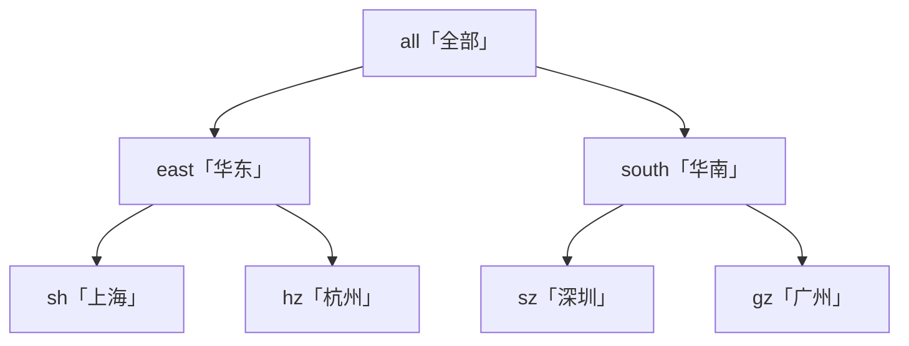

> 本文是《Lv3 复杂交互组件（公认最考功力）》按小节拆分后的续篇，上一部分见 [17-Collapse.md](17-Collapse.md)。

### Tree（★★★★）

树是"递归思维 + 联动算法 + 拖拽几何"三合一的考题。它的四个考点各自都值得单开一节：拍平虚拟化考的是**数据结构选择**，复选框三态考的是**联动算法**（本篇深度校准的样板戏），拖拽换父考的是**DOM 几何判定 + 不可变树操作**，异步加载与搜索考的是**状态与视图的解耦**。

考点清单（原文）：

- 递归渲染 + **虚拟化**（拍平树 + 动态缩进）
- 复选框三态（checked/halfChecked 父子联动算法）
- 拖拽换父、异步加载、搜索命中展开并高亮

统一数据模型（后文全部围绕它）：

```ts
/** 树节点协议：key 全局唯一是整棵树一切状态（展开/勾选/拖拽）的基石 */
export interface TreeNode {
  key: string;
  title: string;
  children?: TreeNode[];
  isLeaf?: boolean; // 异步加载场景：isLeaf=false 且无 children 的节点 = "还有子级待加载"
}

export const demoTree: TreeNode[] = [
  {
    key: 'all',
    title: '全部',
    children: [
      {
        key: 'east', title: '华东',
        children: [
          { key: 'sh', title: '上海' },
          { key: 'hz', title: '杭州' },
        ],
      },
      {
        key: 'south', title: '华南',
        children: [
          { key: 'sz', title: '深圳' },
          { key: 'gz', title: '广州' },
        ],
      },
    ],
  },
];
```

#### 考点 1：递归渲染与拍平 + 虚拟化（为什么先 flatten 再窗口化）

**递归渲染**是树的本能写法：组件渲染自己渲染 children。但它与虚拟滚动**结构性冲突**——窗口化的前提是"把连续索引区间切成窗口"，而递归渲染没有全局索引，每一层只看得见自己的 children；展开/收起任何节点都会让全局序号整体位移，递归栈里的每一层都无从得知。解法是先**拍平**：

> 把"当前展开状态下可见的节点"按渲染顺序拍平成一维数组，虚拟列表吃这个数组，缩进由拍平时记下的 `depth` 计算（`paddingLeft = depth × 缩进单位`），DOM 结构上根本没有嵌套。

```ts
/** 可见节点拍平：expanded 集合决定子树是否下钻。O(可见节点数)，配合 useMemo 只在树或展开态变化时重算 */
export interface FlatTreeNode {
  key: string;
  title: string;
  depth: number;   // 缩进层级：渲染时 paddingLeft = depth * INDENT
  isLeaf: boolean;
  hasChildren: boolean;
}
export const INDENT = 24;

export function flattenVisibleTree(tree: TreeNode[], expanded: Set<string>): FlatTreeNode[] {
  const out: FlatTreeNode[] = [];
  const walk = (nodes: TreeNode[], depth: number) => {
    for (const n of nodes) {
      const hasChildren = !!n.children?.length;
      out.push({ key: n.key, title: n.title, depth, isLeaf: !hasChildren && (n.isLeaf ?? true), hasChildren });
      // 只有"有子级且已展开"才下钻：收起的子树整体从可见序列里消失——虚拟化只需处理"可见"节点
      if (n.children?.length && expanded.has(n.key)) walk(n.children, depth + 1);
    }
  };
  walk(tree, 0);
  return out;
}
```

窗口化渲染直接复用 Lv3 Select 考点 4 的 `VirtualList`——这就是"拍平之后，树 = 一个带缩进的定高列表"的红利：

```tsx
import { useMemo, useState } from 'react';
import { flattenVisibleTree, INDENT, type TreeNode } from './tree-model';
import { VirtualList } from './VirtualList'; // Select 考点 4 的同款实现：定高窗口化

/** 虚拟化树：拍平 → 窗口化，缩进由 depth 计算 */
export function VirtualTree({ treeData }: { treeData: TreeNode[] }) {
  const [expanded, setExpanded] = useState<Set<string>>(new Set(['all']));
  const flat = useMemo(() => flattenVisibleTree(treeData, expanded), [treeData, expanded]); // 拍平结果缓存：滚动不重算

  const toggle = (key: string) =>
    setExpanded((prev) => {
      const next = new Set(prev);
      next.has(key) ? next.delete(key) : next.add(key);
      return next;
    });

  return (
    <VirtualList
      items={flat}
      renderItem={(node) => (
        <div key={node.key} style={{ height: 32, lineHeight: '32px', paddingLeft: node.depth * INDENT, display: 'flex', gap: 4 }}>
          {node.hasChildren ? (
            <button type="button" aria-label={expanded.has(node.key) ? '收起' : '展开'}
              aria-expanded={expanded.has(node.key)} onClick={() => toggle(node.key)}
              style={{ border: 'none', background: 'none', cursor: 'pointer', width: 16 }}>
              {expanded.has(node.key) ? '▾' : '▸'}
            </button>
          ) : (
            <span style={{ display: 'inline-block', width: 16 }} /> // 叶子占位：图标列对齐
          )}
          <span>{node.title}</span>
        </div>
      )}
    />
  );
}
```

antd 的 Tree 默认虚拟化（`virtual` 默认 true，配合 `height` 属性启用定高窗口化），内部同样是"展开态拍平 + rc-virtual-list 窗口化 + depth 缩进"这条路。另记一个工程细节：rc-tree 内部为每个节点维护 `pos` 路径（形如 `'0-1-0'`，根下第 2 个子节点的第 1 个子节点），拖拽与状态更新都靠它在 O(1) 内找到父链——我们下一考点的 `parentKey` 预计算就是同一思想。

#### 考点 2：复选框三态（checked / halfChecked 父子联动算法）

深度校准的样板考点。规则先立清楚：

- **向下联动（勾父全选子）**：勾选任意节点，其整个子树全部 checked；取消同理（子树里有"零散勾选"也整体清掉）；
- **向上联动（父链重算）**：父节点的状态**完全由子节点推导**——全部子 checked → 父 checked；部分子 checked 或 half → 父 halfChecked；全部子未选 → 父两态皆无（注意第三条：**"全没选"既不是 checked 也不是 half**，这里藏着最多 bug）。

**推演表**：拿 demoTree 依次操作，每一步每个节点的终态（✓=checked，◐=halfChecked，—=两态皆无）：



```text
操作                all   east  sh    hz    south sz    gz    │ 推导要点
───────────────────────────────────────────────────────────┼──────────────────────────────────────
① 勾选 sh            ◐     ◐     ✓     —     —     —     —    │ east：1/2 子选 → half；all：子 east 是 half → half
② 再勾选 hz          ◐     ✓     ✓     ✓     —     —     —    │ east：2/2 子选 → checked；all：south 全空 → 仍 half
③ 再勾选 sz          ◐     ✓     ✓     ✓     ◐     ✓     —    │ south：1/2 → half；all：仍不全 → half
④ 再勾选 gz          ✓     ✓     ✓     ✓     ✓     ✓     ✓    │ 全树闭合：south 2/2 → ✓，all 2/2 → ✓，half 清空
⑤ 取消 hz            ◐     ◐     ✓     —     ✓     ✓     ✓    │ 向下清 hz；east 重算 1/2 → half；all 重算 → half
⑥ 再取消 sh          ◐     —     —     —     ✓     ✓     ✓    │ east：0/2 → 两态皆无（不是 half！）；all：east 空 + south ✓ → half
```
<!-- 保留原 ASCII 图:上面推演表本质是操作步骤 × 节点终态的多列对照表,Mermaid 无等价图表类型(转图表会丢逐列查状态与推导要点的对照语义),故不做替换;仅树形部分转为 Mermaid -->

第 ⑥ 行是"三态"最容易漏的分支：**子节点全空时父节点是"未选"，不是"半选"**——半选必须意味着"有后代被选中"。

**实现**分三个函数：预计算父链（`buildKeyEntities`）、向下传导（`conductDown`）、向上重算（`conductUp`）。勾选/取消都走同一个 `toggleCheck` 入口：

```ts
import type { TreeNode } from './tree-model';

/** 节点实体：预计算父键与子键列表——父链 O(1) 可达，是三态算法的地基（rc-tree 的 keyEntities 同思想） */
export interface KeyEntity {
  node: TreeNode;
  parentKey: string | null;
  childKeys: string[];
  depth: number;
}

export function buildKeyEntities(treeData: TreeNode[]): Map<string, KeyEntity> {
  const entities = new Map<string, KeyEntity>();
  const walk = (nodes: TreeNode[], parentKey: string | null, depth: number) => {
    for (const n of nodes) {
      entities.set(n.key, { node: n, parentKey, childKeys: (n.children ?? []).map((c) => c.key), depth });
      if (n.children?.length) walk(n.children, n.key, depth + 1);
    }
  };
  walk(treeData, null, 0);
  return entities;
}

/** 三态数据：checked（全选）与 half（半选）两个集合。Set 便于 O(1) 查询，提交时 [...set] 展开给业务 */
export interface CheckStates {
  checked: Set<string>;
  half: Set<string>;
}

/**
 * 向下传导：勾/取消某个 key，其整个子树跟随置位或清位。
 * 无论子树里原来是"零散勾选"还是"全选"，一律被整体覆盖——"勾父全选子"的语义来源。
 */
function conductDown(entities: Map<string, KeyEntity>, key: string, checked: boolean, states: CheckStates): void {
  const { checked: checkedSet, half: halfSet } = states;
  const stack: string[] = [key]; // 迭代代替递归：千级深度不爆栈
  while (stack.length) {
    const k = stack.pop()!;
    if (checked) checkedSet.add(k); else checkedSet.delete(k);
    halfSet.delete(k); // 子树整体置位后，内部节点不可能再半选
    for (const child of entities.get(k)!.childKeys) stack.push(child);
  }
}

/**
 * 向上重算：从被改节点的父节点开始，沿父链逐层"由子推父"。
 * 三分支与推演表一一对应：全子 checked → 父 checked；有 checked 或 half 的子 → 父 half；全空 → 父清空。
 */
function conductUp(entities: Map<string, KeyEntity>, key: string, states: CheckStates): void {
  const { checked: checkedSet, half: halfSet } = states;
  let parentKey = entities.get(key)!.parentKey;
  while (parentKey != null) {                       // 沿父链爬到根为止
    const { childKeys } = entities.get(parentKey)!;
    let allChecked = childKeys.length > 0;
    let someTouched = false;
    for (const child of childKeys) {
      if (checkedSet.has(child)) someTouched = true;          // 子全选：算"有接触"
      else {
        allChecked = false;
        if (halfSet.has(child)) someTouched = true;           // 子半选：也算"有接触"
      }
    }
    if (allChecked)              { checkedSet.add(parentKey); halfSet.delete(parentKey); }   // 分支 1
    else if (someTouched)        { checkedSet.delete(parentKey); halfSet.add(parentKey); }   // 分支 2（推演表 ①⑤⑥ 的 half）
    else                         { checkedSet.delete(parentKey); halfSet.delete(parentKey); } // 分支 3（推演表 ⑥ 的 east 清空）
    parentKey = entities.get(parentKey)!.parentKey;           // 继续向上：父变了，祖父也要重算
  }
}

/** 唯一入口：勾选（key 不在 checked）与取消（key 在 checked）共用。返回新对象，保证 React 状态更新可被感知 */
export function toggleCheck(entities: Map<string, KeyEntity>, key: string, prev: CheckStates): CheckStates {
  const states: CheckStates = { checked: new Set(prev.checked), half: new Set(prev.half) }; // 不可变更新
  const target = states.checked.has(key);   // 半选节点点击 → target 为 false → 走"勾选"分支（antd 同款语义）
  conductDown(entities, key, !target, states);
  conductUp(entities, key, states);
  return states;
}
```

**取消勾选的处理**就藏在 `toggleCheck` 的对称性里：取消 = `conductDown(false)`（整个子树清位，**子树里原本零散勾选的叶子也一并清掉**，与 antd 行为一致）+ `conductUp`（父链重算，父可能从 checked → half → 未选逐级退化，推演表第 ⑤⑥ 行）。组件接线：

```tsx
import { useMemo, useState } from 'react';
import { buildKeyEntities, toggleCheck, type CheckStates } from './tree-check';
import { flattenVisibleTree, INDENT, type TreeNode } from './tree-model';
import { VirtualList } from './VirtualList';

/** 三态勾选树：checked/half 两个集合渲染三种 checkbox 态 */
export function CheckableTree({ treeData }: { treeData: TreeNode[] }) {
  const [expanded] = useState<Set<string>>(new Set(['all']));
  const [states, setStates] = useState<CheckStates>({ checked: new Set(), half: new Set() });
  const entities = useMemo(() => buildKeyEntities(treeData), [treeData]); // 父链预计算只随树变化
  const flat = useMemo(() => flattenVisibleTree(treeData, expanded), [treeData, expanded]);

  return (
    <VirtualList
      items={flat}
      renderItem={(node) => {
        const checked = states.checked.has(node.key);
        const half = states.half.has(node.key);
        return (
          <label key={node.key} style={{ height: 32, display: 'flex', alignItems: 'center', gap: 4, paddingLeft: node.depth * INDENT }}>
            <input
              type="checkbox"
              checked={checked}
              ref={(el) => { if (el) el.indeterminate = half && !checked; }} // 半选态：DOM 只能靠 indeterminate 属性表达
              onChange={() => setStates((prev) => toggleCheck(entities, node.key, prev))}
            />
            {node.title}
          </label>
        );
      }}
    />
  );
}
```

antd 的对应物：`<Tree checkable onCheck={...} />`，其回调第二参数带全量派生信息，`checkStrictly` 可关闭联动（此时 checkedKeys 变成 `{ checked, halfChecked }` 对象，父子各自独立）：

```tsx
import { Tree } from 'antd';
import type { TreeProps } from 'antd';

const onCheck: TreeProps['onCheck'] = (checked, info) => {
  // 联动模式：checked 是 Key[]；info.halfCheckedKeys 直接给半选集合（即本节 half 集合）
  console.log(checked, info.halfCheckedKeys, info.checkedNodes);
  // checkStrictly 模式下 checked 变为 { checked: Key[], halfChecked: Key[] }——类型联合，取值前先判别
};

<Tree checkable treeData={antdTreeData} onCheck={onCheck} />;
```

#### 考点 3：拖拽换父（drop 位置指示 line / gap 判定）

拖拽树节点到新位置，两件事：**几何判定**（拖到目标的哪里？上方插前面/下方插后面/中间当孩子）与**不可变树操作**（摘除 + 插入）。

几何判定用"高度三分"：dragover 时算 `e.clientY` 在目标行内的比例——上 1/4 是 before（画上边线），下 1/4 是 after（画下边线），中间是 inside（整行高亮，成为目标的孩子）。antd/rc-tree 的 `dropToGap`（true=插缝隙成为兄弟）与 `dropPosition` 就是这个判定的产物。

```tsx
import { useState } from 'react';

type DropPos = 'before' | 'after' | 'inside';

/** drop 指示状态：目标 key + 三分位置。渲染层据此画线（before/after）或整行高亮（inside） */
export function useDropIndicator() {
  const [dropTarget, setDropTarget] = useState<{ key: string; pos: DropPos } | null>(null);

  const onDragOver = (e: React.DragEvent, key: string) => {
    e.preventDefault(); // 不 preventDefault 浏览器拒绝 drop
    const rect = e.currentTarget.getBoundingClientRect();
    const ratio = (e.clientY - rect.top) / rect.height;
    const pos: DropPos = ratio < 0.25 ? 'before' : ratio > 0.75 ? 'after' : 'inside'; // 三分判定
    setDropTarget((prev) => (prev?.key === key && prev.pos === pos ? prev : { key, pos })); // 不变不刷
  };

  const onDragLeave = () => setDropTarget(null);
  const onDrop = (onMove: (dragKey: string, targetKey: string, pos: DropPos) => void, dragKey: string) =>
    (e: React.DragEvent) => {
      e.preventDefault();
      if (dropTarget) onMove(dragKey, dropTarget.key, dropTarget.pos);
      setDropTarget(null);
    };

  return { dropTarget, onDragOver, onDragLeave, onDrop };
}
```

不可变树操作——先防环（拖到自己子孙下面 = 制造循环引用），再摘除，再插入：

```ts
import { buildKeyEntities } from './tree-check';     // 考点 2 的实现：keyEntities 预计算
import type { TreeNode } from './tree-model';        // 考点 1 的数据协议

/**
 * 移动节点（纯函数，返回新树）：
 * 1. 非法判定：目标是拖拽节点自己的后代 → 原样返回（防环：a 挂到 a 的子孙下就是循环引用）
 * 2. 摘除：深拷贝路径上把 dragKey 过滤掉
 * 3. 插入：inside=成为目标第一个孩子；before/after=与目标同级插前/插后
 */
export function moveTreeNode(
  tree: TreeNode[], dragKey: string, targetKey: string, pos: 'before' | 'after' | 'inside',
): TreeNode[] {
  const entities = buildKeyEntities(tree);
  // 防环：沿 target 的父链向上找，若遇到 dragKey，说明 target 在 drag 的子树里
  let ancestor: string | null = entities.get(targetKey)!.parentKey;
  while (ancestor != null) {
    if (ancestor === dragKey) return tree;
    ancestor = entities.get(ancestor)!.parentKey;
  }
  const dragNode = entities.get(dragKey)!.node;

  const remove = (nodes: TreeNode[]): TreeNode[] =>            // 摘除：逐层拷贝 + 过滤，保持不可变
    nodes
      .map((n) => (n.children?.length ? { ...n, children: remove(n.children) } : { ...n }))
      .filter((n) => n.key !== dragKey);
  const withoutDrag = remove(tree);

  const insert = (nodes: TreeNode[]): TreeNode[] =>
    nodes.flatMap((n) => {
      if (n.key === targetKey) {
        if (pos === 'inside') return [{ ...n, children: [dragNode, ...(n.children ?? [])] }]; // 挂为孩子（排最前）
        return pos === 'before' ? [dragNode, n] : [n, dragNode];                              // 同级插前/插后
      }
      return n.children?.length ? [{ ...n, children: insert(n.children) }] : [n];
    });
  return insert(withoutDrag);
}
```

antd 的写法（官方 normalize：`info.dropPosition` 是"绝对行位"，要减掉目标自身在父内的序号才得到 -1/0/1 相对位）：

```tsx
import { Tree } from 'antd';
import type { TreeProps } from 'antd';

const onDrop: TreeProps['onDrop'] = (info) => {
  const dropKey = info.node.key;                       // 目标节点
  const dragKey = info.dragNode.key;                   // 被拖节点
  const dropPos = String(info.node.pos).split('-');    // pos 路径如 '0-1-2'，末段是父内序号
  // 官方归一化：相对位置 = 绝对 dropPosition - 目标自身的父内序号 → -1(上方) / 0(成为孩子) / 1(下方)
  const dropPosition = info.dropPosition - Number(dropPos[dropPos.length - 1]);
  // dropPosition === -1 → before；0 → info.dropToGap 为 false，成为孩子；1 → after
  // 之后套用上面 moveTreeNode 的三步即可（antd 文档 demo 即此结构）
};

<Tree draggable treeData={treeData} onDrop={onDrop} />;
```

#### 考点 4：异步加载（loadData 约定与 expanded 状态）

antd 定下的约定：`loadData(node) => Promise`——展开一个 `isLeaf=false` 且还没有 children 的节点时触发，resolve 的数据成为该节点的子级。自实现的三件套：**loadedKeys**（加载过的不再加载）、**loadingKeys**（目标行的 spinner）、**expanded 受控**（展开是果，加载是因，都挂在 key 上）：

```tsx
import { useState } from 'react';
import { flattenVisibleTree, INDENT, type TreeNode } from './tree-model';
import { VirtualList } from './VirtualList';

/** 异步加载树：loadData 约定 + loaded/loading 两个集合 + expanded 受控 */
export function LazyTree({ fetchChildren }: { fetchChildren: (key: string) => Promise<TreeNode[]> }) {
  const [treeData, setTreeData] = useState<TreeNode[]>([
    { key: 'root', title: '根目录', isLeaf: false }, // isLeaf=false：承诺"我还有孩子，只是还没拉"
  ]);
  const [expanded, setExpanded] = useState<Set<string>>(new Set());
  const [loadedKeys, setLoadedKeys] = useState<Set<string>>(new Set()); // 已加载：防重复请求的第一道闸
  const [loadingKeys, setLoadingKeys] = useState<Set<string>>(new Set());

  /** 把拉回的 children 挂到指定 key 上（不可变更新） */
  const patchChildren = (nodes: TreeNode[], key: string, children: TreeNode[]): TreeNode[] =>
    nodes.map((n) =>
      n.key === key ? { ...n, children, isLeaf: children.length === 0 } // 拉回来是空 → 修正为叶子
        : n.children?.length ? { ...n, children: patchChildren(n.children, key, children) } : { ...n },
    );

  const toggle = async (node: TreeNode) => {
    const isExpanding = !expanded.has(node.key);
    setExpanded((prev) => {
      const next = new Set(prev);
      next.has(node.key) ? next.delete(node.key) : next.add(node.key);
      return next;
    });
    // loadData 约定的触发条件：展开 + 从未加载 + 当前没有子级
    if (isExpanding && !loadedKeys.has(node.key) && !node.children?.length) {
      setLoadingKeys((prev) => new Set(prev).add(node.key));
      const children = await fetchChildren(node.key);       // 失败处理：catch 里回滚 expanded（此处从略，工程必做）
      setTreeData((prev) => patchChildren(prev, node.key, children));
      setLoadedKeys((prev) => new Set(prev).add(node.key)); // 只有成功才记账，失败下次展开可重试
      setLoadingKeys((prev) => { const n = new Set(prev); n.delete(node.key); return n; });
    }
  };

  const flat = flattenVisibleTree(treeData, expanded);
  return (
    <VirtualList
      items={flat}
      renderItem={(node) => (
        <div key={node.key} style={{ height: 32, lineHeight: '32px', paddingLeft: node.depth * INDENT, display: 'flex', gap: 4 }}>
          {loadingKeys.has(node.key) ? (
            <span aria-label="加载中">…</span>
          ) : node.hasChildren || node.isLeaf === false ? (
            <button type="button" onClick={() => toggle(node.key)} style={{ border: 'none', background: 'none', width: 16, cursor: 'pointer' }}>
              {expanded.has(node.key) ? '▾' : '▸'}
            </button>
          ) : (
            <span style={{ display: 'inline-block', width: 16 }} />
          )}
          {node.title}
        </div>
      )}
    />
  );
}
```

antd 侧是声明式的：`<Tree treeData={...} loadData={(node) => promise} />`，内部同样维护 loadedKeys/loading 态。**受控 expandedKeys 时要自己保证"展开未加载的节点触发 loadData"的链路不被掐断**——见文末坑 6。

#### 考点 5：搜索命中展开并高亮（命中路径的集合计算）

树搜索的完整语义不是"过滤出命中节点"，而是三件事：**命中集合**（哪些节点命中）、**命中路径集合**（命中节点的全部祖先——它们必须展开，否则命中的节点根本看不见）、**高亮渲染**（命中文本片段染色）。三者全是纯计算，与渲染解耦：

```ts
/** 搜索：返回命中集合与"命中路径"（祖先全集）。expand = 路径集合，直接喂给 expandedKeys */
export function searchTree(tree: TreeNode[], keyword: string) {
  const kw = keyword.trim().toLowerCase();
  const matchedKeys = new Set<string>();
  const pathKeys = new Set<string>(); // 命中节点的祖先们：必须展开才可见
  if (!kw) return { matchedKeys, pathKeys };

  const walk = (nodes: TreeNode[], parents: string[]) => {
    for (const n of nodes) {
      if (n.title.toLowerCase().includes(kw)) {
        matchedKeys.add(n.key);
        for (const p of parents) pathKeys.add(p); // 命中 → 整条祖先路径入集合
      }
      if (n.children?.length) walk(n.children, [...parents, n.key]); // 携带父链下钻
    }
  };
  walk(tree, []);
  return { matchedKeys, pathKeys };
}
```

```tsx
/** 高亮渲染：按命中位置切开，中间片段染色（与 Lv1 Typography 的溢出 Tooltip 同属"文本切片渲染"家族） */
export function HighlightTitle({ title, keyword }: { title: string; keyword: string }) {
  const kw = keyword.trim();
  if (!kw) return <>{title}</>;
  const idx = title.toLowerCase().indexOf(kw.toLowerCase());
  if (idx < 0) return <>{title}</>;
  return (
    <>
      {title.slice(0, idx)}
      <mark style={{ background: '#ffe58f', padding: 0 }}>{title.slice(idx, idx + kw.length)}</mark>
      {title.slice(idx + kw.length)}
    </>
  );
}

// 接线：搜索态下 expanded 用 pathKeys 替代用户展开态（antd 的 autoExpandParent 推荐只在搜索时打开，同一思想）
// const { matchedKeys, pathKeys } = searchTree(treeData, kw);
// <VirtualTree expanded={kw ? pathKeys : userExpanded} />
// 渲染 title 时：node.key 命中 matchedKeys → <HighlightTitle title={node.title} keyword={kw} />
```

antd Tree 的内置对应物是 `filterTreeNode`（返回 true 的节点高亮）配合搜索期间开 `autoExpandParent`；命中路径展开的逻辑同样内置。数据量大时把 `searchTree` 的结果用 `useMemo` 挂在 `[treeData, keyword]` 上，输入防抖 200ms 即可（复用 Select 考点 5 的防抖骨架）。

#### Tree 常见坑（症状 → 根因 → 修法）

```text
坑 1
症状：勾选/展开总是作用到错误的节点，数据一刷新就串。
根因：key 不唯一（或用数组 index 当 key），两个节点共享同一个 key 后状态互相踩。
修法：树协议第一铁律——key 全局唯一且稳定；来源数据没有 key 就在入口处派生（path 拼串优于 index）。

坑 2
症状：勾了所有子节点，父节点还是半选。
根因：三态只做了向下传导，漏了向上重算（或向上只算了一层，祖父没算）。
修法：conductUp 沿父链 while 到根，父变祖父必变（见考点 2 推演表 ②）。

坑 3
症状：全部取消后父节点仍显示半选。
根因：向上重算漏了第三分支——"子全空"应是两态皆无，被误归为 half。
修法：三分支补全：allChecked→checked / someTouched→half / else→清空（推演表第 ⑥ 行）。

坑 4
症状：拖拽节点到自己的子孙下，页面卡死/栈溢出。
根因：没有防环判定，树成了环，递归渲染死循环。
修法：drop 前沿 target 父链向上找 dragKey，命中即拒绝（见考点 3 moveTreeNode 第 1 步）。

坑 5
症状：虚拟滚动树展开大节点后视口剧烈跳动。
根因：展开让拍平数组前面插入大量节点，当前窗口的索引整体位移。
修法：展开时记录锚点：以"视口首行 key"为准重设 scrollTop（首行索引 × 行高）；antd Tree 的 scrollTo 支持 key 定位。

坑 6
症状：受控 expandedKeys + loadData，每次展开都重复发请求。
根因：loadedKeys 判定失效（或受控切换把 loadedKeys 一起重置）。
修法：loaded/loading 独立于 expanded 维护；受控方只管 expanded，加载去重由组件内部集合兜底（见考点 4）。
```

---

#### 考点 6：受控三件套与半选传播——checkedKeys 受控、checkStrictly 与半选回显

**是什么**：考点 2 的三态联动算法是非受控视角——状态在组件内部。生产级 Tree 的 `checkedKeys` / `expandedKeys` / `selectedKeys`（受控三件套）都要走 [02-A1-受控-非受控双模式-30-行-hook-处处要用.md](02-A1-受控-非受控双模式-30-行-hook-处处要用.md) 的双模式协议。本节讲集合值受控的两个特有难题：**父子联动开关**（antd 的 `checkStrictly`）与**受控半选回显**——业务持久化通常只存 checkedKeys（且常常只存叶子），回灌时半选必须**重新推导**，否则父节点永远不亮。

**为什么难**：标量受控回灌什么显示什么；集合受控的回灌值却可能**不是联动语义下的合法状态**——`['sh']` 是"合法但非闭合"的：联动语义下它意味着 east/all 半选，但数组里没有这两个 key。组件必须做一次**归一化**：向下补全（勾父即全选子）+ 向上推导（父态由子集合唯一决定）。另外联动开关一旦关掉（checkStrictly），半选推导也随之关闭——想显示半选就得协议里带 halfChecked，两种模式数据形状不同，是 API 设计的真实分叉。

**机制**：①集合受控三纪律（A1 的数组版）：受控传 `Key[]`、默认值仅首帧消费、`onCheck` **全量回传**（checked 与 halfChecked 一起给，受控方原样回灌即闭环）；②联动开关：`checkStrictly: false`（默认）父子联动、半选自动推导；`true` 父子解耦、半选不再推导——受控协议升级为 `{ checked, halfChecked }` 对象，给了才显示；③归一化 `normalizeChecked`：向下补全 + 向上推导，"仅叶子"存储、"半闭包"存储（有父无子）、含脏 key 的存储全部拉回一致态。

```ts
// tree-checked.ts —— 受控回显归一化（复用考点 2 的 buildKeyEntities / CheckStates）
import type { CheckStates, KeyEntity } from './tree-check';

export function normalizeChecked(entities: Map<string, KeyEntity>, keys: readonly string[]): CheckStates {
  const checked = new Set<string>();
  const half = new Set<string>();
  // 1. 向下补全（等价 conductDown(true)）：勾了父 = 整个子树勾
  const stack = [...keys];
  while (stack.length) {
    const k = stack.pop()!;
    if (checked.has(k)) continue;                 // 已补全的子树跳过：均摊 O(子树)
    const entity = entities.get(k);
    if (!entity) continue;                       // 脏 key：静默丢弃，不炸
    checked.add(k);
    for (const c of entity.childKeys) stack.push(c);
  }
  // 2. 向上推导（考点 2 conductUp 同款三分支）：重复访问无害——父终态只由子集合决定
  for (const k of [...checked]) {
    let parent = entities.get(k)?.parentKey ?? null;
    while (parent != null) {
      const entity = entities.get(parent)!;
      let all = entity.childKeys.length > 0;
      let some = false;
      for (const c of entity.childKeys) {
        if (checked.has(c)) some = true;
        else { all = false; if (half.has(c)) some = true; }
      }
      if (all) { checked.add(parent); half.delete(parent); }
      else if (some) { checked.delete(parent); half.add(parent); }
      else { checked.delete(parent); half.delete(parent); }
      parent = entity.parentKey;
    }
  }
  return { checked, half };
}
```
```tsx
// ControlledCheckTree.tsx —— 三件套受控接线：回灌即归一化，勾选事件全量外发
import { useMemo, useState } from 'react';
import { buildKeyEntities, toggleCheck, type CheckStates } from './tree-check';
import { normalizeChecked } from './tree-checked';
import { flattenVisibleTree, INDENT, type TreeNode } from './tree-model';
import { VirtualList } from './VirtualList';

export function ControlledCheckTree({ treeData, checkedKeys, onCheck, checkStrictly = false }: {
  treeData: TreeNode[];
  checkedKeys: readonly string[];                        // 受控：仅叶子或全闭包形态皆可
  onCheck: (checked: string[], half: string[]) => void;  // 全量回传
  checkStrictly?: boolean;
}) {
  const [expanded, setExpanded] = useState<Set<string>>(new Set(['all']));
  const entities = useMemo(() => buildKeyEntities(treeData), [treeData]);
  // "受控受半选回显"的全部秘密在这一行：受控值进、推导态出（严格模式给什么是什么）
  const states: CheckStates = useMemo(
    () => (checkStrictly ? { checked: new Set(checkedKeys), half: new Set<string>() } : normalizeChecked(entities, checkedKeys)),
    [checkStrictly, entities, checkedKeys],
  );
  const flat = useMemo(() => flattenVisibleTree(treeData, expanded), [treeData, expanded]);
  return (
    <VirtualList
      items={flat}
      renderItem={(node) => {
        const checked = states.checked.has(node.key);
        const half = states.half.has(node.key);
        return (
          <label key={node.key} style={{ height: 32, display: 'flex', alignItems: 'center', gap: 4, paddingLeft: node.depth * INDENT }}>
            <input
              type="checkbox" checked={checked}
              ref={(el) => { if (el) el.indeterminate = half && !checked; }}
              onChange={() => {
                // 解耦模式只动自己；联动模式走考点 2 的内核
                const next = checkStrictly
                  ? (() => { const n = new Set(states.checked); checked ? n.delete(node.key) : n.add(node.key); return { checked: n, half: new Set<string>() }; })()
                  : toggleCheck(entities, node.key, states);
                onCheck([...next.checked], [...next.half]);
              }}
            />
            {node.title}
          </label>
        );
      }}
    />
  );
}
```

antd 侧对照（协议形状的分叉点）：`checkedKeys` 接受 `Key[] | { checked?: Key[]; halfChecked?: Key[] }`——**联动模式传数组**（半选由内部 conduct 推导，等价 normalizeChecked）；**checkStrictly 模式传对象**（半选给了才显示）。

```tsx
import { Tree } from 'antd';
// 联动模式：数组进，半选自动推导 / 严格模式：对象进，halfChecked 完全听你的
<Tree checkable checkedKeys={['sh']} treeData={treeData} />;
<Tree checkable checkStrictly checkedKeys={{ checked: ['sh'], halfChecked: ['east'] }} />;
```

最小 Vitest（用 demoTree 穷举三种存储形态 + 脏数据）：

```ts
// tree-checked.test.ts
import { describe, it, expect } from 'vitest';
import { buildKeyEntities } from './tree-check';
import { normalizeChecked } from './tree-checked';
import { demoTree } from './tree-model';

const entities = buildKeyEntities(demoTree);
describe('normalizeChecked 受控回显归一化', () => {
  it('仅叶子存储推导父链半选；半闭包存储（只有父）先向下补全再推导', () => {
    const leafOnly = normalizeChecked(entities, ['sh']);
    expect([...leafOnly.checked]).toEqual(['sh']);
    expect([...leafOnly.half].sort()).toEqual(['all', 'east']);
    const halfClosed = normalizeChecked(entities, ['east']);
    expect([...halfClosed.checked].sort()).toEqual(['east', 'sh', 'hz']);
    expect([...halfClosed.half]).toEqual(['all']);
  });
  it('全闭合存储：父全选、半选清空；脏 key 静默丢弃', () => {
    const full = normalizeChecked(entities, ['east', 'sh', 'hz', 'south', 'sz', 'gz']);
    expect([...full.checked].sort()).toEqual(['all', 'east', 'hz', 'sh', 'south', 'sz', 'gz']);
    expect(full.half.size).toBe(0);
    expect(normalizeChecked(entities, ['ghost', 'sz']).half.has('south')).toBe(true);
  });
});
```

**坑（症状 → 根因 → 修法）**：

```text
坑 7
症状：受控回灌后父节点永远不显示半选（勾了子，父纹丝不动）。
根因：自研组件把 checkedKeys 原样进 Set 渲染，回显链路缺归一化——业务存的是"仅叶子"形态。
修法：回灌必过 normalizeChecked（本节）；或 antd 联动模式下保持数组形态（内部推导）。

坑 8
症状：checkStrictly 模式下父节点半选消失/混乱。
根因：严格模式半选不推导，受控仍传数组——half 恒为空。
修法：严格模式协议升级为 { checked, halfChecked } 对象，半选的真相只有你自己的数据。

坑 9
症状：onCheck 回传了差量（"这次少了 hz"），受控集合越勾越少。
根因：集合受控的 onChange 必须全量回传，差量语义让受控方无法闭环（17-手风琴坑 13 同族）。
修法：onCheck(checked[], half[]) 全量协议写死在类型与文档里。

```

#### 考点 7：虚拟树进阶——不定高测量、scrollTo(key) 与展开锚点

**是什么**：考点 1 已给"展开态拍平 + 定高窗口化"的完整链路；[《高阶场景第二辑》06 §3.2.1](../react-高阶场景-第二辑/06-3-2-递归渲染-QueryGroup-QueryRow.md) 在条件树（编辑器行）语境详述过虚拟化取舍与"虚拟化 × 拖拽"的冲突三档；[23-VirtualList-Anchor-Progress-等.md](23-VirtualList-Anchor-Progress-等.md) 讲了 prepend 的 scrollTop 修正。本节写组件库语境的三块增量：**不定高行**（标题换行/副文案）、**scrollTo(key) 定位**（搜索跳转、外部 API）、**展开锚点**（坑 5"展开大节点视口跳动"的完整修法）。

**为什么难**：定高虚拟化的全部数学建立在 `index × ROW_H` 上，行高一旦不等，窗口计算、总高撑条、定位全都失准。引入测量后又生出三个次生问题：**测量缓存键**（展开/过滤后 index 错位，必须用 key）、**测量时机**（未渲染的行没有高度，只能估算 + 滚到位后修正）、**修正引发的跳动**（上面某行实测变高，视口内容整体下移）。三个问题环环相扣，是虚拟树比平铺虚拟列表难一档的原因。

**机制**：①**前缀和偏移表** `offsets[i]`（实测优先、估算兜底），窗口计算从乘法改查表，定位从除法改**二分**（offsets 单调递增）；②**共享一个 ResizeObserver** 观察所有已渲染行，回调按 `data-key` 回写高度缓存，值不变不触发重算，行卸载用 React 19 的 ref cleanup 解除观察；③**scrollTo(key)**：key → flat 索引 → `offsets[idx]` → 设 scrollTop（未实测区域用估算值，滚过去后 RO 修正，需要精确时二段滚动）；④**展开锚点**：toggle 前记录"被点行 key + 行顶距视口顶的偏移"，DOM 更新后按新偏移表把锚行钉回原位——与 23 号文件 prepend 的 scrollHeight 差值法同族，但锚点法对"前后行数都变"的场景更稳。

```ts
// tree-offsets.ts —— 不定高虚拟化的纯数学层（可单测）
import type { FlatTreeNode } from './tree-model';

export function buildOffsets(flat: readonly FlatTreeNode[], heightOf: (key: string) => number): number[] {
  const offsets = new Array<number>(flat.length + 1);
  offsets[0] = 0;
  for (let i = 0; i < flat.length; i++) offsets[i + 1] = offsets[i] + heightOf(flat[i].key);
  return offsets;
}

/** 二分：scrollTop 落在第几行（offsets 单调递增，返回行起点索引） */
export function findStartIndex(offsets: readonly number[], scrollTop: number): number {
  let lo = 0, hi = offsets.length - 2; // 最后一行的起点是 length-2
  while (lo < hi) {
    const mid = (lo + hi + 1) >> 1;
    if (offsets[mid] <= scrollTop) lo = mid; else hi = mid - 1;
  }
  return lo;
}
```

```tsx
// MeasuredVirtualTree.tsx —— 不定高 + 共享 RO + 展开锚点 + scrollTo(key)
import { useCallback, useEffect, useLayoutEffect, useMemo, useRef, useState } from 'react';
import { flattenVisibleTree, INDENT, type TreeNode } from './tree-model';
import { buildOffsets, findStartIndex } from './tree-offsets';

const ESTIMATE = 32; // 估算行高：未实测行的兜底（宁略高不裁切）
export function MeasuredVirtualTree({ treeData, viewportHeight = 320 }: {
  treeData: TreeNode[]; viewportHeight?: number;
}) {
  const [expanded, setExpanded] = useState<Set<string>>(new Set(['all']));
  const [scrollTop, setScrollTop] = useState(0);
  const [bump, setBump] = useState(0);               // 高度缓存变更信号
  const containerRef = useRef<HTMLDivElement>(null);
  const heights = useRef(new Map<string, number>()); // 实测缓存：key 定位（index 会漂移）
  const roRef = useRef<ResizeObserver | null>(null);
  const anchor = useRef<{ key: string; topInView: number } | null>(null);
  // 共享一个 RO：任何行高变化只 bump 一次；行卸载由 React 19 ref cleanup unobserve
  const rowRef = useCallback((key: string) => (el: HTMLDivElement | null) => {
    if (!el) return undefined;
    if (!roRef.current) {
      roRef.current = new ResizeObserver((entries) => {
        let changed = false;
        for (const entry of entries) {
          const k = (entry.target as HTMLElement).dataset.key;
          if (k && heights.current.get(k) !== entry.target.clientHeight) {
            heights.current.set(k, entry.target.clientHeight);
            changed = true;
          }
        }
        if (changed) setBump((v) => v + 1); // 值不变不 bump：测量不引发渲染风暴
      });
    }
    roRef.current.observe(el);
    return () => roRef.current?.unobserve(el);
  }, []);
  useEffect(() => () => roRef.current?.disconnect(), []);
  const flat = useMemo(() => flattenVisibleTree(treeData, expanded), [treeData, expanded]);
  const heightOf = useCallback((key: string) => heights.current.get(key) ?? ESTIMATE, []);
  // bump 进依赖：高度缓存变化强制重建偏移表（bump 只增不减，保证每次测量落地）
  const offsets = useMemo(() => buildOffsets(flat, heightOf), [flat, heightOf, bump]);
  const start = findStartIndex(offsets, scrollTop);
  const end = Math.min(flat.length, findStartIndex(offsets, scrollTop + viewportHeight) + 5);
  const visible = flat.slice(start, end);
  const toggle = (key: string) => {
    const el = containerRef.current;
    const idx = flat.findIndex((n) => n.key === key);
    if (el && idx >= 0) anchor.current = { key, topInView: offsets[idx] - el.scrollTop }; // 锚点：被点行的视觉位置
    setExpanded((prev) => {
      const next = new Set(prev);
      next.has(key) ? next.delete(key) : next.add(key);
      return next;
    });
  };
  // 展开导致的行数变化提交后：把锚行钉回原视口位置——坑 5 的完整修法
  useLayoutEffect(() => {
    const el = containerRef.current;
    const a = anchor.current;
    if (!el || !a) return;
    const idx = flat.findIndex((n) => n.key === a.key);
    if (idx >= 0) el.scrollTop = Math.max(0, offsets[idx] - a.topInView);
    anchor.current = null;
  }, [expanded]); // offsets/flat 由 expanded 派生，此处读到的一定是更新后的值
  /** scrollTo(key)：对外 API——搜索命中跳转、业务定位（估算先行，实测后自然修正） */
  const scrollToKey = (key: string, center = true) => {
    const el = containerRef.current;
    const idx = flat.findIndex((n) => n.key === key);
    if (!el || idx < 0) return;
    el.scrollTop = Math.max(0, offsets[idx] - (center ? viewportHeight / 2 : 0));
  };
  return (
    <div ref={containerRef} style={{ height: viewportHeight, overflowY: 'auto' }}
         onScroll={(e) => setScrollTop(e.currentTarget.scrollTop)}>
      <div style={{ height: offsets[offsets.length - 1], position: 'relative' }}>
        <div style={{ transform: `translateY(${offsets[start]}px)` }}>
          {visible.map((node) => (
            <div key={node.key} data-key={node.key} ref={rowRef(node.key)}
                 style={{ paddingLeft: node.depth * INDENT, display: 'flex', gap: 4 }}>
              {node.hasChildren ? (
                <button type="button" onClick={() => toggle(node.key)}
                        style={{ border: 'none', background: 'none', width: 16, cursor: 'pointer' }}>
                  {expanded.has(node.key) ? '▾' : '▸'}
                </button>
              ) : <span style={{ display: 'inline-block', width: 16 }} />}
              <span>{node.title}</span>
            </div>
          ))}
        </div>
      </div>
    </div>
  );
}
```

最小 Vitest（偏移数学与二分定位）：

```ts
// tree-offsets.test.ts
import { describe, it, expect } from 'vitest';
import { buildOffsets, findStartIndex } from './tree-offsets';
import type { FlatTreeNode } from './tree-model';

const flat = [{ key: 'a', depth: 0 }, { key: 'b', depth: 1 }, { key: 'c', depth: 2 }] as FlatTreeNode[];
const heights: Record<string, number> = { a: 32, b: 64, c: 32 }; // 不定高：b 行两倍高
const offsets = buildOffsets(flat, (k) => heights[k] ?? 32);

describe('buildOffsets / findStartIndex', () => {
  it('前缀和正确累加；二分跨过加高行不偏；越界收敛最后一行', () => {
    expect(offsets).toEqual([0, 32, 96, 128]);
    expect(findStartIndex(offsets, 0)).toBe(0);
    expect(findStartIndex(offsets, 32)).toBe(1);   // b 行起点
    expect(findStartIndex(offsets, 95)).toBe(1);   // 仍在 b 行内
    expect(findStartIndex(offsets, 96)).toBe(2);   // c 行起点
    expect(findStartIndex(offsets, 10_000)).toBe(2);
  });
});
```

**坑（症状 → 根因 → 修法）**：

```text
坑 10
症状：测量缓存用 index 做 key，展开/过滤后行高串位（某行忽高忽低）。
根因：index 随展开态漂移；缓存键必须与"身份"绑定。
修法：高度缓存键用节点 key（本节 heights），与 React 列表 key 同一纪律（坑 1）。

坑 11
症状：滚动中上方某行实测变高，视口内容整体跳一下。
根因：偏移表修正让后续行绝对位置位移，scrollTop 没跟着补。
修法：修正偏移表时同步补偿 scrollTop（锚行视觉位置不变——与展开锚点同一套补偿）；估算值宁高勿低可减少修正幅度。

坑 12
症状：万行树滚动卡顿，DevTools 里全是 ResizeObserver。
根因：每行新建一个 RO 实例——万行万观察者。
修法：全树共享一个 RO，回调按 data-key 分发（本节）；行卸载用 React 19 ref cleanup unobserve。

```

#### 考点 8：拖拽落点三态进阶——指示线渲染层、吸附阈值与悬停展开

**是什么**：考点 3 已给几何三分判定与 `moveTreeNode` 的防环三步。本节补三块工程增量：**指示线渲染层**（一条 DOM 画三态）、**吸附阈值的产品化**（展开节点 inside 语义去重）、**悬停自动展开**。库选型一句话：dnd-kit 的 sortable 是一维列表假设，树的层级落点（三分 + 防环 + 指示线）通常仍手写——dnd-kit 系统精讲见[《进阶大纲》1-6 拖拽原理](../react-进阶大纲-复杂场景/08-1-6-拖拽原理-dnd-kit-精讲.md)；虚拟化与拖拽共存的取舍已在[《第二辑》06 §3.2.1](../react-高阶场景-第二辑/06-3-2-递归渲染-QueryGroup-QueryRow.md) 详述，不重复。

**为什么难**：指示线的朴素写法是"每行放一个 div、命中时显示边框"——拖动经过时整行重渲染、指示闪烁，虚拟树下还要跟行高换算。吸附阈值的坑更隐蔽：**已展开父节点的 inside（当第一个孩子）与"其第一个孩子的 before"是同一个落点**，两种指示都出现时用户无法区分"进去"还是"插前面"。悬停展开必须处理定时器生命周期（拖走、放下、被打断都要清理），漏一处就是"拖完一秒后树自己展开"的灵异现象。

**机制**：①**单例指示条**——整棵树一条指示 DOM，绝对定位于列表坐标系，位置从偏移表（考点 7）取：before = 行顶、after = 行底、inside = 整行轮廓，一条 DOM 位置变化可加 transition，跨行移动天然连续；②**inside 语义去重**——命中已展开节点的 inside 归一化为"其第一个孩子的 before"，指示线只有一种表达，收起的节点/叶子才保留 inside；③**悬停展开定时器**——dragover 进入收起节点的 inside 区启动 800ms 计时，dragleave/drop/dragend 全部清理，展开后旧 dropTarget 几何全变、必须作废重算。

```tsx
// DropIndicator.tsx —— 单例指示条：一条 DOM 画三态（坐标来自考点 7 的偏移表）
export interface DropTarget { key: string; pos: 'before' | 'after' | 'inside' }

export function DropIndicator({ flat, offsets, drop }: {
  flat: readonly { key: string }[]; offsets: readonly number[]; drop: DropTarget | null;
}) {
  if (!drop) return null;
  const idx = flat.findIndex((n) => n.key === drop.key);
  if (idx < 0) return null;                          // 目标不在可见层（虚拟窗口外）：不画
  const top = offsets[idx];
  const height = offsets[idx + 1] - top;
  if (drop.pos === 'inside') {
    return <div aria-hidden style={{ position: 'absolute', top, left: 0, right: 0, height,
      outline: '2px dashed #1677ff', outlineOffset: -2, pointerEvents: 'none' }} />;
  }
  const lineTop = drop.pos === 'before' ? top : top + height;
  return <div aria-hidden style={{ position: 'absolute', top: lineTop - 1, left: 0, right: 0, height: 2,
    background: '#1677ff', pointerEvents: 'none', transition: 'top .12s ease' }} />;
}
```

```ts
// drop-hit.ts —— 吸附判定 + inside 语义去重（纯函数，可单测）
/** 三分吸附：上下 edge 比例（默认 0.25）是缝隙区，中间是 inside。edge 越小缝隙越"黏" */
export function hitTest(clientY: number, rect: DOMRect, edge = 0.25): 'before' | 'after' | 'inside' {
  const ratio = (clientY - rect.top) / rect.height;
  if (ratio < edge) return 'before';
  if (ratio > 1 - edge) return 'after';
  return 'inside';
}

/** inside 语义去重：已展开父的 inside（当第一个孩子）与"第一个孩子的 before"是同一落点，统一归一到后者 */
export function normalizeDrop(
  drop: DropTarget,
  hasChildren: (key: string) => boolean,
  firstChildOf: (key: string) => string | undefined,
  isExpanded: (key: string) => boolean,
): DropTarget {
  if (drop.pos !== 'inside' || !hasChildren(drop.key) || !isExpanded(drop.key)) {
    return drop;                                     // 缝隙落点 / 叶子 / 收起节点：原样通过
  }
  const first = firstChildOf(drop.key);
  return first ? { key: first, pos: 'before' } : drop; // 展开父：落到第一个孩子前
}
```

```tsx
// useHoverExpand.ts —— 悬停自动展开：定时器生命周期是全部难点
import { useEffect, useRef } from 'react';

export function useHoverExpand(
  expanded: ReadonlySet<string>,
  setExpanded: (updater: (prev: Set<string>) => Set<string>) => void,
  delayMs = 800,
) {
  const timer = useRef<{ key: string; id: number } | null>(null);
  const clear = () => {
    if (timer.current) { window.clearTimeout(timer.current.id); timer.current = null; }
  };
  useEffect(() => clear, []); // 卸载兜底：拖拽中组件被卸（弹层关闭等）也要清

  return {
    /** dragover 时调用：命中收起节点的 inside 才计时，其余情况立即清 */
    track: (key: string, pos: 'before' | 'after' | 'inside') => {
      if (pos !== 'inside' || expanded.has(key)) { clear(); return; }
      if (timer.current?.key === key) return;         // 同一目标重复 dragover：不重置计时
      clear();
      const id = window.setTimeout(() => {
        setExpanded((prev) => (prev.has(key) ? prev : new Set(prev).add(key)));
        timer.current = null;                         // 展开后几何全变：调用方作废 dropTarget 重算
      }, delayMs);
      timer.current = { key, id };
    },
    onLeave: clear,   // dragleave
    onDrop: clear,    // drop 落定
    onCancel: clear,  // dragend（没落到有效目标）/ pointercancel
  };
}
```

最小 Vitest（去重归一与吸附边界）：

```ts
// drop-hit.test.ts
import { describe, it, expect } from 'vitest';
import { hitTest, normalizeDrop, type DropTarget } from './drop-hit';

describe('hitTest 三分吸附 + normalizeDrop inside 语义去重', () => {
  const rect = { top: 100, height: 40 } as DOMRect; // 40px 行：上下 10px 是缝隙
  it('缝隙/inside 边界稳定；展开父的 inside 归一到第一个孩子的 before，其余落点原样通过', () => {
    expect(hitTest(105, rect)).toBe('before');
    expect(hitTest(120, rect)).toBe('inside');
    expect(hitTest(140, rect)).toBe('after');
    const hasChildren = (k: string) => k === 'east';
    const firstChildOf = (k: string) => (k === 'east' ? 'sh' : undefined);
    expect(normalizeDrop({ key: 'east', pos: 'inside' }, hasChildren, firstChildOf, () => true))
      .toEqual({ key: 'sh', pos: 'before' });
    expect(normalizeDrop({ key: 'east', pos: 'inside' }, hasChildren, firstChildOf, () => false))
      .toEqual({ key: 'east', pos: 'inside' });
    expect(normalizeDrop({ key: 'sh', pos: 'inside' }, hasChildren, firstChildOf, () => true))
      .toEqual({ key: 'sh', pos: 'inside' });
    const gap: DropTarget = { key: 'east', pos: 'after' };
    expect(normalizeDrop(gap, hasChildren, firstChildOf, () => true)).toBe(gap);
  });
});
```

**坑（症状 → 根因 → 修法）**：

```text
坑 13
症状：指示线每经过一行闪一次，虚拟树下位置还错。
根因：指示线画在每行内部 + 行内相对定位——行卸载指示就消失，位置随行高算。
修法：单例指示条挂在列表坐标系（本节 DropIndicator），位置从偏移表取，与行组件解耦。

坑 14
症状：拖到展开的父节点中间，有时显示"整行高亮"有时显示"第一个孩子上边线"，落点还不一样。
根因：inside（已展开父）与 before(第一个孩子) 语义重复，两种指示随机出现。
修法：normalizeDrop 归一——展开父的 inside 统一落第一个孩子的 before，一种落点一种指示。

坑 15
症状：拖完放下后约一秒，树"自己"展开了一个节点。
根因：悬停展开定时器没有在 drop/dragend/leave 清理，滞后触发。
修法：useHoverExpand 的四个出口（leave/drop/cancel/卸载）全部 clear（本节）。

```

#### 考点 9：搜索过滤与展开态快照——两种过滤形态与用户展开态的保存恢复

**是什么**：考点 5 已给"只高亮不删树"形态的三件套（matchedKeys / pathKeys / 高亮渲染）。本节补两块：**过滤成树形态**（命中节点到根的路径保留、其余子树裁掉——TreeSelect 常用）与**用户展开态的快照与恢复**（搜索期间展开被命中路径接管，清空关键词后要回到搜索前的展开态，而不是全收或全开）。

**为什么难**："过滤"有两种产品形态，混用会两头不是人：**高亮形态**保留全树（信息上下文完整，适合浏览型场景），**过滤形态**只留命中链（结果聚焦，适合选择型场景）——两者的展开策略、数据源、状态集合都不同。展开态快照的坑在**时机**：进入搜索那帧保存、退出搜索那帧恢复，写错时机的症状是"搜索一次，展开态永久丢了"。过滤形态另有状态陷阱：过滤后的树只是**视图**，勾选集合仍对全树——否则未渲染的节点变成"隐形勾选"。

**机制**：①**过滤成树（filterTree）**递归重建——自身命中的节点整棵子树原样保留（父命中时孩子都相关）；自身未命中的节点只在"有后代命中"时作为**路径节点**保留（children 换成过滤版）。命中节点到根的路径因此天然保留，且不需要单独的 pathKeys——路径就是树结构本身。②**展开策略**：高亮形态 `expanded = 用户展开 ∪ pathKeys`（取并集而不是替换，用户手动展开的别被搜索收掉）；过滤形态再并入 matchedKeys（命中节点保留了整个子树，自身也要展开才可见）。③**快照恢复**：关键词"空 → 非空"那帧快照用户展开集，"非空 → 空"那帧恢复；受控 expandedKeys 时组件不能偷改——把恢复做成回调交给受控方。

```ts
// filter-tree.ts —— 过滤成树：命中节点与到根的路径保留，其余裁掉（纯函数，可单测）
import type { TreeNode } from './tree-model';

export function filterTree(nodes: readonly TreeNode[], keyword: string): TreeNode[] {
  const kw = keyword.trim().toLowerCase();
  if (!kw) return [...nodes]; // 空关键词：原样返回（调用方直接切回全树）
  const walk = (list: readonly TreeNode[]): TreeNode[] => {
    const out: TreeNode[] = [];
    for (const n of list) {
      if (n.title.toLowerCase().includes(kw)) {
        out.push({ ...n });                  // 自身命中：整棵子树原样保留
        continue;
      }
      if (n.children?.length) {
        const kept = walk(n.children);
        if (kept.length) out.push({ ...n, children: kept }); // 仅作为"到根的路径"保留
      }
    }
    return out;
  };
  return walk(nodes);
}
```

```ts
// use-search-expansion.ts —— 展开态快照与恢复（非受控内核；受控方可用同一纯逻辑）
import { useRef } from 'react';

export function useSearchExpansion(userExpanded: ReadonlySet<string>, keyword: string, pathKeys: ReadonlySet<string>) {
  const snapshot = useRef<ReadonlySet<string> | null>(null);
  const prevKw = useRef('');
  // 快照时机在渲染期判定（16-Tabs 考点 5 的 visited 补账同一模式）：空→非空快照；非空→空弃快照
  if (prevKw.current === '' && keyword !== '') snapshot.current = userExpanded;
  if (prevKw.current !== '' && keyword === '') snapshot.current = null;
  prevKw.current = keyword;

  const isSearching = keyword.trim() !== '';
  // 高亮形态的展开并集：用户展开不被搜索收掉；命中路径必须展开（否则看不见）
  const effective = isSearching ? new Set([...userExpanded, ...pathKeys]) : userExpanded;
  const restore = (): ReadonlySet<string> => snapshot.current ?? userExpanded;
  return { effective, isSearching, restore };
}
```

```tsx
// SearchableTree.tsx —— 两种形态的完整接线（过滤形态默认，高亮形态换 viewTree = treeData）
import { useMemo, useState } from 'react';
import { flattenVisibleTree, INDENT, type TreeNode } from './tree-model';
import { searchTree, HighlightTitle } from './tree-search'; // 考点 5 的实现
import { filterTree } from './filter-tree';
import { useSearchExpansion } from './use-search-expansion';
import { VirtualList } from './VirtualList';

export function SearchableTree({ treeData }: { treeData: TreeNode[] }) {
  const [keyword, setKeyword] = useState('');
  const [userExpanded, setUserExpanded] = useState<Set<string>>(new Set(['all']));
  const { matchedKeys, pathKeys } = useMemo(() => searchTree(treeData, keyword), [treeData, keyword]);
  const { effective, restore } = useSearchExpansion(userExpanded, keyword, pathKeys);
  const filtering = keyword.trim() !== '';
  // 过滤形态：裁树，展开集 = 用户 ∪ 命中路径 ∪ 命中节点；高亮形态：viewTree = treeData、expanded = effective
  const viewTree = useMemo(() => (filtering ? filterTree(treeData, keyword) : treeData), [filtering, treeData, keyword]);
  const expanded = filtering ? new Set([...effective, ...matchedKeys]) : effective;

  const flat = useMemo(() => flattenVisibleTree(viewTree, expanded), [viewTree, expanded]);
  return (
    <div>
      <input value={keyword} aria-label="搜索树节点"
        onChange={(e) => {
          setKeyword(e.target.value);
          if (keyword && !e.target.value.trim()) setUserExpanded(new Set(restore())); // 退出搜索：恢复快照
        }} />
      <VirtualList
        items={flat}
        renderItem={(node) => (
          <div key={node.key} style={{ height: 32, lineHeight: '32px', paddingLeft: node.depth * INDENT }}>
            <HighlightTitle title={node.title} keyword={keyword} />
          </div>
        )} />
      {/* 勾选等状态集合始终对全树 treeData 计算——过滤视图绝不当状态源（见坑 18） */}
    </div>
  );
}
```

最小 Vitest（路径保留的裁剪语义穷举）：

```ts
// filter-tree.test.ts
import { describe, it, expect } from 'vitest';
import { filterTree } from './filter-tree';
import { demoTree } from './tree-model';

describe('filterTree 过滤成树', () => {
  it('命中叶子：命中到根的路径保留，兄弟子树裁掉；不可变：不修改原树', () => {
    const before = JSON.stringify(demoTree);
    const view = filterTree(demoTree, '杭州');
    expect(view).toHaveLength(1);                          // all
    expect(view[0].children).toHaveLength(1);              // east（south 被裁）
    expect(view[0].children![0].children!.map((n) => n.key)).toEqual(['hz']); // sh 被裁
    expect(JSON.stringify(demoTree)).toBe(before);
  });
  it('命中中间节点：整棵子树原样保留；无命中返回空数组；空关键词原样返回', () => {
    const view = filterTree(demoTree, '华东');
    const east = view[0].children![0];
    expect(east.children!.map((n) => n.key)).toEqual(['sh', 'hz']); // 父命中：孩子全留
    expect(filterTree(demoTree, '不存在')).toEqual([]);
    expect(filterTree(demoTree, '  ')).toHaveLength(demoTree.length);
  });
});
```

**坑（症状 → 根因 → 修法）**：

```text
坑 16
症状：搜索一次再清空，展开态回不去了（全收/变成搜索期间的展开）。
根因：搜索期间 expanded 被接管，退出时没有快照可恢复（或恢复的是搜索态）。
修法：useSearchExpansion 的"空→非空快照、非空→空恢复"，受控方在 onChange 里同步恢复（本节）。

坑 17
症状：搜索期间用户收不起命中路径上的父节点（点了没反应）。
根因：expanded 被解释为"用户 ∪ pathKeys"，pathKeys 把父节点钉死，toggle 后并集仍含它。
修法：toggle 时从接管集中移除该 key（维护"用户显式收起"否决集），或搜索期间禁用收起并给视觉提示。

坑 18
症状：过滤形态下提交勾选，出现"隐形勾选"——提交的 keys 里有界面上看不见的节点。
根因：把过滤后的视图当成了数据源，勾选集合跟着视图走。
修法：过滤只是视图：checked/half 集合永远对全树计算（本节 SearchableTree 注释处），视图树不进状态。

```


---

## 附:ASCII 图替换清单

本文档图形化改版,原 ASCII 字符图与 Mermaid 图表对应关系如下:

| 原图位置 / 标题 | 处理结果 |
| --- | --- |
| 考点 2 树形(缩进即层级) | 替换为 flowchart(树形层级) |
| 考点 2 复选框三态推演表(操作步骤 × 各节点终态) | 保留原图(多列对照表,Mermaid 无等价图表类型) |
