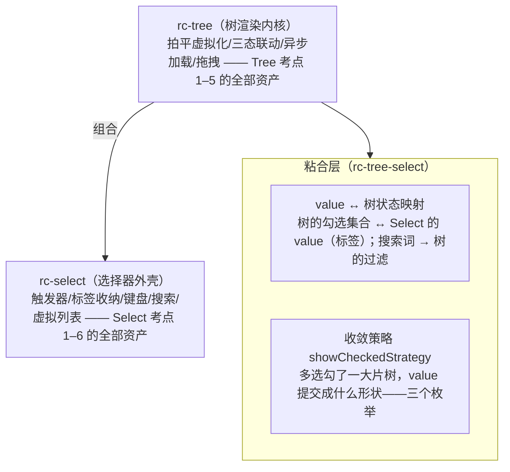

> 本文是《Lv3 复杂交互组件（公认最考功力）》按小节拆分后的续篇，上一部分见 [18-Tree.md](18-Tree.md)。

### Cascader / TreeSelect / Transfer（★★★☆）

这一组是"组合型"考题：三个组件都不是从零造，而是**已有能力的再组合**——Cascader 是"逐级下钻的列表"，TreeSelect 是"树 + Select 收敛"，Transfer 是"两个列表 + 勾选集合"。考的正是识别组合的能力。

考点清单（原文）：

- Cascader：级联面板、搜索时展示全路径、异步加载子级
- TreeSelect：树 + 选择收敛（antd 把 Tree/Select 复用成三个组件，学它的分层）
- Transfer：双列表穿梭 + 搜索过滤

#### Cascader：级联面板

**逐级展示**：面板是 N 列并排的列表，第 1 列是顶层 options，点中某项后第 2 列出现它的 children，以此类推；激活路径就是 `value`（antd 的 Cascader value 是**全路径数组**，如 `['福建', '厦门']`——这是它和 Select 最大的协议差异）。列内容由路径实时派生：

```tsx
import { useState } from 'react';

export interface CascaderOption {
  value: string;
  label: string;
  children?: CascaderOption[];
  isLeaf?: boolean; // false = 还有下一级（可能未加载，见异步小节）
}

/** 列生成：沿激活路径逐级取 children。path=[省, 市] → [省级列, 市级列, 区级列(若市已选中且有 children)] */
export function getCascaderColumns(options: CascaderOption[], path: string[]): CascaderOption[][] {
  const columns: CascaderOption[][] = [options];
  let current = options;
  for (const v of path) {
    const hit = current.find((o) => o.value === v);
    if (!hit?.children?.length) break; // 路径中断（或已到叶子）就不再生成列
    columns.push(hit.children);
    current = hit.children;
  }
  return columns;
}

/**
 * 受控路径的级联面板。
 * 设计：path（内部路径）驱动列展示——点任意列任意项都是"截断到本列再落位"（跳列点击 = 换分支）；
 * onPathChange 每次点击都回调，是否"算完成"由调用方判定（点到叶子才收起提交，即 antd 默认口径；
 * changeOnSelect 语义则是对每个回调都照单全收）。
 */
export function CascaderPanel({ options, path, onPathChange }: {
  options: CascaderOption[];
  path: string[];                        // 当前激活路径：['福建','厦门'] → 已展示两列 + 第三列（厦门的 children）
  onPathChange: (next: string[]) => void;
}) {
  const columns = getCascaderColumns(options, path);
  return (
    <div style={{ display: 'flex', gap: 8 }}>
      {columns.map((col, level) => (
        <ul key={level} role="listbox" style={{ listStyle: 'none', minWidth: 120, maxHeight: 240, overflowY: 'auto', margin: 0, padding: 4, borderRight: '1px solid #f0f0f0' }}>
          {col.map((opt) => {
            const active = path[level] === opt.value;                 // 本列激活项 = 路径第 level 段
            const isLeaf = !opt.children?.length && (opt.isLeaf ?? true);
            return (
              <li key={opt.value} role="option" aria-selected={active}
                onClick={() => onPathChange([...path.slice(0, level), opt.value])} // 截断到本列再落位
                style={{ padding: '4px 8px', background: active ? '#f0f5ff' : undefined, cursor: 'pointer' }}>
                {opt.label}
                {!isLeaf && <span style={{ float: 'right', color: '#999' }}>›</span>}
              </li>
            );
          })}
        </ul>
      ))}
    </div>
  );
}
// 调用方收尾：onPathChange 回调里判断新路径末项是否叶子，是则 onChange 提交并关闭面板（antd 默认）；
// changeOnSelect 场景则每次回调都提交。
```

**搜索时展示全路径**：级联数据搜索的正确姿势不是只匹配叶子名，而是**把所有"根到叶"的路径拍平成数组**，按完整路径文本过滤，命中项展示"福建 / 厦门 / 思明区"。用户搜"思明"能直接看到它挂在哪条链上，点选即提交整条路径：

```tsx
/** 路径拍平：所有根→叶路径 → {valuePath, labelPath}。Cascader 搜索的数据底座 */
export function flattenCascaderPaths(options: CascaderOption[], parents: CascaderOption[] = []): { valuePath: string[]; labelPath: string[] }[] {
  const out: { valuePath: string[]; labelPath: string[] }[] = [];
  for (const o of options) {
    if (o.children?.length) out.push(...flattenCascaderPaths(o.children, [...parents, o]));
    else out.push({ valuePath: [...parents, o].map((n) => n.value), labelPath: [...parents, o].map((n) => n.label) });
  }
  return out;
}

/** 搜索：按"完整路径文本"过滤，返回可渲染的命中行 */
export function searchCascader(options: CascaderOption[], keyword: string) {
  const kw = keyword.trim().toLowerCase();
  if (!kw) return [];
  return flattenCascaderPaths(options)
    .filter(({ labelPath }) => labelPath.join(' / ').toLowerCase().includes(kw));
}
// 渲染：searchCascader(options, kw).map(hit => <li onClick={() => onChange(hit.valuePath)}>{hit.labelPath.join(' / ')}</li>)
```

antd 的对应能力是 `showSearch` 对象配置（`filter` 自定义过滤、`render` 自定义命中行渲染、`limit` 限流），语义与上面一致。

**异步加载子级**：antd 的 `loadData(selectedOptions)` 约定——点开 `isLeaf: false` 的选项时触发，把 children push 进最后一项（不可变更新 treeData）：

```tsx
import { Cascader } from 'antd';
import { useState } from 'react';

interface AntdOption {
  value: string;
  label: string;
  isLeaf?: boolean;
  loading?: boolean; // antd 选项级 loading 标记（官方异步 demo 即用此字段）
  children?: AntdOption[];
}

function LazyCascader() {
  const [options, setOptions] = useState<AntdOption[]>([
    { value: 'zhejiang', label: '浙江', isLeaf: false }, // isLeaf:false → 触发 loadData
  ]);

  const loadData = async (selectedOptions: AntdOption[]) => {
    const target = selectedOptions[selectedOptions.length - 1]; // 约定：最后一项是待加载的
    target.loading = true;                                      // 选项上直接标 loading，行内出 spinner
    const children: AntdOption[] = await fetch(`/api/regions?parent=${target.value}`)
      .then((r) => r.json() as Promise<{ value: string; label: string }[]>);
    target.loading = false;
    target.children = children.map((c) => ({ ...c, isLeaf: false })); // 逐级都可再加载
    setOptions([...options]);                                   // 触发重渲染（antd demo 同款写法）
  };

  return <Cascader options={options} loadData={loadData} onChange={(value) => console.log(value)} changeOnSelect />;
  // changeOnSelect：允许只选到中间层级（默认必须点到叶子）
}
```

#### TreeSelect：树 + 选择收敛（antd 的三层复用）

> TreeSelect：树 + 选择收敛（antd 把 Tree/Select 复用成三个组件，学它的分层）

antd 的 TreeSelect 内核是 rc-tree-select，它的分层是本组件最值得抄的架构：



**收敛策略**是粘合层的关键设计。设树为"华东(上海, 杭州)、华南(深圳)"，勾选上海+杭州（联动使华东 checked）。三种策略下的 value：

```text
策略                          value（提交口径）                     适用场景
──────────────────────────────────────────────────────────────────────────────
TreeSelect.SHOW_ALL          [华东, 上海, 杭州]                     需要完整还原勾选明细（回显最省事，数据最啰嗦）
TreeSelect.SHOW_PARENT       [华东]                                只要分组口径（提交最精简，回显需再查树）
TreeSelect.SHOW_CHILD        [上海, 杭州]                          只要叶子明细（统计报表类最常见）
```
<!-- 保留原 ASCII 图:此处本质是策略 × value 提交口径 × 适用场景的多列对照表,Mermaid 无等价图表类型(转图表会丢按行按列查的对照语义),故不做替换 -->

```tsx
import { TreeSelect } from 'antd';

const { SHOW_CHILD } = TreeSelect;

<TreeSelect
  treeData={[
    { title: '华东', value: 'east', children: [
      { title: '上海', value: 'sh' },
      { title: '杭州', value: 'hz' },
    ] },
    { title: '华南', value: 'south', children: [{ title: '深圳', value: 'sz' }] },
  ]}
  treeCheckable                              // 开树勾选（三态联动自动生效，即 Tree 考点 2）
  showCheckedStrategy={SHOW_CHILD}           // 收敛策略：提交叶子明细
  treeDefaultExpandAll
  maxTagCount="responsive"                   // Select 考点 6 的溢出收纳，在树上直接复用
/>
```

"学它的分层"学到手的标准是：当你给团队写一个"组织架构选择器"时，第一反应不该是重写一个组件，而是**树数据源 + rc-select 外壳 + 一层 50 行的粘合**。Cascader、TreeSelect、Select 三个组件共享一套选择器底座——这就是分层对代码量的复利。

#### Transfer：双列表穿梭

Transfer 的状态模型三件套：**dataSource**（全量，含 key/title/description/disabled）、**targetKeys**（已在右侧的 key 集合，source/target 两个列表由它切分）、**selectedKeys**（两列表勾选框的集合，**跨列表共享**——某 key 属于哪侧由 targetKeys 推导）。移动操作的核心是"勾选集合整体迁移 + 迁移后清空勾选"：

```tsx
import { useMemo, useState } from 'react';

export interface TransferItem { key: string; title: string; description?: string; disabled?: boolean }

/** 穿梭框最小内核：双列表 + 勾选迁移 + 搜索过滤 */
export function MiniTransfer({ dataSource, targetKeys, onChange }: {
  dataSource: TransferItem[];
  targetKeys: string[];
  onChange: (nextTargetKeys: string[], direction: 'left' | 'right', moveKeys: string[]) => void;
}) {
  const [selected, setSelected] = useState<Set<string>>(new Set());        // 勾选集合：左右两侧共享
  const [kw, setKw] = useState({ left: '', right: '' });

  const targetSet = useMemo(() => new Set(targetKeys), [targetKeys]);
  const sourceItems = dataSource.filter((i) => !targetSet.has(i.key));     // 左：未在目标侧
  const targetItems = dataSource.filter((i) => targetSet.has(i.key));      // 右：已在目标侧
  const filter = (list: TransferItem[], k: string) =>
    k.trim() ? list.filter((i) => (i.title + (i.description ?? '')).toLowerCase().includes(k.trim().toLowerCase())) : list;

  const toggle = (key: string) => setSelected((prev) => {
    const next = new Set(prev);
    next.has(key) ? next.delete(key) : next.add(key);
    return next;
  });

  /** 迁移：方向由"勾选项当前在哪侧"推导；迁移的恰是勾选项；完成后勾选必须清空（见文末坑 4） */
  const move = (direction: 'left' | 'right') => {
    const moveKeys = [...selected].filter((k) =>
      direction === 'right' ? !targetSet.has(k) : targetSet.has(k));       // 只动本侧的勾选
    const nextTarget = direction === 'right'
      ? [...targetKeys, ...moveKeys]
      : targetKeys.filter((k) => !moveKeys.includes(k));
    onChange(nextTarget, direction, moveKeys);
    setSelected(new Set());                                                // 关键收尾：不清空会立刻被反向移回
  };

  const Listbox = ({ items, side }: { items: TransferItem[]; side: 'left' | 'right' }) => (
    <div style={{ width: 220, border: '1px solid #d9d9d9', borderRadius: 4 }}>
      <input placeholder={`搜索${side === 'left' ? '待选' : '已选'}列表`} value={kw[side]}
        onChange={(e) => setKw((prev) => ({ ...prev, [side]: e.target.value }))} />
      <ul style={{ listStyle: 'none', maxHeight: 240, overflowY: 'auto', margin: 0, padding: 4 }}>
        {filter(items, kw[side]).map((item) => (
          <li key={item.key}>
            <label style={{ display: 'flex', gap: 4, alignItems: 'center', opacity: item.disabled ? 0.4 : 1 }}>
              <input type="checkbox" disabled={item.disabled} checked={selected.has(item.key)}
                onChange={() => toggle(item.key)} />
              {item.title}
            </label>
          </li>
        ))}
      </ul>
    </div>
  );

  const sourceSelected = [...selected].filter((k) => !targetSet.has(k)).length; // 分侧统计：驱动按钮文案与禁用态
  const targetSelected = [...selected].filter((k) => targetSet.has(k)).length;

  return (
    <div style={{ display: 'flex', gap: 8, alignItems: 'center' }}>
      <Listbox items={sourceItems} side="left" />
      <div style={{ display: 'flex', flexDirection: 'column', gap: 4 }}>
        <button type="button" disabled={!sourceSelected} onClick={() => move('right')}>
          {sourceSelected ? `到右侧 (${sourceSelected})` : '到右侧'}
        </button>
        <button type="button" disabled={!targetSelected} onClick={() => move('left')}>
          {targetSelected ? `到左侧 (${targetSelected})` : '到左侧'}
        </button>
      </div>
      <Listbox items={targetItems} side="right" />
    </div>
  );
}
```

antd 的 Transfer 在此之上补齐了生产细节：`render`（自定义行渲染）、`pagination`（列表分页——大数据量的正解）、`showSearch` + `filterOption`（搜索）、`oneWay`（单向模式，右侧不显示勾选）、`rowKey`（自定义 key 字段）、`titles`/`operations`（文案）、`listStyle`：

```tsx
import { Transfer } from 'antd';
import type { TransferProps } from 'antd';

interface Dept { key: string; title: string; description: string; disabled?: boolean }

const onChange: TransferProps<Dept>['onChange'] = (targetKeys, direction, moveKeys) => {
  // 三参一次带全——和 Table 的 onChange 同款协议设计思想（Lv3 Table 考点 1 的"一致性"论证在这里复用）
  console.log('目标侧:', targetKeys, '方向:', direction, '本次移动:', moveKeys);
};

<Transfer
  dataSource={depts}
  targetKeys={targetKeys}
  onChange={onChange}
  showSearch
  filterOption={(inputValue, item) => item.title.includes(inputValue)} // 搜索过滤谓词
  render={(item) => `${item.title}（${item.description}）`}            // 行渲染
  pagination={{ pageSize: 10 }}                                        // 大列表分页，防万级卡死
  oneWay={false}
  rowKey={(record) => record.key}
/>
```

#### 本组常见坑（症状 → 根因 → 修法）

```text
坑 1
症状：Cascader 表单回显失败，value 明明是 '思明区' 却显示裸路径/空。
根因：Cascader 的 value 是全路径数组 ['福建','厦门','思明区']，只存末级值在 options 里找不到对应链。
修法：提交与回显统一用全路径数组；若后端只存末级，入参时用 flattenCascaderPaths 反查补全链路。

坑 2
症状：Cascader 异步 + 搜索，子级永远搜不到。
根因：搜索基于已加载的 options 拍平，未下钻过的子级根本不在内存里。
修法：二选一——搜索走后端接口（推荐，showSearch.filter 接远程），或预拉全部层级（数据量小时可行）。

坑 3
症状：TreeSelect 换了 showCheckedStrategy 后表单值形状变了，提交报错。
根因：三种策略的 value 形状语义不同（父键/叶子键/全量键），后端没跟着切。
修法：策略是"提交口径"的一部分，前后端一起定；中途切换要写值迁移（旧值按新策略重算）。

坑 4
症状：Transfer 移到右侧后，右侧列表的勾选还是亮的，再点一下按钮又被移回左侧。
根因：move 之后没清空勾选集合，同一批 key 还在 selectedKeys 里。
修法：迁移完成后 setSelected(new Set())（见 MiniTransfer.move 的收尾行）；antd 内部同样如此。

坑 5
症状：Transfer 两三千条数据列表滚动掉帧。
根因：双列表全量渲染 DOM。
修法：开 pagination 分页（antd 一等公民支持）；或列表体换虚拟滚动（复用 Lv3 Select 考点 4 的 VirtualList）。
```

---

到这里，Lv3 的七组组件全部展开完毕。下一节的 Upload（★★★★）会把战场从"展示与选择"切到"文件与网络"：隐藏 input、三入口上传、并发控制与分片续传——那是另一套完全不同的功力考卷。

> 以下三个小节为增补：Cascader 懒加载回显反解、TreeSelect 标签溢出、Transfer 大数据。

---

#### 补充一：Cascader 懒加载细节与只有 value 路径时的回显反解

**是什么。** 两件事：`loadData` 异步协议的工程细节（触发条件、防重复、行内 loading）；以及**回显反解**——表单编辑场景里后端往往只存 value 路径（甚至只存末级 value），组件要把 `['fj','xm','sm']` 还原成"福建 / 厦门 / 思明区"的完整标签链，而懒加载之下更深的层级可能根本不在内存，必须沿路径逐级拉取再取 label。

**为什么值得单列。** "新选一条值"的路径人人会写；"把旧值还原成 UI"才是懒加载 Cascader 的深水区——它把网络（loadData）与换算（value→label）耦合成一条异步链，还要处理竞态（反解未完成时用户又改了值）与断链（路径中某级已被下线）。Select 和 Tree 都没有这种组合难题。

**机制分步：**

1. **loadData 协议的三个细节**（antd 约定，自实现照抄）：
   - 参数是**从根到待加载项的完整路径数组**——Tree 的 loadData 只给单个 node，这是两个协议的关键差异；`selectedOptions[selectedOptions.length - 1]` 即待加载项；
   - 触发条件：选项 `isLeaf: false` 且尚无 `children`——所以拉列表的接口必须能区分叶子/非叶子（按层级深度或 `hasChildren` 字段）；
   - 加载中状态写在**选项上**（`loading: true` → 行内 spinner），而非全局 loading——多条路径可以同时各加载各的。
   - 防重复与失败可重试靠"已加载/加载中"双集合，与 [18-Tree.md](18-Tree.md) 考点 4 的 loadedKeys/loadingKeys 三件套同构，不在此重复。
2. **反解算法骨架**：沿 valuePath 逐级走——本级在内存中找到就直接下潜；找到但 `isLeaf: false` 且无 children，就调 loader 补齐这一级（不可变更新）；某级 value 找不到即**断链**，立即停止，已解出的前缀照常显示，缺失级降级显示 value 本身（选项下线是数据常态，不是异常）。
3. **竞态防护**：反解是多段异步，valuePath 中途变化时旧任务的结果必须作废（effect cleanup 里的 cancelled 标志），否则旧结果后到会覆盖新值。

框架无关内核（不可变补齐 + 同步取 label）：

```ts
export interface LazyOption {
  value: string;
  label: string;
  isLeaf?: boolean; // false = 还有下一级且可能未加载
  children?: LazyOption[];
}

export type ChildLoader = (parentValue: string) => Promise<LazyOption[]>;

/** 不可变更新：沿 path 定位选项并合并 patch，返回新树（原树一字不动） */
export function patchOptionAtPath(
  options: LazyOption[],
  path: string[],
  patch: Partial<LazyOption>,
): LazyOption[] {
  const [head, ...rest] = path;
  return options.map((o) => {
    if (o.value !== head) return o;
    return rest.length === 0
      ? { ...o, ...patch }
      : { ...o, children: patchOptionAtPath(o.children ?? [], rest, patch) };
  });
}

/** 沿 valuePath 逐级确保子级在内存。断链即停；已加载层级不重复请求（幂等，可安全重跑） */
export async function ensurePathLoaded(
  options: LazyOption[],
  valuePath: string[],
  loadChildren: ChildLoader,
): Promise<{ next: LazyOption[]; resolvedDepth: number }> {
  let next = options;
  let level: LazyOption[] | undefined = options;
  let resolvedDepth = 0;
  for (let i = 0; i < valuePath.length; i++) {
    const hit = level?.find((o) => o.value === valuePath[i]);
    if (!hit) break; // 断链：前缀仍有效
    resolvedDepth = i + 1;
    if (i === valuePath.length - 1) break; // 末级只要自身 label，不需要 children
    if (hit.children === undefined && hit.isLeaf === false) {
      const children = await loadChildren(hit.value); // 空数组也算"已加载"，防止 effect 重跑死循环
      next = patchOptionAtPath(next, valuePath.slice(0, i + 1), { children });
      level = children;
    } else {
      level = hit.children;
    }
  }
  return { next, resolvedDepth };
}

/** 同步反解：valuePath → label 链；断链返回已解出的前缀并标记 complete=false */
export function resolveLabels(
  options: LazyOption[],
  valuePath: string[],
): { labels: string[]; complete: boolean } {
  const labels: string[] = [];
  let level: LazyOption[] | undefined = options;
  for (const value of valuePath) {
    const hit = level?.find((o) => o.value === value);
    if (!hit) return { labels, complete: false };
    labels.push(hit.label);
    level = hit.children;
  }
  return { labels, complete: labels.length === valuePath.length };
}
```

竞态安全的反解 hook（编辑表单里 valuePath 一变就重解，旧任务作废）：

```tsx
import { useEffect, useRef, useState } from 'react';
import { ensurePathLoaded, resolveLabels, type ChildLoader, type LazyOption } from './cascaderEcho';

export function useCascaderEcho(
  initialOptions: LazyOption[],
  valuePath: string[],
  loadChildren: ChildLoader,
): { display: string; loading: boolean; complete: boolean } {
  const [options, setOptions] = useState(initialOptions);
  const [labels, setLabels] = useState<string[]>(() => resolveLabels(initialOptions, valuePath).labels);
  const [loading, setLoading] = useState(false);
  const loaderRef = useRef(loadChildren);
  loaderRef.current = loadChildren; // loader 可每渲染换新引用，执行时取最新

  useEffect(() => {
    let cancelled = false; // 竞态防护：valuePath 变化/卸载即作废在途任务
    const sync = resolveLabels(options, valuePath);
    setLabels(sync.labels);
    if (sync.complete) return; // 全在内存：纯同步，零请求
    setLoading(true);
    ensurePathLoaded(options, valuePath, (v) => loaderRef.current(v))
      .then(({ next }) => {
        if (cancelled) return;
        setOptions(next); // ensurePathLoaded 幂等：本次 set 触发的重跑不会再发请求
        setLabels(resolveLabels(next, valuePath).labels);
        setLoading(false);
      })
      .catch(() => {
        if (!cancelled) setLoading(false); // 网络失败：保留前缀显示，不抛穿
      });
    return () => {
      cancelled = true;
    };
  }, [valuePath, options]);

  const complete = labels.length === valuePath.length;
  const display = [...labels, ...valuePath.slice(labels.length)].join(' / '); // 断链降级：缺的级直接展示 value
  return { display, loading, complete };
}
```

最小 Vitest（断链、幂等、不可变三件事各一条）：

```ts
import { describe, expect, it } from 'vitest';
import { ensurePathLoaded, resolveLabels, type LazyOption } from './cascaderEcho';

const tree: LazyOption[] = [
  { value: 'fj', label: '福建', isLeaf: false }, // 子级未加载
  { value: 'gd', label: '广东', isLeaf: true },
];

it('resolveLabels：全链命中与断链前缀', () => {
  const loaded: LazyOption[] = [
    { value: 'fj', label: '福建', children: [
      { value: 'xm', label: '厦门', children: [{ value: 'sm', label: '思明区' }] },
    ] },
  ];
  expect(resolveLabels(loaded, ['fj', 'xm', 'sm'])).toEqual({ labels: ['福建', '厦门', '思明区'], complete: true });
  expect(resolveLabels(loaded, ['fj', 'sz'])).toEqual({ labels: ['福建'], complete: false });
});

it('ensurePathLoaded：逐级恰好各请求一次、幂等、原树不可变', async () => {
  const calls: string[] = [];
  const loader = async (parent: string) => {
    calls.push(parent);
    return parent === 'fj' ? [{ value: 'xm', label: '厦门', isLeaf: false }] : [{ value: 'sm', label: '思明区' }];
  };
  const { next, resolvedDepth } = await ensurePathLoaded(tree, ['fj', 'xm', 'sm'], loader);
  expect(calls).toEqual(['fj', 'xm']);
  expect(resolvedDepth).toBe(3);
  expect(resolveLabels(next, ['fj', 'xm', 'sm']).complete).toBe(true);
  expect(tree[0].children).toBeUndefined(); // 原树未被就地修改
  await ensurePathLoaded(next, ['fj', 'xm', 'sm'], loader);
  expect(calls).toEqual(['fj', 'xm']); // 幂等：重跑零请求
});

it('ensurePathLoaded：断链立即停止，不触发加载', async () => {
  const loader = async () => {
    throw new Error('不该被调用');
  };
  const { resolvedDepth } = await ensurePathLoaded(tree, ['xx', 'yy'], loader);
  expect(resolvedDepth).toBe(0);
});
```

坑表：

| # | 症状 | 根因 | 修法 |
|---|---|---|---|
| 1 | 编辑表单 Cascader 显示裸 value（如 "sm"） | 只存末级 value 或只做同步查找，懒加载子级不在内存 | 先补全 valuePath（后端反查或前文 flattenCascaderPaths），再 ensurePathLoaded 异步反解 |
| 2 | 反解结果闪一下又被旧结果覆盖 | 异步任务无竞态废弃，旧的后来居上 | cleanup 置 cancelled，落地前检查 |
| 3 | 同一节点反复发 loadData | 没有"已加载"集合 | loaded/loading 双集合（同 18-Tree 考点 4） |
| 4 | 断链路径白屏/报错 | 把"找不到"当异常抛 | 断链是数据常态：前缀照常显示，缺级降级展示 value |

---

#### 补充二：TreeSelect 多选标签溢出（maxTagCount、+N 收纳与溢出标签 hover 展示）

**是什么。** 多选 TreeSelect 勾选一堆节点后，触发器里是一排标签；放不下时折叠为 +N，且 +N 要能 hover（和键盘聚焦）展开看全部被收纳的标签。

**为什么值得单列。** 标签溢出是 Select 的老问题——测量式 responsive 收纳已在 [13-Lv3-复杂交互组件-公认最考功力.md](13-Lv3-复杂交互组件-公认最考功力.md) 考点 6 用"两遍渲染测宽 + 贪心装舱"详展，此处不重复；树的增量有二：label 要从树里查（value 是 key 不是文本）；**SHOW_CHILD 口径勾满一棵子树会产生几十个标签，先做"子树折叠"再谈收纳**才是树场景的正解次序。

**机制分步：**

1. **两种收纳模式**：固定数（`maxTagCount: 3`，可预测、表单栅格友好）与响应式（按容器宽测量收纳，见 13-Lv3 考点 6）。触发器宽度可变用 responsive，固定宽度用固定数。
2. **树的前置压缩——子树折叠**：展示层逆向使用 SHOW_PARENT 换算——某父节点的全部后代都在已选集合时，标签区只显示父标签一条。折叠之后 +N 往往直接消失，收纳问题降维。
3. **+N 的展开通道**：+N 本身可聚焦（键盘可达），hover/focus 弹小浮层列出全部被收纳标签；antd 的扩展点是 `maxTagPlaceholder={(omitted) => ...}`，omitted 即被收纳数组。

```tsx
import { useId, useState } from 'react';

export interface TreeNodeLike {
  value: string;
  title: string;
  children?: TreeNodeLike[];
}

export interface TagItem {
  value: string;
  label: string;
}

/** 树拍平：全层级 value → label 映射（懒加载/脏数据下查不到时降级显示 value） */
export function flattenTreeLabels(nodes: TreeNodeLike[], out = new Map<string, string>()): Map<string, string> {
  for (const n of nodes) {
    out.set(n.value, n.title);
    if (n.children?.length) flattenTreeLabels(n.children, out);
  }
  return out;
}

/**
 * 子树折叠（展示层按 SHOW_PARENT 口径压缩）：
 * 某父节点全部后代都在 selected 里 → 只保留父标签；部分选中 → 递归下潜保留明细。
 */
export function collapseToParentTags(tree: TreeNodeLike[], selected: ReadonlySet<string>): TagItem[] {
  const out: TagItem[] = [];
  const walk = (nodes: TreeNodeLike[]): boolean => {
    // 返回 true = 这组节点构成的子树已整棵选中（父标签可代言）
    let fully = nodes.length > 0;
    for (const n of nodes) {
      if (selected.has(n.value)) {
        out.push({ value: n.value, label: n.title }); // 父值本身已选（SHOW_PARENT 提交口径）：直接显示
        continue;
      }
      if (!n.children?.length) {
        fully = false; // 未选中的叶子：本子树不完整
        continue;
      }
      const before = out.length;
      if (walk(n.children)) {
        out.length = before; // 子代明细全部收回，改由父标签代言
        out.push({ value: n.value, label: n.title });
      } else {
        fully = false;
      }
    }
    return fully;
  };
  walk(tree);
  return out;
}

/** 固定数收纳 + +N hover/focus 展示（responsive 模式见 13-Lv3 考点 6 的测量法） */
export function TagOverflow({ tags, max = 2 }: { tags: TagItem[]; max?: number }) {
  const [open, setOpen] = useState(false);
  const tooltipId = useId();
  if (tags.length === 0) return null;
  const visible = tags.slice(0, max);
  const omitted = tags.slice(max);
  return (
    <div style={{ display: 'inline-flex', gap: 4, alignItems: 'center' }}>
      {visible.map((t) => (
        <span key={t.value} style={{ background: '#f0f5ff', borderRadius: 4, padding: '2px 6px', fontSize: 12 }}>
          {t.label}
        </span>
      ))}
      {omitted.length > 0 && (
        <span
          tabIndex={0} // 键盘可达：+N 不只是鼠标装饰
          aria-describedby={open ? tooltipId : undefined}
          onMouseEnter={() => setOpen(true)}
          onMouseLeave={() => setOpen(false)}
          onFocus={() => setOpen(true)}
          onBlur={() => setOpen(false)}
          style={{ position: 'relative', background: '#f5f5f5', borderRadius: 4, padding: '2px 6px', fontSize: 12 }}
        >
          +{omitted.length}
          {open && (
            <span
              id={tooltipId}
              role="tooltip"
              style={{
                position: 'absolute', top: '100%', left: 0, marginTop: 4, whiteSpace: 'nowrap',
                background: 'rgba(0,0,0,0.75)', color: '#fff', padding: '4px 8px', borderRadius: 4, zIndex: 1,
              }}
            >
              {omitted.map((t) => t.label).join('、')}
            </span>
          )}
        </span>
      )}
    </div>
  );
}
```

用法：`<TagOverflow tags={collapseToParentTags(treeData, new Set(value))} max={2} />`。

最小 Vitest：

```ts
import { describe, expect, it } from 'vitest';
import { collapseToParentTags, flattenTreeLabels, type TreeNodeLike } from './OverflowTags';

const tree: TreeNodeLike[] = [
  { value: 'east', title: '华东', children: [
    { value: 'sh', title: '上海' },
    { value: 'hz', title: '杭州' },
  ] },
  { value: 'south', title: '华南', children: [{ value: 'sz', title: '深圳' }] },
];

it('flattenTreeLabels 全层级可查', () => {
  const map = flattenTreeLabels(tree);
  expect(map.get('hz')).toBe('杭州');
  expect(map.size).toBe(5);
});

it('collapseToParentTags：整棵子树选中折叠为父标签，部分选中保留明细', () => {
  expect(collapseToParentTags(tree, new Set(['sh', 'hz', 'sz']))).toEqual([
    { value: 'east', label: '华东' }, // 华东整棵收齐 → 父标签代言
    { value: 'sz', label: '深圳' },   // 华南只选了深圳 → 保留明细
  ]);
  expect(collapseToParentTags(tree, new Set(['sh', 'sz']))).toEqual([
    { value: 'sh', label: '上海' },
    { value: 'sz', label: '深圳' },
  ]);
});
```

坑表：

| # | 症状 | 根因 | 修法 |
|---|---|---|---|
| 1 | 勾满 200 个叶子，触发器塞进 200 个标签 | 展示层照搬 SHOW_CHILD 明细 | 先 collapseToParentTags 压缩，再谈收纳 |
| 2 | +N 点了没反应 | +N 只是纯文本，没给展开通道 | hover/focus 弹层展示 omitted（antd：maxTagPlaceholder） |
| 3 | responsive 模式宽度抖动/无限重渲染 | 测量回路问题 | 见 13-Lv3 考点 6 坑表 |
| 4 | 标签显示裸 value | label 每次从 options 现查，懒加载/脏数据查不到 | flattenTreeLabels 缓存 + value 降级显示 |

---

#### 补充三：Transfer 大数据（两列表虚拟化接线 + 搜索过滤下的穿梭语义）

**是什么。** 万级 dataSource 的 Transfer：两侧列表体换虚拟滚动；同时把"搜索过滤下的全选/计数/移动"的语义定清楚——这三件事在过滤态的行为，比虚拟化本身更容易做错。

**为什么值得单列。** 虚拟化本体（定高窗口化数学）已在 [13-Lv3-复杂交互组件-公认最考功力.md](13-Lv3-复杂交互组件-公认最考功力.md) 考点 4 详展，向上 prepend 的 scrollTop 修正见 [23-VirtualList-Anchor-Progress-等.md](23-VirtualList-Anchor-Progress-等.md)，均不重复；Transfer 的增量是**勾选、过滤、移动三个集合的正交关系**——绝大多数手写 Transfer 栽在这里。

**机制分步：**

1. **虚拟化接线**：左右列表体各用一套窗口化渲染（行高固定是前提），勾选集合与 targetKeys 的推导逻辑完全不变；footer 计数仍按全量算。
2. **勾选与过滤解耦**：过滤只决定"看见什么"，绝不改写勾选集合——过滤态勾的项，清掉过滤词后必须还是勾着的。
3. **表头全选的口径**：antd 语义是"当前过滤后的可见项"——搜"张"再全选，只选姓张的；按全量实现会产出"我明明搜索了，怎么全选了 8000 人"的事故。表头三态（全选/半选/未选）也按可见项判定。
4. **移动语义**：move 作用于勾选集合整体，与当前过滤无关——用户勾选后换了搜索词，被隐藏的已勾选项必须照样被移走。

过滤口径的三个纯函数（本节核心，全部可单测）：

```ts
/** 全选（过滤口径）：把"当前可见且未禁用"的项并入选中集合 */
export function selectAllVisible(
  selected: ReadonlySet<string>,
  visibleKeys: readonly string[],
  disabled: ReadonlySet<string>,
): Set<string> {
  const next = new Set(selected);
  for (const k of visibleKeys) {
    if (!disabled.has(k)) next.add(k);
  }
  return next;
}

/** 取消全选（过滤口径）：只移除可见项，过滤外的勾选原样保留 */
export function deselectAllVisible(
  selected: ReadonlySet<string>,
  visibleKeys: readonly string[],
): Set<string> {
  const next = new Set(selected);
  for (const k of visibleKeys) next.delete(k);
  return next;
}

/** 表头三态：可见可用项全选=true、部分='indeterminate'、全不选或无可用项=false */
export function isAllVisibleSelected(
  selected: ReadonlySet<string>,
  visibleKeys: readonly string[],
  disabled: ReadonlySet<string>,
): boolean | 'indeterminate' {
  const usable = visibleKeys.filter((k) => !disabled.has(k));
  if (usable.length === 0) return false; // 可用项为空：不算"已全选"
  const picked = usable.filter((k) => selected.has(k)).length;
  return picked === usable.length ? true : picked === 0 ? false : 'indeterminate';
}
```

双列表虚拟化 + 过滤口径的完整接线：

```tsx
import { useMemo, useState, type ReactNode } from 'react';
import { deselectAllVisible, isAllVisibleSelected, selectAllVisible } from './filterSemantics';

export interface VTransferItem {
  key: string;
  title: string;
  disabled?: boolean;
}

const ROW_H = 32; // 虚拟化前提：定高行

/** 精简定高虚拟窗口（与 13-Lv3 考点 4 的 VirtualList 同源，内联最小版保证本节自洽） */
function VirtualWindow({ items, height, renderRow }: {
  items: VTransferItem[];
  height: number;
  renderRow: (item: VTransferItem, index: number) => ReactNode;
}) {
  const [scrollTop, setScrollTop] = useState(0);
  const overscan = 6;
  const start = Math.max(0, Math.floor(scrollTop / ROW_H) - overscan);
  const end = Math.min(items.length, Math.ceil((scrollTop + height) / ROW_H) + overscan);
  return (
    <div
      style={{ height, overflowY: 'auto', position: 'relative' }}
      onScroll={(e) => setScrollTop((e.target as HTMLDivElement).scrollTop)}
    >
      <div style={{ height: items.length * ROW_H }} /> {/* 撑高条：让滚动条长度反映全量 */}
      <div style={{ position: 'absolute', top: start * ROW_H, left: 0, right: 0 }}>
        {items.slice(start, end).map((item, i) => renderRow(item, start + i))}
      </div>
    </div>
  );
}

export function VirtualTransfer({ dataSource, targetKeys, onChange }: {
  dataSource: VTransferItem[];
  targetKeys: string[];
  onChange: (next: string[], direction: 'left' | 'right', moveKeys: string[]) => void;
}) {
  const [selected, setSelected] = useState<Set<string>>(new Set());
  const [kw, setKw] = useState({ left: '', right: '' });

  const disabledSet = useMemo(
    () => new Set(dataSource.filter((i) => i.disabled).map((i) => i.key)),
    [dataSource],
  );
  const targetSet = useMemo(() => new Set(targetKeys), [targetKeys]);

  const sides = useMemo(() => {
    const filter = (list: VTransferItem[], k: string) => {
      const q = k.trim().toLowerCase();
      return q ? list.filter((i) => i.title.toLowerCase().includes(q)) : list;
    };
    const source = dataSource.filter((i) => !targetSet.has(i.key));
    const target = dataSource.filter((i) => targetSet.has(i.key));
    return { source, target, sourceVisible: filter(source, kw.left), targetVisible: filter(target, kw.right) };
  }, [dataSource, targetSet, kw]);

  const headerToggle = (side: 'left' | 'right') => {
    const visible = (side === 'left' ? sides.sourceVisible : sides.targetVisible).map((i) => i.key);
    setSelected((prev) =>
      isAllVisibleSelected(prev, visible, disabledSet) === true
        ? deselectAllVisible(prev, visible) // 已全选 → 只撤可见
        : selectAllVisible(prev, visible, disabledSet), // 未选/半选 → 补齐可见
    );
  };

  /** 移动作用域 = 勾选集合整体，与当前过滤无关（被隐藏的勾选项同样被移走） */
  const move = (direction: 'left' | 'right') => {
    const moveKeys = [...selected].filter((k) =>
      direction === 'right' ? !targetSet.has(k) : targetSet.has(k));
    onChange(
      direction === 'right'
        ? [...targetKeys, ...moveKeys]
        : targetKeys.filter((k) => !moveKeys.includes(k)),
      direction,
      moveKeys,
    );
    setSelected(new Set()); // 迁移后清空勾选（前文坑 4 同款收尾）
  };

  const Listbox = ({ side }: { side: 'left' | 'right' }) => {
    const all = side === 'left' ? sides.source : sides.target;
    const visible = side === 'left' ? sides.sourceVisible : sides.targetVisible;
    const keys = visible.map((i) => i.key);
    const state = isAllVisibleSelected(selected, keys, disabledSet);
    return (
      <div style={{ width: 240, border: '1px solid #d9d9d9', borderRadius: 4 }}>
        <input
          value={kw[side]}
          placeholder="搜索"
          onChange={(e) => setKw((p) => ({ ...p, [side]: e.target.value }))}
        />
        <label style={{ display: 'block', padding: '0 4px' }}>
          <input
            type="checkbox"
            checked={state === true}
            ref={(el) => {
              if (el) el.indeterminate = state === 'indeterminate'; // 表头三态
            }}
            onChange={() => headerToggle(side)}
          />
          全选（过滤后 {visible.length} / 全量 {all.length}）
        </label>
        <VirtualWindow
          items={visible}
          height={224}
          renderRow={(item) => (
            <label
              key={item.key}
              style={{ display: 'flex', height: ROW_H, alignItems: 'center', gap: 4, opacity: item.disabled ? 0.4 : 1 }}
            >
              <input
                type="checkbox"
                disabled={item.disabled}
                checked={selected.has(item.key)}
                onChange={() =>
                  setSelected((prev) => {
                    const n = new Set(prev);
                    if (n.has(item.key)) n.delete(item.key);
                    else n.add(item.key);
                    return n;
                  })
                }
              />
              {item.title}
            </label>
          )}
        />
      </div>
    );
  };

  const sourceSelected = [...selected].filter((k) => !targetSet.has(k)).length;
  const targetSelected = [...selected].filter((k) => targetSet.has(k)).length;

  return (
    <div style={{ display: 'flex', gap: 8, alignItems: 'center' }}>
      <Listbox side="left" />
      <div style={{ display: 'flex', flexDirection: 'column', gap: 4 }}>
        <button type="button" disabled={!sourceSelected} onClick={() => move('right')}>
          到右侧 ({sourceSelected})
        </button>
        <button type="button" disabled={!targetSelected} onClick={() => move('left')}>
          到左侧 ({targetSelected})
        </button>
      </div>
      <Listbox side="right" />
    </div>
  );
}
```

最小 Vitest：

```ts
import { describe, expect, it } from 'vitest';
import { deselectAllVisible, isAllVisibleSelected, selectAllVisible } from './filterSemantics';

const disabled = new Set(['d1']);

it('selectAllVisible 只补"可见且可用"项', () => {
  const next = selectAllVisible(new Set(['keep']), ['a', 'd1', 'b'], disabled);
  expect([...next].sort()).toEqual(['a', 'b', 'keep']); // d1 禁用不强选
});

it('deselectAllVisible 不动过滤外的勾选', () => {
  const next = deselectAllVisible(new Set(['a', 'hidden']), ['a']);
  expect([...next]).toEqual(['hidden']);
});

it('isAllVisibleSelected 三态判定', () => {
  expect(isAllVisibleSelected(new Set(['a']), ['a', 'b'], disabled)).toBe('indeterminate');
  expect(isAllVisibleSelected(new Set(['a']), ['a'], disabled)).toBe(true);
  expect(isAllVisibleSelected(new Set(), ['d1'], disabled)).toBe(false); // 可用项为空
});
```

坑表：

| # | 症状 | 根因 | 修法 |
|---|---|---|---|
| 1 | 搜索后点全选，没搜到的几千条也被选了 | 全选按全量而非"过滤后可见"实现 | selectAllVisible 只吃 visibleKeys |
| 2 | 换搜索词后穿梭，被隐藏的勾选项没过去 | move 前按可见列表过滤了 moveKeys | move 作用域 = 勾选集合整体 |
| 3 | 虚拟列表滚动白屏/行高跳动 | 行高不固定（description 换行等） | 定高行 + 文本省略；变高场景见 23-VirtualList |
| 4 | 过滤态 footer 计数误导用户 | 计数没区分全量/过滤后 | 表头文案带"过滤后 y / 全量 z" |
| 5 | 移动后勾选残留，再点按钮反向移回 | 迁移后未清空勾选 | setSelected(new Set())（前文坑 4 同根） |


---

## 附:ASCII 图替换清单

本文档图形化改版,原 ASCII 字符图与 Mermaid 图表对应关系如下:

| 原图位置 / 标题 | 处理结果 |
| --- | --- |
| TreeSelect:rc-select / rc-tree 分层(组合 + 粘合层) | 替换为 flowchart(分层结构) |
| 收敛策略 showCheckedStrategy 三策略对照 | 保留原图(策略 × 提交口径 × 适用场景多列对照表,Mermaid 无等价图表类型) |
