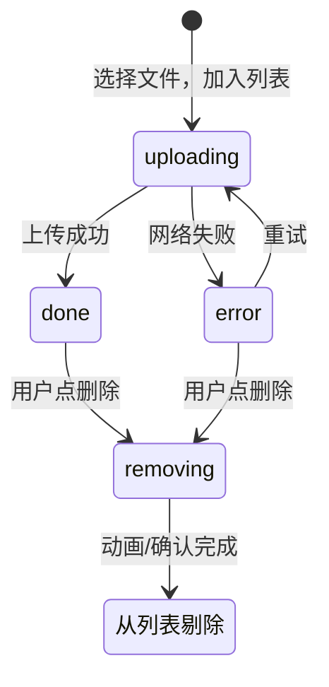
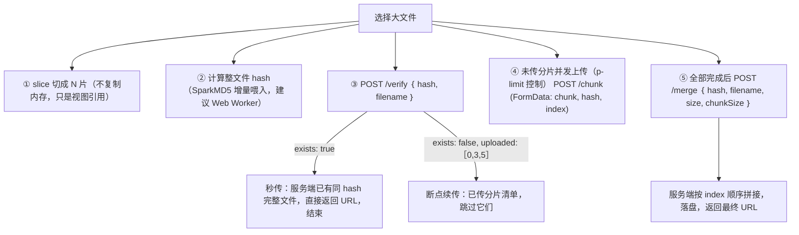

> 本文是《Lv3 复杂交互组件（公认最考功力）》按小节拆分后的续篇，上一部分见 [19-Cascader-TreeSelect-Transfer.md](19-Cascader-TreeSelect-Transfer.md)。

### Upload（★★★★）

> 本节骨架（原大纲）：
> - 隐藏 input + 点击/拖拽/粘贴三入口
> - beforeUpload 返回 false 转手动上传；xhr onprogress 进度
> - **并发控制（p-limit）、分片上传、断点续传（hash 秒传）**、图片裁剪预览

Upload 是 Lv3 里一个特殊的存在：它的 DOM 极少（一个隐藏的 `<input type="file">` 而已），难点全部在**协议与流程**上——怎么把文件从浏览器安全地搬到服务端，怎么在弱网、大文件、批量并发、页面刷新这些现实条件下不出错。你可以把它理解为"文件版的 Table"：Table 的本质是受控协议工程（见前文 Table 一节），Upload 的本质是**上传状态机 + 网络工程**。antd 的 Upload 把这一整套封装成了 `action` / `data` / `headers` / `name` / `withCredentials` / `customRequest` 的 props 协议，本节我们从零把它造一遍，造完再回头看 antd 的 API 设计会非常亲切。

考点地图（与原大纲一一对应）：

1. **三入口**：点击、拖拽、粘贴，各自的监听方式与数据获取通道（`input.change` / `DataTransfer.files` / `clipboardData.files`），以及 `FileReader` 与 `URL.createObjectURL` 两条预览路线。
2. **beforeUpload 返回 false 转手动上传**：受控 `fileList` 的状态机（`uploading / done / error / removing`）。
3. **xhr onprogress 进度**：为什么进度条必须用 XHR 而不是 fetch；FormData 上传的完整函数。
4. **并发控制 p-limit**：实现原理（手写 20 行版）与批量/分片场景的接入方式。
5. **大文件分片上传全流程**：`slice` 分块 + SparkMD5 增量 hash + 并发上传 + 合并通知；断点续传与秒传的接口约定。
6. **图片裁剪预览要点**：显示坐标与原图坐标的换算、canvas 导出。

---

#### 考点一：隐藏 input + 点击/拖拽/粘贴三入口

**先分清两个"数据搬运工"**，这是本考点的概念地基：

- **`DataTransfer`**：拖拽（`event.dataTransfer`）和粘贴（`event.clipboardData`）事件对象上携带文件的容器，从**事件**里**拿 File 对象**，不读内容。
- **`FileReader`**：把 File 的**内容读进内存**（`readAsDataURL` / `readAsArrayBuffer` / `readAsText`），用于本地预览或前端处理（如压缩、hash）。`input.change` 拿到的 `event.target.files` 是 `FileList`，不经 DataTransfer。

一句话：DataTransfer 负责"取文件"，FileReader 负责"读文件"。取到 File 之后，预览还有一条更便宜的路——`URL.createObjectURL(file)` 直接生成一个 blob: URL 给 ``，不把文件内容复制进 JS 堆，代价是要记得 `revokeObjectURL` 释放引用。

**入口一：点击。** 原生文件选择器只能由用户手势触发，而且唯一的触发方式就是 input 元素自己的 `click()`。所以所有组件库的做法一致：渲染一个 `display: none` 的 input，点击自定义按钮时代理触发它：

```tsx
// input 必须真实存在于 DOM 中，display:none 即可（antd 同款做法）
<input ref={inputRef} type="file" style={{ display: 'none' }} multiple onChange={onChange} />
<button onClick={() => inputRef.current?.click()}>点击上传</button>
```

**入口二：拖拽。** 最容易踩的坑在这里：浏览器对"往页面里拖文件"有一个默认行为（松手后直接打开这个文件，等于整页被劫持）。要允许 drop，必须在 `dragover`（以及保险起见的 `dragenter`）上 `preventDefault()`，这个默认行为才会被取消：

```tsx
<div
  onDragOver={(e) => e.preventDefault()}          // 不取消默认行为就无法触发 drop
  onDragEnter={(e) => e.preventDefault()}
  onDrop={(e) => {
    e.preventDefault();
    const files = Array.from(e.dataTransfer.files); // DataTransfer.files：FileList → 数组
    handleFiles(files);
  }}
>
  拖拽文件到此区域
</div>
```

顺手提一个进阶点：`e.dataTransfer.items` 里的 entry（`webkitGetAsEntry()`）能拿到**拖入的文件夹**结构，可递归遍历上传目录——网盘类产品靠它，普通业务不需要。

**入口三：粘贴。** 监听 `paste` 事件，文件在 `e.clipboardData.files` 里（QQ/微信截图后 Ctrl+V 就是这条通道）。注意 paste 只在页面有焦点时触发，用户如果焦点停在地址栏上是收不到的：

```tsx
useEffect(() => {
  const onPaste = (e: ClipboardEvent) => {
    const files = Array.from(e.clipboardData?.files ?? []);
    if (files.length > 0) handleFiles(files);
  };
  document.addEventListener('paste', onPaste);
  return () => document.removeEventListener('paste', onPaste);
}, []);
```

**三个入口汇流之后有一个公共细节：input 重置。** 连续两次选择同一个文件，第二次 `change` 不触发——因为 input 的 value 没变。所以读走 files 后必须手动清空：

```tsx
const onChange = (e: ChangeEvent<HTMLInputElement>) => {
  const files = Array.from(e.target.files ?? []);
  handleFiles(files);
  e.target.value = ''; // 允许再次选择同一个文件
};
```

把三个入口拼成一个完整的"文件采集器"：

```tsx
import {
  useEffect,
  useRef,
  useState,
  type ChangeEvent,
  type DragEvent,
} from 'react';

export function FilePicker({
  onFiles,
  accept,
}: {
  onFiles: (files: File[]) => void;
  accept?: string;
}) {
  const inputRef = useRef<HTMLInputElement>(null);
  const [dragOver, setDragOver] = useState(false);

  useEffect(() => {
    // 入口三：粘贴。挂在 document 上，组件卸载时解绑
    const onPaste = (e: ClipboardEvent) => {
      const files = Array.from(e.clipboardData?.files ?? []);
      if (files.length) onFiles(files);
    };
    document.addEventListener('paste', onPaste);
    return () => document.removeEventListener('paste', onPaste);
  }, [onFiles]);

  return (
    <div
      // 入口二：拖拽
      onDragOver={(e: DragEvent) => {
        e.preventDefault(); // 必须：否则松手时浏览器直接打开文件
        setDragOver(true);
      }}
      onDragLeave={() => setDragOver(false)}
      onDrop={(e: DragEvent) => {
        e.preventDefault();
        setDragOver(false);
        onFiles(Array.from(e.dataTransfer.files));
      }}
      style={{
        border: dragOver ? '2px dashed #1677ff' : '2px dashed #d9d9d9',
        padding: 24,
        textAlign: 'center' as const,
      }}
    >
      {/* 入口一：点击 */}
      <input
        ref={inputRef}
        type="file"
        accept={accept}
        multiple
        style={{ display: 'none' }}
        onChange={(e: ChangeEvent<HTMLInputElement>) => {
          onFiles(Array.from(e.target.files ?? []));
          e.target.value = ''; // 重置：允许重复选择同一文件
        }}
      />
      点击选择 / 拖入文件 / Ctrl+V 粘贴截图
      <button onClick={() => inputRef.current?.click()} style={{ marginLeft: 12 }}>
        浏览文件
      </button>
    </div>
  );
}
```

---

#### 考点二：beforeUpload 返回 false 转手动上传（受控 fileList 状态机）

antd 的 `beforeUpload(file)` 支持四种返回值，语义各不相同，这是面试高频：

| 返回值 | 语义 |
|---|---|
| `true` / 不返回 | 走自动上传（组件自己发请求） |
| `false` | **阻止自动上传，但文件仍进入 fileList**——转手动上传模式 |
| `Promise<File \| Blob>` | 异步校验/加工后，用 resolve 出的新文件替换原文件（典型：前端压缩图片） |
| `Promise.reject` / `Upload.LIST_IGNORE` | 彻底拒绝，连 fileList 都不进 |

`false` 的价值：很多业务要求"先选一批、填好备注、点保存时连同表单一起提交"，或者"上传动作由父组件统一调度"。此时组件不该擅自发请求，只负责维护列表与状态。

**受控 fileList 是一个显式状态机**。antd 的 `UploadFile.status` 是 `'uploading' | 'done' | 'error' | 'removed'`（另有遗留的 `'success'`），我们的手写版保持同一形状：



为什么需要 `removing` 这个过渡态：如果删除是即时的，列表项立刻消失，退出动画（见 A3 的 visible/mounted 双状态机）没有时间播；如果删除要走服务端确认（"确定删除？"），更需要一个"删除中"的状态防止连点。`removed` 则是 antd 约定的"本条已删除"信号——`onChange` 最后会收到一次 status 为 `removed` 的变更，父组件据此从自己的受控列表里过滤掉它。

完整的手动上传实现（受控 fileList + 状态机 + 下一节的 uploadFile 函数拼装即可跑通）：

```tsx
import { useState } from 'react';

// 文件条目：状态机 + 进度
interface UploadFile {
  uid: string;
  name: string;
  size: number;
  raw: File;
  status: 'uploading' | 'done' | 'error' | 'removing';
  percent: number; // 0-100
  url?: string;    // 上传成功后的服务端地址
}

type BeforeUpload = (file: File) => boolean | Promise<File | false>;

export function ManualUpload({
  beforeUpload,
  action,
}: {
  beforeUpload?: BeforeUpload;
  action: string;
}) {
  const [fileList, setFileList] = useState<UploadFile[]>([]);

  // 不可变更新：所有状态迁移都返回新数组/新对象，绝不 push 原数组
  const patch = (uid: string, part: Partial<UploadFile>) =>
    setFileList((list) => list.map((f) => (f.uid === uid ? { ...f, ...part } : f)));

  const addFiles = async (files: File[]) => {
    for (const file of files) {
      // beforeUpload 返回 false：只入列、不上传（本组件本来就是手动模式，这里用于"拒绝/加工"语义）
      const verdict = beforeUpload ? await beforeUpload(file) : true;
      if (verdict === false) continue;
      const real: File = verdict instanceof File ? verdict : file;
      setFileList((list) => [
        ...list,
        {
          uid: `${Date.now()}-${Math.random().toString(36).slice(2)}`,
          name: real.name,
          size: real.size,
          raw: real,
          status: 'uploading',
          percent: 0,
        },
      ]);
    }
  };

  // 手动模式的核心动作：由用户点击触发，而不是选中即传
  const upload = async (file: UploadFile) => {
    try {
      const { url } = await uploadFile(file.raw, {
        action,
        onProgress: (percent) => patch(file.uid, { percent }), // 状态机：uploading + percent 增长
      });
      patch(file.uid, { status: 'done', percent: 100, url });
    } catch {
      patch(file.uid, { status: 'error' }); // 状态机：error，等待重试或删除
    }
  };

  const remove = (file: UploadFile) => {
    // 先进 removing 过渡态（播退出动画 / 弹确认框），完成后真正剔除
    patch(file.uid, { status: 'removing' });
    setTimeout(() => {
      setFileList((list) => list.filter((f) => f.uid !== file.uid)); // removed：从列表消失
    }, 300);
  };

  return (
    <div>
      <FilePicker onFiles={addFiles} />
      <ul>
        {fileList.map((f) => (
          <li key={f.uid}>
            {f.name} · {f.status === 'uploading' ? `${f.percent}%` : f.status}
            {f.status === 'error' && <button onClick={() => upload(f)}>重试</button>}
            <button onClick={() => remove(f)}>删除</button>
          </li>
        ))}
      </ul>
      <button onClick={() => fileList.filter((f) => f.status === 'error' || f.percent === 0)
        .forEach(upload)}>
        开始上传
      </button>
    </div>
  );
}
```

注意三个状态机纪律：**受控列表只做不可变更新**；**所有网络终态（done/error）都必须落进状态**，否则 UI 与真实世界脱节；**重试是把状态机拨回 uploading 再走一遍上传函数**，而不是新开一条列表项。

---

#### 考点三：xhr onprogress 进度实现（FormData 上传完整函数）

**为什么进度条必须用 XHR。** fetch 长期没有上传进度事件：响应体可以流式读（`res.body`），但**请求体**的上传进度一直是空白。后来标准允许用 `ReadableStream` 做 duplex 请求体自己计量，但要求 HTTP/2、服务器配合，且 iOS Safari 等环境长期不支持——工业实践里上传进度依旧一律走 `xhr.upload.onprogress`。XHR 在 `xhr.upload`（XMLHttpRequestUpload 对象）上派发 `progress` 事件，`e.loaded / e.total` 就是已传/总字节数（`lengthComputable` 为 false 时拿不到 total，比如 chunked 编码）。

完整函数（上一节代码引用的就是它）：

```ts
interface UploadOptions {
  action: string;
  fieldName?: string;                       // 文件字段名，服务端按它取文件
  data?: Record<string, string>;            // 附带业务字段（如目录 id）
  headers?: Record<string, string>;         // 如鉴权 token
  onProgress?: (percent: number) => void;
}

export function uploadFile(file: File, options: UploadOptions): Promise<{ url: string }> {
  return new Promise((resolve, reject) => {
    const xhr = new XMLHttpRequest();
    const form = new FormData();
    form.append(options.fieldName ?? 'file', file);
    if (options.data) {
      for (const [k, v] of Object.entries(options.data)) form.append(k, v);
    }

    xhr.open('POST', options.action);
    if (options.headers) {
      for (const [k, v] of Object.entries(options.headers)) xhr.setRequestHeader(k, v);
    }

    // 进度：只有 XHR 有上传进度事件；fetch 做不到（工业环境）
    xhr.upload.onprogress = (e) => {
      if (e.lengthComputable) {
        options.onProgress?.(Math.round((e.loaded / e.total) * 100));
      }
    };

    xhr.onload = () => {
      // HTTP 层完成还要看状态码：2xx 才算业务成功
      if (xhr.status >= 200 && xhr.status < 300) {
        try {
          resolve(JSON.parse(xhr.responseText));
        } catch {
          reject(new Error('响应不是合法 JSON'));
        }
      } else {
        reject(new Error(`上传失败：HTTP ${xhr.status}`));
      }
    };
    xhr.onerror = () => reject(new TypeError('网络错误')); // 断网/DNS/CORS
    xhr.onabort = () => reject(new DOMException('已取消', 'AbortError')); // 可接 xhr.abort() 做取消上传

    xhr.send(form); // 千万不要手动设置 Content-Type（见下方坑表）
  });
}
```

一个必背细节：`xhr.send(FormData)` 会自动带上 `Content-Type: multipart/form-data; boundary=----WebKitFormBoundaryXXX`，boundary 是随机生成的分隔符。如果你 `setRequestHeader('Content-Type', 'multipart/form-data')` 手动覆盖，boundary 丢失，服务端无法切分表单——这是新手最常见的一发必炸。JSON 字段放在 FormData 里一起传即可，不需要单独的 JSON 请求。

---

#### 考点四：并发控制 p-limit（实现原理：手写 20 行 + 接入）

**为什么需要并发控制。** 批量上传 50 个文件或大文件的 100 个分片时，`Promise.all(tasks.map(upload))` 会同时发出全部请求。浏览器的限制立刻撞上：HTTP/1.1 下同域名最多 6 个 TCP 连接（HTTP/2 虽多路复用但服务端并发处理、内存、限流仍在），结果就是队列尾部请求超时、服务端被打挂、进度条全员 0%。正确姿势：**用一个并发上限（如 3–6）的闸门，任务完成一个放行一个**。npm 上的事实标准是 sindresorhus 的 p-limit。

**p-limit 的原理只有三句话**：维护 `activeCount`（在跑的任务数）和一个 FIFO 等待队列；任务到达时若已满，把自己包装成"待唤醒"的 Promise 塞进队列挂起；任务结束（无论成败）在 `finally` 里 `activeCount--` 并唤醒队首。手写 20 行版（语义与 p-limit 一致）：

```ts
// 手写 p-limit：并发上限 + 先进先出 + 异常也释放槽位
export function createLimit(concurrency: number) {
  let activeCount = 0;
  const queue: Array<() => void> = []; // 等待者的 resolve 函数队列

  const next = () => {
    activeCount--;
    queue.shift()?.(); // 唤醒队首
  };

  return async function limit<T>(fn: () => Promise<T>): Promise<T> {
    if (activeCount >= concurrency) {
      // 已满：挂起自己，等上一个任务结束时被唤醒
      await new Promise<void>((resolve) => queue.push(resolve));
    }
    activeCount++;
    try {
      return await fn();
    } finally {
      next(); // 成败都释放槽位——否则一个 reject 就永久少一个坑
    }
  };
}
```

三个容易写错的点单独强调：

1. **释放必须在 `finally`**。写在 then 里，任务抛异常后槽位永久泄漏，后续任务全部饿死。
2. **`await new Promise(push resolve)` 的入队顺序就是执行顺序**。JS 单线程保证同步代码里 push 的先后即 FIFO，不需要锁。
3. **`limit(fn)` 返回的 Promise 依然要在调用方 `await`**。闸门只控制"开始执行"，不改变 Promise 语义。

**接入**（批量上传 + 聚合进度）：

```ts
async function uploadBatch(files: File[], onTotalProgress: (p: number) => void) {
  const limit = createLimit(3); // 并发 3
  let done = 0;
  await Promise.all(
    files.map((file) =>
      limit(async () => {
        await uploadFile(file, { action: '/api/upload' }); // 考点三的函数
        done++;
        onTotalProgress(Math.round((done / files.length) * 100)); // 聚合进度
      }),
    ),
  );
}
```

---

#### 考点五：大文件分片上传全流程（slice + SparkMD5 + 并发 + 合并；断点续传与秒传）

**为什么分片。** 一个 2GB 的视频走单请求：弱网传到 95% 断线，全部重来；网关（Nginx 默认 `client_max_body_size 1m`）直接 413；超时阈值拦腰截断；服务端还要把 2GB 整个缓冲。分片把问题全部拆小：单片 5MB，失败只重传单片，断点续传成为可能。全流程：



**接口约定**（前后端共同遵守的契约，面试时能默写这张表是加分项）：

| 接口 | 方法 | 请求体 | 响应 | 语义 |
|---|---|---|---|---|
| `/api/upload/verify` | POST (JSON) | `{ hash, filename }` | `{ exists: boolean, uploaded: number[] }` | 秒传判定 + 已传分片清单 |
| `/api/upload/chunk` | POST (FormData) | 字段 `chunk`(Blob)、`hash`、`index` | `{ ok: true }` | 上传单个分片 |
| `/api/upload/merge` | POST (JSON) | `{ hash, filename, size, chunkSize }` | `{ url: string }` | 通知服务端按序合并 |

服务端只需两个持久化规则：分片文件按 `{hash}-{index}` 命名暂存；`/merge` 时校验分片齐全（`size / chunkSize` 推出总数）再顺序拼接。hash 用文件内容算出，所以**同一个文件在任何机器上 hash 相同**——这是秒传与断点续传成立的根基。

**① slice 分块 + ② SparkMD5 增量 hash**：

```ts
import SparkMD5 from 'spark-md5'; // npm i spark-md5 @types/spark-md5

// JSON 请求小助手：json() 返回 Promise<any>，这里收窄类型，后面三处复用
function postJSON<T>(url: string, body: unknown): Promise<T> {
  return fetch(url, {
    method: 'POST',
    headers: { 'Content-Type': 'application/json' },
    body: JSON.stringify(body),
  }).then((r) => r.json() as Promise<T>);
}

const CHUNK_SIZE = 5 * 1024 * 1024; // 5MB：兼顾请求数与重传成本（Nginx 需放行该上限）

// ① 分块：File 继承 Blob，slice 返回 Blob"视图"，不复制内存，秒级完成
function createChunks(file: File): Blob[] {
  const chunks: Blob[] = [];
  for (let start = 0; start < file.size; start += CHUNK_SIZE) {
    chunks.push(file.slice(start, start + CHUNK_SIZE));
  }
  return chunks;
}

// ② 增量 hash：SparkMD5.ArrayBuffer 支持分次 append，避免一次性读入整个大文件
async function hashFile(file: File): Promise<string> {
  const spark = new SparkMD5.ArrayBuffer();
  const count = Math.ceil(file.size / CHUNK_SIZE);
  for (let i = 0; i < count; i++) {
    const buf = await file.slice(i * CHUNK_SIZE, (i + 1) * CHUNK_SIZE).arrayBuffer();
    spark.append(buf); // 一片一片喂
  }
  return spark.end(); // 输出最终 MD5
}
```

为什么强调 **Web Worker**：hash 是纯 CPU 计算，1GB 文件在主线程算 MD5 会把页面卡死数秒（用户点击、动画全部冻结）。生产实现把 hashFile 搬进 worker（Vite 下零配置）：

```ts
// hash.worker.ts —— 独立线程算 hash，顺便回报进度
import SparkMD5 from 'spark-md5';

self.onmessage = async (e: MessageEvent<{ file: File }>) => {
  const { file } = e.data;
  const CHUNK = 5 * 1024 * 1024;
  const spark = new SparkMD5.ArrayBuffer();
  const count = Math.ceil(file.size / CHUNK);
  for (let i = 0; i < count; i++) {
    spark.append(await file.slice(i * CHUNK, (i + 1) * CHUNK).arrayBuffer());
    self.postMessage({ type: 'hashing', percent: Math.round(((i + 1) / count) * 100) });
  }
  self.postMessage({ type: 'done', hash: spark.end() });
};

// 主线程（Vite 写法）：
// const worker = new Worker(new URL('./hash.worker.ts', import.meta.url), { type: 'module' });
// worker.postMessage({ file });
// worker.onmessage = (e) => e.data.type === 'done' ? e.data.hash : setHashPercent(e.data.percent);
```

顺带一句安全注脚：demo 用 MD5（快、生态成熟）；对防碰撞有要求的场景换 SHA-256（`crypto.subtle.digest`，但它是一次性全量计算，增量场景仍以 SparkMD5 或 wasm 实现为主），并在 verify 时同时校验 `size`，双因子降低碰撞误判。

**③④⑤ 全流程串起来**（秒传、断点续传、并发、合并一次到位）：

```ts
async function uploadLargeFile(
  file: File,
  onProgress: (percent: number) => void,
): Promise<string> {
  const chunks = createChunks(file);
  const hash = await hashFile(file); // 生产环境换成 worker 版

  // ③ 查询：秒传判定 + 断点续传清单
  const { exists, uploaded } = await postJSON<{ exists: boolean; uploaded: number[] }>(
    '/api/upload/verify',
    { hash, filename: file.name },
  );

  if (exists) {
    onProgress(100); // 秒传：内容相同的文件已存在，零字节上传
    return await queryUrlByHash(hash);
  }

  // ④ 只传缺失分片（断点续传的关键一行：过滤 uploaded）
  const pending = chunks
    .map((chunk, index) => ({ chunk, index }))
    .filter(({ index }) => !uploaded.includes(index));
  const limit = createLimit(3); // 考点四的并发闸门
  let done = uploaded.length;

  await Promise.all(
    pending.map(({ chunk, index }) =>
      limit(async () => {
        const form = new FormData();
        form.append('chunk', chunk);
        form.append('hash', hash);
        form.append('index', String(index));
        await fetch('/api/upload/chunk', { method: 'POST', body: form });
        done++;
        onProgress(Math.round((done / chunks.length) * 100));
      }),
    ),
  );

  // ⑤ 合并通知：服务端按 index 顺序拼接落盘
  const { url } = await postJSON<{ url: string }>('/api/upload/merge', {
    hash,
    filename: file.name,
    size: file.size,
    chunkSize: CHUNK_SIZE,
  });

  return url;
}

// 辅助：秒传时服务端已持有该 hash 的文件，提供按 hash 取 URL 的查询
async function queryUrlByHash(hash: string): Promise<string> {
  const { url } = await fetch(`/api/upload/url?hash=${encodeURIComponent(hash)}`).then(
    (r) => r.json() as Promise<{ url: string }>,
  );
  return url;
}
```

断点续传还有一层"客户端缓存"变体：本地 `localStorage` 记录 `{ hash: [已传 index] }`，刷新页面后先比对本地清单再问服务端——但要以上传中的 `onUploadProgress` 打点为准，服务端清单才是唯一真相。**分片重传的失败处理**：单片失败重试 3 次（指数退避），仍失败则整体标记 error，让用户"续传"而不是"重传"——这正是断点续传的产品价值。

---

#### 考点六：图片裁剪预览要点

头像上传的标配链路：选择 → 预览 → 裁剪 → 导出 File → 上传。要点集中在**坐标系换算**：

- **预览**：`URL.createObjectURL(file)` 给 ``，便宜且同步；用完 `revokeObjectURL`。不需要 FileReader 的 dataURL（base64 会让内存膨胀 1/3）。
- **裁剪框坐标是"显示坐标"**（相对缩放后的 img 元素），**导出要的是"原图像素坐标"**（相对 naturalWidth/naturalHeight）。换算只需一个比例：`scale = img.naturalWidth / img.clientWidth`，裁剪框乘以 scale 即原图坐标。漏乘 scale 是裁剪类 bug 的第一大来源（症状：小图上裁剪偏移不明显，大图上裁出来的区域跑偏）。
- **导出**：`canvas.drawImage(img, sx, sy, sw, sh, 0, 0, sw, sh)` 截取原图区域，`canvas.toBlob` 得 Blob，`new File([blob])` 回到 File 形态，重新进入上传链路。
- **交互要点**：固定比例（1:1 头像）时拖动只改位置不改形状；最小尺寸限制；`` 加 `style={{ imageOrientation: 'from-image' }}` 处理手机照片的 EXIF 旋转，否则裁剪框和实际像素方向对不上。

一个最小可用裁剪器（拖动移动 + 等比导出）：

```tsx
import { useRef, useState, type PointerEvent as ReactPointerEvent } from 'react';

interface CropRect {
  x: number;
  y: number;
  w: number;
  h: number;
}

export function ImageCropper({
  src,
  onCropped,
}: {
  src: string; // createObjectURL 产出的预览地址
  onCropped: (file: File) => void;
}) {
  const SIZE = 200; // 固定 1:1、200×200 显示尺寸的裁剪框
  const [rect, setRect] = useState<CropRect>({ x: 40, y: 40, w: SIZE, h: SIZE });
  const imgRef = useRef<HTMLImageElement>(null);
  const dragBase = useRef<{ px: number; py: number; rect: CropRect } | null>(null);

  const onPointerDown = (e: ReactPointerEvent<HTMLDivElement>) => {
    e.currentTarget.setPointerCapture(e.pointerId); // 拖出裁剪框仍持续跟随（见 Slider 一节）
    dragBase.current = { px: e.clientX, py: e.clientY, rect };
  };
  const onPointerMove = (e: ReactPointerEvent<HTMLDivElement>) => {
    const base = dragBase.current;
    const img = imgRef.current;
    if (!base || !img) return;
    // 夹取在图片显示范围内
    const x = Math.min(Math.max(0, base.rect.x + e.clientX - base.px), img.clientWidth - base.rect.w);
    const y = Math.min(Math.max(0, base.rect.y + e.clientY - base.py), img.clientHeight - base.rect.h);
    setRect({ ...base.rect, x, y });
  };

  const exportCrop = async () => {
    const img = imgRef.current!;
    const scale = img.naturalWidth / img.clientWidth; // 显示坐标 → 原图像素坐标
    const sx = rect.x * scale;
    const sy = rect.y * scale;
    const sw = rect.w * scale;
    const sh = rect.h * scale;
    const canvas = document.createElement('canvas');
    canvas.width = sw;
    canvas.height = sh;
    canvas
      .getContext('2d')!
      .drawImage(img, sx, sy, sw, sh, 0, 0, sw, sh); // 从原图抠区域到画布
    const blob = await new Promise<Blob | null>((r) => canvas.toBlob(r, 'image/jpeg', 0.9));
    if (blob) onCropped(new File([blob], 'avatar.jpg', { type: 'image/jpeg' }));
  };

  return (
    <div>
      <div style={{ position: 'relative', display: 'inline-block' }}>
        
        <div
          onPointerDown={onPointerDown}
          onPointerMove={onPointerMove}
          onPointerUp={() => (dragBase.current = null)}
          style={{
            position: 'absolute',
            left: rect.x,
            top: rect.y,
            width: rect.w,
            height: rect.h,
            border: '2px solid #1677ff',
            cursor: 'move',
            touchAction: 'none', // pointer 事件与触摸滚动不抢手势
          }}
        />
      </div>
      <button onClick={exportCrop}>确认裁剪</button>
    </div>
  );
}
```

生产环境一般直接用 react-easy-crop / react-image-crop（缩放、旋转、多点触控都处理好了），但换算公式和导出代码与上面完全同构——这也是面试问"裁剪怎么实现"时真正想听的东西。

---

#### Upload 常见坑（症状 → 根因 → 修法）

| # | 症状 | 根因 | 修法 |
|---|---|---|---|
| 1 | 第二次选择同一文件无反应 | input 的 value 没变，change 不触发 | 读完 `e.target.files` 后 `e.target.value = ''` |
| 2 | 拖入文件后浏览器打开了文件本身 | `dragover` 没有 `preventDefault()`，drop 被默认行为接管 | dragenter/dragover 双 `preventDefault()` |
| 3 | 进度条永远不动 | 用 fetch 上传，fetch 无上传进度事件 | 换 XHR `upload.onprogress`（考点三） |
| 4 | 服务端 422/解析失败 | 手动设置了 `Content-Type: multipart/form-data`，boundary 丢失 | 删掉该 header，让浏览器自动生成 |
| 5 | 受控 fileList 删了/传完 UI 不刷新 | 用 push/splice 直接改原数组，引用未变，React 不重渲染 | 一律 map/filter 生成新数组（考点二代码） |
| 6 | 粘贴截图收不到事件 | 焦点不在页面内（地址栏/其他窗口） | 提示用户先点击页面；或把监听放到内容区可编辑元素上 |
| 7 | 分片上传 413 | 网关 body 大小上限小于 CHUNK_SIZE（Nginx 默认 1m） | 服务端调 `client_max_body_size`，或减小 CHUNK_SIZE |
| 8 | 大文件卡在"计算 hash"页面冻结 | MD5 计算在主线程，阻塞渲染 | hash 搬 Web Worker（考点五 worker 版） |

---

#### 考点七：分片上传状态机与并发调度（暂停、续传、重试、取消）

**是什么。** 考点五把分片上传写成"一个 async 函数跑到底"；真实产品要求它像下载器一样可控：随时暂停、断网重试、取消放弃、进度精确。本节把那条函数升级为**显式状态机 + 可暂停的并发调度器**。verify/chunk/merge 三接口契约见考点五接口表，不再重复。

**为什么难。** Promise 一旦发出就收不回（暂停/取消需要 AbortController 介入）；断点续传要求"停在任何时刻都能接着传"（本地计数不可信，续传前必须重新对账）；并发闸门只管"放行顺序"，管不了"暂停时把在飞请求掐掉"——考点四的 createLimit 不持有任务句柄，这正是调度器要自己造的原因。

**机制分步：**

1. **状态机**：`idle → hashing → verifying → uploading → merging → done`，`uploading ⇄ paused`（resume 回 verifying 重新对账），verify 返回 exists 直接 done（秒传），任一环节 FAIL → error。reducer 纯函数可单测，非法迁移一律忽略（防连点与乱序回调打穿状态）。
2. **暂停语义**两步：停止派发新分片（pump 检查 phase）+ abort 在飞分片（共享一个 AbortController）。被 abort 的分片**不算已传**（服务端可能只收到一半），所以 resume 必须重新 verify 拿服务端清单——"服务端真相"原则（考点五同款）。
3. **单片重试**：指数退避（300ms × 2^attempt），最多 3 次；主动 abort 不消耗重试预算。仍失败则整体转 error，用户点"续传"而非"重传"——这正是断点续传的产品价值。
4. **进度聚合**：`20 + 已完成分片数 / 总数 × 80`（前 20% 给 hashing），merge 完成前封顶 99，防止"100% 了还在转圈"。

完整代码（框架无关内核；组件接入只需 `uploader.subscribe(setState)`，卸载时 `uploader.cancel()`）：

```ts
// chunkUploader.ts
import SparkMD5 from 'spark-md5';

export type ChunkStatus = 'idle' | 'hashing' | 'verifying' | 'uploading' | 'paused' | 'merging' | 'done' | 'error';

export interface ChunkState {
  status: ChunkStatus;
  percent: number;    // 0-100：hashing 占 0-20，传输占 20-99，done=100
  uploaded: number[]; // 已落地分片（服务端口径的本地缓存）
  total: number;
  url?: string; error?: string;
}

export type ChunkAction =
  | { type: 'START' } | { type: 'HASH_DONE' } | { type: 'PAUSE' } | { type: 'RESUME' } | { type: 'MERGING' }
  | { type: 'HASH_PROGRESS'; percent: number } | { type: 'UPLOAD_PROGRESS'; percent: number }
  | { type: 'VERIFY_DONE'; uploaded: number[] } | { type: 'DONE'; url: string } | { type: 'FAIL'; error: string };

/** 状态机 reducer：非法迁移原样返回（防连点/乱序回调） */
export function chunkReducer(state: ChunkState, action: ChunkAction): ChunkState {
  switch (action.type) {
    case 'START':
      return state.status === 'idle' ? { ...state, status: 'hashing', percent: 0 } : state;
    case 'HASH_PROGRESS':
      return state.status === 'hashing' ? { ...state, percent: Math.min(20, Math.round(action.percent * 0.2)) } : state;
    case 'HASH_DONE':
      return state.status === 'hashing' ? { ...state, status: 'verifying' } : state;
    case 'VERIFY_DONE':
      if (state.status !== 'verifying') return state;
      return { ...state, uploaded: action.uploaded, status: 'uploading', percent: Math.min(99, 20 + Math.round((action.uploaded.length / state.total) * 80)) };
    case 'UPLOAD_PROGRESS':
      return state.status === 'uploading' ? { ...state, percent: Math.max(state.percent, Math.min(99, action.percent)) } : state;
    case 'PAUSE':
      return ['hashing', 'verifying', 'uploading'].includes(state.status) ? { ...state, status: 'paused' } : state;
    case 'RESUME':
      return state.status === 'paused' ? { ...state, status: 'verifying' } : state;
    case 'MERGING':
      return state.status === 'uploading' ? { ...state, status: 'merging' } : state;
    case 'DONE':
      return ['merging', 'verifying'].includes(state.status) ? { ...state, status: 'done', percent: 100, url: action.url } : state;
    case 'FAIL':
      return ['idle', 'done'].includes(state.status) ? state : { ...state, status: 'error', error: action.error };
    default:
      return state;
  }
}

/** 后端契约的类型化（接口语义见考点五接口表） */
export interface ChunkUploadAPI {
  verify(hash: string, filename: string): Promise<{ exists: boolean; uploaded: number[]; url?: string }>;
  uploadChunk(params: { chunk: Blob; hash: string; index: number; signal: AbortSignal }): Promise<void>;
  merge(hash: string, filename: string, size: number, chunkSize: number): Promise<string>;
}

const CHUNK_SIZE = 5 * 1024 * 1024; const CONCURRENCY = 3; const MAX_RETRY = 3;

/** 单片重试退避：300ms / 600ms / 1200ms（attempt 从 0 起） */
export const backoffDelay = (attempt: number): number => 300 * 2 ** attempt;

export function createChunkUploader(file: File, api: ChunkUploadAPI, chunkSize = CHUNK_SIZE) {
  const total = Math.max(1, Math.ceil(file.size / chunkSize));
  let state: ChunkState = { status: 'idle', percent: 0, uploaded: [], total };
  const listeners = new Set<(s: ChunkState) => void>();
  let phase: 'idle' | 'running' | 'paused' | 'finished' = 'idle';
  let controller: AbortController | null = null; let hash = '';
  const dispatch = (a: ChunkAction) => { state = chunkReducer(state, a); listeners.forEach((fn) => fn(state)); };

  const hashFile = async (): Promise<string> => {
    const spark = new SparkMD5.ArrayBuffer();
    for (let i = 0; i < total; i++) {
      if (phase !== 'running') throw new DOMException('已暂停', 'AbortError'); // hashing 中暂停的检查点
      spark.append(await file.slice(i * chunkSize, (i + 1) * chunkSize).arrayBuffer());
      dispatch({ type: 'HASH_PROGRESS', percent: ((i + 1) / total) * 100 });
    }
    return spark.end();
  };
  const uploadWithRetry = async (index: number): Promise<void> => {
    for (let attempt = 0; ; attempt++) {
      try {
        await api.uploadChunk({
          chunk: file.slice(index * chunkSize, Math.min(file.size, (index + 1) * chunkSize)),
          hash, index, signal: controller!.signal,
        });
        return;
      } catch (err) {
        if (controller?.signal.aborted || attempt >= MAX_RETRY - 1) throw err; // 主动 abort 不消耗重试预算
        await new Promise((r) => setTimeout(r, backoffDelay(attempt)));
      }
    }
  };

  const runUpload = async (): Promise<void> => {
    const { exists, uploaded, url } = await api.verify(hash, file.name); // 续传前对账：服务端是唯一真相
    if (exists && url) {
      dispatch({ type: 'DONE', url }); // 秒传
      phase = 'finished';
      return;
    }
    dispatch({ type: 'VERIFY_DONE', uploaded });
    const serverDone = new Set<number>(uploaded);

    await new Promise<void>((resolve, reject) => {
      let active = 0;
      let cursor = 0;
      let failure: unknown = null;
      const settle = () => (failure && phase === 'running' ? ((phase = 'idle'), reject(failure)) : resolve());
      const pump = () => {
        if (phase !== 'running') {
          if (active === 0) settle(); // 不再派发；在飞的随 abort 落地后由此收尾
          return;
        }
        while (active < CONCURRENCY && cursor < total) {
          const index = cursor++;
          if (serverDone.has(index)) continue; // 断点续传：跳过服务端已有
          active++;
          uploadWithRetry(index)
            .then(() => {
              serverDone.add(index);
              dispatch({ type: 'UPLOAD_PROGRESS', percent: 20 + Math.round((serverDone.size / total) * 80) });
            })
            .catch((err) => {
              if (phase === 'running') {
                failure = err;
                controller?.abort(); // 整体失败：掐掉在飞，避免继续烧流量
              }
            })
            .finally(() => {
              active--;
              if (serverDone.size === total && phase === 'running') (phase = 'finished'), resolve();
              else pump(); // 完成一个放行一个（闸门语义）
            });
        }
        if (active === 0 && cursor >= total && phase === 'running') (phase = 'finished'), resolve(); // 全部是"跳过"的极端路径
      };
      pump();
    });

    if (state.status !== 'uploading') return; // 暂停/失败收尾：不 merge
    dispatch({ type: 'MERGING' });
    const finalUrl = await api.merge(hash, file.name, file.size, chunkSize);
    dispatch({ type: 'DONE', url: finalUrl });
    phase = 'finished';
  };
  const run = async (): Promise<void> => {
    dispatch({ type: 'START' });
    try {
      if (!hash) hash = await hashFile(); // 失败重试时 hash 已缓存，跳过重算
      dispatch({ type: 'HASH_DONE' });
      await runUpload();
    } catch (err) {
      if (phase !== 'paused') {
        phase = 'idle';
        dispatch({ type: 'FAIL', error: err instanceof Error ? err.message : String(err) });
      }
    }
  };
  return {
    start() {
      if (phase !== 'idle') return;
      phase = 'running'; controller = new AbortController(); void run();
    },
    pause() {
      if (phase !== 'running') return;
      phase = 'paused';
      controller?.abort(); // 被 abort 的不算已传，resume 重新 verify
      dispatch({ type: 'PAUSE' });
    },
    resume() {
      if (phase !== 'paused') return;
      phase = 'running'; controller = new AbortController(); dispatch({ type: 'RESUME' }); void run(); // 必经重新对账
    },
    cancel() {
      phase = 'idle'; controller?.abort(); controller = null; hash = ''; // 彻底重置
      state = { status: 'idle', percent: 0, uploaded: [], total };
      listeners.forEach((fn) => fn(state));
    },
    getState: () => state,
    subscribe(fn: (s: ChunkState) => void) { listeners.add(fn); return () => listeners.delete(fn); },
  };
}
```

最小 Vitest（reducer 迁移与退避）：

```ts
import { describe, expect, it } from 'vitest';
import { backoffDelay, chunkReducer, type ChunkState } from './chunkUploader';

const init = (total = 4): ChunkState => ({ status: 'idle', percent: 0, uploaded: [], total });

it('合法主链 idle→hashing→verifying→uploading→merging→done', () => {
  let s = chunkReducer(init(), { type: 'START' });
  s = chunkReducer(s, { type: 'HASH_PROGRESS', percent: 50 });
  expect(s.percent).toBe(10); // hashing 占前 20%：50 × 0.2
  s = chunkReducer(s, { type: 'HASH_DONE' });
  s = chunkReducer(s, { type: 'VERIFY_DONE', uploaded: [1] });
  expect(s).toMatchObject({ status: 'uploading', percent: 40 }); // 20 + 1/4 × 80
  s = chunkReducer(s, { type: 'MERGING' });
  expect(chunkReducer(s, { type: 'DONE', url: 'https://cdn/x.png' })).toMatchObject({ status: 'done', percent: 100 });
});
it('pause 只在传输类状态生效；resume 必经 verifying；乱序回调被忽略', () => {
  expect(chunkReducer(init(), { type: 'PAUSE' }).status).toBe('idle');
  const paused = chunkReducer(chunkReducer(init(), { type: 'START' }), { type: 'PAUSE' });
  const resumed = chunkReducer(paused, { type: 'RESUME' });
  expect(paused.status).toBe('paused');
  expect(resumed.status).toBe('verifying');
  expect(chunkReducer(resumed, { type: 'MERGING' }).status).toBe('verifying'); // 不能跳过对账直接 merge
});
it('分片全齐进度封顶 99；退避指数递增', () => {
  const s = chunkReducer(chunkReducer(init(2), { type: 'START' }), { type: 'HASH_DONE' });
  expect(chunkReducer(s, { type: 'VERIFY_DONE', uploaded: [0, 1] }).percent).toBe(99);
  expect([0, 1, 2].map(backoffDelay)).toEqual([300, 600, 1200]);
});
```

坑表：

| # | 症状 | 根因 | 修法 |
|---|---|---|---|
| 1 | 暂停后立即续传，部分分片重复上传 | resume 直接从本地计数续跑，被 abort 的半截分片没对账 | resume 重新 verify（服务端真相） |
| 2 | 暂停时进度 47%，恢复后先跳回 45% 再涨 | 把在飞未确认字节记成了已传 | 进度只认服务端确认的完成数 |
| 3 | 4xx 类错误（hash 冲突、鉴权失效）也无限重试 | 退避只对网络类/5xx 错误有意义 | 上传函数区分错误类型，4xx 直接失败 |
| 4 | merge 提前发，服务端拼出缺块文件 | 用 Promise.all 且没校验分片齐全 | 以 serverDone.size === total 为准再 merge |
| 5 | 组件卸载后请求仍在飞、setState 报卸载警告 | uploader 与组件生命周期未绑定 | 卸载时 cancel + abort（见正文接入一行） |

---

#### 考点八：目录拖入与目录选择（webkitGetAsEntry 递归与 webkitdirectory）

**是什么。** 两条"整目录进站"通道：拖文件夹进 drop zone（`DataTransferItem.webkitGetAsEntry()` 拿 FileSystem entry 递归读取），或点击选择时直接选目录（input 非标准属性 `webkitdirectory`，File 自带 `webkitRelativePath`）。考点一只用了 `dataTransfer.files`——它对目录无能为力（只给一个读不出内容的伪文件）。

**为什么难。** 读目录是纯回调 API（`entry.file(cb)`、`reader.readEntries(cb)`）与递归的组合；还有著名暗坑：**Chrome 的 readEntries 一次最多吐 100 条**——只调一次的实现在小目录里测得好好的，一上 300 个文件的共享目录就"丢文件"。

**机制分步：**

1. **items vs files**：`dt.items` 带 kind/MIME，`webkitGetAsEntry()` 能区分文件/目录，目录能力只有 entry 通道有。entry 必须在 **drop 事件同步阶段**取出——事件派发结束后 DataTransfer 被回收，异步里再取是 null（取 entry 是同步调用，后续读 entry 才是异步）。
2. **递归遍历**：`FileSystemFileEntry.file(cb)` 转 File；`FileSystemDirectoryEntry.createReader().readEntries(cb)` 分批读子项，**循环调到返回空数组才算读完**。
3. **webkitdirectory 对照**：无需递归，浏览器把目录整棵拍平进 `input.files`（`webkitRelativePath` 即含目录前缀的相对路径）。两通道产物统一成 `{ file, relativePath }`，上传管线无感。

```ts
// directoryPick.ts
export interface PickedFile {
  file: File;
  relativePath: string; // "project/src/index.tsx"
}
function readFileEntry(entry: FileSystemFileEntry): Promise<File> {
  return new Promise((resolve, reject) => entry.file(resolve, reject)); // 回调风格包 Promise
}
/** 读空整个目录：Chrome 的 readEntries 单批上限 100 条，必须循环到空批 */
async function readAllEntries(reader: FileSystemDirectoryReader): Promise<FileSystemEntry[]> {
  const out: FileSystemEntry[] = [];
  for (;;) {
    const batch = await new Promise<FileSystemEntry[]>((resolve, reject) => reader.readEntries(resolve, reject));
    if (batch.length === 0) return out; // 空批 = 读完
    out.push(...batch);
  }
}
/** 默认过滤：点开头的隐藏文件与目录（.DS_Store、.git……） */
export const defaultIgnore = (path: string): boolean => path.split('/').some((seg) => seg.startsWith('.'));

/** 深度优先遍历 entry → 扁平 PickedFile[]；不可读/超深的子树跳过而非中断整批 */
export async function walkEntry(
  entry: FileSystemEntry,
  opts: { prefix?: string; maxDepth?: number; ignore?: (p: string) => boolean } = {},
): Promise<PickedFile[]> {
  const { prefix = '', maxDepth = 32, ignore = defaultIgnore } = opts;
  const path = prefix ? `${prefix}/${entry.name}` : entry.name;
  if (ignore(path)) return [];
  if (entry.isFile) return [{ file: await readFileEntry(entry as FileSystemFileEntry), relativePath: path }];
  if (entry.isDirectory && maxDepth > 0) {
    const children = await readAllEntries((entry as FileSystemDirectoryEntry).createReader());
    const nested = await Promise.all(children.map((c) => walkEntry(c, { ...opts, prefix: path, maxDepth: maxDepth - 1 })));
    return nested.flat();
  }
  return [];
}
/** drop 事件 → PickedFile[]：entry 同步阶段全取出，异步的只有后续 entry 读取；不支持时回落 files */
export function pickFromDataTransfer(dt: DataTransfer, opts?: Parameters<typeof walkEntry>[1]): Promise<PickedFile[]> {
  const entries = dt.items
    ? Array.from(dt.items)
        .map((item) => (item.kind === 'file' ? item.webkitGetAsEntry() : null))
        .filter((e): e is FileSystemEntry => e != null)
    : [];
  if (entries.length > 0) return Promise.all(entries.map((e) => walkEntry(e, opts))).then((r) => r.flat());
  return Promise.resolve(Array.from(dt.files).map((file) => ({ file, relativePath: file.name })));
}
```

拖拽通道的接线只是一行：drop 处理器里 `e.preventDefault()` 后调 `pickFromDataTransfer(e.dataTransfer).then(onFiles)`（entry 同步取出、遍历异步），外壳与考点一的 FilePicker 同构。webkitdirectory 通道则连递归都不需要：

```tsx
// 浏览器已把目录整棵拍平进 files，relativePath 自带目录前缀
<input
  type="file"
  multiple
  style={{ display: 'none' }}
  {...({ webkitdirectory: '' } as Record<string, string>)} /* 非标准属性：TS 未收录，展开注入 */
  onChange={(e) => {
    onFiles(Array.from(e.target.files ?? []).map((f) => ({ file: f, relativePath: f.webkitRelativePath || f.name })));
    e.target.value = ''; // 允许重复选择（考点一）
  }}
/>
```

最小 Vitest（批次收全与路径拼接——纯逻辑核心）：

```ts
import { describe, expect, it } from 'vitest';
import { readAllEntries, walkEntry } from './directoryPick';

const fakeFileEntry = (name: string): FileSystemFileEntry =>
  ({ isFile: true, isDirectory: false, name, file: (cb: (f: File) => void) => cb(new File(['x'], name)) }) as unknown as FileSystemFileEntry;

it('readAllEntries 跨批次收全（Chrome 单批 100 条上限）', async () => {
  const names = Array.from({ length: 250 }, (_, i) => `f${i}`);
  let cursor = 0;
  const reader = {
    readEntries: (cb: (entries: FileSystemEntry[]) => void) =>
      cb(names.slice(cursor, (cursor += 100)).map((n) => fakeFileEntry(n)) as unknown as FileSystemEntry[]),
  } as FileSystemDirectoryReader;
  expect(await readAllEntries(reader)).toHaveLength(250); // 只调一次的实现会丢 150 个
});
it('walkEntry 递归拼相对路径，并按默认策略过滤隐藏文件', async () => {
  let call = 0;
  const dir = {
    isFile: false, isDirectory: true, name: 'docs',
    createReader: () => ({
      readEntries: (cb: (entries: FileSystemEntry[]) => void) =>
        cb(call++ === 0 ? ([fakeFileEntry('a.md'), fakeFileEntry('.b.md')] as unknown as FileSystemEntry[]) : []),
    }),
  } as unknown as FileSystemDirectoryEntry;
  const files = await walkEntry(dir);
  expect(files.map((f) => f.relativePath)).toEqual(['docs/a.md']); // .b.md 被默认过滤
});
```

坑表：

| # | 症状 | 根因 | 修法 |
|---|---|---|---|
| 1 | 目录里 300 个文件只传了 100 个 | readEntries 只调了一次（Chrome 单批上限 100） | readAllEntries 循环到空批 |
| 2 | drop 回调里取 entry 全是 null | 异步 `.then` 里才调 webkitGetAsEntry，DataTransfer 已回收 | 事件同步阶段先取出全部 entry |
| 3 | 拖目录进来得到一个 0 字节伪"文件" | 只读了 dataTransfer.files | 走 items + webkitGetAsEntry |
| 4 | 递归卡死/爆栈 | 符号链接成环或超深目录 | maxDepth 上限 + ignore 过滤 |
| 5 | 选目录上传后服务端路径全平了 | 只提交了 file.name，丢了目录结构 | 提交 webkitRelativePath |

---

#### 考点九：canvas 图片压缩管线（EXIF 方向、异步链路、尺寸/质量双约束）

**是什么。** 上传前把相机原图压到"最长边不超限、体积不超限"的目标内，产物仍是 File，无缝接回上传链路——`beforeUpload` 返回 `Promise<File>` 正是为此设计（考点二协议表）：`beforeUpload={(file) => compressImage(file, { maxEdge: 1920, maxBytes: 800 * 1024 })}`，resolve 出的 File 替换原文件。

**为什么难。** 手机照片的 EXIF 方向不处理，压出来就横躺/镜像；全链路异步（decode → canvas → toBlob）；双约束循环（尺寸缩完还得看体积，质量降到底要再降尺寸）；每一步的边界（toBlob 返回 null、重编码反而变大）都会炸。

**机制分步：**

1. **EXIF 方向**：JPEG APP1 段的 orientation 1-8（6 = 顺时针 90°，手机竖拍最常见）。显示层有 CSS 兜底（`imageOrientation: 'from-image'`，考点六用过），但**压缩要重画 canvas**，必须显式处理：读 orientation 字节（只扫文件头前 128KB，便宜），画布按 5-8 交换宽高，drawImage 前按标准矩阵表 setTransform；解码用 `createImageBitmap(file, { imageOrientation: 'none' })` 显式拿未定向像素（新浏览器该选项默认已改 from-image，显式 none 才能确保方向只处理一次，不会双重旋转）。
2. **异步管线**：decode → canvas 缩放绘制 → `toBlob(cb, 'image/jpeg', quality)`；toBlob 可能返回 null（画布 0 尺寸/内存不足），必须兜住，否则 `new File([null])` 直接 TypeError。
3. **双约束循环**：尺寸先缩到 maxEdge；仍超 maxBytes 则质量每轮 -0.1（下限 0.5）；质量到底再降尺寸 ×0.8、质量复位重试。反向边界同样重要：**原图已小于 maxBytes 直接原样返回**——JPEG 重编码不幂等，100KB 的图重编码很可能变 130KB。另：转 JPEG 前铺白底，否则 PNG 透明区变黑（JPEG 无 alpha）。

```ts
// imageCompress.ts
/** JPEG EXIF orientation 最小解析：只读 APP1 的 0x0112 tag；非 JPEG / 无 EXIF 返回 1 */
export function readExifOrientation(buffer: ArrayBuffer): number {
  const view = new DataView(buffer);
  if (view.byteLength < 4 || view.getUint16(0, false) !== 0xffd8) return 1; // 非 JPEG（PNG/GIF/WebP）
  let offset = 2;
  while (offset + 4 <= view.byteLength) {
    const marker = view.getUint16(offset, false);
    if ((marker & 0xff00) !== 0xff00) break; // 段错位，放弃扫描
    const size = view.getUint16(offset + 2, false);
    if (marker === 0xffe1 && view.getUint32(offset + 4, false) === 0x45786966) { // APP1 且开头 "Exif"
      const tiff = offset + 10;                              // 跳过 "Exif\0\0" 6 字节
      const little = view.getUint16(tiff, false) === 0x4949; // "II" = 小端
      const ifd = tiff + view.getUint32(tiff + 4, little);   // IFD0 偏移（相对 TIFF 头）
      const count = view.getUint16(ifd, little);
      for (let i = 0; i < count; i++) {
        const entry = ifd + 2 + i * 12;
        if (view.getUint16(entry, little) === 0x0112) return view.getUint16(entry + 8, little) || 1;
      }
    }
    offset += 2 + size;
  }
  return 1;
}

/** orientation 5-8 是 90° 旋转族：目标画布交换宽高 */
export function orientedSize(w: number, h: number, o: number): { width: number; height: number } {
  return o >= 5 && o <= 8 ? { width: h, height: w } : { width: w, height: h };
}
/** 标准矩阵表（orientation → canvas transform；w/h 为目标画布宽高） */
export function applyOrientation(ctx: CanvasRenderingContext2D, o: number, w: number, h: number): void {
  if (o === 2) ctx.transform(-1, 0, 0, 1, w, 0);
  else if (o === 3) ctx.transform(-1, 0, 0, -1, w, h);
  else if (o === 4) ctx.transform(1, 0, 0, -1, 0, h);
  else if (o === 5) ctx.transform(0, 1, 1, 0, 0, 0);
  else if (o === 6) ctx.transform(0, 1, -1, 0, h, 0);
  else if (o === 7) ctx.transform(0, -1, -1, 0, w, h);
  else if (o === 8) ctx.transform(0, -1, 1, 0, 0, w); // 1 = 无操作
}

async function decodeRaw(file: File): Promise<ImageBitmap> {
  try {
    return await createImageBitmap(file, { imageOrientation: 'none' }); // 未定向原始像素，方向由我们接管
  } catch {
    return await createImageBitmap(file); // 老实现不认该 option（历史默认即原始像素）
  }
}
/** maxEdge 最长边上限（px）/ maxBytes 体积上限 / minQuality 质量下限 / scaleFallback 质量到底后的尺寸缩放系数 */
export interface CompressOptions { maxEdge?: number; maxBytes?: number; minQuality?: number; scaleFallback?: number }
export async function compressImage(file: File, opts: CompressOptions = {}): Promise<File> {
  const { maxEdge = 1920, maxBytes = 1024 * 1024, minQuality = 0.5, scaleFallback = 0.8 } = opts;
  // 非图/GIF（重编码丢动画）/已达标 → 原样返回，防"越压越大"
  if (!file.type.startsWith('image/') || file.type === 'image/gif' || file.size <= maxBytes) return file;
  const orientation = readExifOrientation(await file.slice(0, 128 * 1024).arrayBuffer());
  const bitmap = await decodeRaw(file);
  const oriented = orientedSize(bitmap.width, bitmap.height, orientation);

  const drawEncode = async (scale: number, quality: number): Promise<Blob | null> => {
    const canvas = document.createElement('canvas');
    canvas.width = Math.max(1, Math.round(oriented.width * scale));
    canvas.height = Math.max(1, Math.round(oriented.height * scale));
    const ctx = canvas.getContext('2d')!;
    ctx.fillStyle = '#fff'; // 透明底铺白（PNG → JPEG 黑底坑）
    ctx.fillRect(0, 0, canvas.width, canvas.height);
    applyOrientation(ctx, orientation, canvas.width, canvas.height);
    ctx.drawImage(bitmap, 0, 0, canvas.width, canvas.height); // 拉伸到画布，方向由 transform 负责
    return new Promise<Blob | null>((r) => canvas.toBlob(r, 'image/jpeg', quality));
  };

  let scale = Math.min(1, maxEdge / Math.max(oriented.width, oriented.height));
  let quality = 0.9;
  let blob = await drawEncode(scale, quality);
  while ((blob === null || blob.size > maxBytes) && scale > 0.1) { // 双约束循环
    if (quality > minQuality) quality = Math.max(minQuality, quality - 0.1);
    else { scale *= scaleFallback; quality = 0.9; } // 质量到底 → 降尺寸、质量复位
    blob = await drawEncode(scale, quality);
  }
  bitmap.close?.(); // 释放位图（老 Safari 无 close，可选链兜底）
  if (blob === null) return file; // 编码彻底失败：宁传原图，不断流程
  const name = file.name.replace(/\.[^.]+$/, '') || 'image';
  return new File([blob], `${name}.jpg`, { type: 'image/jpeg', lastModified: file.lastModified });
}
```

最小 Vitest（手搓只含 orientation 的最小 JPEG 头，验证解析器）：

```ts
import { describe, expect, it } from 'vitest';
import { orientedSize, readExifOrientation } from './imageCompress';

/** 最小 JPEG：SOI + APP1("Exif") + TIFF 头 + IFD 一个 Orientation entry */
function minimalJpegWithOrientation(orientation: number): ArrayBuffer {
  const dv = new DataView(new ArrayBuffer(36));
  dv.setUint16(0, 0xffd8, false);                       // SOI
  dv.setUint16(2, 0xffe1, false);                       // APP1
  dv.setUint16(4, 34, false);                           // 段长（含自身 2 字节）
  new Uint8Array(dv.buffer).set([0x45, 0x78, 0x69, 0x66, 0, 0], 6); // "Exif\0\0"
  dv.setUint16(12, 0x4949, false);                      // "II" 小端
  dv.setUint16(14, 0x002a, false);                      // 42
  dv.setUint32(16, 8, false);                           // IFD0 相对 TIFF 头偏移 8
  dv.setUint16(20, 1, false);                           // 1 个 entry
  dv.setUint16(22, 0x0112, false);                      // tag = Orientation
  dv.setUint16(24, 3, false);                           // type = SHORT
  dv.setUint32(26, 1, false);                           // count = 1
  dv.setUint16(30, orientation, false);                 // 值
  return dv.buffer;
}

it('解析 orientation（6 = 手机竖拍最常见）；非 JPEG 返回 1', () => {
  expect(readExifOrientation(minimalJpegWithOrientation(6))).toBe(6);
  expect(readExifOrientation(minimalJpegWithOrientation(1))).toBe(1);
  expect(readExifOrientation(new Uint8Array([0x89, 0x50, 0x4e, 0x47]).buffer)).toBe(1); // PNG magic
});
it('orientation 5-8 交换宽高', () => {
  expect(orientedSize(4000, 3000, 6)).toEqual({ width: 3000, height: 4000 });
  expect(orientedSize(4000, 3000, 1)).toEqual({ width: 4000, height: 3000 });
});
```

坑表：

| # | 症状 | 根因 | 修法 |
|---|---|---|---|
| 1 | iPhone 竖拍压完横躺 | canvas 重画没处理 EXIF | 读 orientation + setTransform（本节管线） |
| 2 | PNG 透明区压完变黑 | JPEG 无 alpha，直接画 | 先 fillRect 白底 |
| 3 | 小图压缩后反而变大 | JPEG 重编码不幂等 | size ≤ maxBytes 直接返回原文件 |
| 4 | toBlob 拿到 null 后 new File 抛 TypeError | 画布 0 尺寸/编码失败未兜底 | null 兜底返回原文件 |
| 5 | 压完双重旋转 | 解码已按 EXIF 摆正，又 transform 一次 | 显式 imageOrientation:'none' 拿原始像素 |

---

#### 考点十：预览四坑（objectURL 泄漏、无缩略图降级、跨域取图、地址切换）

**是什么。** 缩略图与大图预览的四个"demo 能跑、生产必炸"点，分布在四个层面：浏览器存储（blob URL 生命周期）、格式能力（img 渲染不了 PDF/视频）、安全模型（canvas 污染）、状态设计（成功前后两个世界）。每坑按症状/根因/修法给出。

**坑 1：createObjectURL 忘 revoke。** 症状：批量预览后页面内存持续上涨、blob 占用只增不减。根因：blob URL 注册在 document 上并引用原文件，GC 无权回收，直到文档卸载——100 张图就是 100 份原文件钉在内存。修法：把 URL 生命周期钉在 React 生命周期上，换文件、卸载都 revoke：

```tsx
import { useEffect, useState } from 'react';

export function useObjectUrl(file: File | Blob | null | undefined): string | undefined {
  const [url, setUrl] = useState<string>();
  useEffect(() => {
    if (!file) { setUrl(undefined); return; }
    const next = URL.createObjectURL(file);
    setUrl(next);
    return () => URL.revokeObjectURL(next); // 换文件/卸载：确定不再被  引用
  }, [file]); // 依赖引用相等：上游应 memo 住 File，否则每次渲染都重建
  return url;
}
```

**坑 2：PDF / 视频没有缩略图。** 症状：fileList 里非图片项显示破图图标。根因：`` 只渲染位图格式，PDF/视频缩略图需要额外解码器。修法：按 MIME 分级降级——图片直出；视频用 `<video>` 跳帧 + canvas 截首帧（零依赖、百毫秒级）；PDF 纯前端缩略图要 pdf.js 整页渲染、成本不成比例，生产标配"类型图标 + 文件名"：

```ts
export type PreviewKind = 'image' | 'video' | 'icon';
export function previewKindOf(file: { type: string; name: string }): PreviewKind {
  if (file.type.startsWith('image/')) return 'image';
  if (file.type.startsWith('video/')) return 'video'; // 截首帧出缩略图，失败再降 icon
  return 'icon'; // pdf/docx/zip：图标 + 文件名即可
}

/** 视频首帧截图：metadata → 跳帧 → seeked → canvas */
export function captureVideoPoster(file: File, seekTo = 0.1): Promise<string> {
  return new Promise((resolve, reject) => {
    const url = URL.createObjectURL(file);
    const video = document.createElement('video');
    video.muted = true; video.preload = 'metadata';
    video.onloadeddata = () => { video.currentTime = seekTo; }; // 元数据就绪才能跳帧
    video.onseeked = () => {                                   // 跳帧完成才能画，否则黑屏
      const canvas = document.createElement('canvas');
      canvas.width = video.videoWidth; canvas.height = video.videoHeight;
      canvas.getContext('2d')!.drawImage(video, 0, 0);
      URL.revokeObjectURL(url);                                // 画完立即释放（坑 1 纪律）
      resolve(canvas.toDataURL('image/jpeg', 0.7));
    };
    video.onerror = () => {
      URL.revokeObjectURL(url);
      reject(new Error('视频解码失败（编码不支持或文件损坏）')); // 调用方据此降级 icon
    };
    video.src = url;
  });
}
```

**坑 3：跨域图片进 canvas。** 症状：canvas 处理远程图（CDN 图缩略/水印）时 `toBlob` 抛 `SecurityError: The canvas has been tainted`。根因：图片来自其他源且未 CORS 授权，canvas 画过即被"污染"，像素读取全禁（防窃取内网资源）；本地图（blob:）与同源图不受影响。修法：`crossOrigin` 必须早于 src 设置 + 服务端回 ACAO 头——失败走 onerror，好过画完才炸：

```ts
export function loadImageForCanvas(src: string): Promise<HTMLImageElement> {
  return new Promise((resolve, reject) => {
    const img = new Image();
    img.crossOrigin = 'anonymous'; // 必须在 src 之前
    img.onload = () => resolve(img);
    img.onerror = () => reject(new Error('跨域图片加载失败：检查 CORS 响应头'));
    img.src = src;
  });
}
```

**坑 4：本地 blob 预览与远程 URL 的切换。** 症状：上传成功瞬间缩略图闪白，或成功后仍占着 blob 引用（回到坑 1）。根因：成功前用 blob URL 秒出预览、成功后切 CDN 地址，两段地址没有交接纪律——先 revoke 再切 src 会闪（旧地址已失效），只切不 revoke 则泄漏。修法：预览地址做成派生值而非存两份，done 落地后渲染层自然引用远程地址，本地 blob 由 cleanup 收走：

```tsx
// file: { status, url?, raw }——预览地址永远只算一个
const previewSrc = file.status === 'done' && file.url ? file.url : useObjectUrl(file.raw);
// 顺序纪律：先让  换到远程地址，下一拍再 revoke 本地（useObjectUrl 的 cleanup 天然满足）
```

最小 Vitest（previewKindOf 的降级策略）：

```ts
import { describe, expect, it } from 'vitest';
import { previewKindOf } from './preview';

it('按 MIME 分级：图片直出、视频可截帧、其余图标降级', () => {
  expect(previewKindOf({ type: 'image/png', name: 'a.png' })).toBe('image');
  expect(previewKindOf({ type: 'video/mp4', name: 'a.mp4' })).toBe('video');
  expect(previewKindOf({ type: 'application/pdf', name: 'a.pdf' })).toBe('icon');
  expect(previewKindOf({ type: '', name: 'b.zip' })).toBe('icon');
});
```


---

## 附:ASCII 图替换清单

本文档图形化改版,原 ASCII 字符图与 Mermaid 图表对应关系如下:

| 原图位置 / 标题 | 处理结果 |
| --- | --- |
| 考点二 受控 fileList 状态机(uploading/done/error/removing/removed) | 替换为 stateDiagram(状态机) |
| 考点五 大文件分片上传全流程(slice/hash/verify/并发/merge) | 替换为 flowchart(流程图,含秒传/断点续传分支) |
