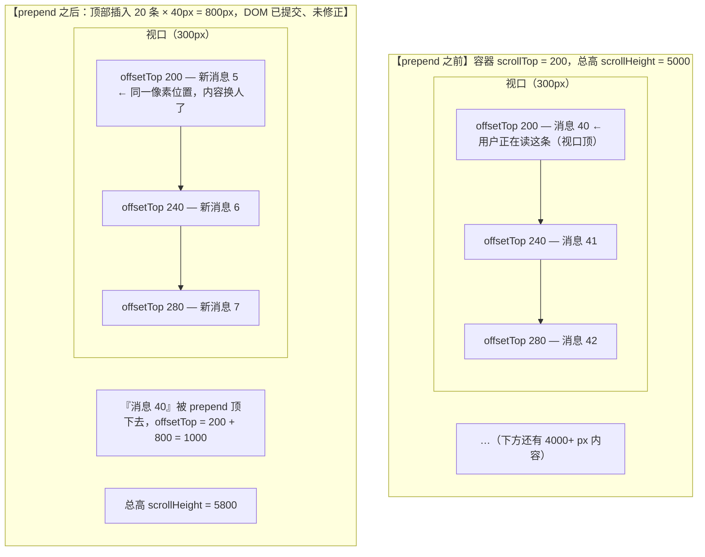

> 本文是《Lv3 复杂交互组件（公认最考功力）》按小节拆分后的续篇，上一部分见 [22-水印-Watermark-攻防趣味题.md](22-水印-Watermark-攻防趣味题.md)。

### VirtualList / Anchor / Progress 等（★★☆）

> 本节骨架（原大纲）：
> - VirtualList：**向上 prepend 时 scrollTop 修正**（IM 向上加载不跳动的关键，接 IM 场景）
> - Anchor：scrollspy（IntersectionObserver）+ 高亮同步
> - Progress：环形 svg `stroke-dashoffset`

这三个组件星数不高，但 VirtualList 的"向上加载修正"是**面试区分度极高**的一题——90% 的人写过"向下加载更多"，很少有人讲清"为什么向上加载会跳"。本节用整幅推导把它讲透。

---

#### VirtualList：向上 prepend 时 scrollTop 修正

**先补地基：定高虚拟滚动的三行数学。** 滚动容器里只渲染"视口 ± overscan"覆盖到的条目，用一个撑高 div 让滚动条长度反映全量：

```text
start = floor(scrollTop / itemHeight) − overscan
end   = ceil((scrollTop + viewportHeight) / itemHeight) + overscan
偏移   = translateY(start × itemHeight)
```

**正题：为什么向上加载会跳。** IM 场景的交互是：滚到顶部 → 拉取更早的历史消息 → **prepend 到列表头部**。问题在 prepend 的一瞬间爆发。看 prepend 前后的内容布局对照（设定：视口高 300px、每条消息定高 40px、用户正读到"消息 40"）：



**推导跳动的本质。** 浏览器在内容变化时保持的是 **scrollTop 数值**（200 还是 200）；而用户视觉锚定的是 **content**（"我正在读的那条消息"）。prepend 把 800px 塞进了视口上方，"offsetTop ↔ content"的映射整体平移——于是**同一 scrollTop 数值对应的像素位置上，放着的内容变了**（从"消息 40"变成"新消息 5"）。用户的感觉是屏幕猛地向下一窜 800px，其实是他锚定的那条消息被顶下去了。对比一下**向下 append 为什么天然不跳**：新内容加在滚动区末尾，既有内容的 offsetTop 一个都没动，"scrollTop ↔ content"映射不变——这就是为什么只有向上加载需要修正。

**修正公式。** 想让"消息 40"仍然出现在视口顶部，就要把它的 offsetTop 搬回 200，等价于把 scrollTop 补上被塞进来的增量：

```text
newScrollTop = oldScrollTop + (prepend 后 scrollHeight − prepend 前 scrollHeight)
             = 200 + (5800 − 5000)
             = 1000
```

动态高度列表（IM 消息有图有文，高度不一）无法事先算出 ΔH，最稳的做法就是**用 scrollHeight 差值实测**：prepend 前快照一次总高，DOM 提交后再量一次，差多少补多少。

**时序是第二个关键：必须 `useLayoutEffect`。** 修正要发生在"DOM 已提交、浏览器尚未绘制"的窗口里。`useEffect` 在绘制之后才执行，用户会看到一帧"窜上去又跳回来"的闪烁；`useLayoutEffect` 在 paint 前同步跑，跳变永远不会被画出来。React 18/19 并发渲染下这个保证依然成立。

完整实现（虚拟列表 + 触顶加载 + 修正三合一）：

```tsx
import { useCallback, useLayoutEffect, useRef, useState, type UIEvent } from 'react';

interface Message {
  id: string;
  text: string;
}

const ITEM_H = 40;   // 定高消息（动态高度的修法相同：仍用 scrollHeight 差值实测）
const VIEW_H = 300;
const OVERSCAN = 5;

// 模拟服务端按游标分页拉更早消息
async function fetchOlder(beforeId: string): Promise<Message[]> {
  const n = Number(beforeId.split('-')[1]);
  return Array.from({ length: 20 }, (_, i) => ({
    id: `m-${n - 20 + i}`,
    text: `历史消息 ${n - 20 + i}`,
  }));
}

export function IMList({ initial }: { initial: Message[] }) {
  const [messages, setMessages] = useState(initial);
  const [scrollTop, setScrollTop] = useState(0);

  const containerRef = useRef<HTMLDivElement>(null);
  const prevHeightRef = useRef(0);   // prepend 前的 scrollHeight 快照
  const loadingRef = useRef(false);  // 防重复触发

  const loadOlder = useCallback(async () => {
    if (loadingRef.current) return;
    loadingRef.current = true;
    const older = await fetchOlder(messages[0].id);
    // ① 快照：在 setState 之前记录 prepend 前的总高
    prevHeightRef.current = containerRef.current!.scrollHeight;
    // ② prepend：不可变更新，旧数组原样排后
    setMessages((list) => [...older, ...list]);
    loadingRef.current = false;
  }, [messages]);

  // ③ 修正：DOM 提交后、浏览器绘制前执行（useLayoutEffect 是跳动与否的分水岭）
  useLayoutEffect(() => {
    if (prevHeightRef.current === 0) return;
    const el = containerRef.current!;
    el.scrollTop += el.scrollHeight - prevHeightRef.current; // 公式落地：补上 ΔH
    prevHeightRef.current = 0;
  }, [messages]);

  // 虚拟窗口计算
  const start = Math.max(0, Math.floor(scrollTop / ITEM_H) - OVERSCAN);
  const end = Math.min(messages.length, Math.ceil((scrollTop + VIEW_H) / ITEM_H) + OVERSCAN);

  const onScroll = (e: UIEvent<HTMLDivElement>) => {
    const el = e.currentTarget;
    setScrollTop(el.scrollTop);
    if (el.scrollTop < ITEM_H * 2) loadOlder(); // 接近触顶就预拉历史
  };

  return (
    <div
      ref={containerRef}
      onScroll={onScroll}
      style={{ height: VIEW_H, overflowY: 'auto', border: '1px solid #e5e7eb' }}
    >
      {/* 撑高条：滚动条长度反映全量消息 */}
      <div style={{ height: messages.length * ITEM_H, position: 'relative' }}>
        {/* 只渲染窗口内条目，translateY 对齐到真实位置 */}
        <div style={{ transform: `translateY(${start * ITEM_H}px)` }}>
          {messages.slice(start, end).map((m) => (
            <div key={m.id} style={{ height: ITEM_H, lineHeight: `${ITEM_H}px` }}>
              {m.text}
            </div>
          ))}
        </div>
      </div>
    </div>
  );
}
```

读一遍闭环：触顶 → `loadOlder` 快照 → prepend 提交 → `useLayoutEffect` 在绘制前把 ΔH 补进 scrollTop → 用户正在读的那条消息在屏幕上纹丝不动，只是滚动条变长、顶部多了可拉的历史。这就是 IM 向上加载不跳动的全部秘密（接 IM 场景）。

**与浏览器原生 scroll anchoring 的取舍。** CSS `overflow-anchor: auto`（默认值）让浏览器自动做同一件事：内容变化时自选视口内一个"锚点节点"，调整 scrollTop 保持它不动。两条路线怎么选：

| 方案 | 优点 | 局限 |
|---|---|---|
| `overflow-anchor`（原生） | 零代码，浏览器级性能 | 锚点节点由启发式选择、**不可指定**；虚拟列表动态装卸节点会让锚点失效；与手动设 scrollTop 的逻辑互相打架时难调试 |
| 手动 scrollTop 修正 | 锚定对象完全可控（精确到"那条消息"）、可测试、可扩展（如"跳到某条消息并居中"） | 要自己管时序（useLayoutEffect）与快照 |

结论：纯内容流的"向上加载不跳"可以吃原生红利；**IM 和虚拟列表必须精确锚定到某条数据**，手动修正是工业界唯一可靠方案（antd List/虚拟滚动、主流 IM Web 端同思路）。

VirtualList 常见坑（症状 → 根因 → 修法）：

| # | 症状 | 根因 | 修法 |
|---|---|---|---|
| 1 | 向上加载闪一帧再跳回 | 修正写在 `useEffect`（绘制后才跑） | 挪进 `useLayoutEffect` |
| 2 | 修正量总是 0 | 快照时机在 setState 之后（已经 prepend 完了才量） | 快照必须在 setState 前 |
| 3 | 动态高度列表修正不准 | 用"条数 × 估算高"算 ΔH，与真实渲染高度不符 | 放弃估算，用 `scrollHeight` 差值实测 |
| 4 | 快速滚顶重复拉同一页 | 没有加载中互斥 | `loadingRef` 或请求去重 |
| 5 | 虚拟列表快速滚动白屏 | overscan 太小 / 撑高条高度算错 | 加大 overscan，核对 `items.length × itemHeight` |

---

#### Anchor：scrollspy（IntersectionObserver）+ 高亮同步

页面内导航的经典双问题：**滚动时高亮要跟着内容走（scrollspy）**，**点击导航要平滑滚到对应区块**——两个方向互相打架。

**scrollspy 用 IntersectionObserver 而不是 scroll 监听。** scroll 事件每帧触发、要手动 rAF 节流、还得逐个 `getBoundingClientRect` 量位置；IO 把"哪个区块可见"的判定交给浏览器合成线程，回调只在交叉状态变化时触发。**调参的钥匙是 `rootMargin`**：它按 CSS margin 语法（px/百分比，百分比按 root 尺寸解析）扩张（正值）/收缩（负值）root 的判定矩形。scrollspy 的惯用手法是把底边大幅上收（如 `-90%`），把判定矩形压成**视口顶部的一条带**——标题滚进这条带才算"正在读"，符合直觉：

```tsx
import { useEffect, useRef, useState } from 'react';

export function Anchor({ sections }: { sections: { id: string; title: string }[] }) {
  const [active, setActive] = useState(sections[0]?.id ?? '');
  const lockRef = useRef(false); // 点击导航引发的平滑滚动期间，锁住 IO 高亮

  useEffect(() => {
    const io = new IntersectionObserver(
      (entries) => {
        if (lockRef.current) return; // 滚动动画进行中：不抢高亮
        for (const entry of entries) {
          if (entry.isIntersecting) setActive(entry.target.id);
        }
      },
      {
        // 底边上收 90%：判定矩形只剩视口顶部 10% 的一条带
        // 标题进入这条带才激活——太小高亮滞后，太大提前亮，按标题间距调
        rootMargin: '0px 0px -90% 0px',
        threshold: 0,
      },
    );
    sections.forEach(({ id }) => {
      const el = document.getElementById(id);
      if (el) io.observe(el);
    });
    return () => io.disconnect();
  }, [sections]);

  // 双向之一：点击驱动。立即高亮 + 平滑滚动 + 期间上锁
  const jump = (id: string) => {
    setActive(id);
    lockRef.current = true;
    document.getElementById(id)?.scrollIntoView({ behavior: 'smooth', block: 'start' });
    // scrollIntoView 的动画时长拿不到，用一段保守时长近似锁定
    window.setTimeout(() => (lockRef.current = false), 400);
  };

  return (
    <nav style={{ display: 'flex', flexDirection: 'column', gap: 8 }}>
      {sections.map(({ id, title }) => (
        <a
          key={id}
          href={`#${id}`}
          style={{
            color: active === id ? '#1677ff' : 'inherit',
            fontWeight: active === id ? 700 : 400,
          }}
          onClick={(e) => {
            e.preventDefault(); // 不用锚点默认跳转：瞬移 + 产生历史记录
            jump(id);
          }}
        >
          {title}
        </a>
      ))}
    </nav>
  );
}
```

**双向同步的冲突与解法**：点击导航后 `scrollIntoView({ behavior: 'smooth' })` 会**依次穿过**中间区块，IO 会一路高亮过去，视觉上高亮来回抖。解法就是代码里的 `lockRef`：点击后的滚动动画期间忽略 IO 更新，抵达后再交还控制权（滚动方向二：用户手动滚 → IO 正常驱动高亮）。这与上文 Carousel"拖拽期间停自动播放"是同一类互斥问题——**两个驱动源操作同一状态时，必须显式仲裁**。

Anchor 常见坑：

| # | 症状 | 根因 | 修法 |
|---|---|---|---|
| 1 | 点击后高亮在中间标题上乱跳 | 平滑滚动穿过中间区块，IO 逐个触发 | 点击期间加锁（lockRef） |
| 2 | 高亮总是"滞后一屏" | rootMargin 没收缩，区块在视口任意位置就算激活 | `-90%` 底边上收成顶部判定带 |
| 3 | 最后一个短区块永远点不亮 | 区块太短，滚到底也进不了判定带 | 内容区底部补白（min-height），或对最后一个区块特殊处理 |
| 4 | 点击后浏览器地址栏多了 #hash、回退异常 | 用了原生锚点跳转 | `preventDefault` + `scrollIntoView` |

---

#### Progress：环形 svg stroke-dashoffset

环形进度不画弧线路径，而是**画一个完整的圆，用虚线偏移"挖掉"没走完的部分**。推导三步：

```text
① 半径：r = (size − strokeWidth) / 2        ← 直径要给描边厚度留出两侧空间
② 周长：C = 2πr                              ← 这就是 dasharray 的基准
③ 偏移：dashoffset = C × (1 − percent/100)   ← 百分比 → 弧长的一元一次换算
```

原理：`strokeDasharray = C` 定义了"描 C 长、空 C 长"的循环节（一整圈恰好一个节）；`strokeDashoffset` 把这个图案沿路径起点回退。于是**可见实线弧长 = C − offset**：进度 100% 时 offset = 0（整圈实线）；进度 0% 时 offset = C（整圈空白）；任意 p% ⇒ 可见弧长 C×p%。再补一个细节：SVG 圆的起点在 3 点钟方向，`rotate(-90)` 把起点搬到 12 点。

```tsx
export function CircleProgress({
  percent,
  size = 120,
  strokeWidth = 8,
  color = '#1677ff',
  trackColor = '#e5e7eb',
}: {
  percent: number;
  size?: number;
  strokeWidth?: number;
  color?: string;
  trackColor?: string;
}) {
  const r = (size - strokeWidth) / 2; // ① 半径：扣除两侧描边厚度
  const C = 2 * Math.PI * r; // ② 周长：dasharray 基准
  const p = Math.min(100, Math.max(0, percent));
  const offset = C * (1 - p / 100); // ③ 百分比 → 偏移量

  return (
    <svg width={size} height={size} viewBox={`0 0 ${size} ${size}`}>
      {/* 起点默认在 3 点钟方向，旋转 -90° 搬到 12 点 */}
      <g transform={`rotate(-90 ${size / 2} ${size / 2})`}>
        {/* 轨道圆 */}
        <circle
          cx={size / 2}
          cy={size / 2}
          r={r}
          fill="none"
          stroke={trackColor}
          strokeWidth={strokeWidth}
        />
        {/* 进度圆：dasharray=C 一个循环节；dashoffset 挖掉未完成部分 */}
        <circle
          cx={size / 2}
          cy={size / 2}
          r={r}
          fill="none"
          stroke={color}
          strokeWidth={strokeWidth}
          strokeLinecap="round" // 圆头：注意两端各多出 strokeWidth/2 的视觉长度
          strokeDasharray={C}
          strokeDashoffset={offset}
          style={{ transition: 'stroke-dashoffset 0.3s ease' }} // 数值变化即平滑动画
        />
      </g>
      <text
        x="50%"
        y="50%"
        dominantBaseline="central"
        textAnchor="middle"
        fontSize={size / 5}
        fill="#374151"
      >
        {Math.round(p)}%
      </text>
    </svg>
  );
}
```

这个"周长 + 偏移"模型是**所有 svg 描边动画的通用底座**：进度环、评分环、路径描边生长动画（把 dasharray 换成路径长度）全是同一招，值得一次学透。

Progress 常见坑：

| # | 症状 | 根因 | 修法 |
|---|---|---|---|
| 1 | 进度环溢出 svg 边界 | r 没扣描边厚度（stroke 沿路径两侧各画一半） | `r = (size − strokeWidth) / 2` |
| 2 | 环形起点在右侧 3 点钟 | SVG 圆的天然起点 | `rotate(-90)` |
| 3 | 0% 时仍有一小段弧 | `strokeLinecap: round` 的圆帽在 offset=C 时仍画一个点 | 起点处 p===0 时不渲染进度圆，或接受圆点 |
| 4 | 进度条不动画 | 每次重渲染重建了 circle（key 变化） | 稳定 key，让 transition 生效于属性变化 |

---

#### 补充：分组虚拟列表——分组头吸顶 + 分组参与的虚拟化度量

> 查重指路：定高虚拟列表本体（撑高条 + translateY 窗口）在 [13-Lv3](13-Lv3-复杂交互组件-公认最考功力.md) 的 Select 考点写过；拍平、动态行高测量（measureElement）、虚拟化与拖拽的冲突等通用原理，《高阶场景·第二辑》[06-3-2-递归渲染-QueryGroup-QueryRow](../react-高阶场景-第二辑/06-3-2-递归渲染-QueryGroup-QueryRow.md) 已详述。本节只写"分组"带来的组件库语境增量：**分组头是参与度量的行**，且**吸顶头不能住在共享 transform 窗口块里**。

**是什么。** 通讯录/歌单式列表 = 分组头行 + 条目行交替（A 组头、A 的条目、B 组头……）。虚拟化要求"任意行的位置可由数据算出"，吸顶要求"当前分组的头贴住滚动容器顶、被下一组头推走"——两件事都要分组参与滚动数学。

**为什么难。** 两个结构性冲突：

1. **sticky 与 transform 窗口块天然冲突。** `position: sticky` 的粘滞范围受其包含块约束，而**祖先带 transform 时包含块变成该祖先**——13 号文件与上文实现用的正是共享 `translateY` 窗口块（高度只有视口级），把 sticky 分组头塞进去，头滚两行就撞到窗口块底边被"顶走"，症状是"吸顶失灵/闪烁"。结论：吸顶头必须离开窗口块，独立成层。
2. **"当前分组"不能只在可见行里找。** 窗口起点往往落在某组中段（组头在窗口上方、未被渲染），从渲染窗口里找分组头会找不到——必须拿着全量偏移表向前回溯。另外，头/项两套行高让"索引 ↔ 像素"不再是简单乘法，要用前缀和 + 二分（拍平思路与 [18-Tree](18-Tree.md)、[15-Table](15-Table-中后台之王.md) 的拍平渲染同源）。

**机制分步。**

1. **拍平 + 前缀和**：`groups` 拍平成 `rows: { kind: 'group' | 'item' }[]`，同时算 `offsets[i]`（第 i 行的 top）——分组头按 GROUP_H、条目按 ITEM_H 累积。
2. **窗口计算换二分**：`start = 最后一个 offsets[i] <= scrollTop 的行`（二分），`end` 从 start 向后扫到超出视口底；上下各加 overscan。
3. **行渲染改为每行独立 `position: absolute; top: offsets[i]`**：不用共享 transform 窗口块，为吸顶层腾出结构空间（行数只有视口级，layout 成本可忽略）。
4. **吸顶层**：从 start 向前找最近的分组行 g；`y = min(nextGroupTop − GROUP_H, max(groupTop, scrollTop))`——头在原位之下时贴滚动顶（`scrollTop`），下一组头逼近时被压到 `nextGroupTop − GROUP_H`（被顶走）。z-index 高于普通行、背景不透明。

**完整代码**：

```tsx
// GroupVirtualList.tsx —— 分组参与度量 + 独立吸顶层
import { useMemo, useState, type CSSProperties, type UIEvent } from 'react';

export interface GroupItem {
  id: string;
  text: string;
}
export interface ListGroup {
  title: string;
  items: GroupItem[];
}

export type Row =
  | { kind: 'group'; key: string; title: string }
  | { kind: 'item'; key: string; item: GroupItem };

export const GROUP_H = 32; // 分组头行高
export const ITEM_H = 48;  // 条目行高

/** 拍平 + 前缀和：分组参与的度量核心（动态行高版本见第二辑 06 的 measureElement 思路） */
export function flattenGroups(groups: ListGroup[]): {
  rows: Row[];
  offsets: number[];
  totalHeight: number;
} {
  const rows: Row[] = [];
  const offsets: number[] = [];
  let y = 0;
  for (const g of groups) {
    rows.push({ kind: 'group', key: `group:${g.title}`, title: g.title });
    offsets.push(y);
    y += GROUP_H;
    for (const item of g.items) {
      rows.push({ kind: 'item', key: item.id, item });
      offsets.push(y);
      y += ITEM_H;
    }
  }
  return { rows, offsets, totalHeight: y };
}

/** 二分：最后一个 offsets[i] <= scrollTop 的行号（视口顶压住的行） */
export function findStartRow(offsets: number[], scrollTop: number): number {
  let lo = 0;
  let hi = offsets.length - 1;
  let ans = 0;
  while (lo <= hi) {
    const mid = (lo + hi) >> 1;
    if (offsets[mid] <= scrollTop) {
      ans = mid;
      lo = mid + 1;
    } else {
      hi = mid - 1;
    }
  }
  return ans;
}

/** 从任意行向前回溯最近的分组行——不能只在渲染窗口里找 */
export function findCurrentGroup(rows: Row[], start: number): number {
  for (let i = Math.min(start, rows.length - 1); i >= 0; i--) {
    if (rows[i].kind === 'group') return i;
  }
  return -1;
}

/** 吸顶位置：null = 组头还在原位（自然可见），吸顶层不参与 */
export function stickyHeaderY(
  rows: Row[],
  offsets: number[],
  scrollTop: number,
  groupH: number,
): { y: number; title: string } | null {
  const g = findCurrentGroup(rows, findStartRow(offsets, scrollTop));
  if (g < 0) return null;
  const groupTop = offsets[g];
  if (scrollTop <= groupTop) return null;
  let nextTop = Number.POSITIVE_INFINITY;
  for (let i = g + 1; i < rows.length; i++) {
    if (rows[i].kind === 'group') {
      nextTop = offsets[i];
      break;
    }
  }
  const y = Math.min(nextTop - groupH, scrollTop); // 下一组逼近时被压下去
  return { y, title: rows[g].title };
}

export function GroupVirtualList({
  groups,
  viewportHeight = 400,
  overscan = 4,
}: {
  groups: ListGroup[];
  viewportHeight?: number;
  overscan?: number;
}) {
  const [scrollTop, setScrollTop] = useState(0);
  const { rows, offsets, totalHeight } = useMemo(() => flattenGroups(groups), [groups]);

  const start = findStartRow(offsets, scrollTop);
  let end = start;
  while (end < rows.length && offsets[end] <= scrollTop + viewportHeight) end++;
  const renderStart = Math.max(0, start - overscan);
  const renderEnd = Math.min(rows.length, end + overscan);
  const sticky = stickyHeaderY(rows, offsets, scrollTop, GROUP_H);

  // 组头样式抽成工厂：行内组头与吸顶组头共用（含"必须不透明"的纪律）
  const headerStyle = (top: number): CSSProperties => ({
    position: 'absolute', top, left: 0, right: 0, height: GROUP_H,
    lineHeight: `${GROUP_H}px`, padding: '0 12px',
    background: '#f3f4f6', fontWeight: 600,
  });

  return (
    <div
      onScroll={(e: UIEvent<HTMLDivElement>) => setScrollTop(e.currentTarget.scrollTop)}
      style={{ height: viewportHeight, overflowY: 'auto', position: 'relative' }}
    >
      <div style={{ height: totalHeight, position: 'relative' }}>
        {rows.slice(renderStart, renderEnd).map((row, i) => {
          const index = renderStart + i;
          return row.kind === 'group' ? (
            <div key={row.key} style={headerStyle(offsets[index])}>{row.title}</div>
          ) : (
            <div key={row.key} style={{
              position: 'absolute', top: offsets[index], left: 0, right: 0,
              height: ITEM_H, display: 'flex', alignItems: 'center', padding: '0 12px',
            }}>
              {row.item.text}
            </div>
          );
        })}
        {/* 吸顶层：只在组头被滚过时出现；z 压过普通行 */}
        {sticky ? (
          <div aria-hidden style={{
            ...headerStyle(sticky.y), zIndex: 2, boxShadow: '0 1px 2px rgba(0,0,0,.08)',
          }}>
            {sticky.title}
          </div>
        ) : null}
      </div>
    </div>
  );
}
```

Vitest（拍平、二分、吸顶位置全是纯函数）：

```ts
// GroupVirtualList.test.ts
import { describe, expect, it } from 'vitest';
import {
  GROUP_H, ITEM_H, findCurrentGroup, findStartRow, flattenGroups, stickyHeaderY,
} from './GroupVirtualList';

const groups = [
  { title: 'A', items: [{ id: 'a1', text: 'a1' }, { id: 'a2', text: 'a2' }] },
  { title: 'B', items: [{ id: 'b1', text: 'b1' }] },
];
const { rows, offsets, totalHeight } = flattenGroups(groups);
// rows: [gA, a1, a2, gB, b1] → offsets: [0, 32, 80, 128, 160]，total = 32×2 + 48×3

describe('flattenGroups（分组参与度量）', () => {
  it('两套行高交替累积', () => {
    expect(rows.map((r) => r.kind)).toEqual(['group', 'item', 'item', 'group', 'item']);
    expect(offsets).toEqual([0, GROUP_H, GROUP_H + ITEM_H, GROUP_H + ITEM_H * 2, GROUP_H * 2 + ITEM_H * 2]);
    expect(totalHeight).toBe(GROUP_H * 2 + ITEM_H * 3);
  });
});

describe('findStartRow / findCurrentGroup', () => {
  it('视口顶落在组中段时，仍能向前回溯到分组头', () => {
    const start = findStartRow(offsets, 90); // 90 落在 a2 行内
    expect(start).toBe(2);
    expect(findCurrentGroup(rows, start)).toBe(0); // 组 A 的头（offset 0）不在渲染窗口里也能找到
  });
});

describe('stickyHeaderY（吸顶三态）', () => {
  it('滚动顶未过组头原位：不吸附', () => {
    expect(stickyHeaderY(rows, offsets, 0, GROUP_H)).toBeNull();
  });
  it('组中段：吸附在滚动顶', () => {
    expect(stickyHeaderY(rows, offsets, 90, GROUP_H)?.y).toBe(90);
  });
  it('下一组头逼近：被压到 nextTop - groupH', () => {
    expect(stickyHeaderY(rows, offsets, 100, GROUP_H)?.y).toBe(128 - GROUP_H);
  });
});
```

坑（症状 → 根因 → 修法）：

| # | 症状 | 根因 | 修法 |
|---|---|---|---|
| 1 | 吸顶头滚两行就消失/闪烁 | sticky 放进共享 translateY 窗口块，transform 祖先成了包含块 | 吸顶头独立成层（本节方案），或每行独立绝对定位 |
| 2 | 吸顶头下方透出条目文字 | 头背景透明 | 头背景不透明（与 [15-Table](15-Table-中后台之王.md) sticky 单元格同款纪律） |
| 3 | 窗口起点落在组中段时没有吸顶头 | 只在渲染窗口里找分组头 | 拿全量 offsets 回溯（`findCurrentGroup`），分组头本身可不渲染 |
| 4 | 动态行高分组列表滚动跳跃 | 用估算高度算 offsets | 指路第二辑 06：measureElement 测量缓存替换常量行高 |

---

#### 补充：反向滚动的锚点法——锚定"那条消息"，而不是总高

> 查重指路：本文件上文已给 scrollHeight 差值法（快照前后总高差）与 `overflow-anchor` 原生方案的对照。本节只写差值法的失效场景与更准的**锚点法**增量。

**是什么。** 差值法量的是"容器总高变化"，锚点法量的是"锚点元素位移了多少"：prepend 前记下锚点元素离视口顶的距离，DOM 提交后重测，`scrollTop += 新距离 − 旧距离`。

**为什么值得单列。** 差值法隐含一个假设——**所有新增高度都在视口上方**。两个常见场景打破它：① 双向加载（同一帧 prepend 历史 + append 新消息），总高差把下方 append 的高度也算进修正量，列表向错误方向窜；② 视口内内容自身变高（图片懒加载撑开、展开一条消息），总高变了但视口上方没变，差值法误修正。锚点法天然免疫：它只关心锚点元素的位移，其余一切高度变化与修正量无关。还有一个衍生红利：**"跳到指定消息并保持位置"（scrollToMessage）就是锚点法的静态版**——同一套数学吃两个需求。

**机制分步。**

1. **选锚点**：虚拟列表里锚点必须在渲染窗口内（窗口外的行被卸载，量不到 rect）。prepend 场景所有旧行整体向下平移相同距离，锚哪一行都等价——选**首个渲染行**（含 overscan 缓冲，窗口怎么动它都在），比"视口顶行"更稳。
2. **快照**：`anchor.getBoundingClientRect().top − container.getBoundingClientRect().top`——**相对容器坐标**，免疫页面级滚动干扰（两个 rect 同帧相减，页面滚动位移互相抵消）。
3. **修正**：`useLayoutEffect`（DOM 已提交、未绘制）里重测同一条公式，`delta = 新 − 旧`，`container.scrollTop += delta`——只动 scrollTop、不 setState。边界：空列表首拉没有锚点，直接跳过；iOS 橡皮筋期 scrollTop 为负，修正前判 `scrollTop >= 0`。

**完整代码**（逻辑收敛成一个通用 hook，与具体列表实现解耦）：

```tsx
// useAnchoredPrepend.ts —— 锚点法反向滚动修正
import { useRef, type RefObject } from 'react';

export function useAnchoredPrepend(
  containerRef: RefObject<HTMLDivElement | null>,
): { snapshot: () => void; restore: () => void } {
  const anchorRef = useRef<{ el: HTMLElement; offsetInView: number } | null>(null);
  // 相对容器坐标：两个 rect 同帧相减，页面级滚动位移互相抵消
  const topInContainer = (el: HTMLElement) =>
    el.getBoundingClientRect().top - containerRef.current!.getBoundingClientRect().top;
  return {
    /** prepend 前（setState 之前）调用：锚定首个渲染行——含 overscan 缓冲，必在 DOM 里 */
    snapshot: () => {
      const first = containerRef.current?.querySelector<HTMLElement>('[data-virtual-row]');
      if (first) anchorRef.current = { el: first, offsetInView: topInContainer(first) };
    },
    /** useLayoutEffect 里调用：把锚点搬回原位，位移多少补多少 */
    restore: () => {
      const container = containerRef.current;
      const anchor = anchorRef.current;
      if (!container || !anchor || !anchor.el.isConnected) return; // 空列表首拉/锚点被卸载
      const delta = topInContainer(anchor.el) - anchor.offsetInView;
      if (delta !== 0 && container.scrollTop >= 0) { // 负 scrollTop = iOS 橡皮筋，挂起
        container.scrollTop += delta; // 与新增内容出现在视口上方还是下方无关
      }
      anchorRef.current = null;
    },
  };
}
```

装配就是把上文 IMList 的差值法两步换成本 hook 两步：`loadOlder` 里 setState 之前 `snapshot()`；`useLayoutEffect(..., [messages])` 里 `restore()`。渲染结构、触顶预拉、撑高条全部原样保留，只需在每个渲染行上加 `data-virtual-row`。锚哪一行都等价（prepend 时旧行整体平移相同距离），选首个渲染行是因为 overscan 保证它永远在渲染窗口内；有偏移表的动态高度列表则复用本节 `findStartRow` 同款二分按数据定位锚点。

差值法与锚点法对照：

| | scrollHeight 差值法（上文） | 锚点法（本节） |
|---|---|---|
| 度量对象 | 容器总高变化（隐含假设：新增全在视口上方） | 锚点元素位移（无假设） |
| 双向加载（同帧 prepend + append） | 修正量含下方增量，补错 | 天然正确 |
| 视口内内容变高（图片加载） | 误算进修正量 | 不受影响 |

坑（症状 → 根因 → 修法）：

| # | 症状 | 根因 | 修法 |
|---|---|---|---|
| 1 | 双向加载仍跳动 | 差值法把视口下方新增也算进修正 | 换锚点法（位移与新增位置无关） |
| 2 | 页面同时滚动时修正量漂移 | rect 相对视口，混入了页面滚动位移 | 一切 rect 减 container rect（相对容器坐标） |
| 3 | 修正被跳过（isConnected false） | 锚点行被虚拟化卸载 | 锚定首个渲染行；动态高度列表按数据 id 查偏移表换算 |
| 4 | iOS 上拉橡皮筋期反复修正 | 负 scrollTop 区间位移异常 | 修正前判 `scrollTop >= 0`，橡皮筋期间挂起 |

---

#### 补充：Anchor 的定位与命中——scrollIntoView vs 手动 scroll、扫描命中算法、sticky 偏移补偿

> 查重指路：本文件上文 Anchor 节给了 IntersectionObserver + rootMargin + 点击上锁；"scrollIntoView 会连滚所有可滚祖先 + 手写贴边滚动数学"在 [16-Tabs](16-Tabs.md) 的溢出滚动考点已详述。本节写 Anchor 语境的三块增量。

**是什么。** ① 定位手段的取舍：`scrollIntoView`（浏览器包办）vs 手动 `scrollTo`（自己算目标位置）；② 高亮命中算法：IO 之外的位置扫描法（缓存各区块 offsetTop、二分找"判定线落在哪个区块"）；③ sticky 头部偏移补偿：定位与判定都要让出吸顶头的高度。

**为什么值得单列。** 上文 IO 方案的三个残留问题都在这里收口：判定带（rootMargin）与区块边界竞争导致高亮抖动；sections 动态增删要重 observe；最后一个短区块滚到底也进不了判定带（上文坑 3 只给了补白缓解法）。扫描法一次解决三个——判定线是唯一真理源，滚到底强制最后一项是两行代码。定位侧的 scrollIntoView 有个隐藏福利和一个隐藏坑：福利是 `scroll-margin-top` 一行 CSS 就能补偿 sticky 头（手动法要自己减）；坑是它会尽义务滚动**所有**可滚祖先（16-Tabs 同款坑，页面跟着滚）。

**机制分步。**

1. **定位决策**：简单场景用 `scrollIntoView({ block: 'start' })` + CSS `scroll-margin-top: var(--anchor-offset)`（补偿全交给 CSS）；要"绝不带动页面滚动 / 统一 easing / 与 history 集成"时手动 `scrollTo(top − offset)`（16-Tabs 的手写数学同源）。
2. **命中算法**：measure 阶段缓存各 section 的文档绝对坐标（`getBoundingClientRect().top + scrollY`，统一坐标系，避开 offsetParent 链的坑）；滚动回调里二分找"最后一个 top ≤ 判定线"的区块，判定线 = `scrollY + headerOffset`（sticky 头让出的高度）；rAF 节流每帧至多一次。
3. **滚到底强制最后一项**：`scrollY + innerHeight ≥ scrollHeight − 2` 时直接命中最后一段——短末段问题的根治法。
4. **锁的升级**：点击驱动的平滑滚动期间，用 `scrollend` 事件（动画真正停止才触发）解锁，替代上文拍脑袋的 400ms 定时器；不支持的旧浏览器回退定时器。

**完整代码**：

```tsx
// useScrollSpy.ts —— 扫描命中 + 手动定位 + sticky 补偿 + scrollend 解锁
import { useCallback, useEffect, useRef, useState } from 'react';

/** 二分命中：最后一个 top <= pos 的段落索引；空表/全超返回 -1 */
export function findActiveIndex(tops: number[], pos: number): number {
  let lo = 0;
  let hi = tops.length - 1;
  let ans = -1;
  while (lo <= hi) {
    const mid = (lo + hi) >> 1;
    if (tops[mid] <= pos) {
      ans = mid;
      lo = mid + 1;
    } else {
      hi = mid - 1;
    }
  }
  return ans;
}

export function useScrollSpy({
  sectionIds,
  headerOffset = 0,
}: {
  sectionIds: string[];
  headerOffset?: number; // sticky 头高度：定位与判定共用同一补偿
}) {
  const [activeId, setActiveId] = useState(sectionIds[0] ?? '');
  const topsRef = useRef<number[]>([]);
  const lockRef = useRef(false);

  const measure = useCallback(() => {
    topsRef.current = sectionIds.map((id) => {
      const el = document.getElementById(id);
      if (!el) return Number.POSITIVE_INFINITY; // 缺失段落排最后，永不命中
      return el.getBoundingClientRect().top + window.scrollY; // 文档绝对坐标
    });
  }, [sectionIds]);

  const recompute = useCallback(() => {
    if (lockRef.current) return;
    const tops = topsRef.current;
    let idx = findActiveIndex(tops, window.scrollY + headerOffset);
    // 滚到底强制最后一项：根治"末段太短进不了判定区"
    if (window.scrollY + window.innerHeight
      >= document.documentElement.scrollHeight - 2) {
      idx = tops.length - 1;
    }
    const id = sectionIds[idx];
    if (id != null) setActiveId(id);
  }, [headerOffset, sectionIds]);

  useEffect(() => {
    measure();
    recompute();
    let raf = 0;
    const onScroll = () => {
      cancelAnimationFrame(raf);
      raf = requestAnimationFrame(recompute); // 每帧至多一次
    };
    window.addEventListener('scroll', onScroll, { passive: true });
    window.addEventListener('resize', onScroll);
    return () => {
      window.removeEventListener('scroll', onScroll);
      window.removeEventListener('resize', onScroll);
      cancelAnimationFrame(raf);
    };
  }, [measure, recompute]);

  const scrollToSection = useCallback((id: string) => {
    const el = document.getElementById(id);
    if (!el) return;
    lockRef.current = true; // 点击驱动期间高亮上锁（同上文 lockRef 思路）
    setActiveId(id);
    window.scrollTo({
      top: el.getBoundingClientRect().top + window.scrollY - headerOffset, // 手动定位 + sticky 补偿
      behavior: 'smooth',
    });
    const release = () => {
      lockRef.current = false;
    };
    if ('onscrollend' in window) {
      // scrollend：滚动真正停止才触发（Chrome 114+ / Firefox 109+ / Safari 17.4+）
      window.addEventListener('scrollend', release, { once: true });
    } else {
      window.setTimeout(release, 500); // 旧浏览器回退保守定时器
    }
  }, [headerOffset]);

  return { activeId, scrollToSection, remeasure: measure };
}
```

scrollIntoView 路线的等价补偿只要一行 CSS（命中所有 `block: 'start'` 定位，sticky 头高度变化时由 ResizeObserver 只写回这一个变量）：`:root { --anchor-offset: 64px; }` + `section { scroll-margin-top: var(--anchor-offset); }`。

Vitest（命中算法纯函数）：

```ts
import { describe, expect, it } from 'vitest';
import { findActiveIndex } from './useScrollSpy';

describe('findActiveIndex（扫描命中）', () => {
  it('命中最后一个 top <= 判定线的段落（边界相等算命中）', () => {
    expect(findActiveIndex([100, 300, 600], 50)).toBe(-1);  // 判定线在首段之前
    expect(findActiveIndex([100, 300, 600], 100)).toBe(0);  // 左闭
    expect(findActiveIndex([100, 300, 600], 299)).toBe(0);
    expect(findActiveIndex([100, 300, 600], 300)).toBe(1);
    expect(findActiveIndex([100, 300, 600], 9999)).toBe(2);
  });
  it('空数组返回 -1', () => {
    expect(findActiveIndex([], 0)).toBe(-1);
  });
});
```

坑（症状 → 根因 → 修法）：

| # | 症状 | 根因 | 修法 |
|---|---|---|---|
| 1 | 定位后标题被 sticky 头盖住 | 定位目标没让出头部高度 | scrollIntoView + `scroll-margin-top`；手动法 `top − headerOffset` |
| 2 | scrollend 永不触发 | Safari 17.4 之前不支持 | `'onscrollend' in window` 探测，回退定时器 |
| 3 | 命中总是偏一段 | offsetTop 相对 offsetParent 链，坐标系不统一 | 统一 `getBoundingClientRect().top + scrollY` 存绝对坐标 |
| 4 | 容器内滚动时命中全错 | 判定线还按 window 算 | 容器版：判定线 = `container.scrollTop + headerOffset`，坐标同步减 container rect |

---

#### 补充：Progress 的两块增量——不均匀分段进度与 progressbar 无障碍语义

> 查重指路：环形 `stroke-dasharray`/`strokeDashoffset` 的周长推导上文已详述，本节不重复；`aria-valuenow` 家族在 [21-Carousel](21-Carousel-Slider-Rate-ColorPicker.md) 的 Slider 一节是同族用法，[06-A5](06-A5-键盘导航与-ARIA.md) 是 ARIA 总纲。

**是什么。** ① 不均匀分段进度：进度不是一条均匀条，而是"校验 10% → 传输 70% → 处理 20%"式的加权段，值要映射到"第几段 + 段内百分之几"；② `role="progressbar"` 语义纪律：aria 值怎么给、valuetext 什么时候比数字更有用、不确定进度怎么表达。

**为什么值得单列。** 分段的坑全在**边界语义**：段边界值属于前段还是后段（左闭右开）、权重和不为 100 时怎么办（归一化）、最后一段吃不吃浮点余数——不定义清楚，"10% 整"这一刻进度条会来回跳。无障碍侧的坑是"看起来给了 a11y 其实给了错的"：小数 valuenow 被念成一长串，indeterminate 写了 `aria-valuenow={0}` 把"未知"念成"百分之零"。

**机制分步。**

1. **值 → 段映射**：权重归一化（`w_i / Σw`）得到段边界 `[0, 10, 80, 100]`；值落在第 i 段（边界**左闭右开**：值 == 边界属于下一段，最后一段含上界）；段内百分比独立换算，同时算总百分比。
2. **可视化**：线性条每段 `flex-grow: weight`、段内宽度 `localPercent%`；环形分段 = 每段一个 circle：`strokeDasharray = "${C·w_i} ${C}"`、起点用 `rotate(累计角)` 前移——公式同上文的周长模型，只是切成几段。
3. **ARIA 纪律**：容器 `role="progressbar"` + `aria-valuemin/max/now`；`now` 取整；`aria-valuetext` 给人话（"传输中 · 34%（共 3.4 MB / 10 MB）"）；不确定进度**不写 valuenow**（role 存在而无 now 即 indeterminate）；高频更新别每帧改 now——屏幕阅读器跟着播报，节流到关键节点。分段是视觉概念，aria 树里仍是一个 progressbar，别给每段加 role。

**完整代码**：

```tsx
// SegmentProgress.tsx —— 不均匀分段 + progressbar 语义
import { useId, type CSSProperties } from 'react';

export interface SegmentStep {
  label: string;
  weight: number; // 权重：不必加起来等于 100，内部归一化
}

export interface SegmentHit {
  index: number;        // 命中段（边界左闭右开，最后一段含上界）
  localPercent: number; // 段内 0~100
  overallPercent: number;
}

export function mapValueToSegment(
  value: number,
  steps: SegmentStep[],
  min = 0,
  max = 100,
): SegmentHit {
  const total = steps.reduce((s, x) => s + x.weight, 0);
  if (steps.length === 0) throw new Error('steps 不能为空');
  if (total <= 0) throw new Error('steps 权重之和必须为正');
  const span = max - min;
  const clamped = Math.min(max, Math.max(min, value));
  const overallPercent = span === 0 ? 0 : ((clamped - min) / span) * 100;
  let acc = min;
  for (let i = 0; i < steps.length; i++) {
    const segLen = (steps[i].weight / total) * span;
    const segMax = i === steps.length - 1 ? max : acc + segLen; // 末段吃掉浮点余数
    if (clamped < segMax || i === steps.length - 1) {
      const localPercent = segMax === acc ? 0 : ((clamped - acc) / (segMax - acc)) * 100;
      return { index: i, localPercent, overallPercent };
    }
    acc = segMax;
  }
  throw new Error('unreachable'); // 循环末段必 return，这行只为类型完备
}

const visuallyHidden: CSSProperties = {
  position: 'absolute', width: 1, height: 1, margin: -1, padding: 0,
  overflow: 'hidden', clip: 'rect(0 0 0 0)', whiteSpace: 'nowrap', border: 0,
};

export function SegmentProgress({
  steps, value, min = 0, max = 100, label,
}: {
  steps: SegmentStep[];
  value: number;
  min?: number;
  max?: number;
  label?: string;
}) {
  const { index, localPercent, overallPercent } = mapValueToSegment(value, steps, min, max);
  const labelId = useId();
  return (
    <div>
      <div
        role="progressbar"
        aria-labelledby={label ? labelId : undefined}
        aria-valuemin={min}
        aria-valuemax={max}
        aria-valuenow={Math.round(value)} // 取整：屏幕阅读器不念小数尾巴
        aria-valuetext={`${steps[index].label} · ${Math.round(localPercent)}%（总 ${Math.round(overallPercent)}%）`}
      >
        <div style={{ display: 'flex', gap: 2 }} aria-hidden>
          {steps.map((s, i) => (
            <div key={s.label} style={{
              flexGrow: s.weight, flexBasis: 0, height: 8,
              background: '#e5e7eb', borderRadius: 4, overflow: 'hidden',
            }}>
              <div style={{
                width: i < index ? '100%' : i === index ? `${localPercent}%` : '0%',
                height: '100%', background: '#1677ff',
              }} />
            </div>
          ))}
        </div>
      </div>
      {label ? <span id={labelId} style={visuallyHidden}>{label}</span> : null}
    </div>
  );
}

// 不确定进度：role 在、now 缺席 = indeterminate（写 0 会被念成"百分之零"）
export function IndeterminateProgress({ label }: { label: string }) {
  const labelId = useId();
  return (
    <div>
      <div role="progressbar" aria-labelledby={labelId}
        style={{ height: 8, borderRadius: 4, background: '#e5e7eb', overflow: 'hidden' }}>
        <div style={{ width: '30%', height: '100%', background: '#1677ff',
          animation: 'progress-slide 1.2s ease-in-out infinite' }} />
      </div>
      <span id={labelId} style={visuallyHidden}>{label}</span>
    </div>
  );
}
```

Vitest：

```ts
import { describe, expect, it } from 'vitest';
import { mapValueToSegment } from './SegmentProgress';

const steps = [
  { label: '校验', weight: 1 },
  { label: '传输', weight: 7 },
  { label: '处理', weight: 2 },
]; // 归一化边界 10 / 80 / 100

describe('mapValueToSegment（不均匀分段）', () => {
  it('段边界左闭右开：10 属于传输段', () => {
    expect(mapValueToSegment(10, steps).index).toBe(1);
  });
  it('段内百分比与总百分比', () => {
    const hit = mapValueToSegment(45, steps);
    expect(hit.index).toBe(1);
    expect(hit.localPercent).toBeCloseTo(50); // (45−10)/(80−10)
    expect(hit.overallPercent).toBeCloseTo(45);
  });
  it('越界 clamp 与末段含上界', () => {
    expect(mapValueToSegment(-5, steps).index).toBe(0);
    const full = mapValueToSegment(120, steps);
    expect(full.index).toBe(2);
    expect(full.localPercent).toBe(100);
  });
  it('权重和不为 100 自动归一化', () => {
    const hit = mapValueToSegment(30, [{ label: 'a', weight: 1 }, { label: 'b', weight: 3 }]);
    expect(hit.index).toBe(1); // 边界 25%，30 已进第二段
    expect(hit.localPercent).toBeCloseTo((30 - 25) / 75 * 100);
  });
});
```

坑（症状 → 根因 → 修法）：

| # | 症状 | 根因 | 修法 |
|---|---|---|---|
| 1 | 屏幕阅读器念"百分之三十四点三一七五八" | aria-valuenow 直传小数 | `Math.round` + aria-valuetext 给人话 |
| 2 | 值恰在段边界时进度条来回跳 | 边界归属未定义（前段 100% 与后段 0% 打架） | 左闭右开写进映射函数与测试（边界值属于下一段） |
| 3 | 不确定进度被念成"百分之零" | indeterminate 写了 `aria-valuenow={0}` | role 在、now 缺席即 indeterminate |
| 4 | 每帧更新 now 导致读屏狂播 | 高频数值变化直接落到 aria 属性 | 节流到关键节点，或 transition 结束再写 |

---

## 附:ASCII 图替换清单

本文档图形化改版,原 ASCII 字符图与 Mermaid 图表对应关系如下:

| 原图位置 / 标题 | 处理结果 |
| --- | --- |
| VirtualList:向上 prepend 之前/之后 scrollTop 对照 | 替换为 flowchart(【之前】【之后】并列 subgraph) |
