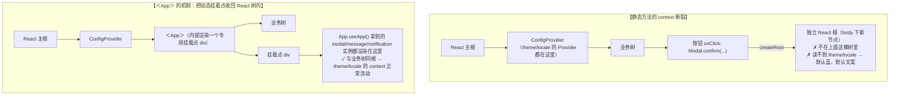

> 本文是《Lv3 复杂交互组件（公认最考功力）》按小节拆分后的续篇，上一部分见 [23-VirtualList-Anchor-Progress-等.md](23-VirtualList-Anchor-Progress-等.md)。

### ConfigProvider / App（模式级）

> 本节骨架（原大纲）：
> - 全局上下文根：主题 token、国际化、弹层挂载容器
> - `<App>` 解决命令式组件的 context 隔离（接 Lv2 Modal）

这两个"组件"不考交互，考**架构**：当一个库被几百个页面引用时，全局约定（主题、语言、弹层挂哪）必须有一个统一的注入口，而命令式 API 又天然游离在 React 树外——ConfigProvider 和 App 分别回应这两个问题。

**ConfigProvider：全局上下文根的职责。** 它是整棵应用树包裹层的"配置根"，三大职责：

1. **主题 token**：`theme.token` 覆盖种子变量（`colorPrimary`、`borderRadius`…），组件的所有派生色（hover、active、disabled、边框、背景）由 token 体系按算法推出——你只改一个主色，整库换肤。`theme.algorithm` 一键切换 `theme.darkAlgorithm` / `theme.compactAlgorithm`，暗色不是"另一套色值"，而是同一批种子的另一套派生公式。
2. **国际化 locale**：DatePicker 的月份名、Modal 的确定/取消文案、分页器语言，全部由 `locale` 注入（如 `zhCN` / `enUS`），组件内部零硬编码文案。
3. **弹层挂载容器 getPopupContainer**：所有 Portal 弹层（Select 下拉、DatePicker 面板、Tooltip）挂到哪，见下。

```tsx
import { App, ConfigProvider, theme } from 'antd';
import zhCN from 'antd/locale/zh_CN';

export function Root() {
  return (
    <ConfigProvider
      locale={zhCN}
      theme={{
        token: { colorPrimary: '#00b96b', borderRadius: 4 }, // 种子 token：派生全部组件色
        algorithm: theme.darkAlgorithm, // 暗色：同一批种子的另一套派生算法
      }}
      getPopupContainer={(triggerNode) => triggerNode.parentElement!} // 弹层挂到触发器父级
    >
      <App>
        <YourPages />
      </App>
    </ConfigProvider>
  );
}
```

**getPopupContainer 的意义与坑。** 默认弹层 Portal 到 `document.body`，理由充分：逃离祖先的 `overflow: hidden/auto` 裁剪、逃离 `transform` 祖先（transform 会把后代的 `position: fixed` 降级成相对自己定位，fixed 弹层直接错位）、逃离父级 z-index 层叠上下文。但在**内滚容器**场景（表格内、抽屉内、侧栏里）默认行为会翻车：弹层挂在 body 不随容器滚动，Select 下拉会脱离触发器漂移。于是把 `getPopupContainer` 指到滚动的祖先——代价接踵而至：

- 容器有 `overflow: hidden` 时弹层被裁掉（症状：下拉闪一下就消失）；
- 挂进容器后弹层从 body 直系变成容器内节点，要重新面对层叠上下文与裁剪问题；
- 弹层尺寸超出容器时同样被裁。

工程结论：**能挂 body 就挂 body**（配合 floating-ui 的滚动重定位，见 A2），只有明确需要"弹层随容器滚"时才改容器，且容器必须允许溢出可见或预留空间。

**`<App>` 解决命令式组件的 context 隔离（接 Lv2 Modal）。** Lv2 讲过 `Modal.confirm()` 命令式 API 的原理：内部 `createRoot` 在 body 下动态建一个**独立的 React 根**渲染确认框。问题就出在"独立"二字——context 沿 React 树流动，独立根不在 ConfigProvider 子树里：



也就是说 `<App>` 不是一个样式容器，而是一个**收容所**：它把命令式组件的渲染目的地从"body 下的野生根"改成"App 内部的挂载点"，让动态弹出的 Modal/Message 天然成为 ConfigProvider 的后代。用法上是两个动作：根部包 `<App>`，业务里用 `App.useApp()` 取实例代替静态方法：

```tsx
import { App } from 'antd';

function Page() {
  // hooks 化实例：渲染进 <App> 的挂载点，主题、国际化、dark 算法全部生效
  const { modal, message, notification } = App.useApp();

  const onDelete = async () => {
    const confirmed = await modal.confirm({
      title: '删除该记录？',            // 这里的按钮文案/配色吃得到 ConfigProvider 的 locale/theme
      content: '删除后不可恢复',
    });
    if (confirmed) {
      await apiDelete();
      message.success('已删除');
    }
  };
  return <button onClick={onDelete}>删除</button>;
}
```

顺带记住连带关系：`message.success()`、`notification.open()` 这些静态方法有同样的 context 断裂（这也是 Lv2 Toast 一节 hooks 化 API 的由来），`App.useApp()` 一次性给齐三个正确姿势的实例。原理层面这是"命令式 vs 声明式"张力的标准解法之一：**命令式 API 想吃 context，就必须在树内留一个可寻址的挂载点**——你以后设计任何"xx.confirm()"式 API 都会再遇到它。

本节常见坑（症状 → 根因 → 修法）：

| # | 症状 | 根因 | 修法 |
|---|---|---|---|
| 1 | `Modal.confirm` 弹出的还是默认蓝、英文按钮 | 静态方法渲染在独立根，读不到 ConfigProvider | 根部包 `<App>` + `App.useApp()` |
| 2 | 改了 getPopupContainer 后下拉被裁剪 | 容器 overflow hidden/auto 裁掉了 Portal 弹层 | 容器放行溢出，或退回 body + 滚动重定位 |
| 3 | 弹层 position: fixed 却相对某祖先定位 | 祖先有 transform，fixed 被降级 | 弹层 Portal 到 body；或该祖先去 transform |
| 4 | App.useApp() 返回 undefined | 该组件不在 `<App>` 子树里 | 检查根部是否真的包了 `<App>` |

#### 补充：嵌套 ConfigProvider——合并语义、作用域与性能拆分

**是什么**：ConfigProvider 可以嵌套——外层给全站主题，内层在某个业务区块再包一层，只覆盖局部（比如表单区换一套紧凑算法、危险操作区换红色主色）。嵌套不是"再包一层就完事"，它牵出三个必须想清楚的问题：**合并什么**（哪些配置参与合并、哪些直接覆盖）、**作用域到哪**（弹层从子树弹出时归谁管）、**性能怎么保**（一个 context 装所有配置会让任何一项变化击穿整棵子树）。

**为什么值得专节**：这是 ConfigProvider 从"API 使用"跨到"库架构"的一道坎。你在自研组件库时几乎必然要自己设计这一层，而三个问题答错的症状都要等库被大量使用后才爆发——局部主题把全局弹层也染了、改一个 locale 全站重渲染、嵌套覆盖的 token 合并出"半红半绿"的怪色。设计 token 的分层结构（种子/派生/组件三层）在《第二辑》20-9 已有完整展开，本节只谈**承载配置的 Provider 层**怎么做。

**机制一：合并语义要逐项定义，不存在默认答案**。把配置分三类处理：

| 配置类别 | 合并语义 | 例 |
|---|---|---|
| 对象型（theme.token） | **深合并**：子层只写的键生效，没写的键继承父层 | 父层 `colorPrimary: '#00b96b'`，子层只写 `borderRadius: 2` → 子树两个都生效 |
| 引用型（locale、algorithm） | **整体覆盖**：语言包没法"合并"，子层给就是子层的 | 子层 `locale={enUS}` 整包替换 |
| 函数型（getPopupContainer） | **链式代理**：子层可以先问父层再改写结果 | 子层拿父层的容器再包一层定位 wrapper |

自研时的深合并实现别引 lodash.merge——**只对"纯数据对象"递归，数组与函数原样覆盖**，否则 `theme.algorithm`（函数/对象混合）会被合并出怪物：

```ts
// merge-config.ts —— 只递归纯对象，其余类型子层覆盖
type PlainObject = Record<string, unknown>

function isPlainObject(v: unknown): v is PlainObject {
  return typeof v === 'object' && v !== null && !Array.isArray(v)
}

export function mergeConfig<P extends PlainObject, C extends PlainObject>(parent: P, child: C) {
  const out: PlainObject = { ...parent }
  for (const key of Object.keys(child)) {
    const pv = parent[key]
    const cv = child[key]
    out[key] = isPlainObject(pv) && isPlainObject(cv) ? mergeConfig(pv, cv) : cv
  }
  return out as P & C
}
```

**机制二：作用域的边界要跟着"渲染目的地"走，而不是跟着"调用代码位置"走**。嵌套 Provider 里打开的 Select 下拉，挂载点由**那一层的** `getPopupContainer` 决定——这通常是对的；但命令式 `modal.confirm()` 从子树里调用时，吃的是**根部**的配置（App 挂载点在根部），"危险区红主题"对它不生效。这是上一节 context 断裂问题的嵌套版本，工程上的正解是 `App.useApp()` 的实例化也允许局部包裹：危险区自己包一个带局部主题的 `<App>`，取到的 modal 就渲染在局部挂载点、吃局部主题（antd v5 的 App 支持这样用，自研时照抄这个"挂载点可下沉"的设计）。

**机制三：context 按"变化频率"拆条，是性能的全部秘密**。单条 context 装所有配置时，改 `getPopupContainer`（几乎从不变）会让读 `theme`（变得最频繁）的组件全体重渲染。antd 内部把配置拆成多条独立 context 正是为此。自研骨架：

```tsx
// 库内部：三条独立 context，公开层聚合成一个 <ConfigProvider>
const ThemeContext = createContext<ThemeConfig>(DEFAULT_THEME)     // 高频变化
const LocaleContext = createContext<Locale>(DEFAULT_LOCALE)        // 低频
const PopupContext = createContext<PopupConfig>(DEFAULT_POPUP)     // 几乎不变

export function ConfigProvider({
  theme, locale, popup, children,
}: ConfigProviderProps) {
  // 分别记忆：theme 变化只让 ThemeContext 的消费者重渲染
  const themeValue = useMemo(() => mergeConfig(DEFAULT_THEME, theme), [theme])
  return (
    <PopupContext.Provider value={popup ?? DEFAULT_POPUP}>
      <LocaleContext.Provider value={locale ?? DEFAULT_LOCALE}>
        <ThemeContext.Provider value={themeValue}>
          {children}
        </ThemeContext.Provider>
      </LocaleContext.Provider>
    </PopupContext.Provider>
  )
}

// 组件侧按需订阅：只弹层的组件别读 ThemeContext
export function usePopupConfig() { return useContext(PopupContext) }
export function useTheme() { return useContext(ThemeContext) }
```

**嵌套的高频场景速查**：

| 场景 | 包法 | 注意 |
|---|---|---|
| 全站暗色 + 局部亮色文档区 | 外层 darkAlgorithm，内层 defaultAlgorithm | 内层记得连背景色一起给（页面底色不是算法推导的） |
| 危险操作区红主色 | 局部 ConfigProvider theme.token.colorPrimary | 只染组件色，业务手写的 CSS 色值不会跟——别指望它管你自己的样式 |
| iframe 嵌入子应用 | 子应用根独立一套 ConfigProvider | 别跨 iframe 传递 context；配置由各自根注入 |
| 表单区紧凑间距 | 局层 compactAlgorithm | 紧凑算法同时改字号与间距，验收时看密集表格的可读性 |

**坑（嵌套层）**：
- 症状：内层改了 `borderRadius`，但内层的弹层、按钮 hover 色还是外层的。
- 根因：深合并把"没写的键"正确继承了，但**派生色是按整包 token 在渲染时算的**——子层只写 `borderRadius` 却期望派生色变化当然不会发生；或者反过来：子层复制了父层整包 token 又改一处，父层后续改主色，子树不跟（**快照式覆盖冻结了继承**）。
- 修法：团队约定"子层只写差异键，永远不整包复制父层配置"；需要"跟随父层 + 局部差异"的动态场景，用 `useTheme()` 读父层再计算子层配置（代码里表达依赖，而不是复制快照）。

#### 补充：自研 `<App>` holder——把命令式 API 收进树内的最小实现

**是什么**：把上节 `<App>` 的机制自己写一遍——一个约 40 行的 holder 模式：Provider 在树内渲染一个挂载点 div，`useToast()` 等 hooks 把"命令式调用"变成"往 holder 的状态队列里 push"，弹层因此天然在树内、吃得到一切 context。antd 的 `<App>`、react-hot-toast 的 `<Toaster>`、sonner 的 `<Toaster />` 都是这一模式。

**为什么值得手写**：Lv2 反馈组件一节从"使用侧"讲过 hooks 化 API 的好处，这里从"实现侧"把它焊死——写完这个最小实现，你能回答三个面试级问题：命令式 API 为什么在 React 18 并发特性下更危险（独立根的渲染不受主树调度，Suspense/transition 边界对它失效）、holder 为什么必须幂等（StrictMode 双挂载会建两个 holder）、实例方法怎么在重渲染间保持稳定引用。

```tsx
// toast-holder.tsx —— 40 行实现一个吃得到 context 的命令式 toast
import {
  createContext, useCallback, useContext, useMemo, useRef, useState,
  type ReactNode,
} from 'react'

interface Toast { id: number; text: string; tone: 'info' | 'success' | 'error' }

interface ToastApi {
  show(text: string, tone?: Toast['tone']): void
  dismiss(id: number): void
}

const ToastCtx = createContext<ToastApi | null>(null)
let seq = 0 // 自增 id：StrictMode 双调用下也唯一，别用 Math.random（不可测）

export function ToastProvider({ children, max = 3 }: { children: ReactNode; max?: number }) {
  const [items, setItems] = useState<Toast[]>([])
  // 用 ref 防抖 set：同一帧多次 show 合并成一次渲染
  const pendingRef = useRef<Toast[]>([])

  const flush = useCallback(() => {
    const pending = pendingRef.current
    pendingRef.current = []
    setItems(prev => [...prev, ...pending].slice(-max)) // 队列上限：最早的被挤掉
  }, [max])

  const api = useMemo<ToastApi>(() => ({
    show: (text, tone = 'info') => {
      pendingRef.current.push({ id: ++seq, text, tone })
      flush() // 若要同帧合并：改用 requestAnimationFrame 安排一次 flush 并记已安排标志
    },
    dismiss: id => setItems(prev => prev.filter(t => t.id !== id)),
  }), [flush]) // 空依赖级别稳定：业务里 onRemove={api.dismiss} 不击穿 memo

  return (
    <ToastCtx.Provider value={api}>
      {children}
      {/* 挂载点：树内 div，弹层吃得到外层全部 Provider（主题/locale/动画） */}
      <div className="toast-holder" role="region" aria-label="通知" aria-live="polite">
        {items.map(t => (
          <div key={t.id} className={`toast toast--${t.tone}`}>
            {t.text}
            <button aria-label="关闭" onClick={() => api.dismiss(t.id)}>✕</button>
          </div>
        ))}
      </div>
    </ToastCtx.Provider>
  )
}

export function useToast(): ToastApi {
  const api = useContext(ToastCtx)
  if (!api) throw new Error('useToast 必须在 <ToastProvider> 内使用') // 快失败优于静默 undefined
  return api
}
```

**逐行讲三个设计决定**：

1. **`aria-live="polite"` 挂在 holder 上而不是每条 toast 上**：读屏器对动态插入的节点报读依赖 live region 先于内容存在；每条 toast 自己挂 live 属性时，插入瞬间常被漏报。holder 常驻 + polite（不打断），是 a11y 的正解。
2. **`api` 用 `useMemo` 空依赖级稳定**：业务组件常写 `onClick={() => api.show('x')}`，这没问题；但列表项组件若把 `api.dismiss` 传给 memo 化的子组件，引用不稳会击穿 memo——所以实例方法必须"创建一次，终身有效"。
3. **队列上限 `slice(-max)`**：命令式 API 最大的滥角是循环触发（上传失败重试风暴），没有上限的 holder 会把页面刷成瀑布。上限策略（淘汰最早 vs 拒绝新增）按产品定，但**必须有**。

**与独立根方案的对照收口**（本表也是"什么时候 holder 不够用"的答案）：

| 维度 | 独立 createRoot（静态方法） | 树内 holder（本实现） |
|---|---|---|
| context | 断裂（本节主问题） | 正常流动 |
| React 18 并发 | 不受主树调度，Suspense/边界失效 | 参与主树一切机制 |
| 挂载时机 | 首次调用才建（懒） | Provider 挂载即建（可接受） |
| SSR | 需手处理水合 | 与主树一起水合 |
| 多实例天然支持 | 否（单例） | 是（每 Provider 一套） |

**坑（实现层）**：
- 症状：开发环境（StrictMode）里每条 toast 弹两次；或刷新后 id 从 0 重新计数导致 key 撞车。
- 根因：模块级 `seq` 自增在 StrictMode 双调用下没问题，但把 id 改成 `Math.random()` 或 `Date.now()` 会在同毫秒/测试快照里撞车；弹两次则多是 effect 里无条件 `show` 且清理函数缺失。
- 修法：id 永远用自增序号（可预测、可断言）；effect 触发的 toast 必须带 cleanup 里的 dismiss；测试里对队列断言用 `items.map(t => t.text)` 而不是 id 快照。


---

## 附:ASCII 图替换清单

本文档图形化改版,原 ASCII 字符图与 Mermaid 图表对应关系如下:

| 原图位置 / 标题 | 处理结果 |
| --- | --- |
| 静态方法的 context 断裂 与 ＜App＞ 收回挂载点(两棵 React 树对照) | 替换为 flowchart(断裂/修复并列 subgraph) |
