# Part C：工程化（从 demo 到可发布）

前面 Part A 练的是"写得出"，Part B 练的是"写得对"，Part C 解决最后一公里：**写得出去**——让组件库变成一个陌生团队可以安装、可以按需加载、可以放心升级、跨项目跨 React 版本都能跑的正式 npm 包。一堆只有源码的组件文件夹，和一个可发布的组件库之间，隔着六道关卡：仓库怎么组织、产物长什么样、文档怎么呈现、测试怎么兜底、版本怎么承诺、兼容边界画在哪。任何一环缺失，组件库都会在某个规模节点上崩掉。

这六条不是并列清单，而是一条流水线：**仓库定骨架（代码怎么组织）→ 构建定产物（用户拿到什么）→ 文档定门面（用户怎么学会）→ 测试定底线（改坏了谁报警）→ 版本定契约（用户怎么敢升级）→ 兼容定边界（在谁的机器上能跑）**。本章逐条过关，每条按"是什么 → 为什么 → 怎么做 → 配置示例 → 常见坑"展开。

先保留原大纲骨架，后文逐条对应展开：

1. **仓库**：pnpm monorepo（components / hooks / token / utils 分包），turbo 任务编排
2. **构建**：tsup/father/unbuild；ESM+CJS 双产物；dts 类型；`sideEffects` 精确声明（按需加载的命门）
3. **文档**：Storybook/dumi，MDX 用例即文档；**视觉回归**（Chromatic/Lost Pixel）；a11y 检查（axe 插件）
4. **测试**：Vitest + Testing Library 逐组件；Storybook play function 交互测试
5. **版本**：changesets 自动 changelog；semver 纪律；大版本迁移配 codemod（jscodeshift）
6. **兼容**：browserslist 矩阵、SSR hydrate 冒烟测试、React 18/19 双版本跑测

---
## C1. 仓库：pnpm monorepo（components / hooks / token / utils 分包），turbo 任务编排

### 是什么

monorepo 是把多个可独立发布的包放进同一个代码仓库统一管理。pnpm workspace 提供包之间的互相引用（改一处、上下游同时可见、版本用 `workspace:*` 占位），turbo 负责按依赖拓扑并行执行构建/测试并做结果缓存。

### 为什么需要

- **发布粒度**：业务方常常只想要 hooks 或设计 token，不想拖走整个组件库。分包后可以单独发布 `@your-org/hooks`。
- **依赖单向化**：utils 被 token/hooks 用，token/hooks 被 components 用，分层清晰后改 utils 会立刻在下游的类型检查里暴露影响——这在多仓库里要等发版才能发现。
- **原子提交**："改 button 样式 + 修对应测试 + 更新文档 demo"是一个 PR，文档永不脱节。
- **为什么是 pnpm 而不是 npm/yarn workspaces**：pnpm 用符号链接构造严格 node_modules，**没有声明的依赖 import 不到**（防幽灵依赖，这是 npm 扁平化结构的顽疾），且硬链接存储让一百个包共用一份 react 时磁盘和安装速度都占优。

### 怎么做：目录树与依赖关系

完整目录树（可直接照抄的骨架）：

```mermaid
flowchart TD
    root["react-ui/"]
    root --> f1["package.json — 根包：只放脚本和开发工具，永不发布"]
    root --> f2["pnpm-workspace.yaml — workspace 成员声明"]
    root --> f3["turbo.json — turbo 任务编排（依赖拓扑 + 缓存）"]
    root --> f4["tsconfig.base.json — 共享 TS 配置，各包 extends 它"]
    root --> cs[".changeset/"]
    cs --> c1["config.json — changesets 配置（C5 展开）"]
    cs --> c2["bright-pandas-run.md — 待消费的变更集文件（发布流程中自动删除）"]
    root --> pkgs["packages/"]
    pkgs --> ut["utils/ — 【层 0】纯函数，零 React 依赖"]
    ut --> us["src/"]
    us --> i1["index.ts"]
    us --> d1["dom.ts — isElement / getOwnerDocument / getScrollParent"]
    us --> n1["number.ts — clamp / toValidNumber"]
    us --> a1["array.ts"]
    ut --> up["package.json — name: @react-ui/utils"]
    ut --> utt["tsup.config.ts"]
    pkgs --> tk["token/ — 【层 1】设计 token：CSS Variables + TS 常量"]
    tk --> tks["src/"]
    tks --> tki["index.ts — export * from './colors' 等 TS 侧出口"]
    tks --> tkc["colors.css — :root ｛ --ui-color-primary: #1677ff；… ｝"]
    tks --> tkt["colors.ts — export const colors —— JS/canvas 场景取色用（Watermark 生成透明水印时就要拿到主色）"]
    tk --> tkp["package.json — name: @react-ui/token"]
    tk --> tkt2["tsup.config.ts"]
    pkgs --> hk["hooks/ — 【层 1】通用 hook，不含任何 UI"]
    hk --> hks["src/"]
    hks --> h1["use-controllable-state.ts — Part A 的 A1，Switch/Input/Select 三处复用"]
    hks --> h2["use-click-outside.ts — A2 弹层体系"]
    hks --> h3["use-focus-trap.ts — A4 焦点管理"]
    hks --> h4["use-escape-key.ts"]
    hks --> h5["index.ts"]
    hk --> hp["package.json — name: @react-ui/hooks"]
    hk --> ht["tsup.config.ts"]
    pkgs --> cp["components/ — 【层 2】组件本体，聚合层"]
    cp --> cps["src/"]
    cps --> bt["button/"]
    bt --> b1["button.tsx — 实现"]
    bt --> b2["button.test.tsx — 测试与组件同目录（C4）"]
    bt --> b3["button.stories.tsx — story 与组件同目录（C3）"]
    cps --> md["modal/"]
    cps --> sl["select/"]
    cps --> cpi["index.ts — 统一出口：export * from './button' …"]
    cps --> cpc["index.css — 全局重置/主题挂载样式（sideEffects 重点保护对象，C2 讲）"]
    cp --> cpp["package.json — name: @react-ui/components"]
    cp --> cpt["tsup.config.ts"]
    root --> ap["apps/"]
    ap --> dc["docs/ — 文档站（Storybook 或 dumi），不发布，只 import packages"]
```



依赖关系必须**单向无环**：

```text
utils（层 0）
  ↑          ↑
token（层 1） hooks（层 1）
  ↑            ↑
  └── components（层 2）──┘
        ↑
   apps/docs（层 3，只消费）
```

分层依据不是"文件类型"，而是**变更频率与稳定性**：utils 是纯函数，几乎不改，发 patch 为主；token 随设计规范演进；hooks 随交互模式演进；components 变更最频繁。下层永远不知道上层的存在——hooks 里绝不能 import components 的类型，否则环出现、构建拓扑失效。

### 配置示例

`pnpm-workspace.yaml`（pnpm 9/10 写法一致）：

```yaml
packages:
  # packages/* 下每个目录是一个可发布的包
  - "packages/*"
  # apps/* 是不发布的工程（文档站、playground）
  - "apps/*"
```

根 `package.json`（只放编排脚本，不放任何业务依赖）：

```json
{
  "name": "react-ui",
  "private": true,
  "scripts": {
    "build": "turbo run build",
    "test": "turbo run test",
    "lint": "turbo run lint",
    "dev": "turbo run dev",
    "changeset": "changeset",
    "version-packages": "changeset version",
    "release": "turbo run build && changeset publish"
  },
  "devDependencies": {
    "turbo": "^2.3.0"
  },
  "packageManager": "pnpm@9.15.0"
}
```

内部包互相引用用 workspace 协议（`packages/components/package.json` 节选）：

```json
{
  "name": "@react-ui/components",
  "dependencies": {
    "@react-ui/hooks": "workspace:*",
    "@react-ui/token": "workspace:*",
    "@react-ui/utils": "workspace:*"
  },
  "peerDependencies": {
    "react": ">=18",
    "react-dom": ">=18"
  }
}
```

`workspace:*` 在开发期直连本地源码；发布时 changesets 自动把星号替换成当时解析出的真实版本号（这个替换只有 changesets publish 会做，见 C5 的坑 3）。

`turbo.json`（Turborepo v2 用 `tasks` 键；v1 的 `pipeline` 已废弃）：

```json
{
  "$schema": "https://turbo.build/schema.json",
  "tasks": {
    "build": {
      "dependsOn": ["^build"],
      "outputs": ["dist/**"]
    },
    "test": {
      "dependsOn": ["build"]
    },
    "lint": {
      "outputs": []
    },
    "dev": {
      "cache": false,
      "persistent": true
    }
  }
}
```

三个关键配置的含义：

- `"dependsOn": ["^build"]`：`^` 表示**拓扑依赖**——先递归构建上游包。执行 `turbo run build` 时 turbo 读 workspace 依赖图，先建 utils，再并行建 token 和 hooks，最后建 components。这就是把"构建顺序"从人脑挪进配置。
- `"outputs": ["dist/**"]`：声明构建的可缓存产物。turbo 对每个任务计算输入哈希（源码、依赖任务的输出、环境变量），命中则直接还原 `dist/**`，跳过执行。
- `"test": { "dependsOn": ["build"] }`：注意**没有 `^`**——只依赖本包自己的 build（测试要 import 本包构建产物或类型），不依赖别的包的 build。`^build` 与 `build` 一字之差，就是"上游任务"和"同包任务"的差别。

缓存效果体感：第二次 `turbo run build` 全量命中，秒级返回；改了 utils 一个文件后重跑，utils 与其下游（token/hooks/components）重建，其余包继续吃缓存。在 CI 上配远程缓存后，队友之间也共享这份命中。

### 常见坑

1. **症状**：在 components 里 `import 'lodash-es'` 能跑，别的同事拉代码后报 "Cannot find module"。**根因**：lodash 装在别的包/根下，npm/yarn 的扁平结构把它提升到顶层 node_modules，components 是"蹭"来的幽灵依赖；换 pnpm 或换环境就炸。**修法**：用 pnpm workspace（默认禁止蹭），并且每个包用什么就声明什么——报错其实是保护机制在工作。
2. **症状**：CI 上测试时绿时红，本地永远绿。**根因**：测试代码里用了 `Date.now()`/随机数，或 turbo 缓存把上次的结果直接还原了（输入文件没变、行为变了，哈希感知不到）。**修法**：测试内 mock 时间与随机源；对这类任务在 turbo.json 里给 `test` 加 `"cache": false` 或在 CI 传 `--force`。
3. **症状**：发布后用户安装报 `ERR_PNPM_NO_MATCHING_VERSION`，npm 页面显示依赖是 `"@react-ui/hooks": "workspace:*"`。**根因**：绕过 changesets 直接 `pnpm publish`，workspace 协议没被替换就发了出去。**修法**：发布永远走 `changeset publish`（详见 C5），根 package.json 里不放 publish 脚本，从流程上杜绝手滑。

## C1.1 workspace 协议细节：版本策略、发布时的版本改写与循环依赖预防

正文用一句话交代了 `workspace:*`；协议本身还有三块值得单列：**版本策略（`*` / `~` / `^` 各改写成什么）、发布时的版本改写发生在哪一步、循环依赖怎么在 CI 就拦下来**。发布流程全景（变更集、Version PR、publish）见 [30-C5-版本-changesets-自动-changelog-semver-纪律.md](30-C5-版本-changesets-自动-changelog-semver-纪律.md)，本节只写协议侧。

### 是什么

`workspace:` 是 pnpm 给 semver range 加的私有前缀。一行内部依赖声明有两段生命周期：

- **开发期**：`pnpm install` 把它解析为符号链接（`node_modules/@react-ui/hooks -> ../../packages/hooks`），改源码即刻可见，不需要发版也不需要 watch。
- **发布期**：`pnpm publish`（注意不是 `npm publish`——npm 不认识这个协议）把协议改写成真实版本 range 写进 tarball 的 package.json；用户机器上没有 workspace，只有改写后的结果。

### 为什么需要

- 同一行 JSON 在两个阶段语义完全不同，所有错误都延迟到"发布之后、用户安装时"才暴露；
- 星号的选择直接决定用户拿到多宽的依赖范围，选错不报错，只在未来变成兼容性事故；
- pnpm 只管"链接到谁"，**不校验依赖方向**——循环依赖在 install 阶段零提示，运行时以 `undefined is not a function` 出现（环上模块初始化顺序错乱，拿到的还是未赋值的 binding）。

### 怎么做：四步

**第 1 步：版本策略选型。** 四种写法与发布时的改写结果：

| 声明 | 发布时改写为 | 适用 |
|---|---|---|
| `"workspace:*"` | 精确版本（如 `"1.4.2"`） | **内部包默认**：锁定到测试过的组合 |
| `"workspace:^"` | `"^1.4.2"` | 一般不要（坑 1） |
| `"workspace:~"` | `"~1.4.2"` | 同上 |
| `"workspace:1.4.2"` | install 时要求本地版本精确等于它，否则直接报错 | 演示/锁死 |

内部包一律 `*` 的理由：range 的意义是"允许安装器挑选兼容版本"，而内部包的版本联动由 changesets 在 Version PR 里统一 bump（C5 第 3 步），语义上不存在"挑版本"这件事。

**第 2 步：发布改写的准确位置。** 改写发生在 `pnpm publish` 打 tarball 的瞬间，`pnpm pack --dry-run` 可以预览改写后的依赖表（排障第一工具）；changesets 的 `changeset publish` 内部正是逐包调用 `pnpm publish`。所以改写不需要配置任何东西，要守住的是**发布入口唯一**（正文坑 3）。

**第 3 步：多包版本联动。** 在 C5 的 `.changeset/config.json` 基础上按需填两个键：

| 键 | 行为 | 组件库适用性 |
|---|---|---|
| `"linked": [[包名列表]]` | major 必须同步，minor/patch 各自独立 | **推荐**：breaking 常跨包（大版本一起升），小修各发各的 |
| `"fixed": [[包名列表]]` | 组内版本号永远一致 | 包少、发版频率低时省心；频率高时出现"utils 没改也跟着 2.3.1"的版本噪音 |

**第 4 步：循环依赖预防，三道防线。**

1. **CI 卡点**：dependency-cruiser 声明依赖方向规则 + 环检测（配置见下）；
2. **类型层**：跨层引用类型一律 `import type`——类型引用被编译擦除，不构成运行时依赖边；大部分"环"其实是类型引用造成的假环，这一条能消掉大半；
3. **编辑器层**：eslint `import/no-cycle` 写代码当场标黄。

### 配置示例

`.dependency-cruiser.cjs`（放仓库根，规则与正文的分层图一一对应）：

```js
/** 循环依赖与分层边界的静态检查（CI 卡点） */
module.exports = {
  forbidden: [
    {
      name: 'no-circular',
      severity: 'error',
      comment: '循环依赖：运行时 undefined 事故与构建拓扑失效的共同根源',
      from: {},
      to: { circular: true },
    },
    {
      name: 'layer-0-pure',
      severity: 'error',
      comment: 'utils 是层 0：禁止反向依赖 token/hooks/components',
      from: { path: '^packages/utils/src' },
      to: { path: '^packages/(token|hooks|components)/src' },
    },
    {
      name: 'layer-1-not-upward',
      severity: 'error',
      comment: 'token/hooks 是层 1：不得依赖 components（层 2）',
      from: { path: '^packages/(token|hooks)/src' },
      to: { path: '^packages/components/src' },
    },
    {
      name: 'layer-1-no-horizontal-token',
      severity: 'warn',
      comment: '同层不横向依赖：共享逻辑应下沉 utils',
      from: { path: '^packages/token/src' },
      to: { path: '^packages/hooks/src' },
    },
    {
      name: 'layer-1-no-horizontal-hooks',
      severity: 'warn',
      from: { path: '^packages/hooks/src' },
      to: { path: '^packages/token/src' },
    },
  ],
  options: {
    doNotFollow: { path: 'node_modules' },
    tsConfig: { fileName: 'tsconfig.base.json' },
  },
};
```

根 `package.json` 追加（scripts 与 devDependencies 各一处）：

```json
{
  "scripts": {
    "depcruise": "depcruise \"packages/*/src\" --config .dependency-cruiser.cjs"
  },
  "devDependencies": {
    "dependency-cruiser": "^16.3.0"
  }
}
```

CI 步骤（加进现有 workflow 的 lint 之后）：

```yaml
- name: Dependency rules (circular + layering)
  run: pnpm depcruise
```

编辑器层（`.eslintrc.cjs` 节选）：

```js
module.exports = {
  overrides: [
    {
      files: ['packages/*/src/**/*.{ts,tsx}'],
      extends: ['plugin:import/typescript'],
      rules: {
        // warn 而非 error：环常由类型引用造成，先提示人判断；真环由 depcruise 在 CI 拦
        'import/no-cycle': [1, { maxDepth: 4, ignoreExternal: true }],
      },
    },
  ],
};
```

`.npmrc`（新增内部依赖自动写成 `workspace:*`，杜绝团队风格漂移）：

```ini
# pnpm add 内部包时保存为 workspace:*（rolling 语义），不跟随 save-prefix 生成 ^
save-workspace-protocol=rolling
```

### 常见坑

1. **症状**：用户侧 `@react-ui/hooks` 装到了未来不兼容的新版本，组件库行为诡异且难复现。**根因**：内部依赖写了 `workspace:^`，发布后变成可浮动的 `^1.4.2`，用户的包管理器自行挑了 1.9.0。**修法**：内部依赖一律 `workspace:*`（发布改写为精确版本）；批量替换存量，再用 `.npmrc` 防新增。
2. **症状**：开发时 import 内部包，行为/类型是"旧的"，明明刚改过源码。**根因**：link 到的确实是包目录，但包的 `exports` 指向 `dist`，拿到的是上次构建产物。**修法**：开发期消费走源码——文档站/测试把 `@react-ui/*` alias 到 `src`（C3 文档站就是这么配的）；或接受"产物化开发"（每次构建后消费 dist），全仓统一一种。
3. **症状**：运行时 `TypeError: Cannot read properties of undefined`，栈停在 hooks 的工具函数里。**根因**：hooks 与 components 之间出现循环 import，环上模块初始化顺序错乱。**修法**：`import type` 擦除类型边；`pnpm depcruise` 拦新环；破环手法 = 把共享逻辑下沉到被依赖的一层。
4. **症状**：同事新增的内部依赖被写成 `workspace:^`，风格漂移。**根因**：缺省时 pnpm 按默认 save-prefix（通常是 `^`）保存 workspace 依赖。**修法**：`.npmrc` 的 `save-workspace-protocol=rolling`；存量靠一条 lint 断言（或 depcruise 自定义规则）兜底。

## C1.2 Turborepo 增量构建：任务图、缓存命中与远程缓存

正文的最小 turbo.json 已能让 `turbo run build` 按拓扑跑起来；本节补三块深水区：**哈希到底算进了什么（决定命中率）、远程缓存（决定 CI 时间）、一份完整的任务定义（任务不再只有 build/test）**。

### 是什么

增量构建 = 对每个"包 × 任务"节点计算**输入哈希**，哈希没变就直接回放上次结果（日志 + 产物），不再执行。三个组成部分：

- **任务图（DAG）**：节点是"包 × 任务"，边由 `dependsOn` 给出（`^任务` 连上游包的同名任务，不带 `^` 连本包的其他任务）；
- **本地缓存**：`.turbo/cache/`（2.x；1.x 在 `node_modules/.cache/turbo`），存执行日志与 `outputs` 声明的产物；
- **远程缓存**：把"哈希 → 产物"上传到共享服务器，命中范围从"本机"扩大到"全团队 + 所有 CI 机器"。

### 为什么需要

缓存命中是**哈希等价**，不是**语义等价**。两种事故方向相反、都极隐蔽：

- **缓存击穿**（该命中却 miss）：一个没声明进哈希的环境变量就能让全部哈希改变，CI 时间悄悄翻倍，没人报警；
- **脏缓存**（不该命中却 hit）：任务读了哈希覆盖不到的输入（网络、时间、未声明的全局文件），还原出的"上次结果"其实是错的——正文坑 2 的深化版。

### 怎么做：四步

**第 1 步：任务图决定执行顺序。** `turbo run build` 读 workspace 依赖图，把每个包的 build 连成 DAG 按拓扑序调度：utils 完成后 token 与 hooks **并行**，最后 components。本地改动循环用 `--filter` 只跑子图：

```bash
turbo run build --filter=@react-ui/components...    # 它和它的上游
turbo run build --filter=...@react-ui/components    # 它和消费它的下游（评估影响面）
```

**第 2 步：哈希输入清单（命中率的第一性）。** 一个任务的哈希由五部分拼成：

1. 任务定义本身（命令、参数、turbo.json 里该任务的配置）；
2. 包内输入文件——默认全算，用 `inputs` 精简（README 改动不该让 build 失效）；
3. 上游任务输出的哈希；
4. **显式声明过的**环境变量（任务级 `env` / 全局 `globalEnv`）——**turbo 2.x 起未声明的环境变量一律不进哈希**，这是"CI 与本地行为不同却查不出原因"的头号来源；
5. 全局文件（`globalDependencies`，如 tsconfig.base.json 改动应让全仓构建失效）。

**第 3 步：命中与回放。** 命中时任务日志被"重放"（终端输出带 replay 标记），`outputs` 原位还原；未命中则执行后写入本地缓存，配置了远程缓存再上传。

**第 4 步：远程缓存两种形态。**

- **Vercel 托管**：本地 `pnpm turbo login` + `pnpm turbo link` 绑定仓库；CI 配 `TURBO_TOKEN` / `TURBO_TEAM` 两个 secret；
- **自托管**：部署一个协议兼容服务（如 `turborepo-remote-cache`，存储落 S3/R2），CI 与本地设置 `TURBO_API`（服务地址）、`TURBO_TOKEN`、`TURBO_TEAM`；开签名校验再配 `TURBO_REMOTE_CACHE_SIGNATURE_KEY`，防止伪造 artifact 注入构建。

### 配置示例

完整 `turbo.json`（正文最小版之上补 typecheck/lint/ci、inputs 精简与环境声明）：

```json
{
  "$schema": "https://turbo.build/schema.json",
  "globalDependencies": ["tsconfig.base.json", ".npmrc"],
  "globalEnv": ["NODE_ENV"],
  "tasks": {
    "build": {
      "dependsOn": ["^build"],
      "inputs": ["$TURBO_DEFAULT$", "!README.md", "!**/*.test.*", "!**/*.stories.*"],
      "outputs": ["dist/**", "*.tsbuildinfo"]
    },
    "typecheck": {
      "dependsOn": ["^build"],
      "inputs": ["src/**/*.ts", "src/**/*.tsx", "tsconfig.json"]
    },
    "test": {
      "dependsOn": ["build"],
      "inputs": ["src/**", "!**/*.md"],
      "outputs": ["coverage/**"]
    },
    "lint": {
      "inputs": ["src/**", "*.json", ".eslintrc.cjs"]
    },
    "dev": {
      "cache": false,
      "persistent": true
    },
    "ci": {
      "dependsOn": ["lint", "typecheck", "test", "build"]
    }
  }
}
```

三点说明：

- `inputs` 里的 `$TURBO_DEFAULT$` 表示"在默认输入之上做排除"，比从零列举安全（漏列等于静默不重建）；
- `globalEnv` 只放**真正影响产物**的变量；`CI` 这类"本地与 CI 值不同"的变量一旦声明，本地缓存与 CI 缓存将互不通用——任务行为不随 CI 环境变化就别声明；
- `ci` 任务把同包的 lint/typecheck/test/build 串成一个入口，根脚本与 workflow 只需记一条命令。

GitHub Actions（接入远程缓存后，PR 也能吃到主干缓存）：

```yaml
# .github/workflows/ci.yml
name: CI
on: [push, pull_request]
jobs:
  ci:
    runs-on: ubuntu-latest
    env:
      # 自托管远程缓存（Vercel 托管时改为 TURBO_TOKEN + TURBO_TEAM）
      TURBO_API: ${{ secrets.TURBO_API }}
      TURBO_TOKEN: ${{ secrets.TURBO_TOKEN }}
      TURBO_TEAM: ${{ secrets.TURBO_TEAM }}
      TURBO_REMOTE_CACHE_SIGNATURE_KEY: ${{ secrets.TURBO_SIGNATURE_KEY }}
    steps:
      - uses: actions/checkout@v4
      - uses: pnpm/action-setup@v4
      - uses: actions/setup-node@v4
        with:
          node-version: 22
          cache: pnpm
      - run: pnpm install --frozen-lockfile
      - name: Full CI pipeline (topological, cached)
        run: pnpm turbo run ci
```

排障命令序列：

```bash
# 预演：不执行，打印每个任务的哈希与预计命中状态（缓存排障第一工具）
turbo run build --dry=json | jq '.tasks[] | {taskId, hash, cache}'

# 任务图可视化（.dot 是纯文本可直接查看；png/svg 需本机装有 graphviz）
turbo run build --graph=graph.dot

# 改了 turbo.json / 基础 tsconfig 后强制全量重建
turbo run build --force

# 收集全部失败再统一看（不让第一个红任务掐断流水线）
turbo run test --continue
```

### 常见坑

1. **症状**：CI 每次全量执行，本地却秒回；`--dry=json` 显示哈希与上次不同。**根因**：任务脚本读了未声明的环境变量（CI 与本地值不同），该声明的没声明。**修法**：把任务真实读取的变量写进 `env`/`globalEnv`；纯展示类变量（颜色、进度条）不要声明。
2. **症状**：缓存命中但下游 typecheck 报"找不到模块"。**根因**：`outputs` 漏了副产物——`*.tsbuildinfo`、单独目录的 `.d.ts` 没被 `dist/**` 覆盖，命中还原的是缺件产物。**修法**：outputs 数组补齐（上面配置里 `*.tsbuildinfo` 的由来）。
3. **症状**：改 README 或 stories 文件触发全量重建。**根因**：包内文件默认全算输入。**修法**：`inputs` 精简 + `$TURBO_DEFAULT$` 排除法（上面配置已示范）。
4. **症状**：接了远程缓存 CI 反而更慢。**根因**：把 coverage、storybook-static 等大目录都声明成 outputs，每个任务都在上传大 artifact。**修法**：outputs 只留"下游真正消费"的产物；覆盖率归档走 actions 的 artifact 机制，不进 turbo 缓存。
5. **症状**：turbo 1.x 升 2.x 后 schema 校验失败或缓存行为大变。**根因**：v2 把 `pipeline` 改名 `tasks`，且环境变量哈希策略收紧（未声明不进哈希）。**修法**：迁移时逐任务补 env/globalEnv 声明，用 `--dry=json` 对比迁移前后的哈希，确认只有预期任务在变。

正文坑 2（时间/随机数导致"输入没变行为变了"）是哈希机制的另一面：**哈希覆盖文件与环境，覆盖不了运行时不确定性**——这类任务只能 `cache: false` 或 mock 掉不确定性源头。

## C1.3 内部包与公共包的边界：私有包不发布、只发聚合包的策略与依赖图

### 是什么

monorepo 里的包按"对外是否有承诺"分两类：**公共包**（发上 npm，每个导出都是 API 契约，改动受 semver 约束）与**内部包**（只在 workspace 内被消费，永不发布，重构零成本）。由此产生两种发布策略，对应两种公开形态：

```text
策略 A：子包独立发布（Radix 模式）      策略 B：只发聚合包（antd 模式）

npm 上有四个包：                        npm 上只有一个包：
  @react-ui/components                    @react-ui/components
  @react-ui/hooks                           （内部依赖在构建时内联进产物）
  @react-ui/token
  @react-ui/utils                        utils/token/hooks 为 private 包，
                                         仅存在于仓库依赖图中
用户可单独装 hooks/token；
组件间共享同一份运行时实现                用户只面对一个包、一条版本线；
                                         内部包可随意重命名/合并/删除
```

第三种变体——internal packages（干脆不构建，`exports` 直接指向 TS 源码，由消费方 app 统一打包）——面向"库与应用同仓"的场景，已在《高阶场景全景图》[07-D-大型应用架构](../react-高阶场景全景图/07-D-大型应用架构.md)写过，不重复；本节的聚合包策略面向"库要发 npm"，两者不冲突。

### 为什么需要

- npm 解析不了 workspace 私有名：策略 B 若把私有包留在 `dependencies` 里发布，tarball 的依赖表指向 registry 上不存在的包，**用户 install 直接 404**；
- 策略 A 有**双实例风险**：用户同时装了聚合包（内含一份 hooks）与独立发布的 hooks，两份代码各建一份全局注册表/Context——"ThemeProvider 对一个包生效、对另一个包不生效"这类 bug 就是从这条缝里出来的；
- 边界一旦含糊，"哪些导出算公共 API"就没人说得清：review 无焦点、breaking 无预警。

### 怎么做：四步

**第 1 步：画清依赖图再写配置。** 策略 B 的两个视角：

```text
开发期（workspace link）：              发布后（用户视角）：
components ──→ hooks/token/utils        components（单体产物）
    ↑ apps/docs                            ├─ react/react-dom（peer，外部供给）
    （不发布，private）                     └─ 内部包代码已内联，依赖表里没有它们
```

**第 2 步：内联的两组配置动作。**

1. 内部包写进 **devDependencies** 并带 workspace 协议——devDependencies 不进发布依赖表，404 从根上消失；开发期 link 语义不变（C1.1）；
2. tsup 显式配 `noExternal: [/^@react-ui\//]`。机制说明：tsup 默认把 package.json 的 dependencies + peerDependencies 视为 external，devDependencies 里的内部包**本来就会被打进产物**；显式声明 noExternal 是防回归——谁哪天把内部包挪回 dependencies，也不会静默变 external。

**第 3 步：私有包防误发的三道闸。**

1. `"private": true`：`pnpm publish` 直接拒绝；
2. changesets 的 `ignore`：变更集选择器里不再出现私有包，不产生版本噪音；
3. CI 断言脚本：发布前跑一遍，私有包若意外出现在 npm、或聚合包依赖表泄漏内部包名，立即失败。

**第 4 步：公共 API 收口到聚合出口。** 私有包里的一切默认是内部实现；只有被 `@react-ui/components/src/index.ts` re-export 的名字才算公共 API。review 时"新增公共导出"只发生在几个 index.ts 里；再配 C2 的 api-extractor 报告，类型面的扩张还有第二道审查。

### 配置示例

聚合包 `packages/components/package.json`（策略 B 全貌）：

```json
{
  "name": "@react-ui/components",
  "version": "2.1.0",
  "description": "React 组件库聚合包（内部包已内联）",
  "sideEffects": ["**/*.css"],
  "main": "./dist/index.cjs",
  "module": "./dist/index.mjs",
  "types": "./dist/index.d.ts",
  "exports": {
    ".": {
      "types": "./dist/index.d.ts",
      "import": "./dist/index.mjs",
      "require": "./dist/index.cjs"
    },
    "./index.css": "./dist/index.css",
    "./package.json": "./package.json"
  },
  "files": ["dist"],
  "peerDependencies": {
    "react": ">=18",
    "react-dom": ">=18"
  },
  "devDependencies": {
    "@react-ui/hooks": "workspace:*",
    "@react-ui/token": "workspace:*",
    "@react-ui/utils": "workspace:*"
  }
}
```

`packages/components/tsup.config.ts` 的关键差异：

```ts
import { defineConfig } from 'tsup';

export default defineConfig({
  entry: ['src/index.ts'],
  format: ['esm', 'cjs'],
  dts: true,
  clean: true,
  external: ['react', 'react-dom'], // peer 永远 external（双 React 实例事故，见 C2）
  // 内部包在 devDependencies 里本会被自动打进产物；显式声明是防回归（见第 2 步说明）
  noExternal: [/^@react-ui\//],
  banner: { js: "'use client'" },
  // 样式文件的复制与聚合沿用 C2 的 onSuccess 钩子模式
});
```

私有包 `packages/utils/package.json`（三道闸之第一道；token/hooks 同构）：

```json
{
  "name": "@react-ui/utils",
  "version": "0.0.0",
  "private": true,
  "main": "./dist/index.cjs",
  "module": "./dist/index.mjs",
  "types": "./dist/index.d.ts",
  "exports": {
    ".": {
      "types": "./dist/index.d.ts",
      "import": "./dist/index.mjs",
      "require": "./dist/index.cjs"
    }
  },
  "files": ["dist"],
  "scripts": { "build": "tsup" }
}
```

`.changeset/config.json` 追加第二道闸（在 C5 的配置之上加一个键）：

```json
{
  "ignore": ["@react-ui/utils", "@react-ui/token", "@react-ui/hooks"]
}
```

第三道闸 `scripts/assert-internal-private.mjs`：

```js
// 发布前断言：内部包永不出现 npm；聚合包依赖表不泄漏内部包名
import { execSync } from 'node:child_process';

const INTERNAL = ['@react-ui/utils', '@react-ui/token', '@react-ui/hooks'];

for (const pkg of INTERNAL) {
  // 期望 404：已存在说明某次误发已发生（npm unpublish --force 有 72 小时窗口，立即人工处理）
  const exists = execSync(`npm view ${pkg} version 2>/dev/null || true`).toString().trim();
  if (exists) {
    console.error(`FAIL: ${pkg} 已存在于 npm（内部包必须私有）`);
    process.exit(1);
  }
  console.log(`ok: ${pkg} 未发布（期望如此）`);
}

// 聚合包 dependencies 里不得出现内部包名（404 事故的防回潮断言）
const deps = JSON.parse(execSync('npm pkg get dependencies', { cwd: 'packages/components' }));
const leaked = Object.keys(deps ?? {}).filter((d) => INTERNAL.includes(d));
if (leaked.length) {
  console.error(`FAIL: 聚合包依赖表泄漏内部包：${leaked.join(', ')}`);
  process.exit(1);
}
console.log('ok: 聚合包依赖表干净');
```

挂进发布 workflow（在 `turbo run build` 与 `changeset publish` 之间）：

```yaml
- name: Assert internal packages stay private
  run: node scripts/assert-internal-private.mjs
```

### 常见坑

1. **症状**：用户 `pnpm i @react-ui/components` 报 404/ETARGET，错误指向 `@react-ui/hooks`。**根因**：策略 B 没做内联——内部包还在 dependencies 里被发布出去。**修法**：内部包进 devDependencies + noExternal（上面两组配置）；断言脚本防回潮。
2. **症状**：ThemeProvider 生效一半：聚合包的组件认它，用户单独引入的 hooks 不认。**根因**：策略 A/B 混用造成双实例，两份 hooks 代码两个 Context。**修法**：公开形态只选一种；若确实双形态并存（聚合包 + 可单独安装的 hooks），则 hooks 必须也发布、且聚合包把它留在 dependencies 里不内联——React Context 必须全树单例，这与 peerDependencies 漏配导致的双 React 实例（C2 tsup 配置注释里的事故）是同族问题。
3. **症状**：changesets 每次发版都给 utils/token 空跳版本。**根因**：私有包没进 `ignore`，被当作可发布包参与版本化。**修法**：`.changeset/config.json` 的 `ignore` 数组 + `"private": true` 双保险。
4. **症状**：想临时发布某个内部包救急，发现 npm 上已有同名包。**根因**：内部包命名未带 org scope，被外部抢注或撞名。**修法**：起名一律带 `@react-ui/` scope（scoped 包默认私有，需 `access: public` 才能发，天然防手滑）；"临时发布"也走 changesets 正常流程，不走手滑。

---

## 附:ASCII 图替换清单

本文档图形化改版,原 ASCII 字符图与 Mermaid 图表对应关系如下:

| 原图位置 / 标题 | 处理结果 |
| --- | --- |
| 怎么做:react-ui/ monorepo 完整目录树(含各文件 # 注释) | 替换为 flowchart(目录树,注释并入节点文本) |
