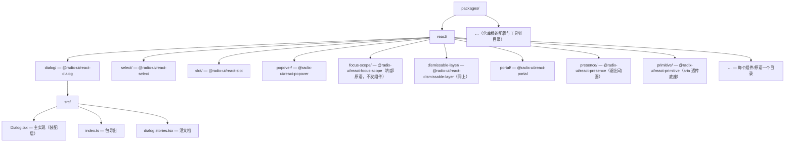

# 源码阅读优先级

原大纲四项逐个展开。读源码的总原则：**带着一个具体问题进，只读回答问题的那几百行**，读完整理成"它解决了什么我没想到的问题"清单。
## D1. **Radix UI**：无样式组件的行为/无障碍实现，每个组件几百行，最易吸收

- **读什么**：不是读它的架构图，是读"行为契约的实现"。以 Dialog 为例，入口在 `packages/react/dialog/src/`（v1 早期文件名为 `dialog.tsx`，现版本 `Dialog.tsx`）：它把行为拆成可复用的独立原语——`FocusScope`（焦点陷阱，A4）、`DismissableLayer`（Esc + 外部点击关闭，含多层弹层豁免）、`Portal`、`Primitive`（aria 属性透传底座）。
- **为什么只有几百行**：因为它**只做行为与无障碍、完全不碰样式**——没有主题系统、没有设计 token、没有视觉分支，状态机与样式彻底解耦后每个组件剩下的就是纯交互逻辑。这正是 headless 路线（Lv4 表格）的工程价值：行为复杂度被独立打磨并发布，样式留给消费者。
- **怎么读**：打开 WAI-ARIA APG 的 Dialog 模式页（键盘模型 + ARIA 属性清单），对照源码逐项找实现位置——`aria-modal` 在哪设置、focus trap 在 `mount` 时如何取焦点、Esc 的 keydown 处理如何只关"最顶层"弹层。读一个组件通常能带走五六个"我没想到的分支"（焦点还回触发元素、`DialogContent` 缺 title 时的 console 警告、嵌套 dialog 的 DismissableLayer 分层）。
- **读后动作**：把 `DismissableLayer` 的"层叠豁免"思想抄进自己弹层体系（A2 的多弹层互斥）；把 FocusScope 的实现与自己第 3 周写的 useFocusTrap 对比，补齐漏掉的分支。

## 带读路线：读前准备（仓库、版本、工具）

- **仓库**：[github.com/radix-ui/primitives](https://github.com/radix-ui/primitives)，monorepo。以 main 分支（1.x 系）为准；要对照自己项目在用的版本，先 `git tag` 再 checkout 对应 tag。注意 Radix **每个组件独立发版**（`@radix-ui/react-dialog@1.x` 与 `@radix-ui/react-select@2.x` 的版本号互不同步），读网上的源码解读时先确认它讲的是哪个版本——早期版本主文件是小写 `dialog.tsx`，现行是 `Dialog.tsx`，本篇一律以现行为例。
- **工具三件**：
  1. clone：`git clone --depth 1 https://github.com/radix-ui/primitives.git`（纯阅读不需要提交历史）；
  2. 跑测试：仓库根 `yarn install && yarn test`（jest）；只想跑一个包就 `yarn jest dialog`——**改一行跑一次测试，是"我真的读进去了"的最快验证**（比如把 Esc 分支注释掉，看哪条测试红）；
  3. 活文档：每个包 `src/*.stories.tsx`（如 `dialog.stories.tsx`）是 API 形态速览——先扫 stories 认识组件全家桶（Trigger/Content/Close…），再进实现文件，比直接啃 tsx 快一半。
- **读法总原则（沿用本篇开头定的纪律）**：带一个具体问题进，只读回答问题的那几百行；读完整理"它解决了什么我没想到的问题"清单。下面三节把这个原则落成可执行动作：先学会定位（路线一），再按难度梯度排四个组件（路线二），最后用问题清单带读核心机制（路线三）。

## 带读路线一：入口定位法——30 秒找到那几百行

**定位法 1：目录结构规律。** `packages/react/` 下每个组件一个目录，目录名 = npm 包名去掉 `@radix-ui/react-` 前缀：



**定位法 2：从 npm 包名反查源码包。** 读 `Dialog.tsx` 时顶部 import 一堆 `@radix-ui/react-focus-scope`、`@radix-ui/react-dismissable-layer`——这些**内部原语以独立 npm 包形式存在**（既被 Dialog 组装，也被 Popover/Select 复用）。看到任何不认识的 `@radix-ui/react-*` import，就去 `packages/react/<去前缀>` 反查目录，不要去 npm 上找（npm 上也有，但源码就在你 clone 的仓库里，跳转更快）。

**定位法 3：分层读——装配层与原语层分离。** 这是 Radix 阅读最重要的心智模型：`packages/react/dialog/src/Dialog.tsx` 是**装配说明书**（把 focus-scope、dismissable-layer、portal、primitive 组装成 Dialog 的组件树，告诉你"谁包谁、props 怎么传"），而**行为细节在原语包里**（焦点怎么陷、层怎么叠）。只读装配层会觉得"就这？"，跟着 import 跳进原语层才会看到那五六个"我没想到的分支"。

**Popover 的额外一步**：`packages/react/popover` 的定位计算委托给 `packages/react/popper`（`@radix-ui/react-popper`），现行版本底层是 floating-ui（早期版本是 Popper v2，读旧博客注意这个迁移）。定位机制本身（computePosition 与中间件）已在 A2.2/A2.3 展开（见 [03-A2-弹层体系](03-A2-弹层体系-Popover-Select-Tooltip-DatePicker.md)），本篇只读它的"装配"部分，不重复定位原理。

**内部原语包速查表**（装配层 import 里最常见的十个，读前扫一遍，读时对照）：

| npm 包名 | packages 目录 | 职责 | 在哪篇有对应自研件 |
|---|---|---|---|
| @radix-ui/react-primitive | `react/primitive` | 按钮/div 等基础元素 + aria 透传 + asChild 底座 | A8 props 合并纪律 |
| @radix-ui/react-portal | `react/portal` | 挂 body 的传送门 | A2.5 挂载点治理 |
| @radix-ui/react-focus-scope | `react/focus-scope` | 焦点陷阱（进/圈/还） | A4 useFocusTrap |
| @radix-ui/react-dismissable-layer | `react/dismissable-layer` | 外部点击 + Esc + 层栈 | A2.9 useClickOutside |
| @radix-ui/react-presence | `react/presence` | 退出动画与卸载解耦 | A3 双状态机 |
| @radix-ui/react-popper | `react/popper` | 定位计算包装（底层 floating-ui） | A2.2 computePosition |
| @radix-ui/react-slot | `react/slot` | asChild 的渲染权让渡 | 25 号 asChild 节 |
| @radix-ui/react-collection | `react/collection` | 子项注册成数组（键盘导航索引） | A5 键盘导航 |
| @radix-ui/react-context | `react/context` | createContext 工厂 + scope | 13 号 compound 节 |
| @radix-ui/react-use-controllable-state | `react/use-controllable-state` | 受控/非受控双模式 | A1 30 行 hook |

这张表还有个反向用法：**每行的"对应自研件"列就是你的复刻对照清单**——读到哪个包，就把第 2-9 周写的那件翻出来并排比，差异行数就是你的功力差距的量化。

## 带读路线二：组件清单（按难度梯度：Dialog → Select → Slot → Popover）

| 顺序 | 组件 | 包路径 | 难度 | 核心看点 | 前置内功 |
|---|---|---|---|---|---|
| 1 | Dialog | `packages/react/dialog` | ★★ | 装配 + 焦点圈 + 层叠豁免 | A4 焦点、A2 弹层 |
| 2 | Select | `packages/react/select` | ★★★★ | collection 注册 + typeahead + aria-activedescendant | A5 键盘 |
| 3 | Slot | `packages/react/slot` | ★★（行数少思想深） | asChild 的 props 合并 | 25 号 asChild 节 |
| 4 | Popover | `packages/react/popover` | ★★★ | 触发方式抽象 + 定位装配 + 层叠 | A2 弹层 |

**第 1 站：Dialog（热身，半天）**。入口 `packages/react/dialog/src/Dialog.tsx`。读两遍：第一遍只画**装配树**——`DialogContent` 内部从外到内是 `Portal`（挂 body）→ `DismissableLayer`（外部点击/Esc，`disableOutsidePointerEvents` 关掉底层指针）→ `FocusScope`（焦点陷阱，`trapped`）→ `Primitive.div`（`role="dialog"`、`aria-modal` 等 aria 属性落点）。第二遍带着路线三的问题 1/2 进原语包。Dialog 是四站里唯一"几百行就能读完装配"的，用它建立目录感。

第 1 站的固定流程（本篇开头"怎么读"的落地版）：

1. 打开 APG 的 Dialog (Modal) 模式页（35-4 号有完整读法），抄下键盘表与 aria 属性清单，列成"待验证清单"；
2. 逐项去源码找实现位置：`aria-modal` 挂在装配树的哪一层？focus trap 在 mount 时怎么取初始焦点？Esc 的 keydown 怎么只关"最顶层"？
3. 对照运行：`yarn jest dialog` 跑一遍测试，边读边改（注释掉 Esc 分支看哪条红）；
4. 合上源码，默写"它解决了什么我没想到的问题"清单，再翻开补漏。

第 1 站读完应能默写的分支清单（自测：每条都能说出"在哪个包的哪段逻辑"才算过站）——焦点还回触发元素（unmount 时 focus 回 prevActiveElement）；`DialogContent` 缺 title/description 时的 `aria-labelledby`/`aria-describedby` 警告（去源码找那条 console.warn 的判定条件）；嵌套 Dialog 的 DismissableLayer 分层豁免；`disableOutsidePointerEvents` 对底层页面滚轮的连锁影响；退出动画由 presence 接管（Dialog 关闭 → present=false → 动画播完才卸载）；Alert Dialog 与 Dialog 的分家（`packages/react/alert-dialog` 是独立包——role 从 `dialog` 换 `alertdialog`，连 Esc 的默认行为都不同，这个对照是"行为契约"最好的注脚）。

**第 2 站：Select（正餐，一至两天）**。入口 `packages/react/select/src/Select.tsx`——primitives 里最大的单文件之一：一个文件装了 Trigger/Value/Content/Viewport/Item/ItemText/ItemIndicator 等十几个子组件。拆开读，只追三条线：
1. **collection 线**：Select 内部用 `@radix-ui/react-collection`（`packages/react/collection`）把所有 `SelectItem` 注册进一个数组（Item 挂载时注册、卸载时移除）——键盘导航的"下一项/上一项"其实是在这个数组上移动索引，DOM 顺序反而只是参考。这是"万级选项 + 虚拟化"能成立的地基（只有数组在，DOM 可以只渲染窗口）。
2. **高亮上报线**：焦点留在 Trigger 上不动，列表高亮靠 `aria-activedescendant` 指向当前项——这正是 A5.8 讲的两套高亮模型里的"焦点不动 + 属性上报"路线（见 [06-A5](06-A5-键盘导航与-ARIA.md) A5.8，此处不重复）。
3. **typeahead 线**：连按字符跳转的收集窗口逻辑在内部 typeahead 实现（`packages/react/typeahead`）——对照 A5.3 自己写的 500ms 窗口版本，看它多处理了什么（数字键、间隔重置时机）。

Select 站的两个补充看点：**value 的受控语义**——`Select` 的 `value/onValueChange` 走内部 `useControllableState`（`packages/react/use-controllable-state`，A1 的 useControllableState 在真实库里的范文，对照你第 2 周的 30 行实现看它多了什么：prop 变化时的回调对齐、`onChange` 与 `onValueChange` 的分流）；**content 的两种锚定**——列表贴选项（默认）与 `position="popper"`（交给 popper 定位）两种模式的 DOM 差异，虚拟化渲染只在 popper 模式下默认开启，去 `SelectContent` 的 props 里找这条分支。

**第 3 站：Slot（小而深，两小时）**。入口 `packages/react/slot/src/Slot.tsx`，一百来行。**props 合并顺序（className 拼接、style 浅合并、事件链式调用且 child 先 slot 后、其余 child 覆盖 slot、ref 合并、多子元素报错）已在 [25-Lv4-范式之争](25-Lv4-范式之争-组件之上的认知.md)的 asChild/slot 补充节完整展开，先读那一节再来看源码**——源码只是它的逐行落地。本篇读源码只看三个增量：`React.Children.only` 在哪抛多子元素错；Slot 与 SlotClone 两层的分工（Slot 决定渲染谁，SlotClone 决定怎么 clone）；child 自身又是 Slot 时的递归解包（asChild 链式穿透的实现）。

**第 4 站：Popover（收官，一天）**。入口 `packages/react/popover/src/Popover.tsx`。读三个"抽象怎么落地"：触发方式统一（hover/click/focus 三种触发怎么被拆成可组合的小件——对照 A2.7 的 hover 意图延时）；定位装配（包一层 popper，锚点与 content 的关系）；层叠链路（Popover 上开 Menu 再开 Tooltip，Esc 只关最顶层的整条链路回到 DismissableLayer 的层栈——问题 2 的复习）。读完这一站，A2 弹层篇的所有概念都有了工业级范文。

顺路对照一个"同族组件"：Menu（`packages/react/dropdown-menu`）在 Popover 之上再叠一层语义（菜单的 roving tabindex、typeahead、`role="menu"` 的键位差异）——不必精读，只看它的目录结构怎么复用 Popover 的原语，体会"原语复用"在 monorepo 里的组织方式。

### 读完四站的产出物（自查）

- 一张**装配树手绘图**（DialogContent 从外到内的包裹顺序，标注每层的职责）；
- 一份**"我没想到的分支"清单**（目标十五条以上，第 1 站的六七条起步，每站贡献三五条）；
- 两个可运行的复刻件（见复刻小任务）+ 它们的测试；
- 一份**差异对照表**：自己的 useFocusTrap / useClickOutside / A1 useControllableState 三个自研件与 focus-scope / dismissable-layer / use-controllable-state 的逐条差距（每条标注"要抄"还是"可不做，因为……"）。

## 带读路线三：核心机制问题清单（问题式带读）

进源码前把问题抄在便签上，读到对应实现行打勾。**每题都"先答一遍再验证"**——错得越离谱，印象越深。问题 1-4 是本篇主线（Dialog 两题、Slot 一题、Context 一题），问题 5-7 是加时题（读完主线有余力再做）；每题末尾标注了与前面内功篇的分工——**已在别的篇展开原理的，本篇只读"源码增量"，不重复原理**。

**问题 1：Dialog 的焦点圈用了什么？**
答案：`@radix-ui/react-focus-scope`。追问链（每问都去源码找行号）：mount 时焦点落到哪（focusScope 怎么挑"初始焦点候选"——有没有 autoFocus 属性的元素优先？容器本身兜底？）→ Tab 按下时怎么拦截（捕获阶段 keydown + 查询容器内 tabbables，查询法）→ 首尾循环怎么实现（在最后一个可聚焦元素按 Tab 回到第一个）→ unmount 时焦点还回（mount 时记录 prevActiveElement，卸载时 focus 回去）→ `trapped=false` 时退化成什么（只管进不管圈）。
对照实验：把 A4 第 5 周自己写的 useFocusTrap 与 focus-scope 并排开，列差异清单。[05-A4-焦点管理](05-A4-焦点管理.md) A4.5 已展开"查询法 vs 环形哨兵法"的路线之争（Radix FocusScope 是查询法的工业化，focus-trap 库是哨兵法），本篇的增量是源码分支：iframe 里的焦点、`tabIndex` 顺序与 DOM 顺序不一致时的排序、autoFocus 元素优先。

**问题 2：dismissable 层怎么叠？**
答案：`@radix-ui/react-dismissable-layer`。追问链：两个 Dialog 叠开时，点外层 Dialog 内部，为什么内层不关（layer 栈：mount 时 push、unmount 时 remove；pointerdown 的 outside 判定只对**栈顶**生效）→ `disableOutsidePointerEvents` 怎么实现（底层层的 pointer-events 关掉——去源码找它把属性挂到哪个节点）→ Esc 为什么只关最顶层（keydown 捕获 + 栈判定：非栈顶层直接放行）→ **branch 是什么**（Popover 的锚点按钮与内容同属一层，点锚点不算 outside——branch 容器豁免机制，这是"关闭判定"最容易漏的分支）。
[12-Lv2-弹层与反馈组件](12-Lv2-弹层与反馈组件-功力主考场之一.md)已展开层栈思想（z-index 事件侧），本篇增量是源码时序：layers 数组与 layersWithOutsidePointerEventsDisabled 两个栈的维护。

**问题 3：Slot 的 asChild 怎么合并 props？**
答案在 `packages/react/slot/src/Slot.tsx` 的合并函数。**props 合并顺序的完整展开在 [25-Lv4-范式之争](25-Lv4-范式之争-组件之上的认知.md) asChild/slot 补充节（含多子元素报错与合并优先级表），此处只列源码侧追问**：事件链式调用时 child 与 slot 的 handler 谁先执行？className 是拼接还是覆盖（顺序谁前谁后）？style 对象怎么浅合并？ref 怎么两个都调（composeRefs）？——每问都在源码里找到那一行。读完后回到问题 3 的最终验证：`<Slot asChild onClick={a}><button onClick={b} /></Slot>` 点击时 a、b 的执行顺序，与你复刻版（见下节任务 2）的行为必须一致。

**问题 4：Context 怎么拆桶？**
分两层答。**包级**：`packages/react/context`（`@radix-ui/react-context`）是个几十行的 createContext 工厂——读它的 `index.ts`：返回 `[Provider, useContext]` 对，且 useContext 没找到 Provider 时抛**带调用方组件名**的错误（比裸 React context 的 undefined 崩溃友好得多）。**组件级**：Dialog/Select 内部把 context 按消费者拆（比如 Select 的 content 层 context 与 item 层 context 是两个）。
**context 按变化频率分桶的完整决策框架（高频状态/稳定动作/实例配置三桶）已在 [13-Lv3-复杂交互组件](13-Lv3-复杂交互组件-公认最考功力.md)的 compound 进阶节展开**——读 Radix 时拿那节的清单对照：Select 实际拆了几个桶？哪些桶每次渲染都变（说明它们靠 memo/reference 稳定）？本篇增量是 Radix 独有的 **scope 机制**（`createScope`）：解决"同类型组件嵌套时，里层 context 要跳过外层同名 context"的问题——先读 `packages/react/context` 的测试用例（两个同名 Provider 嵌套的场景），再读实现，直接读实现大概率看不懂。

**问题 5（加时题）：退出动画怎么和 unmount 解耦？**
`packages/react/presence`（`@radix-ui/react-presence`）：A3 的 visible/mounted 双状态机在这里是工业化实现（监听动画/过渡结束事件再卸载子树、forceMount 逃生门、动画名检测）。双状态机原理 A3 已展开（见 [04-A3-退出动画难题](04-A3-退出动画-难题-visible-mounted-双状态机.md)），本篇只读它比你多的分支清单。

**问题 6（加时题）：Portal 挂哪里、卸载后焦点怎么办？**
`packages/react/portal`（`@radix-ui/react-portal`），配 `packages/react/use-layout-effect`（SSR 安全的 layoutEffect，服务端退化为 useEffect）。挂载点治理（默认 body、`container` 属性、SSR 时的降级）已在 A2.5 展开（[03-A2](03-A2-弹层体系-Popover-Select-Tooltip-DatePicker.md) A2.5），本篇读源码的增量只有一条：Portal 卸载时 DOM 节点的清理时序（谁 removeChild、什么时候 remove），以及它与 FocusScope 的 unmount 还回焦点之间的**执行顺序**——顺序错了焦点会先还回一个已被移除的节点。这条顺序问题是"多原语组合"的典型坑，值得在源码里找到证据。

**问题 7（加时题）：A1 的 useControllableState 在这里长什么样？**
`packages/react/use-controllable-state`——第 2 周自己写的 30 行 hook 的工业版。只做一次对照：它的 `onChange` 回调在受控/非受控两种模式下分别何时触发、prop 外部变化时内部 state 怎么跟随。**A1 已完整展开受控协议本身**（[02-A1](02-A1-受控-非受控双模式-30-行-hook-处处要用.md)），此处不重复原理，只看真实库的防御性代码密度（对照后回答：你的版本少了哪三条防御？）。

## 复刻小任务：读一个复刻一个

读一站复刻一站是本篇的硬要求——不复刻的源码阅读一周后归零。两个任务的代码量都刻意压小（20 行核心 / 30 行核心），**目标是把"层栈豁免"和"props 合并"两块思想装进手，不是抄全功能**。

**任务 1：20 行 DismissableLayer（单层版）**

```tsx
// MiniDismissableLayer.tsx —— 只保留"外部点击 + Esc"的最小骨架
import { useEffect, useRef, type ReactNode } from 'react';

export function MiniDismissableLayer({
  children, open, onDismiss,
}: { children: ReactNode; open: boolean; onDismiss: () => void }) {
  const ref = useRef<HTMLDivElement>(null);
  useEffect(() => {
    if (!open) return;
    const onPointerDown = (e: PointerEvent) => {
      if (ref.current && !ref.current.contains(e.target as Node)) onDismiss();
    };
    const onKeyDown = (e: KeyboardEvent) => {
      if (e.key === 'Escape') onDismiss(); // 真实版：捕获阶段 + 栈顶判定（见下）
    };
    document.addEventListener('pointerdown', onPointerDown);
    document.addEventListener('keydown', onKeyDown, true); // 捕获：抢在业务 onBlur 之前
    return () => {
      document.removeEventListener('pointerdown', onPointerDown);
      document.removeEventListener('keydown', onKeyDown, true);
    };
  }, [open, onDismiss]);
  return <div ref={ref}>{children}</div>;
}
```

验收标准（全部满足才算完成）：
1. 层内点击不触发 `onDismiss`；层外 pointerdown 触发**恰好一次**（快速连点两次也是一次——用计数器断言）；
2. `open=false` 时无任何全局监听（卸载后手动派发事件不触发回调）；
3. 故意触发浏览器 Esc 默认行为（如焦点在 input）时依然先于默认行为关闭——验证捕获阶段的必要性；
4. **扩展题（对应问题 2）**：再叠一层，写测试证明"点内层内部，外层不关"——需要你把单层版改造成栈版（module 级数组 push/remove），改不动就回炉问题 2 的源码。

配套测试骨架（Vitest + Testing Library，基建见 [29-C4](29-C4-测试-Vitest-Testing-Library-逐组件-Storybook.md)，此处只给本任务特有的两条）：

```tsx
import { render, screen } from '@testing-library/react';
import userEvent from '@testing-library/user-event';

it('层外点击触发恰好一次 onDismiss', async () => {
  const onDismiss = vi.fn();
  render(<>
    <MiniDismissableLayer open onDismiss={onDismiss}>
      <div>layer</div>
    </MiniDismissableLayer>
    <button>outside</button>
  </>);
  await userEvent.click(screen.getByText('outside'));
  await userEvent.click(screen.getByText('outside')); // 连点两次
  expect(onDismiss).toHaveBeenCalledTimes(1);          // 验收 1 的"恰好一次"
});

it('open=false 时无全局监听', async () => {
  const onDismiss = vi.fn();
  const { rerender } = render(
    <MiniDismissableLayer open={false} onDismiss={onDismiss}><div>layer</div></MiniDismissableLayer>,
  );
  document.dispatchEvent(new KeyboardEvent('keydown', { key: 'Escape' }));
  expect(onDismiss).not.toHaveBeenCalled(); // 验收 2
  rerender(<MiniDismissableLayer open onDismiss={onDismiss}><div>layer</div></MiniDismissableLayer>);
  document.dispatchEvent(new KeyboardEvent('keydown', { key: 'Escape' }));
  expect(onDismiss).toHaveBeenCalledTimes(1); // 开了才监听
});
```

**任务 2：最简 Slot（单子元素版）**

```tsx
// MiniSlot.tsx —— 只处理单子元素的 asChild
import { Children, cloneElement, isValidElement } from 'react';

export function MiniSlot(props: any) {
  const { children, ...slotProps } = props;
  const child = Children.only(children); // 多子元素在这里抛错（与 Radix 同款）
  if (!isValidElement(child)) return null;
  const childProps: any = child.props;
  const merged: any = { ...slotProps, ...childProps }; // 默认：child 覆盖 slot
  merged.className = [slotProps.className, childProps.className].filter(Boolean).join(' ');
  merged.style = { ...slotProps.style, ...childProps.style };
  for (const key of Object.keys(merged)) {
    const isHandler = key.startsWith('on') && typeof childProps[key] === 'function';
    if (isHandler && typeof slotProps[key] === 'function') {
      merged[key] = (...args: unknown[]) => {
        childProps[key](...args); // child 先
        slotProps[key](...args); // slot 后（对照 Radix 源码验证这个顺序）
      };
    }
  }
  return cloneElement(child, merged);
}
```

验收标准：
1. `<MiniSlot className="x"><button className="y">ok</button></MiniSlot>` 渲染结果只有**一个 button**，className 同时含 `x` 与 `y`（DOM 断言，不是快照）；
2. 两个 onClick（slot 传一个、child 自带一个）点击时都被调用，且 **child 的先执行**——与 Radix Slot 源码行为一致（不一致就去源码找答案，这是本任务的核心检查点）；
3. 传两个子元素抛出明确错误（`Children.only` 的错误信息即可）；
4. 已知差距清单：写出你的简化版与 Radix 真实实现的三条差距（提示：ref 合并、child 是 Slot 的递归解包、default 值 props 的处理）——写不出来说明没读完问题 3。

**两个复刻件的归宿**：不要写完就扔。把它们放进自研库的 `packages/react/` 对应位置（C1 的 monorepo 结构），接上已有测试基建（C4 的 Vitest 配置），并在组件文档里标注"灵感来自 Radix xxx 包 + 本库差异"。这个动作把"源码阅读"正式接入"自研库产出"——四篇源码阅读（32/33/34/35 号）共用这条归宿规则，后面三篇不再重复。

## 坑：读不下去的五个时刻（症状 → 根因 → 修法）

| # | 症状 | 根因 | 修法 |
|---|---|---|---|
| 1 | `Dialog.tsx` 顶部 import 一堆 `@radix-ui/react-*`，点不进去，感觉读不完 | 内部原语以独立 npm 包形式存在，IDE 跳到 node_modules 的 dist 而不是源码 | 全部在 `packages/react/<去前缀目录>` 里；用 VSCode 全局搜 `focus-scope` 直接定位源码目录 |
| 2 | `Select.tsx` 打开三千行，直接劝退 | 一个文件装了十几个子组件，顺序读法天然失败 | 只追路线二的**三条线**（collection/高亮上报/typeahead），每条线单独开一天；其余子组件当黑盒（它们只是 Primitive 加 aria 属性） |
| 3 | context 的 scope 机制反复看不懂 | `createScope` 解决的是"同名 Provider 嵌套"的边角问题，脱离场景读实现必然懵 | 先读 `packages/react/context` 的测试用例（构造两层同名嵌套的场景），再回实现；或先跳过 scope，只读 createContext 工厂本体 |
| 4 | 博客里的文件名/目录与仓库对不上 | Radix 每组件独立发版 + 历史上有大小写文件名迁移（`dialog.tsx` → `Dialog.tsx`）与 popper → floating-ui 迁移 | 以你 clone 的 main 为准，博客只取思想；对不上时 `git log --follow` 查文件改名史 |
| 5 | `yarn test` 全量跑太久/环境起不来 | monorepo 全量测试包含所有包与浏览器环境 | 只跑单包：`yarn jest dialog`；读源码不需要全绿，只需要"我改的这行让哪条测试红了" |

最后一条判断标准，区分**读不下去**与**不该读**：五个时刻都有修法，修完还卡，多数是前置内功缺课——比如读 Select 的 collection 线时连"为什么需要注册数组"都不理解，说明 A5 的键盘导航还没吃透，先回 A5 补课再回来，比硬啃 Radix 快。Radix 是"行为契约的范文"，范文的价值取决于你对考纲（APG，35-4 号）的熟悉度——**32 号与 35 号交替读**（读一个组件的源码前，先读它对应的 APG 模式页）是效率最高的组合，两篇互为考纲与范文。


---

## 附:ASCII 图替换清单

本文档图形化改版,原 ASCII 字符图与 Mermaid 图表对应关系如下:

| 原图位置 / 标题 | 处理结果 |
| --- | --- |
| 带读路线一:packages/react/ 目录结构规律 | 替换为 flowchart(目录树) |
