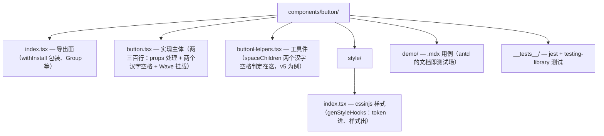
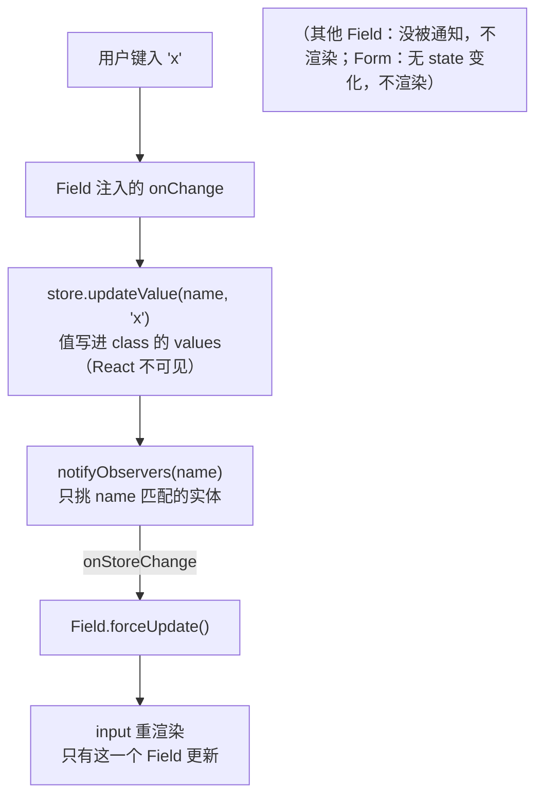

> 本文是《源码阅读优先级》按小节拆分后的续篇，上一部分见 [32-D1-Radix-UI-无样式组件的行为-无障碍实现-每个组件几百行-最易吸收.md](32-D1-Radix-UI-无样式组件的行为-无障碍实现-每个组件几百行-最易吸收.md)。
## D2. **antd**：工程化与细节功力（Wave 波纹、两个汉字空格、Watermark 攻防、Tree 三态）

antd 读四个指定点位，入口如下：

- **Wave 波纹**（`antd/components/_util/wave.tsx`）：一次性伪元素动画的实现——点击时插入带动画的伪元素节点、动画结束移除，避免常驻 DOM。要读的问题：它如何判断波纹颜色（从目标元素算出的合适前景色）与如何避免快速连点时的动画堆积。
- **两个汉字空格**（v5 在 `antd/components/button/buttonHelpers.tsx` 的 `spaceChildren`，v4 之前内联在 `button.tsx`）：`/^[\u4e00-\u9fa5]{2}$/` 判断子节点是恰好两个汉字的文本，插入一个空格 span——为什么是"恰好两个"（三个以上中文排版不需要）、为什么用 span 包裹而不是直接改文本（不能污染用户的 children 引用）。
- **Watermark 攻防**（`antd/components/watermark/`，index.tsx 装配 + useWatermark.ts 核心）：canvas 生成平铺背景（文字绘制、旋转、间距计算、`background-repeat` 挂到覆盖层）、MutationObserver 防 DOM 篡改（水印节点被删除或属性被改时重新挂载/恢复——攻防博弈：观察器自身也可能被断开，antd 用"删除后立即重建 + 重开观察"拉长攻击成本）。这是大纲 Lv3 Watermark 条目"攻防趣味题"的正主。
- **Tree 三态**（主体在独立包 `rc-tree`，antd 的 `components/tree` 是它的封装；三态联动核心在 `rc-tree` 的 util 里的 `conductCheck` 算法）：从选中 key 集合出发"父到子全选、子到父计数判半选"的双向传导。读完对照自己第 8 周的纯函数实现，重点看它如何处理"keys 里混入已禁用/不存在节点"的边界。

### 带读路线：读前准备——读哪个版本、两层结构

- **读哪个版本**：以 antd **v5**（现行主版本）为例。仓库 [github.com/ant-design/ant-design](https://github.com/ant-design/ant-design)，clone main 或切到 v5 的最新 tag。**不要拿 v4 的博客对照 v5 的源码**：v5 换了样式方案（v4 的 less 目录 → v5 的 cssinjs，样式文件从 `style/index.less` 变成 `style/index.tsx`），目录结构差异大。
- **v5 单组件目录结构**（以 Button 为例，所有组件同构）：



- **两层结构（本篇阅读地图的关键）**：antd 组件 = **薄壳（antd 层）+ 核心行为（rc-\* 底层库）**。antd 层负责 API 表面、默认值、文案、主题桥接；真正的交互状态机在 `rc-*` 系列里——它们是 ant-design 团队维护的**独立仓库**（github.com/react-component 组织），单独发版、单独可读。看到 antd 组件源码里的 `import ... from 'rc-table'`，就等于看到一块指路牌：**行为源码在 react-component/table 仓库**。
- **工具**：两个仓库并排 clone（`ant-design/ant-design` + 你要读的 `react-component/<name>`）；antd 侧 `pnpm install && pnpm test`（或 `npm`）；只想跑单组件就 `npx jest button`。demo 目录的 `.mdx` 是"官方用法即文档"的范文——读源码卡住时先跑 demo 对照行为。

### 带读路线一：rc-* 对照表——从 npm 包名反查源码仓库

读 antd 前先备这张表（常见 rc-\* 底层库 → 对应 antd 组件 → react-component 仓库目录名）。**仓库目录名不总等于包名去掉 `rc-`**，如 `rc-field-form` 的仓库目录是 `field-form`：

| npm 包 | 仓库（github.com/react-component/…） | 承载的 antd 组件 | 本篇要读吗 |
|---|---|---|---|
| rc-field-form | `field-form` | Form / Form.Item | 正主（问题 1 + 复刻任务） |
| rc-table | `table` | Table | 是（问题 2） |
| rc-tree | `tree` | Tree / TreeSelect | 三态指路 18 号，不重读 |
| rc-select | `select` | Select / TreeSelect / Cascader | A5/A2 已覆盖键盘线，略 |
| rc-trigger | `trigger` | 各类弹层的触发定位底座 | A2 已覆盖定位线，略 |
| rc-virtual-list | `virtual-list` | Table 虚拟化 / Select 大数据 | 23 号已展开，指路 |
| rc-upload | `upload` | Upload | 20 号已展开，指路 |
| rc-dialog | `dialog` | Modal | A2/A4 已覆盖，略 |
| rc-picker | `picker` | DatePicker | 14 号已展开，指路 |
| rc-tabs / rc-collapse / rc-menu / rc-input… | 同名 | Tabs / Collapse / Menu / Input | 需要时同法反查 |

用法：antd 组件源码顶部 `import X from 'rc-xxx'` → 查表得仓库 → clone 或直接在 github 上读。**反查法是通用的**——表里没有的（如 rc-rate、rc-progress），一律 `github.com/react-component/<去 rc- 前缀>` 试一次。

这张表的"本篇要读吗"列是本篇的取舍声明，依据是查重：**rc-tree 三态的算法展开在 [18-Tree](18-Tree.md) 考点 2（含 conductCheck 逐行讲解）、rc-virtual-list 在 [23-VirtualList-Anchor-Progress-等](23-VirtualList-Anchor-Progress-等.md)、Upload 在 [20-Upload](20-Upload.md)、rc-picker 在 [14-DatePicker-日历是最苦的组件](14-DatePicker-日历是最苦的组件.md)、定位与触发底座（rc-trigger）在 A2——本篇只读它们没覆盖的 Table 虚拟化接法与 Form 注册模型**，其余组件一律指路。这个取舍本身就是源码阅读的方法论：**一个库太大，按"别的篇没写过的增量"切分阅读范围**。

两层结构还有第三层可看（选读）：rc-* 之下再共享一层 `@rc-component/util` 一类的工具库（classnames、ref 收集、动画类名切换等横切件）——遇到了就当工具书查，不作为阅读目标。

### 带读路线二：组件清单（按难度梯度：ConfigProvider → Table → Form）

| 顺序 | 组件 | antd 层 | 核心库 | 难度 | 读什么 |
|---|---|---|---|---|---|
| 1 | ConfigProvider | `components/config-provider` | 无 rc 底层（主体在 antd 层） | ★★ | context 层级与主题 token 注入 |
| 2 | Table | `components/table` | rc-table | ★★★ | 固定列 sticky、阴影切换、虚拟化 |
| 3 | Form | `components/form` | rc-field-form | ★★★★ | 注册模型与字段级重渲染 |

三站的公共读法（与 32 号 Dialog 的四步流程同构，antd 语境的变体）：
1. **先跑 demo 再读源码**——antd 的 `demo/*.mdx` 是可交互的行为契约，读源码前先把对应 demo 跑起来，带着"这个行为是怎么实现的"进源码（demo 的标题就是问题清单）；
2. **两层分读**——antd 层读"垫了什么"（默认值/细节/文案），rc 层读"行为怎么做"（状态机/注册/通知），不要在一层里找另一层的东西；
3. **每站一个问题正主**——ConfigProvider 是"token 怎么流"，Table 是"固定列与虚拟化怎么合"，Form 是"值不进 React state 怎么更新视图"——读完写一段三句话的答案，写不出就回炉。

**第 1 站：ConfigProvider（半天）**。入口 `components/config-provider/index.tsx`。**嵌套合并语义、作用域、与自研 `<App>` holder 的完整展开在 [24-ConfigProvider-App-模式级](24-ConfigProvider-App-模式级.md)，此处只读源码增量**：v5 的 theme（token 算法）怎么进 context（找 `theme` prop 被塞进哪个 context 对象）、`useConfigProps` 类的消费侧 hook 长什么样。这一站的意义是热身 + 建立"antd 层代码密度"的体感——config-provider 是 antd 层少数"厚"的组件。

第 1 站的读法提示：config-provider 的 index.tsx 量大，先只追**一条数据流**——`<ConfigProvider theme={{ token: { colorPrimary: '...' } }}>` 进去后：token 怎么被算法加工（seed → map → alias 的派生在 A9 与 24 号已展开）、加工结果存进哪个 context、Button 侧怎么消费到。追完这一条线就过站，不要试图读完整个文件（警告区域、holder、大小写转换等外围功能按需再查）。

**第 2 站：Table（一天）**。antd 层 `components/table/` 读半小时就够（列定义透传、分页包装），主体时间给 rc-table（仓库 `react-component/table`，`src/` 目录）。**固定列与阴影机制在 [15-Table-中后台之王](15-Table-中后台之王.md)已展开（sticky 方案、`useStickyOffsets` 逐列累加、`ant-table-ping-left/right` 两个类开关首尾阴影），此处不重复原理，只给源码定位**：在 rc-table 的 `src/` 全局搜 `ping`，命中处即滚动监听切换阴影类的状态机；搜 `useStickyOffsets` 即固定列偏移的累加实现。**本站增量是虚拟化**：v5.9 起 Table 开了 `virtual`（配 `scroll.y`）后行渲染交给 `rc-virtual-list`——读 rc-table 里接 virtual 的分支（大列表进、窗口行出），与 [23-VirtualList](23-VirtualList-Anchor-Progress-等.md) 的自研虚拟列表对照：列固定 + 行虚拟同时开时，坐标怎么合成。

虚拟化分支的三个追问（都在 rc-table 接 virtual 的代码处找到答案）：固定列是真实 DOM 的 sticky，虚拟行是绝对定位/transform 偏移——两者的滚动容器是不是同一个（不是的话滚动同步怎么做）？行高从哪来（`scroll.y` 下的虚拟滚动要固定行高还是测量行高——对照 18 号虚拟树的"不定高测量"考点）？表头为什么不虚拟（表头一行，测量成本可忽略，sticky 表头直接保留）。

**第 3 站：Form（一至两天，本篇正主）**。antd 层 `components/form/` 是壳（Form/Form.Item 的 API 表面 + `useForm` 转发），行为全在 **rc-field-form**（仓库 `react-component/field-form`）。核心文件三个：
- `src/FormStore.ts`——注册模型的正主：`registerField`（字段挂载时把实例（含 onStoreChange 回调）收进 fieldEntities，**返回取消注册函数**）、`updateValue`（值只写 store 的 values 对象，**不进 React state**）、`notifyObservers`（按 name 通知订阅了该字段的 Field）；
- `src/Field.tsx`——Form.Item 的本体：`getControlled` 把 value/onChange 注入子元素；收到通知时用内部 forceUpdate 只重渲染自己；
- `src/useForm.ts`——把 store 实例装进 ref 的工厂（`Form.useForm()` 拿到的就是它）。
读法：先读复刻任务（下一节）的 50 行版建立骨架，再回源码对号入座——**50 行版是 rc-field-form 注册模型的蒸馏，读源码时每多看到一行就问"这行解决什么 50 行版没解决的问题"**（校验队列、shouldUpdate 联动、preserve 策略、name path 数组化）。

Form 站的固定追问清单（每个问题在源码里找到行号才算过站）：
1. Field 挂载的时序——`registerField` 在 `useEffect` 还是 `useLayoutEffect` 里调？首次渲染取不到值（store 还不知道有这个字段）时渲染什么？
2. `form.setFieldsValue`（命令式写值）与用户输入走的是同一条 `updateValue` 链路吗？通知范围有差吗？
3. `useWatch`（订阅字段变化的外部 hook）怎么实现"值变了我重渲染，但我不注册成 Field"——与 Field 的订阅差异在哪？
4. 校验触发时机（`validateTrigger`）的默认值是谁给的——rc-field-form 还是 antd 层（薄壳差异清单的一条）？
5. 规则队列（`rules` 数组）串行执行还是并行？异步校验的竞态（快速连续输入）怎么防？

### 带读路线三：核心机制问题清单（问题式带读）

**问题 1：Form 不受控 rerender 怎么做到的？**（输入每个字符，只有那个输入框重渲染，Form 与其他字段纹丝不动）
先自己推一遍再验证。参考答案链：Form 组件**不持有 values 的 React state**（这是与"把表单值放 useState"的朴素实现的根本差异）→ 值住在 store（class 实例）的 values 对象里 → Field 挂载时 `registerField` 注册自己 → 用户输入 → store `updateValue` 写对象 → `notifyObservers` **只通知订阅了该 name 的 Field** → 那个 Field 内部 forceUpdate。外层 Form 因为没有 state 变化而不重渲染；其他字段没被通知也不动。画成数据流（对照源码逐环找到实现行）：


追问链：store 是 class 而不是 hook，为什么（要脱离 React 生命周期被命令式 API `form.setFieldsValue` 调用）？`getFieldValue` 在 render 里直接读对象，React 怎么知道要更新（它不知道——靠 notifyObservers 的显式通知，这正是"逃出 React 数据流"的代价与自由）？与 A1 的 useControllableState 什么关系（A1 是字段级的双模式，FormStore 是表单级的值所有权，[02-A1](02-A1-受控-非受控双模式-30-行-hook-处处要用.md) A1.9 已手写 80 行内核并对照 rc-field-form——**本篇复刻任务是它的源码反推版，两节互为印证**）？
再补一个官方视角的对照：rc-field-form 的"外部 store + 显式通知"本质是 **external store 模式**——React 18 给了官方原语 `useSyncExternalStore`（订阅外部 store 的并发安全写法）。读源码时确认 rc-field-form 用的还是自己的 forceUpdate 通知链（历史原因，早于 React 18），然后思考复刻题：你的 50 行版换成 `useSyncExternalStore` 要改哪几行（getSnapshot 的引用稳定性是最大陷阱——每次返回新对象会造成死循环渲染）。

**问题 2：Table 固定列阴影何时切？**
答案速查：滚动位置"真的滚进固定区"才亮对应阴影（静止在左边缘时左阴影不显示，否则静止状态也有裂痕感）。机制（15 号已展开）：rc-table 在滚动容器上切 `ant-table-ping-left` / `ant-table-ping-right` 两个类开关首尾固定列的 box-shadow。**本篇读源码的增量问题**：监听的是谁的 scroll 事件（容器 onScroll）？阈值判断用的哪个值（scrollLeft 与固定列宽度之和 vs scrollWidth）？横向滚动条出现与否是否影响初始判定（无滚动条时两个 ping 类都不加）？——三个问题都在 rc-table 搜 `ping` 的命中处找到行号。
验证实验（读完必做）：开一个带固定首尾列 + 超宽表格的 demo，DevTools 里手动给容器摘掉/加上 `ant-table-ping-left` 类，肉眼确认阴影与类的对应关系；再在源码的 scroll 监听处下断点，观察阈值从"未滚"到"滚入"的翻转瞬间——**机制类的知识经过"手动改类名 + 断点看翻转"两步才会变成肌肉记忆**。

**问题 3：Wave 的颜色怎么算、连点怎么防堆积？**（本篇开头四点位之一，只补源码定位）
`components/_util/wave.tsx`：读两处——颜色（从目标元素与配置算出合适的对比色）与连点（快速点击时旧波纹未结束新波纹又来，看它怎么用 keyed 节点/延时清理想复用还是重建）。四点位的另外三个（两个汉字空格在 `buttonHelpers.tsx` 的 `spaceChildren`、Watermark 在 `components/watermark/`、Tree 三态在 rc-tree 的 `conductCheck`——**Watermark 攻防 22 号、Tree 三态 18 号已完整展开，此处指路不重复**）。

**问题 4：卸载字段，值为什么还在？**（rc-field-form 的 preserve 语义）
Form.Item 随条件渲染卸载后值默认保留在 store（preserve），但校验状态丢失——"值在、错误提示没了"的半保留现象。[16-Tabs](16-Tabs.md) 的 keep-mounted 考点已把这个现象在页签场景踩过一遍（本篇开头 stub 的 Tree 三态点位同节），此处读源码增量：Field 卸载时 store 对 fieldEntities 的清理与 values 的**不清理**分别在 `registerField` 返回的取消函数与 `unRegisterEntity` 里——找到这两处就找到了 preserve 的开关位置。

**问题 5：antd 层那么薄，为什么还值得读？**
因为"薄"本身就是工程功力：默认值桥接（rc-* 不含 antd 语境的默认值）、大小写/中文细节（两个汉字空格只在该出现的文化语境出现）、demo 即文档（`demo/*.mdx` 同时跑在官网与 CI）、以及 `_util` 里的横切工具（Wave、roundedArrow、transButton……）。读薄壳的正确姿势：**对比着读**——同一个组件，antd 层加了什么 rc 层没有的东西？每一处差异都是一条"库作者认为消费者需要"的决策记录。

**问题 6：样式怎么做到"按组件"生成又"按主题"变化？**（cssinjs 一站式速读）
v5 每个组件的 `style/index.tsx` 用 `genStyleHooks` 一类工厂生成样式：token 进（seed token → 组件 token 的派生链在 [10-A9](10-A9-样式与主题方案选型.md) 已展开，此处不重复算法）、样式对象出、再由 cssinjs 运行时插入。**本篇读源码只追一条线**：Button 的 `style/index.tsx` 里 token 缺省值是怎么写的（组件级 token 覆盖全局 token 的兜底顺序）——这条线是自研库接 theme token 时的直接参照。样式方案选型（cssinjs vs css 变量 vs 原子类）是 A9 的主战场，33 号不展开。

### 读完三站的产出物（自查）

- 一张两层地图手绘图：antd 层组件 → 对应 rc-* 仓库 → 各自动什么、不动什么；
- 一份"薄壳差异清单"：antd 层为 rc-* 垫的每一层默认值/细节（两个汉字空格、Wave、文案），每条注明"自研库要不要抄"；
- 一个可运行的 50 行注册模型 + 测试（复刻任务的验收 5 条全过）；
- 一份 rc-field-form 完整度清单：50 行版缺什么、每项一句话说明 rc-field-form 在哪个文件解决它。

### 复刻小任务：最简 Form 注册模型（50 行版）

**与 [02-A1](02-A1-受控-非受控双模式-30-行-hook-处处要用.md) A1.9 的关系**：A1.9 从受控协议出发手写了 80 行表单内核；本任务从 rc-field-form 源码反推 50 行注册模型。两版对照着写一遍——A1.9 关心"值所有权与订阅"，本版关心"**注册时序**"（Field 挂载注册、卸载反注册、store 只通知订阅者）。代码刻意省略校验/联动/name path，只留注册模型骨架：

为什么"先写再读"：rc-field-form 的 FormStore 有几百行，直接读会在校验/联动/缓存的外围代码里迷路；先写 50 行版（一小时），你就有了骨架——再读源码时**外围代码会自动归位**（"哦，这段是给 rules 用的"），阅读速度翻倍。这是本篇通用的方法论：**复刻在前，通读在后**。

```tsx
// mini-form.tsx —— 最简 Form 注册模型（核心 50 行，命名对齐 rc-field-form）
import {
  createContext, cloneElement, useContext, useEffect, useRef, useState, type ReactElement, type ReactNode,
} from 'react';

interface FieldEntity { name: string | number; onStoreChange: () => void }

class MiniFormStore {
  values: Record<string, unknown> = {};                 // 值住 class，不住 React state —— 问题 1 的答案
  private fieldEntities: FieldEntity[] = [];
  registerField = (entity: FieldEntity) => {            // Field 挂载时注册
    this.fieldEntities.push(entity);
    return () => { this.fieldEntities = this.fieldEntities.filter((e) => e !== entity); }; // 卸载反注册
  };
  getFieldValue = (name: string) => this.values[name];
  setFieldValue = (name: string, value: unknown) => {
    this.values[name] = value;                          // 写值不触发任何 React 更新
    this.notifyObservers(name);                         // 显式通知：只叫订阅了该 name 的字段
  };
  private notifyObservers(name: string) {
    this.fieldEntities.forEach((e) => e.name === name && e.onStoreChange());
  }
}

const FormCtx = createContext<{ store: MiniFormStore } | null>(null);

export function MiniForm({ children, onFinish }: { children: ReactNode; onFinish?: (v: Record<string, unknown>) => void }) {
  const storeRef = useRef<MiniFormStore | null>(null);
  storeRef.current ??= new MiniFormStore();             // store 脱离 React 数据流，可被命令式调用
  return (
    <form onSubmit={(e) => { e.preventDefault(); onFinish?.(storeRef.current!.values); }}>
      <FormCtx.Provider value={{ store: storeRef.current }}>{children}</FormCtx.Provider>
    </form>
  );
}

export function MiniField({ name, children }: { name: string; children: ReactElement }) {
  const ctx = useContext(FormCtx)!;
  const [, forceUpdate] = useState(0);                  // 字段级重渲染开关：只有被通知才拨
  const entityRef = useRef<FieldEntity>({ name, onStoreChange: () => forceUpdate((n) => n + 1) });
  entityRef.current.name = name;
  useEffect(() => ctx.store.registerField(entityRef.current), [ctx.store]); // 挂载注册 / 卸载反注册
  return cloneElement(children, {
    value: ctx.store.getFieldValue(name),
    onChange: (v: unknown) => ctx.store.setFieldValue(name, v),
  });
}
```

验收标准（全部满足）：
1. **重渲染隔离**：渲染两个 `MiniField`（用渲染计数器包裹每个字段内容），在字段 A 输入一个字符，断言 A 的计数 +1、B 的计数不变、`MiniForm` 的 children 外层计数不变——这是问题 1 的可执行版；
2. **取值**：点提交（form submit 事件），`onFinish` 收到 `{ a: ..., b: ... }` 两个字段最新值；
3. **反注册**：条件渲染卸掉字段 B 后向 store 写 B 的值不报错、不通知已卸载实体（计数器不再增长）；
4. **preserve 语义**（对应问题 4）：卸掉 B 后 `store.values` 里 B 的值仍在（默认保留）；加一行代码改成卸载即删（对照 rc-field-form 的 preserve 开关位置）；
5. **对照清单**：写下你的 50 行版缺了 rc-field-form 的哪四件事（提示：校验队列、shouldUpdate 联动、name path 数组（`name={['a','b']}` 嵌套取值）、getInternalHooks 的内部通道）——写不出说明第 3 站没读完。

验收 1（重渲染隔离）的测试骨架——这是本任务唯一的硬测试，其余验收可用交互验证：

```tsx
import { render, screen } from '@testing-library/react';
import userEvent from '@testing-library/user-event';
import { useRef } from 'react';
import { MiniForm, MiniField } from './mini-form';

function CountingInput(props: { value?: string; onChange: (v: string) => void; label: string }) {
  const renders = useRef(0);
  renders.current += 1;
  return (
    <label>
      {props.label}
      <input
        value={props.value ?? ''}
        onChange={(e) => props.onChange(e.target.value)}
        data-renders={renders.current} /* 渲染计数挂在 DOM 上，断言直接读 */
      />
    </label>
  );
}

it('字段 A 输入只重渲染 A（Form 与 B 不动）', async () => {
  render(
    <MiniForm>
      <MiniField name="a"><CountingInput label="A" /></MiniField>
      <MiniField name="b"><CountingInput label="B" /></MiniField>
    </MiniForm>,
  );
  const a = screen.getByLabelText('A');
  const before = a.dataset.renders!;
  await userEvent.type(a, 'x');
  expect(Number(a.dataset.renders)).toBe(Number(before) + 1);       // A 重渲染一次
  expect(screen.getByLabelText('B').dataset.renders).toBe('1');     // B 从未重渲染（验收 1）
});
```

`data-renders` 这招（渲染计数挂 DOM）在 jsdom 里比 mock 计数器稳定，值得进自研库的测试工具箱。

### 坑：读不下去的五个时刻（症状 → 根因 → 修法）

| # | 症状 | 根因 | 修法 |
|---|---|---|---|
| 1 | antd 组件源码里 `import 'rc-table'` 点不进去，读到的全是透传 | 行为源码在 react-component 组织的独立仓库，本仓库 node_modules 里只有构建产物 | 按带读路线一的对照表反查仓库；或 `github.com/react-component/<去 rc- 前缀>` 直接在线读 |
| 2 | `rc-field-form` 的 TS 类型（FieldProps、NamePath……）几百行，越读越晕 | 类型层承载了大量泛型推导（重渲染不需要理解每一层） | 先读运行时三个文件（FormStore/Field/useForm），类型只查 `NamePath` 与 `FieldEntity` 两个 |
| 3 | Table 的列定义从 antd 层到 rc 层层层透传，跟丢了 | 两层各有一版 columns 处理（antd 层先加工再下发） | 从 demo 的最小 `columns` 用例起步，在 antd 层断点打印下发前的 props，再进 rc-table |
| 4 | 博客/教程讲的结构与仓库对不上 | v4（less）与 v5（cssinjs）目录结构差异大 | 确认文章版本；一律以 v5 为例，v4 文章只取思想 |
| 5 | 想跑 antd 全量测试，半天跑不完 | 单仓超大规模 + 快照测试巨大 | 只跑单组件：`npx jest button --silent`；读源码阶段不追求全绿，跑通你要读的那个组件即可 |

读完本篇的固定动作（与 32 号相同的归宿规则）：把 50 行注册模型并入自研库的表单模块，标注"模型来自 rc-field-form 源码反推"；Wave 与两个汉字空格这类**细节功力件**各写一条进自研库的"细节清单"（不一定要实现，但要记录"antd 在这里多想了一步"）。

与同系列其他三篇的接口：
- **32 号（Radix）**：行为契约的范文——antd 的 Dialog 线（rc-dialog）不必精读，读 Radix 的 focus-scope/dismissable-layer 更纯粹（无样式噪音）；antd 独有的增量是"细节功力"（Wave/空格/Watermark 攻防）；
- **34 号（shadcn/ui）**：antd 是"npm 库 + 主题系统"的路线，shadcn 是"复制源 + token 变量"的路线——读完 33 再读 34，看同一批组件在两种交付形态下的代码组织差异；
- **35 号（APG）**：Form/Table 没有直接对应的 APG 模式（表单控件用基础模式、表格是 grid 模式）——35 号读 Tree/Tabs/Combobox/Dialog 时反过来，33 号的 rc-* 源码是那些模式的另一份工程实现范文（rc-select 对 combobox、rc-dialog 对 dialog-modal）。


---

## 附:ASCII 图替换清单

本文档图形化改版,原 ASCII 字符图与 Mermaid 图表对应关系如下:

| 原图位置 / 标题 | 处理结果 |
| --- | --- |
| 带读路线:v5 单组件目录结构(components/button/) | 替换为 flowchart(目录树) |
| 问题 1:Form 不受控 rerender 数据流(键入→updateValue→通知→forceUpdate) | 替换为 flowchart(数据流) |
