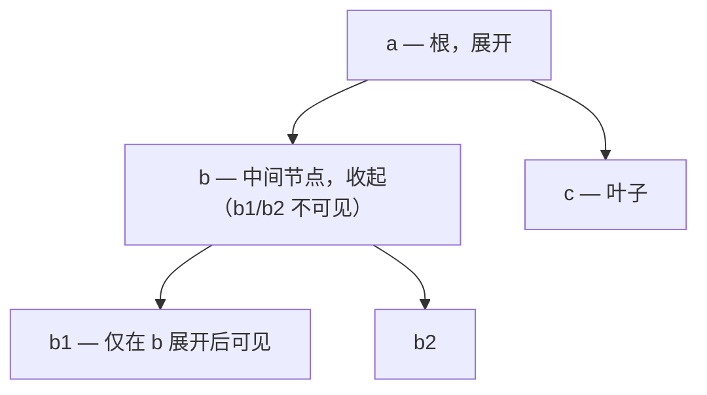

> 本文是《源码阅读优先级》按小节拆分后的续篇，上一部分见 [34-D3-shadcn-ui-cva-变体管理与现代形态.md](34-D3-shadcn-ui-cva-变体管理与现代形态.md)。
## D4. WAI-ARIA Authoring Practices：所有键盘/ARIA 行为的唯一权威

- **是什么**：W3C 官方的组件模式指南（APG），给每类组件规定了 role 结构、键盘交互表、ARIA 状态属性——大纲 A5 称之为"组件库圣经"。
- **怎么当工具书用**（不是通读的书）：
  1. **实现前**：写 Select 前只读两节——Listbox 与 Combobox。抄下键盘表（每行 = 一个按键 + 预期行为）与 aria 属性清单（`role="listbox"`、`aria-activedescendant`、`aria-expanded` 等）。
  2. **把键盘表变成测试清单**：APG 说 "Down Arrow: Moves focus to the next option"，就写一条 `await user.keyboard('{ArrowDown}')` 的测试。APG 表有多少行，测试就有多少条——考纲即测试。
  3. **实现中对照**：自己实现的每个行为去 APG 找依据；APG 没规定的（视觉、动画、中文场景）才自己设计并写进文档。
  4. **与 Radix 互为印证**：Radix 是 APG 的工程化实现（第一优先级条目），APG 是考纲、Radix 是范文——两份对照着读，行为规范就不再是背诵而是理解。

---

## 面试高频考点速查（本章覆盖）

原句列表保留：

受控非受控双模式 / 退出动画双状态机 / 焦点陷阱与 roving tabindex / 命令式组件与 context 丢失 / Select 键盘导航与 typeahead / 弹层定位与 z-index 治理 / 树三态与递归虚拟化 / 滚动锁与宽度补偿 / 样式按需与 sideEffects

以下每条给"30 秒答案要点"——按这个框架说，3 到 5 句内是完整回答。

**1. 受控非受控双模式**

30 秒答案：受控与非受控的核心是"状态的所有权"——外部传了 `value` 就是受控，组件内部不存状态只负责回调和展示；没传就回退到内部 `useState`。我会用一个统一的 `useControllableState` hook 实现：`props.value !== undefined ? props.value : internalState`，`onChange` 在两种模式下都正常回调。两个坑要说清：`defaultValue` 只能消费一次，所以要 `useState(() => defaultValue)` 惰性初始化；运行中切换受控性（先传 value 又去掉）是反模式，React 会告警，库层面要主动检测并给出可读错误。最后用 Switch/Input/Select 三个组件验证同一套 hook，说明这是协议级抽象。

**2. 退出动画双状态机**

30 秒答案：问题本质是 React 没有"播完动画再卸载"的原生语义——`visible=false` 立即 unmount，退出动画根本来不及播。解法是把"是否显示"和"是否挂载"拆成两个状态：关闭时先 `visible=false`（触发 exit 样式），保持 mounted，在 `transitionend` 事件里才真正 `setMounted(false)` 卸载；同时用 timeout 兜底防止事件丢失导致永久挂载。CSSTransition 和 AnimatePresence 本质都是这个双状态机。两个细节加分项：动画期间给容器 `pointer-events: none` 防连点；列表项退出时可能有新项插入导致 key 错位，退出中的项要锁定数据快照。

**3. 焦点陷阱与 roving tabindex**

30 秒答案：焦点陷阱是 Modal 类组件的硬需求，实现是打开时把焦点移入弹窗，然后拦截 Tab——查询容器内所有可聚焦元素（`a[href]`、`button:not(:disabled)`、`input` 等选择器集合），焦点在最后一个元素上按 Tab 时回到第一个，Shift+Tab 在第一个上时跳到最后，形成循环；关闭时焦点还给触发元素。roving tabindex 解决的是 Tabs/Radio 组的键盘模型：容器内只有一个元素的 `tabIndex` 是 0（tab stop），其余是 -1，方向键在它们之间移动焦点并同步更新 tab stop 位置——这样用户 Tab 一次进入组、方向键在组内移动、Tab 一次离开，符合 WAI-ARIA APG 的规定。两者的共同思想：键盘路径必须是设计出来的，而不是 DOM 顺序的自然结果。

**4. 命令式组件与 context 丢失**

30 秒答案：`Modal.confirm()` 这类命令式 API 的实现是用 `createRoot` 在 body 上动态挂一个独立 React 根，往里 render 一个 Confirm 组件，并把 resolve 函数传进去让点击按钮时结束 Promise。它的固有缺陷是这棵新树脱离了应用树的 context——拿不到 ConfigProvider 注入的主题和国际化，深色模式下 confirm 弹窗是白的。React 18 以后还多一条约束：命令式弹层必须自己用 `createRoot`，旧的 `ReactDOM.render` 已废弃。修复方案是 hooks 化：提供 `App.useApp()` 返回绑定了 context 的 message/modal 实例（antd 的 `<App>` 组件就是这么来的），静态方法保留为兜底但文档标注 context 限制。

**5. Select 键盘导航与 typeahead**

30 秒答案：Select 要严格区分两个概念——高亮项（visual focus，列表里当前指向的项）和选中项（value），键盘移动只改高亮，Enter 才把高亮变成选中。键盘模型按 APG 的 listbox：↑↓ 移动高亮（到边界时循环或停止，两种都是合法实现但要固定）、Home/End 跳首尾、Enter 选中并关闭、Esc 关闭且还原。typeahead 是收集连按的可见字符（约 500ms 窗口内拼接），在 options 的 label 里找前缀匹配并跳高亮到那项；窗口超时就清空重新收集。无障碍上用 `aria-activedescendant` 指向高亮项的 id（焦点留在 input 上不动，读屏跟随该属性播报），配 `role="listbox"` 与 `aria-expanded`。万级 options 配合虚拟滚动——只渲染可视区行，键盘移动时同步滚动位置保证高亮项可见。

**6. 弹层定位与 z-index 治理**

30 秒答案：定位绝不自己写，用 floating-ui 的 `computePosition`——它把定位拆成"基准元素 + 锚点方位 + 中间件"：`flip` 空间不够时翻转方向、`shift` 贴边平移、`size` 反馈可用空间，且滚动 resize 时通过 `autoUpdate` 自动重算。z-index 治理的原则是"不让业务猜数字"：弹层统一 Portal 到 body 避免 stacking context 裁剪；库内部维护分层槽位（普通弹层、Modal、Toast 各占一个区间）加一个递增计数器保证同层后开者在上；多级弹层的关闭顺序按层栈处理（Esc 只关最顶层，靠"层注册栈"实现）。验收标准：嵌套 Popover 里开 Modal 里再开 Tooltip，三层都正确覆盖且 Esc 逐层关闭。

**7. 树三态与递归虚拟化**

30 秒答案：三态联动的核心算法是把 checked/halfChecked 的推导做成纯函数——从当前选中 key 集合和树的父子关系出发做两趟传导：父选中则全部子孙选中（自顶向下），子集合全选则父 checked、部分选则 halfChecked（自底向上）；antd 的 rc-tree 里这个函数叫 conductCheck，独立可测。虚拟化的关键是树没有天然的"行"结构，所以先拍平：深度优先遍历展开路径上的节点生成一维可见行数组（每行带 level），虚拟滚动按行高窗口渲染，缩进用 level 乘固定步长而不是嵌套 DOM——这样万级节点只渲染视口内几十行。两个难点：展开/收起时拍平数组局部重算的增量更新，以及勾选大面积节点时三态计算要缓存中间结果避免全树重算。

**8. 滚动锁与宽度补偿**

30 秒答案：Modal 打开要锁背景滚动，最朴素的做法是 `body { overflow: hidden }`，但在 Windows（非 overlay 滚动条）上滚动条占位约 17px，锁完整个页面向右抖 17px，关闭又抖回来。修法是补偿：加锁前测量 `window.innerWidth - document.documentElement.clientWidth` 得到真实滚动条宽，给 body 加等值的 `padding-right`，解锁时还原。现代方案是 CSS 的 `scrollbar-gutter: stable`，让布局永远给滚动条留位，从根上消除抖动，但要确认目标浏览器矩阵支持。还有两个工程细节：多层弹层要计数（引用计数为 0 才真正解锁）；iOS Safari 的 body overflow hidden 不生效，要用 `touchmove` preventDefault 或 position fixed 方案。

**9. 样式按需与 sideEffects**

30 秒答案：按需加载的完整链条是——业务写 `import { Button } from 'lib'`，打包器顺着 ESM 产物做静态分析（ESM 的 import/export 全是顶层静态声明，不执行代码就能建出模块图），然后标记清除：只有 Button 和它的依赖被标记存活，其余导出是死代码候选。能不能删取决于副作用判断：css import、全局注册这类"没有导出、靠执行生效"的模块，打包器默认保守保留，所以包必须在 package.json 里用 `sideEffects` 做精确承诺——`["**/*.css"]` 表示数组匹配的文件有副作用必须保留，其余文件保证无副作用可摇。命门在于写错 `sideEffects: false` 会把全局样式和注册代码无声摇掉，构建不报错、只在用户端裸奔；css-injs 方案（antd v5）样式与组件同体所以天然按需，代价是运行时开销。

---

## 与前五份文档的连接

本篇开头的定位句已经说明：**《基础大纲》阶段 3 只讲了组件设计模式，本篇（尤其 Part B + Part C）补全另一半**。学完本篇回头重看基础大纲，会经历一次"模式 → 纪律"的认知升级：

- 基础大纲的"受控组件"是一个用法知识点；本篇 A1 把它升级为组件库的**发布契约**——每个表单类组件必须同时支持双模式，且有统一 hook 与告警策略。回看时你会重新理解"状态提升"那章：受控的本质是所有权协议，库与业务的边界就画在这条线上。
- 基础大纲的"组合优于继承"是口诀；本篇 Part B 的 Tabs/ConfigProvider 把它落成 compound API 工程——组合不是风格选择，是让复杂组件的子组件可被替换、可读 context 的结构手段。再读基础大纲的组合模式一节，看到的不再是示例而是 API 设计决策。
- 基础大纲的自定义 hook 教你抽逻辑；本篇 C1/C4/C5 教你把 hook 变成**有版本、有测试、有 changelog 的产品**——`useControllableState` 从 demo 到 `@react-ui/hooks` 的距离，正是第 9 周要走的路。

与其余四份文档的呼应：

- **《react-进阶大纲-复杂场景.md》（Schema 驱动线）**：Schema 驱动的动态表单/表格，渲染底座正是本篇的 Form 组件与 Table 的受控协议（一次回调带全参的设计让 Schema 层可以无感接管状态）。读那篇遇到"协议设计"卡点时，回到本篇 Lv3 的 Table 条目。
- **《react-高阶场景全景图.md》（23 场景全景）**：IM 场景的虚拟列表向上加载（本篇 VirtualList 的 scrollTop 修正）、水印防篡改（Watermark 攻防）、大文件上传（Upload 的分片与断点续传）——全景图里的场景级难题，多数的组件级答案在本篇 Part B。
- **《react-高阶场景-第二辑.md》（搭建器 + SaaS 三件套）**：搭建器的物料层就是一个组件库，主题 token 化（A9）是低代码换肤的地基，画布的事件边界（A6 capture 拦截）直接来自本篇内功。先有本篇，搭建器才有可拼装的物料。
- **《react-源码复刻大纲.md》（mini React）**：复刻过 hooks 实现后，本篇的多个"为什么"会自动解开——`defaultValue` 只消费一次是 `useState` 惰性初始化的直接推论，`useId` 的稳定性来自 fiber 的树位置算法，`forwardRef` 的存在原因在 React 19 ref prop 化后看得更清。反过来，本篇的组件行为（退出动画双状态机的卸载时序、Modal 的并发渲染安全）也是检验 mini React 完备度的考题。

六份文档合起来的完整闭环：**基础大纲给招式，本篇给道场（把招式炼成可发布的功力），进阶与全景给战场（复杂场景里用招式），源码复刻给内功心法（知道招式为什么成立）**。组件库作为"React 功力的试炼场"，试炼的从来不只是写组件——是 API 设计的抽象力、组件实现的细节力、工程化的全局力，三者齐备，才敢说"懂 React"。

### 带读路线：读前准备——把 APG 当"考纲仓库"用

- **入口**：[w3.org/WAI/ARIA/apg/](https://www.w3.org/WAI/ARIA/apg/)；Patterns 索引页 [w3.org/WAI/ARIA/apg/patterns/](https://www.w3.org/WAI/ARIA/apg/patterns/)。以 W3C 站点**现行版本**为准（APG 近年以维护为主、不新增模式，存量模式页仍是键盘/ARIA 行为的权威参考；ARIA 属性语义的新变化走 ARIA 规范本体，两者配合用）。
- **与 A5 的分工（本篇存在的前提）**：[06-A5](06-A5-键盘导航与-ARIA.md) 讲**实现**——A5.1 已给 APG 三段式的概括、A5.2 已给五模式必背对照表、A5.6/A5.8 讲了 roving tabindex 与 aria-activedescendant 两种实现路线。**本篇不重复那些表，只讲 A5 没讲的：规格原文怎么查（索引页怎么导航）、每个 Pattern 页的固定结构怎么扫、以及怎么把表格逐行翻译成 Vitest 测试用例**——即"查考纲"与"考纲变考卷"的工作流。
- **本篇选定的四个 Pattern**（对应大纲四大组件）：Combobox（Select/自动完成）、Dialog (Modal)（Modal/Drawer）、Tree View（Tree/TreeSelect）、Tabs（Tabs）。Tree View 是复刻任务的标本。
- **与大纲组件篇的分工**：16 号 Tabs、18 号 Tree 的实现考点不在本篇重述——本篇给它们补"规格原文出处"与"键盘行为的测试化"；18 号的树实现 + 本篇的 Tree 键盘测试合成一棵完整的"可交付树"。
- **工具**：浏览器直接读（不需要 clone）；配两份"范文"对照——Radix 源码（32 号带读的 Select/Dialog）与自研库的第 2-9 周实现；测试侧是 Vitest + Testing Library（基建在 [29-C4](29-C4-测试-Vitest-Testing-Library-逐组件-Storybook.md)）。
- **读屏工具（可选但强烈建议）**：macOS 自带 VoiceOver（Cmd+F5 开关）或 Chrome DevTools 的 Accessibility 面板——翻译 ARIA 表时用来"听/看"属性是否真的生效，光看代码断言会漏掉"属性挂了但读屏不认"的暗病。
- **使用纪律（本篇开头"工具书"定位的延伸）**：APG 不通读——每个组件动手前只读它对应的一页，抄表、翻译、实现、对照四步走。把它当字典：查得快比读得全重要。

读前小清单（四件，十分钟备齐）：
1. 收藏夹建一个 "APG" 目录，把 Patterns 索引页与四个模式页收进去（下次写组件直接点，不搜索）；
2. 打开 [06-A5](06-A5-键盘导航与-ARIA.md) A5.2 的必背表放在旁边——它是"速记层"，本篇读原文时随时对照（并留意两者的措辞差，见路线二的勘正条目）；
3. 准备一张"组件 → Pattern"映射表（路线一的表格抄一份进自研库文档），团队共用；
4. 确认自研库测试环境可跑（C4 的 Vitest + Testing Library 一条命令跑绿）——复刻任务要用。

### 带读路线一：Patterns 索引页怎么用（按本篇组件对应挑）

索引页按"通用 widget 模式 / 复合组件模式"分组列出全部 Pattern，每个条目链到独立模式页。本篇四个组件的对应关系（这层映射是查 APG 的第一道门槛——组件名和 Pattern 名不一一对应）：

| 自研组件 | APG Pattern 页 | 挑选理由与注意 |
|---|---|---|
| Select（不可输入） | Listbox（配 Combobox 页一起读） | 不可输入 Select 的弹层是 listbox 模型；键盘表抄 Listbox 的 |
| Select（可输入/自动完成） | Combobox | combobox 是"输入框 + 弹层"的复合模型，`aria-autocomplete` 三值在这页 |
| Modal / Drawer | Dialog (Modal) | 非模态弹层另有 Non-Modal Dialog 一节，按需查 |
| Tree / TreeSelect | Tree View | 复刻任务标本；TreeSelect = Tree View + Combobox 组合 |
| Tabs | Tabs | 注意 automatic 与 manual 两种激活模式的键盘表差异 |

（Pattern 页的正式名称以索引页现行展示为准，如树模式的页面名是 Tree View、模态框是 Dialog (Modal)——链接从索引页点进去最稳，不要手拼 URL。）

索引页的两条使用规则：
1. **先找"最像的模式"再找"完全一致的模式"**——多数业务组件是模式的组合（DatePicker = combobox + grid、Cascader = tree + menu）。A5.1 已讲过"没有现成模式时拆组合"的方法（A5.1 末段），本篇不重复；
2. **查不到 ≠ 不存在**——索引页有分组折叠，用页面内搜索（Cmd+F）搜模式名比肉眼扫快；实在没有对应模式（如 Upload、Watermark），APG 管不到它们，键盘/ARIA 自己设计并写进组件文档——**这是"APG 是考纲不是法律"的第一处体现**。

映射表的维护规则：每做一个新组件，先补一行映射（组件名 → Pattern 页链接 → 备注"组合方式"或"APG 未覆盖，自行设计"）——这张表会成为自研库的"行为规格目录"，code review 时键盘行为的争议都以"表里指向的 Pattern 页"为裁决依据。**这是把 APG 从个人学习资料变成团队治理工具的关键一步**（与 24 号 ConfigProvider 的"模式级"治理、C5 的版本纪律同属工程化的一环）。

### 带读路线二：每个 Pattern 的固定读法（三段式）

每个模式页的结构高度一致（A5.1 概括过三段式，这里给逐段的**读法动作**）：

**第一段：Keyboard Interaction 表 → 每行抄成一条测试**。读法动作：逐行抄进组件的验收清单（一列按键、一列预期）；带"(Optional)"标记的行单独分组——可选键可以不实现，但实现了必须按规格。注意页内常有多张键盘表（如 Tabs 分 automatic/manual 两张、Tree View 分单选/多选），**先选定自己组件要实现的那张**。

抄表时同时标注两件事，翻译阶段会用到：一是**前置条件**（某行的行为依赖"焦点在父节点"这类前提——翻译成测试的 setup 步骤序列）；二是**副作用**（某行除了移焦点还改状态，如 Right 展开节点——翻译成第二条断言）。只抄"按键 → 行为"两列的表是翻译不完的，带前置与副作用的表才能直接落成测试。

**第二段：ARIA Roles, States, and Properties 表 → 每行抄成一条渲染断言**。读法动作：每行转写为"哪个节点、什么属性、什么值"的三元组——它就是测试里 `getByRole(...)` 与属性断言的原始素材（例：treeitem 行的 `aria-expanded` → 断言"聚焦的父节点展开后 aria-expanded=true"）。

**第三段：Example（示例 DOM 结构）→ 对照自己的 DOM 快照**。读法动作：把示例的 DOM 层级画成树（role 标注），与自己实现的 DOM 对拓扑（层级差一层、group 缺失都是 bug 候选）。示例代码是原生 DOM 写的——**这正好用来做"平台契约"的提醒：交互契约不属于 React，任何框架实现都要落到同一张 DOM 上**。

三段式的阅读时间分配（一页合计约 40 分钟，超过说明陷进通读模式了）：第一段键盘表 15 分钟（抄表 + 标前置/副作用）；第二段 ARIA 表 10 分钟（抄三元组）；第三段示例 10 分钟（画 DOM 树对拓扑）；剩余 5 分钟把三段的产出合并成一张"组件验收清单"——这张清单就是复刻任务与后续 code review 的依据。

以 Tree View 页为例完整走一遍三段（复刻任务的前置阅读）：

- **键盘表（单选模式主表，以现行 APG 原文为准）**：Enter 激活节点；Down Arrow 移到**深度优先顺序的下一个可见节点**（注意！不是"同级下一个"——展开节点的下一个是它的第一个子节点）；Up Arrow 同理反向；Right Arrow 三分支（收起的父节点 → 展开；展开的父节点 → 移到第一个子节点；叶子节点 → 无操作）；Left Arrow 三分支（展开的父节点 → 收起；收起的父节点 → 移到父节点；根级节点 → 无操作）；Home/End 到第一个/最后一个可见节点；星号 `*` 展开同级（可选）；字符 typeahead（可选）。多选模式另有 Ctrl/Shift 变体（Ctrl+方向键"移焦点不选中"、Shift+方向键范围选）——先做单选版。
- **ARIA 表**：容器 `role="tree"`；节点 `role="treeitem"` + `aria-expanded`（父节点）+ `aria-selected` + `aria-level`；子节点组 `role="group"`（嵌在 treeitem 内）。附加属性（需要时）：`aria-setsize`/`aria-posinset`（虚拟化场景告知组内总数与位置——与 A5.8 的虚拟列表上报呼应）。
- **一个勘正**：[06-A5](06-A5-键盘导航与-ARIA.md) A5.2 必背表把 Tree 的 ↑↓ 概括为"同级移动"——那是速记；**APG 原文是"深度优先可见序"，会跨层级**（展开节点 ↓ 进第一个子节点）。实现与测试一律以原文为准，A5.2 用于快速回忆。这类"速记 vs 原文"的差异是本篇存在的理由：**写测试时永远翻原文，不翻记忆**。

其余三个 Pattern 的读法要点（每页只列"读的时候容易漏的"，键位表本体自己抄）：

- **Dialog (Modal)**：焦点初置（打开时焦点落到哪——第一个可聚焦元素或对话框本身）与焦点还回（关闭时还触发元素）**写在键盘表之外的正文段**——这两条是键盘表之外最重要的"隐性条目"，抄表时别漏；Esc 的默认行为与"两段 Esc"（非模态对话框里 Esc 先还原再关闭的分级）按需查 Non-Modal 一节；
- **Combobox**：读的难度在"身份切换"——焦点永远在输入框，但 aria 属性随弹层开合变化（`aria-expanded`）且高亮上报靠 `aria-activedescendant`；`aria-autocomplete` 三值（list/inline/both）的区别在"输入框内要不要即时补全显示"——三值各配一个示例，读示例比读定义快。Esc 的"逐级退"（先关弹层再清输入）是这页最容易实现错的行；
- **Tabs**：先选激活模式——automatic（方向键移动即激活）与 manual（方向键只移焦点、Enter/Space 才激活）两张键盘表二选一并写进组件文档；Home/End 在两种模式里都在。**面试常考的"为什么默认 automatic"**：减少击键，但异步加载面板的场景该选 manual（移动焦点不触发加载风暴）——这个取舍 APG 页内就有论述，读原文比背博客可靠。

### 带读路线三：与 A5 的分工——规格原文怎么查、表格怎么翻成测试

三条翻译规则（APG 表 → 测试代码的机械映射，复刻任务直接用）：

1. **键盘表行 → `user.keyboard` 序列 + 状态断言**："Down Arrow: moves focus to the next visible node" → 测试里 `await user.keyboard('{ArrowDown}')` + 断言焦点（或 `aria-activedescendant`）落在预期节点。断言目标按实现路线二选一：焦点真移动（roving tabindex，A5.6）断 `document.activeElement`；焦点不动（activedescendant，A5.8）断该属性值——两路线 A5 已展开，选型后断言跟着选型走；
2. **ARIA 表行 → 结构断言**：`getByRole('treeitem', { expanded: true })`、`toHaveAttribute('aria-level', '2')` 这类——一条 ARIA 行一条断言，不多不少；
3. **"无操作"也是用例**：Right Arrow 在叶子节点上焦点不动、Left Arrow 在根级节点上焦点不动——**负向用例最容易被自研库漏掉**（多数 bug 恰是"不该动的动了"）。APG 表里每个"nothing happens"都值一条测试。

三条规则各造一个最小例（以 Tree 为例）：规则 1 → "Down Arrow 在 a 上：断言焦点到 b"；规则 2 → "b 展开后：断言 `getByRole('treeitem', { name: 'b' })` 有 `aria-expanded=true`"；规则 3 → "Right Arrow 在 c 上：断言焦点仍是 c"。三个例子的共同点：**断言的对象是"可观察状态"（焦点/属性），不是内部状态**——这也是 C4 讲过的测试纪律在键盘场景的特化。

两条配套纪律：
- **考纲即测试**：APG 键盘表有多少行（含可选组里你选择实现的行），测试就有多少条——覆盖率可以直接数出来（复刻任务的验收 2）；
- **规格没写的自己定**：视觉、动画、中文输入法场景 APG 不规定——自己设计的行为要写进组件文档并配测试（APG 是底线不是天花板；31-C6 的浏览器矩阵冒烟是另一道底线，与此互补）。

一个完整翻译示例（规则 1+2 的合用，选 Tree View 的 Left Arrow 三分支）：

```text
APG 原文（Left Arrow）：
  If focus is on an expanded node, collapses the node.        → it('Left：展开中 → 收起，焦点不动')
  If focus is on a collapsed end node, moves focus to its parent node.  → it('Left：已收起 → 回父节点')
  If focus is on a root node that is also either an end node or a collapsed node, does nothing.  → it('Left：根级 → 无操作（负向）')

APG ARIA 表（treeitem）：
  aria-expanded（父节点）  → expect(item).toHaveAttribute('aria-expanded', 'false')（收起后断言）
  aria-level              → expect(item).toHaveAttribute('aria-level', '2')
```

一页键盘表 + 一页 ARIA 表翻译完，测试清单就齐了——**从读规格到写测试之间不应该有任何"理解转换"，只有"格式转换"**（这就是把 APG 当 DSL 用的意思：左边规格右边代码，逐行对齐）。

### 复刻小任务：把 Tree Pattern 的键盘表翻成 Vitest 键映射测试

**输入**：APG Tree View 模式页的键盘表（上一节抄好的）+ 一棵三层 fixture 树（a(b(b1,b2), c)，初始 a 展开、b 收起、c 叶子）。
**任务**：把键盘表**逐行**写成 `it.each` 参数化用例——目标是"改坏实现任何一行行为，都有对应测试变红"。

fixture 树为什么选这个形状（选 fixture 是测试设计的功夫，不是随手写）：



这棵树覆盖了键盘表需要的全部"地形"：展开的父节点（a，↓ 应进子）、收起的父节点（b，Right 应展开、Left 应回父）、叶子（c，Right 应无操作）、根（a，Left 应无操作）、"最后一个可见节点"的歧义点（b 收起时 End 应到 c 而不是 b2——**fixture 里埋一个歧义点，测试才测得出实现是否真按"可见序"而非"全序"工作**）。换任何更复杂的 fixture 都应保持这五类地形齐全。

骨架（断言按焦点真移动路线写；你的自研 Tree 若走 activedescendant 路线，换成断言属性值）：

```ts
// tree-keyboard.spec.ts —— APG Tree View 键盘表 → 参数化测试骨架
import { render, screen } from '@testing-library/react';
import userEvent from '@testing-library/user-event';
// import { Tree } from '../src';  // 你的自研 Tree（18 号考点实现的那棵）

// fixture：a(b(b1,b2), c) —— a 展开、b 收起、c 是叶子
const cases = [
  // { key, setup: 先按的键序列（把焦点摆到 from）, from, to, note }
  { key: '{ArrowDown}', setup: [], from: 'a', to: 'b', note: 'a 展开着：深度优先下一个是子节点 b，不是同级 c' },
  { key: '{ArrowDown}', setup: ['{ArrowDown}', '{ArrowDown}'], from: 'b', to: 'b1', note: 'b 展开后 ↓ 进第一个子节点' },
  { key: '{ArrowRight}', setup: ['{ArrowDown}'], from: 'b', to: 'b', note: 'b 收起：Right 展开它，焦点不动（aria-expanded 翻转）' },
  { key: '{ArrowRight}', setup: ['{ArrowDown}', '{ArrowDown}', '{ArrowDown}'], from: 'c', to: 'c', note: 'c 是叶子：Right 无操作（负向用例）' },
  { key: '{ArrowLeft}', setup: ['{ArrowDown}', '{ArrowRight}'], from: 'b(已展开)', to: 'b', note: 'b 展开中：Left 收起，焦点不动' },
  { key: '{ArrowLeft}', setup: ['{ArrowDown}'], from: 'b', to: 'a', note: 'b 已收起：Left 回父节点 a' },
  { key: '{ArrowLeft}', setup: [], from: 'a', to: 'a', note: '根级节点：Left 无操作（负向用例）' },
  { key: '{Home}', setup: ['{ArrowDown}', '{ArrowDown}'], from: 'b1', to: 'a', note: 'Home 到第一个可见节点' },
  { key: '{End}', setup: [], from: 'a', to: 'c', note: 'End 到最后一个可见节点（b 收起，所以是 c 不是 b2）' },
];

it.each(cases)('$key @ $from → $to（$note）', async ({ key, setup, to }) => {
  render(<Tree defaultExpandedKeys={['a']} /* fixture 见注释 */ />);
  await userEvent.tab();                       // 焦点进树（roving tabindex 的 tab stop）
  await userEvent.keyboard(setup.join(''));    // 把焦点摆到 from（setup 序列自证可达性）
  await userEvent.keyboard(key);               // 被测按键
  expect(document.activeElement).toHaveAccessibleName(to); // 或断言 aria-activedescendant
});
```

验收标准（全部满足才算完成）：
1. **行数对账**：APG 键盘表的主表行数 = 测试用例条数（上表 9 条对应主表 9 行行为；可选组里你实现了 typeahead/星号就再加对应条数）——**覆盖率是数出来的，不是感觉出来的**；
2. **全绿**：对自研 Tree（18 号考点 1-9 的实现）跑一次全绿；跑不红的键盘表行说明实现或测试有一处不对；
3. **改坏必红**：故意改坏 Left Arrow 的"收起/回父"分支（比如删掉收起判定），至少两条测试变红——验证测试真的盯住了行为；
4. **负向在场**：两条"无操作"用例（叶子上的 Right、根上的 Left）必须在场且全绿；
5. **登记**：这套 it.each 模式收进自研库的测试工具箱（C4 的组件测试模板区）——以后每读一个 Pattern 页，键盘表的翻译成本就是抄表改 fixture 的十分钟。

进阶方向（验收全过后的可选加练，各约半天）：
- **多选模式**：Ctrl+Down/Up（移焦点不选中）、Shift+Down/Up（范围选）与 Shift+F10 菜单键——多选树的键盘表翻译，断言焦点与选中两个状态；
- **typeahead**：连按字符跳节点（可选组实现后加测试）——窗口重置时机是断言重点（A5.3 的 500ms 窗口在 Tree 语境的复验）；
- **activedescendant 路线复写**：把同一张键盘表翻成断言 `aria-activedescendant` 的版本（焦点不动路线）——两套断言对照着写，A5.6/A5.8 两条路线的体感差异立刻浮现；
- **Tree View → Treegrid**：带列的树表（如组织架构 + 属性列）对应 Tree View 与 Grid 的合成模式页——给 18 号的进阶树组件铺规格底。

### 坑：读不下去的五个时刻（症状 → 根因 → 修法）

本篇的坑与前两篇（32/33 号的"源码读不懂"）不同源：APG 是英文规格文档，坑多在**姿势（通读）与执行（测试环境）**。五个时刻按出现频率排序，第 1 与第 4 条几乎是必踩。

| # | 症状 | 根因 | 修法 |
|---|---|---|---|
| 1 | 模式页太长（About/Example/两张表挤一页），读不完 | 想通读——APG 是工具书不是教材 | 只抄两张表 + 画示例 DOM 树，About 段跳读；一页的有效阅读量就是两张表 |
| 2 | APG 的键位与 antd/Radix 的实际实现不一致，不知道信谁 | APG 是考纲不是法律：实现可以**加**键、可选键可以不做，但主表的键不能少、行为不能反 | 以 APG 为准设计自研库；对成熟库的差异去源码看取舍（Radix 的实现即 32 号范文），差异点记进组件文档 |
| 3 | 键盘测试在 CI 上 flaky（焦点断言时灵时不灵） | jsdom 的焦点模拟与真实浏览器有差异；事件未包 act；userEvent 与 fireEvent 混用 | 统一用 userEvent（它内部处理 act）；断言 `document.activeElement` 前确保所有 await 完成；跑不过的焦点用例用 `fireEvent.keyDown` + 手动断言兜底 |
| 4 | A5.2 对照表与 APG 原文对不上（如 Tree 的 ↑↓） | A5.2 是速记表，省略了细节（"同级移动" vs 原文"深度优先可见序"） | **写实现与测试时永远翻 APG 原文**；速记表只用来快速回忆与面试速答 |
| 5 | 想给某组件（DatePicker/Upload）查规格，找不到 Pattern 页 | 不是所有组件都有模式页——APG 覆盖的是"交互模式"，不是"业务组件清单" | 拆组合（DatePicker = combobox + grid，A5.1 的拆法）；查不到的部分自己设计、写文档、配测试——并明说"APG 未覆盖" |

最后一条判断标准（与 32-34 号同构）：APG 读不下去，通常不是英文或长度问题，是**没有带着"要写测试"的任务读**——空读规格记不住，抄表翻测试才记得住。所以本篇的正确打开方式是复刻任务先行：先把 Tree 的 9 条测试写出来，再回头读 Tree View 页的其余部分，那时每一段都会自动归位（示例 DOM 对应你的断言、ARIA 表对应你的 getByRole、可选组对应你的 backlog）。APG 与 32 号的配合关系再强调一次：**APG 是考纲，Radix 是范文，自研库是考卷**——三份材料对着写，键盘/ARIA 功力才算闭环。

与同系列其他三篇的接口：
- **32 号（Radix）**：每读 Radix 一个组件，先来本篇读它对应的 Pattern 页——32 号 Dialog 站的固定流程第一步（开 APG 页抄表）就是本篇路线二的三段式；反向地，本篇抄的表在 Radix 源码里逐条找实现行号（如 `aria-activedescendant` 在 Select 的哪层挂上）；
- **33 号（antd）**：rc-select 是 combobox 的另一份工程范文、rc-dialog 是 dialog-modal 的范文——两份范文（Radix/antd）对同一份考纲的实现取舍差异（如 Esc 分级、typeahead 窗口），是"考纲允许的自由度"的最好注脚；
- **34 号（shadcn/ui）**：它的模板行为等价验收（34 号验收 1）就是 APG Dialog 键盘表——模板没写一行键盘代码，规格全由 Radix 兑现；本篇的翻译工作流直接复用为 34 号的验收工具。

四篇源码阅读（32-35 号）的统一归宿：所有复刻件（DismissableLayer、MiniSlot、Form 注册模型、token 版 Dialog、Tree 键盘测试）进入自研库对应模块，所有"我没想到的分支"清单进入库文档的成长记录——**源码阅读的终点不是"读过"，是"库变厚了"**。

---

## 附:ASCII 图替换清单

本文档图形化改版,原 ASCII 字符图与 Mermaid 图表对应关系如下:

| 原图位置 / 标题 | 处理结果 |
| --- | --- |
| 复刻小任务:fixture 树 a(b(b1,b2), c)(含各节点状态注释) | 替换为 flowchart(树形层级) |
