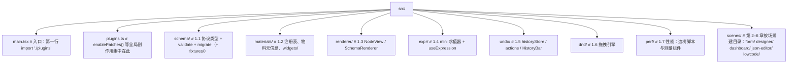

## 如何使用本文档

- **阅读前提**：默认你已完成《react-学习大纲.md》基础阶段 1–4，熟悉函数组件、`useState`/`useEffect`/`useMemo`/`memo`、状态提升与 context 的基本用法。本文不再解释这些 API 本身，只在"为什么在这里用它"上花笔墨。
- **知识点结构**：每个知识点按「是什么 → 为什么需要 / 解决什么问题 → 怎么做（机制分步拆解）→ 代码示例 → 常见坑（症状 → 根因 → 修法）」展开。先建立心智模型，再看代码，最后看坑——知道"防什么"之后再回头看"怎么做"，理解会深一层。
- **代码约定**：TypeScript + React 18/19 函数组件；代码块标注 `tsx` / `ts` / `json` / `bash` / `text`；片段尽量完整（含 import）可直接跑；关键行配中文注释。
- **底座优先**：第 1 章（通用底座）是第 2–6 章所有场景的地基，后面每一章都在复用它。宁可在这里慢一周，也不要跳过练习直接做场景。
- **标记含义**：✍️ 是必须亲手做的练习；⚠️ 是高频坑，先看坑再看代码；✅ 是阶段产出与验收标准。

---

### 补充：最小工程脚手架——让"代码可直接跑"成立

正文约定"片段尽量完整（含 import）可直接跑"，但片段分散在多个文件里，需要一个统一骨架承载。下面是一次搭好、六章通用的最小脚手架。

```bash
# 1. 建工程：官方 react-ts 模板（React 18/19 均可）
npm create vite@latest schema-lab -- --template react-ts
cd schema-lab

# 2. 六件套依赖：状态（zustand）、不可变更新与补丁（immer）、稳定 id（nanoid）
npm install zustand immer nanoid

# 3. 测试运行器：1.1 迁移链、1.4 求值器的验收测试都跑在它上面
npm install -D vitest
```

目录与各章代码的归属（一次建好不用再动）：



入口 8 行，两件事必须照做：`plugins.ts` 放在**第一行** import（原因见下一条坑）；StrictMode 在开发模式会双调用 render 与 effect，练习时 console 打两遍不是 bug，别当问题去修：

```tsx
// src/main.tsx
import './plugins' // 全局副作用最先执行：enablePatches() 等
import { StrictMode } from 'react'
import { createRoot } from 'react-dom/client'
import { App } from './App'

createRoot(document.getElementById('root')!).render(
  <StrictMode>
    <App />
  </StrictMode>,
)
```

### 补充：环境高频坑（症状 → 根因 → 修法）

- **症状**：测试里 `import { nanoid } from 'nanoid'`，Jest 一跑就报 `ERR_REQUIRE_ESM`。
  **根因**：nanoid 4 起只发布 ESM 产物；Jest 默认按 CJS 转换执行，`require` 不动 ESM 包。
  **修法**：三选一——测试框架换 vitest（与 Vite 同源，天然认 ESM）；锁 `nanoid@3`（最后的双格式版本）；或测试代码改用内置的 `crypto.randomUUID()`（Node 19+ 与现代浏览器均有）。
- **症状**：`produceWithPatches` 返回的补丁恒为空数组（或直接抛 immer 的插件错误），撤销整体失效，且只在部分入口复现。
  **根因**：`enablePatches()` 没有在第一次补丁 API 调用之前执行——比如只写在某个按需加载的模块里，注册时机晚于首次 commit。
  **修法**：单独建 `plugins.ts` 只做插件注册，`main.tsx` 与每个测试 setup 文件的**第一行** import 它；全局搜一遍确认没有第二个入口绕过它。
- **症状**：升级 React 19 后类型全面报红：`JSX.Element` 找不到、`useRef()` 提示缺初始值。
  **根因**：React 19 的类型把 JSX 命名空间迁到 `React.JSX`、`useRef` 必须传初始值，而 `@types/react` 还停在 18。
  **修法**：`react`、`react-dom`、`@types/react`、`@types/react-dom` 四包同步升级；存量代码里裸用的 `JSX.Element` 全局替换为 `React.JSX.Element`。
- **症状**：照抄 1.1 的模板字面量索引签名（`[extra: \`x-${string}\`]: unknown`），TS 报"不能用模板字面量做索引签名"。
  **根因**：该语法要求 TS ≥ 4.4，老仓库常见 3.x / 4.0。
  **修法**：升级 TypeScript（Vite react-ts 模板默认满足）；短期升不了的仓库用 `[key: string]: unknown` 兜底，并在 code review 约定 `x-` 前缀纪律。

---

## 附：ASCII 图替换清单

本文档图形化改版，原 ASCII 字符图与 Mermaid 图表对应关系如下：

| 原图位置 / 标题 | 处理结果 |
| --- | --- |
| 补充：最小工程脚手架——src/ 目录与各章代码归属（目录树） | 替换为 flowchart TD（目录树） |
