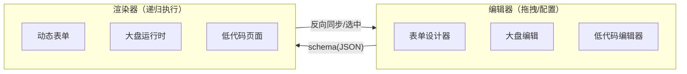

## 0. 全景认知：五大场景是一个内核

这五类场景看似不同，实际是同一条链路的不同切面：



### 0.1 逐行拆解这张图

这张图是全篇的"地图"，后面 8 周做的所有东西都能在上面找到位置。

**第 1 行（两个方框）——两种角色**：左边是"编辑器"，右边是"渲染器"。

- 编辑器：产出 schema 的工具，核心交互是拖拽与配置（物料区、画布、属性面板三件套）。它的产品形态是表单设计器、大盘编辑器、低代码编辑器。
- 渲染器：消费 schema 的程序，核心机制是递归执行——从根节点出发，把 JSON 树解释成组件树。它的产品形态是动态表单、大盘运行时、低代码页面。

**第 2 行（→ 箭头）——正向链路，载体是 schema(JSON)**：编辑器里发生的一切操作（拖入物料、改属性、排序、删除），最终都归结为"对 schema 树的一次修改"。渲染器不认识编辑器，只认识 schema。这意味着：渲染器可以在没有编辑器的情况下独立运行（第 2 章的动态表单就是纯渲染器产品），编辑器做的只是"更友好地修改 schema 的 GUI"。

**第 3 行（◄ 箭头）——反向链路，反向同步/选中**：渲染器侧的运行时状态要回流到编辑器：用户在画布上点了一个节点，编辑器要知道选中了谁（高亮 + 属性面板切换）；表单跑起来后 formData 的实时值、校验错误，要能回填到属性面板做联动预览。这条链路比正向链路容易被忽视，却是"所见即所得"的关键。

**第 4 行（底部两行注释）——产品矩阵**：左侧三种编辑器形态共享同一套编辑器骨架（物料区 + 画布 + 属性区 + 大纲树 + 撤销）；右侧三种运行时形态共享同一套渲染器内核（注册表 + 递归渲染 + 表达式）。形态之间的差异只体现在两点：注册了哪些组件、协议多了哪些字段。

**这张图最重要的推论**：编辑器与渲染器之间**唯一的契约是 schema**。契约唯一，所以两边可以独立开发、独立测试、独立演进——"预览"功能就是把 schema 喂给渲染器再起一个 iframe；"JSON 编辑器"（第 5 章）则是给这份数据开了第三个消费入口（文本形态）。

### 0.2 一个 20 行的最小内核（先建立整体感）

在展开概念之前，先把内核跑起来。协议 + 注册表 + 递归渲染器，核心不到 20 行：

```tsx
import type { ComponentType } from 'react'

// 1. 协议：节点 = 类型 + 属性 + 孩子
type Node = {
  id: string
  type: string
  props?: Record<string, unknown>
  children?: Node[]
}

// 2. 注册表：type 字符串 → 组件
const registry: Record<string, ComponentType<any>> = {
  page: ({ children }) => <div style={{ padding: 16 }}>{children}</div>,
  grid: ({ children, columns = 2 }) => (
    <div style={{ display: 'grid', gridTemplateColumns: `repeat(${columns}, 1fr)` }}>
      {children}
    </div>
  ),
  text: ({ content }: any) => <p>{content}</p>,
  input: ({ placeholder }: any) => <input placeholder={placeholder} />,
}

// 3. 递归渲染器：容器递归、原子终止
function RenderNode({ node }: { node: Node }) {
  const Widget = registry[node.type]
  if (!Widget) return <div>未知组件：{node.type}</div> // 未注册类型的兜底
  return (
    <Widget {...node.props}>
      {node.children?.map((child) => <RenderNode key={child.id} node={child} />)}
    </Widget>
  )
}
```

配上这样一份 JSON：

```json
{
  "id": "root", "type": "page",
  "children": [
    { "id": "t1", "type": "text", "props": { "content": "hello schema" } },
    { "id": "g1", "type": "grid", "props": { "columns": 2 }, "children": [
      { "id": "i1", "type": "input", "props": { "placeholder": "a" } },
      { "id": "i2", "type": "input", "props": { "placeholder": "b" } }
    ]}
  ]
}
```

`<RenderNode node={schema} />` 就能渲染出一个标题加两个并排输入框。第 1 章的 1.1–1.7，本质都是给这 20 行"补工程化"：1.1 给协议上类型，1.2 给注册表配物料元信息，1.3 加性能与正确性（memo、key），1.4 补逻辑表达能力，1.5 补时间线（撤销），1.6 补拖拽交互，1.7 补大树性能。心里装着这 20 行，后面每一节都知道自己在加固哪里。

### 0.3 为什么"五类场景是同一个内核"

把五个场景的核心数据与核心程序摆在一起看：

| 场景 | 核心数据（schema 是什么） | 核心程序（解释器是什么） |
|---|---|---|
| Schema 动态表单 | 字段列表/字段树 | 字段渲染器 + 校验引擎 |
| 表单设计器 | 同一张字段 schema | 编辑器 = 物料区 + 画布 + 属性面板 |
| 拖拽仪表盘 | dashboard JSON（layout + panels） | 面板渲染器 + 数据源层 |
| JSON 编辑器 | schema 本身的文本形态 | 文本编辑 + parse + 校验 |
| 低代码平台 | 页面组件树 schema（含事件/绑定/数据源） | 页面渲染器 + 表达式绑定 + 动作引擎 |

共性可以压缩成三句话：

1. **每个场景都有一棵可序列化的配置树**（JSON），树的每个节点都有 `type` 与 `props`。
2. **每个场景都需要"type 字符串 → 组件"的注册表**，否则渲染器就要为每种类型写 if-else。
3. **每个场景都用递归渲染器把树解释成组件树**；编辑器类场景再叠加"拖拽 + 选中 + Setter + Undo"，运行时类场景再叠加"数据源 + 表达式绑定"。

反过来看不做内核的代价：五个场景各自造协议、各自写渲染、各自实现撤销，等于维护五套平行系统；某天"下拉组件要支持分组选项"，你得改五个地方。内核化之后，新增一个场景的成本变成：设计协议子集 + 注册一批物料，底座（渲染、撤销、表达式、性能方案）全部复用。第 3、4、6 章会反复验证这一点——这也是为什么本章叫"通用底座，先于一切场景"。

**内核六件套**（所有场景共用，先打地基）：

| 模块 | 解决什么 | 典型实现 |
|---|---|---|
| Schema 协议 | 声明式描述"页面/表单/面板" | JSON + TypeScript discriminated union |
| 组件注册表 | `type` 字符串 → 组件的映射 | `Record<string, ComponentType>` + 物料元信息 |
| 递归渲染器 | 把 schema 树变成组件树 | 布局容器与原子组件分离、递归 + memo |
| Setter 体系 | 属性面板 = 一张配置表单 | 属性面板本身复用"动态表单"（自举） |
| 表达式引擎 | 安全的联动/条件/绑定逻辑 | expr-eval / jsonata / 自研 mini 求值器 |
| Undo/Redo | 编辑器的底线能力 | immer patches / 命令模式 / zundo |

表格每一行的完整展开见下面 0.4 节，代码级实现见第 1 章对应小节。

### 0.4 六件套逐行展开

#### 第 1 行：Schema 协议——内核的数据形态

**是什么**：一份用纯 JSON 描述"页面/表单/面板长什么样、行为如何"的图纸，例如 `{ type: 'input', props: { placeholder: '姓名' } }`。

**为什么它是第一块砖**：编辑器的一切操作都是在改这份 JSON，渲染器的一切行为都是在解释这份 JSON。协议一定，编辑器与渲染器的接口就定了；协议的表达能力上限，就是整个平台的能力上限。

**它决定三件事**：能描述什么（字段类型、布局结构、联动关系）；不能描述什么（可执行代码——逻辑交给表达式引擎，保证 schema 始终是纯数据）；以及工程属性（能否存盘、能否跨服务传输、能否做版本迁移——由"可序列化 + 版本号"保证）。完整类型定义与设计原则见 1.1。

#### 第 2 行：组件注册表——内核的词典

**是什么**：`type` 字符串到 React 组件的映射表，外加每个组件的"物料元信息"（显示名 label、图标 icon、默认 props、可配置属性声明 setters）。

**为什么需要**：渲染器是通用程序，不该知道具体组件；注册表把"新增一种组件"从"改渲染器代码"降级为"注册一条数据"，这是开闭原则在 UI 领域的直接应用。协议里的 `type` 是"词"，注册表是"词典"——词典只管收词，不管语法。

**典型实现**：静态对象映射（编译期类型检查）或运行时 `Map`（支持插件动态注册），见 1.2。

#### 第 3 行：递归渲染器——内核的解释器

**是什么**：从根节点出发的递归组件：遇到容器节点（page/grid/card）就递归渲染 `children`，遇到原子节点（input/text）就终止。它是"同一个内核"最硬的证据：表单、大盘、低代码页面跑的是**同一份 renderNode 代码**，区别只是注册表里有什么、协议里多了哪些字段。实现与性能闸门（memo）见 1.3。

#### 第 4 行：Setter 体系——内核的自举

**是什么**：编辑器右侧属性面板的生成机制——每种物料用 setters 声明"哪些属性可配、用什么控件配"，属性面板根据声明自动渲染成一张表单。

**为什么叫自举**：这张"配置表单"本身就是用第 2 章的动态表单引擎渲染的——等于用渲染器渲染"描述 schema 的 schema"。收益是一次实现、两处受益：属性面板零手写表单；动态表单引擎被自己的编辑器第一时间验证。这也是"先做渲染器，再做编辑器"的直接原因之一：Setter 依赖渲染器侧的能力。

#### 第 5 行：表达式引擎——内核的安全逻辑层

**是什么**：协议里禁止写 JS 代码，那么"当城市选北京时显示区县字段"这类逻辑放在哪？放在**表达式字符串**里（如 `$form.city == 'bj'`），由一个受限的求值器在运行时解释。

**为什么不用 `eval`/`new Function`**：安全（schema 是用户间共享的数据，等于执行任意代码）、作用域失控（表达式能摸到闭包与全局对象）、CSP 冲突。自研/引入的求值器只支持白名单语法（四则、比较、逻辑、属性访问），只能访问显式注入的上下文（`$form`/`$user`/`$now`）。100 行手写实现见 1.4。

#### 第 6 行：Undo/Redo——内核的时间线

**是什么**：把 schema 的每次变更记录成可逆操作（命令对象或 immer 补丁），支持回退与重做。它是编辑器的底线能力——一个不能撤销的编辑器没人敢用。

**为什么一处实现、五个场景受益**：因为所有场景的编辑对象都是同一份可序列化 JSON，"对 JSON 求补丁"的撤销系统天然与"这是什么编辑器"无关。三种实现（命令模式 / immer patches / zundo）与 300ms 输入合并见 1.5。

### 0.5 学习总原则：先做渲染器，再做编辑器

**学习总原则：先做渲染器，再做编辑器。** 编辑器本质是"生成 schema 的 GUI"，没有渲染器的编辑器是无根之木。

展开说四层理由：

1. **渲染器是纯函数，反馈最快**。schema 进、UI 出，没有拖拽、选中、撤销这些交互复杂度，一天就能出雏形。协议设计得合不合理（字段不够用、结构冗余、表达能力缺失），渲染器最先暴露——你会在写渲染器时频繁回头改协议，这个迭代回路越早启动越好。
2. **编辑器严格复杂于渲染器**。画布 = 渲染器 + 选中态 + 事件拦截；属性面板 = 渲染器 + Setter 体系；预览 = 渲染器本体。先有渲染器，编辑器的每一块才有可复用的地基；反过来做，等于把最难的问题放在最没有积累的时刻。
3. **协议会被"编辑器优先"的思路带偏**。先写编辑器的人，会不自觉按"编辑器内部方便"来存数据（比如直接存组件引用、存函数回调），等做渲染器、做序列化时再推倒重来。先写渲染器，协议自然被约束在"纯数据"一侧。
4. **映射到学习路径**：第 1 章底座（渲染器内核）→ 第 2 章动态表单（渲染器第一个完整产品）→ 第 3 章表单设计器（编辑器第一次落地）→ 第 4 章仪表盘 → 第 5 章 JSON 编辑器 → 第 6 章低代码平台总装。顺序不可颠倒的原因就在这张图上。

---

### 0.6 内核诊断实战：三段"没长出内核"的代码

会背六件套不等于会用。下面三段都是真实项目里常见的"半内核"形态——各自缺一件，代价立刻显形。学会用六件套当检查表去诊断别人的代码，是本章最重要的迁移能力。

**案例一：注册表缺失——if-else 渲染器**

```tsx
// 某 CRM 的"动态表单"：schema 有了，注册表没有
function FormRenderer({ fields }: { fields: FieldDef[] }) {
  return fields.map((f) => {
    if (f.type === 'input') return <div className="row"><label>{f.label}</label><input /></div>
    if (f.type === 'select') return <div className="row"><label>{f.label}</label><Select options={f.options} /></div>
    if (f.type === 'date') return <div className="row"><label>{f.label}</label><DatePicker /></div>
    return null // ← 未识别的类型静默消失
  })
}
```

诊断：渲染器亲自认识每种字段（缺六件套第 2 件）。症状链：加一种"级联选择"要改渲染器源码并发版；二开方无法扩展；`return null` 让脏 type 静默消失而不是暴露问题。修法：组件进注册表、渲染器只查表（1.2），未注册类型渲染占位并上报。

**案例二：可序列化缺失——schema 里塞函数**

```ts
// 某活动页配置：blocks 里直接放渲染函数与谓词函数
const pageConfig = {
  blocks: [
    { render: () => <HeroBanner img="/a.png" />, visible: (ctx) => ctx.user.vip },
    { render: () => <Countdown end="2025-12-31" /> },
  ],
}
```

诊断：配置里混进了代码（违反 1.1 原则 1/2）。症状链：`JSON.stringify` 后 render/visible 双双丢失，配置无法入库，只能硬编码在前端代码里随发版变更——"配置化"名存实亡；就算勉强存了，撤销系统（第 6 件）与迁移链也无从下手。修法：render 改为 `type + props` 查注册表；visible 改为表达式字符串 `$user.vip`（1.4）。

**案例三：时间线不完整——一半操作可撤销**

```ts
// 某设计器：结构操作走了命令栈，属性修改直接 set
addNode(node) {
  execCommand({ do: () => setNodes(add(nodes, node)), undo: () => setNodes(remove(nodes, node.id)) })
}
updateProps(id, patch) {
  setNodes((s) => ({ ...s, [id]: { ...s[id], props: { ...s[id].props, ...patch } } })) // ← 不进历史
}
```

诊断：撤销只覆盖了一类变更（第 6 件半残）。症状链：用户改错属性无法回退只是表层；更深的坑是"绕过历史的变更"不清空 redo 栈——用户 undo 掉删节点、再改属性、再 redo 时，redo 补丁作用在一个从未被记录过的中间状态上，状态错乱且难复现。修法：任何 schema 变更收敛到唯一 commit 入口，正反补丁自动生成（1.5 方案二）。

**诊断三问**（拿到任何"配置化/低代码"代码库，先问这三句）：

1. 新增一种组件要改几个文件？——要改公共渲染代码，即注册表缺失。
2. 把配置 `JSON.parse(JSON.stringify(cfg))` 一遍，丢东西吗？——丢，即协议不纯。
3. 每一处状态变更都过统一历史入口吗？——存在直写，即时间线有洞。

### 0.7 自测与面试题：能不能凭空复现内核

答不出的题号，就是该回去重读的小节（答案要点附在每题后面）。

1. **编辑器与渲染器之间为什么"唯一的契约是 schema"？直接共享 React 元素或组件引用行不行？**
   要点：React 元素含函数与引用、不可序列化——无法存盘、传输、undo diff、版本迁移；契约唯一，两边才能独立开发、独立测试、独立演进（"预览"就是把 schema 喂给渲染器再起一个 iframe）。
2. **用一句话说清"五大场景是一个内核"，再给三条结构证据。**
   要点：核心数据都是可序列化配置树、核心程序都是"type → 组件"注册表 + 递归渲染器；场景差异只落在注册了什么物料、协议多了哪些字段。
3. **协议为什么禁止可执行代码？逻辑放哪？**
   要点：安全（schema 是用户间共享的数据，eval 等于存储型 XSS）、可序列化的前提、可静态分析；逻辑降级为表达式字符串，由受限求值器解释（1.4）。
4. **Setter 体系为什么叫"自举"？它决定了怎样的构建顺序？**
   要点：属性面板本身是动态表单引擎渲染的"描述 schema 的 schema"；因此必须先有渲染器（第 2 章）再做编辑器（第 3 章）。
5. **Undo 为什么能一处实现、五个场景受益？前提是什么？**
   要点：编辑对象都是同一份纯 JSON，"对 JSON 求补丁"与具体业务无关；前提是所有变更走统一 commit 入口、状态可结构化 diff。
6. **内核化之后接入一个新场景（比如"打印模板编辑器"）的成本是什么？不做内核的代价是什么？**
   要点：成本 = 设计协议子集 + 注册一批物料，底座全复用；不做 = 五套平行协议/渲染/撤销，一个通用需求改五处。
7. **0.2 的 20 行内核里，`if (!Widget) return <div>未知组件：{node.type}</div>` 这行兜底为什么重要？去掉会怎样？**
   要点：schema 是外部数据，脏 type 一定会出现；不兜底则整树白屏，兜底则单节点损坏可定位可上报——防御要落在边界上（1.3 展开）。

---

## 附：ASCII 图替换清单

本文档图形化改版，原 ASCII 字符图与 Mermaid 图表对应关系如下：

| 原图位置 / 标题 | 处理结果 |
| --- | --- |
| 0. 全景认知：编辑器 ⇄ 渲染器（schema(JSON) 正向 / 反向同步选中，含产品形态矩阵） | 替换为 flowchart LR（架构图） |
