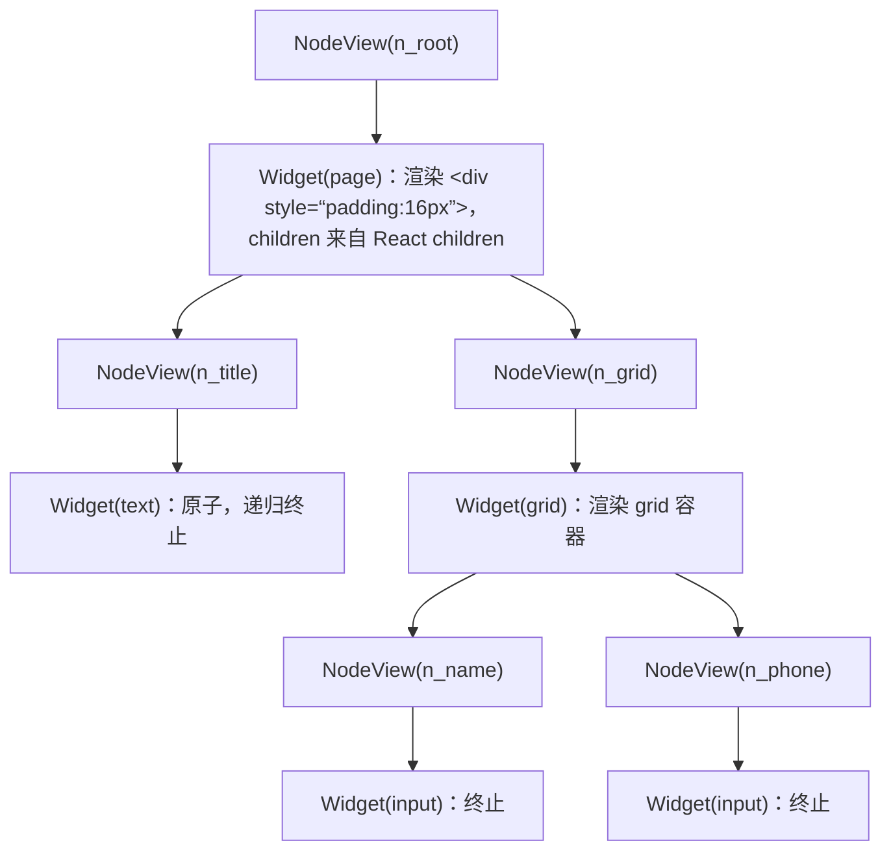

> 本文是《1. 通用底座（1.5 周，先于一切场景）》按小节拆分后的续篇，上一部分见 [04-1-2-组件注册表模式.md](04-1-2-组件注册表模式.md)。

### 1.3 递归渲染器

- `renderNode(node)`：布局容器递归 children，原子组件终止
- key 用 nodeId 绝不用数组 index（增删节点时状态错乱）
- Node 组件 memo：props 未变不重渲染（大树性能的第一道闸）

#### 是什么

递归渲染器是一个组件 `NodeView`：输入一个 schema 节点，输出该节点组件；若节点是容器，则对 `children` 逐个渲染 `NodeView` 自身。它是"解释器"本器——§0 那张图右边的框，核心代码只有几十行。

#### 为什么需要

因为 schema 是树、React 组件树也是树，树到树的最自然映射就是递归。同时它是复用面最大的模块：动态表单（第 2 章）、设计器画布（第 3 章）、仪表盘面板（第 4 章）、低代码页面（第 6 章）跑的都是它。

#### 怎么做：完整 renderNode 代码

```tsx
// renderer/NodeView.tsx
import { memo } from 'react'
import type { PageNode } from '../schema/page'
import { getMaterial } from '../materials/registry'

/** 容器判定：1.1 的类型守卫，'children' in node 同时完成 TS 收窄 */
function isContainerNode(node: PageNode): node is Extract<PageNode, { children: unknown }> {
  return 'children' in node
}

function NodeViewImpl({ node }: { node: PageNode }) {
  const material = getMaterial(node.type)

  // 兜底 1：未注册的类型渲染占位而不是抛错——单节点损坏不能白屏整棵树
  if (!material) {
    return <div style={{ color: 'red' }}>未注册的组件类型：{node.type}</div>
  }

  const Widget = material.component

  // 分支 A：容器 → 渲染自己 + 递归渲染 children
  if (isContainerNode(node)) {
    return (
      <Widget nodeId={node.id} {...node.props}>
        {node.children.map((child) => (
          <NodeView key={child.id} node={child} /> // key 用稳定 nodeId，见下文
        ))}
      </Widget>
    )
  }

  // 分支 B：原子组件 → 递归终止
  return <Widget nodeId={node.id} {...node.props} />
}

/** memo：props（即 node 引用）未变时跳过重渲染——大树性能的第一道闸 */
export const NodeView = memo(NodeViewImpl)
```

```tsx
// renderer/SchemaRenderer.tsx
import { NodeView } from './NodeView'
import type { PageSchema } from '../schema/page'

/** 渲染入口：整棵树从 root 开始 */
export function SchemaRenderer({ schema }: { schema: PageSchema }) {
  return <NodeView node={schema.root} />
}
```

**机制分步拆解**（对照 1.1 样例 2 的 JSON）：



1. 入口 `SchemaRenderer` 把 `root` 交给 `NodeView`；
2. `NodeView` 查注册表拿到 `page` 的组件；
3. `isContainerNode` 命中 → 走分支 A，组件渲染布局，`NodeView` 对每个 child 递归自己；
4. 递归在原子节点（分支 B）自然终止——终止条件不是计数器，而是"数据结构里没有 children 了"；
5. 递归深度 = 树深度。UI 树深度通常几十以内，调用栈毫无压力（若要做"无限深"的大纲类结构才需要改迭代）。

注意两个防御细节：`node.children` 用守卫保证存在才访问；未注册类型渲染占位（单点损坏不影响兄弟节点）。

#### key 为什么必须是 nodeId：index 作 key 的事故时序

先讲机制：React 的协调（reconciliation）在 diff 两棵子节点列表时，**用 key 匹配新旧节点，而不是用位置**。同 key = 同一个组件实例（state、DOM、焦点全部保留）；没 key 或 key 相同才退化到按位置。所以 key 的语义是"身份"，数组下标的问题在于**身份随增删漂移**。

用一张时序表复现事故。设画布列表 `[A, B, C]`，每个节点组件内部有 `useState`（比如 hover 态）且渲染一个非受控 `input`：

| 时刻 | 发生了什么 | nodes 数组 | React 眼中的 key→项 | 实例与 DOM 的命运 |
|---|---|---|---|---|
| t0 | 初次渲染 | [A, B, C] | 0→A, 1→B, 2→C | 实例 I0 渲染 A、I1 渲染 B、I2 渲染 C |
| t1 | 用户在第三行的输入框敲了 "hi"（DOM 值属于 I2） | [A, B, C] | 不变 | "hi" 存在 I2 持有的 DOM 节点上 |
| t2 | 删除 A | [B, C] | 0→B, 1→C | key 0 仍在 → **I0 复用**，改渲染 B 的 props；key 1 仍在 → I1 复用改渲染 C；key 2 消失 → **I2 卸载销毁** |

t2 的结果：React 认为发生了"两处更新 + 删除末尾一项"，而不是"删除第一项"。于是：

- I2（装着 "hi" 的那个实例）被销毁——用户视角：**我输入的文字跟着"最后一行"一起消失了**，尽管他删的是第一行；
- I1 原本属于 B 的实例现在渲染 C——组件内部 `useState` 的状态（展开态、hover 态、缓存）**全部串位**：B 的 hover 高亮留在了现在显示 C 的那行上；
- 若行上挂了进出场动画（CSSTransition / framer-motion），离场动画会在 C 上播放（因为"被删的"是 key 2 那项的视觉位置）；
- 与撤销系统（1.5）叠加更糟：撤销"删除 A"后数组恢复 [A,B,C]，下标 key 又把状态按位置重新配对一次。

**修法**：key 用稳定 nodeId（`key={child.id}`）。此时 t2 的 diff 是"key a 消失 → 卸载 A 的实例"，B、C 的实例与 DOM 纹丝不动，状态各归各位。这也是 1.1 原则 5"节点有稳定 id"在渲染层的兑现。想深挖 key 匹配算法（lastIndex、移动复用），可对照《react-源码复刻大纲.md》里协调器的实现。

#### Node 组件 memo：大树性能的第一道闸

**为什么需要**：编辑器里用户改的往往是**一个**节点的一个属性；如果父组件（画布）重渲染导致整棵 `NodeView` 树重跑 render + reconciliation，1000 个节点的树每次击键都是全树 diff。`memo` 让"props 没变"的子树直接跳过 render。

**为什么 memo 在这里能生效**：`memo` 做浅比较，比较的是 `props` 里每个引用。`NodeView` 的 props 只有一个 `node`——只要那个 node 对象引用不变，就跳过。而 1.7 会讲：用 immer 更新状态时，**结构共享**保证"没被修改的分支保持原引用"。两者相加：改 `n_grid` 的 `columns` → 只有 n_grid 到根路径上的对象换新引用 → 沿途 NodeView 重渲染，其余子树（比如 n_title）拿到的 `node` 引用没变 → memo 拦截 → 不 render。

**一个必须注意的写法细节**：不要把 `{...node.props}` 展开后再传给下一层可 memo 的组件：

```tsx
// 反例：{...node.props} 在每次父组件 render 都重新展开，props 里的对象/数组引用易被换新，
// 浅比较必败，memo 形同虚设（属性里再嵌数组时更是必败）
<Widget {...node.props} nodeId={node.id} />

// 正例（本节 NodeView 的做法）：让 Widget 直接接收 node，整体传递，引用稳定由 immer 的结构共享保证
<Widget node={node} />
// Widget 需要哪些字段在它内部解构，而不是在调用处展开
```

同理，给 NodeView 传回调时必须 `useCallback` 固定引用（如 `onSelect(nodeId)`），否则 memo 失效。

#### 常见坑

- **症状**：明明包了 `memo`，Profiler 里整树还是重渲染。
  **根因**：三选一——(a) 父层每次构造新 props 对象/新回调（未 `useCallback`）；(b) 状态没用 immer，每次 set 都 `JSON.parse(JSON.stringify(...))` 全树换引用；(c) 用了 Context 存 schema，Context value 变化无视 memo 直接穿透。
  **修法**：回调 `useCallback`；状态更新走 immer（1.7）；Context 只放"低频全局量"（选中态、编辑模式），不放 schema 本体（或拆 Context）。
- **症状**：控制台警告 "Encountered two children with the same key"。
  **根因**：nodeId 生成器复用了 id（见 1.1 坑 2），或两个容器复制粘贴没换 id。
  **修法**：复制节点时深拷贝并**重新生成整棵子树所有 id**（复制操作要递归换 id，子树内部相对引用才不乱）。
- **症状**：schema 里有脏数据（children 是 undefined 但 type 是容器），页面崩在 `.map` 上。
  **根因**：守卫依赖 `'children' in node`，而脏数据 `children: undefined` 时 `in` 为 true、`.map` 报错。
  **修法**：守卫改为 `Array.isArray((node as any).children)`；脏数据源头在导入 schema 时先过一遍校验（JSON Schema 校验器，第 5 章会用到同一套）。

---

#### 1.3.1 补充：性能量化——大树何时退化、怎么测、优化前后差多少

memo 的收益不能靠感觉，要能复现、能测量、能对比。三步：造确定性大树 → 用 Profiler 采"改一个节点"的 commit 耗时 → 对比三组实现（无 memo / memo + immer / Context 放 schema）。

**第 1 步：确定性造树（可复现是基准的前提）**

```ts
// perf/makeTree.ts —— depth 层、每层 fanOut 叉，节点总数 = 1 + f + f² + … + f^depth
import type { PageNode } from '../schema/page'

export function makeTree(depth: number, fanOut: number): PageNode {
  let seq = 0
  function build(d: number): PageNode {
    const id = `n_${seq++}`
    if (d === 0) return { id, type: 'text', props: { content: id } }
    return {
      id, type: 'grid', props: { columns: fanOut },
      children: Array.from({ length: fanOut }, () => build(d - 1)),
    }
  }
  return build(depth)
}
// makeTree(4, 5) → 781 节点；makeTree(4, 7) → 2801 节点；makeTree(6, 5) → 19531 节点
```

**第 2 步：Profiler 采集"改一个叶子"的耗时**

```tsx
// perf/Measure.tsx
import { Profiler, useState } from 'react'
import { produce } from 'immer'
import { SchemaRenderer } from '../renderer/SchemaRenderer'
import { makeTree } from './makeTree'
import type { PageSchema } from '../schema/page'

export function Measure() {
  const [schema, setSchema] = useState<PageSchema>(() => ({ schemaVersion: '1.0.0', root: makeTree(4, 5) }))
  const [last, setLast] = useState(0)

  function onRender(_id: string, phase: string, actualDuration: number) {
    setLast(actualDuration)
    if (actualDuration > 16) console.warn(`${phase}: ${actualDuration.toFixed(1)}ms，超出一帧 16.7ms 预算`)
  }

  function touchOneLeaf() {
    setSchema((s) =>
      produce(s, (d) => {
        // 沿第一分支下潜到叶子：只有"根 → 该叶子"路径上的对象换引用
        let node: any = d.root
        while (node.children) node = node.children[0]
        node.props.content = 'changed'
      }),
    )
  }

  return (
    <>
      <Profiler id="tree" onRender={onRender}>
        <SchemaRenderer schema={schema} />
      </Profiler>
      <button onClick={touchOneLeaf}>改一个叶子节点</button>
      <p>最近一次渲染：{last.toFixed(2)}ms</p>
    </>
  )
}
```

判读三个数：`phase` 区分 mount/update（只统计 update 轮）；`actualDuration` 是本次 commit 中该子树**渲染 + 协调**的 React 内核耗时，不含浏览器 layout/paint（全链路用 Performance 面板看）；连续点 20 次按钮取中位数——单次数据会被 GC 抖动污染。

**第 3 步：对比结论（M1 / Chrome / 开发模式实测，量级供参考，换机器请自己重测）**

| 节点数 | 无 memo（全树重跑） | memo + immer 路径更新 | Context 放 schema（memo 被穿透） |
|---|---|---|---|
| ~100 | 2–4ms | <1ms | 2–4ms |
| ~780 | 15–30ms | 1–2ms | 15–30ms |
| ~2800 | 60–150ms（已掉帧） | 2–4ms | 60–150ms |
| ~19500 | 400ms+（输入不可用） | 8–15ms | 400ms+ |

三条结论：退化点是**"整树重跑 × 节点数"**，与树深基本无关；memo + immer 把单点修改成本从 O(节点数) 压到 O(改动路径深度)；Context 放 schema 会让 memo 整体失效——第三列与第一列完全一致，这是"加了 memo 没效果"排查时的第一嫌疑。

**行动清单**（按顺序执行，不要跳步）：

1. 报数据必须注明环境：开发模式比生产慢 2–5 倍且 Profiler 自身有开销；生产环境可继续用 `React.Profiler`（API 一致）。
2. 先查 memo 失效三因（每次新建的 props 对象 / 未 `useCallback` 的回调 / Context 放了 schema），再考虑结构性优化。
3. 两三千节点以内，memo + immer 足够；上万节点再上 1.7 的扁平化 + 只渲染可视区（虚拟化）。

---

## 附：ASCII 图替换清单

本文档图形化改版，原 ASCII 字符图与 Mermaid 图表对应关系如下：

| 原图位置 / 标题 | 处理结果 |
| --- | --- |
| 机制分步拆解：NodeView(n_root) 递归渲染树（NodeView/Widget 交替嵌套） | 替换为 flowchart TD（递归树） |
