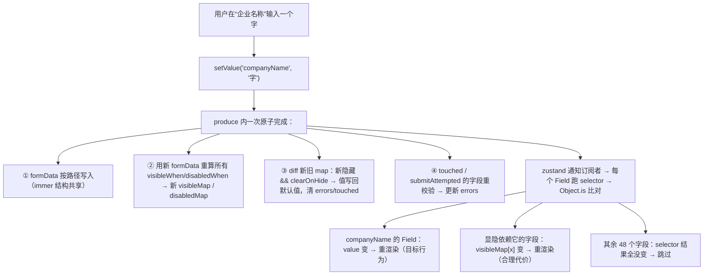

## 2. Schema 动态表单（2 周）

**业务画像**：中后台 50+ 字段配置化表单、SaaS 让接入方自定义字段、一个页面跑 N 套表单配置。

把这三句话拆开看，它们其实是同一个问题的三种表述：

- **中后台 50+ 字段配置化表单**：员工入职、报销、审批这类页面，字段多、联动多、改得勤。手写 JSX 的话，每加一个字段要写"取值 + 校验 + 布局 + 提交"四份代码；产品改需求（加个字段、换个联动）你就要发版。把字段变成 JSON 配置后，改表单 = 改数据，不发版。
- **SaaS 让接入方自定义字段**：你不可能把租户的字段写死在代码里——租户 A 的工单有"紧急程度"，租户 B 没有。字段定义必须来自数据库里的 JSON，前端只负责"解释执行"。
- **一个页面跑 N 套表单配置**：同一个渲染组件，根据 URL 参数加载不同的 schema，渲染出完全不同的表单。这是"渲染器"和"表单定义"彻底分离后的自然能力。

本章要做的就是这样一个**渲染器**：输入是 JSON，输出是一个行为完整（取值、联动、校验、提交）的表单。它会成为第 3 章表单设计器的渲染底座、第 4 章面板配置的属性面板、第 6 章低代码平台的表单渲染器——所以这一章值得花两周做到位。

### 实现路线（顺序即依赖）

这条 1→9 的路线不是并列的功能清单，而是严格的依赖链：没有协议（1）就没有渲染依据，没有渲染器（2）就没有地方挂字段，没有 store（3）字段无处读写，没有订阅模式（4）性能不达标，联动（5）和校验（6）都建立在"值变化 → 精确通知"之上，数组字段（7）是路径系统的进阶应用，异步 options（8）是字段组件的最后一个能力缺口，布局（9）纯是渲染层升级、放最后不影响内核。按顺序做，每一步都有上一步兜底。

#### 1. 字段协议：`{ id, type, label, required, default, options, visibleWhen, disabledWhen, rules }`

**是什么**：字段协议是一份 TS 类型 + 约定，描述"一个字段长什么样、怎么校验、何时显隐"。它是整个体系里最值得反复打磨的一层——协议定错，后面全部返工。

**为什么需要**：回忆底座 1.1 的设计原则——协议必须**可序列化、声明式、带版本号、预留 `x-*` 扩展字段**。落到表单场景意味着三件事：schema 能存数据库、能走网络、能被第 3 章的设计器生成；逻辑（显隐、禁用、校验）用**表达式字符串**表达而不是内联函数；自定义校验器通过**注册表键名**引用而不是闭包。凡是塞进函数的协议都不可序列化，第 3 章"设计器生成 schema"就直接死掉。

**怎么做**：用 discriminated union 按 `type` 收窄每个字段类型的专有属性。完整类型如下。

```ts
// types.ts —— 字段协议全集
export type FieldType =
  | 'input' | 'textarea' | 'number' | 'select' | 'switch' | 'date'
  | 'array' | 'object'      // 值字段
  | 'group' | 'grid'        // 布局字段（不产生数据）

export interface OptionItem {
  label: string
  value: string | number
}

/** 远程 options 的可序列化描述：只有字符串/数字，没有任何函数 */
export interface RemoteOptionsSpec {
  /** URL 模板，{keyword} 会被替换为搜索词，如 '/api/users?q={keyword}' */
  urlTemplate: string
  /** 响应里取数组的路径，如 'data.list' */
  resultPath?: string
  /** 从数组元素里取 label/value 的字段名 */
  labelField?: string
  valueField?: string
  /** 依赖的字段路径（如省 → 市），该字段变化时重新加载 */
  dependsOn?: string
  /** 搜索防抖毫秒数，默认 300 */
  debounce?: number
}

/** 校验规则。custom 是 validatorRegistry 的键名——协议里绝不放函数 */
export interface ValidationRules {
  required?: boolean
  requiredMessage?: string
  /** 正则源字符串，如 '^1\\d{10}$'（序列化时字符串比 RegExp 对象安全） */
  pattern?: string
  patternMessage?: string
  minLength?: number
  maxLength?: number
  min?: number
  max?: number
  /** 指向 validatorRegistry 中注册的校验器键名 */
  custom?: string
  /** 本字段何时校验：blur（默认，失焦即校已 touched 的字段）| change | submit */
  trigger?: 'blur' | 'change' | 'submit'
}

/** 所有字段共享的公共属性 */
export interface BaseFieldSchema {
  /** 字段名，同时是 formData 的键；同名冲突时在 object 内用嵌套路径区分 */
  name: string
  label: string
  required?: boolean
  /** 初始值；缺省时按类型补空白值（见步骤 3 的 normalizeInitialData） */
  default?: unknown
  placeholder?: string
  /**
   * 显隐表达式。求值上下文为 { $form, $item }，$item 仅数组行内字段可用。
   * 例："$form.userType == 'company'"（expr-eval 用 ==，没有 ===）
   */
  visibleWhen?: string
  /** 禁用表达式，语法与求值时机同 visibleWhen */
  disabledWhen?: string
  /** 隐藏后是否清空已填值。false=保留（默认），true=清空。两种策略的业务后果见步骤 5 */
  clearOnHide?: boolean
  rules?: ValidationRules
  /** 预留扩展：协议演进时不破坏旧 schema */
  'x-props'?: Record<string, unknown>
}

export interface InputFieldSchema extends BaseFieldSchema {
  type: 'input' | 'textarea' | 'date'
  maxLength?: number
}
export interface NumberFieldSchema extends BaseFieldSchema {
  type: 'number'
  min?: number
  max?: number
}
export interface SelectFieldSchema extends BaseFieldSchema {
  type: 'select'
  options?: OptionItem[]
  remote?: RemoteOptionsSpec
}
export interface SwitchFieldSchema extends BaseFieldSchema {
  type: 'switch'
}
/** 数组字段：item 是"一行"的字段模板，运行时按行数展开 */
export interface ArrayFieldSchema extends BaseFieldSchema {
  type: 'array'
  item: ObjectFieldSchema
  maxItems?: number
}
/** 嵌套对象字段：子字段路径自动加前缀，如 company.name */
export interface ObjectFieldSchema extends BaseFieldSchema {
  type: 'object'
  fields: FieldSchema[]
}
/** 布局：分组（带标题的 fieldset），不产生数据 */
export interface GroupFieldSchema extends BaseFieldSchema {
  type: 'group'
  collapsible?: boolean
  fields: FieldSchema[]
}
/** 布局：栅格，columns 列 + 每字段 span */
export interface GridFieldSchema extends BaseFieldSchema {
  type: 'grid'
  columns?: number
  fields: Array<FieldSchema & { span?: number }>
}

export type FieldSchema =
  | InputFieldSchema | NumberFieldSchema | SelectFieldSchema | SwitchFieldSchema
  | ArrayFieldSchema | ObjectFieldSchema | GroupFieldSchema | GridFieldSchema

export interface FormSchema {
  formId: string
  /** 协议版本号：从第一天就带上，为将来 migration 链留口子（见第 6 章） */
  version: string
  fields: FieldSchema[]
}

export type FormData = Record<string, unknown>
```

三个**表达式字段**（`visibleWhen` / `disabledWhen`，以及 rules 里将提到的条件思路）是协议里唯一的"逻辑通道"，值得单独说透：

- 它们是字符串表达式，由底座 1.4 的表达式引擎（expr-eval 或你手写的 mini 求值器）在**运行时求值**，求值上下文注入 `$form`（当前表单数据）和 `$item`（数组行数据）。
- 为什么不用函数：函数不可序列化。为什么不用 `eval`：安全 + 作用域失控（底座 1.4 讲过）。为什么不用 JSON 逻辑对象（`{ "and": [...] }`）：可以，但表达式字符串对配置人员可读性最好，且 expr-eval 一行接入。
- 表达式里统一用 `==`：expr-eval 不支持 `===`，写协议时注意。

一份合法 schema 长这样（截取，完整综合示例见步骤 9）：

```json
{
  "formId": "employee-onboarding",
  "version": "1.0.0",
  "fields": [
    {
      "type": "select",
      "name": "userType",
      "label": "人员类型",
      "required": true,
      "options": [
        { "label": "个人", "value": "person" },
        { "label": "企业", "value": "company" }
      ]
    },
    {
      "type": "input",
      "name": "companyName",
      "label": "公司名称",
      "visibleWhen": "$form.userType == 'company'",
      "clearOnHide": true,
      "rules": { "required": true }
    }
  ]
}
```

**常见坑（症状 → 根因 → 修法）**：症状——同事往 schema 里塞了个 `validator: (v) => ...`，JSON.stringify 后变 `null`，配置端保存再读出来校验悄悄失效。根因——协议被函数污染，序列化丢能力。修法——类型层就把 `custom` 限定为 string 键名，运行时查 `validatorRegistry`；code review 时把"schema 里出现 function"当 error 处理。

#### 2. registry + 递归渲染器（复用底座 1.2/1.3）

**是什么**：把 `type` 字符串映射到组件的注册表，加一个按 schema 递归渲染的组件。

**为什么需要**：渲染器要"解释执行"schema，它必须知道 `'select'` 对应哪个组件。注册表是这个翻译层的唯一字典——新增一种字段类型 = 注册一个 widget，渲染器一行不改。

**怎么做**：widget 组件的 props 契约先定死（后面所有 widget 都遵守它）：

```ts
// widgets/types.ts
import type { ReactElement } from 'react'
import type { FieldSchema } from '../types'

/** 所有输入组件统一遵守的 props 契约 */
export interface WidgetProps<T = unknown> {
  /** 字段完整路径，同时用作 label/htmlFor 关联与错误定位的 data-path */
  id: string
  schema: FieldSchema
  value: T
  disabled: boolean
  onChange: (value: T) => void
  onBlur: () => void
}

export type WidgetComponent = (props: WidgetProps<any>) => ReactElement
```

```ts
// widgets/registry.ts
import type { WidgetComponent } from './types'

/**
 * 注册表：type 字符串 → widget 组件。
 * 故意用 Record<string, ...> 而不是穷举映射——第 3 章会注册自定义 widget（如 options 编辑器），
 * 注册表必须是开放的，类型收窄交给调用处的 fallback UI 兜底。
 */
export const widgetRegistry: Record<string, WidgetComponent> = {
  input: InputWidget,
  textarea: TextareaWidget,
  number: NumberWidget,
  select: SelectWidget,
  switch: SwitchWidget,
  date: InputWidget, // 简化示例：date 先复用 input
}
```

两个最朴素的 widget，注意 `value` 的边界处理（这是坑 3 的第一道防线）：

```tsx
// widgets/InputWidget.tsx
import type { WidgetProps } from './types'

export function InputWidget({ id, schema, value, disabled, onChange, onBlur }: WidgetProps<string>) {
  return (
    <input
      id={id}
      className="widget-input"
      // 关键：value 永远是 string。undefined 会让 input 变非受控组件，触发 React 告警
      value={typeof value === 'string' ? value : value == null ? '' : String(value)}
      placeholder={schema.placeholder}
      disabled={disabled}
      onChange={(e) => onChange(e.target.value)}
      onBlur={onBlur}
    />
  )
}
```

```tsx
// widgets/SwitchWidget.tsx
import type { WidgetProps } from './types'

export function SwitchWidget({ id, value, disabled, onChange, onBlur }: WidgetProps<boolean>) {
  return (
    <input
      id={id}
      type="checkbox"
      className="widget-switch"
      checked={value === true}
      disabled={disabled}
      onChange={(e) => onChange(e.target.checked)}
      onBlur={onBlur}
    />
  )
}
```

递归渲染器（复用底座 1.3 的 `renderNode` 思路）在本章的形态是 `SchemaNode`：叶子字段交给 `Field`（步骤 4 详述），布局字段（group/grid/object）递归展开。骨架先立起来，布局细节在步骤 9 补全：

```tsx
// SchemaNode.tsx —— 路线骨架版，步骤 9 扩展布局分支
import { Field } from './Field'
import type { FieldSchema } from './types'

export function SchemaNode({ schema, path }: { schema: FieldSchema; path: string }) {
  // 叶子字段统一走 Field；Field 内部处理订阅、显隐、校验展示
  return <Field schema={schema} path={path} />
}
```

**常见坑（症状 → 根因 → 修法）**：症状——两个表单页字段 type 撞名（都用 `'input'` 但要不同样式）。根因——全局唯一注册表把"语义类型"和"实现组件"焊死了。修法——`createFormRenderer(registry)` 工厂按需生成渲染器，或注册表键加命名空间（`'antd.input'`）；本章保持单注册表，够用且简单。

#### 3. formData 管理：zustand 单 store，`setValue(path, value)` 用 immer 按路径更新

**是什么**：整个表单只有**一个** store 实例，持有 `formData / errors / touched / visibleMap / disabledMap`；所有更新走 `setValue(path, value)` 这类带路径的 action，用 immer 做不可变更新。

**为什么需要**：对比两种坏方案就明白了。方案 A"每字段一个 useState"：50 个字段 50 个 state，跨字段联动（改 A 要清 B）拿不到别的字段的值，提交时要挨个收集，FieldArray 更是没法做。方案 B"一个 useState({...formData})"：值都在一起了，但每次更新整棵 formData 换新引用，谁都不敢 fine-grained 订阅。单 store + 按路径更新是第三条路：**数据集中（联动、提交、回显都方便），更新精准（immer 结构共享让没动的子树保持原引用，订阅才有判重依据）**。

immer 的结构共享是后面 path 级订阅能成立的物理基础，这里必须讲透：对 `formData.company.name` 赋值时，immer 只复制路径上的对象（formData → company），`finance`、`users` 等兄弟子树全部保持**原引用**。于是"值没变的字段，selector 返回值的引用也没变"，zustand 用 `Object.is` 一比就跳过重渲染。

**怎么做**：先写两个路径工具（全章复用）：

```ts
// form/path.ts
import type { FormData } from '../types'

/** 按点路径读值：getPath(data, 'users.2.name')；任何一层缺失返回 undefined */
export function getPath(root: unknown, path: string): unknown {
  return path.split('.').reduce<unknown>((acc, key) => {
    if (acc != null && typeof acc === 'object') {
      return (acc as Record<string, unknown>)[key]
    }
    return undefined
  }, root)
}

/** 按点路径写值（配合 immer draft 使用）。中间层缺失时补空对象 */
export function setPath(root: FormData, path: string, value: unknown): void {
  const keys = path.split('.')
  const last = keys.pop()!
  let cur: Record<string, unknown> = root
  for (const k of keys) {
    const next = cur[k]
    // 中间层是 null/标量时补 {}，避免 'company.name' 在 company 未初始化时崩掉
    if (next == null || typeof next !== 'object') {
      cur[k] = {}
    }
    cur = cur[k] as Record<string, unknown>
  }
  cur[last] = value
}
```

store 的核心骨架（完整 action 在后续步骤逐步补齐；这里给出setValue 完整实现）：

```ts
// form/store.ts
import { create } from 'zustand'
import { produce } from 'immer'
import type { FormSchema, FormData, FieldSchema } from '../types'
import { getPath, setPath } from './path'

export interface FormStoreState {
  schema: FormSchema
  formData: FormData
  /** 键为字段完整路径，只在"确有错误"时存在该键 */
  errors: Record<string, string>
  /** 用户碰过（失焦过）的字段路径集合 */
  touched: Record<string, boolean>
  /** 显隐/禁用 map：只有声明了表达式的字段才会出现在 map 里 */
  visibleMap: Record<string, boolean>
  disabledMap: Record<string, boolean>
  submitAttempted: boolean
  setValue: (path: string, value: unknown) => void
  blur: (path: string) => void
  // validateField / validateAll / arrayPush / arrayRemove / arrayMove / submit 见步骤 6/7
}

export const createFormStore = (schema: FormSchema, initial?: FormData) =>
  create<FormStoreState>()((set, get) => {
    const initialData = normalizeInitialData(schema, initial)   // 见坑 3 小节，初始化必经
    return {
    schema,
    formData: initialData,
    errors: {},
    touched: {},
    // 装载时对初始数据先求一轮显隐/禁用（比如编辑回显时 userType 已是企业）
    visibleMap: evaluateLinkageMap(schema, initialData, 'visibleWhen'),
    disabledMap: evaluateLinkageMap(schema, initialData, 'disabledWhen'),
    submitAttempted: false,

    setValue: (path, value) =>
      set((s) =>
        produce(s, (draft) => {
          // ① 按路径写值：只有路径上的对象换新引用，其余子树保持原引用（结构共享）
          setPath(draft.formData, path, value)
          // ② 联动单轮重算：visibleMap/disabledMap + clearOnHide + 已触碰字段重校验
          //    实现见步骤 5，为什么"单轮"是循环依赖的解药也在步骤 5 展开
          applyLinkage(draft)
        }),
      ),
    blur: (path) =>
      set((s) =>
        produce(s, (draft) => {
          draft.touched[path] = true
          const field = findFieldByPath(draft.schema, path)
          if (field) {
            const msg = validateOne(field, getPath(draft.formData, path), draft.formData)
            if (msg) draft.errors[path] = msg
            else delete draft.errors[path]
          }
        }),
      ),
    }
  })
```

上面 `createFormStore` 的函数体是 `=> { const initialData = ...; return { ... } }` 形式：先用初始数据算好 `initialData`，再用它初始化 formData 并**求第一轮显隐/禁用**（编辑回显场景里 `userType` 可能一开始就是"企业"，公司字段的显隐必须在装载时就正确）。`evaluateLinkageMap` / `applyLinkage` / `validateOne` / `normalizeInitialData` / `findFieldByPath` 分别在步骤 5、6、9 展开，最终组装成完整文件。

为什么用 `produce(s, draft => ...)` 而不是 zustand 的 immer 中间件（`zustand/middleware/immer`）：两者等价，middleware 版写 `set((d) => { setPath(...) })` 更短，但显式 `produce` 把"一次 set = 一次原子更新"表达得更清楚——formData、errors、visibleMap 在同一次 produce 里一起变，不会出现"值更新了但显隐 map 还是旧的"的中间态。多字段一致性比省几个字符重要。

**常见坑（症状 → 根因 → 修法）**：症状——字段名里带点（如 `"tax.id"`），取值取到了嵌套对象。根因——点路径语法把 `.` 当分隔符，键名与路径语法冲突。修法——协议层面约束字段 `name` 只允许字母数字下划线；若真要支持，需引入转义语法（如 `['tax.id']`）并在 getPath/setPath 统一实现，代价是所有路径工具复杂化——除非硬需求，不建议。

#### 4. Field 组件模式：每个字段组件用 selector 只订阅自己的 `value` 和 `error`

这是本章的灵魂。先把反面教材摆出来，你会对"为什么需要 path 级订阅"有体感。

**反面代码：全量受控**。

```tsx
// ❌ 反面教材：父组件持有整个 formData，用 props 灌给所有字段
import { useState } from 'react'

function BadForm({ schema }: { schema: { fields: { name: string; label: string }[] } }) {
  const [formData, setFormData] = useState<Record<string, string>>({})
  return (
    <form>
      {schema.fields.map((f) => (
        <FieldBad
          key={f.name}
          schema={f}
          formData={formData}   // ← 灾难源头：每个字段都依赖整个 formData 对象
          onChange={(v) => setFormData({ ...formData, [f.name]: v })}
        />
      ))}
    </form>
  )
}

const FieldBad = ({ schema, formData, onChange }: any) => {
  const value = formData[schema.name] ?? ''
  return (
    <div className="field">
      <label>{schema.label}</label>
      <input value={value} onChange={(e) => onChange(e.target.value)} />
    </div>
  )
}
```

输入一个字符的完整灾难链：`setFormData` 生成新对象 → `BadForm` 重渲染 → 50 个 `FieldBad` 全部拿到新的 `formData` prop 引用 → 全部重渲染。50 个字段每键一键就是 50 次 render + 50 次 DOM diff，输入法连拼几个字母直接掉帧。更糟的是这不可救药——props 依赖的是"整个对象"，只要对象换引用，子组件无论如何都逃不掉，`memo` 也拦不住（props 真的变了）。

**修法的核心思路**：把"订阅"从父组件**下沉到叶子**，且每个叶子只订阅**自己的那一小块**。zustand 的 selector 机制正好提供这个能力：store 变化时，zustand 对每个订阅者跑一遍 selector，用 `Object.is` 比较新旧结果，只有结果变了才安排这个组件重渲染。配合 immer 结构共享（没变的子树引用不变），效果就是：改 `company.name`，只有 `company.name` 那个 Field 的 selector 返回值变了，其余 49 个字段全部静默。

**完整可运行链路**：store 定义 → selector（Context 分发 per-instance store）→ Field 组件 → 输入组件。

第 1 环，store 定义即步骤 3 的 `createFormStore`。为什么是工厂函数而不是模块级单例：一个页面可能同时存在两个表单（主表单 + 弹窗表单），第 3 章的属性面板更是"每次选中节点一个实例"。工厂 + Context 是标准搭配。

第 2 环，Context 分发 + 类型化 hook：

```tsx
// form/FormProvider.tsx
import { createContext, useContext, useState, type ReactNode } from 'react'
import type { StoreApi } from 'zustand'
import { createFormStore, type FormStoreState } from './store'
import type { FormSchema, FormData } from '../types'

type FormStoreApi = ReturnType<typeof createFormStore>

const FormStoreContext = createContext<FormStoreApi | null>(null)

export function FormProvider({
  schema,
  initial,
  children,
}: {
  schema: FormSchema
  initial?: FormData
  children: ReactNode
}) {
  // useState 惰性初始化：store 只建一次。schema 变化需要重建实例时，由外层用 key 控制
  const [store] = useState(() => {
    const s = createFormStore(schema, initial)
    return s
  })
  return <FormStoreContext.Provider value={store}>{children}</FormStoreContext.Provider>
}

/** 每个字段组件都通过它拿 store 并声明自己的 selector */
export function useFormStore<T>(selector: (s: FormStoreState) => T): T {
  const store = useContext(FormStoreContext)
  if (!store) throw new Error('useFormStore 必须在 <FormProvider> 内使用')
  return store(selector)
}
```

第 3 环，Field 组件——path 级订阅的落点：

```tsx
// form/Field.tsx
import { memo, useContext } from 'react'
import { FormStoreContext } from './FormProvider'
import { getPath } from './path'
import { widgetRegistry } from './widgets/registry'
import type { FieldSchema } from './types'

/**
 * Field：一个字段 = 一个订阅单元。
 * ① memo：父组件（分组/栅格容器）重渲染时，props（schema/path 引用稳定）没变就跳过
 * ② 全部 selector 只返回原始值：Object.is 一比即知变没变，不会因"每次返回新对象"误判
 */
export const Field = memo(function Field({ schema, path }: { schema: FieldSchema; path: string }) {
  const useStore = useContext(FormStoreContext)!
  // ↓↓↓ path 级订阅：每个字段只读自己路径下的四个值 + 两个 action
  const value = useStore((s) => getPath(s.formData, path))
  const error = useStore((s) => s.errors[path])
  const touched = useStore((s) => s.touched[path] === true)
  const visible = useStore((s) => s.visibleMap[path] ?? true)
  const disabled = useStore((s) => s.disabledMap[path] ?? false)
  const submitAttempted = useStore((s) => s.submitAttempted)
  const setValue = useStore((s) => s.setValue)   // action 引用在 store 创建时就固定，订阅永远稳定
  const blur = useStore((s) => s.blur)

  if (!visible) return null

  const Widget = widgetRegistry[schema.type]
  if (!Widget) {
    return <div className="field-unknown">未注册的字段类型：{String(schema.type)}</div>
  }

  const showError = (touched || submitAttempted) && !!error
  return (
    <div className={'field' + (showError ? ' field--invalid' : '')} data-path={path}>
      <label className="field-label" htmlFor={path}>
        {schema.label}
        {schema.required === true && <span className="field-required"> *</span>}
      </label>
      <Widget
        id={path}
        schema={schema}
        value={value}
        disabled={disabled}
        onChange={(v) => setValue(path, v)}
        onBlur={() => blur(path)}
      />
      {showError && (
        <div className="field-error" role="alert">
          {error}
        </div>
      )}
    </div>
  )
})
```

第 4 环，输入组件即步骤 2 的 `InputWidget` 等。四个环串起来：

```tsx
// 使用方式：四环链路的最小例子
import { FormProvider } from './form/FormProvider'
import { SchemaNode } from './form/SchemaNode'
import type { FormSchema } from './types'

export function DynamicForm({ schema }: { schema: FormSchema }) {
  return (
    <FormProvider schema={schema}>
      <form className="dynamic-form">
        {schema.fields.map((f) => (
          <SchemaNode key={f.name} schema={f} path={f.name} />
        ))}
      </form>
    </FormProvider>
  )
}
```

数据流读一遍：用户在 `company.name` 输入 `值` → `InputWidget.onChange` → `setValue('company.name', '值')` → store 内 produce 更新 → zustand 通知全部订阅者 → 每个订阅者执行 selector → **只有** `company.name` 的 `getPath(s.formData, 'company.name')` 返回值变了 → 只有它重渲染。联动字段（visibleMap 依赖它的）是合理代价，其余字段纹丝不动。

**Profiler 观察法**（验证性能达标的科学方法，不是"感觉不卡"）：

1. 装 React DevTools 浏览器插件，打开你的表单页。
2. Profiler 面板 → 点录制（圆点）→ 在任意输入框打一个字符 → 停止录制。
3. 看火焰图：反面代码会看到 `BadForm` + 50 个 `FieldBad` 全部亮起（每次 commit 都算一次 render）；修复后只剩 1 个 `Field`。
4. 点某个重渲染的 `FieldBad`，右侧 "Why did this render?" 显示 "props changed: formData"——这就是根因证据链。
5. 打开 "Highlight updates when components render"，打字时页面上高亮闪烁的区域就是真实重渲染范围：反面代码整个表单闪，修复后只有当前输入框闪。

自动化场景（CI/测试）用 `React.Profiler` 编程接口数数：

```tsx
// __tests__/perf.tsx —— 计数每个字段的 commit 次数
import { Profiler } from 'react'

const renderCounts: Record<string, number> = {}

export function CountingField(props: { path: string; children: React.ReactNode }) {
  return (
    <Profiler
      id={props.path}
      onRender={(id) => {
        renderCounts[id] = (renderCounts[id] ?? 0) + 1
      }}
    >
      {props.children}
    </Profiler>
  )
}

// 断言：在 'finance.amount' 输入一个字符后
// expect(Object.keys(renderCounts).filter((p) => renderCounts[p] > 0)).toEqual(['finance.amount'])
```

三个容易破功的细节，全部要写进你的实现检查单：

| 泄漏点 | 症状 | 修法 |
|---|---|---|
| selector 返回新对象/数组 | 该字段每次 store 变化都重渲染（Object.is 恒 false） | selector 只返回原始值；非要对象用 `useShallow`（`zustand/react/shallow`） |
| 容器组件订阅了 formData | 分组/栅格容器整组重渲染 | 容器只渲染结构，不碰 formData；数据读取全部下沉到 Field |
| Field 没 memo | 容器因其他原因重渲染时把所有子 Field 带着重渲染 | `memo(Field)` + 保证 schema/path 这两个 props 引用稳定（schema 来自配置对象，天然稳定） |

```tsx
// selector 返回对象时的正确姿势（zustand v5 无默认浅比较，必须显式 useShallow）
import { useShallow } from 'zustand/react/shallow'

const { value, error } = useStore(
  useShallow((s) => ({ value: getPath(s.formData, path), error: s.errors[path] })),
)
// 本章 Field 用两个独立 selector 达到同样效果，且少一层比较，故不采用此写法
```

最后回答一个"为什么不用 Context 自己做"：Context 的 value 变化会让**所有消费组件**重渲染，没有 selector 层就没有"比一比再决定"的环节；React 官方 `use ContextSelector` 提案多年未落地。zustand 把订阅粒度做进库层，这就是选它的全部理由。

#### 5. 联动：`visibleWhen` 表达式求值显隐；想清楚"隐藏字段的值保留还是清空"

**是什么**：字段显隐（和禁用）由表达式驱动，表达式读表单数据求值，数据变 → 显隐跟着变。

**为什么需要**：联动是配置化表单的立身之本。"企业用户才显示公司信息字段"这种需求，手写要用 effect 监听再 setState，配置化之后是一行字符串 `"$form.userType == 'company'"`。但联动的难点从来不是"能不能动"，而是**求值时机**和**隐藏后的数据语义**——这两点不想清楚，上线就是 bug 单。

**怎么做（机制分步）**：

求值时机的完整管线——**每次 setValue 的同一次 produce 内，用新 formData 单轮重算全部表达式，产出新 visibleMap**：



为什么求值放在 store action 里而不是放在 Field 的 `useEffect` 里：(a) 一致性——所有 Field 读同一份 visibleMap，不存在"有的字段算完了有的还没算"的撕裂帧；(b) 收敛性——联动计算是纯函数（formData 进、map 出），单轮执行无副作用，循环依赖天然被压住；(c) 性能——N 个表达式每键只算一轮，而不是每个字段各算各的。

三个函数构成联动引擎：

```ts
// form/linkage.ts
import { Parser } from 'expr-eval'
import type { FormSchema, FormData, FieldSchema, FormStoreState } from './types'
import { getPath, setPath } from './path'

const parser = new Parser()

/** 求值上下文：$form = 表单数据，$item = 数组行数据（仅行内字段用得到） */
export function evalExpr(expr: string, ctx: Record<string, unknown>): unknown {
  try {
    return parser.parse(expr).evaluate(ctx)
  } catch {
    // 表达式写错（引用了不存在的字段等）：返回 undefined 而不是抛错，
    // 否则一个字段的配置笔误会让整个表单输入瘫痪
    return undefined
  }
}

export function evalCondition(expr: string, formData: FormData, item?: unknown): boolean {
  const result = evalExpr(expr, { $form: formData, $item: item })
  return result === true
}

/** 遍历静态 schema 的叶子字段（group/grid/object 递归，array 视为叶子——行内字段动态求值） */
export function walkLeafFields(
  fields: FieldSchema[],
  prefix: string,
  cb: (field: FieldSchema, path: string) => void,
): void {
  for (const f of fields) {
    const path = prefix ? `${prefix}.${f.name}` : f.name
    if (f.type === 'group' || f.type === 'grid') {
      walkLeafFields(f.fields, prefix, cb)              // 布局节点不改路径前缀
    } else if (f.type === 'object') {
      walkLeafFields(f.fields, path, cb)
    } else {
      cb(f, path)                                        // input/select/array... 都是叶子
    }
  }
}

function evaluateLinkageMap(
  schema: FormSchema,
  formData: FormData,
  exprKey: 'visibleWhen' | 'disabledWhen',
): Record<string, boolean> {
  const map: Record<string, boolean> = {}
  walkLeafFields(schema.fields, '', (field, path) => {
    const expr = field[exprKey]
    if (typeof expr === 'string') {
      map[path] = evalCondition(expr, formData)
    }
    // 没写表达式的字段不进 map，Field 侧用 `?? true` / `?? false` 兜底
  })
  return map
}

/**
 * setValue 内的联动单轮重算。操作的是 produce 的 draft，全部改动合并进同一次 set。
 */
function applyLinkage(draft: FormStoreState): void {
  const nextVisible = evaluateLinkageMap(draft.schema, draft.formData, 'visibleWhen')

  // ③ clearOnHide：对"刚刚隐藏"的字段，值写回默认值（两种策略的差异见下文）
  for (const path of Object.keys(nextVisible)) {
    const wasVisible = draft.visibleMap[path] ?? true
    const nowVisible = nextVisible[path]
    if (wasVisible && !nowVisible) {
      const field = findFieldByPath(draft.schema, path)
      if (field?.clearOnHide) {
        setPath(draft.formData, path, field.default ?? blankOf(field.type))
        delete draft.errors[path]
        delete draft.touched[path]
      }
    }
  }

  draft.visibleMap = nextVisible
  draft.disabledMap = evaluateLinkageMap(draft.schema, draft.formData, 'disabledWhen')

  // ④ 已 touched 或 submitAttempted 的字段重校验：值变了/显隐变了，错误信息可能过时
  walkLeafFields(draft.schema.fields, '', (field, path) => {
    if (draft.touched[path] || draft.submitAttempted) {
      const msg = validateOne(field, getPath(draft.formData, path), draft.formData)
      if (msg) draft.errors[path] = msg
      else delete draft.errors[path]
    }
  })
}

export function findFieldByPath(schema: FormSchema, target: string): FieldSchema | undefined {
  let hit: FieldSchema | undefined
  walkLeafFields(schema.fields, '', (field, path) => {
    if (path === target) hit = field
  })
  return hit
}
```

Field 侧怎么消费 visibleMap——不需要任何新代码，步骤 4 的 `const visible = useStore((s) => s.visibleMap[path] ?? true)` 已经写好，显隐变化时只有 visibleMap 里那个字段的 Field 重渲染。**这就是"表达式求值时机 → visibleMap → path 订阅"三点连成一线**：表达式结果落到 map（store 里），map 变化精确通知到订阅该 path 的 Field。

**隐藏字段的值：保留 vs 清空**。这是产品语义决策，不是技术决策，但技术实现要同时支持两种，用 `clearOnHide` 开关。两种策略的代码差异只有上面 `applyLinkage` 中那一个 `if`，差异全在业务后果：

| | 保留（clearOnHide: false，默认） | 清空（clearOnHide: true） |
|---|---|---|
| 再显示时 | 用户之前填的还在（体验好） | 空白，要重填（体验差） |
| 提交数据 | 隐藏字段的值**混进提交数据** | 数据干净，隐藏 = 不存在 |
| 后端契约 | 后端必须容忍并忽略无关字段 | 契约严格，脏数据在源头消灭 |
| 适用 | 低危信息（备注、地址） | 敏感信息（身份证号）、强契约接口 |

具体业务例子：报销单"是否需要发票"开关关掉再打开，保留策略让用户填到一半的发票抬头不丢——这是体验刚需；但"身份证号"字段一旦因切换人员类型而隐藏，隐私合规要求它绝不能躺在提交数据里——必须清空。所以推荐组合拳：**默认保留 + 提交时按 visibleMap 过滤**，敏感字段显式标 `clearOnHide`：

```ts
// form/submitFilter.ts —— 保留策略下保证提交数据干净
import type { FormData } from '../types'
import { getPath, setPath } from './path'

/** 提交前：把当前不可见字段的值从数据里剥掉（当前隐藏 = 本次填写不包含它） */
export function filterByVisible(data: FormData, visibleMap: Record<string, boolean>): FormData {
  const out: FormData = structuredClone(data)
  for (const [path, visible] of Object.entries(visibleMap)) {
    if (!visible) {
      // 置 undefined 后 JSON.stringify 自然跳过；这里直接删键也可以
      setPath(out, path, undefined)
    }
  }
  return out
}
```

**联动循环依赖：复现与解法**。先复现一个真死循环——注意，罪魁祸首几乎总是"用 effect 把派生值写回 store"这个反模式：

```tsx
// ❌ 反面教材：a 的值由 b 派生，b 的值由 a 派生，effect 写回 → 死循环
function DerivedField({ pathA, pathB }: { pathA: string; pathB: string }) {
  const a = useFormStore((s) => getPath(s.formData, pathA))
  useEffect(() => {
    // b = a * 2，写成 effect 回写
    setValue(pathB, (Number(a) || 0) * 2)
  }, [a])
  return null
}
// 另一处对称地写着 a = b / 2 的 effect：
// a 变 → effect1 写 b → b 变 → effect2 写 a → ... 控制台刷
// "Maximum update depth exceeded"，字段值来回跳，页面卡死
```

表达式的静态环更隐蔽：`a.visibleWhen: "$form.b == 1"` 且 `b` 有 `clearOnHide`，b 的隐藏触发清值，b 的值又出现在 a 的表达式里……只要存在"值 → 显隐 → 值"的环，且写回动作存在，就可能振荡。

三层解法，层层递进：

1. **架构层（根治）**：派生数据永远不写回 store。显隐/禁用是"读时计算"的派生值（我们的 visibleMap 就是 formData 的纯函数），像 React 官方 "You Might Not Need an Effect" 说的那样在渲染/求值阶段算，而不是 effect 里 set。上面 DerivedField 的正确实现是展示时算 `Number(a) * 2`，或者显式做成"自动计算字段"由 setValue 统一触发。
2. **静态检测（提前暴露）**：加载 schema 时扫描所有表达式引用的 `$form.xxx` 路径建依赖图，找出环并拒绝加载：

```ts
// form/dependencyGraph.ts
/** 从表达式文本里提取 $form.xxx 引用：'$form.a.b > 1 && $form.c == 2' → ['a.b', 'c'] */
export function extractDeps(expr: string): string[] {
  const re = /\$form\.([A-Za-z0-9_.]+)/g
  return [...expr.matchAll(re)].map((m) => m[1])
}

/** schema 级环检测：显隐依赖成环直接报配置错误，而不是运行时振荡 */
export function assertNoDependencyCycle(schema: FormSchema): void {
  const graph = new Map<string, string[]>() // path → 它依赖的路径
  walkLeafFields(schema.fields, '', (field, path) => {
    const exprs = [field.visibleWhen, field.disabledWhen].filter(Boolean) as string[]
    graph.set(
      path,
      [...new Set(exprs.flatMap(extractDeps))].filter((dep) => dep !== path),
    )
  })
  // DFS 检测有向环（经典三色标记）
  const state = new Map<string, 1 | 2>() // 1=访问中 2=完成
  const stack: string[] = []
  const visit = (node: string): void => {
    const s = state.get(node)
    if (s === 1) throw new Error(`联动存在循环依赖：${[...stack, node].join(' → ')}`)
    if (s === 2) return
    state.set(node, 1)
    stack.push(node)
    for (const dep of graph.get(node) ?? []) if (graph.has(dep)) visit(dep)
    stack.pop()
    state.set(node, 2)
  }
  for (const node of graph.keys()) visit(node)
}
```

3. **运行时兜底（最后防线）**：`applyLinkage` 只跑单轮（本设计天然如此——重算 map 不触发新的 setValue），clearOnHide 的清值在**同一轮 produce** 内完成，第二轮求值时数据已收敛。若未来引入"清值再触发联动"的语义，给求值加轮数上限（如 5 轮，超限 console.error 并停止），这是表达式引擎的通用保护。

#### 6. 校验：required/正则/自定义函数，区分"失焦校验"与"提交校验"，维护 touched 状态

**是什么**：一套基于 rules 的校验函数 + 一套"何时触发"的时机策略 + 一个 touched 状态机。

**为什么需要**：校验逻辑本身简单（都是纯函数），难的是**时机**——边打字边报"格式不对"是体验灾难（用户还没打完就挨骂），只等提交才报又太迟钝。业界共识是三档时机：**失焦校验**（blur，我打完了，请检查）、**提交校验**（submit，全量兜底）、**变更校验**（change，只对"已经报过错"的字段做，报过错之后实时转正，这是体验关键）。touched 用来区分"没碰过"和"碰了但为空"。

**怎么做**：

先补齐自定义校验的注册表（呼应步骤 1：协议里只存键名）：

```ts
// form/validators.ts
import type { FormData } from '../types'

/** 自定义校验器：返回错误文案表示不通过，undefined 表示通过 */
export type CustomValidator = (value: unknown, formData: FormData) => string | undefined

export const validatorRegistry: Record<string, CustomValidator> = {
  phone: (v) => (/^1\d{10}$/.test(String(v)) ? undefined : '手机号格式不正确'),
  idCard: (v) => (/^\d{17}[\dXx]$/.test(String(v)) ? undefined : '身份证号格式不正确'),
  // 需要跨字段数据的校验也放这里：formData 全量在手
  greaterThanStartDate: (v, formData) =>
    v && formData.startDate && String(v) < String(formData.startDate)
      ? '结束时间不能早于开始时间'
      : undefined,
}
```

核心校验函数：

```ts
// form/validate.ts
import { validatorRegistry } from './validators'
import { getPath } from './path'
import type { FieldSchema, FormData } from '../types'

function isEmpty(v: unknown): boolean {
  return v === undefined || v === null || v === '' || (Array.isArray(v) && v.length === 0)
}

/** 单字段校验：优先级 required > pattern > 长度/范围 > custom */
export function validateOne(field: FieldSchema, value: unknown, formData: FormData): string | undefined {
  const r = field.rules ?? {}
  if (r.required && isEmpty(value)) {
    return r.requiredMessage ?? `${field.label}不能为空`
  }
  // 空值且非必填：不继续跑格式校验（空手机号不该报"格式不正确"）
  if (!isEmpty(value)) {
    if (r.pattern && !new RegExp(r.pattern).test(String(value))) {
      return r.patternMessage ?? `${field.label}格式不正确`
    }
    if (r.minLength != null && String(value).length < r.minLength) {
      return `${field.label}至少 ${r.minLength} 个字符`
    }
    if (r.maxLength != null && String(value).length > r.maxLength) {
      return `${field.label}最多 ${r.maxLength} 个字符`
    }
    if (r.custom) {
      const fn = validatorRegistry[r.custom]
      if (!fn) {
        console.error(`未注册的自定义校验器：${r.custom}`)
      } else {
        const msg = fn(value, formData)
        if (msg) return msg
      }
    }
  }
  return undefined
}
```

时机策略表（实现即步骤 3 `blur`、步骤 5 `applyLinkage` ④、下面 `validateAll` 三处）：

| 时机 | 做什么 | 不做什么 |
|---|---|---|
| onChange（setValue 内） | touched 或 submitAttempted 的字段重校验 | 没 touch 过的字段不校验（用户还在打字） |
| onBlur | 标记 touched + 立即校验该字段 | 不校验别的字段 |
| onSubmit | validateAll 全量校验、置 submitAttempted、聚焦第一个错误 | 不清空用户已填内容 |

提交相关的 store action 补全：

```ts
// form/store.ts 追加（拼进步骤 3 的 createFormStore）
import { produce } from 'immer'
import { walkLeafFields } from './linkage'
import { validateOne } from './validate'
import { filterByVisible } from './submitFilter'
import { transformSubmitData } from './transform'

// —— 在 createFormStore 的对象里追加：
  validateAll: () => {
    let firstErrorPath = ''
    set((s) =>
      produce(s, (draft) => {
        draft.errors = {}
        walkLeafFields(draft.schema.fields, '', (field, path) => {
          const msg = validateOne(field, getPath(draft.formData, path), draft.formData)
          if (msg) {
            draft.errors[path] = msg
            firstErrorPath ||= path   // 记录字典序遍历中第一个错误，用于聚焦
          }
        })
        draft.submitAttempted = true
      }),
    )
    if (firstErrorPath) {
      // data-path 是 Field 渲染时打上的锚点（见步骤 4），据此定位 DOM 聚焦
      const el = document.querySelector<HTMLElement>(
        `[data-path="${CSS.escape(firstErrorPath)}"]`,
      )
      el?.focus()
      el?.scrollIntoView({ block: 'center' })
      return false
    }
    return true
  },

  submit: () => {
    const ok = get().validateAll()
    if (!ok) return null
    const { formData, visibleMap } = get()
    // 提交数据 = 按 visibleMap 过滤 + 剥掉 _id 等内部键
    return transformSubmitData(filterByVisible(formData, visibleMap)) as FormData
  },
```

touched 状态机只有三条规则，别多加：**只在 blur 置位**（onChange 不置——打字不算"碰完"）；**reset 清空**；**校验展示条件 = `touched || submitAttempted`**（提交点过一次后，所有错误都该显示，字段随后实时重校验转正）。`submitAttempted` 一旦置位保持到下次成功提交或 reset，避免"提交报错→改好了→另一个错误不显示"的怪状态。

**常见坑（症状 → 根因 → 修法）**：症状——正则 `/^\d{11}$/` 配了 `pattern`，字段填了 11 位数字仍报格式错误。根因——`value` 是 number 类型（number 字段），`String(v)` 转换没错，但 schema 里正则写成了 `'\\d{11}'` 少了一层转义（JSON 里 `\d` 必须写 `\\d`，否则 JSON 解析后变成非法转义或直接变 `d`）。修法——写一个 schema 装载时的 `new RegExp(r.pattern)` 冒烟测试，非法正则在加载期报配置错误；文档里给出"JSON 正则速记：双反斜杠"。

#### 7. 数组字段：FieldArray 动态增删、上移下移，路径 `users.2.name` 的渲染与校验

**是什么**：一个字段持有一个数组，每行是同一份 item 模板渲染出的子表单；增删行、行排序、行内字段按 `数组路径.下标.字段名` 寻址。

**为什么需要**："紧急联系人列表""多个收款账户"这类需求，字段数量用户说了算。它是对路径系统的终极考验：行的增删会**平移所有后续行的路径**（删掉第 2 行后，原 `users.3.name` 变成 `users.2.name`），错误信息、touched 状态如果跟着路径走，就必须同步重映射——这是 FieldArray 全部难度的来源。

**怎么做**：

store 侧三个 action，重点是错误与 touched 的重映射：

```ts
// form/arrayOps.ts —— 数组操作 + 状态重映射工具
import type { RecordMap } from './types'

/** move：把 from 行移到 to 行，errors/touched 的路径同步重排 */
export function remapIndexed(
  map: Record<string, unknown>,
  basePath: string,
  from: number,
  to: number,
): Record<string, unknown> {
  const out: Record<string, unknown> = {}
  const prefix = `${basePath}.`
  for (const [key, val] of Object.entries(map)) {
    if (!key.startsWith(prefix)) {
      out[key] = val
      continue
    }
    const m = key.slice(prefix.length).match(/^(\d+)\.(.+)$/)
    if (!m) {
      out[key] = val
      continue
    }
    let idx = Number(m[1])
    if (idx === from) idx = to
    else if (from < to && idx > from && idx <= to) idx -= 1
    else if (from > to && idx >= to && idx < from) idx += 1
    out[`${prefix}${idx}.${m[2]}`] = val
  }
  return out
}

/** remove：删掉第 removedIndex 行，其后行的下标整体 -1 */
export function shiftIndexedAfter(
  map: Record<string, unknown>,
  basePath: string,
  removedIndex: number,
): Record<string, unknown> {
  const out: Record<string, unknown> = {}
  const prefix = `${basePath}.`
  for (const [key, val] of Object.entries(map)) {
    if (!key.startsWith(prefix)) {
      out[key] = val
      continue
    }
    const m = key.slice(prefix.length).match(/^(\d+)\.(.+)$/)
    if (!m) {
      out[key] = val
      continue
    }
    const idx = Number(m[1])
    if (idx === removedIndex) continue            // 被删行的状态直接丢弃
    out[`${prefix}${idx > removedIndex ? idx - 1 : idx}.${m[2]}`] = val
  }
  return out
}
```

```ts
// form/store.ts 追加：三个数组 action（都走 produce，一次 set 原子完成）
import { produce } from 'immer'
import { remapIndexed, shiftIndexedAfter } from './arrayOps'
import { validateOne } from './validate'

// —— 在 createFormStore 的对象里追加：
  arrayPush: (path, item) =>
    set((s) =>
      produce(s, (draft) => {
        const arr = getPath(draft.formData, path)
        if (Array.isArray(arr)) arr.push(item)
      }),
    ),

  arrayRemove: (path, index) =>
    set((s) =>
      produce(s, (draft) => {
        const arr = getPath(draft.formData, path)
        if (Array.isArray(arr)) arr.splice(index, 1)
        draft.errors = shiftIndexedAfter(draft.errors, path, index)
        draft.touched = shiftIndexedAfter(draft.touched, path, index)
      }),
    ),

  arrayMove: (path, from, to) =>
    set((s) =>
      produce(s, (draft) => {
        const arr = getPath(draft.formData, path)
        if (!Array.isArray(arr)) return
        if (from < 0 || from >= arr.length || to < 0 || to >= arr.length) return
        const [moved] = arr.splice(from, 1)
        arr.splice(to, 0, moved)
        draft.errors = remapIndexed(draft.errors, path, from, to)
        draft.touched = remapIndexed(draft.touched, path, from, to)
      }),
    ),
```

新建行的默认值（`_id` 是给 React key 用的稳定标识，提交时剥掉）：

```ts
// form/createDefaultItem.ts
import type { ArrayFieldSchema, ObjectFieldSchema, FormData } from '../types'
import { setPath } from './path'

function blankOf(type: string): unknown {
  switch (type) {
    case 'switch': return false
    case 'number': return null
    case 'select': return null
    case 'array': return []
    default: return ''
  }
}

export function createDefaultItem(item: ObjectFieldSchema): Record<string, unknown> {
  const row: Record<string, unknown> = { _id: crypto.randomUUID() }
  for (const f of item.fields) {
    row[f.name] = f.default ?? blankOf(f.type)
  }
  return row
}

/** 提交前剥掉 _id 等内部键（递归） */
export function transformSubmitData(value: unknown): unknown {
  if (Array.isArray(value)) return value.map(transformSubmitData)
  if (value && typeof value === 'object') {
    const out: Record<string, unknown> = {}
    for (const [k, v] of Object.entries(value as Record<string, unknown>)) {
      if (k === '_id') continue
      out[k] = transformSubmitData(v)
    }
    return out
  }
  return value
}
```

渲染侧。注意两个关键设计：**行的 key 用 `_id` 不用下标**（增删行时组件实例与状态跟随数据走而不是跟随位置走，输入焦点不乱）；**FieldArray 组件只订阅 `length`** 而不是数组本身——订阅数组的话，任何行内任何一个字段变化都会让整个数组组件重渲染，订阅 length 后行内输入对 FieldArray 完全不可见：

```tsx
// widgets/ArrayFieldWidget.tsx
import { memo } from 'react'
import { useContext } from 'react'
import { FormStoreContext } from '../form/FormProvider'
import { getPath } from '../form/path'
import { ArrayRow } from './ArrayRow'
import type { WidgetProps } from './types'
import type { ArrayFieldSchema, ObjectFieldSchema } from '../types'

export const ArrayFieldWidget = memo(function ArrayFieldWidget({
  id,
  schema,
  value,
  disabled,
}: WidgetProps<unknown[]>) {
  const useStore = useContext(FormStoreContext)!
  const items = Array.isArray(value) ? value : []
  const arraySchema = schema as ArrayFieldSchema
  const arrayPush = useStore((s) => s.arrayPush)
  const arrayRemove = useStore((s) => s.arrayRemove)
  const arrayMove = useStore((s) => s.arrayMove)

  const atLimit = arraySchema.maxItems != null && items.length >= arraySchema.maxItems

  return (
    <fieldset className="field-array" data-path={id}>
      <legend>
        {schema.label}
        {schema.required === true && <span className="field-required"> *</span>}
      </legend>
      {items.map((row, i) => (
        <ArrayRow
          key={(row as Record<string, unknown>)._id as string}   // ← 稳定 key，绝不用 i
          arrayPath={id}
          index={i}
          total={items.length}
          itemSchema={arraySchema.item}
          row={row as Record<string, unknown>}
          onRemove={() => arrayRemove(id, i)}
          onMoveUp={i > 0 ? () => arrayMove(id, i, i - 1) : undefined}
          onMoveDown={i < items.length - 1 ? () => arrayMove(id, i, i + 1) : undefined}
        />
      ))}
      <button
        type="button"
        className="field-array__add"
        disabled={disabled || atLimit}
        onClick={() => arrayPush(id, createDefaultItem(arraySchema.item))}
      >
        + 新增{schema.label}
      </button>
    </fieldset>
  )
})

function createDefaultItem(item: ObjectFieldSchema): Record<string, unknown> {
  const row: Record<string, unknown> = { _id: globalThis.crypto.randomUUID() }
  for (const f of item.fields) {
    row[f.name] = f.default ?? (f.type === 'switch' ? false : f.type === 'select' || f.type === 'number' ? null : f.type === 'array' ? [] : '')
  }
  return row
}
```

```tsx
// widgets/ArrayRow.tsx —— 一行 = item 模板展开 + 行操作条
import { memo } from 'react'
import { Field } from '../form/Field'
import type { ObjectFieldSchema } from '../types'

export const ArrayRow = memo(function ArrayRow({
  arrayPath,
  index,
  total,
  itemSchema,
  row,
  onRemove,
  onMoveUp,
  onMoveDown,
}: {
  arrayPath: string
  index: number
  total: number
  itemSchema: ObjectFieldSchema
  row: Record<string, unknown>
  onRemove: () => void
  onMoveUp?: () => void
  onMoveDown?: () => void
}) {
  return (
    <div className="field-array__row">
      <div className="field-array__row-main">
        {/* 子字段路径 = `${arrayPath}.${index}.${name}`，如 users.2.name —— Field 按此路径订阅与校验 */}
        {itemSchema.fields.map((f) => (
          <Field key={f.name} schema={f} path={`${arrayPath}.${index}.${f.name}`} />
        ))}
      </div>
      <div className="field-array__row-ops">
        <span className="field-array__row-no">{index + 1}/{total}</span>
        <button type="button" aria-label="上移" disabled={!onMoveUp} onClick={onMoveUp}>↑</button>
        <button type="button" aria-label="下移" disabled={!onMoveDown} onClick={onMoveDown}>↓</button>
        <button type="button" aria-label="删除" onClick={onRemove}>✕</button>
      </div>
    </div>
  )
})
```

校验错误如何定位到 `users.2.name`：错误以完整路径为键存在 `errors` 里（`validateAll` 的 walkLeafFields 只走静态 schema，不展开数组行），所以数组行的校验分两处——(a) `arraySchema` 自身的 required/minItems 在 validateAll 里以 `users` 为键校验数组整体；(b) 行内字段在 blur/change 时以 `users.2.name` 为键写入 errors，Field 的 `data-path` 属性让 `validateAll` 聚焦逻辑也能 querySelector 到行内元素。给 validateAll 补上数组行展开：

```ts
// form/validate.ts 追加：数组行内字段的遍历版（validateAll 内改用这个）
import type { FormStoreState } from './store'

export function walkAllFieldsIncludingRows(state: FormStoreState, cb: (field: FieldSchema, path: string, item?: unknown) => void): void {
  walkLeafFields(state.schema.fields, '', (field, path) => {
    cb(field, path)
    if (field.type === 'array') {
      const rows = getPath(state.formData, path)
      if (Array.isArray(rows)) {
        rows.forEach((row, i) => {
          const item = field.item
          for (const sub of item.fields) {
            cb(sub, `${path}.${i}.${sub.name}`, row)
          }
        })
      }
    }
  })
}
```

行内字段如果声明了 `visibleWhen`，全局 map 覆盖不到（下标是运行时的），在 ArrayRow 里现场求值（读 `$form` + `$item`）：

```tsx
// ArrayRow 内，渲染子字段前：
const visible = f.visibleWhen
  ? evalCondition(f.visibleWhen, useStore.getState().formData, row)   // $item 注入行数据
  : true
return visible ? <Field key={f.name} schema={f} path={...} /> : null
```

注意这是"读时求值"而非订阅驱动：任何字段输入都会让 ArrayRow 因父组件重渲染而重新执行这段判断，规模小（每行几个字段）时可接受；若要精确订阅，把 visibleWhen 引用的路径提取出来作为 ArrayRow 的 selector——留作本章产出后的优化练习。

**常见坑（症状 → 根因 → 修法）**：症状——删除第 1 行后，第 2 行的校验错误显示在了第 1 行上。根因——errors 以 `users.0.name` 为键存着，删行后数组平移但 errors 没重映射，Field 按"新路径"读到了"旧行的错误"。修法——即上面 `shiftIndexedAfter` / `remapIndexed`，任何改变行序的操作必须同步重排 errors 和 touched；凡是写"删行"忘了重排，就会出现这种错位。

#### 8. 异步 options：远程搜索 Select（防抖 + AbortController 取消）

**是什么**：select 的候选来自接口，支持输入关键词远程搜索，防抖发请求，请求竞态用 AbortController 取消。

**为什么需要**：候选上千条时不可能全量下发（下拉渲染不动、接口也慢），必须远程搜索。两个工程问题随之而来：用户连打 5 个字母会发出 5 个请求（防抖解决"发太多"），网络乱序时第 1 个响应后到、覆盖了第 5 个的结果（abort 解决"答非所问"——症状是"搜 a 出了 b 的结果"，极难排查）。

**怎么做**：完整的 hook + widget：

```tsx
// widgets/RemoteSelectWidget.tsx
import { useEffect, useState } from 'react'
import { useContext } from 'react'
import { FormStoreContext } from '../form/FormProvider'
import { getPath } from '../form/path'
import type { WidgetProps } from './types'
import type { RemoteOptionsSpec, OptionItem } from '../types'

/** 把 RemoteOptionsSpec 的模板/字段名解析成真实选项数组——协议无函数的代价就是这里多做一层 */
function resolveOptions(spec: RemoteOptionsSpec, raw: unknown): OptionItem[] {
  const list = (spec.resultPath ? getPath(raw, spec.resultPath) : raw) as unknown[]
  if (!Array.isArray(list)) return []
  const labelField = spec.labelField ?? 'label'
  const valueField = spec.valueField ?? 'value'
  return list.map((it) => ({
    label: String(getPath(it, labelField) ?? ''),
    value: getPath(it, valueField) as string | number,
  }))
}

export function RemoteSelectWidget({ id, schema, value, disabled, onChange, onBlur }: WidgetProps<string | number | null>) {
  const useStore = useContext(FormStoreContext)!
  const selectSchema = schema as { type: 'select'; options?: Opt[]; remote?: RemoteOptionsSpec }
  const spec = selectSchema.remote

  const [keyword, setKeyword] = useState('')
  const [options, setOptions] = useState<OptionItem[]>(selectSchema.options ?? [])
  const [loading, setLoading] = useState(false)

  // 依赖字段的当前值（如"省"变化触发"市"重载）：订阅进组件，进 effect 依赖
  const dependsValue = spec?.dependsOn ? useStore((s) => getPath(s.formData, spec.dependsOn)) : undefined

  useEffect(() => {
    if (!spec) return
    const ac = new AbortController()          // 本次 effect 生命周期专属的取消器
    const timer = setTimeout(async () => {    // 防抖：300ms 内的连续输入只会发出最后一个请求
      setLoading(true)
      try {
        const url = spec.urlTemplate
          .replace('{keyword}', encodeURIComponent(keyword))
          .replace('{depends}', encodeURIComponent(String(dependsValue ?? '')))
        const res = await fetch(url, { signal: ac.signal })   // ← 竞态解药：换词即取消上一个
        const raw = await res.json()
        setOptions(resolveOptions(spec, raw))
      } catch (e) {
        if ((e as Error).name !== 'AbortError') {
          setOptions([])   // 真错误：清空候选并允许上层重试；AbortError 是正常取消，静默
        }
      } finally {
        if (!ac.signal.aborted) setLoading(false)
      }
    }, spec.debounce ?? 300)

    return () => {
      clearTimeout(timer)  // 防抖窗口内又输入了：取消定时器，请求根本不会发出
      ac.abort()           // 请求已在途：中止它，迟到的响应不会再 setOptions
    }
  }, [keyword, dependsValue, spec])

  if (!spec) {
    // 纯静态 options 的兜底渲染（与本地 SelectWidget 相同逻辑）
    return (
      <select id={id} value={value ?? ''} disabled={disabled} onChange={(e) => onChange(e.target.value)} onBlur={onBlur}>
        <option value="">{schema.placeholder ?? '请选择'}</option>
        {options.map((o) => (
          <option key={String(o.value)} value={o.value}>{o.label}</option>
        ))}
      </select>
    )
  }

  return (
    <div className="remote-select">
      <input
        id={id}
        className="remote-select__search"
        placeholder={loading ? '搜索中…' : (schema.placeholder ?? '输入关键词搜索')}
        value={keyword}
        disabled={disabled}
        onChange={(e) => setKeyword(e.target.value)}
        onBlur={onBlur}
      />
      <select
        className="remote-select__pick"
        value={value ?? ''}
        disabled={disabled}
        onChange={(e) => onChange(e.target.value === '' ? null : e.target.value)}
      >
        <option value="">{loading ? '加载中…' : '请选择'}</option>
        {options.map((o) => (
          <option key={String(o.value)} value={o.value}>{o.label}</option>
        ))}
      </select>
    </div>
  )
}
```

逐行看竞态是怎么被杀死的：用户输入 `张` → 300ms 后发请求 R1；又在 200ms 时输入 `张国` → **effect 重跑，cleanup 先执行**：clearTimeout 掉 R1？不——R1 可能已发出（300ms 已过），此时 `ac.abort()` 把 R1 的 fetch 置为 AbortError，R1 的响应（哪怕服务端已返回）在 `res.json()` 处抛错被 catch 静默；R2 带着 `张国` 正常返回并 setOptions。若没有 abort：R1 慢 R2 快，用户看到的是"张"的结果却以为在搜"张国"。

`dependsOn` 的联动加载走的是同一条链路：省字段变化 → `dependsValue` selector 返回值变 → 组件重渲染 → effect 依赖变化重跑 → abort 旧请求、发新请求。**不需要写一行联动代码，复用同一个 effect。**

**常见坑（症状 → 根因 → 修法）**：症状——远程 select 回显（编辑表单）时显示的是 value（如 `310000`）而不是 label（`上海市`）。根因——options 是搜索出来的，初始为空，select 找不到匹配项只能显示裸 value。修法——协议加 `echoOption`（回显时把 `{ label, value }` 合入 options 的静态声明），或在初始 effect 里用已存 value 反查一次详情接口；本章实现选前者（简单、无额外请求）：schema 里 `options` 预置回显项，搜索结果用 value 去重合并。

#### 9. 布局升级：分组、栅格、嵌套对象

**是什么**：协议里的 group（分组折叠）/ grid（栅格）/ object（嵌套对象）三种结构字段，以及 SchemaNode 对它们的递归渲染。

**为什么需要**：50 个字段平铺一列在真实中后台页面是不存在的——真实页面有"基本信息 / 工作信息"分组、有"姓名+工号并排"的栅格、有 `company.name` 这种业务上嵌套的数据结构。布局升级**纯是渲染层的事**：内核（store/订阅/校验/联动）一行不改，这正好验证内核与渲染解耦的设计是对的。

**怎么做**：SchemaNode 补全布局分支：

```tsx
// form/SchemaNode.tsx —— 完整版（函数声明形式，同名递归调用自身）
import { Field } from './Field'
import type { FieldSchema } from './types'

export function SchemaNode({ schema, path }: { schema: FieldSchema; path: string }) {
  switch (schema.type) {
    case 'group': {
      // 分组：fieldset + 可折叠。collapsed 是纯 UI 态，用原生 details 零状态实现
      return (
        <details className="form-group" open={!schema.collapsible ? true : undefined}>
          <summary className="form-group__title">{schema.label}</summary>
          <div className="form-group__body">
            {schema.fields.map((f) => (
              <SchemaNode key={f.name} schema={f} path={joinPath(path, f.name)} />
            ))}
          </div>
        </details>
      )
    }
    case 'grid': {
      // 栅格：CSS Grid，columns 列，子字段 span 跨列
      return (
        <div
          className="form-grid"
          style={{ display: 'grid', gridTemplateColumns: `repeat(${schema.columns ?? 2}, 1fr)`, gap: '12px' }}
        >
          {schema.fields.map((f) => (
            <div key={f.name} style={{ gridColumn: `span ${'span' in f ? (f.span ?? 1) : 1}` }}>
              <SchemaNode schema={f} path={joinPath(path, f.name)} />
            </div>
          ))}
        </div>
      )
    }
    case 'object': {
      // 嵌套对象：一个带标题的盒子，子字段路径加前缀（company.name）
      return (
        <fieldset className="form-object">
          <legend>{schema.label}</legend>
          {schema.fields.map((f) => (
            <SchemaNode key={f.name} schema={f} path={joinPath(path, f.name)} />
          ))}
        </fieldset>
      )
    }
    default:
      // 叶子字段（含 array）：统一走 Field
      return <Field schema={schema} path={path} />
  }
}

/** group/grid 不产生数据层前缀，object 产生。与 walkLeafFields 的规则保持一字不差 */
function joinPath(prefix: string, name: string): string {
  return prefix ? `${prefix}.${name}` : name
}
```

一个坑先指出：上面 group/grid 分支里子字段的路径拼接用了 `joinPath(path, f.name)`，但 group/grid 的 `path` 参数应当原样透传父前缀（不追加自己的 name）——这与 `walkLeafFields` 里"布局节点不改路径前缀"的规则必须完全一致，否则 store 里算出来的 visibleMap 键与 Field 实际订阅的路径对不上，显隐失灵。两处规则建议抽成同一个 `childPath(parentPath, field)` 函数共用（上面 joinPath 就是它的雏形，把 group/grid/object 的差异收敛进去）。

嵌套对象的初始化也要递归（normalizeInitialData 的 object 分支），完整初始化器：

```ts
// form/normalize.ts
import type { FormSchema, FormData, FieldSchema } from '../types'
import { getPath, setPath } from './path'

function blankOf(type: FieldSchema['type']): unknown {
  switch (type) {
    case 'switch': return false
    case 'number': return null        // null = 未填，与合法值 0 区分开
    case 'select': return null        // null = 显示 placeholder
    case 'array': return []
    case 'object': return {}
    case 'group': case 'grid': return undefined   // 布局节点不进 formData
    default: return ''                // input / textarea / date
  }
}

export function normalizeInitialData(schema: FormSchema, initial?: FormData): FormData {
  const data: FormData = { ...(initial ?? {}) }
  initFields(schema.fields, '', data)
  return data
}

function initFields(fields: FieldSchema[], prefix: string, data: FormData): void {
  for (const f of fields) {
    const path = prefix ? `${prefix}.${f.name}` : f.name
    if (f.type === 'group' || f.type === 'grid') {
      initFields(f.fields, prefix, data)          // 布局：不加前缀，直接下钻
    } else if (f.type === 'object') {
      if (getPath(data, path) == null) setPath(data, path, {})
      initFields(f.fields, path, data)            // 对象：加前缀下钻
    } else if (f.type === 'array') {
      if (getPath(data, path) == null) setPath(data, path, [])
    } else {
      if (getPath(data, path) === undefined) {
        setPath(data, path, f.default ?? blankOf(f.type))
      }
    }
  }
}
```

一份展示全部布局能力的综合 schema（可直接喂给 DynamicForm）：

```json
{
  "formId": "employee-full",
  "version": "1.0.0",
  "fields": [
    {
      "type": "group",
      "name": "g1",
      "label": "基本信息",
      "fields": [
        {
          "type": "grid",
          "name": "grid1",
          "columns": 2,
          "fields": [
            { "type": "input", "name": "name", "label": "姓名", "required": true, "rules": { "minLength": 2 }, "span": 1 },
            { "type": "number", "name": "age", "label": "年龄", "rules": { "min": 16, "max": 65 }, "span": 1 },
            { "type": "input", "name": "phone", "label": "手机号", "rules": { "custom": "phone" }, "span": 2 }
          ]
        }
      ]
    },
    {
      "type": "select",
      "name": "userType",
      "label": "人员类型",
      "required": true,
      "options": [
        { "label": "个人", "value": "person" },
        { "label": "企业", "value": "company" }
      ]
    },
    {
      "type": "object",
      "name": "company",
      "label": "公司信息",
      "visibleWhen": "$form.userType == 'company'",
      "clearOnHide": true,
      "fields": [
        { "type": "input", "name": "companyName", "label": "公司名称", "required": true },
        {
          "type": "select",
          "name": "city",
          "label": "城市",
          "remote": {
            "urlTemplate": "/api/cities?q={keyword}",
            "resultPath": "data.list",
            "labelField": "name",
            "valueField": "code"
          }
        }
      ]
    },
    {
      "type": "array",
      "name": "contacts",
      "label": "紧急联系人",
      "required": true,
      "maxItems": 5,
      "item": {
        "type": "object",
        "name": "contact",
        "label": "联系人",
        "fields": [
          { "type": "input", "name": "name", "label": "姓名", "required": true },
          { "type": "input", "name": "relation", "label": "关系" },
          { "type": "input", "name": "phone", "label": "电话", "rules": { "custom": "phone" } }
        ]
      }
    }
  ]
}
```

对应生成的 formData 结构（初始化后、未输入时）：`{ name: '', age: null, phone: '', userType: null, company: { companyName: '', city: null }, contacts: [] }`——注意 `company` 在 `userType != 'company'` 时依然初始化了（显隐是渲染层概念，数据层结构稳定，清不清值由 clearOnHide 决定）。

**常见坑（症状 → 根因 → 修法）**：症状——grid 里给某字段配了 `visibleWhen`，隐藏后栅格出现一个空洞。根因——`Field` 返回 null 后外层的 `gridColumn: span N` 包装 div 还在占格。修法——把 span 包装 div 改为也订阅 visibleMap（或让 Field 渲染 null 的同时给包装 div 传 `display: contents / none`）；推荐包装 div 自己 `useStore((s) => s.visibleMap[childPath] ?? true)` 后条件渲染，保持"布局职责在布局组件"的分层。

### 难点与坑

- ⚠️ **输入一个字符、全表 50 个字段重渲染**：全量受控 state 的经典灾难 → path 级订阅是本章灵魂
- ⚠️ 联动循环依赖（a 依赖 b、b 依赖 a）→ 限制单轮求值或建依赖图
- ⚠️ `undefined / null / ''` 初始值不一致导致受控告警与回显 bug

#### 坑 1：输入一个字符、全表 50 个字段重渲染 —— 症状 → 根因 → 修法

**症状**：表单输入手感发粘，输入法联想词还没选完页面已经卡了；打开 DevTools Performance 录一段打字，Long Task 里全是 commit 阶段的脚本；React DevTools Profiler 显示每键一键 50+ 组件 render。伴随现象：某些"看起来没关系"的组件（统计栏、其他分组的字段）也在火焰图里闪。

**根因**：逐层排查，按命中率排序——(1) 持有 formData 的父组件用 props 下发整个对象（步骤 4 反面代码， props 依赖整对象，memo 无解）；(2) 用 Context 存 formData，value 变化广播所有 consumer；(3) selector 返回了新对象/数组（`useStore((s) => ({ v: s.a, e: s.errors[p] }))` 每次都是新引用，Object.is 恒不等）；(4) Field 没 memo，容器（分组）因任何原因重渲染就全军覆没；(5) rows 组件订阅了整个数组（ArrayFieldWidget 订阅 `users` 而不是 `users.length`，行内打字数组换引用、父组件连带重渲染）。

**修法**：对照步骤 4 的三行检查单逐项改——数据订阅下沉到叶子 Field；selector 只返回原始值（对象必须 `useShallow`）；Field/ArrayRow 全部 `memo`；FieldArray 订阅 length。改完用 Profiler 复测：单字段输入应只看到 1 个 Field commit（外加可见联动字段的合理 commit）。若仍有泄漏，用 "Why did this render?" 面板看是 props 变了（上游引用不稳）还是 context 变了（还有人订阅了粗粒度数据），顺藤摸瓜。

#### 坑 2：联动循环依赖（a 依赖 b、b 依赖 a）—— 症状 → 根因 → 修法

**症状**：控制台刷 `Maximum update depth exceeded`；两个字段的值或显隐肉眼可见地"打架"（闪烁、来回切换）；CPU 占用飙升，页面假死。

**根因**：存在"派生值写回 store"的通道，且依赖关系成环。典型形态是 effect 回写（步骤 5 的 DerivedField 反面代码）：a 变 → 算 b → set b → 算 a 的 effect 又被触发 → 无限循环。表达式层面的环（a 的 visibleWhen 引用 b，b 的 clearOnHide 清空后影响 a 的表达式结果）本身不会振荡——只要没有写回动作；一旦有人加了"显隐变化时重算某字段值"的 effect，静态环就变成运行时振荡。

**修法**：三道防线按优先级上——(1) 架构上消灭"effect 写回"：派生数据（visibleMap、自动计算字段）在 setValue 的 produce 内单轮收敛地算完，不产生二次 set（本章 applyLinkage 即此设计）；(2) 装载期跑 `assertNoDependencyCycle`（步骤 5 的三色标记 DFS），静态环直接拒绝 schema 并报出环路径，把运行时炸弹变成配置期报错；(3) 若业务真需要链式联动（A 显隐 → 清 B → B 清空触发 C 重算），给求值循环加轮数上限（5 轮）+ 超限告警，宁可联动不生效也不能死循环。

#### 坑 3：`undefined / null / ''` 初始值不一致导致受控告警与回显 bug —— 症状 → 根因 → 修法

**症状**：控制台 `Warning: A component is changing an uncontrolled input to be controlled`；编辑场景回显时明明接口返回了数据，字段却是空的；或者反过来，"没填过"的字段提交出了 `''`，后端唯一索引报"该值已存在"；checkbox 显示选中但值是 undefined。

**根因**：三种"空"混用。`undefined`（键不存在，getPath 的天然产物）传给 input 是非受控；`null` 传给 input 一样告警；`''` 是合法受控空值但语义上是"填了空字符串"。字段初始化走多条路径（default 缺省、接口回显、clearOnHide 清值）时各自为政，同一字段在不同路径下拿到不同的空值，行为就开始漂移。

**修法**：定死三条军规并机械执行——(1) **初始化必经 normalizeInitialData**（步骤 9 已给全码）：每个叶子字段装载时必有值，类型对应的空白值表（input→''、number/select→null、switch→false、array→[]）全项目唯一；(2) **widget 边界兜底**：`value={typeof value === 'string' ? value : ''}`（InputWidget 已示范），保证就算上游漏了也不炸；(3) **提交前统一 transform**：`''` 与 null 都视为未填（后端约定 NULL 语义），由 transformSubmitData / filterByVisible 统一处理，禁止各 widget 自己发明空值。clearOnHide 清值用 `field.default ?? blankOf(type)` 与初始化同一张表，别写裸 undefined。

### 对标开源（按可读性排序）

react-jsonschema-form（rjsf，**先读这个**）→ Formily（path 订阅 + 响应式，深度参考）→ FormKit 思想

三者代表 schema 表单的三代设计思想，对照读能把自己本章的实现校准到位：

| 维度 | rjsf | Formily | FormKit |
|---|---|---|---|
| 协议来源 | 标准 JSON Schema（数据约束）+ uiSchema（UI 定制）双轨 | 自研协议（JSON Schema 风格扩展或 Markup 动态描述） | 自研 schema，**编译成渲染函数** |
| 状态与订阅 | 整树受控为主，靠组件层优化 | path 系统 + @formily/reactive 代理式响应式，字段级依赖收集 | node 树即状态容器（Vue 响应式） |
| 校验 | ajv（JSON Schema 校验的事实标准） | 内置规则 + registry | 内置规则分层，validation-first 设计 |
| 与本章的对照 | 我们的"朴素版"：协议→渲染→校验全链路最直白 | 我们 path 级订阅的"完全体"：它做到字段内属性级依赖收集 | "运行时递归"之外的另一条路："配置→编译" |
| 生态定位 | React，主题包分层（mui/antd...） | React/Vue 双端 | Vue 生态，思想可迁移 |

**阅读入口**（带着"对比我的实现"去读）：

- **rjsf**（GitHub: rjsf-team/react-jsonschema-form，monorepo）：先读 `packages/core/src/components/Form.tsx`——提交与校验主链路；再读 `packages/utils` 里的 `getDefaultFormState`——它就是我们 `normalizeInitialData` 的工业版，重点看它怎么处理 default/空值/条件字段（allOf/if-then-else），会加深你对坑 3 的理解；最后浏览 `fields/` 与 `widgets/` 目录，对照我们的 widgetRegistry。先读它的原因：链路最朴素，没有响应式魔法，schema→组件的每一步都肉眼可见。
- **Formily**（GitHub: alibaba/formily）：先读 `packages/path`——路径语法比我们的 `a.b.0.c` 强得多（匹配、通配、树操作），看完你就知道自己的路径系统还能进化到哪；再读 `packages/react` 里 Field 组件与 ReactiveField 的接线——它不是每个字段跑 selector，而是用 @formily/reactive 的依赖收集做到"表达式里读了哪个属性就订阅哪个属性"，这是我们 useMemo/selector 方案的深水区版本；`packages/reactive` 是 Proxy 依赖收集的教科书实现。
- **FormKit**（GitHub: formkit/formkit，Vue）：只读思想——`packages/schema` 把 JSON schema **编译为渲染函数**，运行时零递归解释开销。对应到 React 世界的取舍：我们的递归渲染器是"解释执行"，简单但每次渲染都有解释成本；编译方案把成本移到装载期。第 6 章讲"出码 vs 渲染"时这个对比会再次出现。

选型一句话：接标准 JSON Schema、要 ajv 校验、团队要快速上手 → rjsf；深度联动 + 大表单性能 + 跨端 → Formily；已经在 Vue 生态 → FormKit。而自己写的价值在于：这两周下来，这三个项目对你从"黑盒"变成"可批判阅读的参考答案"。

✅ **产出**：mini formily——用 JSON 配置渲染一个 20 字段、含联动与数组字段的表单，输入任意字段时 Profiler 里只有该字段重渲染。

验收清单（全部勾掉才算本章毕业）：

- [ ] 一份 20+ 字段的 JSON schema，覆盖 group / grid / object / array / 联动（visibleWhen + disabledWhen）/ 异步 options / 自定义校验器（registry 键名），不写任何字段级 JSX 即可渲染
- [ ] `assertNoDependencyCycle` 在装载期跑通：构造一个 a↔b 循环依赖的 schema，能报出环路径而不是运行时振荡
- [ ] 用户类型切换（person ↔ company）时公司信息组显隐正确；clearOnHide 字段隐藏后提交数据中不存在该键；非 clearOnHide 字段隐藏后提交数据同样被 filterByVisible 过滤（两种策略各自验证一次）
- [ ] 必填/正则/自定义校验三档全部生效：失焦即报、提交全量报、报错后修改即时转正；提交失败时焦点落到第一个错误字段
- [ ] 数组字段增删行、上移下移后：行内容不错位、校验错误跟着行走（删第 1 行后原第 2 行的错误显示在第 1 行且文案属于它自己的字段）、行 key 为稳定 `_id`
- [ ] 远程搜索 select：连续输入 5 个字符只发出 1 个请求（Network 面板验证），响应乱序时结果与最后一次输入一致（DevTools 网络限速验证）
- [ ] 性能验收：Profiler 录制任意字段输入一个字符，重渲染的 Field 恰为 1 个（联动目标字段另计）；React.Profiler 计数测试断言 `renderCounts` 中只有当前路径 > 0
- [ ] 提交输出的 formData：无 `_id`、无隐藏字段值、无 undefined 键（`JSON.stringify` 结果逐键检查）

### 补充：实战变体——表单查看态：同一份 schema 渲染审批详情页

**需求**：入职表单填完进入审批流，审批人看到的"详情页"与填表页字段完全一致（同一份 schema、同一套显隐联动），但全部只读、排版是"label: 值"对齐、空值显示占位符、数组渲染成只读行。移动端详情、打印视图、邮件摘要随后都消费同一渲染层。

**为什么不是"给所有控件加 disabled"**：(1) disabled 是交互语义不是阅读语义——文本不可选中复制、select 显示灰但仍然是个下拉、屏幕阅读器会跳过 disabled 内容；(2) disabled 控件保留了大量无用 DOM（下拉列表、日期面板），详情页要的是文本；(3) 值格式化是查看态独有逻辑：switch → 是/否、select → 反查 label、date → 本地化、空 → 占位符。

**实现**：mode 走独立 Context（渲染配置不是表单数据，store 零改动——内核与渲染解耦的又一次兑现）：

```tsx
// form/FormProvider.tsx 增量：mode 进独立 Context
const FormModeContext = createContext<'edit' | 'readonly'>('edit')

export function FormProvider({ schema, initial, mode = 'edit', children }: FormProviderProps) {
  const [store] = useState(() => createFormStore(schema, initial))
  return (
    <FormModeContext.Provider value={mode}>
      <FormStoreContext.Provider value={store}>{children}</FormStoreContext.Provider>
    </FormModeContext.Provider>
  )
}

export const useFormMode = () => useContext(FormModeContext)   // Props 只多了 mode?: 'edit' | 'readonly'
```

```tsx
// form/ValueText.tsx —— 查看态的"万能控件"：类型 → 文本
import type { FieldSchema } from '../types'

const EMPTY = '—'

export function formatValue(schema: FieldSchema, value: unknown): string {
  if (value == null || value === '') return EMPTY        // 三种空在查看态只有一个出口
  switch (schema.type) {
    case 'switch':
      return value === true ? '是' : value === false ? '否' : EMPTY
    case 'select': {
      const hit = schema.options?.find((o) => o.value === value)
      return hit ? hit.label : String(value)             // 远程 options 的回显项已在步骤 8 预置进 options
    }
    case 'date':
      return new Date(String(value)).toLocaleDateString('zh-CN')
    default:
      return String(value)
  }
}

export function ValueText({ schema, value }: { schema: FieldSchema; value: unknown }) {
  return <span className="field-value-text">{formatValue(schema, value)}</span>
}
```

```tsx
// form/Field.tsx 增量：visible 判断之后、Widget 查找之前插一段
const mode = useContext(FormModeContext)

if (mode === 'readonly') {
  return (
    <div className="field field--readonly" data-path={path}>
      <span className="field-label">{schema.label}</span>
      <ValueText schema={schema} value={value} />
    </div>
  )
}
```

group / grid / object 分支不用动（SchemaNode 不看 mode，递归到叶子自然切换）。数组要单独藏掉操作条：`widgets/ArrayFieldWidget.tsx` 里 `const mode = useContext(FormModeContext)`，行操作条与"+ 新增"按钮都包 `{mode === 'edit' && …}`——行内子字段经 Field 已经自动只读，数组外壳只剩操作条是编辑语义。

**三个关键取舍**：

- **复用 Field 加分支 vs 单写 DetailRenderer**：复用保证显隐联动、路径、订阅逻辑只有一份——查看态也遵循 visibleWhen（审批人与申请人视角一致是合规要求，不是锦上添花）；代价是 Field 多一个分支。等出现第三种形态（打印态/邮件摘要）再抽独立组件，两次以前不值得抽象（三次法则）。
- **查看态不跑校验**：查看 ≠ 提交，errors 订阅照旧但永远显示不出来（没有提交入口触发 validateAll）——这是"不跑"而不是"跑完藏起来"，别在 readonly 分支里调 validateAll。
- **空值语义单出口**：''/null/undefined 统一走 formatValue 的占位符，别让各控件自己判空——与坑 3 的三条军规同源：空值规则全项目唯一。

### 补充：坑位补遗——校验与提交链路的四个新坑

- **症状**：提交校验失败，页面纹丝不动——不滚动也不聚焦；手动展开那个分组能看到红字。
  **根因**：validateAll 里 querySelector 找得到元素，但 `<details>` 收起时内容不可见（不可聚焦），`focus()` / `scrollIntoView()` 都是无声 no-op。
  **最小复现**：group 配 `collapsible: true` 默认收起，里面放必填字段，直接点提交。
  **修法**：details 的 open 受控化 + 聚焦前检查可见性：

```tsx
// SchemaNode 的 group 分支：受控 open + onToggle 回写（不回写的话用户手动展开会被下次渲染拉回）
case 'group': {
  const [open, setOpen] = useState(!schema.collapsible)
  return (
    <details className="form-group" open={open}
      onToggle={(e) => setOpen((e.target as HTMLDetailsElement).open)}>
      {/* ... */}
    </details>
  )
}

// validateAll 的聚焦段改造：不可见先展开祖先分组，下一帧再聚焦
const el = document.querySelector<HTMLElement>(`[data-path="${CSS.escape(firstErrorPath)}"]`)
if (el && el.offsetParent === null) {
  expandAncestorGroups(firstErrorPath)        // 按路径前缀展开所有收起的分组（改 open state）
  requestAnimationFrame(() => el.focus())     // 展开引起同帧布局，下一帧聚焦才生效
} else {
  el?.focus()
}
```

- **症状**：自定义校验"时好时坏"——同一个值第一次通过、第二次不通过、第三次又通过，随机得像玄学。
  **根因**：validatorRegistry 里写了带 `g` 标志的正则字面量。`/…/g` 的 `test` 会推进 `lastIndex` 并在下次调用从该位置匹配——正则对象是模块级单例，状态在多次调用间残留。
  **最小复现**：

```ts
export const validatorRegistry: Record<string, CustomValidator> = {
  // ❌ 带 g：'123456' 连续校验交替返回 true/false（^ 在非零 lastIndex 处永远失配，失配后 lastIndex 归零）
  code: (v) => (/^\d{6}$/g.test(String(v)) ? undefined : '编码须为 6 位数字'),
}
```

  **修法**：校验正则永远不带 `g`（也不要 `y`）；必须复用带标志的正则对象时，每次 `new RegExp(source)` 或调用前重置 `lastIndex = 0`。协议层 `pattern` 是源字符串、运行时每次 `new RegExp`（步骤 6），天然无此坑——坑专属于往注册表里写正则字面量的人。

- **症状**：删掉数组第 1 行后，原第 2 行某个行内字段的显隐"跟着变了个人"——本来约束"关系=配偶才显示电话"，删行后约束跑到了别的行上。
  **根因**：行内字段的求值上下文有 `$item`（本行），但 `$form` 里也能写任何路径——配置人员在行内字段里写了 `$form.contacts.2.relation == 'spouse'`，下标 2 是写死的，行序一变全部错位。
  **最小复现**：item 模板里给"电话"配 `visibleWhen: "$form.contacts.2.relation == 'spouse'"`，删除第 1 行，观察第 3 行（原下标 2 → 现 1）的字段显隐错乱。
  **修法**：装载期 lint——行内表达式的 `$form` 依赖禁止指向"自己所在数组"的绝对下标：

```ts
// form/lintArrayExpr.ts（extractDeps 复用步骤 5 的 dependencyGraph）
import { extractDeps } from './dependencyGraph'
import type { FieldSchema, ArrayFieldSchema } from '../types'

export function lintArrayItemExpressions(fields: FieldSchema[]): string[] {
  const errors: string[] = []
  const walk = (list: FieldSchema[], insideArray?: string) => {
    for (const f of list) {
      if (f.type === 'group' || f.type === 'grid') walk(f.fields, insideArray)
      else if (f.type === 'object') walk(f.fields, insideArray)
      else if (f.type === 'array') walk((f as ArrayFieldSchema).item.fields, f.name)
      else if (insideArray) {
        for (const expr of [f.visibleWhen, f.disabledWhen].filter(Boolean) as string[]) {
          for (const dep of extractDeps(expr)) {
            const rest = dep.startsWith(`${insideArray}.`) ? dep.slice(insideArray.length + 1) : null
            if (rest != null && /^\d+\./.test(rest)) {
              errors.push(`字段 ${f.name}（${insideArray} 行内）引用了绝对下标 ${dep}，请改用 $item`)
            }
          }
        }
      }
    }
  }
  walk(fields)
  return errors
}
```

- **症状**：编辑表单提交后后端报未知字段 / 数据库的时间戳、状态字段被前端"改回去了"。
  **根因**：normalizeInitialData 只补缺不清洗——回显接口返回的额外键（status、updatedAt、__v）原样留在 formData；filterByVisible 只删隐藏字段，transformSubmitData 只删 `_id`，多余键全部存活到提交。
  **最小复现**：initial 传 `{ name: '张三', updatedAt: '2024-01-01' }`（schema 没有 updatedAt 字段），提交后打印 payload。
  **修法**：提交白名单——按 schema 重建输出对象，对一切未知键免疫（在输入上做减法永远追不上后端加新字段的速度）：

```ts
// form/submitFilter.ts 追加
import { getPath } from './path'
import type { FormSchema, FieldSchema, FormData } from '../types'

export function pickBySchema(schema: FormSchema, data: FormData): FormData {
  const pickInto = (fields: FieldSchema[], src: unknown, dst: Record<string, unknown>) => {
    for (const f of fields) {
      if (f.type === 'group' || f.type === 'grid') {
        pickInto(f.fields, src, dst)                    // 布局节点平铺，不加前缀
      } else if (f.type === 'object') {
        const child: Record<string, unknown> = {}
        pickInto(f.fields, getPath(src, f.name), child)
        dst[f.name] = child
      } else if (f.type === 'array') {
        const rows = getPath(src, f.name)
        dst[f.name] = Array.isArray(rows)
          ? rows.map((row) => {
              const r: Record<string, unknown> = {}
              pickInto(f.item.fields, row, r)
              return r
            })
          : []
      } else {
        dst[f.name] = getPath(src, f.name)
      }
    }
  }
  const out: FormData = {}
  pickInto(schema.fields, data, out)
  return out
}

// submit 管道改为：transformSubmitData(filterByVisible(pickBySchema(schema, formData), visibleMap))
```

  取舍：白名单会把"schema 没声明的故意扩展数据"也剥掉——真要携带，用 `x-props` 显式声明进协议，别依赖"数据里带了就会提交"。

### 补充：提交链路的防御式写法——连击、超时、冲突与幂等

弱网/双击/多标签页下提交有四个故障模式，逐个给防线（更复杂的"连续操作只发最后一个"的单飞队列已在学习大纲 19-2 完整展开，此处不重复）：

1. **连击**：submitting 原子闸门——`if (get().submitting) return`。注意闸门必须在 store 侧而不是按钮侧：两次 click 是两个事件，第一次的 set 还没触发渲染时第二次 handler 已经执行，只有 store 里的同步检查是原子的。
2. **超时**：fetch 无默认超时，弱网下按钮永远转圈。AbortController + 定时器：

```ts
function withTimeout(ms: number) {
  const controller = new AbortController()
  const timer = setTimeout(
    () => controller.abort(new DOMException('timeout', 'TimeoutError')), ms,
  )
  return { signal: controller.signal, done: () => clearTimeout(timer) }
}
```

3. **冲突（409）与幂等**：编辑表单多人同改，后端乐观锁返回 409——绝不清空用户输入，保留数据、提示冲突、让人工决定；网络超时 ≠ 失败（请求可能已成功），盲目重试会写两条——每次"用户发起的提交"生成一个 Idempotency-Key，重试复用同一个 key，服务端按 key 去重。
4. **无变化不提交**：dirty 用 O(1) 引用比较（1.7 补充坑 4 同款思路）——结构共享下任何修改都换 formData 根引用。

完整防御版 action（替换步骤 6 的简化版 submit）：

```ts
// form/store.ts —— submit 防御版（state 增加 submitting / submitError / lastSynced / version）
submit: async () => {
  const s = get()
  if (s.submitting) return { kind: 'duplicate' }             // ① 连击拦截（store 侧原子）
  if (s.formData === s.lastSynced) return { kind: 'noop' }   // ④ 无变化直接返回
  const ok = get().validateAll()
  if (!ok) return { kind: 'invalid' }

  set({ submitting: true, submitError: undefined })
  const { signal, done } = withTimeout(10_000)               // ② 超时
  const idempotencyKey = crypto.randomUUID()                 // ③ 幂等键：本次提交的所有重试共用

  try {
    const res = await fetch('/api/forms/submit', {
      method: 'POST',
      headers: {
        'Content-Type': 'application/json',
        'Idempotency-Key': idempotencyKey,
        'If-Match': String(s.version ?? 0),                  // 乐观锁版本
      },
      body: JSON.stringify(get().buildSubmitPayload()),      // 内部 = pickBySchema + filterByVisible + transform
      signal,
    })
    if (res.status === 409) {
      set({ submitError: '他人已保存更新的版本，请核对后重试' })   // 保输入，不自动重试
      return { kind: 'conflict' }
    }
    if (!res.ok) throw new Error(`HTTP ${res.status}`)
    const saved = await res.json()
    set({ submitting: false, lastSynced: saved.formData, version: saved.version })
    return { kind: 'ok', data: saved }
  } catch (e) {
    const retryable = e instanceof DOMException && e.name === 'TimeoutError'
    set({ submitError: retryable ? '提交超时，可安全重试' : '提交失败，请稍后重试' })
    return { kind: retryable ? 'timeout' : 'error' }
  } finally {
    done()                                                    // 清掉超时定时器（泄漏源）
    set((st) => (st.submitting ? { submitting: false } : st))
  }
}
```

边界清单：提交成功后 lastSynced 更新，dirty 自动归 false——离开拦截（useBlocker/useBeforeUnload 已在学习大纲 15-4-4 展开，指路）不会误拦"已保存"的表单；自动重试只对 TimeoutError 做（幂等键兜底），HTTP 4xx/5xx 一律交还用户。

### 补充：工程落地——装载检查管道、CI 门禁与线上监控

**装载期检查管道**。TS 只挡编译期，挡不住数据库里的旧 schema 和手改的 JSON——装载时跑一遍结构化 lint，全绿才渲染：

```ts
// form/lintSchema.ts —— 第 ②–⑤ 步全码；第 ① 步结构校验可用 zod（ajv 版错误定位见《项目四》M7，不重复）
import { assertNoDependencyCycle } from './dependencyGraph'
import { lintArrayItemExpressions } from './lintArrayExpr'
import { validatorRegistry } from './validators'
import { widgetRegistry } from './widgets/registry'
import type { FieldSchema, FormSchema } from '../types'

export interface LoadIssue { path: string; message: string }

const LEAF_TYPES = new Set(['input', 'textarea', 'number', 'select', 'switch', 'date', 'array'])

export function lintSchema(schema: FormSchema): LoadIssue[] {
  const issues: LoadIssue[] = []
  const walk = (fields: FieldSchema[], trail: string) => {
    fields.forEach((f, i) => {
      const path = `${trail}[${i}]`
      if (LEAF_TYPES.has(f.type) && !widgetRegistry[f.type]) {
        issues.push({ path: `${path}.type`, message: `未注册的字段类型：${f.type}` })
      }
      if (f.rules?.pattern) {
        try { new RegExp(f.rules.pattern) }
        catch { issues.push({ path: `${path}.rules.pattern`, message: `非法正则（JSON 里要双反斜杠）` }) }
      }
      if (f.rules?.custom && !(f.rules.custom in validatorRegistry)) {
        issues.push({ path: `${path}.rules.custom`, message: `未注册的校验器：${f.rules.custom}` })
      }
      if (f.type === 'group' || f.type === 'grid' || f.type === 'object') walk(f.fields, `${path}.fields`)
      if (f.type === 'array') walk(f.item.fields, `${path}.item.fields`)
    })
  }
  walk(schema.fields, 'fields')

  for (const message of lintArrayItemExpressions(schema.fields)) {
    issues.push({ path: '(linkage)', message })               // ④ 行内表达式绝对下标
  }
  try { assertNoDependencyCycle(schema) }                     // ③ 联动环
  catch (e) { issues.push({ path: '(linkage)', message: (e as Error).message }) }
  return issues
}
```

要点：错误必须带路径（`fields[3].rules.pattern`），别抛一行字符串——配置人员要能定位到字段；migration 链（旧版本 schema 升级）在《项目一复刻手册》§4 第 1 条，管道顺序 = migrate → lintSchema → normalizeInitialData。

**CI 检查项**（fixtures 驱动）：仓库 `forms/*.json` 作为 schema 全量 fixture，CI 用一个循环测试兜底——`for (const file of readdirSync('forms')) it(file + ' 装载通过', () => expect(lintSchema(JSON.parse(readFileSync(...)))).toEqual([]))`。另加两条：

- 装载失败路径也要测：构造带环 / 坏正则 / 未注册类型 / 绝对下标的 fixture，断言 lintSchema 报出**正确的 path**；
- normalizeInitialData 的输出加快照测试——防止有人改空白值表导致存量表单首帧数据变化（坑 3 的回归防线）。

**线上监控**（表单引擎的三个健康指标，最小落点 `form/telemetry.ts`）：`loadFailed(formId, issues)` 装载失败上报（配置错误当天发现，不等客服工单）；`validationFailed(formId, paths)` 校验失败按 path 聚合 topN（失败率异常高的字段多半是配置问题而非用户问题）；`submitResult(formId, kind)` 提交结果分布（ok/conflict/timeout/error——幂等与冲突防线是否在真实生效，看这里）。

**schema PR 的 code review 检查清单**：

- [ ] schema 里没有函数 / RegExp 实例 / Date（JSON.stringify 会变 null 或丢能力，步骤 1 的铁律）
- [ ] 新字段类型已注册进 widgetRegistry，自定义校验器已注册进 validatorRegistry（lintSchema 会拦，但 review 先看）
- [ ] 表达式用 `==`（expr-eval 无 `===`）；`$form.` 引用的路径真实存在
- [ ] 数组行内字段的表达式只引用 `$item`（绝对下标 lint 会拦）
- [ ] 敏感字段显式 `clearOnHide: true`；新增显隐逻辑时确认提交侧 filterByVisible/pickBySchema 覆盖
- [ ] number/select 新字段的空值走空白值表（null），没有私自引入第四种空
- [ ] 存量表单改 schema 的 PR 附上 fixtures 快照对比（首帧数据无意外变化）

---

## 附：ASCII 图替换清单

本文档图形化改版，原 ASCII 字符图与 Mermaid 图表对应关系如下：

| 原图位置 / 标题 | 处理结果 |
| --- | --- |
| 联动：setValue 同一次 produce 内单轮重算全部表达式的求值时机管线 | 替换为 flowchart TD（流程图） |
