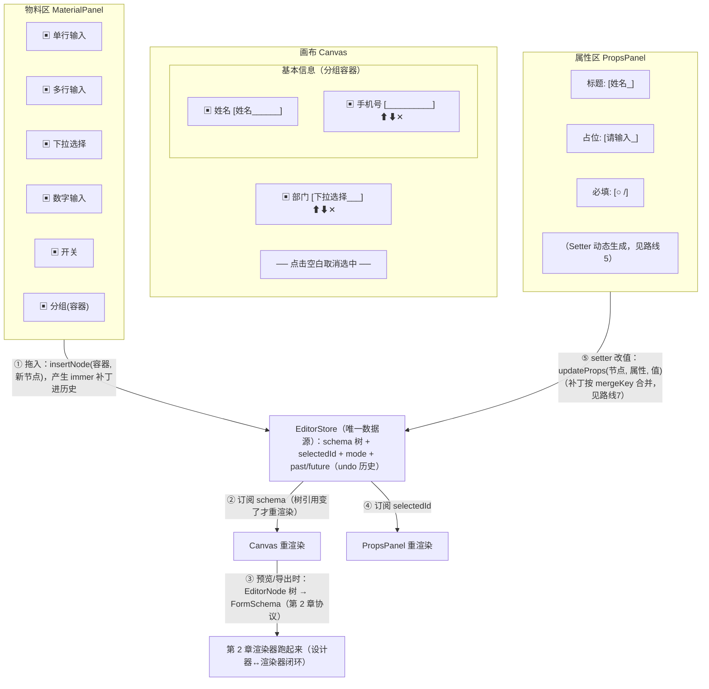
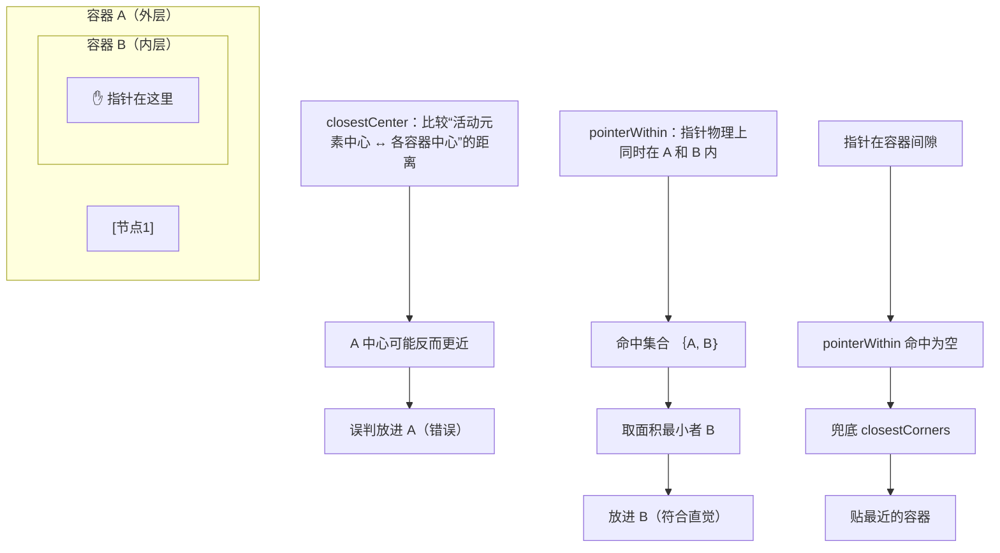

## 3. 拖拽式表单设计器 Form Builder（2 周）

**业务画像**：问卷/审批流配置页，运营拖组件生成表单，产线开发者只维护渲染器。

这个画像里的角色分工是理解本章的钥匙：**运营**负责"搭"（拖组件、配属性），**开发者**负责"撑"（做物料、做渲染器、修 bug）。设计器存在的意义是把这两类工作解耦——运营的每次搭建产出一份 schema JSON，开发者维护的唯一程序是第 2 章的渲染器。于是"加一种新组件"从"运营提需求 → 开发排期发版"变成"开发注册一个物料（半天）→ 运营自助使用"。判断一个 Form Builder 做得好不好，就看运营能不能完全不碰代码、从零搭出一份能提交的表单。

本章几乎是第 1 章底座 + 第 2 章渲染器的总装演习：拖拽用底座 1.6 的 dnd-kit，undo/redo 用底座 1.5 的 immer patches，属性面板直接复用第 2 章的动态表单引擎。

### 结构：三栏（物料区 / 画布 / 属性区）

三栏是表单设计器的"工作台"标准形态，左边提供积木、中间组装、右边拧螺丝：



数据流一句话总结：**一切编辑动作（拖入/删除/排序/改属性）都是对 EditorStore 中 schema 树的一次 produce 更新，三栏全部通过订阅这个 store 驱动；画布和属性面板不持有任何自己的状态。** 这个"单一数据源"纪律是后面 undo/redo 能全局生效的前提——历史记录的是 store 的补丁，任何绕过 store 的直改 DOM 都是历史管不到的盲区。

注意图里的第 ③ 步：设计器内部的树（`EditorNode`）和渲染器消费的协议（第 2 章 `FormSchema`）是**两种 schema**——前者带 id/children/组件名（为编辑服务），后者是字段声明（为渲染服务），预览/导出时做一次 `toFormSchema` 转换。别试图用一份协议同时伺候两个主人，那会让两边都变得难看。

### 实现路线

路线 1→8 的依赖关系：物料协议（1）定义"有什么可拖"，画布（2）定义"拖到哪、怎么选中"，拖拽（3）打通"怎么进去、怎么排"，选中态（4）是编辑的视觉反馈，Setter（5）是"改属性"的主通道，快捷键（6）与 undo/redo（7）建立安全网，预览导入导出（8）收口闭环。其中 3 的嵌套容器和 5 的自举是两处硬骨头，时间分配上各留足 3 天。

#### 1. **物料协议**：`{ name, label, icon, defaultProps, setters, isContainer? }`，注册进物料库

**是什么**：物料协议描述"一种可拖入画布的组件"的全部元信息——它叫什么、拖进去长什么样、属性面板该怎么配置它。

**为什么需要**：画布渲染要知道组件名对应的预览，拖入要知道初始 props，属性面板要知道有哪些可配置项。这三样信息如果散落在各处（组件文件里一份、面板文件里一份），加物料就要改 N 个文件；收拢成一份 `MaterialMeta` 注册进物料库，加物料 = 加一个注册项。这正是底座 1.2 注册表模式的进阶：注册的不只是组件，是组件 + 它的编辑器生态（setters）。

**怎么做**：完整类型与注册表：

```ts
// designer/materials/types.ts
import type { ReactNode } from 'react'
import type { OptionItem } from '../../chapter2/types'

/** Setter 的种类：本质是"属性面板这张表单的字段类型"（复用第 2 章 FieldType 思想） */
export type SetterKind =
  | 'text'        // 单行文本
  | 'textarea'    // 多行文本
  | 'number'      // 数字
  | 'switch'      // 布尔开关
  | 'select'      // 单选（候选来自 setterProps.options）
  | 'options'     // 选项编辑器（编辑下拉候选，自定义 widget）
  | 'expression'  // 表达式编辑（联动条件，自定义 widget）

export interface SetterDecl {
  /** 对应物料 props 的键名，如 'label' / 'placeholder' / 'required' */
  prop: string
  label: string
  setter: SetterKind
  /** Setter 的额外配置：select 的候选、number 的 min/max、占位符等 */
  setterProps?: {
    options?: OptionItem[]
    placeholder?: string
    min?: number
    max?: number
  }
  /** 该属性在面板里的显隐条件（表达式求值上下文是 props，如 "required == true"） */
  visibleWhen?: string
  defaultValue?: unknown
}

export interface MaterialMeta {
  /** 物料唯一名，等于 EditorNode.componentName */
  name: string
  /** 物料区与画布角标上显示的中文名 */
  label: string
  icon: ReactNode
  /** 容器物料：可接收子节点（分组），画布上高亮投放区 */
  isContainer?: boolean
  /** 拖入画布时的初始 props（必含渲染器需要的字段配置） */
  defaultProps: Record<string, unknown>
  /** 属性面板的声明：它决定了属性面板长什么样（见路线 5 的自举） */
  setters: SetterDecl[]
}
```

```ts
// designer/materials/registry.ts
import type { MaterialMeta } from './types'

export const materialRegistry: Record<string, MaterialMeta> = {
  input: {
    name: 'input',
    label: '单行输入',
    icon: '▭',
    defaultProps: { label: '单行输入', placeholder: '请输入', required: false },
    setters: [
      { prop: 'label', label: '标题', setter: 'text' },
      { prop: 'placeholder', label: '占位提示', setter: 'text', setterProps: { placeholder: '输入框内的灰色提示' } },
      { prop: 'required', label: '必填', setter: 'switch', defaultValue: false },
      { prop: 'maxLength', label: '最大长度', setter: 'number', setterProps: { min: 0 } },
      { prop: 'visibleWhen', label: '显隐条件', setter: 'expression', setterProps: { placeholder: "如 $form.userType == 'company'" } },
    ],
  },
  select: {
    name: 'select',
    label: '下拉选择',
    icon: '▾',
    defaultProps: { label: '下拉选择', required: false, options: [{ label: '选项一', value: 'opt1' }] },
    setters: [
      { prop: 'label', label: '标题', setter: 'text' },
      { prop: 'required', label: '必填', setter: 'switch' },
      { prop: 'options', label: '候选选项', setter: 'options' },
    ],
  },
  number: {
    name: 'number',
    label: '数字输入',
    icon: '№',
    defaultProps: { label: '数字输入', required: false, min: 0, max: 100 },
    setters: [
      { prop: 'label', label: '标题', setter: 'text' },
      { prop: 'required', label: '必填', setter: 'switch' },
      { prop: 'min', label: '最小值', setter: 'number' },
      { prop: 'max', label: '最大值', setter: 'number' },
    ],
  },
  switch: {
    name: 'switch',
    label: '开关',
    icon: '◠',
    defaultProps: { label: '开关', required: false },
    setters: [
      { prop: 'label', label: '标题', setter: 'text' },
      { prop: 'required', label: '必填', setter: 'switch' },
    ],
  },
  textarea: {
    name: 'textarea',
    label: '多行输入',
    icon: '▤',
    defaultProps: { label: '多行输入', placeholder: '请输入', required: false },
    setters: [
      { prop: 'label', label: '标题', setter: 'text' },
      { prop: 'placeholder', label: '占位提示', setter: 'text' },
      { prop: 'required', label: '必填', setter: 'switch' },
    ],
  },
  section: {
    name: 'section',
    label: '分组',
    icon: '❐',
    isContainer: true,
    defaultProps: { label: '分组标题' },
    setters: [{ prop: 'label', label: '分组标题', setter: 'text' }],
  },
}
```

拖入时"从物料实例化一个节点"的工厂：

```ts
// designer/materials/createNode.ts
export interface EditorNode {
  /** 节点稳定 id：React key、拖拽 id、选中定位全靠它，创建后永不改变 */
  id: string
  componentName: string
  props: Record<string, unknown>
  children?: EditorNode[]
}

export function createNodeFromMaterial(meta: MaterialMeta): EditorNode {
  const node: EditorNode = {
    id: globalThis.crypto.randomUUID(),
    componentName: meta.name,
    props: structuredClone(meta.defaultProps),   // 深拷贝！否则两个节点的数组型 props（如 options）共享引用
  }
  if (meta.isContainer) node.children = []
  return node
}
```

**常见坑（症状 → 根因 → 修法）**：症状——拖两个"下拉选择"进画布，在 A 上编辑候选选项，B 的选项也变了。根因——`defaultProps` 里的 `options` 数组是引用类型，`createNode` 时浅拷贝（或直接 `props: meta.defaultProps`），两节点共享同一数组。修法——实例化必须 `structuredClone`（上面代码已做）；物料注册表本身也永不允许被运行时修改。

#### 2. 画布 = schema 树 + 递归渲染；**编辑模式下子组件 `pointer-events: none`**，画布统一接管点击做选中（否则会触发组件自身行为）

**是什么**：画布把 EditorNode 树递归渲染出来（复用底座 1.3），编辑模式下所有组件内容被剥夺交互能力（`pointer-events: none`），点击、拖拽、选中全部由每个节点外层的"壳"统一接管。

**为什么需要**：画布上渲染的是真实组件——select 会被点开下拉、date 会弹日历、带链接的物料会跳页。设计器要的是"点它 = 选中它"，绝不是"点它 = 使用它"。两道防线：`pointer-events: none` 让子组件收不到任何指针事件（治本）；事件捕获阶段拦截兜底（治漏网：键盘焦点、第三方库挂在 document 上的监听）。

先看 EditorStore——三栏共同的唯一数据源（含 undo 历史骨架，路线 7 详述合并机制）：

```ts
// designer/store.ts
import { create } from 'zustand'
import { enablePatches, produce, produceWithPatches, applyPatches, type Patch } from 'immer'
import type { EditorNode } from './materials/createNode'

enablePatches()   // immer v9+：必须显式开启，produceWithPatches 才会生成正/反补丁

export interface HistoryEntry {
  patches: Patch[]
  inversePatches: Patch[]
  /** 同一 mergeKey 且 300ms 内的操作合并为一条历史（setter 连续输入的关键，见路线 7） */
  mergeKey?: string
  at: number
}

export type EditorMode = 'edit' | 'preview'

export interface EditorState {
  schema: EditorNode                       // 根节点：{ id: 'root', componentName: 'FormRoot', children: [...] }
  selectedId: string | null
  mode: EditorMode
  past: HistoryEntry[]
  future: HistoryEntry[]

  select(id: string | null): void
  setMode(m: EditorMode): void
  insertNode(containerId: string, node: EditorNode, index?: number): void
  removeNode(id: string): void
  duplicateNode(id: string): void
  moveNodeByStep(id: string, dir: -1 | 1): void
  moveNodeByDrag(id: string, containerId: string, index: number): void
  updateProps(id: string, propPath: string, value: unknown, mergeKey?: string): void
  undo(): void
  redo(): void
}

/** 树查找工具：全库唯一入口，保证查找语义一致 */
export function findNode(root: EditorNode, id: string): EditorNode | undefined {
  if (root.id === id) return root
  for (const c of root.children ?? []) {
    const hit = findNode(c, id)
    if (hit) return hit
  }
  return undefined
}
export function findParentOf(root: EditorNode, id: string): EditorNode | undefined {
  for (const c of root.children ?? []) {
    if (c.id === id) return root
    const hit = findParentOf(c, id)
    if (hit) return hit
  }
  return undefined
}
function isDescendant(root: EditorNode, ancestorId: string, maybeChildId: string): boolean {
  const anc = findNode(root, ancestorId)
  return !!anc && !!findNode(anc, maybeChildId) && maybeChildId !== ancestorId
}

export const useEditorStore = create<EditorState>()((set, get) => {
  /**
   * 所有结构变更的统一出口：mutate 走 produceWithPatches，补丁进历史栈。
   * mergeKey 语义见路线 7——同 key 且 300ms 内的补丁合并成一条，撤销时不逐字符回退。
   */
  const mutate = (mergeKey: string | undefined, mutator: (d: EditorState) => void) =>
    set((state) => {
      const [next, patches, inversePatches] = produceWithPatches(state, (d) => {
        mutator(d as EditorState)
      })
      if (patches.length === 0) return state          // 无实际变化：不进历史，也不触发更新
      const now = Date.now()
      const past = [...state.past]
      const last = past[past.length - 1]
      if (mergeKey && last && last.mergeKey === mergeKey && now - last.at < 300) {
        // 合并进最后一条：
        // 正补丁按发生顺序追加（redo 时依序 apply）
        // 逆补丁必须"新的排前面"（undo 时先回滚最近的编辑，applyPatches 按数组顺序执行）
        past[past.length - 1] = {
          mergeKey,
          at: now,
          patches: [...last.patches, ...patches],
          inversePatches: [...inversePatches, ...last.inversePatches],
        }
      } else {
        past.push({ patches, inversePatches, mergeKey, at: now })
      }
      return { ...next, past, future: [] }            // 产生新操作时清空 redo 栈
    })

  return {
    schema: { id: 'root', componentName: 'FormRoot', props: {}, children: [] },
    selectedId: null,
    mode: 'edit',
    past: [],
    future: [],

    select: (id) => set({ selectedId: id }),
    setMode: (m) => set({ mode: m }),

    insertNode: (containerId, node, index) =>
      mutate(undefined, (d) => {
        const container = findNode(d.schema, containerId)
        if (!container) return
        container.children ??= []
        if (index == null || index < 0 || index > container.children.length) {
          container.children.push(node)
        } else {
          container.children.splice(index, 0, node)
        }
        d.selectedId = node.id      // 拖入即选中，属性面板立刻就位
      }),

    removeNode: (id) =>
      mutate(undefined, (d) => {
        const parent = findParentOf(d.schema, id)
        if (!parent?.children) return
        const i = parent.children.findIndex((c) => c.id === id)
        if (i >= 0) parent.children.splice(i, 1)
        if (d.selectedId === id) d.selectedId = null
      }),

    duplicateNode: (id) =>
      mutate(undefined, (d) => {
        const parent = findParentOf(d.schema, id)
        const src = findNode(d.schema, id)
        if (!parent?.children || !src) return
        // 深拷贝 + 全部换新 id（子树递归换），否则 key/拖拽 id 冲突
        const clone = reassignIds(structuredClone(src))
        const i = parent.children.findIndex((c) => c.id === id)
        parent.children.splice(i + 1, 0, clone)
        d.selectedId = clone.id
      }),

    moveNodeByStep: (id, dir) =>
      mutate(undefined, (d) => {
        const parent = findParentOf(d.schema, id)
        if (!parent?.children) return
        const i = parent.children.findIndex((c) => c.id === id)
        const j = i + dir
        if (i < 0 || j < 0 || j >= parent.children.length) return
        const [moved] = parent.children.splice(i, 1)
        parent.children.splice(j, 0, moved)
      }),

    moveNodeByDrag: (id, containerId, index) =>
      mutate(undefined, (d) => {
        // 守卫：容器不能拖进自己的子树（自己套自己）
        if (isDescendant(d.schema, id, containerId)) return
        const oldParent = findParentOf(d.schema, id)
        if (!oldParent?.children) return
        const i = oldParent.children.findIndex((c) => c.id === id)
        if (i < 0) return
        const [moved] = oldParent.children.splice(i, 1)
        const container = findNode(d.schema, containerId)
        if (!container) return
        container.children ??= []
        let j = index
        if (oldParent.id === containerId && i < index) j -= 1   // 同容器后移：删除后索引前移了一位
        if (j < 0 || j > container.children.length) j = container.children.length
        container.children.splice(j, 0, moved)
      }),

    updateProps: (id, propPath, value, mergeKey) =>
      mutate(mergeKey, (d) => {
        const node = findNode(d.schema, id)
        if (node) setPathOnProps(node.props, propPath, value)
      }),

    undo: () =>
      set((s) => {
        const last = s.past[s.past.length - 1]
        if (!last) return s
        return {
          ...applyPatches(s, last.inversePatches),
          past: s.past.slice(0, -1),
          future: [last, ...s.future],
        }
      }),

    redo: () =>
      set((s) => {
        const [nextEntry, ...rest] = s.future
        if (!nextEntry) return s
        return {
          ...applyPatches(s, nextEntry.patches),
          past: [...s.past, nextEntry],
          future: rest,
        }
      }),
  }
})

/** 深拷贝子树时给每个节点换新 id（duplicateNode 用） */
function reassignIds(node: EditorNode): EditorNode {
  const clone: EditorNode = { ...node, id: globalThis.crypto.randomUUID() }
  if (node.children) clone.children = node.children.map(reassignIds)
  return clone
}

/** props 按点路径写值（结构简单，一层/两层足够；实现同第 2 章 setPath） */
function setPathOnProps(root: Record<string, unknown>, path: string, value: unknown): void {
  const keys = path.split('.')
  const last = keys.pop()!
  let cur: Record<string, unknown> = root
  for (const k of keys) {
    if (cur[k] == null || typeof cur[k] !== 'object') cur[k] = {}
    cur = cur[k] as Record<string, unknown>
  }
  cur[last] = value
}
```

关键设计决策两个：**patches 以整个 EditorState 为基**（mutator 改 `d.schema`，补丁路径形如 `['schema','children',0,...]`），undo/redo 直接 `applyPatches(state, ...)`，不需要额外的"还原映射"；**`select`/`setMode` 不进历史**——选中态不是文档内容，撤销选中会让用户困惑（Cmd+Z 应该撤的是结构/属性变化）。

画布与"编辑壳"。完整代码与原理：

```tsx
// designer/canvas/Canvas.tsx
import { useEditorStore } from '../store'
import { CanvasTree } from './CanvasTree'

export function Canvas() {
  const schema = useEditorStore((s) => s.schema)
  const mode = useEditorStore((s) => s.mode)
  const select = useEditorStore((s) => s.select)
  const editing = mode === 'edit'

  return (
    <div
      className={'canvas' + (editing ? ' canvas--editing' : '')}
      // 兜底拦截第 2 层：键盘事件在捕获阶段截停，防止焦点残留在组件里时被 Tab/回车触发其内部行为
      onKeyDownCapture={editing ? (e) => e.stopPropagation() : undefined}
      // 点击画布空白（target 是画布自身）→ 取消选中
      onPointerDown={(e) => {
        if (editing && e.target === e.currentTarget) select(null)
      }}
    >
      {editing ? (
        // 第 1 层防线：整个内容树 pointer-events:none——子组件一个指针事件都收不到。
        // 注意 pointer-events 是"继承式"属性，EditableShell 的遮罩层会显式改回 auto（见 EditableShell）
        <div style={{ pointerEvents: 'none' }}>
          <CanvasTree node={schema} />
        </div>
      ) : (
        // 预览模式：去掉 none 包装、EditableShell 也不再渲染遮罩/操作条，交互归还组件本身。
        // （完整可提交的预览走路线 8 的 PreviewPanel——那才是第 2 章渲染器）
        <CanvasTree node={schema} />
      )}
    </div>
  )
}
```

```tsx
// designer/canvas/CanvasTree.tsx —— 递归渲染（复用底座 1.3 的 renderNode 思路）
import { materialRegistry } from '../materials/registry'
import { EditableShell } from './EditableShell'
import { ContainerDropZone } from './ContainerDropZone'
import { WidgetPreview } from './WidgetPreview'
import { SortableArea } from './SortableArea'
import type { EditorNode } from '../materials/createNode'

export function CanvasTree({ node }: { node: EditorNode }) {
  const children = node.children ?? []
  return (
    <ContainerDropZone node={node}>
      <SortableArea ids={children.map((c) => c.id)}>
        {children.map((child) => (
          <CanvasNode key={child.id} node={child} />   // key 用节点 id，绝不用 index（底座 1.3 铁律）
        ))}
      </SortableArea>
    </ContainerDropZone>
  )
}

function CanvasNode({ node }: { node: EditorNode }) {
  const meta = materialRegistry[node.componentName]
  if (meta?.isContainer) {
    return (
      <EditableShell node={node}>
        <CanvasTree node={node} />
      </EditableShell>
    )
  }
  return (
    <EditableShell node={node}>
      <WidgetPreview node={node} />
    </EditableShell>
  )
}
```

**原理拆解：两道防线各挡什么**。

第 1 层 `pointer-events: none`（治本）：CSS 的 `pointer-events` 是继承属性，画布内容容器设 none 后，整棵子树的元素都不再是"命中目标"——点击会穿透它们落到上层（EditableShell 的遮罩）。子组件无论内部怎么监听 click，事件根本不会派发给它。**但它只挡指针事件**，键盘（Tab 聚焦后按回车打开 select）、程序性 focus、以及第三方组件弹到 body 的 portal（不在画布 DOM 子树内，inherit 不生效）管不到——所以需要第 2 层。

第 2 层捕获拦截（兜底）：`onKeyDownCapture` 在捕获阶段（事件从根向目标传播时）截停键盘事件，子组件的 bubble 监听永远收不到。对 portal 弹层的治理是模式问题：编辑模式下物料预览应选择"无交互版本"（我们渲染 `WidgetPreview` 而不是真组件，天然无弹层）；如果物料预览必须用真组件，需要在编辑模式给它传"禁止打开弹层"的 props——这也是为什么物料预览独立成组件而不是直接复用第 2 章 widget。

```tsx
// designer/canvas/WidgetPreview.tsx —— 编辑模式专用的" inert 预览"
import type { EditorNode } from '../materials/createNode'

export function WidgetPreview({ node }: { node: EditorNode }) {
  const p = node.props
  switch (node.componentName) {
    case 'input':
      return (
        <div className="preview">
          <span className="preview__label">{String(p.label ?? '')}{p.required ? ' *' : ''}</span>
          <input placeholder={String(p.placeholder ?? '')} readOnly aria-readonly />
        </div>
      )
    case 'textarea':
      return (
        <div className="preview">
          <span className="preview__label">{String(p.label ?? '')}{p.required ? ' *' : ''}</span>
          <textarea placeholder={String(p.placeholder ?? '')} readOnly />
        </div>
      )
    case 'select': {
      const options = Array.isArray(p.options) ? p.options : []
      return (
        <div className="preview">
          <span className="preview__label">{String(p.label ?? '')}{p.required ? ' *' : ''}</span>
          <select>
            {options.map((o, i) => (
              <option key={i}>{String((o as { label?: string }).label ?? '')}</option>
            ))}
          </select>
        </div>
      )
    }
    case 'number':
      return (
        <div className="preview">
          <span className="preview__label">{String(p.label ?? '')}{p.required ? ' *' : ''}</span>
          <input type="number" readOnly />
        </div>
      )
    case 'switch':
      return (
        <div className="preview">
          <span className="preview__label">{String(p.label ?? '')}</span>
          <input type="checkbox" readOnly />
        </div>
      )
    default:
      return <div className="preview preview--unknown">未知物料：{node.componentName}</div>
  }
}
```

**常见坑（症状 → 根因 → 修法）**：症状——画布上点选"下拉选择"物料，下拉竟然弹开了，且选中态没触发。根因——`pointer-events: none` 加在了错误的层（比如加在了画布根而不是内容包裹层），或者某个组件用 portal 把真实交互 DOM 挂到了 body。修法——检查 none 的生效范围（DevTools 元素面板勾选 :hov 看 computed pointer-events）；portal 类组件（Select/DatePicker/Tooltip）在编辑模式换 inert 预览（本节 WidgetPreview 方案）或传"禁弹层"props；确认遮罩层显式 `pointerEvents: 'auto'`（下一节 EditableShell）。

#### 3. 拖拽（dnd-kit）：

设计器有三种语义不同的拖放，一套 DndContext 全搞定，但每种的目标解析不同，先列清楚再上代码：

| 拖放 | 拖起方（active） | 落点（over） | 语义 |
|---|---|---|---|
| 物料区 → 画布 | 物料项 `material:xxx` | 容器投放区或任意节点 | 新建节点插入 schema |
| 画布内排序 | 节点（useSortable） | 兄弟节点 | 同容器内 arrayMove |
| 跨/嵌套容器移动 | 节点（useSortable） | 容器投放区或节点 | 摘出再插入目标容器 |

   - 物料区 → 画布：拖入 = 向 schema 插入节点（目标 droppable = 各容器节点）

物料区每项是 draggable，画布上每个容器是 droppable，画布上每个节点（叶子）经 useSortable 也自动注册成 droppable——所以"拖到节点上"应理解为"插到它前面"，"拖到容器空白"是"追加到容器末尾"：

```tsx
// designer/panels/MaterialPanel.tsx
import { useDraggable } from '@dnd-kit/core'
import { materialRegistry } from '../materials/registry'
import type { MaterialMeta } from '../materials/types'

function MaterialItem({ meta }: { meta: MaterialMeta }) {
  const { setNodeRef, listeners, isDragging } = useDraggable({
    id: `material:${meta.name}`,
    data: { kind: 'material', meta },   // data 随拖拽携带，onDragEnd 里取回
  })
  return (
    <div
      ref={setNodeRef}
      {...listeners}
      className={'material-item' + (isDragging ? ' material-item--dragging' : '')}
    >
      <span className="material-item__icon">{meta.icon}</span>
      <span>{meta.label}</span>
    </div>
  )
}

export function MaterialPanel() {
  return (
    <aside className="material-panel">
      <h3>物料</h3>
      {Object.values(materialRegistry).map((m) => (
        <MaterialItem key={m.name} meta={m} />
      ))}
    </aside>
  )
}
```

```tsx
// designer/canvas/ContainerDropZone.tsx —— 容器投放区（空容器也能接收拖放的关键）
import { useDroppable } from '@dnd-kit/core'
import type { EditorNode } from '../materials/createNode'

export function ContainerDropZone({ node, children }: { node: EditorNode; children?: React.ReactNode }) {
  const { setNodeRef, isOver } = useDroppable({
    id: `container:${node.id}`,
    data: { kind: 'container', containerId: node.id },
  })
  const empty = !(node.children ?? []).length
  return (
    <div
      ref={setNodeRef}
      className={'drop-zone' + (isOver ? ' drop-zone--over' : '') + (empty ? ' drop-zone--empty' : '')}
    >
      {children}
      {empty && <div className="drop-zone__hint">拖入组件到这里</div>}
    </div>
  )
}
```

为什么容器要独立 droppable：SortableContext 只对 items 里的节点生效，**空容器没有任何 sortable 项**，没有独立 droppable 就无法接收任何拖放——"空分组拖不进东西"是新手实现最常见的断路。

   - 画布内排序：`useSortable`

```tsx
// designer/canvas/SortableArea.tsx
import { SortableContext, verticalListSortingStrategy } from '@dnd-kit/sortable'

export function SortableArea({ ids, children }: { ids: string[]; children: React.ReactNode }) {
  return (
    <SortableContext items={ids} strategy={verticalListSortingStrategy}>
      {children}
    </SortableContext>
  )
}
```

EditableShell 里每个节点挂 useSortable（拖起手柄就是遮罩层本身）：

```tsx
// designer/canvas/EditableShell.tsx —— 节点编辑壳：sortable + 选中 + 遮罩（选中态 UI 细节在路线 4）
import { memo } from 'react'
import { useSortable } from '@dnd-kit/sortable'
import { CSS } from '@dnd-kit/utilities'
import { useEditorStore } from '../store'
import { materialRegistry } from '../materials/registry'
import type { EditorNode } from '../materials/createNode'

export const EditableShell = memo(function EditableShell({
  node,
  children,
}: {
  node: EditorNode
  children: React.ReactNode
}) {
  const selected = useEditorStore((s) => s.selectedId === node.id)   // 布尔订阅：只有新旧选中两个节点会重渲染
  const select = useEditorStore((s) => s.select)
  const editing = useEditorStore((s) => s.mode === 'edit')

  const { attributes, listeners, setNodeRef, setActivatorNodeRef, transform, transition, isDragging } =
    useSortable({ id: node.id, data: { kind: 'node' } })

  return (
    <div
      ref={setNodeRef}
      className={'editable-node' + (selected ? ' editable-node--selected' : '') + (isDragging ? ' editable-node--dragging' : '')}
      style={{ transform: CSS.Transform.toString(transform), transition }}
    >
      {/* 组件内容：编辑模式不吃指针事件（路线 2 的第 1 层防线在此处落地） */}
      <div className="editable-node__content">{children}</div>

      {/* 遮罩层：仅编辑模式渲染，显式恢复 pointer-events，接管本节点的点击/拖拽 */}
      {editing && (
        <div
          ref={setActivatorNodeRef}
          className="editable-node__mask"
          style={{ pointerEvents: 'auto' }}
          {...attributes}
          {...listeners}
          onPointerDown={(e) => {
            select(node.id)          // 按下即选中
            listeners?.onPointerDown?.(e)   // 同时交给 dnd-kit 判定是否启动拖拽（有 4px 启动距离）
          }}
        />
      )}
    </div>
  )
})
```

启动距离的配置在 DndContext 的 sensor 里（见下方总装代码）：`activationConstraint: { distance: 4 }` 表示按下后移动超 4px 才算拖拽，否则视为点击——**这是"点击选中"与"拖拽排序"共存的关键**，没有这个约束，单击会立刻进入拖拽态、遮罩上的 select 反而抖动。

   - 嵌套容器拖放：**`pointerWithin` + `closestCorners` 组合碰撞策略**（本章最大坑）

**症状先行**：嵌套容器（分组里套分组）场景，把节点拖进内层容器，它总是落到外层容器；或拖到两容器交界处，落点反复横跳。**根因**：默认的 `closestCenter` 策略比的是"活动元素中心到各 droppable 中心的距离"——外层容器面积大、中心可能在物理上更近，即使指针明明落在内层容器里，判定仍可能选外层。**修法**：优先用"指针物理命中"（pointerWithin），命中多个（嵌套时父子容器同时命中）时取面积最小的（最内层）；指针不在任何容器内（间隙、外侧）时退回 closestCorners 保持响应。图解：



```ts
// designer/canvas/collision.ts —— 组合碰撞策略 + 最内层优先
import {
  pointerWithin,
  closestCorners,
  type CollisionDetection,
} from '@dnd-kit/core'

export const nestedCollisionDetection: CollisionDetection = (args) => {
  // 第 1 优先：指针物理命中的 droppable
  const hits = pointerWithin(args)
  if (hits.length === 0) {
    // 第 2 优先：间隙/外侧时按四角最近距离兜底，拖拽仍然"有感知"
    return closestCorners(args)
  }
  if (hits.length === 1) return hits
  // 嵌套时父子同时命中：按命中矩形面积升序 = 最内层容器优先
  // droppableRects 是参与碰撞判定的各 droppable 当前矩形（dnd-kit 维护）
  const area = (id: string | number): number => {
    const rect = args.droppableRects.get(id)
    return rect ? rect.width * rect.height : Number.MAX_SAFE_INTEGER
  }
  return [...hits].sort((a, b) => area(a.id) - area(b.id))
}
```

DndContext 总装（三种拖放的 onDragEnd 统一解析）：

```tsx
// designer/DesignerRoot.tsx
import { useState } from 'react'
import {
  DndContext,
  DragOverlay,
  PointerSensor,
  KeyboardSensor,
  useSensor,
  useSensors,
  type DragEndEvent,
  type DragStartEvent,
} from '@dnd-kit/core'
import { sortableKeyboardCoordinates } from '@dnd-kit/sortable'
import { useEditorStore, findParentOf, findNode } from './store'
import { materialRegistry } from './materials/registry'
import { createNodeFromMaterial } from './materials/createNode'
import { nestedCollisionDetection } from './canvas/collision'
import { MaterialPanel } from './panels/MaterialPanel'
import { Canvas } from './canvas/Canvas'
import { PropsPanel } from './panels/PropsPanel'

export function DesignerRoot() {
  const schema = useEditorStore((s) => s.schema)
  const insertNode = useEditorStore((s) => s.insertNode)
  const moveNodeByDrag = useEditorStore((s) => s.moveNodeByDrag)
  const [activeKind, setActiveKind] = useState<'material' | 'node' | null>(null)
  const [activeLabel, setActiveLabel] = useState('')

  // 4px 启动距离：区分"点击选中"与"拖拽"；KeyboardSensor 配 sortable 键盘坐标算法保证无障碍
  const sensors = useSensors(
    useSensor(PointerSensor, { activationConstraint: { distance: 4 } }),
    useSensor(KeyboardSensor, { coordinateGetter: sortableKeyboardCoordinates }),
  )

  const onDragStart = (e: DragStartEvent) => {
    const data = e.active.data.current
    if (data?.kind === 'material') {
      setActiveKind('material')
      setActiveLabel(data.meta.label as string)
    } else if (data?.kind === 'node') {
      setActiveKind('node')
      // 节点拖拽的 data 里只有 kind，具体节点信息按 id 回查 schema
      const n = findNode(useEditorStore.getState().schema, String(e.active.id))
      setActiveLabel(materialRegistry[n?.componentName ?? '']?.label ?? '节点')
    }
  }

  const onDragEnd = ({ active, over }: DragEndEvent) => {
    setActiveKind(null)
    if (!over) return
    const a = active.data.current
    const o = over.data.current
    const state = useEditorStore.getState()

    // ① 物料区 → 画布：over 是容器 → 追加；over 是节点 → 插到它前面
    if (a?.kind === 'material') {
      if (o?.kind === 'container') {
        insertNode(o.containerId, createNodeFromMaterial(a.meta))
      } else if (o?.kind === 'node') {
        const parent = findParentOf(state.schema, String(over.id))
        if (parent) {
          const i = (parent.children ?? []).findIndex((c) => c.id === over.id)
          insertNode(parent.id, createNodeFromMaterial(a.meta), i >= 0 ? i : undefined)
        }
      }
      return
    }

    // ②③ 画布内排序 / 跨容器移动：over 是容器 → 追加；over 是节点 → 落到其父容器对应位置
    if (a?.kind === 'node') {
      const dragId = String(active.id)
      if (o?.kind === 'container') {
        moveNodeByDrag(dragId, o.containerId, -1)   // -1 = 追加到末尾
      } else if (o?.kind === 'node') {
        const parent = findParentOf(state.schema, String(over.id))
        if (parent) {
          const i = (parent.children ?? []).findIndex((c) => c.id === over.id)
          moveNodeByDrag(dragId, parent.id, i >= 0 ? i : -1)
        }
      }
    }
  }

  return (
    <div className="designer">
      <DndContext
        sensors={sensors}
        collisionDetection={nestedCollisionDetection}
        onDragStart={onDragStart}
        onDragEnd={onDragEnd}
        onDragCancel={() => setActiveKind(null)}
      >
        <MaterialPanel />
        <Canvas />
        <PropsPanel />
        {/* 替身预览：拖动时原节点保持原位（只是降透明度），预览层跟随指针 */}
        <DragOverlay>
          {activeKind ? (
            <div className="drag-overlay-chip">{activeLabel}</div>
          ) : null}
        </DragOverlay>
      </DndContext>
    </div>
  )
}
```

排序语义的补充：上面 ② 里 over 是节点时取"该节点在其父容器中的 index"作为插入位。这与 SortableContext + arrayMove 的经典写法（直接对 items 数组 `arrayMove(ids, oldIndex, newIndex)`）效果等价——我们的 items 就是 schema 的 children，`moveNodeByDrag` 内部做的就是"摘出 + 按修正后的索引插回"（同容器时 `i < index` 先减一），语义与 arrayMove 一致，同时天然支持跨容器。

   - 拖动预览用 DragOverlay

**为什么必须用 DragOverlay**：不用它时，被拖元素本体被 dnd-kit 施加 transform 跟随指针——元素从文档流"原位"被拉走，父容器高度塌陷、兄弟节点瞬间跳动重排，视觉抖动且极易导致碰撞矩形失真（dnd-kit 缓存的 droppable rect 与跳动后的真实位置对不上，落点判定跟着错）。DragOverlay 的机制是：原元素留在原地（只降透明度/虚化），另渲染一个"替身"（fixed 定位、跟随指针），布局零扰动、碰撞矩形稳定。上面总装代码里替身是简化 chip；要高保真可把 WidgetPreview 也渲染进 overlay，代价是拖拽帧率略降。

**常见坑（症状 → 根因 → 修法）**：症状——拖拽中页面其他区域疯狂滚动或选中文字。根因——pointer 事件没有被 preventDefault，浏览器把拖拽当成"按住拖选"。修法——dnd-kit 的 listeners 会自动处理，但自定义遮罩层上若还有别的 onPointerDown 逻辑，注意不要在它之前 `stopPropagation` 掉 listeners；文案区域给 `.editable-node__mask { user-select: none }`。

#### 4. 选中态：outline + 节点类型角标 + 悬浮操作条（复制/删除/上移/下移）

**是什么**：被选中节点的一组视觉反馈——外框、左上角类型标签、上浮操作条。

**为什么需要**：没有选中态，用户不知道"现在属性面板配的是谁"；没有操作条，增删移动只能靠拖拽（低频动作应给精确按钮）。这三个 UI 都挂在 EditableShell 上，选中的重渲染代价经过设计：`useEditorStore((s) => s.selectedId === node.id)` 订阅的是**布尔值**，选中切换时只有"旧的选中节点"和"新的选中节点"两个组件重渲染，其余几十个节点纹丝不动——path 级订阅思想在编辑器里的又一次应用。

**怎么做**：EditableShell 补全（替换路线 3 里的骨架版）：

```tsx
// designer/canvas/EditableShell.tsx —— 完整版：遮罩 + outline + 角标 + 操作条
import { memo } from 'react'
import { useSortable } from '@dnd-kit/sortable'
import { CSS } from '@dnd-kit/utilities'
import { useEditorStore } from '../store'
import { materialRegistry } from '../materials/registry'
import type { EditorNode } from '../materials/createNode'

export const EditableShell = memo(function EditableShell({
  node,
  children,
}: {
  node: EditorNode
  children: React.ReactNode
}) {
  const selected = useEditorStore((s) => s.selectedId === node.id)
  const select = useEditorStore((s) => s.select)
  const editing = useEditorStore((s) => s.mode === 'edit')
  const removeNode = useEditorStore((s) => s.removeNode)
  const duplicateNode = useEditorStore((s) => s.duplicateNode)
  const moveNodeByStep = useEditorStore((s) => s.moveNodeByStep)
  const meta = materialRegistry[node.componentName]

  const { attributes, listeners, setNodeRef, setActivatorNodeRef, transform, transition, isDragging } =
    useSortable({ id: node.id, data: { kind: 'node' } })

  return (
    <div
      ref={setNodeRef}
      className={
        'editable-node' +
        (selected ? ' editable-node--selected' : '') +
        (isDragging ? ' editable-node--dragging' : '')
      }
      style={{ transform: CSS.Transform.toString(transform), transition }}
    >
      <div className="editable-node__content">{children}</div>

      {/* 左上角类型角标：编辑模式且选中时才显示，绝对定位不占布局 */}
      {editing && selected && <span className="editable-node__badge">{meta?.label ?? node.componentName}</span>}

      {/* 悬浮操作条：编辑模式且选中时显示在节点上方一档 */}
      {editing && selected && (
        <div className="editable-node__toolbar">
          <button
            title="上移"
            onPointerDown={(e) => e.stopPropagation()}   // 防止按下触发遮罩的选中/拖拽
            onClick={() => moveNodeByStep(node.id, -1)}
          >
            ↑
          </button>
          <button
            title="下移"
            onPointerDown={(e) => e.stopPropagation()}
            onClick={() => moveNodeByStep(node.id, 1)}
          >
            ↓
          </button>
          <button
            title="复制"
            onPointerDown={(e) => e.stopPropagation()}
            onClick={() => duplicateNode(node.id)}
          >
            ⧉
          </button>
          <button
            title="删除"
            className="editable-node__toolbar-danger"
            onPointerDown={(e) => e.stopPropagation()}
            onClick={() => removeNode(node.id)}
          >
            ✕
          </button>
        </div>
      )}

      {/* 遮罩层：仅编辑模式渲染（预览模式去掉遮罩，指针事件穿透到真实组件） */}
      {editing && (
        <div
          ref={setActivatorNodeRef}
          className="editable-node__mask"
          style={{ pointerEvents: 'auto' }}
          {...attributes}
          {...listeners}
          onPointerDown={(e) => {
            select(node.id)
            listeners?.onPointerDown?.(e)
          }}
        />
      )}
    </div>
  )
})
```

配套 CSS 要点（为什么这么写）：

```css
/* outline 不占布局：用 border 选中时节点会抖 2px，outline 不会 */
.editable-node--selected {
  outline: 2px solid #1677ff;
  outline-offset: -1px;            /* 负偏移把线画在节点内侧，避免遮挡相邻节点的角标 */
}
/* 角标骑在 outline 左上角：translate 抵掉自身高度，父元素 position:relative */
.editable-node__badge {
  position: absolute;
  top: 0;
  left: 0;
  transform: translateY(-100%);
  background: #1677ff;
  color: #fff;
  font-size: 12px;
  line-height: 18px;
  padding: 0 6px;
  border-radius: 4px 4px 0 0;
}
/* 操作条浮在节点上方一档，z-index 压过兄弟节点的角标 */
.editable-node__toolbar {
  position: absolute;
  bottom: 100%;
  right: 0;
  margin-bottom: 4px;
  display: flex;
  gap: 2px;
  background: #fff;
  box-shadow: 0 2px 8px rgba(0, 0, 0, 0.15);
  border-radius: 6px;
  padding: 2px;
  z-index: 10;
}
/* 拖拽中的原节点降透明度（替身由 DragOverlay 渲染） */
.editable-node--dragging {
  opacity: 0.4;
}
/* 遮罩铺满节点，压住内容但不响应文本选择 */
.editable-node {
  position: relative;
}
.editable-node__mask {
  position: absolute;
  inset: 0;
  cursor: grab;
  user-select: none;
}
```

操作条按钮的 `onPointerDown={(e) => e.stopPropagation()}` 容易漏：不加的话，按下按钮的事件冒泡到遮罩/画布，先触发了 sortable 的拖拽启动或选中切换，click 根本轮不到。凡是"浮在画布上的控件"，第一件事就是想清楚它的 pointerdown 要不要跟画布隔离。

#### 5. **Setter 体系**：属性面板 = 用第 2 章动态表单渲染 settable 字段声明 —— 属性面板本身就是一张 schema 表单（**自举闭环**）

这是本章最漂亮的一步，先把"自举"两个字说透：**属性面板配置的是物料的 props，而 props 怎么配置，恰恰是由 `setters` 声明（一份元数据）描述的；把这份元数据翻译成第 2 章的字段协议，属性面板就"用表单引擎渲染出了另一张表单"**。于是：做第 2 章时的每一分投入（订阅、校验、联动、自定义 widget）在属性面板上原样兑现；给物料加一个可配置项 = 在 setters 里加一行声明，零组件代码。这个闭环在 lowcode-engine 里叫 Setter 体系，在 Grafana 里叫 panel options editor（第 4 章会第三次复用它）——它是"搭建器"类产品的通用内核。

**机制分步**：

1. SetterDecl（路线 1 已定义）翻译成第 2 章 `FieldSchema`——一张"配置表单"的 schema 诞生；
2. 物料 props 作为该表单的 formData；
3. 表单引擎（第 2 章原封不动）渲染这张表单 → 属性面板；
4. 面板里改值 → 写回 EditorStore 的节点 props（走补丁历史）→ 画布重渲染；
5. 特殊 Setter（选项编辑器、表达式输入）作为自定义 widget 注册进第 2 章 registry——引擎不知道"业务"，引擎只知道"字段"。

第 1 步，翻译器：

```ts
// designer/setters/settersToFormSchema.ts
import type { FormSchema, FieldSchema } from '../../chapter2/types'
import type { MaterialMeta, SetterDecl } from '../materials/types'

/** SetterDecl → 第 2 章字段协议。schema 表单的 name 就是 prop 键名 */
function setterToField(d: SetterDecl): FieldSchema {
  const base = {
    name: d.prop,
    label: d.label,
    default: d.defaultValue,
    visibleWhen: d.visibleWhen,   // 属性之间的显隐联动也是表达式，继续复用第 2 章求值器
  }
  switch (d.setter) {
    case 'text':
      return { type: 'input', ...base, placeholder: d.setterProps?.placeholder }
    case 'textarea':
      return { type: 'textarea', ...base }
    case 'number':
      return { type: 'number', ...base, min: d.setterProps?.min, max: d.setterProps?.max }
    case 'switch':
      return { type: 'switch', ...base }
    case 'select':
      return { type: 'select', ...base, options: d.setterProps?.options ?? [] }
    case 'options':
      return { type: 'options-editor', ...base }      // 自定义 widget，下面注册
    case 'expression':
      return { type: 'expression-input', ...base }    // 自定义 widget，下面注册
  }
}

export function settersToFormSchema(meta: MaterialMeta): FormSchema {
  return {
    formId: `setter-panel:${meta.name}`,
    version: '1.0.0',
    fields: meta.setters.map(setterToField),
  }
}
```

两个自定义 Setter widget（第 5 步：注册进第 2 章 registry，验证引擎的扩展性）：

```tsx
// designer/setters/customWidgets.tsx
import { useState } from 'react'
import { widgetRegistry } from '../../chapter2/widgets/registry'
import { evalExpr } from '../../chapter2/linkage'
import type { WidgetProps } from '../../chapter2/widgets/types'
import type { OptionItem } from '../../chapter2/types'

/**
 * 选项编辑器：编辑"下拉选择"物料的候选列表。
 * 注意它本身就是一个微缩 FieldArray（增删行、每行两个字段）——自举套自举。
 */
export function OptionsEditorWidget({ id, value, disabled, onChange }: WidgetProps<OptionItem[]>) {
  const items = Array.isArray(value) ? value : []
  const update = (i: number, key: 'label' | 'value', v: string) => {
    const next = items.map((it, idx) => (idx === i ? { ...it, [key]: v } : it))
    onChange(next)
  }
  const removeAt = (i: number) => onChange(items.filter((_, idx) => idx !== i))
  const add = () => onChange([...items, { label: `选项${items.length + 1}`, value: `opt${items.length + 1}` }])
  return (
    <div className="options-editor" id={id}>
      {items.map((o, i) => (
        <div key={i} className="options-editor__row">
          <input
            value={o.label}
            disabled={disabled}
            placeholder="选项名"
            onChange={(e) => update(i, 'label', e.target.value)}
          />
          <input
            value={String(o.value)}
            disabled={disabled}
            placeholder="选项值"
            onChange={(e) => update(i, 'value', e.target.value)}
          />
          <button type="button" disabled={disabled} onClick={() => removeAt(i)}>✕</button>
        </div>
      ))}
      <button type="button" className="options-editor__add" disabled={disabled} onClick={add}>
        + 添加选项
      </button>
    </div>
  )
}

/** 表达式输入：textarea + 求值冒烟提示（写错立刻知道，而不是运行时静默失败） */
export function ExpressionInputWidget({ id, value, disabled, onChange, onBlur }: WidgetProps<string>) {
  const text = typeof value === 'string' ? value : ''
  const [warn, setWarn] = useState('')
  return (
    <div className="expression-input">
      <textarea
        id={id}
        value={text}
        disabled={disabled}
        rows={2}
        placeholder="如 $form.userType == 'company'"
        onChange={(e) => {
          onChange(e.target.value)
          // 冒烟求值：空上下文试算一次，算不出结果（返回 undefined）大概率是语法/引用错误
          setWarn(e.target.value && evalExpr(e.target.value, { $form: {} }) === undefined
            ? '表达式可能无法求值，请检查语法与变量'
            : '')
        }}
        onBlur={onBlur}
      />
      {warn && <div className="expression-input__warn">{warn}</div>}
      <div className="expression-input__hint">可用变量：$form（表单数据）、$item（数组行）</div>
    </div>
  )
}

// 注册：第 2 章 registry 是开放的（Record<string, WidgetComponent>），一行接入
widgetRegistry['options-editor'] = OptionsEditorWidget
widgetRegistry['expression-input'] = ExpressionInputWidget
```

第 2~4 步，属性面板本体——**受控桥接**是这里的核心工程问题：面板表单引擎有自己的 store（第 2 章 per-instance store），画布节点 props 在 EditorStore 里，两个数据源要双向同步且不回声。给第 2 章 store 补一个整表替换 action（外部数据 → 表单）：

```ts
// chapter2/store.ts 追加（第 2 章引擎的受控适配口）
  replaceValues: (values: FormData) =>
    set((s) =>
      produce(s, (draft) => {
        draft.formData = normalizeInitialData(draft.schema, values)
        applyLinkage(draft)   // 外部数据进来也走同一套联动重算，行为一致
      }),
    ),
```

```tsx
// designer/panels/PropsPanel.tsx —— 自举闭环的组装现场
import { useEffect, useMemo, useRef, useState } from 'react'
import { useEditorStore, findNode } from '../store'
import type { EditorNode } from '../materials/createNode'
import { materialRegistry } from '../materials/registry'
import { settersToFormSchema } from '../setters/settersToFormSchema'
import { FormProvider } from '../../chapter2/FormProvider'
import { SchemaNode } from '../../chapter2/SchemaNode'
import { createFormStore } from '../../chapter2/store'

export function PropsPanel() {
  const selectedId = useEditorStore((s) => s.selectedId)
  // 订阅"选中的那个节点对象"：树更新时 findNode 返回的新对象引用变了才重渲染面板
  const node = useEditorStore((s) => (s.selectedId ? findNode(s.schema, s.selectedId) : null))

  if (!selectedId || !node) {
    return <aside className="props-panel"><div className="props-panel__empty">点击画布中的节点配置属性</div></aside>
  }
  // key = 节点 id：切换选中节点时整棵面板表单重建（store 重建、内部状态归零）
  return <PropsForm key={node.id} node={node} />
}

function PropsForm({ node }: { node: EditorNode }) {
  const meta = materialRegistry[node.componentName]
  const updateProps = useEditorStore((s) => s.updateProps)
  const nodeProps = node.props as Record<string, unknown>

  // ① setters 声明 → 第 2 章 schema（meta 引用稳定，转换一次即可）；nodeProps 作初始数据。
  //    每个节点一个独立表单实例
  const panelSchema = useMemo(() => settersToFormSchema(meta), [meta])
  const [store] = useState(() => createFormStore(panelSchema, nodeProps))
  // 防回声：记录"最近一次同步进表单的 props 引用"
  const lastSyncedRef = useRef(nodeProps)

  // ② 表单内变化 → 写回画布 schema（每个 prop 一条 updateProps，带 mergeKey 供历史合并）
  useEffect(() => {
    return store.subscribe((state, prev) => {
      if (state.formData === prev.formData) return
      lastSyncedRef.current = state.formData
      for (const key of Object.keys({ ...state.formData, ...prev.formData })) {
        if (state.formData[key] !== prev.formData[key]) {
          // mergeKey = props:节点id:属性名 —— 连续编辑同一属性合并为一条撤销历史（路线 7）
          updateProps(node.id, key, state.formData[key], `props:${node.id}:${key}`)
        }
      }
    })
  }, [store, updateProps, node.id])

  // ③ 外部变化（undo/redo、操作条复制后的 props 微调等）→ 整体写回表单
  useEffect(() => {
    if (nodeProps !== lastSyncedRef.current) {
      lastSyncedRef.current = nodeProps
      store.getState().replaceValues(nodeProps)
    }
  }, [nodeProps, store])

  return (
    <aside className="props-panel">
      <h3>{meta?.label ?? node.componentName} 属性</h3>
      <FormProvider store={store}>
        <div className="props-panel__form">
          {panelSchema.fields.map((f) => (
            <SchemaNode key={f.name} schema={f} path={f.name} />
          ))}
        </div>
      </FormProvider>
    </aside>
  )
}
```

两个同步方向的回声分析（这是自举能不能稳的关键）：②里表单变 → 我们主动把 `lastSyncedRef` 更新为 `state.formData` 并 updateProps → EditorStore 里 node.props 变 → ③ 的 effect 看到 `nodeProps !== lastSyncedRef.current`？nodeProps 是 EditorStore 侧的新对象，而 lastSyncedRef 是表单侧的 formData 对象——两者是**不同对象但相同内容**，比较引用必然不等 → 又 replaceValues 一次 → replaceValues 生成新 formData → ② 的 subscribe 触发，逐 key diff 全部相等 → 不再 updateProps → 收敛。整个过程多了一次无害的同步（值相同，replaceValues 后所有 selector 结果不变，不触发任何重渲染）。如果想省掉这次同步，把 ② 里 lastSyncedRef 赋值改成"直接持有 EditorStore 即将生成的对象引用"做不到（对象在 produce 内部生成），所以接受"一次冗余但收敛的回写"是这个桥接方案的合理代价——比引入脏标记复杂度低得多。

`FormProvider` 需要支持"外部传入已创建的 store"（第 2 章版本是内部创建）：

```tsx
// chapter2/FormProvider.tsx —— 增加外部 store 注入口
export function FormProvider({
  schema,
  initial,
  store: externalStore,
  children,
}: {
  schema?: FormSchema
  initial?: FormData
  store?: ReturnType<typeof createFormStore>
  children: ReactNode
}) {
  const [internalStore] = useState(() => createFormStore(schema!, initial))
  const store = externalStore ?? internalStore
  return <FormStoreContext.Provider value={store}>{children}</FormStoreContext.Provider>
}
```

**常见坑（症状 → 根因 → 修法）**：症状——切到另一个节点，属性面板还显示上一个节点的值，改一下又串到旧节点上。根因——面板表单实例没随节点销毁（没用 `key={node.id}`，或 store 放在了 PropsPanel 而不是 PropsForm）。修法——像上面代码那样把"每节点一份实例"落实到组件层级：PropsPanel 只做选择判断，PropsForm 用 key 隔离生命周期。

#### 6. 快捷键：Cmd+Z / Cmd+Shift+Z / Delete / Cmd+D 复制

**是什么**：一组全局键盘监听，把高频编辑操作映射到肌肉记忆的键位。

**为什么需要**：搭表单是高频操作流，"拖 → 选中 → 删掉重拖"和"选中 → Cmd+D"之间是十倍效率差；且 Cmd+Z 是编辑器的底线安全感——用户敢放手实验的前提是"错了能回来"。

**怎么做**：

```ts
// designer/useEditorHotkeys.ts
import { useEffect } from 'react'
import { useEditorStore } from './store'

export function useEditorHotkeys(enabled: boolean): void {
  useEffect(() => {
    if (!enabled) return

    const onKey = (e: KeyboardEvent) => {
      const mod = e.metaKey || e.ctrlKey   // Mac 用 Cmd，Windows/Linux 用 Ctrl
      const key = e.key.toLowerCase()
      const target = e.target as HTMLElement | null
      const inEditable =
        !!target &&
        (target.tagName === 'INPUT' || target.tagName === 'TEXTAREA' || target.tagName === 'SELECT' ||
          target.isContentEditable)

      // ── Cmd+Z / Cmd+Shift+Z：撤销/重做 ──
      // 必须 preventDefault：否则输入框内会触发浏览器原生"逐字撤销"，
      // 绕过我们的补丁历史，出现"输入框回退了一个字但 schema 历史没动"的错位
      if (mod && key === 'z') {
        e.preventDefault()
        if (e.shiftKey) useEditorStore.getState().redo()
        else useEditorStore.getState().undo()
        return
      }

      // 其余快捷键在输入场景下让位（在输入框里按 Delete 应该删字符，不是删节点）
      if (inEditable) return

      const selectedId = useEditorStore.getState().selectedId
      if (!selectedId) return

      // ── Delete / Backspace：删除选中节点 ──（Mac 笔记本无独立 Delete 键，Backspace 一并接）
      if (e.key === 'Delete' || e.key === 'Backspace') {
        e.preventDefault()
        useEditorStore.getState().removeNode(selectedId)
        return
      }
      // ── Cmd+D：复制选中节点 ──（preventDefault 防止浏览器书签快捷键）
      if (mod && key === 'd') {
        e.preventDefault()
        useEditorStore.getState().duplicateNode(selectedId)
      }
    }

    window.addEventListener('keydown', onKey)
    return () => window.removeEventListener('keydown', onKey)
  }, [enabled])
}
```

使用：`useEditorHotkeys(mode === 'edit')`——预览模式下快捷键整体下线。

实现要点三个：(1) **Cmd+Z 连输入框内也要 preventDefault**（与直觉相反）——因为 setter 输入的每次变更都已进我们的补丁历史（带 mergeKey 合并），浏览器原生输入级撤销会绕开历史造成双轨错位；统一走全局历史，一次 Cmd+Z 回滚整个词（路线 7 的合并保证这一点）。(2) **其余快捷键在可编辑元素内让位**——Delete 删字符是用户当下更合理的预期。(3) 监听挂 window 并随 enabled 清理，避免设计器卸载后快捷键还在全局生效。

**常见坑（症状 → 根因 → 修法）**：症状——在属性面板输入框里打字，按 Delete 节点没了。根因——没做 inEditable 让位判断。修法——如上代码分层处理：撤销类全局接管，破坏类（Delete/Cmd+D）仅非输入态生效。

#### 7. undo/redo 接底座（注意 setter 输入的补丁合并）

底座 1.5 讲了三种 undo 方案，本章选 immer `produceWithPatches`，路线 2 的 store 里已经写好了完整实现，这一节把三个"为什么"补齐。

**为什么选补丁而不是命令模式**：命令模式要求每个操作手写 `{ do, undo }`——插入节点要写"摘除"，改 props 要写"还原旧值"，样板代码随操作种类线性增长且极易漏写。补丁模式里，`produceWithPatches` 对**任何** mutation 自动生成正向补丁（patches）与逆向补丁（inversePatches），redo = `applyPatches(state, patches)`，undo = `applyPatches(state, inversePatches)`——新增操作类型（未来加"合并单元格""设置主题"）零历史代码。

**为什么必须合并（症状 → 根因 → 修法）**：症状——在属性面板标题框输入"员工姓名"四个字，按一次 Cmd+Z 只回退一个"字"（其实是"名"），要按四次才能撤销完这次编辑；历史面板里躺着几十条 `replace props.label` 的碎记录。根因——每次 keystroke 触发一次 PropsForm 的 subscribe → 一次 updateProps → 一条 HistoryEntry。修法——mergeKey 合并窗口：`updateProps(id, key, value, 'props:id:key')` 里同 key 且距上一条 300ms 内的补丁**并入最后一条**而不是新开一条。代码即路线 2 store 里 mutate 的合并分支，注意两处细节：

```text
合并时的顺序规则（用"先输入 'a' 再改成 'ab'"举例）：
编辑1：patches: [label: '' → 'a']        inverse: [label: 'a' → '']
编辑2：patches: [label: 'a' → 'ab']      inverse: [label: 'ab' → 'a']

合并后的条目：
patches:       [编辑1.patches, 编辑2.patches]        → redo 依时间顺序应用：'' → 'a' → 'ab' ✓
inversePatches:[编辑2.inverse, 编辑1.inverse]        → undo 先应用新的逆：'ab' → 'a' → '' ✓
                                                （若 inverse 也按时间序排，undo 会先 'a'→'' 再 'ab'→'a'，
                                                 对同一路径后者覆盖前者，得到 'a' 而不是 ''——错）
```

immer 的 `applyPatches` 按数组顺序执行，所以逆补丁必须"新在前"。这是补丁合并最容易写错的一行，写对了撤销行为才是"整词回退"。

**为什么 300ms**：够覆盖连续击键间隔（人类连打间隔通常 < 200ms），又不会把两次明确的独立编辑（用户思考超过 300ms）误并成一条。做成常量可调，手感不对就调它。

验证撤销正确性的三个手测用例：(1) setter 连续输入 → 一次 Cmd+Z 整词回退；(2) 拖拽移动节点 → Cmd+Z 回原位、Cmd+Shift+Z 又移过去；(3) 在 setter 输入"姓名"后立刻删除节点再 Cmd+Z 两次——第一次恢复节点（连带输入后的 props），第二次回退输入；因为节点删除是独立条目（mergeKey 为 undefined），与输入条目互不干扰。

#### 8. 预览：schema 交给第 2 章渲染器跑起来；导入/导出 JSON

**是什么**：预览模式把 EditorNode 树转换为第 2 章的 FormSchema，交给动态表单渲染器真实运行（可填可校验可提交）；导出把树存为 JSON 文件，导入反向恢复。

**为什么需要**：预览是"所见即所得"的最终检验——画布上的 inert 预览再像也不算数，只有跑在真实渲染器上才能暴露"配置出来的表单根本不能提交"这类问题。导入导出则是设计器的存档/协作/版本化通道，也标志着设计器与渲染器的解耦是真实的（schema 文件在两边都能用）。

**怎么做**：

树 → 协议的转换器（两种 schema 的翻译官）：

```ts
// designer/preview/toFormSchema.ts
import type { EditorNode } from '../materials/createNode'
import { materialRegistry } from '../materials/registry'
import type { FieldSchema, FormSchema, OptionItem } from '../../chapter2/types'

/** 容器节点 → group 字段；叶子节点 → 对应类型的字段。fieldName 取 label（保证合法标识符时） */
export function toFormSchema(root: EditorNode): FormSchema {
  return {
    formId: 'designed-form',
    version: '1.0.0',
    fields: nodeToFields(root),
  }
}

function nodeToFields(container: EditorNode): FieldSchema[] {
  const out: FieldSchema[] = []
  for (const child of container.children ?? []) {
    const meta = materialRegistry[child.componentName]
    const p = child.props
    if (meta?.isContainer) {
      out.push({
        type: 'group',
        name: `group_${child.id.slice(0, 6)}`,   // 分组是布局节点，name 只需唯一，不进数据
        label: String(p.label ?? meta.label),
        fields: nodeToFields(child),
      })
    } else {
      out.push(leafToField(child))
    }
  }
  return out
}

function leafToField(node: EditorNode): FieldSchema {
  const p = node.props
  const base = {
    name: `field_${node.id.slice(0, 6)}`,   // 设计器不要求运营起字段名，导出时按 id 生成；
                                            // 若后端需要语义化字段名，给物料加一个 fieldName setter
    label: String(p.label ?? ''),
    required: p.required === true,
    placeholder: typeof p.placeholder === 'string' ? p.placeholder : undefined,
    visibleWhen: typeof p.visibleWhen === 'string' && p.visibleWhen ? p.visibleWhen : undefined,
  }
  switch (node.componentName) {
    case 'input':
      return { type: 'input', ...base, maxLength: typeof p.maxLength === 'number' ? p.maxLength : undefined }
    case 'textarea':
      return { type: 'textarea', ...base }
    case 'number':
      return {
        type: 'number', ...base,
        min: typeof p.min === 'number' ? p.min : undefined,
        max: typeof p.max === 'number' ? p.max : undefined,
      }
    case 'switch':
      return { type: 'switch', ...base }
    case 'select':
      return { type: 'select', ...base, options: Array.isArray(p.options) ? (p.options as OptionItem[]) : [] }
    default:
      return { type: 'input', ...base }
  }
}
```

预览组件与提交（第 2 章引擎原样复用，包括它的校验与提交逻辑）：

```tsx
// designer/preview/PreviewPanel.tsx
import { useMemo, useState } from 'react'
import { useEditorStore } from '../store'
import { toFormSchema } from './toFormSchema'
import { FormProvider } from '../../chapter2/FormProvider'
import { SchemaNode } from '../../chapter2/SchemaNode'
import { useFormStore } from '../../chapter2/FormProvider'
import type { FormData } from '../../chapter2/types'

export function PreviewPanel() {
  const schema = useEditorStore((s) => s.schema)
  // 预览期间 schema 还可能被改（分屏预览）：useMemo 随树更新重转换
  const formSchema = useMemo(() => toFormSchema(schema), [schema])
  const [submitted, setSubmitted] = useState<FormData | null>(null)

  return (
    <div className="preview-panel">
      {submitted ? (
        <pre className="preview-panel__result">{JSON.stringify(submitted, null, 2)}</pre>
      ) : (
        <FormProvider schema={formSchema}>
          <PreviewForm onSubmit={setSubmitted} />
        </FormProvider>
      )}
    </div>
  )
}

function PreviewForm({ onSubmit }: { onSubmit: (d: FormData) => void }) {
  const submit = useFormStore((s) => s.submit)
  return (
    <form
      className="preview-form"
      onSubmit={(e) => {
        e.preventDefault()
        const data = submit()   // 第 2 章的提交链路：全量校验 → 过滤隐藏字段 → 剥 _id
        if (data) onSubmit(data)
      }}
    >
      {/* 这里复用第 2 章 SchemaNode 渲染全部字段 */}
      <SubmitFields />
      <button type="submit">提交</button>
    </form>
  )
}

function SubmitFields() {
  const fields = useFormStore((s) => s.schema.fields)
  return (
    <>
      {fields.map((f) => (
        <SchemaNode key={f.name} schema={f} path={f.name} />
      ))}
    </>
  )
}
```

导入导出：

```tsx
// designer/io/exportImport.tsx
import { useRef } from 'react'
import { useEditorStore, type EditorState } from '../store'

/** 导出：树 + 协议版本号落盘。版本号从第一天就写——旧文件在未来 migration 链里靠它认祖（第 6 章） */
export function exportSchemaFile(): void {
  const { schema } = useEditorStore.getState()
  const file = {
    type: 'form-designer-document',
    version: '1.0.0',
    schema,
  }
  const blob = new Blob([JSON.stringify(file, null, 2)], { type: 'application/json' })
  const url = URL.createObjectURL(blob)
  const a = document.createElement('a')
  a.href = url
  a.download = `form-${new Date().toISOString().slice(0, 10)}.json`
  a.click()
  URL.revokeObjectURL(url)
}

/** 导入：解析 → 校验结构 → 原子替换整棵树（走一次 mutate，导入本身可撤销） */
export function useImportSchema() {
  const inputRef = useRef<HTMLInputElement>(null)
  const onFile = async (file: File) => {
    const text = await file.text()
    let parsed: unknown
    try {
      parsed = JSON.parse(text)
    } catch {
      alert('不是合法 JSON')
      return
    }
    const doc = parsed as { type?: string; version?: string; schema?: EditorState['schema'] }
    if (doc.type !== 'form-designer-document' || !doc.schema?.children) {
      alert('不是本设计器导出的文件')
      return
    }
    // 版本检查：不认识的版本走 migration 链（本章只认 1.0.0，第 6 章扩展）
    if (doc.version !== '1.0.0') {
      alert(`暂不支持版本 ${doc.version}`)
      return
    }
    useEditorStore.getState().replaceAll(doc.schema)   // store 需补一个 replaceAll action（下方）
  }
  return { inputRef, onFile }
}
```

`replaceAll` 是导入所需的最后一个 store action（整树替换、进一次历史）：

```ts
// designer/store.ts 追加（放进 create 返回对象里）
  replaceAll: (schema: EditorNode) =>
    mutate(undefined, (d) => {
      d.schema = schema
      d.selectedId = null
    }),
```

工具栏把预览/导入/导出串起来：

```tsx
// designer/panels/Toolbar.tsx
import { useEditorStore } from '../store'
import { exportSchemaFile, useImportSchema } from '../io/exportImport'

export function Toolbar() {
  const mode = useEditorStore((s) => s.mode)
  const setMode = useEditorStore((s) => s.setMode)
  const { inputRef, onFile } = useImportSchema()
  return (
    <div className="designer-toolbar">
      <button onClick={() => setMode(mode === 'edit' ? 'preview' : 'edit')}>
        {mode === 'edit' ? '预览' : '返回编辑'}
      </button>
      <button onClick={exportSchemaFile}>导出 JSON</button>
      <button onClick={() => inputRef.current?.click()}>导入 JSON</button>
      <input
        ref={inputRef}
        type="file"
        accept="application/json"
        hidden
        onChange={(e) => {
          const f = e.target.files?.[0]
          if (f) void onFile(f)
          e.target.value = ''   // 允许连续导入同一文件
        }}
      />
    </div>
  )
}
```

**常见坑（症状 → 根因 → 修法）**：症状——导出的 JSON 再导入，画布正常但两个"下拉选择"的候选互相联动。根因——导出走 `JSON.stringify` 没问题，问题在更早：某处代码把 `meta.defaultProps` 直接当节点 props 用（没拷贝），序列化时两节点引用了同一数组——stringify 各自展开倒看不出，但运行时共享。修法——回到路线 1 的 `structuredClone` 军规；同时给导入加一道防御：解析后对每个节点 props 做 `structuredClone`（防手改过的文件里塞循环引用，stringify 过的文件不会有循环，防御是给未来留的）。

### 难点与坑

- ⚠️ 嵌套容器"拖到哪个容器里"判定错误 → 碰撞策略组合 + 容器权重
- ⚠️ 编辑模式下阻止组件内部事件 → capture 阶段 `stopPropagation`
- ⚠️ 撤销逐字符 → patch 合并（底座 1.5）

#### 坑 1：嵌套容器"拖到哪个容器里"判定错误 —— 症状 → 根因 → 修法

**症状**：分组套分组时，把组件拖进内层分组，松手后出现在外层；或拖到两层边界，落点在两个容器间反复横跳；`isOver` 高亮的容器和最终插入的容器不一致。

**根因**：碰撞策略与"嵌套"这个几何现实不匹配。默认 `closestCenter` 比较活动元素中心到各 droppable 中心的距离——嵌套时外层容器永远参与比较，且其中心可能物理上更近，于是"指针明明在内层"也可能判给外层。另外 dnd-kit 的碰撞结果默认按距离排序，并不区分"谁更内层"，直接取第一个就是取"最近的"而不是"最深的"。

**修法**：即路线 3 的 `nestedCollisionDetection`——`pointerWithin` 优先（指针物理命中，嵌套时返回父子命中集合），命中多个时按命中矩形**面积升序**取最内层（这就是"容器权重"：面积小 = 更深 = 更符合投放直觉）；`pointerWithin` 为空时（间隙/外侧）退 `closestCorners` 保持拖拽响应。如果产品上还有"某些容器只接收特定物料"的规则，在同一函数里按 `args.droppableContainers` 的 `data.accepts` 过滤命中集合——判定逻辑收敛在一处，别散落到 onDragEnd 里补丁式修正。

#### 坑 2：编辑模式下阻止组件内部事件 —— 症状 → 根因 → 修法

**症状**：编辑态点击画布上的 select 弹出了下拉、日期控件弹了日历、开关真的切换了；或者点击后面板选中了但组件的 hover 效果/tooltip 也跟着出现。

**根因**：只做了一层防御。`pointer-events: none` 挡得住"DOM 里的指针事件"，挡不住三类残余：(1) 键盘事件——用户此前点过该组件留下焦点（或 Tab 聚焦），回车/空格照样触发组件行为；(2) 第三方组件挂在 `document` 上的全局监听（弹层、快捷键）；(3) portal 到 body 的弹层 DOM 不在画布子树内，inherit 的 none 管不到它。

**修法**：三层防御各司其职——内容层 `pointer-events: none`（杀指针，主防线）；画布根 `onKeyDownCapture` 里 `stopPropagation`（杀键盘，React 捕获阶段在事件到达子组件前截停）；物料预览用 inert 版本（杀 portal 与全局监听，因为根本不渲染真组件）。三层缺一都会漏出特定交互，按症状对号入座补对应层。

#### 坑 3：撤销逐字符 —— 症状 → 根因 → 修法

**症状**：属性面板输入"员工姓名"，Cmd+Z 要按四次才回退完；更糟的变体：在输入框里按 Cmd+Z 触发的是浏览器原生撤销（只回退输入框显示），画布/schema 却不同步，两边内容错位。

**根因**：每次 keystroke 都是一次 `updateProps` → 一条历史记录（未合并）；同时输入框的原生撤销栈与全局补丁历史双轨并行，各自为政。

**修法**：双管齐下——(1) 补丁合并：setter 上报时带 `mergeKey: 'props:${nodeId}:${prop}'`，store 的 mutate 分支把 300ms 内同 key 的补丁并入最后一条（逆补丁新在前，见路线 7 的顺序分析）；(2) 全局接管 Cmd+Z：window keydown 里 `preventDefault()`（含输入框内），浏览器原生撤销栈从此不参与，单一事实来源是补丁历史。两者缺一：只做 (1) 输入框内按 Cmd+Z 仍走原生逐字；只做 (2) 历史里是碎补丁，一次 Cmd+Z 也只回一个字。

✅ **产出**：拖 5 种物料搭建表单 → 导出 schema → 用第 2 章渲染器渲染并提交，**设计器↔渲染器闭环**。

验收清单（全部勾掉才算本章毕业）：

- [ ] 物料区 5 种叶子物料（input/textarea/select/number/switch）+ 分组容器可拖入画布；拖到空分组、拖到已有节点前、拖到根容器空白，三种落点行为全部正确
- [ ] 画布内排序：同容器内上下拖动顺序正确；跨容器拖动节点真实迁移；把分组拖进自己的子孙子分组被正确拒绝（自嵌套守卫）
- [ ] 嵌套容器用例：分组里套分组，组件拖进内层分组落点是内层（pointerWithin + 最内层优先策略生效）；拖到容器间隙仍能就近吸附（closestCorners 兜底）
- [ ] 编辑态交互隔离：点击 select 不弹下拉、开关不切换、textarea 不聚焦输入；预览模式下全部恢复正常交互
- [ ] 选中态完整：outline 不引起布局抖动、角标显示物料名、悬浮操作条四个按钮（上移/下移/复制/删除）全部生效且不触发误拖拽
- [ ] Setter 自举：给物料加一个新可配置项只改 materials/registry.ts 一行声明，属性面板自动出现对应控件；改属性面板任意值，画布预览即时更新
- [ ] 自定义 Setter：选项编辑器可增删改下拉候选，表达式输入框写错表达式有提示
- [ ] 快捷键：Cmd+Z/Cmd+Shift+Z（Windows Ctrl 同效）撤销重做、Delete/Backspace 删除、Cmd+D 复制；在属性面板输入框内打字时按 Delete 删的是字符不是节点
- [ ] 撤销手感：属性面板连续输入"员工姓名"后一次 Cmd+Z 整词回退；拖拽移动 + 属性修改交替操作后多步撤销/重做全部回到正确状态
- [ ] 闭环验收：拖出至少 8 个节点（含一个分组、一个含 3 个候选的 select）→ 导出 JSON → 清空画布 → 导入恢复 → 预览模式用第 2 章渲染器渲染 → 填写并触发必填校验 → 提交成功输出 formData

### 补充：实战变体——接口元数据一键生成表单草稿（toFormSchema 的逆向链路）

**需求全文**：用户中心已经有 200+ 个实体的接口元数据（字段名 / 类型 / 是否必填 / 枚举候选）。运营希望"新建表单"不再是白板起拖：选择实体 → 拉取元数据 → 勾选字段 → 一键生成画布草稿，再人工微调标题与顺序。硬性约束四条：(1) 请求可取消（切换实体、关弹窗）；(2) 8 秒超时，网络抖动自动重试一次；(3) 生成动作整体可一次撤销（不是每个字段一条历史）；(4) 未知字段类型不允许静默丢弃——降级但留痕。

**机制**：这是 `toFormSchema` 的对偶问题——那边是"编辑树 → 渲染协议"的有损压缩，这边是"外部字段声明 → 编辑树"的有损还原。"有损"是理解本节的钥匙：外部元数据没有物料视角（不知道 enum 该用 select 还是未来的 radio），逆向转换必须做三个决定——默认物料选谁、id 怎么生成、未知类型怎么降级——每个决定都落在下面代码的注释里：

```ts
// designer/io/fromApiMeta.ts —— 元数据类型 → 物料名 → EditorNode
import { materialRegistry } from '../materials/registry'
import { createNodeFromMaterial } from '../materials/createNode'
import type { EditorNode } from '../materials/createNode'

export interface ApiFieldMeta {
  name: string
  label: string
  type: string                                  // 'string' | 'number' | 'boolean' | 'enum'，未知的也进这里
  required?: boolean
  candidates?: { label: string; value: string }[]
}

/** 决定一：类型 → 默认物料的映射收在一张表，别散在组件里 */
const META_TYPE_TO_MATERIAL: Record<string, string> = {
  string: 'input',
  number: 'number',
  boolean: 'switch',
  enum: 'select',
}

export function fieldMetaToNode(meta: ApiFieldMeta): EditorNode {
  const known = META_TYPE_TO_MATERIAL[meta.type]
  const node = createNodeFromMaterial(materialRegistry[known ?? 'input'])
  node.props = {
    ...node.props,
    label: meta.label,
    required: meta.required === true,
    // x- 前缀透传字段：不属于物料协议，导出 / 导入 / 未来 migration 都必须原样保留（底座 1.1 的扩展字段纪律）
    'x-origin-name': meta.name,
    ...(meta.type === 'enum' ? { options: meta.candidates ?? [] } : {}),
    // 决定三：未知类型降级为 input，但把原类型留在透传字段里——不丢数据，只降交互
    ...(known ? {} : { 'x-unknown-type': meta.type }),
  }
  return node
}

export function buildDraft(entity: string, fields: ApiFieldMeta[], picked: Set<string>): EditorNode {
  return {
    // 决定二：id 一律新生成 UUID，绝不用外部字段名当 id——不同分组里的同名字段会撞车
    id: globalThis.crypto.randomUUID(),
    componentName: 'FormRoot',
    props: { 'x-origin-entity': entity },       // 幂等键：同实体重复生成时按它清掉旧草稿
    children: fields.filter((f) => picked.has(f.name)).map(fieldMetaToNode),
  }
}
```

请求层的防御三件套（取消 / 超时 / 重试）——这段是"边界与防御"的模板，可直接搬到任何拉取场景：

```ts
// designer/io/fetchApiMeta.ts
export async function fetchApiMeta(entity: string, signal?: AbortSignal): Promise<ApiFieldMeta[]> {
  for (let attempt = 0; attempt < 2; attempt++) {
    const ctrl = new AbortController()
    const onAbort = () => ctrl.abort()                    // 外部取消（切换实体/关弹窗）传导到本次请求
    signal?.addEventListener('abort', onAbort, { once: true })
    const timer = setTimeout(() => ctrl.abort(), 8_000)   // 超时也是 abort 的一种，与外部取消共用一条清理路径
    try {
      const res = await fetch(`/api/meta/${encodeURIComponent(entity)}`, { signal: ctrl.signal })
      if (!res.ok) throw new Error(`HTTP ${res.status}`)
      const { fields } = (await res.json()) as { fields: ApiFieldMeta[] }
      return fields
    } catch (err) {
      if (signal?.aborted) throw err                      // 用户主动取消：不重试，让调用方静默收场
      if (attempt === 1) throw err                        // 重试额度用完：抛给 UI 展示"加载失败，点击重试"
      await new Promise((r) => setTimeout(r, 500))        // 退避第一档：半秒后再试
    } finally {
      clearTimeout(timer)
      signal?.removeEventListener('abort', onAbort)       // 每轮循环配对清理，防监听器累积泄漏
    }
  }
  throw new Error('unreachable')
}
```

弹窗侧的竞态防守与落库动作：

```tsx
// designer/panels/GenerateFromApiDialog.tsx —— 核心 handler（勾选列表 UI 从略）
const ctrlRef = useRef<AbortController | null>(null)

const loadEntity = async (entity: string) => {
  ctrlRef.current?.abort()        // 竞态防守：快速切换实体时，旧响应永远没有落地机会
  const ctrl = new AbortController()
  ctrlRef.current = ctrl
  setLoading(true)
  try {
    const list = await fetchApiMeta(entity, ctrl.signal)
    if (ctrl.signal.aborted) return
    setFields(list)
  } catch {
    if (!ctrl.signal.aborted) setError(true)
  } finally {
    if (ctrlRef.current === ctrl) setLoading(false)   // 只有自己的请求才复位 UI
  }
}

const generate = () => {
  // replaceAll 是路线 8 已有的整树替换 action：走一次 mutate → 草稿整体一条历史，Cmd+Z 一步回到生成前
  useEditorStore.getState().replaceAll(buildDraft(entity, fields, picked))
}
```

**关键取舍**：(1) 逆向直接产出 EditorNode 而不是绕道 FormSchema——少一次转换、少一份类型耦合，代价是这段代码与物料协议耦合（加物料要回来补映射表），对"设计器的输入"这个定位值得；(2) 幂等键放根节点 props 的 `x-origin-entity` 而不是塞进 componentName——组件名是物料身份，不能为业务语义让路；(3) 未知类型"降级 + 留痕"而不是报错拒绝——接口字段类型只会越加越多，把决定权交还给人（画布角标提示"未知类型 date"）比硬失败更符合运营场景。

### 补充：坑位补遗（坑 4 ～ 坑 8）

#### 坑 4：导出字段名截断碰撞——提交数据互相覆盖 —— 症状 → 根因 → 修法

**症状**：一份 60 字段的表单，测试提交后发现"手机号"的值总等于"姓名"的值；后端收到的 JSON 少一个键。

**根因**：路线 8 的 `leafToField` 里 `name: \`field_${node.id.slice(0, 6)}\``——UUID 前 6 位十六进制只有 16^6 ≈ 1670 万种取值，按生日悖论推算，字段数到几千量级（表单模板市场、上一节的批量生成）碰撞概率陡增；两个节点前缀相同时渲染器拿到两个同 name 字段，formData 写同一条路径，后写覆盖先写。测试侧手工构造确定性复现（生产里等概率撞上）：

```ts
const a: EditorNode = { id: 'ab12cd-xxxx', componentName: 'input', props: { label: '姓名' } }
const b: EditorNode = { id: 'ab12cd-yyyy', componentName: 'input', props: { label: '手机号' } }
const form = toFormSchema({ id: 'root', componentName: 'FormRoot', props: {}, children: [a, b] })
form.fields.map((f) => f.name)   // ['field_ab12cd', 'field_ab12cd'] → 两个字段共享一条提交路径
```

**修法**：name 用完整 id（128 位 UUID 工程上视为不碰撞），并在导出与测试里加唯一性断言，把"概率问题"变成"确定性检查"：

```ts
// toFormSchema 中：name: `field_${node.id}`（完整 id，不再截断）
// 测试侧断言（放测试，不放运行时热路径）：
const names = form.fields.map((f) => f.name)
if (new Set(names).size !== names.length) throw new Error('字段名碰撞：' + names.join(','))
```

#### 坑 5：中文输入法组合期间快捷键打架 —— 症状 → 根因 → 修法

**症状**：属性面板用拼音输入"员工姓名"，候选框未上屏时按 Cmd+Z——画布结构回退了一步，输入框里留着半截拼音；继续打字，面板值与 schema 从此错位。

**根因**：IME 组合期间每次击键的 keydown 是 `key: 'Process'` / `keyCode: 229`，且 `e.isComposing === true`。组合文本会实时进受控输入（面板是受控的，拼音串也经 subscribe 写进 props），此时全局快捷键若照常接管，preventDefault 会打断组合流程、撤销会回退到"半截拼音"对应的历史条目。

**修法**：快捷钩子第一行就给组合期让路（路线 6 的 onKey 开头补一行）：

```ts
const onKey = (e: KeyboardEvent) => {
  // IME 组合中（候选框未上屏）：一切快捷键让位，否则会打断组合并把半截拼音写进历史
  if (e.isComposing || e.keyCode === 229) return
  // ……原有分层判断……
}
```

取舍说明：组合期的拼音串仍会经 mergeKey 合并成一条历史（上屏时被完整值覆盖），视觉与撤销手感都无碍，不必为此把面板改成非受控。

#### 坑 6：撤销穿越导入边界 —— 症状 → 根因 → 修法

**症状**：导入一份 30 字段的表单，微调两处后连按 Cmd+Z——画布一路退回导入前的空白状态，运营以为"文件坏了 / 丢了"。

**根因**：`replaceAll` 是一条普通历史条目（导入可撤销，这本身是对的），但历史没有"会话边界"概念。用户的心智模型是"撤销我导入之后的编辑"，连续 Cmd+Z 却会无提示地吞掉导入本身。

**修法**：HistoryEntry 加 `boundary` 标记，undo 到边界先"武装"一次（弹提示），第二次才跨过：

```ts
// designer/store.ts 三处小改
export interface HistoryEntry {
  // ……原字段不变……
  /** 会话边界：导入 / 生成草稿这类"一次性大变更"的标记 */
  boundary?: 'session'
}

// mutate 增加第三个参数，push 历史时带上：
replaceAll: (schema) =>
  mutate(undefined, (d) => { d.schema = schema; d.selectedId = null }, { boundary: 'session' }),

// undo：第一次到边界只武装并提示，第二次才真正跨过；任何新 mutate 复位武装位
undo: () =>
  set((s) => {
    const last = s.past[s.past.length - 1]
    if (!last) return s
    if (last.boundary === 'session' && !s.boundaryArmed) {
      return { boundaryArmed: true }   // UI 订阅 boundaryArmed 弹 toast："已回到导入起点，再按一次将撤销导入"
    }
    return {
      ...applyPatches(s, last.inversePatches),
      past: s.past.slice(0, -1),
      future: [last, ...s.future],
      boundaryArmed: false,
    }
  }),
```

#### 坑 7：selector 返回未缓存对象——getSnapshot 死循环 —— 症状 → 根因 → 修法

**症状**：控制台刷屏 `The result of getSnapshot should be cached to avoid an infinite loop`，CPU 占满、页面卡死。

**根因**：zustand v4+ 基于 `useSyncExternalStore`，每次 store 通知都重跑 selector，用 `Object.is` 比较返回值。selector 里返回对象字面量 / `map` 出来的新数组，每次都是新引用 → React 判定 snapshot 变化 → 重渲染 → 再跑 selector → 死循环。最小复现：

```ts
// ❌ 每次通知都造新对象
const { node, isSelected } = useEditorStore((s) => ({
  node: findNode(s.schema, s.selectedId ?? ''),
  isSelected: s.selectedId === id,
}))
// 同罪写法：useEditorStore((s) => s.schema.children.map((c) => c.id))
```

**修法**：拆成原子 selector（各自返回原始值或树内稳定引用），确实要聚合时用 `useShallow`：

```ts
// ✅ 拆分：findNode 返回树内节点对象，树没变引用就不变，天然可作 snapshot
const node = useEditorStore((s) => (s.selectedId ? findNode(s.schema, s.selectedId) : null))
const isSelected = useEditorStore((s) => s.selectedId === id)

// ✅ 聚合：useShallow 逐键浅比较
import { useShallow } from 'zustand/react/shallow'
const { node, isSelected } = useEditorStore(
  useShallow((s) => ({
    node: s.selectedId ? findNode(s.schema, s.selectedId) : null,
    isSelected: s.selectedId === id,
  })),
)
```

#### 坑 8：props 混入不可序列化值——运行时正常、落盘即丢 —— 症状 → 根因 → 修法

**症状**：画布与预览一切正常；导出的 JSON 里某项配置悄悄消失（或导入时 `structuredClone` 抛 `DataCloneError: function could not be cloned`），重新导入后该物料行为静默变化。

**根因**：有开发者为图方便往物料 props 里塞了函数或 React 元素（`formatValue: (v) => '¥' + v`）。props 是要"落盘 / 跨端 / 进历史"的纯数据，函数运行时可读，`JSON.stringify` 静默丢弃、`structuredClone` 直接抛错——两条落盘路径一条静默一条爆炸，排查时极难联想到注册表。

**修法**：军规 + 注册期断言，把问题暴露在注册时而不是三个月后的导出工单里：

```ts
// 物料注册表模块加载时（dev 构建跑一次）逐物料断言可序列化
for (const meta of Object.values(materialRegistry)) {
  const roundTrip = JSON.parse(JSON.stringify(meta.defaultProps)) as Record<string, unknown>
  const lost = Object.keys(meta.defaultProps).filter((k) => !(k in roundTrip))
  if (lost.length) throw new Error(`物料 ${meta.name} 的 defaultProps 含不可序列化键：${lost.join(',')}`)
}
// 行为放物料实现里：props 存类型枚举（format: 'currency'），组件内部 switch 决定怎么格式化
```

### 补充：大画布性能量化——何时退化、怎么测、优化前后对比

底座 1.7 给了通用武器（path 级订阅、immer 结构共享、树扁平化、虚拟化），但画布有自己的退化面，通用方法不会自动救你。先定位、再测量、后优化，顺序不能反。

#### 四个退化点（1000 节点开始疼，3000 节点不可用）

| # | 退化点 | 复杂度 | 机制 |
|---|---|---|---|
| A | setter 每次击键全画布重渲染 | O(n) 组件执行 | Canvas 订阅整棵 `s.schema`，任何 produce 都换根引用——结构共享保的是"子树引用不变"，不保根。更隐蔽的是 `memo(EditableShell)` 被"每次父渲染新建的 children 元素"击穿：浅比较里 node 引用相同、children 却是新 element，memo 形同虚设 |
| B | selector 里 findNode | O(n) × 订阅者数 | PropsPanel 每次通知线性扫树；m 个订阅者就是 O(m·n) |
| C | dnd-kit 常驻成本 | O(n) 注册 + 拖拽每帧 O(n) 碰撞 | 每节点一个 useSortable（context 订阅 + 测量注册）；碰撞检测每帧对全部 droppable 求交 |
| D | 分屏预览全量重转 | O(n) 每次树变 | toFormSchema 随 useMemo 重跑；另有隐性正确性边界：FormProvider 的 store 由 useState 创建一次，schema 引用变了 store 不会自动重建——分屏预览要给 FormProvider 加 `key` 重建键，否则改的是旧表单 |

#### 怎么测：一个可复制的击键基准

```ts
// designer/bench/keystrokeBench.ts —— 仅开发构建挂载（import.meta.env.DEV 守卫），生产 tree-shake 掉
import { useEditorStore } from '../store'

export function runKeystrokeBench(targetId: string, times = 50): void {
  const frames: number[] = []
  let t0 = 0
  const tick = () => {
    if (t0) frames.push(performance.now() - t0)   // dispatch → 下一帧 rAF = 端到端一帧（scripting + commit）
    requestAnimationFrame(tick)
  }
  requestAnimationFrame(tick)

  let i = 0
  const step = () => {
    if (i >= times) {
      const s = [...frames].sort((a, b) => a - b)
      console.log(`击键 P50=${s[Math.floor(s.length / 2)].toFixed(1)}ms P95=${s[Math.floor(s.length * 0.95)].toFixed(1)}ms`)
      return
    }
    t0 = performance.now()
    useEditorStore.getState().updateProps(targetId, 'label', `字段-${i}`, 'bench')
    i++
    setTimeout(step, 32)                          // 每帧最多一次击键，避免合并进同一帧低估成本
  }
  step()
}
// 用法：buildBenchTree(1000) 灌进 store → 点选任一节点 → 控制台 runKeystrokeBench(selectedId)。
// 交叉验证：Chrome Performance 面板录一段打字，看长任务里 CanvasTree / EditableShell 的执行占比。
```

#### 优化四式（按收益排序）

第一式，索引 Map + 容器自订阅（同时治 A/B）：store 每次 mutate 后重建 `index: Map<id, EditorNode>`（一次 O(n) 换所有订阅者 O(1) 查找，且 immer 保证未动节点引用不变 → `Object.is` 命中 → 不重渲染）；画布递归改为"容器只订阅自己的 children 数组，壳只拿 id"：

```ts
// designer/store.ts —— index 维护（mutate 的 return 与初始 state 各加一行）
const rebuildIndex = (root: EditorNode): Map<string, EditorNode> => {
  const m = new Map<string, EditorNode>()
  const walk = (n: EditorNode) => { m.set(n.id, n); (n.children ?? []).forEach(walk) }
  walk(root)
  return m
}

// designer/canvas/useNode.ts
export const useNode = (id: string) => useEditorStore((s) => s.index.get(id)!)

// CanvasTree：不再接收 node 对象，只订阅"本容器的 children 数组"——数组引用随结构共享保持稳定
export function CanvasTree({ id }: { id: string }) {
  const children = useEditorStore((s) => s.index.get(id)?.children)
  const list = children ?? []
  return <SortableArea ids={list.map((c) => c.id)}>{list.map((c) => <Shell key={c.id} id={c.id} />)}</SortableArea>
}

// Shell：memo + 纯原始值 prop（id），内部 useNode 取数据、自渲染 WidgetPreview——children 元素击穿从结构上消失
export const Shell = memo(function Shell({ id }: { id: string }) {
  const node = useNode(id)
  /* 原有遮罩 / 操作条 / 角标逻辑照搬，WidgetPreview 在这里自己渲染 */
  return null
})
```

第二式，碰撞检测粗筛（治 C 的每帧部分）：指针 300px 半径外的 droppable 不参与精算：

```ts
export const batchedCollisionDetection: CollisionDetection = (args) => {
  const p = args.pointerCoordinates?.current
  if (p) {
    const near = args.droppableContainers.filter((c) => {
      const r = args.droppableRects.get(c.id)
      return !!r && p.x >= r.left - 300 && p.x <= r.right + 300 && p.y >= r.top - 300 && p.y <= r.bottom + 300
    })
    if (near.length && near.length < args.droppableContainers.length) {
      return nestedCollisionDetection({ ...args, droppableContainers: near })
    }
  }
  return nestedCollisionDetection(args)
}
```

第三式，折叠子树（治 C 的注册部分 + A 的广度）：`collapsedIds: Set<string>` 进 store（视图态，不进历史，同 selectedId）；折叠容器渲染摘要行"分组：收件信息（12）"，不递归 CanvasTree——子树的 sortable / droppable 全部不注册，等于把 n 砍到可见规模。

第四式，分屏预览降频（治 D）：toFormSchema 的 useMemo 依赖从 `schema` 换成 300ms 防抖后的 `schemaDebounced`——编辑态流畅优先，预览差半秒无感知。

#### 优化前后对比（一次实测示例）

量级参考（Apple M1 / Chrome / React 18 / buildBenchTree 生成 1000 节点），绝对值随环境浮动，结论以自己的 bench 为准：

| 指标 | 优化前 | 优化后（一式 + 二式） | 优化后（再叠三式，折叠至 200 可见节点） |
|---|---|---|---|
| 击键一帧端到端 P95 | ~38ms（掉帧感明显） | ~4ms | ~2ms |
| 拖拽过程帧率 | ~22fps | ~55fps | ~58fps |
| 首次挂载到可交互 | ~640ms | ~430ms | ~150ms |

#### 何时收手

百节点以内的表单（多数审批流）做第一式之前的任何优化都是负收益：布尔订阅 + DragOverlay + mergeKey 已经够。触发优化的信号用数据说话——击键 P95 超过一帧预算（16.7ms），且 Profiler 显示热点在 CanvasTree / EditableShell 的重复执行而不是某个业务组件。

### 补充：设计器与渲染器的协议漂移防护——契约测试、CI 与评审清单

设计器与渲染器是两个独立演进的程序，中间只隔一份 JSON。漂移的三条典型路径：物料 props 演进（`placeholder` 改名，导出端忘了同步翻译）、toFormSchema 改动（新物料没接进 switch，走 default 兜底被静默转成 input）、渲染器协议演进（新版本要求 `options` 必填，设计器还在导出旧结构）。共同症状：设计器里好好的，产线表单丢字段 / 丢联动，且没有报错。防护分三层闸门 + 两张清单 + 一组埋点。

#### 第一层：导出即校验（运行时闸门）

```ts
// designer/io/exportSchemaFile.ts —— 导出前用渲染器同款校验器把关
import { validateFormSchema } from '../../chapter2/validate'   // 第 2 章的协议校验：字段重名、必填缺失、options 形状……

export function exportSchemaFile(): void {
  const { schema } = useEditorStore.getState()
  const errors = validateFormSchema(toFormSchema(schema))
  if (errors.length) {
    showExportBlocker(errors)    // 工具栏红点 + 错误清单，禁止导出——把"产线静默丢字段"前移成"设计期拦截"
    return
  }
  /* ……原有落盘逻辑不变…… */
}
```

#### 第二层：类型穷尽（编译期闸门）

路线 8 的 `leafToField` 用 `default: return { type: 'input', ... }` 兜底——新物料没适配导出协议时被静默降级，这正是漂移温床。改成穷尽 switch，让"没适配"编译期就红：

```ts
function assertNever(x: never): never {
  throw new Error(`物料未接入导出协议：${String(x)}`)
}

function leafToField(node: EditorNode): FieldSchema {
  const p = node.props
  const base = { /* 同路线 8 */ }
  switch (node.componentName) {
    case 'input':    return { type: 'input', ...base }
    case 'textarea': return { type: 'textarea', ...base }
    case 'number':   return { type: 'number', ...base }
    case 'switch':   return { type: 'switch', ...base }
    case 'select':   return { type: 'select', ...base, options: Array.isArray(p.options) ? (p.options as OptionItem[]) : [] }
    default:         return assertNever(node.componentName)   // componentName 不在枚举内 → 不收敛到 never → tsc 报错
  }
}
```

代价：导入"来自未来版本"的文件（含本版未注册物料）会在导出时抛错——所以导入侧本来就该做未知物料占位或拒绝（对应下方埋点 designer_unknown_material），两层各司其职。

#### 第三层：golden fixture 契约测试（CI 闸门）

fixtures 是"真实导出的文档"（脱敏后入库），设计器与渲染器两端共享同一目录（monorepo 内部包或 submodule）。设计器端守护 toFormSchema 输出稳定；渲染器端用同一批 fixture 跑渲染冒烟——任何一侧单方面改协议，另一侧 CI 先红：

```ts
// designer/__tests__/contract.spec.ts
import { describe, it, expect } from 'vitest'
import { readdirSync, readFileSync } from 'node:fs'
import { toFormSchema } from '../preview/toFormSchema'
import { validateFormSchema } from '../../chapter2/validate'

const DIR = './fixtures'

describe('设计器 ↔ 渲染器 契约', () => {
  for (const file of readdirSync(DIR)) {
    it(`${file}：导出合法 + 快照稳定 + 可序列化`, () => {
      const doc = JSON.parse(readFileSync(`${DIR}/${file}`, 'utf-8'))
      const form = toFormSchema(doc.schema)
      expect(validateFormSchema(form)).toEqual([])        // 渲染器吃得下
      expect(form).toMatchSnapshot()                      // 协议有意变更时，diff 必须过人眼
      expect(JSON.parse(JSON.stringify(doc))).toEqual(doc) // 坑 8 的运行时守护：能落盘能回来
    })
  }
})
// 渲染器仓库对称一份：同 fixtures → 渲染不抛错 → 字段计数与 fixture 清单一致
```

#### CI 检查项

- [ ] 契约测试在设计器与渲染器两端仓库都配置为 required check
- [ ] 快照更新（`vitest -u`）禁止与功能改动混在同一 PR——协议变更独立成 PR 并双端同改
- [ ] 协议版本常量单源：`PROTOCOL_VERSION` 从共享包 import，两端 package.json 锁同版本
- [ ] 物料注册表变更（加物料 / 改 props）触发 fixture 生成任务：自动导出一份含全部物料的样例文档入 fixtures

#### Code review 检查清单（改物料 / 协议时逐条过）

- [ ] SetterDecl 增删后：registry、toFormSchema、fixture 三处同步了吗（穷尽 switch 会在编译期提醒第二处）
- [ ] props 新键是否可序列化（坑 8 的注册期断言在 dev 下会拦）
- [ ] defaultProps 变更是否考虑旧文档：老文档节点没有新键，WidgetPreview / 渲染器取值要有 `?? 默认值` 兜底
- [ ] 数组型 props（options）实例化是否走了 structuredClone（路线 1 军规）
- [ ] 表达式类 props（visibleWhen）是否进第 2 章联动求值器的测试用例

#### 线上监控埋点（漂移在线上第一时间可见）

| 事件 | 关键字段 | 用途 |
|---|---|---|
| designer_export | schemaVersion、节点数、物料使用直方图 | 协议版本分布的收敛速度；哪个物料用量在涨 |
| designer_import_reject | 原因码（非法 JSON / 版本不支持 / 校验失败） | 旧版本存量还有多少没消化 |
| designer_unknown_material | componentName、schemaVersion | 有人在导入手工编辑 / 未来版本的文件——物料缺口预警 |
| renderer_unknown_field | type、fieldName | 渲染器遇到不认识的字段类型（占位组件渲染时上报）——漂移越过全部闸门的最后信号 |

---

## 附：ASCII 图替换清单

本文档图形化改版，原 ASCII 字符图与 Mermaid 图表对应关系如下：

| 原图位置 / 标题 | 处理结果 |
| --- | --- |
| 结构：三栏（物料区/画布/属性区）+ EditorStore 五步数据流 | 替换为 flowchart TD（布局 + 数据流） |
| 嵌套容器拖放：pointerWithin + closestCorners 组合碰撞策略图解 | 替换为 flowchart TD（嵌套结构 + 策略对比链） |
