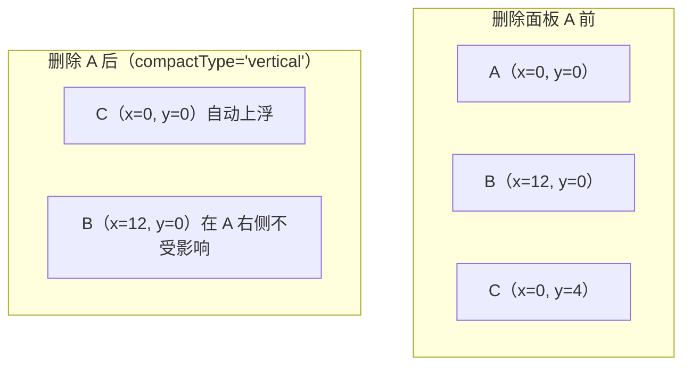

## 4. Grafana 式拖拽仪表盘（2 周）

**业务画像**：数据可视化大盘、BI 工具、监控面板，编辑态拖拽布局配图表，运行态定时刷新。

在动第一行代码之前，先想清楚本章和第 3 章表单设计器的本质差异，这决定了技术选型的全部分岔：

1. **布局从"任意嵌套树"退化为"平面栅格"**。面板之间不嵌套、不重叠，只排位置和大小。于是拖拽不必再用 dnd-kit 自己写碰撞与落点判定——react-grid-layout 把"量化网格 + 碰撞 + 自动紧凑"整套做好了。复杂度没有消失，而是转移到了**布局协议**和**数据链路**上。
2. **出现了"时间"维度**。全局时间范围（from/to）、自动刷新、数据点数控制，全是表单场景没有的问题，也是监控大盘区别于普通图表页的三件套。
3. **数据获取成为一等公民**。第 2、3 章的组件渲染的是静态 props（schema / formData），本章的面板渲染的是"查询结果"。查询从哪来、怎么发、怎么复用——这就引出本章的灵魂：**数据源抽象**（路线 5）。

对照第 0 章的内核六件套，本章的落点：Schema 协议 = dashboard JSON（layout + panels 双数组）；组件注册表 = panel registry；递归渲染器退化为"平铺面板渲染"（树深度为 1，不需要递归）；Setter 体系 = 面板配置抽屉（panel options 又是一张 schema 表单，第二次复用）；表达式引擎本章暂不展开（Grafana 用它做变量联动，思路同第 2 章 `visibleWhen`）；Undo/Redo 在编辑态改布局时接底座即可。

学习顺序仍然是总原则那句"先做渲染器，再做编辑器"：先让一个写死 layout 的大盘在"查看态"跑起来（能查数、能刷、能联动时间），再做"编辑态"（拖拽、缩放、配置抽屉），最后做导入导出。反过来做（先搭拖拽再塞数据）会让你在数据不通时无法判断布局 bug 还是渲染 bug。

### 实现路线

1. 布局层：`react-grid-layout`（拖拽 + 缩放 + 碰撞 + 自动 compact），理解 layout model：`{ i, x, y, w, h, static? }` 与 24 列栅格
2. 面板协议：`{ id, type: 'line'|'bar'|'stat'|'table', title, query, options }`；layout 与 panel 用 id 关联
3. **面板插件化**：panel registry（复用底座注册表），新增面板类型零侵入
4. 图表封装：echarts 统一组件（ResizeObserver 自适应、卸载 dispose、loading/空态）
5. **数据源抽象**：`interface DataSource { query(q, timeRange): Promise<Frame[]> }`，实现 mock 数据源（随机游走序列）+ 静态 JSON 数据源 —— 这是 Grafana 插件体系的精髓
6. 时间范围：全局 store（from/to），面板订阅；与 URL 查询参数双向同步（可分享链接）
7. 自动刷新：interval 定时器；`visibilitychange` 页面隐藏时暂停；面板级节流
8. 编辑/查看双模式：编辑态布局可拖 + 右侧配置抽屉（panel options 用第 3 章 Setter 渲染，又复用！）
9. 持久化：layout + panels 合并为 dashboard JSON，导入/导出

### 路线 1：布局层 —— react-grid-layout 的 layout model、24 列栅格与 compact 算法

**是什么**。react-grid-layout（下称 RGL）是一个"网格坐标驱动"的布局组件：你不写 CSS 位置，而是给每个子元素一个 `{x, y, w, h}` 的网格坐标，RGL 负责把它们换算成像素、处理拖拽/缩放、在发生重叠时按规则推挤、并在留出空洞时自动上浮面板。

**为什么用量化网格而不是自由拖拽（绝对定位）**。四个理由：① 坐标是整数，天然可 JSON 序列化持久化；② 响应式只需换"列数"重算，不需要为每档屏幕重排（自由画布做不到）；③ 碰撞判定是矩形求交，O(n²) 都绰绰有余；④ 用户心智简单——"半行宽、三分之一行宽"这种语言产品经理也能用。Grafana、AWS CloudWatch 大盘、多数 BI 工具都是这个路线。

**layout model 逐字段**。RGL 的 layout 是一个数组，每项字段如下（TypeScript 类型 `Layout` 从包里导出）：

| 字段 | 含义 | 说明 |
|---|---|---|
| `i` | 面板唯一 id | 必须与对应子元素的 React `key` 完全一致，这是 layout 与面板的关联键 |
| `x` | 左上角列坐标 | 0 到 `cols - w` 之间，不是像素 |
| `y` | 左上角行坐标 | 可以很大（比如 100），compact 会把它拉回紧凑位置 |
| `w` | 宽度，单位=列数 | 24 列栅格下 w=12 即半行 |
| `h` | 高度，单位=行数 | 实际像素 = `h * rowHeight + (h - 1) * rowGap`（margin 的垂直分量） |
| `static` | 是否钉死 | `true` 时该面板不可拖不可缩，且 compact 时别人绕开它、它绝不让位——适合做"置顶公告栏" |
| `minW/maxW/minH/maxH` | 缩放上下限 | 防止用户把折线图缩成 1 列宽的"电线杆" |
| `isDraggable/isResizable` | 单项开关 | 覆盖容器级的全局开关，可实现"这个面板锁位置但可缩放" |
| `moved` | RGL 内部标记 | 拖动过程标记，**持久化时应剔除**，不要把它写进你的协议 |

**24 列栅格怎么算像素**。列宽公式：

```text
colWidth = (容器宽度 - (cols - 1) * marginX - 2 * containerPaddingX) / cols
面板像素宽 = w * colWidth + (w - 1) * marginX
面板像素高 = h * rowHeight + (h - 1) * marginY
```

为什么是 24 而不是 RGL 默认的 12？因为 24 能被 2、3、4、6、8、12 整除——"半行、三分之一行、四分之一行"都是整数列，设计师排版的常用比例全能表达。Grafana 同样是 24 列。列数只是个 prop（`cols={24}`），但**它必须写进协议文档**：导入的 JSON 若按 12 列设计，在 24 列栅格里会全部缩在左半边。

**碰撞与 compact 的直观解释**。把网格想成一个"重力朝上"的箱子：

- 两个面板碰撞的定义就是矩形相交：`a.x < b.x + b.w && b.x < a.x + a.w && a.y < b.y + b.h && b.y < a.y + a.h`。
- 拖动一个面板压到别人时，被压的面板被**向下推**，推到不碰撞为止；被推的面板又可能压到更下面的，级联下去。
- `compactType="vertical"`（默认）：任何面板下方出现的空洞都会让更下面的面板**上浮**填补，就像失重环境下气泡上浮。上浮算法可以概括为：把所有面板按 `y` 升序、`x` 升序排序，逐个尝试把当前面板的 y 往上移到"再移一格就会碰到已放置面板"的位置，然后放置；static 面板最先按原位固定，普通面板绕行。
- `compactType={null}`：不 compact，删掉面板留下空洞（Grafana 的 "strict" 布局），适合"位置有语义"的场景（比如第 0 行永远是告警面板）。
- `preventCollision`：禁止重叠时的兜底策略；`allowOverlap`（较新版本）允许面板叠放，监控大盘基本用不到。



**完整可运行示例（单断点 + WidthProvider）**：

```tsx
// src/dashboard/GridDemo.tsx —— 最小可运行的栅格示例
import { useState } from 'react';
import GridLayout, { WidthProvider } from 'react-grid-layout';
import type { Layout } from 'react-grid-layout';
// 两个样式文件必须引入：缺了会表现为"拖不动、右下角缩放手柄消失"的诡异现象
import 'react-grid-layout/css/styles.css';
import 'react-resizable/css/styles.css';

const Grid = WidthProvider(GridLayout); // HOC：包一层"会量宽度"的容器

const PANEL_KEYS = ['a', 'b', 'c', 'd'];

const INITIAL: Layout = [
  { i: 'a', x: 0,  y: 0, w: 8,  h: 6 },
  { i: 'b', x: 8,  y: 0, w: 10, h: 6 },
  { i: 'c', x: 18, y: 0, w: 6,  h: 6 },
  { i: 'd', x: 0,  y: 6, w: 24, h: 4, static: true }, // 钉死在最下方的公告栏
];

export function GridDemo() {
  const [layout, setLayout] = useState<Layout>(INITIAL);
  return (
    // 宽度来源：这个 div 必须能被量出确定宽度（父链上别出现内容撑开的 flex）
    <div style={{ width: '100%', minWidth: 0 }}>
      <Grid
        layout={layout}
        cols={24}            // 24 列栅格
        rowHeight={32}       // 一行的基准高度（px），配合 h=9 大约 300px 面板
        margin={[8, 8]}      // 面板间水平/垂直间距
        isDraggable
        isResizable
        compactType="vertical"
        onLayoutChange={(next) => setLayout(next)} // 拖/缩/compact 后的最终布局回写
      >
        {PANEL_KEYS.map((key) => (
          <div key={key} style={{ background: '#fff', border: '1px solid #d9d9d9', borderRadius: 6, padding: 8 }}>
            panel {key}
          </div>
        ))}
      </Grid>
    </div>
  );
}
```

**WidthProvider 与 Responsive 的用法，以及"容器宽度是谁量出来的"**。RGL 网格要换算像素就必须知道容器宽度，但它不该自己去猜——于是官方给了 `WidthProvider` 这个 HOC：它在网格外包一个 div，用 ResizeObserver 监听这个 div 的宽度，存进 state，再作为 `width` prop 注入网格。简化后的内核长这样（示意代码，帮助你理解而非源码拷贝）：

```tsx
// WidthProvider 的原理示意
function withWidth(Composed: React.ComponentType<any>) {
  return function Measured(props: Record<string, unknown>) {
    const [width, setWidth] = useState(-1);
    const ref = useRef<HTMLDivElement>(null);
    useEffect(() => {
      const el = ref.current!;
      const ro = new ResizeObserver(() => setWidth(el.offsetWidth));
      ro.observe(el); // 容器宽度变化（侧栏折叠、窗口缩放、父级动画）都会触发
      setWidth(el.offsetWidth);
      return () => ro.disconnect();
    }, []);
    return (
      <div ref={ref} style={{ width: '100%', minWidth: 0 }}>
        {width > 0 ? <Composed {...props} width={width} /> : null /* 量出宽度前不渲染，避免 0 宽首帧 */}
      </div>
    );
  };
}
```

理解这个原理后你就明白坑 1 的一切症状从哪来（容器在 tab 里 `display:none`、父级是没设宽的 flex item、首帧 0 宽闪烁），也知道绕开 HOC 的正路：如果你项目里已有全局的容器测量（比如 SplitPane 自己管宽度），可以直接给 `<GridLayout width={number}>` 传数值，跳过 WidthProvider。

**多断点响应式（Responsive）**：`Responsive` 组件按断点选择不同的 layout 数组和列数：

```tsx
// src/dashboard/ResponsiveGridDemo.tsx —— 多断点：每档一份 layout
import { useState } from 'react';
import { Responsive, WidthProvider } from 'react-grid-layout';
import type { Layouts } from 'react-grid-layout';
import 'react-grid-layout/css/styles.css';
import 'react-resizable/css/styles.css';

const ResponsiveGrid = WidthProvider(Responsive);

const BREAKPOINTS = { lg: 1200, md: 996, sm: 768, xs: 480, xxs: 0 }; // 容器宽度阈值（px）
const COLS = { lg: 24, md: 24, sm: 12, xs: 8, xxs: 4 };              // 每档列数：屏越窄列越少，面板相对越宽

const INITIAL_LAYOUTS: Layouts = {
  lg: [{ i: 'a', x: 0, y: 0, w: 12, h: 6 }, { i: 'b', x: 12, y: 0, w: 12, h: 6 }],
  md: [{ i: 'a', x: 0, y: 0, w: 12, h: 6 }, { i: 'b', x: 12, y: 0, w: 12, h: 6 }],
  sm: [{ i: 'a', x: 0, y: 0, w: 12, h: 8 }, { i: 'b', x: 0, y: 8, w: 12, h: 8 }], // 窄屏改单列堆叠
  xs: [{ i: 'a', x: 0, y: 0, w: 8, h: 8 },  { i: 'b', x: 0, y: 8, w: 8, h: 8 }],
  xxs: [{ i: 'a', x: 0, y: 0, w: 4, h: 8 }, { i: 'b', x: 0, y: 8, w: 4, h: 8 }],
};

export function ResponsiveGridDemo() {
  const [layouts, setLayouts] = useState<Layouts>(INITIAL_LAYOUTS);
  return (
    <ResponsiveGrid
      layouts={layouts}
      breakpoints={BREAKPOINTS}
      cols={COLS}
      rowHeight={32}
      onLayoutChange={(layout, allLayouts) => setLayouts(allLayouts)} // 注意：第二个参数才是全档布局
      onBreakpointChange={(bp, cols) => console.log('断点切换到', bp, '列数', cols)}
    >
      <div key="a">面板 a</div>
      <div key="b">面板 b</div>
    </ResponsiveGrid>
  );
}
```

两个易错点提前打预防针：① 用 `Responsive` 时必须传复数 `layouts`（对象）而不是 `layout`（数组），且回调要接第二个参数，否则断点切换时布局会互相覆盖；② 本章的 dashboard 协议（路线 9）为了简化只持久化一份 24 列的基准 layout——多档 layouts 的维护成本（拖了 lg 又拖 sm，谁同步谁？）远超监控场景收益，Grafana 的选择也是"单一 24 列 + 小屏线性堆叠"。Responsive 用在"仪表盘首页要适配手机"这类真需求上。

**本步小结的常见坑**：容器量宽失败（症状与修法见坑 1 详解）、`layout` 里出现子元素没有的 key（RGL 控制台告警 + 幽灵占位，见坑 4）、拖拽手柄与图表事件打架（见路线 8 的 `draggableHandle`）。

### 路线 2：面板协议 —— layout 与 panel 用 id 关联的数据结构

**是什么**。把"一个面板是什么"与"一个面板在哪"拆成两份数据，用 `id` 关联：

```ts
// src/dashboard/types.ts
export type PanelType = 'line' | 'bar' | 'stat' | 'table';

/** 数据查询：面板声明"我要什么数据"，查询体本身是数据源私有的 */
export interface DataQuery {
  refId: string;                       // 面板内唯一，一个面板可发多条查询（A/B/C…）
  payload: Record<string, unknown>;    // 数据源私有查询体：PromQL、SQL、mock 参数……核心代码不解释它
}

export interface LineOptions { unit?: string; area?: boolean; legend?: boolean }
export interface BarOptions  { unit?: string; stack?: boolean }
export interface StatOptions { unit?: string; decimals?: number; dangerAbove?: number }
export interface TableOptions { pageSize?: number }

export interface PanelBase {
  id: string;                // 稳定 id：nanoid 生成，绝不复用已删除面板的 id
  title: string;
  datasourceUid: string;     // 指向 dashboard.doc.datasources[].uid
  query: DataQuery;
}

/** discriminated union：type 字面量决定 options 的形状，switch 分支里 TS 自动收窄 */
export type Panel =
  | (PanelBase & { type: 'line';  options: LineOptions  })
  | (PanelBase & { type: 'bar';   options: BarOptions   })
  | (PanelBase & { type: 'stat';  options: StatOptions  })
  | (PanelBase & { type: 'table'; options: TableOptions });

/** 与 react-grid-layout 的 Layout 同构；显式声明，协议自持、不依赖第三方类型 */
export interface LayoutItem {
  i: string;                 // = panels[].id，唯一关联键
  x: number;
  y: number;
  w: number;
  h: number;
  static?: boolean;
  minW?: number; maxW?: number; minH?: number; maxH?: number;
}

export interface DataSourceRef {
  uid: string;               // 大盘内唯一，面板通过它引用数据源
  type: string;              // 'mock-random-walk' | 'static-json' | 未来的 'prometheus'
  options: Record<string, unknown>;
}

export interface DashboardDoc {
  version: 1;                              // 协议版本号：一开始就带上（第 6 章 migration 的前提）
  meta: { title: string; updatedAt: number };
  time: { from: number; to: number; refreshMs: number }; // 大盘默认时间范围与刷新间隔
  datasources: DataSourceRef[];
  panels: Panel[];
  layout: LayoutItem[];
}
```

对应的合法 JSON 样例（也是路线 9 导出的目标格式）：

```json
{
  "version": 1,
  "meta": { "title": "交易核心大盘", "updatedAt": 1760000000000 },
  "time": { "from": 1759996400000, "to": 1760000000000, "refreshMs": 30000 },
  "datasources": [
    { "uid": "ds-walk",   "type": "mock-random-walk", "options": {} },
    { "uid": "ds-static", "type": "static-json",      "options": {} }
  ],
  "panels": [
    {
      "id": "p_qps",
      "type": "line",
      "title": "QPS",
      "datasourceUid": "ds-walk",
      "query": { "refId": "A", "payload": { "seriesName": "qps", "seriesCount": 3, "volatility": 12, "baseline": 800 } },
      "options": { "unit": "req/s", "area": true, "legend": true }
    },
    {
      "id": "p_err",
      "type": "stat",
      "title": "错误率",
      "datasourceUid": "ds-walk",
      "query": { "refId": "A", "payload": { "seriesName": "err", "seriesCount": 1, "volatility": 2, "baseline": 3 } },
      "options": { "unit": "%", "decimals": 2, "dangerAbove": 5 }
    }
  ],
  "layout": [
    { "i": "p_qps", "x": 0,  "y": 0, "w": 16, "h": 9 },
    { "i": "p_err", "x": 16, "y": 0, "w": 8,  "h": 9 }
  ]
}
```

**为什么拆两个数组、用 id 关联**（而不是像 Grafana 那样把 `gridPos` 内嵌在 panel 里）：① RGL 的 `onLayoutChange` 天然吐出一个纯 layout 数组，双数组结构可以零转换直接回写 store；② 查看态渲染只关心 panels，编辑器拖动只改 layout，两份变更互不制造无谓的 diff；③ 面板配置抽屉更新 panel 对象时不会触碰布局。代价是**删除面板必须两处同删**——这正是坑 4，我们会在 store 层用单一 action 封死这个风险。两种设计都对，关键是把一致性收敛到一个入口。

id 的纪律：用 `nanoid()` 这类短随机 id；不要用数组下标（拖动排序即变化）；不要用标题拼音（用户改标题就断链）；导入 JSON 冲突时宁可重新生成 id 并同步改 layout，也不要容忍两份 panels 出现同一个 id。

### 路线 3：面板插件化 —— panel registry

**解决什么问题**。"新增一种仪表盘面板"应该是一个纯增量动作：写一个新组件文件、注册、完事。不该去改渲染器、改类型收口、改配置抽屉的 switch。要做到这一点，就把"面板类型 → 组件 + 元信息"的映射收进注册表（底座 1.2 的直接复用，只是物料从表单控件换成图表面板）：

```tsx
// src/dashboard/panelRegistry.tsx
import type { ComponentType } from 'react';
import type { Panel } from './types';
import type { SeriesFrame } from '../datasource/types';
import type { SetterSchema } from '../setter/SetterForm'; // 第 3 章的 Setter 声明协议，原样复用

/** 面板组件拿到的输入：面板声明 + 数据帧。组件是纯渲染者，不自己发请求 */
export interface PanelComponentProps<O = unknown> {
  panel: Panel & { options: O };
  data: { status: 'loading' | 'ok' | 'error' | 'empty'; frames: SeriesFrame[]; error?: string };
  width: number;   // 面板内容区实时像素宽（外壳用 ResizeObserver 量好传入）
  height: number;
}

/** 一种面板类型的完整定义 = 物料元信息 + 组件 */
export interface PanelDefinition<O = unknown> {
  type: string;                 // 'line' | 'bar' | ... 协议里的 type 字符串
  label: string;                // 物料区/新增面板下拉框显示的名字
  defaultW: number;             // 新增面板的默认尺寸
  defaultH: number;
  defaultOptions: O;            // 新增面板的默认配置
  setters: SetterSchema[];      // 配置抽屉自动生成表单的声明（第 3 章 Setter，又复用）
  Component: ComponentType<PanelComponentProps<O>>;
}

const panelRegistry = new Map<string, PanelDefinition<any>>();

export function registerPanel(def: PanelDefinition<any>) {
  if (panelRegistry.has(def.type)) console.warn(`面板类型重复注册：${def.type}，后注册的覆盖前者`);
  panelRegistry.set(def.type, def);
}
export function getPanelDefinition(type: string) {
  return panelRegistry.get(type);
}
export function listPanelTypes() {
  return [...panelRegistry.keys()];
}
```

渲染入口统一走一个 `PanelHost`，未知类型给兜底卡片而不是抛白屏：

```tsx
// src/dashboard/PanelHost.tsx
import { getPanelDefinition } from './panelRegistry';
import type { PanelComponentProps } from './panelRegistry';

export function PanelHost(props: PanelComponentProps) {
  const def = getPanelDefinition(props.panel.type);
  if (!def) {
    // 导入了不认识的面板类型（旧文件、别人私加的物料）→ 显式兜底，别让整个大盘崩掉
    return <div className="panel-fallback">未知面板类型：{props.panel.type}</div>;
  }
  const C = def.Component;
  return <C {...props} />;
}
```

四个面板的注册与实现（`Component` 的具体代码在路线 4 的 echarts 封装就绪后给出，见 `registerPanels.tsx`）。至此"新增 gauge 面板" = 新建 `GaugePanel.tsx` + 一行 `registerPanel({...})`，渲染器、类型、抽屉零改动——这就是"零侵入"的验收标准。

### 路线 4：图表统一封装 —— echarts 组件与 setOption 时机

**为什么必须统一封装**。四个面板都画 echarts，如果各自 `echarts.init`，会踩同一批坑四次：实例泄漏（忘了 dispose）、resize 只监听 window（栅格缩放不触发）、loading/空态样式不一、notMerge 时机各写各的。封装成一个 `EChart` 组件，把生命周期纪律固化：

```tsx
// src/dashboard/EChart.tsx —— echarts 统一封装
import { useEffect, useRef } from 'react';
import * as echarts from 'echarts';

type EChartsInstance = ReturnType<typeof echarts.init>;

export interface EChartProps {
  option: echarts.EChartsOption;
  /** 结构签名：变了才 notMerge 全量替换；没变走 merge 增量更新（见下文时机讲解） */
  structureKey: string;
  loading?: boolean;
  empty?: boolean;
}

export function EChart({ option, structureKey, loading = false, empty = false }: EChartProps) {
  const containerRef = useRef<HTMLDivElement>(null);
  const chartRef = useRef<EChartsInstance | null>(null);
  const prevStructureRef = useRef<string>(structureKey);

  // 生命周期：init 一次、dispose 一次；resize 跟随容器而不是 window
  useEffect(() => {
    const el = containerRef.current;
    if (!el) return;
    const chart = echarts.init(el);
    chartRef.current = chart;

    // 关键：监听容器自身。栅格拖拽缩放改的是 grid item 的 style 宽高，window resize 根本不会触发
    const ro = new ResizeObserver(() => {
      // 容器 display:none（切 tab）或首帧未布局完成时尺寸为 0，resize 到 0 会得到一张坏画布
      if (el.clientWidth > 0 && el.clientHeight > 0) chart.resize();
    });
    ro.observe(el);

    return () => {
      ro.disconnect();
      chart.dispose();       // 释放 canvas 上下文、事件监听、内部定时器——不 dispose 就是内存泄漏
      chartRef.current = null;
    };
  }, []);

  // 数据/结构更新：loading 由 React 状态驱动，option 更新区分 merge / notMerge
  useEffect(() => {
    const chart = chartRef.current;
    if (!chart || empty) return;
    const notMerge = structureKey !== prevStructureRef.current; // 结构变了才全量替换
    prevStructureRef.current = structureKey;
    if (loading) chart.showLoading('default', { text: '', color: '#c0c4cc', maskColor: 'rgba(255,255,255,0)' });
    else chart.hideLoading();
    chart.setOption(option, { notMerge });
  }, [option, structureKey, loading, empty]);

  // 空态用"覆盖层"而不是条件渲染换掉容器：换了 DOM，echarts 实例就悬空在游离节点上了
  return (
    <div style={{ position: 'relative', width: '100%', height: '100%' }}>
      <div ref={containerRef} style={{ position: 'absolute', inset: 0 }} />
      {empty && <div className="echart-empty">暂无数据</div>}
    </div>
  );
}
```

四个细节值得逐一解释：

1. **ResizeObserver 监听容器而非 window**。这是图表在"可拖拽缩放的栅格"里能自适应的根本原因：RGL 缩放面板时改的是该 grid item 的行内样式，window 没有任何事件。RO 观察的是元素自身的盒尺寸，天然覆盖窗口缩放、侧栏折叠、栅格拖缩三种场景。
2. **dispose**。echarts 实例持有 canvas 上下文（浏览器对同页 canvas/WebGL 上下文数量有限制，Chrome 触顶后新图表直接黑屏）、全局事件监听和动画定时器。React 18/19 开发模式 StrictMode 会故意"挂载→卸载→再挂载"一次，cleanup 写对了这只是多花一次 init 的钱；写错了就是每次路由进出都漏一个实例，Performance 面板里 JS Heap 阶梯上涨。
3. **loading/空态**。`showLoading` 只在"已有旧数据、正在刷"时启用才有意义（不然 5s 一刷的大盘整页转圈）。首屏没有数据时应显示空态文案。loading 遮罩样式里把 maskColor 设为透明，避免遮住旧数据——Grafana 的刷新就是"旧图保持可见，新数据到了无感替换"。
4. **merge vs notMerge 的时机**（坑 2 的正面讲解）。`setOption(option)` 默认是 **merge 模式**：新 option 与图表当前状态按组件索引/名称合并，series 数量变少时**多余的旧 series 不会被删除**，坐标轴、图例的残留同理。所以：
   - **同结构、只换数据**（自动刷新 tick 到了，还是那 3 条序列、还是折线图）→ merge。便宜、不重置内部状态（用户选过的图例、dataZoom 视口、无动画跳变）。
   - **结构变化**（series 数量/名字变了、面板从 line 切到 bar、单轴变双轴）→ 必须全量替换，否则出现"幽灵序列"。上面的实现用 `structureKey`（面板 id + 类型 + 序列名列表拼成的字符串）自动判断；也可以用更细粒度的 `chart.setOption(option, { replaceMerge: ['series'] })`——只整体替换 series、其余仍 merge，适合"序列集合常变但坐标系不动"的面板。
   - 一个粗暴但常用的替代：`<EChart key={structureKey} ...>` 让 React 整个重挂。能用，但代价是丢图例选择/缩放状态 + 重新 init，不作为首选。

基于 `EChart` 的四个面板实现与注册：

```tsx
// src/dashboard/panels.tsx —— line / bar / stat / table 四种面板 + 注册
import { useMemo } from 'react';
import * as echarts from 'echarts';
import type { PanelComponentProps } from './panelRegistry';
import { registerPanel } from './panelRegistry';
import { EChart } from './EChart';
import type { SeriesFrame } from '../datasource/types';

/** 帧集合 → 折线/柱状 option。line 与 bar 只差 series.type，共用一个转换器 */
function framesToCartesianOption(
  frames: SeriesFrame[],
  kind: 'line' | 'bar',
  opts: { area?: boolean; legend?: boolean; unit?: string },
): echarts.EChartsOption {
  const series = frames.map((f) => {
    const time = (f.fields.find((x) => x.type === 'time')?.values ?? []) as number[];
    const num = (f.fields.find((x) => x.type === 'number')?.values ?? []) as number[];
    return {
      name: f.name,
      type: kind,
      smooth: true,
      showSymbol: false,
      sampling: 'lttb',   // echarts 内置的 LTTB 降采样：点再多也只画"视觉保真"的若干点（坑 3 主力手段）
      areaStyle: kind === 'line' && opts.area ? {} : undefined,
      data: num.map((v, i) => [time[i]!, v] as [number, number]),
    };
  });
  return {
    animation: false,     // 高频刷新场景关动画：每 5s 整图重播一次入场动画是灾难
    grid: { left: 48, right: 16, top: opts.legend === false ? 16 : 40, bottom: 28 },
    legend: opts.legend === false ? undefined : {},
    tooltip: {
      trigger: 'axis',
      showDelay: 40,      // tooltip 防抖：快速划过时不逐点计算浮层
      valueFormatter: (v) => (opts.unit ? `${v} ${opts.unit}` : `${v}`),
    },
    xAxis: { type: 'time' },
    yAxis: {},
    series,
  };
}

function ChartPanel({ panel, data }: PanelComponentProps) {
  const kind = panel.type === 'bar' ? 'bar' : 'line';
  const options = panel.options as { area?: boolean; legend?: boolean; unit?: string };
  const option = useMemo(
    () => framesToCartesianOption(data.frames, kind, options),
    [data.frames, kind, options],
  );
  // 结构签名 = 类型 + 序列名集合：序列增删/换图型 → notMerge；纯数据刷新 → merge
  const structureKey = `${panel.id}:${kind}:${data.frames.map((f) => f.name).join('|')}`;
  return <EChart option={option} structureKey={structureKey} empty={data.status === 'empty'} />;
}

function StatPanel({ panel, data, width, height }: PanelComponentProps) {
  const frame = data.frames[0];
  const latest = useMemo(() => {
    const numField = frame?.fields.find((f) => f.type === 'number');
    if (!numField || numField.values.length === 0) return null;
    return numField.values[numField.values.length - 1] as number; // 时间序列最后一个点 = "当前值"
  }, [frame]);
  if (!frame || latest === null) return <div className="echart-empty">暂无数据</div>;
  const o = panel.options as { unit?: string; decimals?: number; dangerAbove?: number };
  const danger = o.dangerAbove !== undefined && latest > o.dangerAbove;
  return (
    <div style={{ display: 'flex', flexDirection: 'column', justifyContent: 'center', height: '100%', paddingLeft: 16 }}>
      <div style={{ fontSize: Math.min(48, Math.max(20, height * 0.35)), fontWeight: 700, color: danger ? '#cf1322' : '#262626' }}>
        {latest.toFixed(o.decimals ?? 0)}
        <span style={{ fontSize: 14, marginLeft: 4, color: '#8c8c8c' }}>{o.unit ?? ''}</span>
      </div>
      <div style={{ color: '#8c8c8c' }}>{frame.name}</div>
    </div>
  );
}

function TablePanel({ panel, data }: PanelComponentProps) {
  const frame = data.frames[0];
  if (!frame || frame.fields.length === 0) return <div className="echart-empty">暂无数据</div>;
  const o = panel.options as { pageSize?: number };
  const rowCount = frame.fields[0]!.values.length;
  const rows = frame.fields[0]!.values
    .map((_, rowIdx) => frame.fields.map((f) => f.values[rowIdx])) // 列式 → 行式，仅渲染需要的前 N 行
    .slice(0, o.pageSize ?? 50);
  return (
    <div style={{ overflow: 'auto', height: '100%' }}>
      <table className="panel-table" style={{ width: '100%', fontSize: 12, borderCollapse: 'collapse' }}>
        <thead>
          <tr>{frame.fields.map((f) => <th key={f.name} style={{ textAlign: 'left', padding: '4px 8px' }}>{f.name}</th>)}</tr>
        </thead>
        <tbody>
          {rows.map((row, i) => (
            <tr key={i}>
              {row.map((cell, j) => <td key={j} style={{ padding: '4px 8px' }}>{String(cell)}</td>)}
            </tr>
          ))}
        </tbody>
      </table>
      {rowCount > rows.length && <div style={{ color: '#8c8c8c', padding: 8 }}>仅展示前 {rows.length} 行（共 {rowCount} 行）</div>}
    </div>
  );
}

// —— 注册：新增面板类型 = 在这里加一段，别处零改动 ——
registerPanel({
  type: 'line', label: '折线图', defaultW: 12, defaultH: 9,
  defaultOptions: { unit: '', area: false, legend: true },
  setters: [
    { key: 'unit',   label: '单位',     setter: 'input'  },
    { key: 'area',   label: '面积填充', setter: 'switch' },
    { key: 'legend', label: '显示图例', setter: 'switch' },
  ],
  Component: ChartPanel,
});
registerPanel({
  type: 'bar', label: '柱状图', defaultW: 12, defaultH: 9,
  defaultOptions: { unit: '', stack: false, legend: true },
  setters: [
    { key: 'unit',   label: '单位',     setter: 'input'  },
    { key: 'legend', label: '显示图例', setter: 'switch' },
  ],
  Component: ChartPanel, // 同一组件：kind 由 panel.type 推出
});
registerPanel({
  type: 'stat', label: '单值面板', defaultW: 6, defaultH: 6,
  defaultOptions: { unit: '', decimals: 0, dangerAbove: undefined },
  setters: [
    { key: 'unit',        label: '单位',       setter: 'input'  },
    { key: 'decimals',    label: '小数位',     setter: 'number' },
    { key: 'dangerAbove', label: '超阈值标红', setter: 'number' },
  ],
  Component: StatPanel,
});
registerPanel({
  type: 'table', label: '表格', defaultW: 12, defaultH: 8,
  defaultOptions: { pageSize: 50 },
  setters: [{ key: 'pageSize', label: '显示行数', setter: 'number' }],
  Component: TablePanel,
});
```

### 路线 5：数据源抽象 —— Grafana 插件体系的精髓

这一步是本章密度最高的部分，慢慢读。

**它解决什么问题**。先看没有抽象的世界：LinePanel 里写 `fetch('/api/qps')`，TablePanel 里写 `fetch('/api/logs')`，过两天要接 Prometheus，于是每个面板组件里都长出一段 PromQL 拼接与响应转换。假设有 N 种面板、M 种数据来源，没有抽象时你要维护 N×M 份"面板 × 来源"的胶水代码；有了抽象，面板只认识 `Frame[]`，来源只负责产出 `Frame[]`，胶水代码变成 N+M 份，而且两边可以独立演进、独立开源——**这正是 Grafana 插件生态能滚起来的原因**：panel 插件作者不需要知道数据来自 Prometheus 还是 MySQL；datasource 插件作者不需要知道数据将画成折线还是热力图。两个坐标轴各自生长，组合爆炸变成组合红利。

**接口全貌**（`src/datasource/types.ts`），每个设计决定都有理由：

```ts
/** 全局时间范围。用 epoch ms 绝对时间戳：可序列化、可与 URL 参数互转、无时区歧义 */
export interface TimeRange {
  from: number;
  to: number;
}

/** 面板 → 数据源 → 面板 的上下文：面板把自己的"渲染约束"告诉数据源 */
export interface QueryContext {
  range: TimeRange;
  /** 面板建议的最大点数（按面板像素宽估算），数据源据此降采样 */
  maxDataPoints: number;
  /** 面板期望的最小采样间隔 ms（防止 1s 刷新的面板把后端打爆） */
  intervalMs: number;
}

/**
 * 列式数据帧（DataFrame 思想）：
 * - 一个 Frame ≈ 一张窄表 ≈ 一条 echarts series：time 字段做 x 轴，number 字段做 y 轴
 * - 列式（每字段一个数组）而不是行式（每行一个对象）：
 *   1) 10000 个点只有 2 个大数组，不是 10000 个小对象——GC 压力天差地别
 *   2) 一个 Frame 里有多个 number 字段 = 一条查询返回多条序列，映射 series 零成本
 *   3) 与 Apache Arrow / Grafana DataFrame 同构，将来接列式协议不改面板
 */
export interface SeriesFrame {
  refId: string;                    // 来自哪条查询（一个面板多条查询时用于对账）
  name: string;                     // 序列名（图例文字）
  fields: Field[];
}

export interface Field {
  name: string;
  type: 'time' | 'number' | 'string' | 'boolean';
  values: Array<number | string | boolean | null>;
}

/** 数据源接口：query 是唯一必须实现的能力 */
export interface DataSource<Q extends DataQuery = DataQuery> {
  readonly type: string;
  /**
   * 批量查询：一次传一个面板的所有查询（refId A/B/C…），返回帧时带上 refId
   * 批量设计让"一个面板多序列"的数据源有机会做单次请求合并
   */
  query(queries: Q[], ctx: QueryContext): Promise<SeriesFrame[]>;
  /** 可选：配置页"测试连接"按钮 */
  healthCheck?(): Promise<void>;
}
```

`DataQuery` 复用路线 2 定义的 `{ refId; payload }`。**注意 query 的 payload 对核心代码是不透明的**——mock 用它传 `seriesName`，将来的 Prometheus 数据源用它存 PromQL 字符串。核心只负责把 payload 原样递给对应数据源，这保证了协议的可扩展性（`x-` 风格的私有字段思路同底座 1.1）。

**注册表与懒加载**：

```ts
// src/datasource/registry.ts
import type { DataSource, SeriesFrame, DataQuery, QueryContext } from './types';
import type { DataSourceRef } from '../dashboard/types';

export type DataSourceFactory = () => Promise<DataSource<any>>;

const factories = new Map<string, DataSourceFactory>(); // type → 工厂（懒加载）
const instances = new Map<string, DataSource<any>>();   // uid → 实例（缓存）

export function registerDataSource(type: string, factory: DataSourceFactory) {
  factories.set(type, factory);
}

export async function getDataSource(ref: DataSourceRef): Promise<DataSource<any>> {
  const cached = instances.get(ref.uid);
  if (cached) return cached;
  const factory = factories.get(ref.type);
  if (!factory) throw new Error(`未注册的数据源类型：${ref.type}`);
  const ds = await factory(); // 工厂里可以 dynamic import()：重的数据源 SDK 不进主包
  instances.set(ref.uid, ds);
  return ds;
}
```

**实现一：mock 随机游走数据源**。随机游走（random walk）= 每个点在上一点基础上加一个随机扰动，是监控演示最常用的假数据——曲线连续、有噪声、像真的。两个工程细节：① 把每条序列的"最后一个值"记住，下次刷新从它继续，这样 5s 自动刷出来的曲线是**接得上上一段的**；② 按面板给的 `maxDataPoints` 控制点数，天然演练"点数上限"这条纪律（坑 3）。

```ts
// src/datasource/RandomWalkDataSource.ts
import type { DataSource, SeriesFrame, QueryContext } from './types';
import type { DataQuery } from '../dashboard/types';

interface RandomWalkPayload {
  seriesName: string;
  seriesCount?: number;   // 一个查询出几条序列（多实例对比）
  volatility?: number;    // 抖动幅度
  baseline?: number;      // 初始基线
}

const sleep = (ms: number) => new Promise((r) => setTimeout(r, ms));

export class RandomWalkDataSource implements DataSource<DataQuery> {
  readonly type = 'mock-random-walk';
  /** refId/序号 → 上次末值。让自动刷新的曲线前后拼接、连续生长 */
  private last = new Map<string, number>();

  async query(queries: DataQuery[], ctx: QueryContext): Promise<SeriesFrame[]> {
    await sleep(150 + Math.random() * 250); // 模拟网络延迟：用于验证 loading 态与并发防护（路线 7）
    return queries.flatMap((q) => this.walkOne(q.refId, q.payload as RandomWalkPayload, ctx));
  }

  private walkOne(refId: string, p: RandomWalkPayload, ctx: QueryContext): SeriesFrame[] {
    const { seriesName, seriesCount = 1, volatility = 8, baseline = 50 } = p;
    // 点数 = 时间跨度 / 间隔，但不超过面板建议上限——降采样从源头做
    const points = Math.max(60, Math.min(ctx.maxDataPoints, Math.floor((ctx.range.to - ctx.range.from) / Math.max(1000, ctx.intervalMs))));
    const step = (ctx.range.to - ctx.range.from) / points;

    return Array.from({ length: seriesCount }, (_, si) => {
      const key = `${refId}/${si}`;
      let v = this.last.get(key) ?? baseline + si * 10; // 没有历史则从基线出发
      const times: number[] = [];
      const values: number[] = [];
      for (let i = 0; i <= points; i++) {
        const t = ctx.range.from + Math.round(step * i);
        v += (Math.random() - 0.5) * volatility; // 游走：新值 = 旧值 + 随机扰动
        v = Math.min(100, Math.max(0, v));
        times.push(t);
        values.push(Number(v.toFixed(2)));
      }
      this.last.set(key, v); // 记住末值，下一拍从这继续
      return {
        refId,
        name: si === 0 ? seriesName : `${seriesName}-${si}`,
        fields: [
          { name: 'time', type: 'time' as const, values: times },
          { name: seriesName, type: 'number' as const, values: values },
        ],
      };
    });
  }
}
```

**实现二：静态 JSON 数据源**。给运营演示、离线环境、单测用：把一份行式 JSON 内嵌在查询里，数据源负责"行式 → 列式 Frame"的转换和按时间范围过滤。

```ts
// src/datasource/StaticJsonDataSource.ts
import type { DataSource, SeriesFrame, QueryContext } from './types';
import type { DataQuery } from '../dashboard/types';

interface StaticJsonPayload {
  /** 行式数据：[{ time: 1690000000000, pv: 120, uv: 80 }, ...] */
  json: Array<Record<string, number | string>>;
  timeField?: string;      // 缺省 'time'
  valueFields?: string[];  // 缺省取除时间字段外的所有数值字段
}

export class StaticJsonDataSource implements DataSource<DataQuery> {
  readonly type = 'static-json';

  async query(queries: DataQuery[], ctx: QueryContext): Promise<SeriesFrame[]> {
    return queries.map((q) => {
      const p = q.payload as StaticJsonPayload;
      const timeField = p.timeField ?? 'time';
      const valueFields = p.valueFields ?? Object.keys(p.json[0] ?? {}).filter((k) => k !== timeField);
      // 时间范围过滤：静态数据也要响应全局时间范围，否则联动是假的
      const rows = p.json.filter((r) => {
        const t = Number(r[timeField]);
        return t >= ctx.range.from && t <= ctx.range.to;
      });
      return {
        refId: q.refId,
        name: 'static',
        fields: [
          { name: timeField, type: 'time' as const, values: rows.map((r) => Number(r[timeField])) },
          // 多个 number 字段 = 一个 Frame 多条序列
          ...valueFields.map((vf) => ({
            name: vf,
            type: 'number' as const,
            values: rows.map((r) => Number(r[vf])),
          })),
        ],
      };
    });
  }
}
```

**装配**（应用入口调用一次）：

```ts
// src/datasource/register.ts
import { registerDataSource } from './registry';
import { RandomWalkDataSource } from './RandomWalkDataSource';
import { StaticJsonDataSource } from './StaticJsonDataSource';

registerDataSource('mock-random-walk', async () => new RandomWalkDataSource());
registerDataSource('static-json', async () => new StaticJsonDataSource());
// 将来接 Prometheus：
// registerDataSource('prometheus', async () => (await import('./PrometheusDataSource')).PrometheusDataSource);
```

**将来接真数据源是什么体验**。写一个 `PrometheusDataSource implements DataSource`，`query` 里把 payload 里的 PromQL 拼进 `/api/v1/query_range?start=...&end=...&step=...`，把响应的 `data.result[].values` 转成 Frame——面板、布局、时间范围、刷新、配置抽屉**一行都不用改**。这个"加数据不改展示、加展示不改取数"的自由度，就是开头那段 N×M → N+M 的红利落地。

**本步常见坑**：① 把 `fetch` 直接写进面板组件（回退到 N×M 泥潭，等接第二个后端时就懂了）；② Frame 行列混用（面板里到处 `rows.map(r => r.xxx)`，等于放弃了列式的性能红利）；③ 忘记把 `ctx.range` 传进查询（时间范围联动失效，症状是"改了时间下拉，图不变"）。

### 路线 6：时间范围全局 store + URL 双向同步

**是什么**。大盘顶部一个时间选择器（最近 15m / 1h / 6h / 24h / 自定义），改变后**所有面板**重新查询。它是全局单例状态，放 zustand：

```ts
// src/dashboard/timeRangeStore.ts
import { create } from 'zustand';

interface TimeRangeState {
  from: number; // epoch ms
  to: number;
  setRange: (from: number, to: number) => void;
}

export const useTimeRange = create<TimeRangeState>()((set) => ({
  from: Date.now() - 6 * 3600_000, // 默认最近 6 小时
  to: Date.now(),
  setRange: (from, to) => set({ from, to }),
}));
```

**为什么还要同步到 URL**。"把大盘链接发给同事，他打开看到一模一样的时间范围和刷新间隔"——这是监控工具的刚需，也是排障时贴进工单的上下文。设计：`?from=xxx&to=xxx&refresh=30000`。双向同步有三条边，每条边的语义要分清：

```ts
// src/dashboard/useTimeRangeUrlSync.ts
import { useEffect } from 'react';
import { useTimeRange } from './timeRangeStore';

function readRangeFromUrl(): { from: number; to: number } | null {
  const sp = new URLSearchParams(window.location.search);
  const from = Number(sp.get('from'));
  const to = Number(sp.get('to'));
  if (!Number.isFinite(from) || !Number.isFinite(to) || from >= to) return null; // 脏参数当没有
  return { from, to };
}

export function useTimeRangeUrlSync() {
  // 1) 初始化：URL 优先（分享链接恢复现场），没有参数则保留 store 默认值
  useEffect(() => {
    const r = readRangeFromUrl();
    if (r) useTimeRange.getState().setRange(r.from, r.to);
  }, []);

  // 2) store → URL：用 replaceState 而不是 pushState
  //    时间选择是高频操作，pushState 会把历史记录灌满，用户按"后退"退掉 6 次时间选择会骂人
  useEffect(() => {
    const unsub = useTimeRange.subscribe((s) => {
      const sp = new URLSearchParams(window.location.search);
      sp.set('from', String(s.from));
      sp.set('to', String(s.to));
      window.history.replaceState(null, '', `?${sp.toString()}`);
    });
    return unsub;
  }, []);

  // 3) URL → store：用户点浏览器前进/后退时把 URL 里的时间写回 store
  useEffect(() => {
    const onPop = () => {
      const r = readRangeFromUrl();
      if (r) useTimeRange.getState().setRange(r.from, r.to);
    };
    window.addEventListener('popstate', onPop);
    return () => window.removeEventListener('popstate', onPop);
  }, []);
}
```

没有死循环的原因：`replaceState` 不会触发 `popstate`，而 `popstate` 分支写回 store 后 store→URL 分支再把相同值写一遍 URL（幂等，无害）。

**相对时间（"最近 6 小时"）怎么表达**。直接存绝对时间戳的缺点：链接发出去 10 分钟后，接收者看到的"最近 6 小时"其实是发送者当时的 6 小时，边界是旧的。Grafana 的做法值得抄：URL 里存原始表达式 `from=now-6h`，**打开页面的那一刻**才解析成绝对时间——每个打开者得到"相对他自己现在"的窗口。解析函数很简单：

```ts
export function resolveTimeParam(raw: string | null, fallback: number): number {
  if (raw === null) return fallback;
  const rel = /^now-(\d+)([mhd])$/.exec(raw); // now-6h / now-30m / now-2d
  if (rel) {
    const n = Number(rel[1]);
    const unitMs = { m: 60_000, h: 3600_000, d: 86_400_000 }[rel[2] as 'm' | 'h' | 'd']!;
    return Date.now() - n * unitMs;
  }
  const abs = Number(raw);
  return Number.isFinite(abs) ? abs : fallback;
}
```

**为什么必须做成 store 而不是 props 逐层传**。面板是动态渲染的（registry 出组件、layout 定位置），不存在一条稳定的"页面 → 面板"props 链；就算有，10 层 props 传递只为一个时间值也是自虐。全局单例 + 组件内 `useTimeRange()` 订阅，新面板接入零成本。

### 路线 7：自动刷新 —— interval、visibilitychange、面板级节流

**设计决策一：全局 interval 还是面板各自 interval？**

- **全局一个节拍器**（本章实现）：dashboard store 里一个 `refreshMs` + 一个 `tick` 计数器，定时器到点 `tick+1`，所有面板订阅 tick。优点：定时器生命周期只有一份要管；刷新"同拍"发生，网络并发量可预测、可整体暂停；UI 上一个刷新开关就够。缺点：所有面板同频，快慢不能差异化。
- **面板各自 interval**：每个面板自己 `setInterval`。适合"一个大盘里既有 5s 实时表又有 5m 汇总图"的极端混排，但 N 个定时器 = N 份生命周期管理，后台暂停逻辑要写 N 遍。
- **折中（Grafana 的实际路线，也是本章的推荐扩展点）**：全局节拍器 + **面板级节流下限**。面板声明 `minIntervalMs`，tick 到了但离上次查询不足下限就跳过本拍——快面板跟着全局快，慢面板自动降频。下面的 `usePanelData` 就内置了这个机制。

**设计决策二：为什么页面隐藏要暂停（`visibilitychange`）**。三个理由，一个比一个硬：

1. **浏览器对后台标签页的定时器节流**。后台 tab 里 `setTimeout/setInterval` 被浏览器强制降频（普遍对齐到 ≥1s，Chrome 的密集节流策略下，链式定时器可低至每分钟一次）。你以为的 5s 刷新，在后台早已名存实亡，且触发时刻不可预测——依赖"定时器准时"的代码在后台 tab 全是未定义行为。
2. **看不见的刷新是纯浪费**。监控后端按查询计费（Prometheus 每次查询都是真实的 CPU/内存/磁盘），一个挂后台 8 小时、5s 一刷的大盘 = 5760 次没人看的查询。Grafana 同样在页面隐藏时暂停刷新，这不是可选项，是工程礼貌。
3. **回前台的相位问题**。不暂停的话，用户切回来那刻可能刚错过一拍，第一眼看到的是旧数据还要再等最多一个完整周期。暂停 + "切回立即补一刷"彻底解决。

**实现**：

```ts
// src/dashboard/useAutoRefresh.ts
import { useEffect } from 'react';
import { useDashboardStore } from './dashboardStore';

/**
 * 全局节拍器：到点 tick+1。
 * @param enabled 编辑态传 false——编辑布局时数据还在旁边闪，体验极差且浪费查询
 */
export function useAutoRefresh(enabled: boolean) {
  const refreshMs = useDashboardStore((s) => s.doc.time.refreshMs);
  useEffect(() => {
    if (!enabled || refreshMs <= 0) return;
    let timer: number | undefined;
    const fire = () => useDashboardStore.setState((s) => ({ tick: s.tick + 1 }));

    const start = () => {
      window.clearInterval(timer);
      timer = window.setInterval(fire, refreshMs); // 每次启动都重置相位
    };

    const onVisibility = () => {
      if (document.hidden) {
        window.clearInterval(timer); // 后台：停表（见上方三个理由）
      } else {
        fire();  // 切回前台：立刻补一刷——数据可能已经陈旧了整个隐藏期
        start(); // 重置相位：下一拍是"从现在起"的完整周期，而不是旧时间表上的残拍
      }
    };

    start();
    document.addEventListener('visibilitychange', onVisibility);
    return () => {
      window.clearInterval(timer);
      document.removeEventListener('visibilitychange', onVisibility);
    };
  }, [refreshMs, enabled]);
}
```

**面板侧的节流去重**。tick 只是"建议刷新"，真正发请求前还有两道闸：**in-flight 去重**（上一次请求还没回来就丢弃本拍，绝不叠加并发）与**最小间隔节流**（面板声明最快刷新频率）。同时 loading 态只在"尚无数据"时显示，避免每 5s 整屏闪一次加载圈：

```ts
// src/dashboard/usePanelData.ts
import { useCallback, useEffect, useRef, useState } from 'react';
import { useDashboardStore } from './dashboardStore';
import { useTimeRange } from './timeRangeStore';
import { getDataSource } from '../datasource/registry';
import type { SeriesFrame } from '../datasource/types';
import type { Panel } from './types';

export interface PanelData {
  status: 'loading' | 'ok' | 'error' | 'empty';
  frames: SeriesFrame[];
  error?: string;
}

export function usePanelData(panel: Panel): PanelData {
  const tick = useDashboardStore((s) => s.tick);
  const datasources = useDashboardStore((s) => s.doc.datasources);
  const { from, to } = useTimeRange();

  const [data, setData] = useState<PanelData>({ status: 'loading', frames: [] });
  const inFlight = useRef(false);        // 闸 1：并发去重
  const lastRunAt = useRef(0);           // 闸 2：最小间隔节流
  const MIN_INTERVAL_MS = 5_000;         // 本面板最快 5s 一次（真实项目做成 panel 配置项）

  const load = useCallback(async () => {
    if (inFlight.current) return;                                  // 上一拍未返回：丢弃
    if (lastRunAt.current > 0 && Date.now() - lastRunAt.current < MIN_INTERVAL_MS) return; // 节流
    inFlight.current = true;
    lastRunAt.current = Date.now();
    try {
      const ref = datasources.find((d) => d.uid === panel.datasourceUid);
      if (!ref) throw new Error(`数据源不存在：${panel.datasourceUid}`);
      const ds = await getDataSource(ref);
      const frames = await ds.query([panel.query], {
        range: { from, to },
        maxDataPoints: 600,                                        // 坑 3 的第一道闸：点数上限
        intervalMs: Math.max(1000, (to - from) / 600),             // 采样间隔 = 跨度/点数
      });
      setData(
        frames.length > 0
          ? { status: 'ok', frames }
          : { status: 'empty', frames: [] },
      );
    } catch (e) {
      setData({ status: 'error', frames: [], error: String(e) });
    } finally {
      inFlight.current = false; // 无论成败都放行，错误不能把面板永久卡死
    }
  }, [from, to, panel.query, panel.datasourceUid, datasources]);

  useEffect(() => {
    // 已有数据时刷新不闪 loading（旧图保持可见，新数据无感替换）
    setData((prev) => (prev.frames.length > 0 ? prev : { status: 'loading', frames: [] }));
    load();
  }, [tick, load]); // tick 变（自动刷新）或 查询/时间范围/数据源变 都会重新加载

  return data;
}
```

**边界情况清单**（自测用）：切后台 30 分钟再切回 → 应立即刷一次且曲线接得上；两个面板共用同一数据源 → 各自请求（进阶优化：按 query 内容 hash 合并同拍重复请求，思路同第 2 章异步 options 的去重）；刷新间隔改成"关闭" → interval 清理、面板停在最后一帧；`from > to` 的脏参数 → `readRangeFromUrl` 已挡。

### 路线 8：编辑/查看双模式与配置抽屉（Setter 复用）

**模式切换的落点**。mode 存在 dashboard store（`'view' | 'edit'`），影响三处：RGL 的 `isDraggable/isResizable`、面板外壳的点击行为（view=无操作或打开下钻，edit=打开配置抽屉）、自动刷新是否运行（编辑态暂停）。给 store 补上 mode 与编辑动作：

```ts
// src/dashboard/dashboardStore.ts（节选：与路线 2 类型配套）
import { create } from 'zustand';
import type { DashboardDoc, LayoutItem, Panel } from './types';

interface DashboardState {
  doc: DashboardDoc;
  mode: 'view' | 'edit';
  tick: number;                    // 自动刷新节拍
  selectedPanelId: string | null;  // 编辑态当前配置的面板
  setMode: (mode: 'view' | 'edit') => void;
  selectPanel: (id: string | null) => void;
  updatePanel: (id: string, patch: Partial<Panel>) => void;
  removePanel: (id: string) => void;   // 关键：panels 与 layout 同删（坑 4 正解）
  addPanel: (panel: Panel) => void;    // 位置自动追加到底部
  setLayout: (layout: LayoutItem[]) => void;
  replaceDoc: (doc: DashboardDoc) => void;
}

/** 开发期默认大盘：即路线 2 的 JSON 样例。真实项目从后端按 id 拉取 */
function createSampleDoc(): DashboardDoc {
  const now = Date.now();
  return {
    version: 1,
    meta: { title: '交易核心大盘', updatedAt: now },
    time: { from: now - 6 * 3600_000, to: now, refreshMs: 30_000 },
    datasources: [
      { uid: 'ds-walk', type: 'mock-random-walk', options: {} },
      { uid: 'ds-static', type: 'static-json', options: {} },
    ],
    panels: [
      {
        id: 'p_qps', type: 'line', title: 'QPS', datasourceUid: 'ds-walk',
        query: { refId: 'A', payload: { seriesName: 'qps', seriesCount: 3, volatility: 12, baseline: 800 } },
        options: { unit: 'req/s', area: true, legend: true },
      },
      {
        id: 'p_err', type: 'stat', title: '错误率', datasourceUid: 'ds-walk',
        query: { refId: 'A', payload: { seriesName: 'err', seriesCount: 1, volatility: 2, baseline: 3 } },
        options: { unit: '%', decimals: 2, dangerAbove: 5 },
      },
    ],
    layout: [
      { i: 'p_qps', x: 0, y: 0, w: 16, h: 9 },
      { i: 'p_err', x: 16, y: 0, w: 8, h: 9 },
    ],
  };
}

export const useDashboardStore = create<DashboardState>()((set) => ({
  doc: createSampleDoc(),
  mode: 'view',
  tick: 0,
  selectedPanelId: null,
  setMode: (mode) => set({ mode, selectedPanelId: null }), // 切模式清空选中，避免抽屉残留
  selectPanel: (id) => set({ selectedPanelId: id }),

  updatePanel: (id, patch) =>
    set((s) => ({
      doc: {
        ...s.doc,
        meta: { ...s.doc.meta, updatedAt: Date.now() },
        panels: s.doc.panels.map((p) => (p.id === id ? ({ ...p, ...patch } as Panel) : p)),
      },
    })),

  removePanel: (id) =>
    set((s) => ({
      doc: {
        ...s.doc,
        panels: s.doc.panels.filter((p) => p.id !== id),
        layout: s.doc.layout.filter((l) => l.i !== id), // ★ 两处一起删，永远不残留
      },
      selectedPanelId: s.selectedPanelId === id ? null : s.selectedPanelId,
    })),

  addPanel: (panel) =>
    set((s) => {
      // 追加到底部：y = 当前所有面板的最大底边
      const maxY = s.doc.layout.reduce((m, l) => Math.max(m, l.y + l.h), 0);
      return {
        doc: {
          ...s.doc,
          panels: [...s.doc.panels, panel],
          layout: [...s.doc.layout, { i: panel.id, x: 0, y: maxY, w: 12, h: 9 }],
        },
      };
    }),

  setLayout: (layout) =>
    set((s) => ({
      doc: {
        ...s.doc,
        // RGL 回传的 item 可能带 moved 等内部字段，只白名单持久化协议内字段
        layout: layout.map(({ i, x, y, w, h, static: st, minW, maxW, minH, maxH }) => ({
          ...(st !== undefined ? { static: st } : {}),
          i, x, y, w, h,
          ...(minW !== undefined ? { minW } : {}), ...(maxW !== undefined ? { maxW } : {}),
          ...(minH !== undefined ? { minH } : {}), ...(maxH !== undefined ? { maxH } : {}),
        })),
      },
    })),

  replaceDoc: (doc) => set({ doc, selectedPanelId: null }),
}));
```

**面板外壳**（grid item 里渲染的东西）——量尺寸、取数、渲染标题栏与面板体：

```tsx
// src/dashboard/PanelShell.tsx
import { useEffect, useRef, useState } from 'react';
import { useDashboardStore } from './dashboardStore';
import { usePanelData } from './usePanelData';
import { PanelHost } from './PanelHost';
import type { Panel } from './types';

export function PanelShell({ panel }: { panel: Panel }) {
  const mode = useDashboardStore((s) => s.mode);
  const selectedId = useDashboardStore((s) => s.selectedPanelId);
  const selectPanel = useDashboardStore((s) => s.selectPanel);
  const data = usePanelData(panel);

  const bodyRef = useRef<HTMLDivElement>(null);
  const [size, setSize] = useState({ width: 0, height: 0 });
  useEffect(() => {
    // 面板自身尺寸跟随：栅格拖拽/缩放都会改这里，RO 全覆盖
    const el = bodyRef.current;
    if (!el) return;
    const ro = new ResizeObserver(() => setSize({ width: el.clientWidth, height: el.clientHeight }));
    ro.observe(el);
    return () => ro.disconnect();
  }, []);

  const selected = selectedId === panel.id;
  return (
    <div
      className={`panel-shell${selected ? ' panel-shell--selected' : ''}`}
      style={{
        display: 'flex', flexDirection: 'column', height: '100%',
        background: '#fff', border: selected ? '2px solid #1677ff' : '1px solid #d9d9d9',
        borderRadius: 6, overflow: 'hidden',
      }}
      onClick={() => mode === 'edit' && selectPanel(panel.id)} // 编辑态点面板 = 选中并打开配置
    >
      {/* 标题栏同时是拖拽手柄：draggableHandle 只认 .panel-drag-handle，
          这样查看态图表的 tooltip/点击不受 RGL 影响，编辑态从标题拖动 */}
      <div className="panel-drag-handle" style={{ padding: '4px 10px', fontWeight: 600, fontSize: 13, borderBottom: '1px solid #f0f0f0', cursor: mode === 'edit' ? 'move' : 'default' }}>
        {panel.title}
      </div>
      <div ref={bodyRef} style={{ flex: 1, minHeight: 0, padding: 4 }}>
        <PanelHost panel={panel} data={data} width={size.width} height={size.height} />
      </div>
    </div>
  );
}
```

**配置抽屉 = 第 3 章 SetterForm 的第二次复用**。面板类型定义里已经带了 `setters` 声明（路线 3），抽屉把它交给第 3 章的动态表单渲染器，属性面板本身就是一张 schema 表单——和表单设计器是同一个"自举闭环"：

```tsx
// src/dashboard/PanelConfigDrawer.tsx
import { useDashboardStore } from './dashboardStore';
import { getPanelDefinition } from './panelRegistry';
import { SetterForm } from '../setter/SetterForm'; // 第 3 章产物：schema 驱动的配置表单

export function PanelConfigDrawer() {
  const selectedId = useDashboardStore((s) => s.selectedPanelId);
  const panel = useDashboardStore((s) => s.doc.panels.find((p) => p.id === selectedId));
  const updatePanel = useDashboardStore((s) => s.updatePanel);
  const removePanel = useDashboardStore((s) => s.removePanel);

  if (!selectedId || !panel) return null;
  const def = getPanelDefinition(panel.type);
  if (!def) return <aside className="panel-drawer">未知面板类型：{panel.type}</aside>;

  return (
    <aside className="panel-drawer" style={{ width: 320, borderLeft: '1px solid #e5e5e5', overflowY: 'auto' }}>
      <h3>面板配置</h3>

      <label>标题
        <input value={panel.title} onChange={(e) => updatePanel(panel.id, { title: e.target.value })} />
      </label>

      <fieldset>
        <legend>面板选项（按 {def.label} 的 setters 声明自动生成）</legend>
        {/* options 是 discriminated union 的窄化分支，直接交给 SetterForm 按声明渲染 */}
        <SetterForm
          schema={def.setters}
          value={panel.options as Record<string, unknown>}
          onChange={(next) => updatePanel(panel.id, { options: next } as Partial<typeof panel>)}
        />
      </fieldset>

      <button onClick={() => removePanel(panel.id)}>删除面板</button>
    </aside>
  );
}
```

**页面总装**（时间选择器、刷新选择、模式切换、导入导出齐全）：

```tsx
// src/dashboard/DashboardPage.tsx
import { useRef } from 'react';
import GridLayout, { WidthProvider } from 'react-grid-layout';
import 'react-grid-layout/css/styles.css';
import 'react-resizable/css/styles.css';
import { useDashboardStore } from './dashboardStore';
import { useTimeRange } from './timeRangeStore';
import { useTimeRangeUrlSync } from './useTimeRangeUrlSync';
import { useAutoRefresh } from './useAutoRefresh';
import { PanelShell } from './PanelShell';
import { PanelConfigDrawer } from './PanelConfigDrawer';
import { exportDashboard, importDashboardFile } from './persistence';
import type { LayoutItem } from './types';

const Grid = WidthProvider(GridLayout);

const TIME_PRESETS = [
  { label: '最近 15 分钟', ms: 15 * 60_000 },
  { label: '最近 1 小时',  ms: 60 * 60_000 },
  { label: '最近 6 小时',  ms: 6 * 60 * 60_000 },
  { label: '最近 24 小时', ms: 24 * 60 * 60_000 },
];
const REFRESH_OPTIONS = [
  { label: '关闭', ms: 0 }, { label: '5s', ms: 5_000 }, { label: '30s', ms: 30_000 }, { label: '5m', ms: 300_000 },
];

export function DashboardPage() {
  const doc = useDashboardStore((s) => s.doc);
  const mode = useDashboardStore((s) => s.mode);
  const setMode = useDashboardStore((s) => s.setMode);
  const setLayout = useDashboardStore((s) => s.setLayout);
  const replaceDoc = useDashboardStore((s) => s.replaceDoc);
  const setRange = useTimeRange((s) => s.setRange); // 只订阅 setter：时间变化不会让本组件重渲染（面板自己订阅）
  const fileRef = useRef<HTMLInputElement>(null);

  useTimeRangeUrlSync();
  useAutoRefresh(mode === 'view'); // 编辑态暂停自动刷新
  const refreshMs = doc.time.refreshMs; // 刷新间隔存在 doc.time 里：随 dashboard JSON 一起持久化

  const editing = mode === 'edit';
  return (
    <div style={{ display: 'flex', height: '100vh' }}>
      <main style={{ flex: 1, minWidth: 0, padding: 12 }}>
        {/* 工具条 */}
        <div style={{ display: 'flex', gap: 8, marginBottom: 12, alignItems: 'center' }}>
          <select
            onChange={(e) => {
              const to2 = Date.now();
              setRange(to2 - Number(e.target.value), to2);
            }}
            defaultValue={String(6 * 60 * 60_000)}
          >
            {TIME_PRESETS.map((p) => <option key={p.ms} value={p.ms}>{p.label}</option>)}
          </select>

          <select
            value={refreshMs}
            onChange={(e) =>
              useDashboardStore.setState((s) => ({ doc: { ...s.doc, time: { ...s.doc.time, refreshMs: Number(e.target.value) } } }))
            }
          >
            {REFRESH_OPTIONS.map((o) => <option key={o.ms} value={o.ms}>{o.label}</option>)}
          </select>

          <button onClick={() => setMode(editing ? 'view' : 'edit')}>
            {editing ? '完成编辑' : '编辑大盘'}
          </button>
          <button onClick={() => exportDashboard(useDashboardStore.getState().doc)}>导出 JSON</button>
          <button onClick={() => fileRef.current?.click()}>导入 JSON</button>
          <input
            ref={fileRef} type="file" accept="application/json" hidden
            onChange={async (e) => {
              const f = e.target.files?.[0];
              if (!f) return;
              try {
                replaceDoc(await importDashboardFile(f)); // 校验+清洗在 persistence 里做（路线 9）
              } catch (err) {
                alert(`导入失败：${String(err)}`);
              }
              e.target.value = ''; // 允许连续导入同一个文件
            }}
          />
        </div>

        {/* 栅格 */}
        <Grid
          layout={doc.layout}
          cols={24}
          rowHeight={32}
          margin={[8, 8]}
          compactType="vertical"
          isDraggable={editing}
          isResizable={editing}
          draggableHandle=".panel-drag-handle" // 只从标题栏拖：图表区域事件不被劫持
          onLayoutChange={(next) => setLayout(next as LayoutItem[])} // RGL 的 Layout 多带内部字段，store 里会白名单过滤
        >
          {doc.panels.map((p) => (
            <div key={p.id}>
              <PanelShell panel={p} />
            </div>
          ))}
        </Grid>
      </main>

      {editing && <PanelConfigDrawer />}
    </div>
  );
}
```

### 路线 9：持久化 —— dashboard JSON 导入/导出与格式设计

**格式已经在路线 2 定义**（`DashboardDoc`），这里讲三个设计理由与导入导出的完整实现：

- `version` 一开始就带。第 6 章低代码协议迁移的前车之鉴："旧 schema 打不开"的根因就是协议无版本。`version: 1` + 一条 `migrate(doc)` 链，将来 v1→v2 只需在导入口加一步转换。
- `datasources` 与 `panels` 分离、靠 `datasourceUid` 引用：多个面板共享一个数据源配置（uid、type、连接 options），改一处全生效，和"面板用 id 关联 layout"是同一纪律。
- `time` 存在大盘级：打开大盘默认恢复上次的时间范围与刷新间隔（用户下次打开的惯性），但 URL 参数优先级更高（分享场景）。

导出 = 序列化 + 触发下载：

```ts
// src/dashboard/persistence.ts
import type { DashboardDoc } from './types';
import { getPanelDefinition, listPanelTypes } from './panelRegistry';
import { useDashboardStore } from './dashboardStore';

export function exportDashboard(doc: DashboardDoc) {
  const blob = new Blob([JSON.stringify(doc, null, 2)], { type: 'application/json' });
  const url = URL.createObjectURL(blob);
  const a = document.createElement('a');
  a.href = url;
  a.download = `${doc.meta.title || 'dashboard'}.json`;
  a.click();
  URL.revokeObjectURL(url); // 用完立刻释放 blob 引用
}

export async function importDashboardFile(file: File): Promise<DashboardDoc> {
  const text = await file.text();
  let raw: unknown;
  try {
    raw = JSON.parse(text);      // 第一层：JSON 语法错在这里抛
  } catch (e) {
    throw new Error(`不是合法 JSON：${String(e)}`);
  }
  return validateDashboard(raw); // 第二层：结构校验 + 脏数据清洗
}

export function validateDashboard(raw: unknown): DashboardDoc {
  if (typeof raw !== 'object' || raw === null) throw new Error('根元素必须是对象');
  const doc = raw as DashboardDoc;
  if (doc.version !== 1) throw new Error(`不支持的协议版本：${String(doc.version)}`);
  if (!Array.isArray(doc.panels)) throw new Error('缺少 panels 数组');
  if (!Array.isArray(doc.layout)) throw new Error('缺少 layout 数组');

  const known = new Set(listPanelTypes());
  for (const p of doc.panels) {
    if (!p.id || !p.type) throw new Error('存在缺少 id/type 的面板');
    if (!known.has(p.type)) throw new Error(`未知面板类型：${p.type}（先注册物料，或检查文件是否来自别的大盘）`);
  }

  // 清洗 1：layout 里没有对应面板的条目剔除（坑 4 的兜底——即使上游残留也不放进渲染）
  const ids = new Set(doc.panels.map((p) => p.id));
  doc.layout = doc.layout.filter((l) => ids.has(l.i));

  // 清洗 2：有面板但缺 layout 的，按物料默认尺寸补到底部
  const laid = new Set(doc.layout.map((l) => l.i));
  let nextY = doc.layout.reduce((m, l) => Math.max(m, l.y + l.h), 0);
  for (const p of doc.panels) {
    if (!laid.has(p.id)) {
      const def = getPanelDefinition(p.type);
      const w = def?.defaultW ?? 12, h = def?.defaultH ?? 9;
      doc.layout.push({ i: p.id, x: 0, y: nextY, w, h });
      nextY += h;
    }
  }
  return doc;
}

/** localStorage 自动保存：doc 任何变化后 800ms 落盘，刷新页面不丢工作现场 */
export function enableAutoSave(key: string) {
  let timer: number | undefined;
  const save = () =>
    window.localStorage.setItem(key, JSON.stringify(useDashboardStore.getState().doc)); // getState：非 React 上下文读 store 的标准姿势
  const unsub = useDashboardStore.subscribe(() => {
    window.clearTimeout(timer);
    timer = window.setTimeout(save, 800); // 防抖：拖一次布局触发 20 次 setLayout，只存最后一次
  });
  return () => {
    unsub();
    window.clearTimeout(timer);
    save(); // 卸载时取消订阅并立刻存一次
  };
}
```

版本迁移钩子（为将来准备，现在只有一版）：

```ts
// 未来的 v2 出现时，在这里挂迁移函数，v1 文件永远打得开：
const migrations: Record<number, (doc: any) => any> = {
  // 1: (doc) => ({ ...doc, version: 2, /* v1→v2 的字段搬迁 */ }),
};
export function migrateToLatest(doc: DashboardDoc): DashboardDoc {
  let cur = doc as any;
  while (cur.version < 1 /* LATEST_VERSION */) {
    cur = migrations[cur.version]!(cur);
  }
  return cur as DashboardDoc;
}
```

### 难点与坑

- ⚠️ react-grid-layout 容器宽度需正确测量（ResizeObserver 驱动），响应式断点列数切换
- ⚠️ echarts 实例复用与 `setOption` 的 merge 模式（notMerge 时机）
- ⚠️ 高频刷新 + 大数据量 tooltip 卡顿 → 数据抽样/downsampling
- ⚠️ 删除面板后 layout 数组残留脏数据

**坑 1｜容器宽度测量与响应式断点切换（症状 → 根因 → 修法）**

- 症状：大盘首次渲染时所有面板挤成一列或宽度为 0；图表 canvas 空白；把大盘放进可折叠侧栏布局后，展开侧栏时栅格宽度不更新；用 `Responsive` 时窗口缩到中屏，列数没变。
- 根因：RGL 是受控组件——它必须拿到数字宽度的 `width` prop 才能算列宽。`WidthProvider` 用 ResizeObserver 量的是**它自己渲染的那个 wrapper div**，三种情况会量失败/量晚：① 容器在 `display:none` 的 tab/折叠面板里，`offsetWidth` 为 0；② 祖先是 flex item 且内容自适应（没设 `width`/`flex-basis`/`min-width: 0`），宽度测量先后于布局稳定；③ SSR 或首帧测量前渲染，`width` 是初始 0 值——网格按 0 宽算出"每列 0px"。断点问题则是 `Responsive` 按容器宽（不是窗口宽！）查 `breakpoints` 表选档，传错 `layouts`/漏 `onLayoutChange` 第二参数都会让断点切换表现怪异。
- 修法：① 保证测量 div 的宽度由布局决定而不是内容决定：父链上 flex item 加 `min-width: 0`，隐藏容器先显示再渲染网格（或 key 重挂）；② 首帧 0 宽可接受就用 `measureBeforeMount`，或干脆在宽度为 0 时渲染骨架（`if (width <= 0) return <Skeleton />`），量到正宽度再挂 Grid——`EChart` 里 RO 的非零守卫是同一思想；③ 已有精确宽度的场景直接传 `<Grid width={w}>` 绕过测量；④ `Responsive` 必须用 `layouts`（复数）+ `cols` 每档映射 + `onLayoutChange(layout, allLayouts)` 全量回写，并明白断点阈值比较的是容器宽度。

**坑 2｜echarts setOption 的 merge 残留（症状 → 根因 → 修法）**

- 症状：序列从 4 条变 2 条后，图上仍残留旧的两条"幽灵线"，图例也多两项；面板从折线切柱状，图变成"半折线半柱状"；双 y 轴面板改单轴后第二条轴死活不消失。
- 根因：`setOption` 默认 merge 语义——新 option 按组件类型与 index/名称合并进当前状态，**只增不改不删**：series 数量减少时旧 series 仍在坐标系里；`yAxis` 从数组两项变一项时第二项保留。这不是 bug，是"增量更新保状态"的设计代价。
- 修法：按"结构变化"与"数据变化"分别处理（路线 4 的 `structureKey` 已实现）：结构签名（图型 + 序列名集合 + 轴配置摘要）变化 → `setOption(option, { notMerge: true })` 全量替换；签名不变（定时刷到新数据）→ 默认 merge，保住图例勾选、dataZoom 视口与平滑动画。只需局部替换时用 `chart.setOption(option, { replaceMerge: ['series'] })`：只整体换 series、其余 merge。上线前专门测"序列数量减少"与"切换图型"两个用例，merge 坑 100% 在这两处现形。

**坑 3｜高频刷新 + 大数据量 tooltip 卡顿（症状 → 根因 → 修法）**

- 症状：1s 刷新的大盘，鼠标悬停 tooltip 半秒才出来；拖动时间窗口掉帧；任务管理器里该 tab CPU 常驻 80%；Profile 显示时间都花在 echarts 渲染与 GC。
- 根因：三层叠加——① 每 tick 全量 `setOption` 传新的大数组（1 万点的 series），echarts 内部拷贝、布局、重绘 canvas；② tooltip 的 `trigger: 'axis'` 在每次 mousemove 时对全部数据做最近点查找；③ 大数组频繁分配触发 GC 停顿。刷新越快，"重绘成本 × 频率"越不可收拾。
- 修法（按性价比排序）：
  1. **源头限点**：`QueryContext.maxDataPoints`（路线 5 已传）+ 面板侧兜底抽样。echarts 折线内置 `sampling: 'lttb'`（LTTB 算法保留视觉形状的最佳 N 点），数据源不给力时自己桶平均：

  ```ts
  // 桶平均降采样：每桶取均值，保留趋势、抹平毛刺（约 20 点的代价换 10 倍点数缩减）
  export function bucketDownsample(times: number[], values: number[], maxPoints: number) {
    if (times.length <= maxPoints) return { times, values };
    const bucket = Math.ceil(times.length / maxPoints);
    const t2: number[] = [], v2: number[] = [];
    for (let i = 0; i < times.length; i += bucket) {
      const end = Math.min(i + bucket, times.length);
      t2.push(times[end - 1]!);
      v2.push(values.slice(i, end).reduce((a, b) => a + b, 0) / (end - i));
    }
    return { times: t2, values: v2 };
  }
  ```

  2. **关动画 + tooltip 防抖**：高频面板 `animation: false`，`tooltip.showDelay: 40`（路线 4 代码已含）。
  3. **notMerge 少用**：结构没变就走 merge，别每 tick 全量替换（与坑 2 联动）。
  4. **后台暂停**：路线 7 的 `visibilitychange`，看不见的一律不刷——这是收益最大的一条。

**坑 4｜删除面板后 layout 数组残留脏数据（症状 → 根因 → 修法）**

- 症状：删除面板后原位置留下一个空白"鬼格"；RGL 控制台出现 key 不匹配的告警；导出的 JSON 越用越大，里面躺着没有面板对应的 layout 条目；对方导入你的 JSON 后也出现同样的空洞。
- 根因：panels 与 layout 是两份独立数组（路线 2 的设计选择），删除只过滤了 `panels`。RGL 渲染时以 children 的 key 为准，layout 里多出来的条目没有 child 可挂，但 compact 计算仍会把它当占位方块参与碰撞——于是留下洞；序列化时它又被原样写进导出文件，脏数据随分享扩散。
- 修法：三层防御。① **唯一删除入口**：store 的 `removePanel` 同时过滤两个数组（路线 8 代码），UI 任何地方删面板都只能走它；② **导入清洗**：`validateDashboard` 把无面板的 layout 条目剔除、给无 layout 的面板补默认位（路线 9 代码），外部脏数据进不来；③ **防御性渲染**：渲染前 `layout = layout.filter((l) => panelIds.has(l.i))` 兜底（有了①②这条通常不触发，但它是最后一道保险）。

### 对标开源

Grafana 前端（panel/datasource 插件化架构教科书）

读 Grafana 前端源码时带着本章的三样东西去对照，收获最大：

1. **DataFrame**：`@grafana/data` 里的列式数据帧（fields + values，支持 Arrow 零拷贝），对照路线 5 的 `SeriesFrame`——你会发现自己 60 行实现的就是它的最小内核，差异主要在类型系统（Grafana 的 field 带 config/labels 元信息）与向量实现（Grafana 有 ArrayVector/ArrowVector 抽象）。
2. **插件双轴**：`DataSourceApi`（数据源插件基类，`query()` 返回 DataFrame，另有 `healthCheck`/变量查询等能力）与 `PanelProps`（面板组件注入的 props：data、width/height、时间范围、替换变量后的 options）——对照路线 3 的 `PanelComponentProps` 与路线 5 的 `DataSource` 接口，注意 Grafana 把 width/height 由框架测量后注入，与我们 PanelShell 的做法一致。
3. **大盘状态**：dashboard JSON 的版本迁移链（`getMigrationHandler` 一路升级旧文件）、时间范围与 URL 的同步（`from=now-6h` 的相对时间解析）——对照路线 6/9。

读法沿用第 8 章的总原则：从渲染入口顺着一条数据的链路读到副作用出口——从一个 panel 组件的 `data` prop 出发，反向找到 `query()` 的调用点，再看 DataFrame 如何被 `getSeries` 转成图表 option，最后看 `visibilitychange` 如何挂起刷新循环。

✅ **产出**：4 种面板 + 拖拽缩放布局 + 全局时间范围联动 + 自动刷新 + dashboard JSON 导出/导入。

产出验收清单（全部打勾才算完成本章）：

- [ ] **4 种面板**：line / bar / stat / table 全部从 panel registry 渲染；临时写一个 `registerPanel({ type: 'gauge', ... })`，不改任何已有文件，大盘里能新增并渲染该面板（"零侵入"验收）。
- [ ] **拖拽缩放布局**：编辑态可拖动（仅标题栏手柄）、可缩放（受 minW/minH 约束）；拖走面板后下方面板自动上浮（compact 生效）；`static` 面板拖不动、别人绕行。
- [ ] **全局时间范围联动**：切"最近 15 分钟"，所有面板在无感闪烁的前提下重新查询（有旧数据的面板不显示 loading 圈）；URL 变为 `?from=...&to=...`，复制链接给同事打开后时间范围一致。
- [ ] **自动刷新**：设为 5s 后 Network 面板每 5s 出现一批查询；切到别的 tab 30 秒（可临时把间隔调小观察）请求停止；切回立刻补一发请求且曲线与隐藏前拼接连续；刷新期间快速拖动面板，请求不叠加（in-flight 去重生效）。
- [ ] **导出/导入**：导出的 JSON 与协议字段一一对应（无 `moved` 等内部字段）；手工把 JSON 改坏（语法错 / 未知 type / 删掉一个面板但保留其 layout）分别导入，三种情况都得到可读的中文错误或被自动清洗，页面不白屏。
- [ ] **性能基线**：Profiler 验证一次刷新 tick 只重渲染面板组件（布局容器与其余面板不重渲染）；单面板 1000+ 点 hover tooltip 无肉眼卡顿。

### 补充：图表库选型深化 —— 集成范式与包体的再权衡

**是什么**。路线 4 直接给了 echarts 的统一封装，但没有回答"为什么是它、什么场景应该换"。这一节把选型决策补全到可以写进技术方案评审的程度。图型覆盖 / 体积 / License 的速查表见《项目三复刻手册》1.3，本节不重复表格，只展开表格回答不了的三个问题：React 集成方式的本质差异、包体的真实构成与压缩空间、监控场景的硬性淘汰项。

**为什么选型在仪表盘场景格外重**。普通业务页换图表库 = 改几个组件；仪表盘换图表库 = 重写全部面板插件（panel registry 里每种图型的 option 协议、事件、按需注册清单都要跟着换），因为图表库是面板插件的地基。所以这个决策要在写第一个面板之前做完，而它的输入是三组需求：

- **图型覆盖**：监控场景迟早会要热力图、关系图、仪表盘（gauge）——这三样是多数轻量库的分水岭；
- **数据量与刷新频率**：1s 刷新 + 万点序列是常态（坑 3 的背景），库的渲染架构必须扛得住；
- **包体预算**：大盘页常常是"打开频率最高的页面之一"，首屏 JS 的每一百 KB 都有感。

**机制一：三种集成范式**。React 项目里用图表库有三种典型姿势，理解差异比记住库名重要：

| | echarts + 手写封装（路线 4） | Recharts 声明式组件 | Chart.js + react-chartjs-2 |
|---|---|---|---|
| 状态宿主 | echarts 实例（命令式） | React 组件树 | Chart 实例（命令式） |
| 更新方式 | `chart.setOption(next)` | 改 props，React 重渲染 | 改 `data` prop，内部 `chart.update()` |
| 尺寸自适应 | 自己写 ResizeObserver → `resize()`（路线 4 已实现） | `ResponsiveContainer` 内置测量 | Chart.js 4 内置 ResizeObserver，只需容器有高度 |
| 卸载纪律 | 必须 `dispose()` | 无（React 管生命周期） | `chart.destroy()`（react-chartjs-2 已代办） |
| React 一致性 | 弱：实例在 effect 里创建，渲染函数碰不到它 | 强：option 即 JSX | 中：组件包了一层，但 Chart 实例仍是命令式对象 |

三种范式各写一个"折线面板"的最小实现，对照路线 4 的 echarts 版就能感受心智差异。Recharts 版：

```tsx
// src/dashboard/panels/LinePanelRecharts.tsx —— 声明式范式：option 长在 JSX 里
import {
  ResponsiveContainer, LineChart, Line, XAxis, YAxis, Tooltip, Legend,
} from 'recharts';
import type { PanelComponentProps } from '../panelRegistry';

export function LinePanelRecharts({ frame, options }: PanelComponentProps<'line'>) {
  // Recharts 要的是"行式"数据：把列式的 SeriesFrame 转成 [{ time, a: 1, b: 4 }, ...]
  const rows = frameToRows(frame);
  return (
    <ResponsiveContainer width="100%" height="100%">
      <LineChart data={rows} margin={{ top: 8, right: 8, bottom: 0, left: 0 }}>
        <XAxis dataKey="time" tick={{ fontSize: 11 }} />
        <YAxis tick={{ fontSize: 11 }} width={44} />
        <Tooltip isAnimationActive={false} />
        {options.legend && <Legend />}
        {frame.fields.map((f) => (
          <Line key={f.name} dataKey={f.name} dot={false} isAnimationActive={false} />
        ))}
      </LineChart>
    </ResponsiveContainer>
  );
}
```

Chart.js 版（v4 起同样支持按需注册）：

```tsx
// src/dashboard/panels/LinePanelChartJs.tsx —— react-chartjs-2 范式：data 是 prop，resize 免费
import {
  Chart, LineController, LineElement, PointElement, LinearScale, CategoryScale, Tooltip, Filler,
} from 'chart.js';
import { Line } from 'react-chartjs-2';
import type { PanelComponentProps } from '../panelRegistry';

// 按需注册：没注册的元素/控制器运行时报错（与 echarts 按需注册同款纪律）
Chart.register(LineController, LineElement, PointElement, LinearScale, CategoryScale, Tooltip, Filler);

export function LinePanelChartJs({ frame }: PanelComponentProps<'line'>) {
  const timeField = frame.fields.find((f) => f.type === 'time') ?? frame.fields[0];
  const series = frame.fields.filter((f) => f.type === 'number');
  return (
    <div style={{ position: 'relative', height: '100%' }}>
      <Line
        data={{
          labels: timeField?.values as string[],
          datasets: series.map((f, i) => ({
            label: f.name,
            data: f.values as number[],
            borderWidth: 1.5,
            pointRadius: 0,
            borderColor: PALETTE[i % PALETTE.length],
          })),
        }}
        options={{
          animation: false,                 // 高频刷新面板必关（坑 3 同款结论）
          maintainAspectRatio: false,       // 关掉"按宽高比撑高"，高度交给容器
          responsive: true,
        }}
      />
    </div>
  );
}
```

**机制二：包体的真实构成与按需注册**。"echarts 330KB"说的是全量构建；真实可控。echarts 5 的 `echarts/core` 按需注册是官方路线，监控大盘只用到 line/bar 时收益明显：

```ts
// src/dashboard/echartsSetup.ts —— 全项目唯一的 echarts 入口：按需注册 + 收窄 option 类型
import * as echarts from 'echarts/core';
import { LineChart, BarChart } from 'echarts/charts';
import {
  GridComponent, TooltipComponent, LegendComponent,
  DatasetComponent, DataZoomComponent, TransformComponent,
} from 'echarts/components';
import { CanvasRenderer } from 'echarts/renderers';
import type { ComposeOption } from 'echarts/core';
import type {
  LineSeriesOption, BarSeriesOption,
} from 'echarts/charts';
import type {
  GridComponentOption, TooltipComponentOption, LegendComponentOption,
  DatasetComponentOption, DataZoomComponentOption, TransformComponentOption,
} from 'echarts/components';

echarts.use([
  LineChart, BarChart,
  GridComponent, TooltipComponent, LegendComponent,
  DatasetComponent, DataZoomComponent, TransformComponent,
  CanvasRenderer,
]);

/** 全项目统一的 option 类型：ComposeOption 把"注册过的部分"的类型拼起来 */
export type ECOption = ComposeOption<
  | LineSeriesOption | BarSeriesOption
  | GridComponentOption | TooltipComponentOption | LegendComponentOption
  | DatasetComponentOption | DataZoomComponentOption | TransformComponentOption
>;

export { echarts };
```

路线 4 的 `EChart` 组件把 `import * as echarts from 'echarts'` 换成 `import { echarts } from './echartsSetup'` 即可，其余代码零改动——`init/dispose/setOption` 的 API 面完全一致。Recharts 与 Chart.js 的树摇靠包自身的 ESM（Recharts 会连带 d3 的若干子模块，压不下去；Chart.js v4 靠 `Chart.register` 显式收窄）。经验量级（gzip，随版本浮动）：echarts 按需后约 180–220KB，Recharts 约 95–120KB，Chart.js core + line 约 70–90KB，react-chartjs-2 本体只有几 KB。

**决策树**（把上面的信息压成三问）：① 需要热力/关系/gauge 图吗？需要 → echarts 基本是唯一解；② 只有 line/bar 但团队 React 声明式心智重、面板数不多 → Recharts 顺手；③ 嵌入式小 widget、包体极限敏感 → Chart.js；监控密度极高（几十个万点面板）的极端场景可以了解 uPlot（监控界最小最快，但图型生态与文档明显弱，团队要自担封装成本）。

**坑**：

**坑 A｜按需注册后的静默失效（症状 → 根因 → 修法）**

- 症状：折线面板正常，新增柱状面板后图区空白，控制台出现 `Unknown series bar` 一类报错；或者图能画出来但 tooltip / dataZoom / legend 完全无响应，且无报错。
- 根因：`echarts.use([...])` 漏注册——series 类型（`BarChart`）漏了是"Unknown series"；组件（`TooltipComponent`）漏了是"无报错的静默失效"，因为 echarts 对 option 里不认识的组件键直接忽略。这两种失败都发生在运行时、且只影响用到它的面板，Code Review 很难盯住。
- 修法：① 注册收敛到 `echartsSetup.ts` 一个文件，并用 ESLint `no-restricted-imports` 禁止从 `'echarts'` / `'echarts/core'` 直接 import（面板代码只能从 setup 文件拿 echarts 与 `ECOption`）；② 新增面板类型的验收步骤里加一条"注册清单同步"——`ECOption` 的类型收窄会让"注册了但没用"无害，但"用了没注册"仍要靠 checklist 与一次真实渲染验收兜底。

**坑 B｜Recharts 大点数卡顿是架构性的（症状 → 根因 → 修法）**

- 症状：5000 点的折线面板在 Recharts 下滚动掉帧、DevTools Elements 面板展开后 `<path>`/`<circle>` 数以千计；同样的数据 echarts canvas 版丝滑。
- 根因：Recharts 输出 SVG——每个数据点/线段都是真实 DOM 节点，浏览器 layout 与 React reconciliation 的成本都随点数线性涨，且没有降采样以外的结构性解法。这不是 Recharts 的 bug，是 SVG 渲染模型的代价（下一节"渲染器"展开同一问题的 echarts 版）。
- 修法：源头限点（坑 3 的降采样通用）；点数需求不可压 → 该面板换 echarts canvas 渲染。混用是被支持的：面板插件本来就是 registry 里各管各的。

**坑 C｜react-chartjs-2 面板高度塌陷（症状 → 根因 → 修法）**

- 症状：Chart.js 面板在 RGL 格子里高度永远不对——要么被压成一条 150px 的扁条，要么把格子撑破。
- 根因：Chart.js 默认 `maintainAspectRatio: true`，按 canvas 宽度的固定比例推高度，完全无视容器；RGL 的格子高度是外层 div 定的，两层逻辑打架。
- 修法：`maintainAspectRatio: false` + 给 `<Line>` 一个 `position: relative; height: 100%` 的外层 div（上面代码已含）。这是 Chart.js 集成出现率第一的问题，值得在面板物料模板里预置。

### 补充：面板渲染性能深化 —— Canvas/SVG 渲染器与面板级懒挂载

**是什么**。坑 3 解决的是"单个面板内部太重"（降采样、关动画、后台暂停）；本节解决剩下两半问题：渲染器选错（Canvas vs SVG）与"视口外的面板根本不该挂载"。数据点数治理见坑 3，此处不重复；表格面板的行虚拟化见 1-7《大 Schema 树性能》，也不展开。

**为什么面板级优化要看全局**。一屏监控大盘常有 20+ 面板，每个面板 `echarts.init + 首次 setOption` 都是同步主线程成本（每个 10–50ms 级），首屏全部立刻挂载 = 一次性 300–1000ms 的长任务；而用户第一眼只看得见首屏的 6–8 个。渲染成本必须跟着视口走，而不是跟着文档走。

**机制一：Canvas 与 SVG 渲染器**。echarts 的 `init` 第二个参数选渲染器（默认 canvas）：`echarts.init(el, undefined, { renderer: 'canvas' | 'svg' })`。两者的差异是渲染模型的差异：

| 维度 | canvas 渲染器 | svg 渲染器 |
|---|---|---|
| DOM 占用 | 1 个 `<canvas>` 元素 | 每个图形元素一个 SVG 节点（万点 = 数千节点） |
| 大数据 | 强（绘制成本接近 O(点数)，无 DOM diff） | 弱（DOM 数量爆炸 + 每次更新重排） |
| 交互 | 内置命中检测（无障碍弱） | 每元素原生事件与 CSS |
| 导出 | 位图（`getDataURL`，缩放有锯齿） | 矢量（无限缩放，可进印刷稿） |
| 内存 | canvas 缓冲区（宽×高×4 字节量级） | DOM 树，随元素数增长 |

仪表盘场景的结论很干脆：**面板默认一律 canvas**（监控图型交互简单、数据量大、导出走像素），svg 留给"小面板 + 点数 < 500 + 需要矢量导出进文档"的少数场景。按数据量动态选渲染器的策略一行即可：

```ts
// init 时按数据量定渲染器：千点以上强制 canvas，SVG 的 DOM 优势在这个量级以下才存在
const renderer = totalPoints > 1000 ? 'canvas' : 'svg';
const chart = echarts.init(el, undefined, { renderer });
```

**机制二：面板级懒挂载（LazyMount）**。核心思想：视口外的面板只渲染一个空替身 div，进入视口（带预加载余量）后才挂真面板。它成立的根基是路线 1 的设计——RGL 的格子位置由 layout 数组计算，**child 内容是什么不影响布局**，所以"晚挂载内容"不会引起布局抖动。完整实现：

```tsx
// src/dashboard/LazyMount.tsx
import { useEffect, useRef, useState, type ReactNode } from 'react';

interface LazyMountProps {
  /** 进入视口前渲染的替身。注意：是"轻占位"，不是把真面板 display:none 藏起来 */
  placeholder?: ReactNode;
  /** 预加载余量：提前 240px 开始挂载，滚动时用户看到的永远是已就绪的面板 */
  rootMargin?: string;
  /** 滚动容器 ref。大盘不在 window 滚动（在分栏/抽屉里）时必传 */
  rootRef?: React.RefObject<HTMLElement | null>;
  children: ReactNode;
}

export function LazyMount({ placeholder, rootMargin = '240px 0px', rootRef, children }: LazyMountProps) {
  const hostRef = useRef<HTMLDivElement | null>(null);
  const [visible, setVisible] = useState(false);

  useEffect(() => {
    const el = hostRef.current;
    if (!el || visible) return;
    const io = new IntersectionObserver(
      (entries) => {
        if (entries.some((e) => e.isIntersecting)) setVisible(true); // once 语义：挂载后不再卸载
      },
      { root: rootRef?.current ?? null, rootMargin }, // root=null 即相对视口；交叉判定会考虑祖先裁剪
    );
    io.observe(el);
    return () => io.disconnect();
  }, [visible, rootMargin, rootRef]);

  // 替身必须是"晚挂载"而不是"藏起来"：display:none 下 init 的 echarts 宽高为 0（与坑 1 同根因）
  return <div ref={hostRef}>{visible ? children : placeholder}</div>;
}
```

在 `PanelShell`（路线 3）里包一层即可，替身给个骨架：

```tsx
<LazyMount rootRef={scrollRef} placeholder={<PanelSkeleton />}>
  <EChart option={option} />
</LazyMount>
```

三个实现细节决定成败：① **once 语义**——面板进入过视口就永久挂载，不做"滚出视口就卸载"（echarts 反复 init/dispose 的成本远大于省下的内存，且刷新中的面板卸载再挂会丢 dataZoom 视口）；② **替身不是隐藏**——`display:none` 下 init 会拿到 0 宽（坑 1 的变体），晚挂载从根上免疫；③ **rootMargin 给余量**——240px 大约是滚轮一屏的滚动量，保证滚动到达时图表已渲染完。

**机制三：首屏分批挂载**。懒挂载已覆盖绝大多数收益；若首屏内面板本身就超过 12 个（如 4K 大屏投放、报表式单列长盘），再叠一层"分帧挂载"：把首屏面板按 `layout.y` 从小到大排序，每帧只挂 3–4 个，让长任务摊平成多个 16ms 内的小任务。实现上它是 LazyMount 的"主动版"——不等人滚动，而是按帧主动放开：

```tsx
// src/dashboard/PhaseMount.tsx —— 首屏分帧挂载：按 layout.y 排序分批放行
import { useEffect, useState } from 'react';

export function usePhaseMount(count: number, perFrame = 4): number {
  // 返回"当前允许挂载到第几个"（0..count），每帧推进 perFrame，直到全部放行
  const [granted, setGranted] = useState(0);

  useEffect(() => {
    if (granted >= count) return; // 全部放行后不再排队
    const raf = requestAnimationFrame(() => {
      setGranted((g) => Math.min(g + perFrame, count)); // 函数式更新：StrictMode 双执行下也不超发
    });
    return () => cancelAnimationFrame(raf); // granted 变化 → effect 重排下一帧：天然逐帧推进
  }, [granted, count, perFrame]);

  return granted;
}

// 用法：面板列表先按 layout.y 排序，再按序号与 granted 比较——
// 前 granted 个渲染真面板，其余渲染骨架（与 LazyMount 的替身同款）。
// 两条机制叠加时，PhaseMount 管"首屏出场顺序"，LazyMount 管"视口外待命"。
```

两条纪律：① 这是锦上添花——先测 Profiler（录制从加载到可交互，看有没有 >100ms 的长任务），再决定要不要上；② `perFrame` 别贪大，每帧 3–4 个面板的 init+首渲正好填满一帧预算，再多就又变成长任务。

**坑**：

**坑 A｜懒挂载与整盘截图导出互相矛盾（症状 → 根因 → 修法）**

- 症状：用了 LazyMount 后点"导出整盘 PNG"，导出图下半部分全是骨架占位块。
- 根因：html2canvas 一类"截 DOM"方案只能画已挂载的内容，而懒挂载的语义就是"视口外不挂载"——两个特性天然打架。
- 修法：二选一。a) 导出前全量挂载：给 LazyMount 加 `forceShow` 透传（导出流程先 setState 全显 → 等 `requestAnimationFrame` ×2 → 再截图），实现简单但导出慢；b) 改用"离屏合成导出"（下一节机制二）：只依赖面板 option 不依赖已挂载 DOM，与懒挂载完全解耦——推荐。

**坑 B｜切 SVG 渲染器后滚动掉帧（症状 → 根因 → 修法）**

- 症状：为了"导出更清晰"把某面板切到 svg 渲染器，3000 点的折线立刻开始拖动卡顿，任务管理器内存上涨明显。
- 根因：SVG 模式下每个点/线段都是 DOM 节点，3000 点的面板瞬间生成数千元素；数据每次刷新，echarts 都要 diff 与更新这批节点，layout 成本随元素数线性涨。
- 修法：回到"数据量定渲染器"策略（机制一的那行代码）；矢量导出需求改由"导出时临时用离屏 svg 实例重放"解决，不要让常态渲染为导出买单。

**坑 C｜IntersectionObserver 在滚动容器里的 margin 失真（症状 → 根因 → 修法）**

- 症状：大盘放在左侧分栏的 `overflow: auto` 容器里，面板能懒挂载但"预加载余量"时灵时不灵——有时滚到跟前才挂（可见一瞬间的骨架闪烁）。
- 根因：`rootMargin` 的百分比参照的是 root 的尺寸；root 传了滚动容器时若容器本身高度动态（抽屉展开中、分栏拖动中），margin 的实际像素量跟着变，余量估算偏小。
- 修法：rootMargin 用固定像素（如 `'240px 0px'`）而不是百分比；容器尺寸高频变化的场景把余量调大一档。交叉判定本身没问题（IO 会考虑祖先裁剪），要盯的只是余量。

### 补充：仪表盘导出与打印 —— 单面板 PNG、整盘合成与深色反转

**是什么**。路线 9 的导出是"导数据"（dashboard JSON），本节处理"导像素"的三类诉求：单面板存档（贴周报的 PNG）、整盘分享（PNG/PDF）、以及真正的打印。三者技术路线完全不同，混用是翻车的起点。

**为什么必须当成独立子系统设计**。导出要把"屏幕上的深色、动画中、懒挂载、响应式"这四个运行态特性全部反着处理一遍（亮色、静止、全量、定宽），这不是一个按钮的事，是一条独立管线。

**机制一：单面板 PNG —— echarts 原生导出**。echarts 实例自带 `getDataURL`，不依赖任何 DOM 截图库：

```ts
// src/dashboard/exportPanel.ts
import type { EChartsType } from 'echarts/core';

function downloadBlob(blob: Blob, filename: string) {
  const url = URL.createObjectURL(blob);
  const a = document.createElement('a');
  a.href = url;
  a.download = filename;
  a.click();
  URL.revokeObjectURL(url); // 路线 9 的下载纪律：用完立刻释放
}

export async function exportPanelPng(chart: EChartsType, filename: string) {
  // backgroundColor 必传：不传导出透明底，贴到深色聊天工具/PPT 里"图消失一半"
  const dataUrl = chart.getDataURL({ type: 'png', pixelRatio: 2, backgroundColor: '#ffffff' });
  const blob = await (await fetch(dataUrl)).blob(); // data: 协议 fetch → Blob（免手写 base64 解码）
  downloadBlob(blob, filename);
}
```

它有一个隐性前提：导出瞬间动画已结束（`setOption` 后的动画中间帧会被截下来）。低频面板无动画问题不大；高频刷新面板本来就该 `animation: false`（坑 3）。

**机制二：整盘 PNG —— 离屏合成，而不是截 DOM**。截 DOM 路线（html2canvas）的跨域图片与 web font 两坑，第二辑《低代码页面搭建器——可视化大屏编辑器》1.5 已详述，此处不重复；这里展开更适合仪表盘的路线：**逐面板离屏渲染 + 按栅格坐标拼接到一张 canvas**。它不重绘 DOM，天然免疫 CSS/字体/跨域问题，也不依赖面板已挂载（与懒挂载解耦，上一节坑 A 的推荐解法）：

```ts
// src/dashboard/exportDashboard.ts —— 整盘导出：option 重放，不碰已挂载的 DOM
import { echarts, type ECOption } from './echartsSetup';

export interface ExportPanelSpec {
  title: string;
  option: ECOption;      // 面板当前 option（store 里就有，不需要从图表实例反查）
  x: number; y: number; w: number; h: number; // 24 列栅格坐标（layout 条目）
}

const SCALE = 2;        // 统一 2x，打印 A4 也够用
const COLS = 24;
const COL_W = 60 * SCALE;   // 每格 60px（导出器自己的画布坐标，与屏幕无关）
const ROW_H = 40 * SCALE;
const GAP = 8 * SCALE;

/** 亮色导出基底：以"基底 + 面板 option 顺序 setOption"的 merge 语义注入浅色默认值 */
const LIGHT_BASE: ECOption = {
  backgroundColor: '#ffffff',
  textStyle: { color: '#1f2937' },
  color: ['#2563eb', '#16a34a', '#d97706', '#dc2626', '#7c3aed', '#0891b2'],
  xAxis: { axisLabel: { color: '#4b5563' }, axisLine: { lineStyle: { color: '#d1d5db' } } },
  yAxis: { axisLabel: { color: '#4b5563' }, splitLine: { lineStyle: { color: '#f3f4f6' } } },
};

async function renderPanelToImage(option: ECOption, wPx: number, hPx: number): Promise<HTMLImageElement> {
  const host = document.createElement('div');
  host.style.cssText = `position:fixed;left:-10000px;top:0;width:${wPx}px;height:${hPx}px;`;
  document.body.appendChild(host);
  try {
    const chart = echarts.init(host, undefined, { renderer: 'canvas', width: wPx, height: hPx });
    chart.setOption(LIGHT_BASE);       // 先铺亮色基底
    chart.setOption(option, false);    // 再 merge 面板 option：面板显式配置可覆盖基底
    await new Promise(requestAnimationFrame);
    await new Promise(requestAnimationFrame); // 双 rAF：确保同步绘制完成再取像素
    const img = new Image();
    await new Promise<void>((resolve, reject) => {
      img.onload = () => resolve();
      img.onerror = () => reject(new Error('面板像素化失败'));
      img.src = chart.getDataURL({ type: 'png', pixelRatio: 1, backgroundColor: '#ffffff' });
    });
    chart.dispose();
    return img;
  } finally {
    host.remove();
  }
}

export async function exportDashboardPng(specs: ExportPanelSpec[], title: string) {
  const rows = Math.max(...specs.map((s) => s.y + s.h));
  const canvas = document.createElement('canvas');
  canvas.width = COLS * COL_W + GAP;
  canvas.height = rows * ROW_H + GAP + 48 * SCALE; // 顶部留标题带
  const ctx = canvas.getContext('2d')!;
  ctx.fillStyle = '#ffffff';
  ctx.fillRect(0, 0, canvas.width, canvas.height);
  ctx.fillStyle = '#111827';
  ctx.font = `${18 * SCALE}px sans-serif`;
  ctx.fillText(title, GAP, 32 * SCALE);

  for (const s of specs) { // 顺序渲染：并发离屏实例会同时占两三倍内存，得不偿失
    const wPx = s.w * COL_W - GAP;
    const hPx = s.h * ROW_H - GAP;
    const img = await renderPanelToImage(s.option, wPx, hPx);
    ctx.drawImage(img, s.x * COL_W + GAP / 2, s.y * ROW_H + GAP / 2 + 48 * SCALE, wPx, hPx);
    ctx.strokeStyle = '#e5e7eb';
    ctx.strokeRect(s.x * COL_W + GAP / 2, s.y * ROW_H + GAP / 2 + 48 * SCALE, wPx, hPx);
  }
  const blob = await new Promise<Blob | null>((r) => canvas.toBlob(r, 'image/png'));
  if (blob) downloadBlob(blob, `${title || 'dashboard'}.png`);
}
```

**机制三：打印 —— `window.print()` + 打印专用 CSS**。打印最大的坑不是样式而是**分页**：RGL 用绝对定位摆放面板，面板跨页边界时浏览器会把它从中间切开。正确策略是"打印改流式重排"——放弃栅格绝对定位，面板按两列网格铺开，每面板声明"不可切分"：

```css
/* src/dashboard/dashboard-print.css */
@media print {
  @page { size: A4 landscape; margin: 10mm; }      /* 监控大盘横版利用率高得多 */

  .dashboard-toolbar, .dashboard-drawer, .dashboard-scroll__bar { display: none !important; }

  /* 容器解除固定高度与滚动：否则打印只出第一屏（见坑 2） */
  .dashboard-scroll { overflow: visible !important; height: auto !important; max-height: none !important; }

  /* 栅格 → 打印网格：面板改文档流，从"位置布局"退回"阅读布局" */
  .react-grid-layout {
    display: grid !important;
    grid-template-columns: repeat(2, 1fr) !important;
    gap: 6mm !important;
    height: auto !important;
  }
  .react-grid-item {
    position: static !important;
    transform: none !important;
    width: auto !important;
    height: auto !important;
    break-inside: avoid;                            /* 面板不被分页切开 */
  }
  .panel-chart { min-height: 58mm; }                /* 静态高度兜底，防止塌陷 */
}
```

打印还有一个容易被忽略的联动：**canvas 尺寸**。面板从屏幕宽度被重排到 A4 两列后宽度变了，echarts 的 canvas 还是旧尺寸（模糊或留白）。解法是监听打印事件主动 resize：

```ts
// 打印前让所有图表按新容器宽度重绘（afterprint 再 resize 回屏幕宽度）
window.addEventListener('beforeprint', () => panelCharts.forEach((c) => c.resize()));
window.addEventListener('afterprint', () => panelCharts.forEach((c) => c.resize()));
```

**机制四：深色模式反转**。深色大盘直接截图/打印是灾难：贴进白底文档像一块黑洞，打印大面积吃墨。错误做法先摆出来：给容器加 `filter: invert(1) hue-rotate(180deg)`——它对 DOM 生效，但 `getDataURL` 取的是 canvas 内部像素（不含 CSS filter），截图依旧深色；html2canvas 对 filter 的支持也不完整；且色相旋转会把品牌色转成不可控的颜色，黑白打印更糊。正确做法是**颜色本来就是 option 的一部分**：离屏合成路线里用 `LIGHT_BASE` 注入浅色基底（机制二代码已含），DOM 侧（面板标题/边框）则在导出容器上临时挂一个 `export-light` class 切换 CSS 变量——主题变量的组织方式第二辑《多租户动态主题》已展开，不重复。

**坑**：

**坑 1｜`toDataURL` 导出空白或半张（症状 → 根因 → 修法）**

- 症状：导出的 PNG 整张透明（看图软件里棋盘格）或图表只剩一半内容。
- 根因：三个常见来源——① `backgroundColor` 没传（透明底）；② 导出发生在 `setOption` 动画中间帧；③ 传了 `width/height` 但与 init 尺寸不一致（resize 尚未完成）。三个都是"导出时机快于渲染完成"一族的问题。
- 修法：离屏实例路线一次性解决——init 时显式传宽高、`animation: false`（或基底里注入）、双 `requestAnimationFrame` 后再取像素。屏幕上的实例只服务交互，导出永远走独立管线，时序问题从架构上消失。

**坑 2｜打印只出第一页（症状 → 根因 → 修法）**

- 症状：屏幕上 30 个面板，打印预览只有第一屏的 6 个，后面全是白纸。
- 根因：大盘容器为了内部滚动设了 `height: 100%; overflow: auto`，打印媒体下这个固定高度把内容裁掉了——浏览器的打印分页按文档流走，被 overflow 裁剪的内容不参与分页。
- 修法：打印 CSS 里对滚动容器 `height: auto !important; overflow: visible !important;`（上面样式已含）。这类"运行态样式污染打印态"的问题，验收时永远用真实打印预览过一遍，不能只看屏幕模拟。

**坑 3｜导出图与屏幕内容不一致（症状 → 根因 → 修法）**

- 症状：导出的 PNG 里某面板的数据明显是旧的——比屏幕上少最后一段，或图例勾选状态不同。
- 根因：离屏重放用的 option 不是"屏幕实例的当前 option"：echarts 运行时状态（dataZoom 视口、图例勾选）有一部分存在实例里而不在传入的 option 里；若导出规格从 store 里的"原始 option"取，就会丢这些用户态。
- 修法：导出规格的 option 来源要统一且明确——要么接受"导出的是协议态而非交互态"（产品上说明"导出为默认视图"），要么从屏幕实例 `getOption()` 取快照（echarts 的 `getOption` 会把内部状态合并回来）再传给离屏实例。选哪种是产品决策，但必须选一个并写进导出的验收清单。

### 补充：布局模板与预设系统 —— 模板注册表与用户布局覆盖

**是什么**。两个常被混为一谈的需求：**布局模板**（template）是"面板组合 + 布局 + 数据源"的起手套件——新建大盘时选一套，而不是对着空白盘发呆；**用户布局覆盖**（user layout override）是"同一份共享大盘，每个用户拖出自己的排法"——管理员定内容，个人定排布。前者写进文档，后者写在用户区，数据落点完全不同。

**为什么值得做**。空白盘冷启动是仪表盘产品流失最重的一环（用户面对 24 列栅格不知道从哪开始）；而共享大盘的信息密度偏好人各不同——运维想要 4×4 密排，老板想要一屏三个大数字。两个需求共享同一套 layout 机制（路线 1），成本远低于收益。

**机制一：模板的数据模型**。模板就是"去掉身份字段的 DashboardDoc"（路线 9 的协议再加一块模板元信息），这让它能免费复用已有的校验与清洗：

```ts
// src/dashboard/types.ts 追加
import type { Layout, PanelSpec, DataSourceSpec, DashboardDoc } from './core';

export interface LayoutTemplate {
  id: string;                 // 模板自身 id（内置模板用固定字符串，用户模板用 nanoid）
  name: string;
  description?: string;
  thumbnail?: string;         // 可选缩略图 URL（用上一节的离屏合成缩小生成，存外部，不进 JSON）
  /** 与 DashboardDoc 同构的内容字段：datasources + panels + layout 三件套 */
  datasources: DataSourceSpec[];
  panels: PanelSpec[];
  layout: Layout[];
  time?: DashboardDoc['time'];
}
```

内置模板走注册表（与 panel registry 同一纪律，第 1-2 章已展开），用户"另存为模板"则是一个剥离函数：

```ts
// src/dashboard/templates.ts（节选）—— 现有大盘 → 模板：去掉身份，保留内容
import { nanoid } from 'nanoid';
import type { DashboardDoc, LayoutTemplate } from './types';

export function toTemplate(doc: DashboardDoc, name: string): LayoutTemplate {
  return {
    id: nanoid(10),
    name,
    datasources: doc.datasources.map((d) => ({ ...d })),  // 拷贝：datasources 必须随行（见坑 1）
    panels: doc.panels.map((p) => ({ ...p })),            // 面板 id 原样保留（应用时统一换新）
    layout: doc.layout.map((l) => ({ ...l })),
    time: doc.time,
  };
}
```

**机制二：`applyTemplate` 纯函数**。应用模板有且只有两个难点：**面板 id 冲突**（模板里的 id 只在模板内唯一，进新文档必须全量换新，且 `layout.i` 同步映射——路线 2 的"id 关联"纪律）；**数据源 uid 冲突**（模板引用的 uid 在目标环境可能不存在或已属于别的数据源）：

```ts
// src/dashboard/templates.ts（续）
export interface TemplateApplyEnv {
  /** 目标环境已有数据源（会被就地扩充：模板带来的新数据源追加进来） */
  datasources: DashboardDoc['datasources'];
  genId?: () => string;
}

export function applyTemplate(tpl: LayoutTemplate, env: TemplateApplyEnv, now = Date.now()): DashboardDoc {
  const genId = env.genId ?? (() => nanoid(10));

  // 1) 面板 id 全量换新 + layout.i 同步映射：两个数组永远一起改（路线 9 坑 4 的教训）
  const idMap = new Map<string, string>();
  const panels = tpl.panels.map((p) => {
    const fresh = genId();
    idMap.set(p.id, fresh);
    return { ...p, id: fresh };
  });
  const layout = tpl.layout
    .filter((l) => idMap.has(l.i))                       // 防御：模板自身脏数据不带进新文档
    .map((l) => ({ ...l, i: idMap.get(l.i)! }));

  // 2) 数据源映射：优先复用环境中 type+name 相同的已有数据源（避免重复建同名源）
  const uidMap = new Map<string, string>();
  for (const ds of tpl.datasources) {
    const hit = env.datasources.find((d) => d.type === ds.type && d.name === ds.name);
    if (hit) { uidMap.set(ds.uid, hit.uid); continue; }
    const fresh = genId();
    env.datasources.push({ ...ds, uid: fresh });         // 环境缺源：连同配置带上，绝不静默丢面板
    uidMap.set(ds.uid, fresh);
  }
  for (const p of panels) {
    const mapped = p.datasourceUid && uidMap.get(p.datasourceUid);
    if (mapped) p.datasourceUid = mapped;
  }

  return {
    version: 1,
    meta: { title: tpl.name, updatedAt: now },
    time: tpl.time ?? { from: now - 6 * 3600_000, to: now, refreshMs: 30_000 },
    datasources: env.datasources,
    panels,
    layout,
  };
}
```

**机制三：用户布局覆盖**。数据形态：`userLayoutOverrides: Record<dashboardId, Layout[]>` 存在用户配置区（服务端按用户隔离，示意即可）。渲染与保存的规则：

- 读取优先级：`override ?? doc.layout`——面板内容、查询、数据源永远来自 doc，个人只能改"排布"；
- 保存时机：编辑态下用户开启"个人布局"开关时，`onLayoutChange` 写 override 不写 doc；未开启则按共享盘流程写 doc（需要权限）；
- "恢复默认布局" = 删除该 dashboard 的 override 条目。

合并必须是防御性的——管理员随时可能增删共享盘面板，override 会与 doc 漂移：

```ts
// 用户布局合并：doc.layout 为底，override 只覆盖"仍然存在的面板"
export function mergeUserLayout(doc: DashboardDoc, override?: Layout[]): Layout[] {
  if (!override?.length) return doc.layout;
  // 管理员后来新增的面板（override 里没有）：按 doc 原位保留；
  // 管理员已删面板的 override 残留条目：自然丢弃（找不到 doc 条目可覆盖）。
  return doc.layout.map((l) => override.find((o) => o.i === l.i) ?? l);
}
```

这一行 `map + find` 同时解决了"新增面板去哪"（doc 原位，用户下次可再拖）与"删除面板残留"（路线 9 坑 4 的用户侧翻版）两个问题，O(n²) 在面板数 <200 时完全够用。

**坑**：

**坑 1｜模板应用后面板全部空转（症状 → 根因 → 修法）**

- 症状：套用模板后大盘结构完美、标题都在，但每个面板都显示"数据源不存在"或空态；控制台可能一条错都没有。
- 根因：模板只拷了 panels（query 里引用 `datasourceUid`）没拷 datasources——uid 在新环境指向空。这是 toTemplate/applyTemplate 拆开写时最高频的遗漏，且因为渲染层有兜底空态而不报错，静默失败。
- 修法：datasources 与 panels 在模板协议里强制成对出现（类型上就是同级的两个字段，`applyTemplate` 做映射与补建）；验收用例固定一条"模板在全新环境（空 datasources）应用后每个面板都能出数"。

**坑 2｜用户 override 越用越脏（症状 → 根因 → 修法）**

- 症状：共享盘改版（面板增删）后，某些用户的大盘出现空洞或错位，且只发生在"改过个人布局"的用户身上；用户配置区的 override JSON 越来越大，躺着大量指向已删面板的条目。
- 根因：override 是"全量 layout 快照"，与 doc 的演进天然漂移；渲染时若直接用 override 替换 doc.layout（而不是 merge），新增面板没有条目、已删面板的条目成为占位洞（路线 9 坑 4 的机制重演）。
- 修法：读取永远走 `mergeUserLayout`（防御性合并，只认仍然存在的面板）；写入时顺手做一次同过滤（`override.filter(o => panelIds.has(o.i))`）让存量数据自我瘦身；不追求一次性迁移清洗。

**坑 3｜模板的"时间默认值"绑架用户（症状 → 根因 → 修法）**

- 症状：从模板建的新大盘，时间范围永远是模板作者保存时的绝对时间戳（如 `from: 1700000000000`），用户打开一看是"三年前的 6 小时"，一脸空白图。
- 根因：`toTemplate` 原样拷贝了 `doc.time`，而绝对时间戳在"另存"那一刻就过期了。
- 修法：模板的 time 只保留**相对策略**（`refreshMs` 保留、from/to 存"相对窗口"如 `last6h`，或干脆不存、应用时按当前时间生成默认窗口——上面 `applyTemplate` 的兜底即此策略）；路线 6 讲过 URL 相对时间（`now-6h`）的解析，同一套表达可以直接复用到模板协议。

---

## 附：ASCII 图替换清单

本文档图形化改版，原 ASCII 字符图与 Mermaid 图表对应关系如下：

| 原图位置 / 标题 | 处理结果 |
| --- | --- |
| 碰撞与 compact：删除面板 A 前后的网格布局对比 | 替换为 flowchart TD（前后对比 subgraph） |
