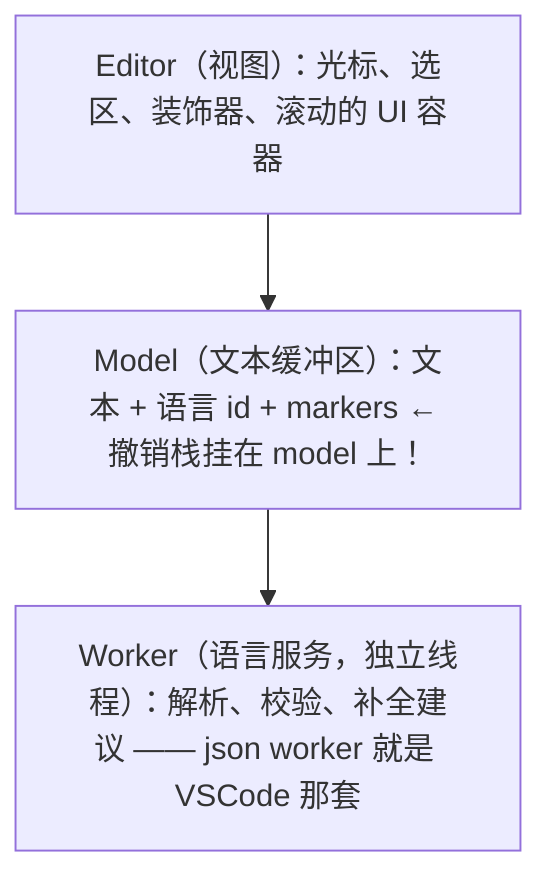
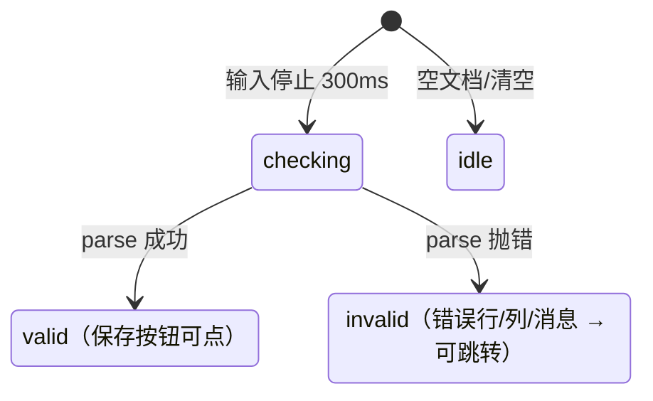

## 5. JSON 编辑器（1 周）

**业务画像**：schema 配置编辑、接口调试、第 3/4 章产物的源码级编辑入口。

第 3 章产出表单设计器、第 4 章产出 dashboard JSON，它们都有"导入/导出 JSON"按钮——但用户拿到 JSON 后去哪改？贴到 VSCode 里改完再贴回来，是所有低代码产品最割裂的体验。本章把这个口子补上：在产品内嵌一个**带 Schema 校验、自动补全、格式化、diff** 的 JSON 编辑器，与可视化编辑器形成"可视化编辑 ↔ 源码编辑"双入口（详见本章产出）。这也是《react-进阶大纲-复杂场景.md》第 6 章低代码平台"源码模式"的地基。

在写第一行代码之前，先建立 Monaco 的三层心智模型，后面每个坑都挂在这三层上：



关键认知：**model 才是文本的 source of truth，editor 只是 model 的一个视图**。一个 model 可以被多个 editor 复用（切换文件 = `setModel`），撤销/重做历史记录在 model 上而不是 editor 上。理解了这一点，"非受控 model 模式"（路线 1）和"executeEdits 保撤销栈"（坑 3）都是它的直接推论。

### 选型对比

| | Monaco | CodeMirror 6 |
|---|---|---|
| 体验 | VSCode 级 | 优秀但轻量 |
| 体积 | 大（worker 按需） | 小、tree-shakable |
| JSON Schema 补全 | 官方 json worker | codemirror-json-schema |
| 适合 | 重度 IDE 场景 | 嵌入业务系统 |

逐行补上论据：

**体验：VSCode 级 vs 优秀但轻量**。Monaco 就是把 VSCode 的编辑器核心抽出来打成包——多光标、列选择、folding、minimap、Cmd+D 逐个选中、命令面板、diff 视图，行为与 VSCode 完全一致（它俩共享同一份代码）。CodeMirror 6 是社区从 CM5 重写的下一代编辑器，交互现代、触屏与移动端适配好，但功能面刻意收窄：没有开箱的 minimap/diff，扩展都靠拼装。如果你要的是"网页里的 VSCode"，只有 Monaco 一个选项。

**体积：大（worker 按需）vs 小、tree-shakable**。Monaco 全量语言包是 MB 级的（TypeScript 语言服务最重），按需注册语言、worker 分包后核心仍在数百 KB gzip 的量级，且 worker 是独立 chunk、首屏可以不加载。CodeMirror 6 由几十个小包组成（`@codemirror/state/view/language` + 各语言包），只 import 用到的部分，"core + JSON 语言"通常在一两百 KB 量级，是它的核心卖点。还有一个 Monaco 特有的加载策略：`@monaco-editor/react` **默认不打包 monaco**，而是运行时从 CDN（jsdelivr）按需拉取——首屏打包体积为零，代价是强外网依赖（内网项目的坑 1 详解里会给本地化配置）。CodeMirror 是纯 npm 依赖，没有这层变量。

**JSON Schema 补全：官方 json worker vs codemirror-json-schema**。Monaco 的 JSON 能力来自官方 `monaco-json` 语言包，里面跑的就是 VSCode 同款的 JSON language service——挂上 JSON Schema 后，键名补全、枚举值补全、hover 文档、红线校验、格式化全部开箱即用，一个 `setDiagnosticsOptions` 调用搞定，成熟度与 VSCode 等同。CodeMirror 侧的 `codemirror-json-schema` 是社区扩展，补全/hover/校验的基本盘都有，但配置面与边界情况（`$ref`、远程 schema、错误信息格式）不如 VSCode 那套打磨得久。重 schema 依赖的场景，这一行就能定胜负。

**适合：重度 IDE 场景 vs 嵌入业务系统**。决策清单：需要 diff 视图、多语言（JSON + TS + SQL 混布）、VSCode 肌肉记忆 → Monaco；只是"表单里一个 JSON 字段要个高亮和括号配对"、对包体敏感、要兼容移动端 → CodeMirror 6。另一个隐形维度是**线程模型**：Monaco 的语言服务跑在 Web Worker 里（大文档校验不阻塞输入），代价是打包配置麻烦（坑 1）；CodeMirror 的 lezer 解析器在主线程做增量解析，快且零配置，但超大文档 + 重校验时会挤占主线程。本章按大纲以 `@monaco-editor/react` 展开主线，CodeMirror 的等价实现思路在路线 7（大 JSON）处对照说明。

### 实现路线（以 @monaco-editor/react 为例）

1. **非受控 model 模式**：编辑器持有 model 作为 source of truth
   - ⚠️ 最大坑：受控 `value` 每次渲染 `setValue` → 光标跳、撤销栈被破坏
2. JSON 语言能力：json worker 语法校验（红波浪线）；`jsonDefaults.setDiagnosticsOptions({ schemas: [{ uri, fileMatch }] })` 挂 JSON Schema → **自动补全 + 校验**
3. onChange 防抖 → `JSON.parse` → 错误状态上报工具栏（错误数/行号），合法时才允许保存
4. 工具条：格式化 / 压缩 / 复制 / 搜索替换 / 跳转错误
5. DiffEditor：两版 schema 对比（版本回滚场景）
6. 树形 + 代码双视图（设置页模式）：光标变化 → 计算 JSONPath → 树定位高亮，反向点击树 → 跳转代码位置
7. 大 JSON：wordWrap、折叠、关闭 minimap；超长文档考虑 CodeMirror
8. 进阶：自定义 DSL 高亮（Monarch tokenizer）——为自研协议服务的语法着色

### 路线 1：非受控 model 模式 —— 本章最大坑的正面攻坚

**先看错误写法**。从 React 表单迁移过来的第一直觉是把 Monaco 当 `<input>`：

```tsx
// ❌ 反例：把 Monaco 当受控输入框
import { useState } from 'react';
import Editor from '@monaco-editor/react';

function BadJsonEditor({ onJson }: { onJson: (v: string) => void }) {
  const [code, setCode] = useState('{}');
  return (
    <Editor
      language="json"
      value={code}                      // 受控：每次渲染都"对账"
      onChange={(v) => setCode(v ?? '')}
    />
  );
}
```

**症状**：打字时光标时不时跳到行尾/别处；Cmd+Z 撤销历史"变浅"甚至整体失效（按一下直接回到很早的状态或完全不能撤销）；中文输入法组词被打断；父组件一旦做了规范化回写（`JSON.stringify(JSON.parse(code))` 再 setCode），编辑器整段文本被替换。

**机理分析**（一步步跟）：

1. 用户敲一个字符 → Monaco 内部更新 model 文本 → `onChange(v)` 回调 → `setCode(v)` → 组件重渲染 → `value` prop 变化。
2. `@monaco-editor/react` 对 `value` 的处理语义是"渲染后编辑器文本必须等于 value"：发现 model 文本与 value 不一致（哪怕只是父组件存了一份规范化过的、或引用不同的字符串），就把 value **整段写入** model。
3. 整段写入（`setValue` 语义）在 Monaco 里是"程序性替换整个文档"：**撤销栈被清空**（这不是 bug，是设计——整体替换无法与既有编辑操作历史对齐，Monaco 干脆视为"换了一份新文档"）。
4. 光标与撤销栈一样是 model 之上的隐藏状态：替换后文本长度、行数已变，Monaco 只能把光标位置"夹紧"到合法区间，用户看到的就是光标乱跳。
5. 受控模式每敲一个字符就走一遍 1–4，撤销栈反复被清，症状稳定复现。

根因一句话：**受控组件的契约是"DOM 值是 state 的纯函数"，但代码编辑器的隐藏状态（光标/选区/撤销栈/IME/折叠/滚动）不属于 React**——你只同步了文本，却把其余状态当成了空气，而整段写入恰恰是破坏它们的操作。

**正确的 model 模式**：编辑器自己持有 model，React 只做三件事——传初值（`defaultValue`）、收变更通知（`onChange`）、暴露命令式出口（ref）。外部要改文本走命令式通道（见坑 3 的 `executeEdits`），绝不通过 prop 回灌：

```tsx
// src/json-editor/JsonSourceEditor.tsx —— 正确的非受控 model 模式
import { useImperativeHandle, useRef } from 'react';
import Editor, { type OnMount } from '@monaco-editor/react';
import type { editor as monacoEditor } from 'monaco-editor';

export interface JsonSourceEditorHandle {
  getValue(): string;
  /** 外部数据安全写回（保撤销栈、保光标），见坑 3 */
  setValueSafely(next: string): void;
  format(): void;
  /** 跳转并高亮某位置（工具栏"跳到错误"用） */
  reveal(line: number, column: number): void;
}

interface Props {
  /** 同一文档固定一个 path：@monaco-editor/react 按 path 建/复用 model，
      且 model URI 会被路线 2 的 schema fileMatch 命中 */
  path?: string;
  defaultValue?: string;
  readOnly?: boolean;
  onChange?: (value: string) => void;
}

export function JsonSourceEditor(
  { path = 'config.dashboard.json', defaultValue = '{\n  \n}', readOnly = false, onChange }: Props,
  ref: React.Ref<JsonSourceEditorHandle>,   // React 19：ref 可直接作为 prop；React 18 项目包一层 forwardRef 即可
) {
  const editorRef = useRef<monacoEditor.IStandaloneCodeEditor | null>(null);

  const handleMount: OnMount = (editor) => {
    editorRef.current = editor; // 拿到编辑器实例：后续所有命令式操作都从这走
  };

  // 命令式出口：父组件用 ref 调，不走 props 回灌
  useImperativeHandle(ref, () => ({
    getValue: () => editorRef.current?.getValue() ?? '',
    setValueSafely: (next) => {
      const editor = editorRef.current;
      const model = editor?.getModel();
      if (!editor || !model || model.getValue() === next) return;
      // 全量替换但用 executeEdits：它是一次"正常编辑"，入撤销栈，Cmd+Z 可回退这次外部写入
      editor.executeEdits('external-update', [
        { range: model.getFullModelRange(), text: next, forceMoveMarkers: true },
      ]);
    },
    format: () => { void editorRef.current?.getAction('editor.action.formatDocument')?.run(); },
    reveal: (line, column) => {
      const editor = editorRef.current;
      if (!editor) return;
      editor.setPosition({ lineNumber: line, column });
      editor.revealLineInCenter(line);
      editor.focus();
    },
  }), []);

  return (
    <Editor
      path={path}                    // ← 关键：按 path 建 model，同 path 复用同一 model（source of truth 在编辑器侧）
      defaultLanguage="json"
      defaultValue={defaultValue}    // 只在 model 首次创建时生效，此后 React 不再干预文本
      readOnly={readOnly}
      onMount={handleMount}
      onChange={(v) => onChange?.(v ?? '')} // 单向通知：编辑器 → 外部。外部只读，不回写
      height="100%"
      options={{
        automaticLayout: true,       // Monaco 内置 ResizeObserver 自适应容器，不用自己写
        tabSize: 2,
        scrollBeyondLastLine: false,
      }}
    />
  );
}
```

对比记忆：`defaultValue`/`path` 之于 Monaco，如同 `defaultValue` 之于原生 `<input type="text">`——非受控组件那一套 React 心智在这里完全适用。父组件要"当前值"就 `ref.current.getValue()`，或订阅 `onChange` 存一份镜像 state（只用于展示/校验，永不传回 `value` prop）。

**常见坑小结**：症状 = 光标跳 + 撤销失效 + IME 断；根因 = 受控 value 每次渲染触发整段写入，销毁 model 上的撤销栈与光标状态；修法 = 非受控 model 模式（`path` + `defaultValue` + 命令式 ref），外部更新走 `executeEdits`。

### 路线 2：json worker 语法校验 + JSON Schema 补全

**是什么**。挂上 JSON Schema 后，Monaco 的 json worker 会做三件事：① 语法错误画红波浪线（`Unexpected token`）；② 按 schema 做语义校验（缺 required 字段、类型不对、枚举外取值）；③ 按 schema 生成补全——键名、枚举值、`markdownDescription` 的 hover 文档。三者共用一次配置。

**完整配置代码**（以第 4 章 dashboard 协议为例）：

```tsx
// src/json-editor/useDashboardJsonSchema.ts
import { useEffect } from 'react';
import { useMonaco } from '@monaco-editor/react';

// 协议的 JSON Schema：与第 4 章 types.ts 一一对应，长期由协议文件派生维护
const dashboardSchema = {
  $schema: 'http://json-schema.org/draft-07/schema#',
  title: 'Dashboard v1',
  type: 'object',
  required: ['version', 'panels', 'layout'],
  properties: {
    version: { const: 1 },
    meta: {
      type: 'object',
      properties: {
        title: { type: 'string', minLength: 1 },
        updatedAt: { type: 'number', description: 'epoch 毫秒' },
      },
    },
    time: {
      type: 'object',
      properties: {
        from: { type: 'number' },
        to: { type: 'number' },
        refreshMs: { type: 'number', enum: [0, 5000, 30000, 300000] },
      },
    },
    datasources: {
      type: 'array',
      items: {
        type: 'object',
        required: ['uid', 'type'],
        properties: {
          uid: { type: 'string' },
          type: { type: 'string', enum: ['mock-random-walk', 'static-json'] },
        },
      },
    },
    panels: {
      type: 'array',
      items: {
        type: 'object',
        required: ['id', 'type', 'title'],
        properties: {
          id: { type: 'string', pattern: '^[a-zA-Z0-9_]{1,32}$' },
          type: { type: 'string', enum: ['line', 'bar', 'stat', 'table'] },
          title: { type: 'string', minLength: 1 },
          datasourceUid: { type: 'string' },
          options: { type: 'object' },
        },
      },
    },
    layout: {
      type: 'array',
      items: {
        type: 'object',
        required: ['i', 'x', 'y', 'w', 'h'],
        properties: {
          i: { type: 'string' },
          x: { type: 'integer', minimum: 0, maximum: 23 },
          y: { type: 'integer', minimum: 0 },
          w: { type: 'integer', minimum: 1, maximum: 24 },
          h: { type: 'integer', minimum: 1 },
        },
      },
    },
  },
} as const;

export function useDashboardJsonSchema() {
  const monaco = useMonaco();
  useEffect(() => {
    if (!monaco) return; // CDN 模式下 monaco 异步就绪，useMonaco 返回 undefined 直到加载完成
    monaco.languages.json.jsonDefaults.setDiagnosticsOptions({
      validate: true,
      allowComments: false,        // 严格 JSON：注释也报错（协议文件不允许注释）
      schemas: [
        {
          // uri 只是 schema 的标识符，不必真的可访问——schema 已内联，worker 不会发请求
          uri: 'https://example.com/schemas/dashboard-v1.json',
          // fileMatch 按 model 的 URI 匹配：路线 1 里 path='config.dashboard.json' 正好命中
          fileMatch: ['*.dashboard.json'],
          schema: dashboardSchema,
        },
      ],
    });
  }, [monaco]);
}
```

**机制拆解**：① `fileMatch` 支持通配，匹配的是 model 的 URI 而不是内容，所以路线 1 的 `path` 命名纪律（协议文件名以 `.dashboard.json` 结尾）是这里的前置条件——这也是"model 模式"的又一收益：**model 有稳定 URI，schema 才能挂得准**。② `schema` 直接内联对象，worker 免去 HTTP 拉取；若只给 `uri` 不给 `schema`，需要同时 `enableSchemaRequest: true` 让 worker 发请求下载。③ 校验/补全发生在 worker 线程，主线程零卡顿，代价是结果（markers）异步到达——所以工具栏的错误数不应该在 onChange 里同步算，而应该监听 markers 变化事件（路线 3 的进阶实现）。

**拿到校验结果（markers）的正确姿势**：

```ts
// monaco 就绪后（onMount 或 useMonaco effect 里）：
const disposable = monaco.editor.onDidChangeMarkers((uris) => {
  const model = editor.getModel();
  if (!model || !uris.some((u) => u.toString() === model.uri.toString())) return;
  // owner 'json' = json worker 产出的诊断；severity 8 = Error
  const markers = monaco.editor.getModelMarkers({ owner: 'json', resource: model.uri });
  const errors = markers.filter((m) => m.severity === 8); // MarkerSeverity.Error
  setErrors(errors.map((m) => ({ line: m.startLineNumber, column: m.startColumn, message: m.message })));
});
// 组件卸载时 disposable.dispose();
```

### 路线 3：onChange 防抖 → JSON.parse → 错误上报工具栏的状态机

**为什么需要自己的 JSON.parse 校验**：worker markers 覆盖语法与 schema 错误，但它是异步的且粒度面向"编辑体验"；"是否允许保存"这个业务判定需要一条**确定性的同步链路**：防抖 → `JSON.parse` → 状态机。两条链路并存：markers 负责"红波浪线 + 错误列表"，parse 负责保存闸门。

**状态机**：



```tsx
// src/json-editor/useJsonValidity.ts
import { useEffect, useState } from 'react';

export type ValidityState =
  | { kind: 'idle' }                                    // 空文档
  | { kind: 'checking' }                                // 防抖等待中
  | { kind: 'valid' }                                   // 可保存
  | { kind: 'invalid'; message: string; line: number; column: number }; // 禁止保存

/** JSON.parse 的报错只有 message（各引擎格式不一），行/列要自己从 position 换算 */
export function positionToLineCol(text: string, position: number): { line: number; column: number } {
  const before = text.slice(0, position);
  const lines = before.split('\n');
  return { line: lines.length, column: lines[lines.length - 1]!.length + 1 };
}

function extractError(err: Error, raw: string): { message: string; line: number; column: number } {
  const msg = err.message;
  const pos = /position (\d+)/.exec(msg); // 老引擎："... at position 42"
  if (pos) return { message: msg, ...positionToLineCol(raw, Number(pos[1])) };
  const lc = /line (\d+) column (\d+)/.exec(msg); // 新引擎：部分报错自带 line/column
  if (lc) return { message: msg, line: Number(lc[1]), column: Number(lc[2]) };
  return { message: msg, line: 1, column: 1 }; // 兜底：跳到开头
}

export function useJsonValidity(raw: string, delay = 300) {
  const [state, setState] = useState<ValidityState>({ kind: 'idle' });
  useEffect(() => {
    if (!raw.trim()) { setState({ kind: 'idle' }); return; }
    setState({ kind: 'checking' });
    const t = window.setTimeout(() => {
      try {
        JSON.parse(raw);              // 同步判定，成本可接受（大文档兜底见路线 7）
        setState({ kind: 'valid' });
      } catch (e) {
        setState({ kind: 'invalid', ...extractError(e as Error, raw) });
      }
    }, delay);
    return () => window.clearTimeout(t); // 300ms 内继续输入 → 上一次的 parse 取消
  }, [raw, delay]);
  return state;
}
```

**工具栏消费状态机**（与路线 4 的按钮合在一起）：

```tsx
// src/json-editor/JsonEditorToolbar.tsx
import type { ValidityState } from './useJsonValidity';

interface Props {
  validity: ValidityState;
  onFormat: () => void;
  onMinify: () => void;
  onCopy: () => void;
  onFindReplace: () => void;
  onJumpError: (line: number, column: number) => void;
  onSave: () => void;
}

export function JsonEditorToolbar({ validity, onFormat, onMinify, onCopy, onFindReplace, onJumpError, onSave }: Props) {
  return (
    <div style={{ display: 'flex', gap: 8, alignItems: 'center', borderBottom: '1px solid #eee', padding: '4px 8px' }}>
      <button onClick={onFormat}>格式化</button>
      <button onClick={onMinify}>压缩</button>
      <button onClick={onCopy}>复制</button>
      <button onClick={onFindReplace}>搜索替换</button>

      {/* 状态区：checking 转圈、invalid 红字可点、valid 绿字 */}
      {validity.kind === 'checking' && <span style={{ color: '#999' }}>校验中…</span>}
      {validity.kind === 'invalid' && (
        <button
          style={{ color: '#cf1322' }}
          onClick={() => onJumpError(validity.line, validity.column)}
          title={validity.message}
        >
          JSON 错误：{validity.message}（第 {validity.line} 行第 {validity.column} 列，点击跳转）
        </button>
      )}
      {validity.kind === 'valid' && <span style={{ color: '#389e0d' }}>JSON 合法</span>}

      <button disabled={validity.kind !== 'valid'} onClick={onSave}>保存</button>
    </div>
  );
}
```

`invalid` 时保存按钮 disabled——"合法时才允许保存"这道闸门必须做在 UI 层和提交层两处（提交函数入口再 `JSON.parse` 一次兜底，防止绕过 UI 的调用）。

### 路线 4：工具条 —— 格式化 / 压缩 / 复制 / 搜索替换 / 跳转错误

各功能的实现要点与差异，全部基于路线 1 拿到的 `editorRef`：

```tsx
// src/json-editor/useEditorActions.ts —— 工具条动作集合
import { useCallback } from 'react';
import type { editor as monacoEditor } from 'monaco-editor';

export function useEditorActions(getEditor: () => monacoEditor.IStandaloneCodeEditor | null) {
  /** 格式化：优先用 Monaco 内置 action（等价于用户按 Shift+Alt+F，走编辑器统一的编辑管线） */
  const format = useCallback(() => {
    void getEditor()?.getAction('editor.action.formatDocument')?.run();
  }, [getEditor]);

  /** 压缩：内置没有 minify action，自己 parse + stringify 后用 executeEdits 写回（入撤销栈，Cmd+Z 可撤销压缩） */
  const minify = useCallback(() => {
    const editor = getEditor();
    const model = editor?.getModel();
    if (!editor || !model) return;
    let min = '';
    try {
      min = JSON.stringify(JSON.parse(model.getValue()));
    } catch {
      return; // 不合法就不压缩——绝不能在语法错误时执行，会把用户内容覆盖坏
    }
    editor.executeEdits('toolbar-minify', [
      { range: model.getFullModelRange(), text: min, forceMoveMarkers: true },
    ]);
  }, [getEditor]);

  /** 复制：Clipboard API + 降级 */
  const copy = useCallback(async () => {
    const text = getEditor()?.getValue() ?? '';
    try {
      await navigator.clipboard.writeText(text);
    } catch {
      // 非安全上下文（http）没有 clipboard API：降级选中文本让用户 Cmd+C
      getEditor()?.trigger('toolbar', 'editor.action.selectAll', null);
      alert('已全选，请按 Cmd/Ctrl+C 复制');
    }
  }, [getEditor]);

  /** 搜索替换：打开 Monaco 内置查找替换组件（与 VSCode 同一个） */
  const findReplace = useCallback(() => {
    void getEditor()?.getAction('editor.action.startFindReplaceAction')?.run();
  }, [getEditor]);

  /** 跳转错误：光标定位 + 视口滚动到中心 + 聚焦（不聚焦的话光标标记不可见） */
  const jumpError = useCallback((line: number, column: number) => {
    const editor = getEditor();
    if (!editor) return;
    editor.setPosition({ lineNumber: line, column });
    editor.revealLineInCenter(line);
    editor.focus();
  }, [getEditor]);

  return { format, minify, copy, findReplace, jumpError };
}
```

要点辨析：**格式化**绝不要自己 `JSON.stringify(JSON.parse(v), null, 2)` 后整段写回——内置 action 会保留光标相对位置、支持部分选区格式化、走统一的编辑管线（可撤销）；自己写回是下策。**压缩**则相反（内置没有），必须自己实现，但注意两点：不合法时直接放弃（错误 JSON 压缩 = 数据损坏），写回必须走 `executeEdits` 而不是 `setValue`（理由同坑 3）。**搜索替换**没有任何理由自己造——`editor.action.startFindReplaceAction` 打开的就是 VSCode 那个查找替换条，含正则/大小写/全词切换。**跳转错误**的三件套 `setPosition + revealLineInCenter + focus` 缺一不可，少 focus 时用户看到行滚过去了但没有光标闪烁，体感像"没反应"。

### 路线 5：DiffEditor —— 两版 schema 对比

**是什么**：`@monaco-editor/react` 的 `DiffEditor` 组件，双栏渲染两份文本的差异，差异行/差异字符高亮。场景：dashboard JSON 的版本回滚——"当前线上版 vs 候选版"，确认无误后一键应用。

```tsx
// src/json-editor/SchemaDiff.tsx
import { DiffEditor } from '@monaco-editor/react';

interface Props {
  current: string;      // 当前版本 JSON
  candidate: string;    // 候选版本 JSON
  currentRev: number;   // 两个版本号：作为 key 保证 diff 随版本切换刷新
  candidateRev: number;
  onApply: () => void;  // "应用此版本"：把 candidate 写回主编辑器（走 setValueSafely）
}

export function SchemaDiff({ current, candidate, currentRev, candidateRev, onApply }: Props) {
  return (
    <div style={{ display: 'flex', flexDirection: 'column', height: 480 }}>
      <DiffEditor
        key={`${currentRev}-${candidateRev}`}   // 对比视图不需要编辑，key 重挂载最稳、避免增量 diff 的状态残留
        original={current}                       // 左：当前
        modified={candidate}                     // 右：候选
        language="json"
        options={{
          readOnly: true,                // 对比视图只读；应用走显式按钮，避免"顺手改了两边不一致"
          renderSideBySide: true,        // false = 行内 diff（窄屏/移动端友好）
          enableSplitViewResizing: true, // 允许拖动调整双栏宽度
          renderOverviewRuler: false,
          ignoreTrimWhitespace: false,   // 严格 diff：JSON 虽不该有尾随空白，出现了就该被看见
          diffWordWrap: 'off',
        }}
      />
      <div style={{ padding: 8, textAlign: 'right' }}>
        <button onClick={onApply}>应用此版本（写入编辑器，Cmd+Z 可撤销）</button>
      </div>
    </div>
  );
}
```

三个实践要点：① DiffEditor 的 `original/modified` 是可以受控更新的 prop（对比场景无光标/撤销态，受控无害），但用 `key` 重挂载可以彻底规避增量 diff 的内部缓存问题；② `renderSideBySide: false` 切行内模式是响应式布局的好搭档；③ "应用"动作的实现就是调用路线 1 的 `setValueSafely(candidate)`——外部写入必须保撤销栈，用户应用错了能 Cmd+Z 回来，这是版本回滚场景的安全底线。

### 路线 6：树形 + 代码双视图 —— 光标与 JSONPath 的双向同步

**场景**：设置页模式。左侧一棵 JSON 树（可折叠导航），右侧 Monaco 代码。要求：光标落在代码里某个值上 → 左树自动展开并高亮对应节点；反过来点击树的某个节点 → 右侧跳到对应代码位置并高亮。实现分四块：

**第一块：offset ↔ JSONPath 映射表**。核心数据结构是"每个 JSON 节点的路径 + 它在文本中的字符区间"。`JSON.parse` 给不了位置信息，所以要么用现成的 `json-source-map`（生产推荐，一步得到 pointer → 位置区间的映射），要么手写一个递归下降扫描器。教学价值优先，这里手写（同时它就是路线 7 之前对大 JSON 的唯一遍历成本）：

```ts
// src/json-editor/jsonPathMap.ts
export interface JsonNodeRef {
  path: string;        // JSONPath：$.panels[0].title
  isKey: boolean;      // true = 这是键名 token（"title"），false = 值或容器
  start: number;       // 文本中的 [start, end) 字符区间
  end: number;
}

export interface PathMapResult {
  nodes: JsonNodeRef[]; // 按 start 升序（递归下降天然有序）
  value: unknown;       // 顺手返回解析结果，省一次 JSON.parse
}

/**
 * 简化版 JSON 扫描器：支持对象/数组/字符串（含转义）/数字/true/false/null。
 * 不支持注释（allowComments=false 时无损失）。文本暂不合法时返回 null，调用方保留上一次的映射。
 */
export function buildJsonPathMap(text: string): PathMapResult | null {
  let pos = 0;
  const nodes: JsonNodeRef[] = [];

  const skipWs = () => {
    while (pos < text.length && ' \t\r\n'.includes(text[pos]!)) pos++;
  };
  const peek = () => text[pos];

  function parseString(): { value: string; start: number; end: number } {
    const start = pos;
    pos++; // 开头引号
    let raw = '';
    while (pos < text.length && text[pos] !== '"') {
      if (text[pos] === '\\' && pos + 1 < text.length) {
        raw += text[pos]! + text[pos + 1]!; // 转义序列原样保留，反转义交给 JSON.parse
        pos += 2;
      } else {
        raw += text[pos]!;
        pos++;
      }
    }
    if (peek() !== '"') throw new Error('字符串未闭合');
    pos++; // 结尾引号
    return { value: JSON.parse('"' + raw + '"'), start, end: pos };
  }

  function parseValue(path: string): unknown {
    skipWs();
    const c = peek();
    if (c === '{' || c === '[') return parseContainer(path, c === '[' ? 'array' : 'object');
    if (c === '"') {
      const s = parseString();
      nodes.push({ path, isKey: false, start: s.start, end: s.end });
      return s.value;
    }
    // 数字 / true / false / null
    const m = /^(true|false|null|-?\d+(?:\.\d+)?(?:[eE][+-]?\d+)?)/.exec(text.slice(pos));
    if (!m) throw new Error(`位置 ${pos} 出现意外字符：${c ?? 'EOF'}`);
    pos += m[0].length;
    nodes.push({ path, isKey: false, start: pos - m[0].length, end: pos });
    const raw = m[0];
    return raw === 'true' ? true : raw === 'false' ? false : raw === 'null' ? null : Number(raw);
  }

  function parseContainer(path: string, kind: 'object' | 'array'): unknown {
    const start = pos;
    pos++; // { 或 [
    const nodeIdx = nodes.length;
    nodes.push({ path, isKey: false, start, end: -1 }); // 容器的 end 在解析完回填
    const out: unknown[] | Record<string, unknown> = kind === 'array' ? [] : {};

    skipWs();
    if (peek() === (kind === 'array' ? ']' : '}')) {
      pos++;
      nodes[nodeIdx]!.end = pos;
      return out; // 空容器 {}
    }

    for (;;) {
      skipWs();
      if (kind === 'array') {
        (out as unknown[]).push(parseValue(`${path}[${(out as unknown[]).length}]`));
      } else {
        const key = parseString(); // 键也是字符串 token
        nodes.push({ path: `${path}.${key.value}`, isKey: true, start: key.start, end: key.end }); // 键 token 单独记录，点击树时高亮 "key" 更直观
        skipWs();
        if (peek() !== ':') throw new Error('对象缺少 :');
        pos++;
        (out as Record<string, unknown>)[key.value] = parseValue(`${path}.${key.value}`);
      }
      skipWs();
      if (peek() === ',') { pos++; continue; }
      if (peek() === (kind === 'array' ? ']' : '}')) { pos++; break; }
      throw new Error(`位置 ${pos} 出现意外字符：${peek() ?? 'EOF'}`);
    }
    nodes[nodeIdx]!.end = pos;
    return out;
  }

  try {
    skipWs();
    const value = parseValue('$');
    skipWs();
    if (pos !== text.length) throw new Error('JSON 根元素后存在多余内容');
    return { nodes, value };
  } catch {
    return null; // 编辑中间态（删了一半的括号）很常见：返回 null，调用方沿用旧映射
  }
}

/** 光标 offset → 所在最深节点的 JSONPath（nodes 有序，线性扫即可；超大树可二分） */
export function pathAtOffset(nodes: JsonNodeRef[], offset: number): string | null {
  let hit: JsonNodeRef | null = null;
  for (const n of nodes) {
    if (n.start > offset) break;
    if (offset < n.end) hit = n; // 后命中的更深层（start 更大），覆盖外层容器
  }
  return hit?.path ?? null;
}
```

**第二块：树数据**。从 `PathMapResult.value` 递归生成树节点（每个节点带 path，点击时能查回区间）：

```ts
// src/json-editor/treeModel.ts
export interface TreeNode {
  path: string;
  label: string;
  kind: 'object' | 'array' | 'value';
  children: TreeNode[];
  preview?: string; // 叶子节点的值预览
}

export function buildTree(value: unknown, path = '$', label = '$'): TreeNode {
  if (Array.isArray(value)) {
    return {
      path, label, kind: 'array',
      children: value.map((v, i) => buildTree(v, `${path}[${i}]`, `[${i}]`)),
    };
  }
  if (value !== null && typeof value === 'object') {
    return {
      path, label, kind: 'object',
      children: Object.entries(value as Record<string, unknown>).map(
        ([k, v]) => buildTree(v, `${path}.${k}`, k),
      ),
    };
  }
  return { path, label, kind: 'value', children: [], preview: String(value) };
}

/** 把一个 path 的所有祖先展开：$.panels[0].title → ['$', '$.panels', '$.panels[0]', '$.panels[0].title'] */
export function expandableAncestors(path: string): string[] {
  const parts: string[] = [];
  let cur = '';
  for (const seg of path.replace(/^\$/, '').split(/(?=\.|\[)/)) {
    cur += seg;
    parts.push('$' + cur);
  }
  return parts;
}
```

**第三块：双向同步骨架**。两个方向、一个防环闸门：

```tsx
// src/json-editor/JsonDualView.tsx —— 树 + 代码双视图（骨架）
import { useEffect, useMemo, useRef, useState } from 'react';
import Editor, { type OnMount } from '@monaco-editor/react';
import type { editor as monacoEditor } from 'monaco-editor';
import { buildJsonPathMap, pathAtOffset } from './jsonPathMap';
import { buildTree, expandableAncestors, type TreeNode } from './treeModel';

export function JsonDualView({ defaultValue }: { defaultValue: string }) {
  const editorRef = useRef<monacoEditor.IStandaloneCodeEditor | null>(null);
  const monacoRef = useRef<typeof import('monaco-editor') | null>(null); // 保存 monaco 命名空间：构造 Range/Uri 都要它
  const decorationsRef = useRef<monacoEditor.IEditorDecorationsCollection | null>(null);
  const suppressCursorSyncRef = useRef(0); // ★ 防环闸门：程序化定位后的光标事件不再回写树

  const [raw, setRaw] = useState(defaultValue);
  const [activePath, setActivePath] = useState<string | null>(null);
  const [expanded, setExpanded] = useState<Set<string>>(new Set(['$']));

  // 防抖重建映射：输入停 300ms 才扫（大 JSON 扫描不便宜）
  const [debouncedRaw, setDebouncedRaw] = useState(defaultValue);
  useEffect(() => {
    const t = window.setTimeout(() => setDebouncedRaw(raw), 300);
    return () => window.clearTimeout(t);
  }, [raw]);

  const pathMap = useMemo(() => buildJsonPathMap(debouncedRaw), [debouncedRaw]);
  const tree = useMemo(() => (pathMap ? buildTree(pathMap.value) : null), [pathMap]);

  const handleMount: OnMount = (editor, monaco) => {
    editorRef.current = editor;
    monacoRef.current = monaco;
    decorationsRef.current = editor.createDecorationsCollection([]); // 高亮集合：可整组替换

    // 方向一：代码 → 树。光标每次变化计算 JSONPath，定位树节点
    editor.onDidChangeCursorPosition((e) => {
      if (Date.now() < suppressCursorSyncRef.current) return; // 自己触发的光标移动：忽略
      const model = editor.getModel();
      if (!model || !pathMap) return;
      const offset = model.getOffsetAt(e.position);
      const p = pathAtOffset(pathMap.nodes, offset);
      if (p) {
        setActivePath(p);
        setExpanded((prev) => {
          const next = new Set(prev);
          for (const a of expandableAncestors(p)) next.add(a); // 祖先链全部展开
          return next;
        });
      }
    });
  };

  // 方向二：树 → 代码。点击树节点：选区 + 滚动 + 装饰高亮
  const onTreeNodeClick = (node: TreeNode) => {
    const editor = editorRef.current;
    const monaco = monacoRef.current;
    const model = editor?.getModel();
    if (!editor || !monaco || !model || !pathMap) return;
    const target = pathMap.nodes.find((n) => n.path === node.path && !n.isKey)
      ?? pathMap.nodes.find((n) => n.path === node.path);
    if (!target) return;

    suppressCursorSyncRef.current = Date.now() + 150; // ★ 防环：150ms 内忽略 onDidChangeCursorPosition
    const start = model.getPositionAt(target.start);  // offset → 行/列
    const end = model.getPositionAt(target.end);
    const range = new monaco.Range(start.lineNumber, start.column, end.lineNumber, end.column);
    editor.setSelection(range);            // 选中 "key": value 区间
    editor.revealRangeInCenter(range);     // 滚到视口中央
    editor.focus();                        // 光标可见
    decorationsRef.current?.set([          // 整组替换高亮（上一次的自动清除）
      {
        range,
        options: {
          className: 'json-tree-highlight',                  // CSS 里给背景色
          overviewRuler: { color: '#f5c518', position: 4 },   // 右侧标尺同步可见
        },
      },
    ]);
    setActivePath(node.path);
  };

  // 树渲染：递归 + expanded/activePath 控制展开与高亮（数据量上千时换 react-arborist 虚拟化，见第 6 章大纲树）
  const renderNode = (node: TreeNode, depth: number) => {
    const isBranch = node.children.length > 0;
    const open = expanded.has(node.path);
    return (
      <div key={node.path}>
        <div
          onClick={() => {
            if (isBranch) setExpanded((p) => { const n = new Set(p); n.has(node.path) ? n.delete(node.path) : n.add(node.path); return n; });
            onTreeNodeClick(node);
          }}
          style={{
            paddingLeft: depth * 16, cursor: 'pointer',
            background: activePath === node.path ? '#e6f4ff' : undefined,
          }}
        >
          {isBranch ? (open ? '▾ ' : '▸ ') : '  '}
          {node.label}
          {!isBranch && node.preview !== undefined && <span style={{ color: '#8c8c8c' }}> : {node.preview}</span>}
        </div>
        {isBranch && open && <div>{node.children.map((c) => renderNode(c, depth + 1))}</div>}
      </div>
    );
  };

  return (
    <div style={{ display: 'flex', height: 600 }}>
      <div style={{ width: 300, borderRight: '1px solid #eee', overflow: 'auto', fontSize: 12 }}>
        {tree ? renderNode(tree, 0) : <div style={{ padding: 8, color: '#999' }}>JSON 暂不可解析，树已冻结在上次合法状态</div>}
      </div>
      <div style={{ flex: 1, minWidth: 0 }}>
        <Editor
          defaultLanguage="json"
          defaultValue={defaultValue}
          onMount={handleMount}
          onChange={(v) => setRaw(v ?? '')}
          options={{ automaticLayout: true, minimap: { enabled: false } }}
        />
      </div>
    </div>
  );
}
```

**双向同步的实现思路总结**（面试常问，值得背下来）：① 一个"地址系统"——JSONPath + 文本 offset 区间，双向同步本质是地址在两套坐标系（树节点 / 文本位置）间的换算；② 代码→树：`onDidChangeCursorPosition` → `getOffsetAt` → `pathAtOffset`（区间命中取最深）→ 祖先链展开 + 高亮；③ 树→代码：path → 区间 → `getPositionAt` → `setSelection + revealRangeInCenter + createDecorationsCollection` 高亮；④ 防环：程序化定位也会触发光标事件，用时间戳闸门（150ms）或判断事件 source 为程序化来源来忽略，否则树高亮 ↔ 光标跳转互相触发形成抖动循环；⑤ 映射表随输入防抖重建，文本暂不合法时沿用旧映射（树冻结），合法后无感恢复。

### 路线 7：大 JSON 优化清单

十兆级的 dashboard/接口响应贴进编辑器，默认配置会卡。按性价比排序的清单，每条带原因：

```ts
// 大 JSON 场景的 options 组合
const bigJsonOptions = {
  automaticLayout: true,        // 容器自适应（RGL/抽屉里的编辑器必开）
  minimap: { enabled: false },  // 1) minimap 渲染整个文档缩略图：大文档纯开销、JSON 无导航价值
  wordWrap: 'on',               // 2) 长行折行：压缩过的一行 JSON 不折行就是横向马拉松
  folding: true,                // 3) 折叠：默认开，配合 Cmd+K Cmd+0（全部折叠）快速巡航
  largeFileOptimizations: true, // 4) Monaco 内置开关：超大文件自动关掉词法补全等重特性
  scrollBeyondLastLine: false,
  renderWhitespace: 'none',
  quickSuggestions: false,      // 5) 大文档关掉"边打字边弹补全"：每次弹窗都要 worker 全量扫描
  tabSize: 2,
};
```

清单其余各条：

6. **动态关 schema 校验**：超过阈值（经验值 1MB）时 `jsonDefaults.setDiagnosticsOptions({ validate: false, schemas: [] })`，小于阈值恢复——worker 对全文的 schema 校验成本与文档长度成正比，而"正在编辑的 8MB 配置文件"多半也不在乎补全了。
7. **不要受控回写**：大 JSON 下路线 1 的受控坑会从"体验差"升级成"每键一卡"（整段 diff + 替换都是全文级成本）。
8. **粘贴防御**：`editor.onDidPaste((e) => {...})` 里检查 `model.getValueLength()`，超阈值提示"已进入只读浏览模式"并可顺手切 `readOnly: true`。
9. **导航交给树**：路线 6 的树视图用 react-arborist 虚拟化后承载导航（跳转/搜索），代码视图退化为只读参考——这是"设置页模式"对超大文档的正确姿势。
10. **极限场景换 CodeMirror**：Monaco 在数 MB 以上交互明显变重（它为 IDE 全能付费）；CodeMirror 6 的增量解析架构在纯浏览场景更省。决策线：编辑 + schema 补全是刚需 → 留在 Monaco 并执行上述 1–7；只是"看得动" → CodeMirror 或直接树视图。

### 路线 8：Monarch tokenizer —— 自定义 DSL 高亮入门

**是什么**。Monarch 是 Monaco 内置的声明式语法高亮引擎：一个"状态机 + 正则表"，`[正则, token 类型]` 逐条匹配，命中后可跳转状态。VSCode 里绝大多数语言的"基础着色"都是它写的。为自研协议做高亮（比如第 1 章表达式引擎的插值语法、或低代码平台的绑定表达式）不需要写 parser，一个 Monarch 文件就够。

**目标 DSL**：模板插值语言 `合计：[[ @sum($form.items[*].price) * 1.1 ]] 元`——`[[ ]]` 外是普通文本，内部是表达式（`@函数`、`$变量路径`、数字、运算符）。完整注册代码：

```ts
// src/json-editor/miniExprLanguage.ts
import type * as monacoNs from 'monaco-editor';

export function registerMiniExprLanguage(monaco: typeof monacoNs) {
  if (monaco.languages.getLanguages().some((l) => l.id === 'miniexpr')) return; // 防重复注册（HMR 场景必踩）

  monaco.languages.register({ id: 'miniexpr' });

  // 语言行为配置：括号匹配、自动闭合（与着色无关但一起配了）
  monaco.languages.setLanguageConfiguration('miniexpr', {
    brackets: [['(', ')'], ['[', ']']],
    autoClosingPairs: [
      { open: '(', close: ')' },
      { open: '"', close: '"' },
      { open: '[[', close: ']]' },
    ],
  });

  monaco.languages.setMonarchTokensProvider('miniexpr', {
    tokenizer: {
      // 状态一：root = 普通文本（入口状态）
      root: [
        [/\[\[/, { token: 'keyword', next: '@expr' }], // 看到 [[ → 吃掉定界符并压入 expr 状态
        [/./, 'string'],                               // 其余字符按文本着色（浅色主题下视觉上是"模板文字"）
      ],
      // 状态二：expr = 表达式内部
      expr: [
        [/\]\]/, { token: 'keyword', next: '@pop' }],           // ]] → 弹栈回到 root（状态栈的后进先出）
        [/\s+/, 'white'],                                        // 空白
        [/@[a-zA-Z_]\w*/, 'annotation'],                         // @sum @avg @round → 函数注解
        [/\$[a-zA-Z_]\w*((?:\.\w+|\[\*\]|\[\d+\])*)/, 'variable'], // $form.items[*].price → 变量路径
        [/\d+(?:\.\d+)?/, 'number'],                             // 数字（含小数）
        [/"(?:[^"\\]|\\.)*"/, 'string'],                         // 双引号字符串（含转义）
        [/'(?:[^'\\]|\\.)*'/, 'string'],
        [/[a-zA-Z_]\w*/, 'identifier'],                          // 裸标识符
        [/[+\-*/%<>=!&|?:,()[\]]/, 'operator'],                  // 运算符与标点
      ],
    },
  });
}
```

Monarch 心智模型三句话：① **状态栈**——`next: '@state'` 压栈、`next: '@pop'` 弹回，`root` 是入口状态；本例"文本/表达式"两个状态就是插值语言的最小形态（复杂语言会有字符串状态、模板嵌套状态）。② **token 类型名 → 主题色**——`keyword`/`number`/`string`/`comment`/`operator` 是主题内置名，自动有颜色；`annotation`/`variable` 这类自定义名默认无色，要配色就 `editor.defineTheme`：

```ts
monaco.editor.defineTheme('miniexpr-theme', {
  base: 'vs',
  inherit: true,
  rules: [
    { token: 'annotation', foreground: '7c3aed', fontStyle: 'bold' }, // @函数：紫色加粗
    { token: 'variable',   foreground: '0e7490' },                    // $变量：深青色
  ],
  colors: {},
});
```

③ **正则按声明顺序试匹配，先到先得**——所以更具体的规则（如 `@函数`）必须排在更宽泛的规则（`identifier`）前面，顺序错了就是"全灰"的典型新手症状。写完用 `<Editor defaultLanguage="miniexpr" theme="miniexpr-theme" ...>` 验证；这套 DSL 的补全/校验属于第 1 章表达式引擎的范畴，Monarch 只管"着色"这一层。

### 难点与坑

- ⚠️ Vite 下 monaco worker 打包配置
- ⚠️ 中文输入法 composition 期间的变更处理
- ⚠️ 外部数据变化如何安全写回编辑器（`executeEdits` 保撤销栈）

**坑 1｜Vite 下 monaco worker 打包配置（症状 → 根因 → 修法）**

- 症状：控制台报 "You must define a function MonacoEnvironment.getWorkerUrl or MonacoEnvironment.getWorker" 一类错误，或弹 "Could not create web worker"；编辑器能打字但没有语法红波浪线、没有 schema 补全（json worker 没起来）；Network 面板看不到任何 worker 请求；另一种极端症状是内网/离线环境编辑器整个白屏（默认走 CDN 拉 monaco，jsdelivr 不可达）。
- 根因：Monaco 的语言服务（json/ts/css/html worker）与编辑器基础 worker 是**独立的 JS 文件、独立线程**。它的 ESM 代码在运行时按 `MonacoEnvironment.getWorker(label)` 要 worker 构造器，而 Vite 的打包器不会凭空把 `new Worker(...)` 指向的产物切出来——没有任何配置时 worker 文件既没打包也没被引用。`@monaco-editor/react` 默认从 CDN 加载 monaco（`loader` 机制），于是又叠加"外网依赖"这层变量。
- 修法：Vite 原生 `?worker` 导入，一步到位（无需任何插件）：

```ts
// src/monaco-setup.ts —— 应用入口 import 一次
import { loader } from '@monaco-editor/react';
import * as monaco from 'monaco-editor';
// ?worker 后缀是 Vite 的原生 worker 导入：产物切成独立 chunk，拿到的是 Worker 构造器
import editorWorker from 'monaco-editor/esm/vs/editor/editor.worker?worker';
import jsonWorker from 'monaco-editor/esm/vs/language/json/json.worker?worker';
import tsWorker from 'monaco-editor/esm/vs/language/typescript/ts.worker?worker';
import cssWorker from 'monaco-editor/esm/vs/language/css/css.worker?worker';
import htmlWorker from 'monaco-editor/esm/vs/language/html/html.worker?worker';

self.MonacoEnvironment = {
  // label 是语言标识：按需分发对应 worker，只有编辑器本体用 editorWorker
  getWorker(_workerId: string, label: string): Worker {
    switch (label) {
      case 'json': return new jsonWorker();
      case 'css': case 'scss': case 'less': return new cssWorker();
      case 'html': case 'handlebars': case 'razor': return new htmlWorker();
      case 'typescript': case 'javascript': return new tsWorker();
      default: return new editorWorker();
    }
  },
};

loader.config({ monaco }); // ★ 关键：@monaco-editor/react 不走 CDN，改用上面这份本地 monaco（内网必改）
```

```tsx
// src/main.tsx
import './monaco-setup'; // 必须在渲染 <Editor /> 之前执行
```

验证方式：DevTools Network 的 JS 筛选里应看到独立的 worker chunk 请求（构建后是 `json.worker-*.js` 这类文件），随后打一个非法 JSON 应在 1 秒内出现红波浪线。社区还有 `vite-plugin-monaco-editor` 插件方案，能省掉手写 switch，代价是多一个构建期魔法——`?worker` 方案每一行都可解释、可调试，推荐作为默认。

**坑 2｜中文输入法 composition 期间的变更处理（症状 → 根因 → 修法）**

- 症状：在 JSON 字符串值里打中文：候选词条还在组词，编辑器外的逻辑就开始动作——字数统计跳变、自动保存被拼音中间态触发、树视图随拼音逐字母重建、最严重的是受控回写直接打断组词（词条丢失/重复，输入法报错音）。此外撤销栈里出现"每敲一个拼音字母一条"的碎记录。
- 根因：IME 输入分三段事件——`compositionstart` → 多次 `compositionupdate`（拼音中间态，textarea 里是"zhong'wen"这种半成品）→ `compositionend`（上屏最终汉字）。Monaco 的 `onChange`（`onDidChangeModelContent`）在中间态每次变化都会触发；如果你的下游逻辑（parse/保存/联动/回写）把中间态当最终文本处理，就会产生上述全部症状。这与 React 受控 textarea 遇到的 composition 问题是同一件事，只是换了个宿主。
- 修法：三原则。① **结构性防线（最重要）**：路线 1 的非受控 model 模式下，你根本不会在 composition 期间往编辑器写文本——"永不回写"天然免疫打断组词。② **旁路逻辑挂闸门**：监听 composition 起止，组词期间挂起 parse/保存/树重建，结束时补一次。Monaco 把 DOM 事件桥接成了编辑器事件，直接用：

```tsx
// 组词闸门：composition 期间挂起副作用
const composingRef = useRef(false);
// onMount 里：
const d1 = editor.onDidCompositionEnter(() => { composingRef.current = true; });
const d2 = editor.onDidCompositionLeave(() => {
  composingRef.current = false;
  scheduleParse(); // 组词结束才算一次有效变更，补一次防抖解析
});
const d3 = editor.onDidChangeModelContent(() => {
  if (composingRef.current) return; // 拼音中间态：不解析、不保存、不重建树
  scheduleParse();
});
// 卸载时 d1.dispose(); d2.dispose(); d3.dispose();
```

③ **防抖兜底**：路线 3 的 300ms 防抖本身就能吸收大部分中间态（组词通常一气呵成不超过 300ms 的间隙），但闸门是确定性的，防抖只是概率性的，两者叠加最稳。

**坑 3｜外部数据变化如何安全写回编辑器（症状 → 根因 → 修法）**

- 症状：双入口场景——用户在可视化编辑器里拖了个面板，切回"源码模式"想让 JSON 跟上：用 `model.setValue(next)` 或重建编辑器后，源码里的 Cmd+Z 一按回到"很久以前"、光标/选区/滚动位置全丢；反过来如果干脆不写回，两个入口内容漂移。
- 根因：`setValue` 的语义是"程序性整体替换文档"——**它不入撤销栈，反而清空撤销栈**（Monaco 把整体替换视作"换了一份新文档"）。而用户的期望语义是"编辑器替我做了一次全选粘贴"：可撤销、光标尽量保持。两个 API 的分水岭要记牢：

| API | 撤销栈 | 光标 | 适用 |
|---|---|---|---|
| `model.setValue(text)` | **清空** | 重置 | 首次装载、确认丢弃历史的场景 |
| `editor.executeEdits(source, edits)` | **入栈（可 Cmd+Z）** | 由编辑计算 | 一切"外部数据写回"的正解 |

- 修法：全量替换走 `executeEdits`（路线 1 的 `setValueSafely` 已实现），这里补上完整的"外部同步"组件逻辑——版本号驱动 + 冲突保护：

```tsx
// src/json-editor/ExternalSync.tsx —— 外部（可视化编辑器）→ 源码编辑器的安全同步
import { useEffect, useRef } from 'react';
import type { editor as monacoEditor } from 'monaco-editor';

interface SyncProps {
  editorRef: React.RefObject<monacoEditor.IStandaloneCodeEditor | null>;
  /** 每次外部变更递增的版本号：React 18/19 的 StrictMode 双执行下，比"比较内容"更可靠 */
  externalRevision: number;
  externalValue: string;
  /** 冲突策略回调：用户正在编辑时外部又变了。默认跳过写回并提示 */
  onConflict?: () => void;
}

export function useExternalSync({ editorRef, externalRevision, externalValue, onConflict }: SyncProps) {
  const appliedRev = useRef(externalRevision); // 已应用的版本：初始跳过第一次（初值已由 defaultValue 装载）

  useEffect(() => {
    if (appliedRev.current === externalRevision) return; // 只响应"新的外部版本"
    appliedRev.current = externalRevision;

    const editor = editorRef.current;
    const model = editor?.getModel();
    if (!editor || !model) return;
    if (model.getValue() === externalValue) return; // 内容相同：无事发生
    if (editor.hasTextFocus()) {                    // 用户正在编辑：不覆盖未保存的输入
      onConflict?.(); // 提示"检测到外部变更，已暂存；离开编辑器后应用"或弹对比（路线 5 的 DiffEditor 正好用上）
      return;
    }
    // 安全写回：executeEdits = 一次普通编辑 → 入撤销栈，Cmd+Z 可回到写回前
    editor.executeEdits('external-sync', [
      { range: model.getFullModelRange(), text: externalValue, forceMoveMarkers: true },
    ]);
  }, [externalRevision, externalValue, editorRef, onConflict]);
}
```

进阶：如果对光标位置有苛刻要求（写回后选区原样保留），用更底层的 `model.pushEditOperations(edits, cursorStateComputer)`——第二个参数决定各光标的最终位置，把 `editor.getSelection()` 原样返回即可"冻结"选区：

```ts
const sel = editor.getSelection();
model.pushEditOperations(
  [{ range: model.getFullModelRange(), text: externalValue }],
  () => (sel ? [sel] : []), // 光标/选区保持在原位（若替换后仍合法）
);
```

注意 `pushEditOperations` 是 model 级 API（不经 editor 的命令管线），撤销/重做同样生效，但不会触发 `executeEdits` 的一些边缘行为——日常写回用 `executeEdits` 就够，选区敏感时再升级。

✅ **产出**：带 Schema 校验/补全/格式化/diff 的 JSON 编辑器组件，接入第 3、4 章的 schema 导入导出（形成"可视化编辑 ↔ 源码编辑"双入口）。

产出验收清单（全部打勾才算完成本章）：

- [ ] **Schema 校验/补全**：删掉 dashboard JSON 里 `panels` 的一个 required 字段 → 红波浪线 + 悬停提示；在 `"type":` 后触发补全 → 弹出 `line/bar/stat/table` 枚举（来自 schema，不是自由文本）。
- [ ] **非受控验证**：连续打字 30 秒，Cmd+Z 逐键回退无一跳变；光标从无"闪跳"；中文输入法打一段字符串值无词条丢失/重复。
- [ ] **格式化/压缩/复制/搜索替换/跳转错误**：五个按钮各自达成语义；压缩后再 Cmd+Z 能完整还原；粘贴一段缺括号的 JSON → 工具栏出现"第 N 行第 M 列"错误，点击后编辑器跳转并聚焦。
- [ ] **保存闸门**：JSON 非法时保存按钮 disabled 且提交函数入口二次校验拦截。
- [ ] **DiffEditor**：改一个字段后对比当前/候选两版，差异行高亮；"应用此版本"写入编辑器且 Cmd+Z 可撤销这次应用。
- [ ] **双视图双向同步**：光标点进 `"title"` 的值 → 左树展开 `$.panels[0]` 并高亮 `title`；点树上的 `$.time.refreshMs` → 右侧选区跳到该值并高亮；来回切换 10 次无抖动循环（防环闸门生效）。
- [ ] **双入口闭环**：第 4 章大盘"导出 JSON"→ 本章编辑器打开 → 修改 `layout[0].w` → 应用回第 4 章 → 大盘第 0 个面板宽度变化；反向在第 4 章拖动面板 → 源码模式内容同步且撤销栈完好。
- [ ] **工程验收**：Vite 构建产物含独立 worker chunk；Network 面板无 CDN 请求（本地化 monaco 生效）；10MB 级 JSON 打开可滚动浏览（清单 1–7 生效）。

### 补充：JSONC 宽容模式 —— 注释、尾逗号与现实世界的配置文件

**是什么**。JSON 标准（RFC 8259）没有注释、不允许尾逗号；但现实世界里大量"JSON"其实是 JSONC——`tsconfig.json`、VSCode 的 `launch.json` 都带注释。编辑器如果只认严格 JSON，用户把 tsconfig 贴进来就是满屏红波浪线，第一印象直接崩塌。JSONC 宽容模式 = 编辑器"宽容地读"（注释/尾逗号不报错、能解析出值），保存时"规范地存"（剥离后校验、可选规范化）。

**为什么必须先划文件边界**。不是所有 JSON 都该宽容：**协议文件**（`.dashboard.json`，机器读写，第 4 章的导入导出口）必须严格——注释会污染协议；**人写的配置**（系统设置、样例数据）应该宽容——它是给人读的。所以宽容模式是**按 model 挂**的能力，不是全局开关：文件名/入口决定该走哪条链路，这和路线 2 的 `fileMatch` 纪律是同一件事。

**机制一：Monaco 侧的容忍开关**。json worker 的校验等级是可以调的（monaco-editor 0.34+，底层是 vscode-json-languageservice 的等级语义；更老的版本只有 `allowComments` 布尔，升级前先确认版本）：

```ts
// 对"人写配置"类 model：注释与尾逗号都不报错（协议文件保持路线 2 的严格配置不动）
monaco.languages.json.jsonDefaults.setDiagnosticsOptions({
  validate: true,
  comments: 'ignore',          // 'error' | 'warning' | 'ignore'
  trailingCommas: 'ignore',    // 同上；严格协议文件用默认的 'error'
  allowComments: true,         // 兼容旧版本的布尔开关（与 comments: 'ignore' 语义重叠，双保险）
  schemas: [/* ... */],
});
```

注意它只影响**红波浪线**（校验表现）；要让"保存闸门"（路线 3 的 `JSON.parse` 状态机）同样宽容，parse 入口必须换——这就到机制二。

顺带回答一个常见疑问：要不要把 model 的 language 切成 `'jsonc'`？不需要也不建议——Monaco 默认只注册了 `'json'` 语言（json worker 挂在它上面），并没有独立注册 `'jsonc'` 这个语言 id；注释的高亮（绿色斜体）在 `'json'` 语言下由容忍开关配合 tokenizer 自然出现，单独发明一个语言 id 反而要让 worker 重新挂载。**语言保持 `'json'`，宽容靠诊断选项**，这与路线 1 的 model 命名纪律、路线 2 的 `fileMatch` 纪律都不冲突。

**机制二：容忍解析与剥离管道**。微软官方的 `jsonc-parser`（VSCode 同款）提供"带错误的解析"：返回值与错误列表分开，错误还带 offset。装一下：

```bash
npm i jsonc-parser
```

完整管道（容忍读 → 剥离 → 规范存）：

```ts
// src/json-editor/jsonc.ts —— JSONC：宽容解析 + 等长剥离
import {
  parse, stripComments, getParseErrorMessage,
  type JSONParseError, type ParseErrorCode,
} from 'jsonc-parser';

export interface JsoncError {
  offset: number;  // 文本偏移：交给 model.getPositionAt(offset) 一行换算成行列
  length: number;
  message: string;
}

/** 容忍解析：注释、尾逗号都不致命；错误带位置（JSON.parse 只有 message，这是换它的核心理由） */
export function parseJsonc(text: string): { value?: unknown; errors: JsoncError[] } {
  const errors: JSONParseError[] = [];
  const value = parse(text, errors, { allowTrailingCommas: true, disallowComments: false });
  return {
    value,
    errors: errors.map((e) => ({
      offset: e.offset,
      length: e.length,
      message: getParseErrorMessage(e.error as ParseErrorCode),
    })),
  };
}

/**
 * 尾逗号剥离：必须带"字符串状态"逐字符扫描。
 * 官方 stripComments 只处理注释且用等长空格替换（不破坏 offset），
 * 尾逗号没有官方函数——正则 `/,\s*[}\]]/g` 一步到位会误伤字符串内容（见坑 1）。
 */
export function stripTrailingCommas(text: string): string {
  let out = '';
  let inString = false;
  let escaped = false;
  for (let i = 0; i < text.length; i++) {
    const ch = text[i]!;
    if (inString) {
      out += ch;
      if (escaped) escaped = false;          // 上一字符是反斜杠：本字符是被转义的，正常累积
      else if (ch === '\\') escaped = true;
      else if (ch === '"') inString = false; // 字符串结束
      continue;
    }
    if (ch === '"') { inString = true; out += ch; continue; }
    if (ch === ',') {
      // 向后看：跳过空白后若是 } 或 ]，这个逗号是尾逗号 → 等长替换为空格（offset 不漂移）
      let j = i + 1;
      while (j < text.length && /\s/.test(text[j]!)) j++;
      if (text[j] === '}' || text[j] === ']') { out += ' '; continue; }
    }
    out += ch;
  }
  return out;
}

/** 保存前规范化：剥离注释与尾逗号 → 校验 → 统一缩进输出。返回 null 表示当前文本不可规范化 */
export function canonicalizeJsonc(text: string): string | null {
  const stripped = stripTrailingCommas(stripComments(text, ' ')); // 两个剥离都等长，位置信息全程有效
  const r = parseJsonc(stripped);
  if (r.errors.length > 0 || r.value === undefined) return null;
  return JSON.stringify(r.value, null, 2) + '\n';
}
```

把它接进既有链路只需要两个动作：① 路线 3 状态机的 parse 入口从 `JSON.parse` 换成 `parseJsonc`（闸门语义变为"剥离后合法"）；② 保存按钮在闸门通过后可选调用 `canonicalizeJsonc` 落一份规范文本（会丢注释——见下面的产品决策）。

**保存策略是个产品决策，不是技术决策**：a) **保留原文存**（注释不丢，文件长期是 JSONC，消费方都要走 parseJsonc）——适合"这文件主要给人看"；b) **规范化存**（注释丢弃、格式统一，得到严格 JSON）——适合"这文件要被程序消费"。两种都应该在 UI 上明示（比如保存按钮旁的"将剥离注释"提示），静默丢注释是信任杀手。

**坑**：

**坑 1｜正则剥离注释/尾逗号误伤字符串（症状 → 根因 → 修法）**

- 症状：`{ "url": "https://a//b", }` 这类内容经过自写正则剥离后 `https:` 后面被吃掉一段，或尾逗号正则把 `"a, "` 字符串里的逗号当成了尾逗号，保存后值损坏且无报错。
- 根因：`//` 与 `,` 在字符串值内部都是合法字符，纯正则没有"当前是否在字符串里"的状态，无从区分代码位与内容位。
- 修法：剥离必须走带字符串状态的扫描器（上面的 `stripTrailingCommas` 就是模板：`inString` + `escaped` 两个标志位）；注释剥离直接用官方 `stripComments`，不要自写。

**坑 2｜剥离后错误行号整体偏移（症状 → 根因 → 修法）**

- 症状：工具栏报"第 12 行第 3 列错误"，点击跳转落在一个毫无关系的位置；注释越多的文件偏得越远。
- 根因：剥离实现用"删除"而不是"等长替换"——每删一个字符，后续所有 offset 集体前移，错误定位与高亮全部失真。
- 修法：剥离一律等长替换（逗号换空格、注释换同长空格）；`stripComments(text, ' ')` 的第二参数正是替换字符。只要全程等长，`parseJsonc` 的 offset 就能直接喂给 `model.getPositionAt` 定位。

**坑 3｜编辑器宽容了、保存闸门还在报错（症状 → 根因 → 修法）**

- 症状：配置文件带注释打开没有红波浪线（jsonDefaults 已 `comments: 'ignore'`），但保存按钮始终 disabled，工具栏还报"Unexpected token"。
- 根因：两条校验链路标准不同步——markers 链路（worker）宽容了，路线 3 的闸门链路还在跑严格 `JSON.parse`。单改一处就会出现"红线没了但存不了"的精神分裂。
- 修法：宽容开关成对切换——决定 model 走 JSONC 链路时，同时改 jsonDefaults 与状态机的 parse 入口（`parseJsonc`）。建议把这个"模式"收敛成一个 `JsonEditorMode = 'strict' | 'jsonc'` 配置对象下发，避免两处布尔各自为政。

### 补充：超大 JSON 的加载策略深化 —— 解析搬进 Worker 与分级降级

**是什么**。路线 7 是"Monaco 侧减负清单"（关 minimap、关补全、动态关 schema 校验）；但**我们自己那条链路**——路线 3 的 parse 状态机与路线 6 的树构建——在 10MB 级文本上同样是主线程杀手：`JSON.parse` 一个 10MB 文本要 100–300ms，递归建树再翻倍，防抖后的每一次停顿都是一次可感知的卡死。深扫描/懒展开的扫描器实现见《项目四复刻手册》4.2，此处不重复；本节讲它上面的两层：**分级降级策略**与**解析搬进 Web Worker 的工程闭环**。

**为什么 Worker 是正解**。解析是纯计算、无 DOM 依赖、输入输出都可序列化——Web Worker 教科书级的应用场景。Monaco 自己的 json worker 只服务语言特性（补全/校验），不会替你跑业务 parse；业务侧需要自己的 parse worker。

**机制一：分级降级表**。先定策略再写代码，不同量级是完全不同的产品形态：

| 文本尺寸 | 编辑器（路线 7） | parse | 树（路线 6） |
|---|---|---|---|
| < 1MB | 默认配置 + schema 校验 | 主线程照旧（感知不到） | 全量构建 |
| 1–10MB | 清单 1–7（关补全/动态关校验） | **搬进 Worker** | 全量构建，但构建也在 Worker |
| > 10MB | 只读浏览倾向 + 清单全开 | Worker + **浅扫描**（只建前两层） | 懒展开：点到哪层扫哪层 |

**机制二：parse worker 完整实现**。消息协议的设计要点：请求带自增 `id`（过期判定用）、响应按 `id` 回对、树按 `maxDepth` 截断只回传浅层（见机制三）。Vite 的 `?worker` 导入与坑 1 的 monaco worker 是同一手法：

```ts
// src/json-editor/parse.worker.ts —— 解析与浅层树构建（独立线程）
import { parse, getParseErrorMessage } from 'jsonc-parser';

export interface ParseRequest {
  id: number;
  kind: 'parse';
  text: string;
  maxDepth: number; // 树构建到该深度（根为 0）；更深层只回传 childCount
}

export interface ShallowNode {
  key: string | null;              // 对象成员的键 / 数组元素的下标字符串；根为 null
  type: 'object' | 'array' | 'value';
  childCount: number;
  children: ShallowNode[] | null;  // 超过 maxDepth 的层为 null（展开时二次请求）
}

export interface ParseResponse {
  id: number;
  ok: boolean;
  result?: {
    stats: { nodes: number; maxDepth: number; bytes: number };
    root: ShallowNode | null;
  };
  error?: { message: string; offset: number; length: number }; // offset 可喂给 model.getPositionAt
}

function buildShallow(
  value: unknown, key: string | null, depth: number, maxDepth: number,
  stats: { nodes: number },
): ShallowNode {
  stats.nodes += 1;
  if (Array.isArray(value)) {
    return {
      key, type: 'array', childCount: value.length,
      children: depth < maxDepth
        ? value.map((v, i) => buildShallow(v, String(i), depth + 1, maxDepth, stats))
        : null,
    };
  }
  if (value !== null && typeof value === 'object') {
    const entries = Object.entries(value as Record<string, unknown>);
    return {
      key, type: 'object', childCount: entries.length,
      children: depth < maxDepth
        ? entries.map(([k, v]) => buildShallow(v, k, depth + 1, maxDepth, stats))
        : null,
    };
  }
  return { key, type: 'value', childCount: 0, children: null };
}

self.onmessage = (e: MessageEvent<ParseRequest>) => {
  const { id, kind, text, maxDepth } = e.data;
  if (kind !== 'parse') return;
  const errors: Parameters<typeof parse>[1] = [];
  const value = parse(text, errors, { allowTrailingCommas: true });
  if (errors.length > 0 || value === undefined) {
    const first = errors[0]!;
    const res: ParseResponse = {
      id, ok: false,
      error: { message: getParseErrorMessage(first.error), offset: first.offset, length: first.length },
    };
    (self as unknown as Worker).postMessage(res);
    return;
  }
  const stats = { nodes: 0, maxDepth: 0, bytes: text.length };
  const root = buildShallow(value, null, 0, maxDepth, stats);
  const res: ParseResponse = { id, ok: true, result: { stats, root } };
  (self as unknown as Worker).postMessage(res); // 浅树节点数 = O(前两层)，克隆成本可控
};
```

主线程的 hook——防抖、过期丢弃、卸载清理三件缺一不可：

```ts
// src/json-editor/useWorkerParse.ts
import { useEffect, useRef, useState } from 'react';
import ParseWorker from './parse.worker?worker'; // 需 tsconfig 含 "vite/client" 类型
import type { ParseResponse, ShallowNode } from './parse.worker';

export interface WorkerParseState {
  status: 'idle' | 'parsing' | 'done' | 'error';
  root?: ShallowNode;
  stats?: { nodes: number; maxDepth: number; bytes: number };
  error?: { message: string; offset: number; length: number };
}

export function useWorkerParse(text: string, opts: { debounceMs?: number; maxDepth?: number } = {}) {
  const { debounceMs = 300, maxDepth = 2 } = opts;
  const [state, setState] = useState<WorkerParseState>({ status: 'idle' });

  const workerRef = useRef<Worker | null>(null);
  const seqRef = useRef(0);       // 单调递增的请求版本号：过期结果的唯一判据
  const timerRef = useRef<number | undefined>(undefined);

  useEffect(() => {
    const worker = new ParseWorker();
    workerRef.current = worker;
    // 常驻监听：按 id 匹配，天然免疫"每请求挂一个 listener"的泄漏（见坑 1 的反面教材）
    worker.addEventListener('message', (e: MessageEvent<ParseResponse>) => {
      if (e.data.id !== seqRef.current) return; // 过期结果：静默丢弃
      if (e.data.ok) {
        setState({ status: 'done', root: e.data.result!.root, stats: e.data.result!.stats });
      } else {
        setState({ status: 'error', error: e.data.error });
      }
    });
    return () => {
      worker.terminate();          // StrictMode 挂-卸-挂下防止双 worker 常驻（见坑 3）
      workerRef.current = null;
    };
  }, []);

  useEffect(() => {
    if (text.length === 0) { setState({ status: 'idle' }); return; }
    setState((s) => (s.status === 'done' ? { ...s, status: 'parsing' } : { status: 'parsing' }));
    window.clearTimeout(timerRef.current);
    timerRef.current = window.setTimeout(() => {
      const worker = workerRef.current;
      if (!worker) return;
      const id = ++seqRef.current;
      worker.postMessage({ id, kind: 'parse', text, maxDepth });
    }, debounceMs);
    return () => window.clearTimeout(timerRef.current);
  }, [text, debounceMs, maxDepth]);

  return state;
}
```

**机制三：树的懒展开编排**。`maxDepth: 2` 首次只建两层，深层节点在树上是"…（展开加载）"行；用户展开时对**该节点的区间**发第二次 parse（把 `text.slice(start, end)` 作为子文本再走一遍 worker，协议里加一个 `kind: 'parseRange'` 即可）。区间信息从哪来？扫描器版实现（含 offset 的 buildPathMapShallow）见《项目四复刻手册》4.2——worker 里 `JSON.parse` 的结果没有文本位置，浅树导航够用；需要"树节点 ↔ 源码区间"互跳时才需要那套扫描器，两个层次按需选。Monaco 侧不用动：文本缓冲区本来就是为 MB 级设计的（路线 7 的结论），永远全量留在 model 里。

**坑**：

**坑 1｜过期结果覆盖新结果（症状 → 根因 → 修法）**

- 症状：快速连续粘贴/输入两次，UI 先闪现新内容的树，随后又跳回**上一版**内容；错误提示也是旧的。
- 根因：worker 的响应无序保证——请求 2（新文本）先返回、请求 1（旧文本）后返回时，`onmessage` 不加判断就 setState，旧结果把新结果盖掉了。防抖只降低了发生频率（两次输入合并成一次请求），并不提供顺序保证。
- 修法：单调递增的请求 id + 响应侧 `if (e.data.id !== seqRef.current) return`——上面的实现已含。这是所有"异步可取消任务"的通用骨架，值得形成肌肉记忆。

**坑 2｜想"取消"worker 里的解析，却发现没有中断 API（症状 → 根因 → 修法）**

- 症状：产品要求"切文件时立刻放弃旧解析"，但 `JSON.parse` 一旦开跑就没有中断手段，只能等它跑完（或跑不完）。
- 根因：Web Worker 的执行模型——消息进队后不可撤销，JS 也没有协作式中断点（parse 是同步黑盒）。
- 修法：把"取消"翻译成"丢弃"（上面的 id 判定就是丢弃式取消，足够 UI 用）；真要释放正在燃烧的 CPU（比如用户连续贴了 5 个 20MB 文件），用 `worker.terminate()` 硬终止并重建实例——代价是实例重建（几 ms 级）与在途请求全部作废（本来也要作废）。terminate 后旧引用继续 postMessage 是静默失败（见坑 2 的坑），重建时必须把 `workerRef` 一起换掉。

**坑 3｜StrictMode 下双 worker 常驻（症状 → 根因 → 修法）**

- 症状：DevTools 的 Application/Workers 面板里出现两个 parse worker 实例，只增不减；内存 profile 里双份解析结果。
- 根因：React 18/19 开发模式故意执行"挂载 → 卸载 → 再挂载"，effect 里 `new Worker()` 而 cleanup 没 `terminate()`，第一个实例就永久泄漏。
- 修法：cleanup 里 `worker.terminate()` + `workerRef.current = null`（上面的实现已含）。monaco worker（坑 1）不用 terminate 是因为 monaco 自己管理生命周期；自建 worker 的生死必须自己负责到底。

### 补充：编辑器命令扩展与多光标 —— 把工具条升级为键盘体系

**是什么**。路线 4 的能力都长在"按钮"上；Monaco 自带一套命令体系（键位绑定、命令面板 F1、右键菜单），把同一批能力注册进去，用户就能用键盘直达、并且在命令面板里"发现"它们。《项目四复刻手册》M5 已用 `addCommand` 重绑 Cmd+Z 到全局历史（一句话指路，此处不重复）；本节补全命令体系全貌，以及工具条给不了的**编程式多光标**。

**为什么值得做**。高频用户（配置文件重度编辑者）的操作路径是"键盘 → 鼠标 → 键盘"来回切换，每切一次都是几十秒的日积月累；命令面板还是功能的"免费广告位"——注册过的 action 自动出现在 F1 里，带键位提示，零 UI 成本。

**机制一：三层 API 的分工**。

| API | 键位 | 命令面板（F1） | 右键菜单 | 适用 |
|---|---|---|---|---|
| `editor.addCommand(keybinding, fn)` | 有 | 无 | 无 | 纯快捷键（M5 的撤销重绑就是它） |
| `editor.addAction({ id, label, keybindings, contextMenuGroupId, run })` | 有 | 有（label 即条目） | 有（group 决定位置） | 面向用户的功能，**首选** |
| `monaco.editor.registerCommand(id, fn)` | 无 | 无 | 无 | 跨编辑器/供其他 action 调度的底层命令 |

两个公共纪律：① `contextMenuGroupId` 用内置分组（`'navigation'`、`'1_modification'`、`'9_cutcopypaste'`）控制插入位置，`contextMenuOrder` 控制组内顺序；② 所有注册都返回 `IDisposable`，必须收集起来在卸载时统一 dispose（编辑器重建场景不 dispose 就是幽灵命令）。

**机制二：两个实战 action**。"复制当前节点 JSONPath"（与路线 6 的双向同步互补：那是定位，这是取地址）与"对象键排序规范化"：

```ts
// src/json-editor/editorActions.ts —— 在 onMount 里调用一次，返回 dispose 集合
import type { editor as monacoEditor } from 'monaco-editor';
import type * as monacoNs from 'monaco-editor';

export function registerJsonActions(
  monaco: typeof monacoNs,
  editor: monacoEditor.IStandaloneCodeEditor,
  /** 路线 6 已实现的光标 → JSONPath 计算，从那里导出复用 */
  getPathAt: (pos: monacoNs.Position) => string | null,
  notify: (msg: string) => void,
): monacoNs.IDisposable[] {
  const disposables: monacoNs.IDisposable[] = [];

  disposables.push(editor.addAction({
    id: 'json.copy-jsonpath',                          // 全局唯一 id，冲突时后注册覆盖先注册
    label: '复制当前节点的 JSONPath',
    keybindings: [monaco.KeyMod.CtrlCmd | monaco.KeyMod.Alt | monaco.KeyCode.KeyP],
    contextMenuGroupId: 'navigation',
    contextMenuOrder: 1.5,
    run: (ed) => {
      const path = getPathAt(ed.getPosition());
      if (!path) { notify('光标不在任何 JSON 节点上'); return; }
      void navigator.clipboard
        .writeText(path)
        .then(() => notify(`已复制 ${path}`))
        .catch(() => notify('复制失败：非安全上下文（需 https 或 localhost）'));
    },
  }));

  disposables.push(editor.addAction({
    id: 'json.sort-keys',
    label: '规范化：对象键按字母排序',
    keybindings: [monaco.KeyMod.CtrlCmd | monaco.KeyMod.Shift | monaco.KeyCode.KeyO],
    contextMenuGroupId: '1_modification',
    contextMenuOrder: 5,
    run: (ed) => {
      const model = ed.getModel();
      if (!model) return;
      let sortedText: string;
      try {
        sortedText = JSON.stringify(sortKeysDeep(JSON.parse(model.getValue())), null, 2) + '\n';
      } catch {
        notify('JSON 不合法，无法规范化');           // 破坏性操作前必须有合法性闸门（路线 4 压缩同款纪律）
        return;
      }
      // executeEdits 而非 setValue：入撤销栈，Cmd+Z 可完整回退（坑 3 的铁律）
      ed.executeEdits('json.sort-keys', [
        { range: model.getFullModelRange(), text: sortedText, forceMoveMarkers: true },
      ]);
    },
  }));

  return disposables;
}

function sortKeysDeep(v: unknown): unknown {
  if (Array.isArray(v)) return v.map(sortKeysDeep);
  if (v !== null && typeof v === 'object') {
    return Object.fromEntries(
      Object.entries(v as Record<string, unknown>)
        .sort(([a], [b]) => (a < b ? -1 : a > b ? 1 : 0))
        .map(([k, val]) => [k, sortKeysDeep(val)]),
    );
  }
  return v;
}
```

**机制三：编程式多光标**。场景：要把文件里 20 处 `refreshMs` 键名批量改成 `refreshInterval`。手写批量替换是"字符串替换"，多光标是"先给用户看清单、再让他亲手改"——两行代码建立 20 个光标：

```ts
/** 把文件里某字面量的所有出现处设为多光标（返回匹配数，供 UI 提示） */
export function selectAllOccurrences(
  monaco: typeof import('monaco-editor'),
  editor: monacoEditor.IStandaloneCodeEditor,
  literal: string,
): number {
  const model = editor.getModel();
  if (!model || literal.length === 0) return 0;
  // 参数依次：搜索串 / 仅可编辑区 / 非正则 / 区分大小写 / 无分词约束 / 不捕获分组
  const matches = model.findMatches(literal, false, false, true, null, false);
  if (matches.length === 0) return 0;
  editor.setSelections(
    matches.map((m) => new monaco.Selection(
      m.range.startLineNumber, m.range.startColumn, m.range.endLineNumber, m.range.endColumn,
    )),
  );
  editor.focus(); // 多光标就位：直接打字即逐处替换，Esc 收起为单光标
  return matches.length;
}
```

多光标的两种用法都要会：**交互式**（上面代码——建好光标交给用户打字，Monaco 内置逐光标输入）；**程序式**（`executeEdits` 一次传入全部 edit 区间）：

```ts
// 程序式批量替换：一次调用 = 一条撤销记录（这是与 for 循环逐个 executeEdits 的本质区别，见坑 3）
editor.executeEdits('batch-rename', matches.map((m) => ({
  range: m.range,
  text: 'refreshInterval',
  forceMoveMarkers: true,
})));
```

**坑**：

**坑 1｜action 闭包捕获了过期的 React state（症状 → 根因 → 修法）**

- 症状：自定义命令第一次用正常，某个 props/state 变化后行为变"旧"——比如 notify 还在用旧的 toast 队列、getPathAt 还在按旧 schema 判断。
- 根因：`addAction` 只在 onMount 注册一次，`run` 闭包里捕获的函数引用停留在挂载那一刻；之后 React 重渲染换新的函数实例，闭包里的还是旧的。
- 修法：注册时只捕获**稳定引用**——用 ref 包住会变的回调（`const notifyRef = useRef(notify); notifyRef.current = notify;`，`run` 里调 `notifyRef.current(...)`），或像上面代码那样把依赖收窄到 editor 实例与纯函数。

**坑 2｜自定义键位与内置命令冲突（症状 → 根因 → 修法）**

- 症状：按下自定义快捷键没反应，或触发的还是内置行为（比如 Cmd+Alt+P 被某个扩展语义抢走）。
- 根因：Monaco 的键位分发按"后注册优先 + 编辑器上下文条件"走；同和弦撞车时谁赢取决于注册顺序，行为不直观。
- 修法：① 选键位避开高频区（Cmd+S/Cmd+Z/Cmd+F 这类永远别碰；Alt 系与 Shift 组合相对安全）；② `addAction` 的 `keybindings` 是数组，可同时给主备两个和弦提高可发现性；③ 恶意冲突（就是要覆盖内置）时用 `addCommand`——编辑器实例级命令优先于默认键位，M5 的撤销重绑正是利用这一点。

**坑 3｜批量编辑撤销像"挤牙膏"（症状 → 根因 → 修法）**

- 症状：批量替换 20 处后按一次 Cmd+Z 只回退了 1 处，要按 20 次才能撤销整个操作，期间任何一步打断都会留下半新半旧的状态。
- 根因：把 `executeEdits` 放进了 `for` 循环——每次调用入一条撤销记录，20 次调用 = 20 条记录。
- 修法：一次 `executeEdits` 传入**全部** edit 区间的数组，Monaco 把一次调用内的所有编辑作为一个原子撤销单元。这也是"多选区替换"这类功能必须走单次调用的原因。

### 补充：协作编辑落地 Monaco —— 文本协同的最小闭环与边界

**是什么**。多个浏览器同时编辑同一份 JSON 源码：字符级实时同步、能看到彼此的光标、离线重连自动合入。CRDT/Yjs 的核心概念（Y.Doc、update、awareness、UndoManager 的边界）与"结构化建模的正反例"在第 6 章路线 10 已建立，此处一句话指路、不重复；本节只做一件事：把协同**落到 Monaco 的 model 上**（y-monaco 官方绑定），并讲清它与本章既有链路——非受控 model（路线 1）、撤销栈（坑 3）、保存闸门（路线 3）——的三处相互作用。

**为什么源码模式选文本协同**。第 6 章的结论是"画布 schema 要结构化建模（Y.Map/Y.Array），别整串塞 Y.Text"；源码模式正好相反——它的主产物**就是文本**，用户在逐字符地编辑文本，把 Y.Text 绑到 Monaco model 是语义最贴、成本最低的路线（VSCode Live Share 同理）。

**机制一：最小闭环**。三个包：内核、Monaco 绑定、传输通道：

```bash
npm i yjs y-monaco y-websocket
```

```ts
// src/json-editor/collab.ts —— 把一个 Monaco model 接入协同房间
import * as Y from 'yjs';
import { WebsocketProvider } from 'y-websocket';
import { MonacoBinding } from 'y-monaco';
import type { editor as monacoEditor } from 'monaco-editor';

export interface CollabHandle {
  dispose(): void;
}

export function bindCollab(opts: {
  room: string;
  model: monacoEditor.ITextModel;        // 与路线 1 同一个 model：协同直接兑现"model 是唯一 source of truth"
  editor: monacoEditor.IStandaloneCodeEditor;
  userName: string;
  userColor: string;
}): CollabHandle {
  const ydoc = new Y.Doc();
  const provider = new WebsocketProvider('wss://collab.example', opts.room, ydoc);
  const ytext = ydoc.getText('monaco');

  const binding = new MonacoBinding(
    ytext,
    opts.model,
    new Set([opts.editor]),   // 本地光标/选区来源：binding 会把远端光标画成装饰器
    provider.awareness,
  );

  provider.awareness.setLocalStateField('user', { name: opts.userName, color: opts.userColor });

  return {
    dispose() {
      binding.destroy();      // 顺序：先解绑，再断通道，最后销毁文档
      provider.destroy();
      ydoc.destroy();
    },
  };
}
```

接入时机的一条硬纪律：**绑定前 model 必须是空的**（新 model 或先 `setValue('')`），让远端内容通过 binding 流入。如果绑定时 model 里已有本地草稿，"本地文本 vs 远端文本谁覆盖谁"取决于绑定内部的 diff 时序，是典型的不确定行为（见坑 1）；"未连上服务器前的草稿"应该存 localStorage（或走 IndexedDB 离线缓冲），连接建立后作为一次普通编辑写回，而不是预填进 model。

落到 React 侧的完整接线（含连接状态展示与生命周期纪律）：

```tsx
// src/json-editor/useCollab.ts —— 协同接入：一个 effect 管一间房间的生死
import { useEffect, useRef, useState } from 'react';
import type { editor as monacoEditor } from 'monaco-editor';
import { bindCollab, type CollabHandle } from './collab';

export type CollabStatus = 'offline' | 'connecting' | 'online';

export function useCollab(opts: {
  room: string | null;                 // null = 协作关闭（单人模式）
  editorRef: React.RefObject<monacoEditor.IStandaloneCodeEditor | null>;
  userName: string;
}) {
  const [status, setStatus] = useState<CollabStatus>('offline');
  const handleRef = useRef<CollabHandle | null>(null);

  useEffect(() => {
    const editor = opts.editorRef.current;
    if (!opts.room || !editor) { setStatus('offline'); return; }

    const model = editor.getModel();
    if (!model) return;
    model.setValue('');                                  // 硬纪律：绑定前清空，远端内容经由 binding 流入
    setStatus('connecting');

    const handle = bindCollab({
      room: opts.room,
      model,
      editor,
      userName: opts.userName,
      userColor: '#3b82f6',
    });
    handleRef.current = handle;
    setStatus('online');                                 // 简化：真实项目应在 provider.synced 回调里置 online

    return () => {
      handle.dispose();                                  // 顺序纪律：binding → provider → ydoc（collab.ts 内已保证）
      handleRef.current = null;
      setStatus('offline');
    };
  }, [opts.room]);                                       // ★ 依赖只有 room：editor/model 走 ref，防重绑（坑 2）

  return status;
}
```

两个实现要点：① effect 依赖刻意收窄到 `[opts.room]`——`userName` 等变化不值得推倒重来（改名走 `awareness.setLocalStateField` 局部更新即可）；② `setValue('')` 是全文唯一一次合法的 `setValue`（清空不需要保留撤销栈，语义正确），此后所有写入都必须走 binding/executeEdits 通道。

**机制二：与本章链路的三处相互作用**。

1. **非受控 model（路线 1）从"最佳实践"升格为"前提"**。协同绑定独占 model 的写入协调——任何绕过它的 `setValue`/受控回写都会制造"两条写入通道"，轻则内容跳变、重则冲掉远端未合入的改动。路线 1 的纪律在这里不是性能优化，是正确性边界。
2. **撤销栈必须换内核**。Monaco 内部撤销栈不知道 CRDT 的存在，也不会区分"我的编辑"与"远端流入的编辑"；协同模式下应把撤销交给 `Y.UndoManager`——它只撤销**自己的**操作（别人的编辑不会被你 Cmd+Z 掉，这是协同编辑 undo 的本质语义）。键位重绑用 `addCommand`，手法与《项目四复刻手册》M5 的撤销接管完全一致：

```ts
const undoManager = new Y.UndoManager(ytext, { trackedOrigins: new Set([binding]) });
const disposables = [
  editor.addCommand(monaco.KeyMod.CtrlCmd | monaco.KeyCode.KeyZ, () => undoManager.undo()),
  editor.addCommand(monaco.KeyMod.CtrlCmd | monaco.KeyMod.Shift | monaco.KeyCode.KeyZ, () => undoManager.redo()),
];
```

3. **保存闸门（路线 3）从"兜底"升格为"常态防御"**。CRDT 保证的是**文本**收敛，不保证文本是**合法 JSON**——两个人在同一个对象里同时插键，收敛结果语法上可能就是坏的（或语义上重复键）。所以协同下的 parse 状态机不是防呆设计，是每时每刻都在工作的安全网；markers 链路（路线 2）照常画红线，保存按钮照常被闸门挡住，等某个人把文档修合法。

**机制三：边界与展望**。文本协同与结构协同（第 6 章路线 10）的混布是真正的难题：同一份配置，"源码模式"在文本层协同、"可视化模式"在结构层协同，两个投影之间的实时双向转换（文本 diff ↔ 树操作）成本陡增。产品化通常先做减法：**单人编辑 + 协作光标预览**（awareness 只读广播别人的位置，不开放并发写），或"编辑权锁"（同一时刻只有一个人能写）。离线场景补一块 `y-indexeddb`（把本地 update 缓冲到 IndexedDB，重连后自动补发）就能覆盖弱网演示。服务器侧：y-websocket 仓库自带演示服务器（bin 目录）；生产自托管常用 Hocuspocus，或直接用托管服务——通道实现可替换是 Yjs"传输无关"设计的直接收益。

**坑**：

**坑 1｜绑定前 model 里有草稿，合入方向随机（症状 → 根因 → 修法）**

- 症状：偶发——进入房间的瞬间本地旧文本闪现一下然后被远端覆盖；更糟的版本是本地文本把房间内容"清空"了一段。
- 根因：`MonacoBinding` 初始化时对"ytext 与 model 的文本差异"做一次对齐，绑定时 model 非空则本地内容也在候选里，胜负取决于双方状态与同步时序，属于未定义行为的灰色地带。
- 修法：按机制一的纪律实现——绑定前 model 置空，等 provider `synced` 后由远端内容填充；本地未保存的工作放 localStorage，连接建立后作为一次显式编辑（executeEdits）写回。这条修掉了"随机"，把它变成确定的两步。

**坑 2｜StrictMode/effect 重跑导致双绑定（症状 → 根因 → 修法）**

- 症状：打一个字页面上出现两个相同字符，或控制台报 yjs 的结构冲突警告；DevTools 里发现同一个 model 挂了两个 MonacoBinding。
- 根因：effect 依赖（room、model）变化或开发模式双执行时，旧 binding 没有 destroy 就建了新的——两个绑定都在监听同一个 model 的变更并各自写 ytext，互相放大。
- 修法：handle 的 `dispose()` 必须在 effect cleanup 里调用（顺序：binding → provider → ydoc，反了会出现"向已销毁文档写操作"的告警）；effect 依赖只留真正决定房间身份的 `[room]`，model/editor 通过 ref 传递。

**坑 3｜协作者关闭页面后光标残留（症状 → 根因 → 修法）**

- 症状：一个协作者早就关了页面，他的名字牌和光标还挂在编辑器上几十秒甚至更久。
- 根因：awareness 状态靠心跳维持，异常退出（杀进程、断网、直接关标签）不会发"离开"广播，只能等超时回收（默认十几秒量级）；如果页面走的是正常刷新但没调 `provider.destroy()`，本地状态甚至不会主动清除。
- 修法：`beforeunload`/组件卸载时显式 `provider.disconnect()`（会广播离开）；远端残留交给 awareness 超时机制自然过期，不要自己造即时清理（会把弱网用户误杀）。

---

## 附：ASCII 图替换清单

本文档图形化改版，原 ASCII 字符图与 Mermaid 图表对应关系如下：

| 原图位置 / 标题 | 处理结果 |
| --- | --- |
| Monaco 三层心智模型：Editor → Model → Worker | 替换为 flowchart TD（层级图） |
| 路线 3：onChange 防抖 → JSON.parse → 错误上报的状态机 | 替换为 stateDiagram-v2（状态机） |
