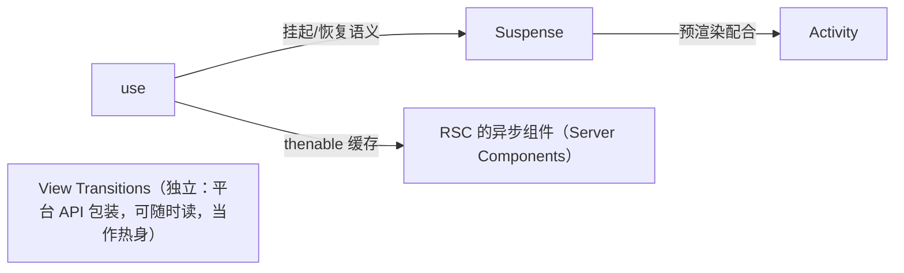

## 8. 源码阅读地图（按难度递增）

1. **rjsf**：schema form 最易读，先看 renderer 与 ajv 校验链路
2. **react-grid-layout**：栅格布局/碰撞/compact 算法，纯逻辑好啃
3. **dnd-kit**：现代拖拽的 sensor/碰撞抽象
4. **amis**：schema 协议大全，重点看渲染器目录组织
5. **formily**：path 订阅 + reactive 性能设计
6. **lowcode-engine**：编辑器骨架、setter、协议版本
7. **grafana frontend**：panel/datasource 插件化 + 大盘状态

下面把 7 个项目逐一展开成可执行的阅读计划。通用约定：先跑起来（clone → install → 起它的 playground/storybook），带着下述问题打断点读，不做通读——通读是后期享乐，不是入门手段。

### 8.1 rjsf —— schema 表单的入门读物

- **入口在哪**：`rjsf/react-jsonschema-form` 仓库，monorepo 结构。主入口 `packages/core`（Form 组件、fields/widgets/templates 目录），校验在 `packages/validator-ajv8`，示例工程在各 `packages/playground-*`。
- **按什么顺序读**：第一步读 playground 里最小 schema 的渲染结果；第二步进 Form 组件的渲染函数，看它如何把 JSON Schema 递归拆成 field 树（对象 → ObjectField → 每个属性一个 Field）；第三步看 `getDefaultRegistry`——fields/widgets/templates 三张注册表如何拼装；第四步追校验链路：提交 → `validateFormData`（ajv 编译 schema 出错误列表）→ ajv 错误如何被转换成按 `props.errorSchema` 组织的、挂在字段路径上的错误对象。
- **带着什么问题读**：一个 `properties.foo` 是怎么变成一个输入组件的？ajv 的错误（JSON Pointer 形如 `/foo/bar`）怎么映射回具体字段的？我要换掉某个字段的渲染，扩展点是哪个？
- **预期读到什么**："registry + 递归 + 错误按路径归集"三件套的工程化范本。它代码量小、类型清楚，是验证你第 2 章 mini formily 设计的第一面镜子——读完你会明确看到自己缺的是 templates 抽象（布局与逻辑分离）。

### 8.2 react-grid-layout —— 纯算法好啃的布局库

- **入口在哪**：`react-grid-layout` 仓库非 monorepo，核心就三个文件：`lib/GridLayout.jsx`（容器与 reconcile）、`lib/GridItem.jsx`（单个格子的拖拽生命周期）、`lib/utils.js`（全部纯算法）。测试目录的用例就是算法的行为文档。
- **按什么顺序读**：先读 `utils.js`：`compact`（垂直压实）、`correctBounds`（越界回正）、`sortLayoutItemsByRowCol`（排序决定谁先占位）——每个都是输入输出明确的纯函数，配合测试用例读。再读 GridItem 的拖拽回调：拖动 x 像素怎么换算成列偏移、什么时候触发 re-layout。最后读 GridLayout 如何把新 layout 通过 `onLayoutChange` 抛给你。
- **带着什么问题读**：拖动时碰撞怎么解（被挡的让位还是挡回去）？`verticalCompact` 关掉后行为差在哪？为什么它要求 key 用 `layout[i].i` 而不是 index（对照第 1 章 key 铁律）？
- **预期读到什么**：第 4 章你用过的 layout model `{i,x,y,w,h}` 背后的完整算法世界。这是 7 个项目里唯一"能读完"的，适合建立"读源码是有产出的"的信心。

### 8.3 dnd-kit —— 现代拖拽的抽象设计

- **入口在哪**：`clauderic/dnd-kit` monorepo。`packages/core/src/components/DndContext` 是心脏；传感器在 `packages/core/src/sensors/`（pointer/mouse/touch/keyboard 各一个目录）；碰撞算法在 `packages/core/src/collision/`（closestCenter、closestCorners、pointerWithin、rectIntersection 各自独立成文件）；排序逻辑在 `packages/sortable/`。
- **按什么顺序读**：先读 DndContext 提供的 context 值结构（活跃拖拽、碰撞结果、悬停目标都挂在上面）；再挑 PointerSensor 读一个传感器的完整生命周期（activation constraint 怎么区分点击与拖拽）；然后把四个碰撞算法各读一遍（都很短，差异只在"怎么算距离/包含"）；最后读 `useSortable` 如何用 `useDroppable + useDraggable` 组合出排序语义。
- **带着什么问题读**：为什么传感器是插件而不是事件监听写死？DragOverlay 为什么能让拖动流畅（它绕过了什么）？嵌套 droppable 时碰撞算法的组合如何生效（对照第 3 章你踩过的坑）？
- **预期读到什么**：第 1/3 章使用它的黑盒打开——你会理解"sensor 抽象 + 碰撞策略注入"是所有拖拽基础设施的通用形，之后读任何 DnD 库（包括原生 HTML5 DnD 封装）都是同一张地图。

### 8.4 amis —— schema 协议的大词典

- **入口在哪**：`baidu/amis` monorepo。渲染器注册机制在 `packages/amis-core/src/factories.ts`（`registerRenderer` 与 `Renderer` 装饰器）；具体渲染器在 `packages/amis/src/renderers/`（按类型分目录：Form/ 下是表单家族、CRUD、Table、图表……）；动作系统在 `packages/amis-core/src/actions/`；类型定义搜 `packages/amis-core/src` 里的 Schema 相关文件。
- **按什么顺序读**：先跑官方文档的示例页，找一个最简 `type: 'page'` schema；然后从它的 render 入口断点跟进去：字符串 type → 查渲染器注册表 → 实例化 → 递归处理子 schema。接着横向读目录组织：挑 `renderers/Form` 精读一个（如 InputText），看 props 如何从 schema 映射、表达式（`${}`）在哪里求值。最后读 actions 目录的内置动作清单，对照第 6 章你的 action registry。
- **带着什么问题读**：它的 schema 有多少顶层域（type/props/visible/hidden/onEvent/api/expression）？组件如何声明自己支持哪些事件与动作？渲染器之间如何做作用域传递（表单数据怎么流到子项）？
- **预期读到什么**：一份"协议该有哪些词汇"的完整答案。第 6 章产出后读它事半功倍——每读一个域就对照"我的协议有没有这层、为什么"。

### 8.5 formily —— 性能设计的深水区

- **入口在哪**：`alibaba/formily` monorepo。数据模型在 `packages/core/src/models/`（Form/Field/ArrayField 各一文件）；响应式内核在 `packages/reactive/`（依赖收集/autorun/batch）；React 绑定在 `packages/reactive-react/`（observer）与 `packages/react/src/components/`（Field/FormConsumer 等）。
- **按什么顺序读**：先读 `packages/reactive` 的 autorun：函数执行时访问了哪些 observable 属性、如何登记订阅、再变更如何精确触发重跑。然后读 Field 模型：path 如何寻址、value 校验状态如何聚合到 Form。最后读 React 侧 observer 如何把"依赖收集"变成"组件级精准重渲染"。
- **带着什么问题读**：为什么 formily 的字段组件天然只在自己值变化时重渲染（对照你第 2 章 path selector 手工实现的东西）？batch 把多次变更合并成一次渲染是怎么做到的？
- **预期读到什么**：第 2 章"path 级订阅"的工业化版本——响应式代理替代手写 selector，依赖自动收集替代手工声明。读不懂的部分留到二刷，带着你已实现过的简化版对照，理解成本会指数下降。

### 8.6 lowcode-engine —— 编辑器工程化标准

- **入口在哪**：`alibaba/lowcode-engine` monorepo。主包 `packages/engine`：设计器在 `src/designer`（拖拽、投放位置计算、hover/highlight）、文档模型在 `src/document`（节点树操作 API）、面板骨架在 `src/skeleton`（注册面板/工具栏插件位）、setter 体系与物料协议相关代码同仓；仓库根 `specs/` 目录是《中后台搭建协议规范》的规范文档与 JSON Schema。
- **按什么顺序读**：先读 `specs/` 的协议规范文档（它是中文、成体系，半天能通读）；再进 `src/designer` 看一次"从物料面板拖入画布"的事件流；然后看 skeleton 如何让插件把面板注册进各个插槽；最后对照内置 setter 列表与第 6 章你的 Setter 体系。
- **带着什么问题读**：它的画布/宿主如何划分（对照你的 iframe 方案）？协议里 version 与规范治理怎么做的（对照你的 migration 链）？setter 的元信息协议长什么样（对照你的 configSchema）？
- **预期读到什么**："编辑器是一个由插件拼装的系统"这个工程观，以及协议规范的治理范本。它体量大，务必只按问题跳读。

### 8.7 grafana frontend —— 插件化的超大样本

- **入口在哪**：`grafana/grafana` 仓库前端主目录 `public/app`（以仓库当前结构为准）。panel 插件在 `public/app/plugins/panel/`（每个面板一个目录：`module.tsx` + `plugin.json`），datasource 插件在 `public/app/plugins/datasource/`，大盘状态传统上在 `public/app/features/dashboard/`，新一代 Scenes 架构在 `public/app/features/scenes/`。
- **按什么顺序读**：先读一个最简单 panel 插件（如 stat/table）的 `module.tsx` 与 `plugin.json`——看"一个插件要声明什么、被谁加载"；再读 datasource 插件的 query 接口形状（对照第 4 章你的 `DataSource` 抽象）；然后挑 dashboard 状态管理读"dashboard JSON → 内存模型 → 面板查询调度"的链路；有余力再看 Scenes 如何把大盘组织成可嵌套的 scene 树。
- **带着什么问题读**：panel 与 datasource 是怎么解耦的（面板如何做到"对任何数据源都工作"）？插件的生命周期（加载/禁用/升级）谁管？大盘的自动刷新与时间范围如何分发到每个面板（对照第 4 章）？
- **预期读到什么**：第 4 章思想的十万行级放大——你会在真实工业强度下看到注册表、插件元信息、数据源抽象如何撑起一个生态，以及"协议先行"在多人协作里意味着什么。

### 8.8 通用读法：一条链路读法 + issue 驱动读法

读法：从渲染入口顺着一条 schema 的处理链路读到副作用出口；带着一个具体 issue 去读效率最高。

这句话展开成两套可执行的方法论。

**方法一：一条 schema 处理链路读法（纵向）**。步骤固定五步：

1. **准备一个最小输入**。手写/官方示例里挑一份 10 行以内的 schema，它能跑出可见输出。没有最小输入的阅读是空中楼阁——你在读的是"想象中的数据怎么流"。
2. **锚定渲染入口**。搜索"schema 进来的第一个函数"：amis 的 render、rjsf 的 Form、你自己的 `mountRenderer`。在这里打上第一个断点。
3. **顺着一条链走，不做分叉**。每一步只回答"当前函数对这份输入做了什么、产出了什么给下一个函数"——遇到与当前 schema 无关的分支（其他组件类型、其他事件）直接跳过。建议开一个笔记文件记调用链：`render → resolveRenderer(type) → createReactComponent → props 映射 → 子 schema 递归 → …`。
4. **走到副作用出口为止**。链路的终点必是三类副作用之一：DOM/组件渲染、网络请求、状态写入。把出口记下来，这条链就闭环了。
5. **合上源码画图复述**。凭笔记把链路画成一张流程图，画不出来的地方就是你没真懂的地方，回去补。第二天再默画一次，能默画 = 这条链属于你了。

这套方法的价值在于**边界克制**：一个库有几百条链路，你只需要读通 1–2 条主干就获得了它的"世界观"，剩下的按需再钻。

**方法二：issue 驱动读法（问题驱动）**。步骤四步：

1. **选一个真问题**。去仓库 issue 列表按 `good first issue` 或你实际遇到的 bug/疑惑挑一个（例如"嵌套 droppable 命中不对"）。真问题给了你"带着什么读"的答案，比抽象的"学习源码"有效一个数量级。
2. **本地复现**。clone + 起它的 playground/storybook，把 issue 的最小复现做出来。复现不了就换一个 issue——复现是硬门槛。
3. **从行为反推代码**。你已经会用调试器（方法一练过），从"表现不对的那一行 UI"反向打断点、看调用栈，定位到产生行为的代码区域。这个区域通常只有两三个文件。
4. **对照官方修复**。试着改；再看 maintainer 的 fix commit / PR diff，对比他改了哪里、为什么那里而不是你改的地方。差异点就是你对架构理解的盲区。即使不提 PR，"我的补丁 vs 官方补丁"的 diff 也是最高浓度的架构课。

两个方法的关系：链路读法建立地图，issue 驱动定位深钻。只用前者容易"读过就忘"，只用后者容易"只见树木"。建议节奏：每读一个新库，先花半天跑链路法，之后全部用 issue 驱动。

### 8.9 React 本体（facebook/react）——把源码跑起来再读的入场 checklist

前 7 个项目都是生态库，React 本体是它们共同的底座，也是最值得读的一份源码。两份既有材料已经把"读什么"解决了：架构地图（四个包怎么分工、三层怎么协作）见《源码复刻大纲》第 1 章；**文件级寻宝图**（scheduler/WorkLoop/BeginWork/Hooks 每个文件读哪几行、与你复刻的 mini 版怎么对照）见其第 13 章"路径 A：对照真实源码"——本节不重复它们，补的是它们都默认你会、但恰恰最容易卡死人的**入场动作**：环境怎么搭、断点往哪打、怎么避免迷路。

**为什么直接读会失败**。三种典型死法：其一，在 GitHub 网页版上读——没有跳转、没有引用检索，`import { someFlag } from './ReactFiberFlags'` 每一个都是死胡同，十分钟就放弃。其二，对着 `node_modules/react` 读——npm 装的是打包产物（`react/cjs/react.development.js`），函数名能对上源码，但它是 bundle：模块被拍平、注释是构建生成的，读它等于读"源码的影子"。其三，被类型注解劝退——仓库正处在 Flow 向 TypeScript 的迁移中，你会同时看到带 Flow 注解的 `.js` 与 `.ts/.tsx`，类型密度远超业务代码。对策分别见下面四步。

**入场四步**（每步一个产出，做完才算入场）：

| 步骤 | 动作 | 产出/验收 |
|---|---|---|
| 1. clone 并锁定版本 | `git clone git@github.com:facebook/react.git`，`git checkout v19.2.0`（以你项目在用的版本号为准——读的版本和用的版本不一致，行为对照会互相欺骗） | 本地仓库，IDE 打开后跨文件跳转可用 |
| 2. 装依赖 | 仓库锁定 Yarn 1（classic）：`yarn install`。若你机器默认 yarn 3+，用 `yarn set version classic` 或直接 `npx yarn@1 install` | `node_modules` 就绪、无 engine 报错 |
| 3. 构建 | `yarn build`（首次约几分钟）。产物不在 `packages/`，而在 **`build/node_modules/`** 下的 `react`、`react-dom` 等——这是"把 monorepo 各包拼装成可发布形态"的目录 | `build/node_modules/react/cjs/react.development.js` 存在 |
| 4. 接进测试项目 | 新建最小 Vite 项目，把 `react` 与 `react-dom` 都 alias 到构建产物（只指 `react` 不指 `react-dom` 会导致两包内部状态对不上） | 测试页正常渲染，DevTools 断点能落在**带原始注释的源码**上 |

第 4 步的配置：

```ts
// vite.config.ts —— 把 react/react-dom 指向本地构建产物
import { defineConfig } from 'vite';
import { fileURLToPath } from 'node:url';
import path from 'node:path';

const reactRepo = '/Users/you/code/react';   // 你的 clone 目录

export default defineConfig({
  resolve: {
    alias: {
      react: path.join(reactRepo, 'build/node_modules/react'),
      'react-dom': path.join(reactRepo, 'build/node_modules/react-dom'),
      // 用到 scheduler 时同样指过去：
      scheduler: path.join(reactRepo, 'build/node_modules/scheduler'),
    },
  },
});
```

改源码后的增量构建（全量 `yarn build` 太重时）：

```bash
# 只重建两个包的 DEV 产物（参数以仓库 wiki 当前文档为准；这里是模式示例）
yarn build react,react-dom --type=DEV
# 改 reconciler 源码后三连：build → 刷新测试页 → 断点重命中
```

**断点三入口**（覆盖一次更新的完整生命周期，从这三个函数进去就不会迷路）：

1. **首渲染入口**：`packages/react-dom/src/client/ReactDOMRoot.js` 的 `render` 一带。
   - 怎么去：测试页里 `createRoot(document.getElementById('root')!)` 那行打个 debugger，step into。
   - 看什么：`render` → `updateContainer` 的接力——"渲染请求"如何变成 reconciler 的一次工作安排。
2. **更新入口**：`ReactFiberHooks.js` 的 `dispatchSetState`。
   - 怎么去：在函数体第一行打断点，点页面上任意一个会 setState 的按钮。
   - 看什么：调用栈上半段是你的事件处理器，往下穿过 `dispatchSetState` → 调度登记——一次点透"更新是怎么被记录的"。
3. **提交入口**：`ReactFiberWorkLoop.js` 的 `commitRootImpl`。
   - 怎么去：条件断点（右键 Breakpoint type → conditional）写 `committedLanes !== 0` 之类减少命中噪音，或直接在函数首行断点后跳过非目标命中。
   - 看什么：beforeMutation → mutation → layout 三个子阶段在一个函数体里顺序排开，逐段 step over 就能看完提交全程。

配套的 DevTools 习惯三条：

- 用 Sources 面板的 **Blackbox** 把你自己的业务代码排除，step-into 只在 React 内部走。
- 多用 **Logpoint**（日志断点：只打印不暂停）观察高频路径——`beginWork` 这种每节点都过的函数用普通断点会点到怀疑人生。
- 关掉 "Pause on caught exceptions"——React 内部大量 try/catch 是控制流（如 Suspense 的 thenable 捕获），全停会把断点会话变成灾难。

版本对照纪律（读源码的"对照有效性"前提）：

- clone 后先 `git checkout` 到你项目**实际锁定**的版本号，再开始读——跨版本的行为差异会污染你的一切结论。
- 笔记里记下版本号；日后升级 React 后带着"这段变了吗"回看，是性价比最高的复习。
- 主干（main）与稳定分支偶尔差着几个大特性，引用博客/文章讲的结构对不上时，第一怀疑对象就是版本错位。

**迷路自救表**（读 React 源码的迷路是常态，关键是知道出路）：

| 迷路场景 | 自救动作 |
|---|---|
| 顺着调用栈进了一个完全陌生的函数 | 看栈上两帧：当前函数被谁调用的，比它自己在干什么更重要 |
| 一个 flag/常量看不懂含义 | 全局搜索它的定义处——ReactFiberFlags 这类常量文件本身就是一份"术语表" |
| 函数太长（几百行）分不清主干 | 先找它所有 `return` 出口，从出口倒着读输入怎么流过去 |
| `.new.js`/`.old.js` 双文件（并发特性新旧两套） | 认准 `.new.js`，`.old.js` 是 legacy 路径，别读 |
| 断点命中次数太多（如 render 中） | 条件断点 + 日志断点（Logpoint 只打印不暂停）代替逐次 continue |
| 想知道"某个 API 内部走到哪" | 先在 react 包导出处搜函数名，再进 reconciler 的实现文件——导出层永远是最干净的入口 |
| 断点在 DEV 分支之间反复横跳 | `__DEV__` 双分支是常态：先确认你追的行为在 dev 还是 prod 产物里，再读对应分支，两个都读等于没读 |

**单元测试当行为文档**。`packages/react/src/__tests__/`（如 hooks 行为测试）与 `fixtures/dom/`（真实 DOM 下的行为用例）是最被低估的读源码材料：想知道"边界上 React 保证什么"，一个测试用例胜过十行源码推演——每个 `it('...', ...)` 的标题就是一条行为契约。用法三例：读 WorkLoop 卡住时，先翻它对应测试的用例标题，往往直接给出预期行为；想验证自己对 `use` 的理解，写一个自己的用例放进 fixtures 跑一遍；给源码加实验性改动时，跑对应包的 `yarn test <pattern>` 看有没有破坏既有契约——这是"我改懂了没有"最硬的检验。

**出场自检**（入场四步 + 断点三入口都做过后，用这张单子验收）：

1. 测试项目断点能落在**带原始注释**的源码上（不是 CJS bundle）。
2. 从 `dispatchSetState` 断点出发，能口头说出调用栈上每一帧的职责。
3. 改一行 reconciler 源码（如加一个 console.log），增量构建后测试页能看到效果——证明"改的是真身"。
4. 用 Logpoint 在 `commitRootImpl` 打一条日志，能解释一次点击触发了几次 commit 以及为什么。
5. 能在 30 秒内说清 `packages/react` 与 `build/node_modules/react` 的关系（源码包 vs 可发布产物）——这是"迷路自救"的前提知识。
6. 迷路自救表里的每一条，都能对应想起自己迷过的一次路（没迷过路说明还没开始读）。

轻量替代（不想本地构建时）：直接在项目里把 DevTools 的断点打在 `node_modules/react-dom/cjs/react-dom-client.development.js` 上——CJS 开发版未压缩、函数名与源码一致，能追主流程；代价是没有源码级注释与文件边界，适合"临时查一个行为"，不适合系统阅读。另注意 React 19 起**不再发布 UMD 版**，别再从 CDN 找 `react.production.min.js` 挂 script 标签的老路子。

**本节的坑（症状→根因→修法）**：

- 断点断在压缩代码里。症状：断点位置显示的是形如 `ll(e,t)` 的函数。根因：项目用的是生产构建（或 CDN 压缩版）。修法：确认 Vite `mode` 为 development 且 alias 指向 `development` 产物；DevTools 里 Sources 能看到完整函数名即达标。
- `yarn build` 失败或极慢。症状：Node 22+ 下构建脚本报错或 OOM。根因：仓库构建对 Node 版本有适配范围。修法：按仓库根 `package.json` 的 engines 提示切换 Node 版本（用 nvm/fnm 装一个匹配版本），内存不足时 `NODE_OPTIONS=--max-old-space-size=8192 yarn build`。
- 改了源码不生效。症状：在 `packages/react-reconciler/src` 里改一行，测试项目毫无变化。根因：alias 指向的是 `build/node_modules` 的**产物**，源码改动要重新 `yarn build`。修法：改源码 → `yarn build`（可配合 `yarn build react-reconciler,react-dom --type=DEV` 缩小范围，参数以仓库 wiki 为准）→ 刷新测试项目。
- alias 只指了一半。症状：断点能进 react 但 react-dom 的行为还是旧的，或直接抛两包不匹配的错误。根因：`react` 与 `react-dom` 必须指向**同一次构建**的产物，只指其一等于两包跨版本混用。修法：alias 一组三件（react、react-dom、scheduler）一起指，缺一不可。

### 8.10 React 19.x 新增主题的阅读路线（带问题清单）

8.1–8.7 与 8.9 读的都是"既有内核"。React 19 前后新增的几块源码有自己的入口与问题域，且使用层文档（见《学习大纲》阶段 9 与阶段 6 的 React Compiler 评估清单）不覆盖"实现长什么样"。每个主题按 8.8 的方法论组织：**入口 + 三问 + 预期收获**，半天到一天一个。开始前先重申一次纪律：一次只带一个问题进源码，读完能合上代码回答它就算完成，不要"顺路多看点"。

这一节与 8.9 的分工：8.9 解决"环境与断点"（入场），本节解决"读哪些新东西、各带什么问题"（路线）。环境没搭好的先回 8.9——本节所有入口路径都以你能在 IDE 里跳转、能打断点为前提。

为什么值得专门读"新增"部分，三个理由：

- 新增代码没有历史包袱——没有为兼容旧版留下的旁枝，每一行都在回答"这个特性为什么存在"，信噪比比老代码高一个量级。
- 新增 API 大多有对应的 RFC/讨论记录，源码读不懂时能找到"设计者当时怎么想的"第一手材料（RFC 编号见各主题的 react.dev 文档页脚注）。
- 它们是你未来两三年每天要写的东西——对 `use`、Activity、RSC 的机制理解会直接变成你排查线上问题的速度。
- 每个主题都有"能上手做的小实验"（见各主题的验证实验条目）——新特性代码量小，实验成本远低于内核主题，正适合练"边读边验证"的肌肉。

五个主题一张总表（入口以仓库当前结构为准，路径变了就用表里的搜索词重新定位）：

| 主题 | 入口 | 定位搜索词 | 半天够吗 |
|---|---|---|---|
| React Compiler | `packages/react-compiler` | `babel-plugin-react-compiler` | 一天（含 Playground 实验） |
| `use` | `ReactFiberHooks.js` | `use(` + `thenable` | 半天 |
| `<Activity>` | reconciler 的 Offscreen/Activity 处理 | `ActivityComponent` / `Offscreen` | 半天 |
| View Transitions | react-dom 对平台 API 的包装 | `startViewTransition` | 半天 |
| Server Components | `react-server` / `react-client` | `ReactFlightServer` / `ReactFlightClient` | 一天（建议放最后） |

读前准备的定位命令（React 仓库重构频繁，记住"怎么找"比记住"在哪"可靠）：

```bash
# 主题三：Activity/Offscreen 在 reconciler 的落点（.new.js 优先，见迷路自救表）
grep -rn "OffscreenComponent" packages/react-reconciler/src --include="*.new.js" -l

# 主题四：react-dom 里对平台 View Transitions 的所有触点
grep -rn "startViewTransition" packages/react-dom*/src -l

# 主题五：Flight 协议两端实现的位置
ls packages/react-server/src packages/react-client/src
```

主题之间的依赖关系（决定阅读顺序）：



顺序建议：`use` → `<Activity>` → Server Components 是一条"异步渲染语义"主线（先概念后协议）；View Transitions 独立，放任何空档；Compiler 独立但实验最多，留整段时间。

**主题一：React Compiler（自动 memo 化编译器）**。

- 入口：`packages/react-compiler`（独立于运行时的编译时工具链），Babel 插件在 `packages/react-compiler/babel-plugin-react-compiler`，编译核心在其 `src` 的 pipeline——HIR 中间表示 → 依赖与可变性分析 → memoization 决策 → 代码生成。
- 问题 1（输入输出长什么样）：先在官方 React Compiler Playground 粘贴两个组件——一个纯派生渲染、一个内部有局部可变数组操作——对比产物里缓存插入的差异。这是唯一能"看见"编译器思考的方式，先做这步再进源码。
- 问题 2（它凭什么敢自动缓存）：读它对"值何时变"的分析——props/state 的依赖追踪 + 对 mutation 的保守判定；重点找"这个值逃出了组件"时它的处理。
- 问题 3（什么代码会 bail out）：在 Playground 里逐个试违反 Rules 的写法（条件调用 hook、逃逸引用），观察"组件不可编译"报告的措辞与分类，再到源码里找生成这些诊断的位置。
- 预期收获：把《学习大纲》阶段 6 的"Compiler 评估清单"从使用守则升级为机制理解——为什么"遵守 Rules of React"不只是 lint 教条，而是编译器做静态分析的前提。

**主题二：`use`（读取 Promise/Context 的"零 hook"）**。

- 入口：`react` 包导出；实现核心在 `packages/react-reconciler/src/ReactFiberHooks.js` 对 `use` 的特殊处理（thenable 状态缓存与挂起）。
- 问题 1（为什么 `use` 可以写在条件分支里、其他 hook 不行）：读它的实现是否注册进 hook 链表——它不挂链表、走 thenable 缓存路径，所以不受"调用顺序不变"约束。找到"不挂链表"的那几行是本主题的打卡点。
- 问题 2（同一个 Promise 渲染两次，第二次为什么不重新挂起）：追 thenable 缓存 Map 的读写时机——缓存键是什么、何时写入 resolved 值。
- 问题 3（它 throw 出的 Promise 被 Suspense 的哪一层接住）：从 `use` 的 throw 反向找到 Suspense 处理 thenable 的分支，画一条"挂起 → 边界捕获 → 重试"的时序线。
- 验证实验：写一个条件调用 `use(promise)` 的组件（合法！）与一个条件调用 `useState` 的组件（非法），对比二者行为——用行为差异反证"不挂链表"的结论。
- 预期收获：彻底分清"`use` 是不是 hook"这类问题的机制层答案；顺带打通 Suspense 的实现直觉。

**主题三：`<Activity>`（隐藏但保状态的子树）**。

- 入口：`react` 包导出的组件；reconciler 侧搜 `Activity`/`Offscreen` 的 fiber 处理（以仓库当前命名为准，两代命名并存过）。
- 问题 1（`mode="hidden"` 时子树 effect 发生什么）：读隐藏分支对 effect 链的处理——这是它与 `display: none` 的本质差异（后者副作用照跑，Activity 隐藏即 effect 卸载、状态保留）。
- 问题 2（重新显示时 effect 是重 mount 还是复用）：从隐藏态切回可见态的路径上找 effect 的调度决策。
- 问题 3（与 Suspense/预渲染怎么配合）：Activity 包住 Suspense 时谁先谁后——预渲染（Partial Pre-rendering）场景就建立在这两者的协作上。
- 验证实验：`mode="hidden"` 的子树里放一个 `setInterval` 的组件，观察 interval 是否随隐藏停止——把"隐藏即 effect 卸载"从结论变成亲眼所见。
- 预期收获：拿到"用状态换资源"的官方实现参照——预取的页面用 Activity 藏起来，显示时零成本；你第 4 章做过的"visibilitychange 暂停轮询"是它的手写版。

**主题四：View Transitions（跨帧视觉过渡）**。

- 入口：`react-dom` 对浏览器 `document.startViewTransition` 的包装（在 react-dom 源码搜调用点）与 `<ViewTransition>` 组件的类型定义。
- 问题 1（React 如何把"一次更新"包进 transition 回调）：更新调度与浏览器截图时机的衔接点——找到"更新被推迟到截图之后"的那个衔接函数。
- 问题 2（`name` 如何映射到 CSS 的 `view-transition-name`）：React 侧命名 → 生成类名/属性 的规则。
- 问题 3（降级路径）：不支持 View Transitions 的浏览器里代码走什么分支——降级策略往往比主路径更能体现 API 的工程成熟度。
- 验证实验：在不支持的浏览器（或用 DevTools 的 Rendering 面板模拟）里触发同一过渡，Network/Performance 面板确认走了降级分支——把"降级"从注释变成观察。
- 预期收获：看清"React 把平台 API 纳入自己的更新模型"这层包装有多薄——比想象的薄，这正是它可读性好的原因。

**主题五：Server Components（服务端组件的序列化协议）**。

- 入口三件：`packages/react-server/src/ReactFlightServer.js`（服务端：组件树 → **指令流**而非 HTML）、`packages/react-client/src/ReactFlightClient.js`（客户端：解析指令流、按需还原模块引用）、`packages/react-server-dom-webpack`（打包器集成——模块 id 与 chunk 的编码）。
- 问题 1（服务端"渲染"产出什么）：在 `ReactFlightServer` 里找序列化协议——模块引用、元素、Promise 分别编码成什么指令；对着 Network 面板里的 RSC 响应流看，两边互相印证。
- 问题 2（客户端如何把"模块引用"还原成真组件）：`react-client` 里对 chunk 的动态 import 与模型懒解析。
- 问题 3（`'react-server'` 条件导出如何让同一个包两端呈现不同 API）：读 `react` 包 `package.json` 的 exports 段——双包（dual package）在条件导出下的分叉。
- 验证实验：本地起一个最小 RSC demo（社区有官方模板），在 `ReactFlightServer` 的序列化函数打断点，Network 面板里对照每条指令的字节——协议从抽象变具体只需要这一步。
- 预期收获：RSC 从"框架魔法"变成"一套编码协议 + 两个运行时"；这是五个主题里离日常最远、架构含金量最高的一个。

**读后自测**：五个主题各写一页纸——入口文件路径、三个问题的答案、一处"原来如此"的发现。写不出的主题等于没读，按 8.8 的 issue 驱动法带一个真实问题重读。

五个主题的公共套路（读完回看，你会发现自己反复在做同一件事）：

- **先找平台 API 或既有机制，再看 React 的包装层**：View Transitions 包 `startViewTransition`、Activity 是 Offscreen 的正名、`use` 是 thenable 惯例的官方化——React 新 API 大多数是"把某条生态实践收编为内核语义"，认出被收编者，源码就薄了。
- **找"降级分支"**：每个新特性都有"不支持/未启用时走什么路"的分支，降级分支往往 20 行就把主路径的必要性反着讲清楚了。
- **测试用例当验收标准**：每个主题读完后去对应包的 `__tests__` 里找它的用例，能预判用例断言的结果才算过关。
- **记"命名考古"**：遇到 Offscreen/Activity 这类新旧双名，顺手查一下改名 PR——改名原因往往就是概念演化史，10 分钟换来对这个 API 定位的准确理解。
- **控制时间盒**：每个主题超时（一天还没答完三问）就先写半页纸收工，隔天带一个更小的问题重进——超时硬啃的沉没成本会杀死整个源码阅读计划。

### 8.11 中型库一夜读路线——zustand / immer / valtio

7 个大项目 + React 本体都是"多日工程"。但源码阅读习惯的养成靠的是高频小胜：**1–5 千行的生产级中型库**一晚读一个，一个月你就是团队里"懂底层那个人"。这一节给三个精心挑选的对象（都是你项目里天天 import 的依赖）与一条统一读法。与 8.5 formily 的关系：formily 是"响应式 + path 订阅"的深水区，这三个库是同一片水域的浅滩版——先读它们，8.5 会容易一半。

**统一读法四步**（每个库都这么读，一夜一个）：

1. **画 API 面**：读 `package.json` 的 `exports` 字段与入口文件的导出表，把公开 API 抄成清单。10 分钟内你会知道这个库"承诺了什么"——剩下的全部是"怎么兑现承诺"。
2. **找核心状态机**：找"那个被所有 API 共享的数据结构"（zustand 的 state + listeners、immer 的 draft 代理树、valtio 的 proxy 快照），写下它的不变量（什么操作会新建引用、什么会原地改）。
3. **找 React 绑定层**：三个库都靠 `useSyncExternalStore` 桥进 React——对比它们 `subscribe/getSnapshot` 的写法差异，是这一步最大的收获（原理讲解见《学习大纲》阶段 10，这里是亲手摸到实物的机会）。
4. **产出"一页纸"**：数据结构草图 + 一次更新的完整时序（从调用 API 到组件重渲染）+ 三个新学到的招。没有产出物的阅读会在一周后蒸发。

一页纸的固定模板（直接照抄成你的笔记骨架）：

```text
# 库名@版本 一页纸
## API 面（从 exports 抄）
-
## 核心数据结构与不变量
- 结构：
- 不变量：
## 一次更新的时序（API 调用 → 组件重渲染）
1.
## React 绑定层：subscribe / getSnapshot 怎么写的
-
## 三个新学到的招
1.
```

为什么是这三个库（选库标准，以后自己扩充名单也按这个筛）：

- **生产强度**：都在海量项目里跑了多年——读到的每个设计决策都经过了实战检验，不是玩具权衡。
- **体量 1–5 千行**：一晚能走完"API 面 → 状态机 → 绑定层"全程；超过一万行的库（formily、dnd-kit）不适合这个节奏。
- **与你已实现的东西直连**：zustand 对应你的编辑器 store、immer 对应你的 undo patch、valtio 对应 path 订阅的另一种解——每读完一个都能回头印证第 1–5 章你手写过的东西，对照是双向的。
- **同一问题域**：三个库都在回答"外部状态怎么进 React"，概念互相照亮，读完获得的是一张小地图而不是三个孤岛。

对象一的"顺手实验"参考实现（写不出复刻版时对照）：

```ts
// playground/miniZustand.ts —— 15 行复刻：state + listeners + 浅合并 set
export function createStore<T extends object>(initial: T) {
  let state = initial;
  const listeners = new Set<() => void>();
  return {
    getState: () => state,
    setState(partial: Partial<T>) {
      state = { ...state, ...partial };           // 浅合并：zustand 语义的核心一行
      listeners.forEach((l) => l());
    },
    subscribe(l: () => void) {
      listeners.add(l);
      return () => { listeners.delete(l); };       // 返回取消函数——useSyncExternalStore 的约定
    },
  };
}
// 用 useSyncExternalStore(store.subscribe, () => store.getState().count) 接进组件，
// 与官方实现对照：你缺了什么？（提示：selector 层、批量通知、中间件洋葱）
```

"读完了"的判断标准（三晚结束自查，比"感觉读懂了"硬）：

- 能不看源码画出核心数据结构并写出它的不变量。
- 能从"组件里一次 setState/proxy 修改"出发，口述到"该组件重渲染"的完整时序，包括中间每一步是谁调的。
- 能回答"如果让我加一个特性 X（如 zustand 的 persist），我会在哪一层加"——回答得出挂载点，说明分层已经吃透。
- 三库对比表能默写填满；填不满的格子就是下次重读的目标。

**对象一：zustand（一晚）**。

- 入口：`packages/zustand/src` 的 `vanilla.ts`（`createStore`：state + `setState` 浅合并 + listeners 通知）与 `react.ts`（`useStore`：selector + `useSyncExternalStore`）。
- 问题 1（`set` 为什么是浅合并）：`Object.assign({}, state, partial)`——嵌套对象必须整体替换。这决定了你写 store 的形状（扁平化、按切片拆），也解释了为什么 zustand 项目里几乎不需要 immer。
- 问题 2（selector 返回新数组会怎样）：`useSyncExternalStore` 对 snapshot 做 `Object.is` 比较，每次 `filter` 都是新引用 → 无限重渲染。第 9 章速查表新增行对应的就是它，这一晚是读它的机制源头。
- 问题 3（中间件怎么包出来的）：`subscribeWithSelector` 等中间件的洋葱模型（`(config) => (set, get, api) => ...`）——读懂它你就懂了所有 zustand 插件的写法。
- 顺手实验：给 `createStore` 手写一个 15 行的复刻版（state + listeners + set），用它驱动一个计数器——写得出复刻版才算读完。

**对象二：immer（一晚）**。

- 入口：`packages/immer/src`——draft 的 Proxy 代理、finalize（把 draft 变回普通对象）、补丁生成（`patches` 相关文件）。
- 问题 1（draft 为什么不能泄漏到 produce 之外）：finalize 阶段对"仍被引用的 draft"的检测与报错——找到那条错误信息在源码里的抛出点。
- 问题 2（写时复制发生在哪一步）：第一次写属性时才 copy，读操作全程走代理不复制——在代理的 set trap 里找到 copy 的那一行。
- 问题 3（`patches`/`inversePatches` 怎么生成）：这正是你第 1 章 1.5 undo/redo 用的原料；读它的补丁生成与你手写的 diff 对比——同一件事的两种实现，谁的边界处理更好？
- 顺手实验：用 20 行代码给 zustand 接上 immer + patch undo（第 1 章 1.5 的组合复刻），跑通"输入汉字 Cmd+Z 一次撤一个词"——三库知识在这里会师。

**对象三：valtio（一晚）**。

- 入口：`packages/valtio/src`——`proxy`（递归代理任何对象树，变更即通知）、`snapshot`（结构性快照）、`useSnapshot`（React 绑定 + `affected` 优化）。
- 问题 1（snapshot 为什么必须不可变）："本体可变、快照不可变"的双层设计怎么配合 `useSyncExternalStore` 的引用比较——每次变更 snapshot 引用如何变化。
- 问题 2（`affected` 如何做到属性级订阅）：组件渲染时记录"访问过哪些属性"，只有这些属性变化才重渲染——对比 formily 的依赖收集，思想同源、实现轻一个量级。
- 问题 3（与 zustand 的心智差异）：mutable proxy + immutable snapshot vs "永远替换新 state"——两种模型各自的坑（valtio 的坑是"改了 proxy 忘了它不会立刻反映到快照"，zustand 的坑是"嵌套更新啰嗦"）。
- 产出：写一页 zustand vs valtio 对比笔记——这是三晚里含金量最高的产出，也是团队技术选型时你能拿得出手的依据。

三库速查对比（读完三晚后填空，填不出的回去补）：

| 维度 | zustand | immer | valtio |
|---|---|---|---|
| 核心数据结构 | state 对象 + listeners 数组 | Proxy draft 树 | Proxy 本体 + 不可变快照 |
| 更新方式 | set 整体替换（浅合并） | produce 内修改 draft | 直接改 proxy 属性 |
| 进 React 的桥 | `useStore(selector)` | （无 React 层） | `useSnapshot(proxy)` |
| 你项目里的位置 | 页面/编辑器 store | undo 的 patch 来源 | （多数项目没有——正好借读源码补上判断力） |

**本节的坑**：

- 读的版本与你项目锁的版本不一致。症状：源码里有的 API 你项目里没有（或相反）。根因：clone 的 main 分支领先/落后于锁定的版本。修法：`git checkout v5.x.x` 对齐 `package-lock` 里的版本号——中型库迭代快，跨大版本可能重写过。
- 一次读三个。症状：三份源码在脑子里搅成响应式浆糊。根因：三个库解决同一问题域（外部状态进 React），概念互相干扰。修法：一夜一个、中间隔一天，第三晚开始前先默写前两个的一页纸。
- 只读不跑。修法：给每个库搭一个 5 分钟 Vite playground（两行 alias 到本地源码），读到的每个关键函数打一次断点——"读过"和"调过"的记忆强度差一个量级（与 8.9 同一条纪律）。

---

## 附：ASCII 图替换清单

本文档图形化改版，原 ASCII 字符图与 Mermaid 图表对应关系如下：

| 原图位置 / 标题 | 处理结果 |
| --- | --- |
| 主题之间的依赖关系：use → Suspense → Activity、use → RSC，View Transitions 独立 | 替换为 flowchart LR（依赖关系图） |
