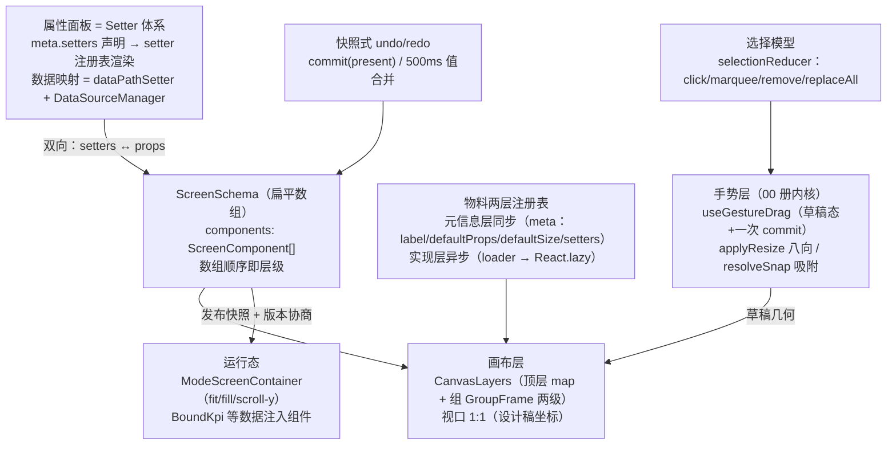

# 场景 1 · 低代码页面搭建器（可视化大屏编辑器）复刻手册

> 一句话目标：从零复刻一个"自由画布 + 绝对定位"的大屏搭建器——物料区拖入画布、拖动/八向缩放/对齐吸附、框选与对齐分布、图层面板、属性面板双向绑定、undo/redo 与脏检查、三模式适配的运行态预览与发布快照。组件模型 `{x, y, w, h, rotation, locked, hidden}`，渲染走"扁平数组 + 注册表分发"。预计工期：2 周。前置要求：已完成本目录《[00-公共底座复用与第二辑增量](00-公共底座复用与第二辑增量-复刻手册.md)》（视口/手势/吸附/迁移四件直接用）；图纸：第二辑《[1. 低代码页面搭建器 / 可视化大屏编辑器](../react-高阶场景-第二辑/02-1-低代码页面搭建器-可视化大屏编辑器.md)》，尤其 1.1–1.5（内核五节）。

## 0. 最终效果与验收清单

- [ ] **协议**：一页大屏 = 一份可 `JSON.parse(JSON.stringify())` 无损的 `ScreenSchema`（扁平 `components` 数组，数组顺序即层级）；示例页含 6 个组件（KPI×2、图表×1、文本×1、装饰条×1、组×1）能整存整取
- [ ] **物料两层注册**：注册一个新 `type: 'video'` 物料只需一个文件（meta + loader），渲染器/物料区/图层零改动；未注册类型渲染红色占位不白屏
- [ ] **拖入放置**：从物料区拖 KPI 到画布，落点即组件 x/y；落点与已有组件重叠面积 > 50% 时自动让位（+32/+32 级联偏移）；吸附网格 20px 可开关
- [ ] **对齐吸附**：拖动组件与兄弟边缘/中线距离 < 6px 时吸附并显示红色参考线，松手后位置 = 吸附后位置；吸附阈值与网格吸附互不干扰（对齐优先）
- [ ] **八向缩放**：8 个把手全部可拖，最小 20px 不拖穿；西/北把手是反向拖拽（对侧边固定）
- [ ] **选中/框选**：单击选中、Shift 加选、空白拖框选（命中集合过滤 `locked || hidden`）；多选拖动"不散架"（选集 bbox 吸附）；对齐六命令 + 分布两命令各一次 undo
- [ ] **图层面板**：数组顺序即层级；置顶/置底/上移/下移/拖拽调序即时反映到画布覆盖关系；锁定组件画布不可选中、隐藏组件编辑态不渲染
- [ ] **属性面板**：选中组件的 props 经 Setter 声明渲染，改面板 → 画布实时变、改画布（拖动）→ 面板数值实时变；数据映射面板配置 `source→target`，两个组件共享同一数据源时 Network 面板一次轮询只有一条请求
- [ ] **undo/redo 与脏检查**：拖动/缩放/增删/对齐/调序全部可 `cmd+z` 逐步回退（一次手势 = 一步）；属性输入 500ms 合并；未保存关闭页面触发 `beforeunload` 提示
- [ ] **预览与发布**：预览页按 `fit/fill/scroll-y` 三模式渲染同一份 schema；发布生成带版本号快照，旧快照在新物料版本下经 `negotiate` 三档处置（exact/migratable/incompatible）

## 1. 架构总览



数据流一句话：**用户手势（00 册内核）产出草稿几何 → 松手一次 commit 写回 ScreenSchema（同步进快照历史）→ 画布按"扁平数组 + 注册表"重渲染 → 属性面板双向读写 props；发布时冻结版本快照，运行态按适配模式渲染并注入数据映射。**

技术选型表：

| 库/件 | 用途 | 来源与理由 | 替代项 |
|---|---|---|---|
| 00 册 canvas 内核 | 视口/手势/吸附 | 本目录已就绪，别重写 | — |
| 00 册快照式历史 | undo/redo | 结构操作零差异接入 | immer patches（值编辑极多时再换） |
| zustand + immer | 编辑器 store | path 级订阅 + 结构共享（底座纪律） | useState（50 组件内也行，见 §5 坑 9） |
| @dnd-kit/* | 图层面板调序、物料区拖出 | 底座 dnd 内核同款 | 原生 HTML5 DnD（移动端不可用） |
| echarts | 图表物料 | 大屏刚需，配 ResizeObserver 封装 | — |
| 00 册 LazyMonaco | 高级 props 的 json setter | 按需加载 | textarea（降级已内置） |

与图纸的分工：图纸 1.1–1.13 讲透了**机制与论证**（三方案对比、状态机、市场闭环、部署形态）；本手册只取"一个能跑的大屏编辑器"的最短路径（1.1–1.5 的内核 + 1.6 的两层注册表 + 1.11 的三模式），其余进 §4 进阶扩展按需取用。

## 2. 数据模型与协议

### 2.1 页面协议 DSL（ScreenSchema）

```ts
// src/screen/schema.ts —— 大屏页面协议：自由画布是"扁平数组 + 数组顺序即层级"
export interface ScreenRect { x: number; y: number; w: number; h: number }

export interface ScreenComponent extends ScreenRect {
  id: string          // nanoid/randomUUID，只生成不回收
  type: string        // 物料类型（注册表 key）
  rotation: number    // 旋转角（度），顺时针
  locked: boolean     // 锁定：画布交互禁用，图层面板可解
  hidden: boolean     // 隐藏：编辑态不渲染
  props: Record<string, unknown>   // 物料 props（数据映射的注入点）
  [extra: `x-${string}`]: unknown  // 扩展字段（协议演进不破坏旧数据）
}

/** 组：持有 children（成员 id 列表）；子组件坐标是"组内相对坐标"（原点 = 组左上角） */
export interface GroupComponent extends ScreenComponent {
  type: 'group'
  children: string[]
}

export function isGroup(c: ScreenComponent): c is GroupComponent {
  return c.type === 'group'
}

export interface ScreenSchema {
  schemaVersion: string  // 从第一天就带（00 册迁移链的输入）
  id: string
  design: { width: number; height: number }  // 设计稿基准：1920×1080，创建后锁定
  components: ScreenComponent[]
}
```

两条协议纪律（图纸 1.2/1.12 的结论）：**扁平数组 + 数组顺序即层级**（置顶 = 移到末尾，零冗余，undo 快照自动携带层级）；**成组永不换子组件 id**（数据绑定以 id 为 key，换 id = 绑定悬空）。子组件坐标系改"组内相对"是成组时的一次换算，换来组移动 O(1)。

### 2.2 物料描述协议（两层注册表）

```tsx
// src/screen/material-registry.ts —— 两层注册：元信息同步可查，实现按需加载
import { lazy, Suspense, type ComponentType, type LazyExoticComponent } from 'react'

/** 元信息层：轻数据，同步注册——物料区、发布校验、占位块尺寸只依赖它 */
export interface MaterialMeta {
  type: string
  label: string
  group: string                 // 物料区分组
  defaultProps: () => Record<string, unknown>  // 工厂函数：防止新节点间共享引用
  defaultSize: { w: number; h: number }        // 拖入画布的初始几何 + Suspense 占位尺寸
  /** 属性面板的 Setter 声明（M4 消费） */
  setters?: SetterDeclaration[]
}

export interface SetterDeclaration {
  key: string                   // 作用于节点数据的哪个键，如 'props.title'
  setter: 'string' | 'number' | 'boolean' | 'select' | 'json' | 'dataPath'
  props?: Record<string, unknown>  // select 的 options 等
}

type Loader = () => Promise<{ default: ComponentType<Record<string, unknown>> }>

const metas = new Map<string, MaterialMeta>()
const loaders = new Map<string, Loader>()
const loaded = new Map<string, ComponentType<Record<string, unknown>>>()
const inflight = new Map<string, Promise<ComponentType<Record<string, unknown>>>>()

export function registerMaterial(meta: MaterialMeta, loader: Loader): void {
  metas.set(meta.type, meta)
  loaders.set(meta.type, loader)
}

export const getMaterialMeta = (type: string) => metas.get(type)
export const listMaterialMetas = () => [...metas.values()]

/** 异步层：缓存 + 并发去重（画布 10 个同 type 首帧只发一次 import）+ 失败清 inflight */
export function loadMaterial(type: string): Promise<ComponentType<Record<string, unknown>>> {
  const cached = loaded.get(type)
  if (cached) return Promise.resolve(cached)
  const pending = inflight.get(type)
  if (pending) return pending
  const loader = loaders.get(type)
  if (!loader) return Promise.reject(new Error(`未注册的物料类型：${type}`))
  const p = loader().then(mod => {
    loaded.set(type, mod.default)
    inflight.delete(type)
    return mod.default
  }).catch(err => {
    inflight.delete(type) // 失败必须清：否则一次失败永远无法重试
    throw err
  })
  inflight.set(type, p)
  return p
}

/** lazy 包装按 type 缓存（React.lazy 每次调用返回新组件，不缓存会反复挂起） */
const lazyCache = new Map<string, LazyExoticComponent<ComponentType<Record<string, unknown>>>>()

export function MaterialRenderer({ type, props }: { type: string; props: Record<string, unknown> }) {
  const meta = getMaterialMeta(type)
  if (!meta) return <div style={{ padding: 12, color: '#ff4d4f' }}>未注册的物料：{type}</div>
  let comp = lazyCache.get(type)
  if (!comp) {
    comp = lazy(() => loadMaterial(type))
    lazyCache.set(type, comp)
  }
  const Lazy = comp
  return (
    <Suspense fallback={<div style={{ width: '100%', height: '100%', background: 'rgba(255,255,255,0.06)', borderRadius: 8 }} />}>
      <Lazy {...props} />
    </Suspense>
  )
}
```

内置三件物料起步（KPI / 文本 / 图表），各一个文件：`widgets/kpi/index.tsx` 导出组件 + `registerMaterial({...}, () => import('./KpiWidget'))`。动态 import 路径必须字面量（00 册 §6 坑 1）；物料多于 20 个时换 `import.meta.glob('./widgets/*/index.tsx')` 批量收集（图纸 1.6 的写法）。

### 2.3 最小示例（验收用的"示例页"）

```json
{
  "schemaVersion": "1.0.0",
  "id": "screen-demo",
  "design": { "width": 1920, "height": 1080 },
  "components": [
    { "id": "c_title", "type": "text", "x": 40, "y": 24, "w": 400, "h": 60, "rotation": 0,
      "locked": false, "hidden": false, "props": { "content": "作战指挥中心", "level": 1 } },
    { "id": "c_kpi_gmv", "type": "kpi", "x": 40, "y": 120, "w": 280, "h": 120, "rotation": 0,
      "locked": false, "hidden": false, "props": { "title": "今日 GMV", "value": 0 } },
    { "id": "c_chart", "type": "chart", "x": 360, "y": 120, "w": 640, "h": 360, "rotation": 0,
      "locked": false, "hidden": false, "props": { "kind": "line", "series": [] } },
    { "id": "c_grp", "type": "group", "x": 1040, "y": 120, "w": 600, "h": 260, "rotation": 0,
      "locked": false, "hidden": false, "props": {}, "children": ["c_kpi_a", "c_kpi_b"] },
    { "id": "c_kpi_a", "type": "kpi", "x": 0, "y": 0, "w": 280, "h": 120, "rotation": 0,
      "locked": false, "hidden": false, "props": { "title": "在线人数", "value": 0 } },
    { "id": "c_kpi_b", "type": "kpi", "x": 320, "y": 0, "w": 280, "h": 120, "rotation": 0,
      "locked": false, "hidden": false, "props": { "title": "告警数", "value": 0 } }
  ]
}
```

## 3. 复刻主线路径：里程碑 M0–M6

### M0 工程骨架与协议落位（第 1 天）

**目标**：工程就位、§2 两份协议类型落地、序列化测试通过、空画布跑起来。

**步骤**：

1. `npm create vite@latest screen-builder -- --template react-ts`，装 `zustand immer nanoid @dnd-kit/core @dnd-kit/sortable @dnd-kit/utilities echarts`，把 00 册的 `canvas/`、`protocol/`、`lazy/`、`remote/` 与底座 `store/useHistory` 拷入；
2. 写 `src/screen/schema.ts`（§2.1）与 `material-registry.tsx`（§2.2）；
3. store 骨架（zustand + 快照历史接线）：

```ts
// src/screen/screenStore.ts
import { create } from 'zustand'
import type { ScreenComponent, ScreenSchema } from './schema'

interface ScreenStore {
  schema: ScreenSchema
  selectedIds: string[]
  /** 全部结构性修改的唯一入口：调用方先 commit 历史（M5 接线） */
  update: (fn: (s: ScreenSchema) => ScreenSchema) => void
  setSelection: (ids: string[]) => void
}

export const useScreenStore = create<ScreenStore>()((set) => ({
  schema: { schemaVersion: '1.0.0', id: 'screen-demo', design: { width: 1920, height: 1080 }, components: [] },
  selectedIds: [],
  update: (fn) => set((s) => ({ schema: fn(s.schema) })),
  setSelection: (ids) => set({ selectedIds: ids }),
}))
```

**验收**：`npx tsc --noEmit` 零报错；vitest 里示例页 JSON `parse(stringify)` round-trip 深相等；dev 页面显示 1920×1080 空画布（深色底 + 20px 网格背景，图纸 1.2 的 CSS）。

**常见报错与修复**：`Type ... is not assignable to 'x-${string}' index`——组件字面量里写了未声明的扩展键。修复：接口里保留 `[extra: 'x-${string}']` 索引签名（§2.1 已含），不要删它换"干净"。

### M1 物料注册与画布渲染（第 2–3 天）

**目标**：注册 kpi/text/chart 三件物料；画布按"顶层 map + 组 GroupFrame 两级"渲染示例页；图层面板（只读版）同步显示。

**关键实现**——渲染器（扁平数组两级渲染；组内若再嵌组，`renderLeaf` 递归扩展即可）：

```tsx
// src/screen/CanvasLayers.tsx —— 顶层元素 map + 组的两级渲染（DOM 嵌套让 transform 天然复合）
import { memo } from 'react'
import { MaterialRenderer } from './material-registry'
import { isGroup, type GroupComponent, type ScreenComponent, type ScreenSchema } from './schema'

/** 顶层渲染：只 map"没有被任何组引用"的元素 */
export function CanvasLayers({ schema }: { schema: ScreenSchema }) {
  const parentOf = new Map<string, string>()
  const byId = new Map<string, ScreenComponent>(schema.components.map(c => [c.id, c]))
  for (const c of schema.components) {
    if (isGroup(c)) for (const childId of c.children) parentOf.set(childId, c.id)
  }
  const topLevel = schema.components.filter(c => !parentOf.has(c.id) && !c.hidden)
  return (
    <>
      {topLevel.map(c =>
        isGroup(c)
          ? <GroupFrame key={c.id} group={c} byId={byId} />
          : <LeafFrame key={c.id} comp={c} />,
      )}
    </>
  )
}

function LeafFrame({ comp }: { comp: ScreenComponent }) {
  return (
    <div
      data-node-id={comp.id}
      style={{
        position: 'absolute',
        left: comp.x, top: comp.y, width: comp.w, height: comp.h,
        transform: comp.rotation ? `rotate(${comp.rotation}deg)` : undefined,
      }}
    >
      <MaterialRenderer type={comp.type} props={comp.props} />
    </div>
  )
}

/** 组容器：子组件按组内相对坐标绝对定位；缩放/平移组自动作用于子树 */
const GroupFrame = memo(function GroupFrame({
  group, byId,
}: {
  group: GroupComponent
  byId: Map<string, ScreenComponent>
}) {
  const children = group.children
    .map(id => byId.get(id))
    .filter((c): c is ScreenComponent => c != null && !c.hidden)
  return (
    <div
      data-node-id={group.id}
      style={{
        position: 'absolute', left: group.x, top: group.y, width: group.w, height: group.h,
        outline: '1px dashed rgba(22,119,255,0.45)',
      }}
    >
      {children.map(c => (
        <div key={c.id} style={{ position: 'absolute', left: c.x, top: c.y, width: c.w, height: c.h }}>
          <MaterialRenderer type={c.type} props={c.props} />
        </div>
      ))}
    </div>
  )
})
```

echarts 物料的容器尺寸自适应（图纸 1.1 的结论：监听容器而非 window）：

```tsx
// src/screen/widgets/chart/useEchart.ts —— 挂载 init / 容器 ResizeObserver 重绘 / 卸载 dispose
import { useEffect, useRef } from 'react'
import * as echarts from 'echarts'
import type { EChartsOption } from 'echarts'

export function useEchart(option: EChartsOption) {
  const containerRef = useRef<HTMLDivElement>(null)
  const chartRef = useRef<echarts.ECharts | null>(null)

  useEffect(() => {
    const el = containerRef.current
    if (!el) return
    const chart = echarts.init(el)
    chartRef.current = chart
    const observer = new ResizeObserver(() => chart.resize()) // 自由画布拖改 w/h 也要触发
    observer.observe(el)
    return () => {
      observer.disconnect() // 先断观察再销毁，避免销毁后回调踩空
      chart.dispose()
      chartRef.current = null
    }
  }, [])

  useEffect(() => { chartRef.current?.setOption(option) }, [option])
  return containerRef
}
```

**验收**：示例页 6 组件全部渲染（组内两个 KPI 相对定位正确）；临时注册 `type: 'video'` 物料一个文件搞定；把某个 type 改成 `unknown-x`，该位置红色占位、其余照常；拖宽 chart 容器（先临时加个按钮改 w），echarts 自动重绘。

**常见报错与修复**：

1. 组内子组件跑到画布外——成组时忘了坐标换算（画布绝对 → 组内相对）。修复：成组函数里 `x: c.x - groupLeft`（M3 落地成组时同步实现，测试"成组→解组→坐标回到原值"）。
2. Suspense 占位闪跳——fallback 无尺寸。修复：fallback 占满父容器（§2.2 已含），父容器尺寸由组件 w/h 保证。
3. 控制台 `Invalid hook call`——物料 chunk 二次打包 react。修复：物料分包构建 external react/react-dom（本手册单体工程不会遇到，微前端/独立物料仓库时回来查图纸 1.6 坑 2）。

### M2 拖拽放置与吸附（第 4–6 天）

**目标**：物料区 HTML5 拖出 → 画布落点换算 → 放置命中检测与让位 → 组件拖动（草稿态 + 吸附）→ 八向缩放。

**关键实现一：放置命中检测（drop hit testing）**——从物料区拖到画布释放，决定"放哪 + 要不要让位"：

```ts
// src/screen/drop.ts —— 落点让位：与既有组件重叠过半时沿对角线级联偏移
import type { ScreenComponent } from './schema'

const OVERLAP_RATIO = 0.5
const STEP = 32 // 让位步长：与 Cmd+D 复制偏移同款，用户已习惯这个距离
const MAX_TRY = 50

export function rectsIntersect(a: { x: number; y: number; w: number; h: number },
                               b: { x: number; y: number; w: number; h: number }): boolean {
  return a.x < b.x + b.w && a.x + a.w > b.x && a.y < b.y + b.h && a.y + a.h > b.y
}

/** 重叠面积 / 新组件面积 > 0.5 视为"压在别人身上"，需要让位 */
function overlapsTooMuch(a: { x: number; y: number; w: number; h: number }, b: ScreenComponent): boolean {
  const ix = Math.max(0, Math.min(a.x + a.w, b.x + b.w) - Math.max(a.x, b.x))
  const iy = Math.max(0, Math.min(a.y + a.h, b.y + b.h) - Math.max(a.y, b.y))
  return (ix * iy) / (a.w * a.h) > OVERLAP_RATIO
}

/** 画布上的自由落点：不压别人直接放；压了沿 +32/+32 找空位（画布无限大，50 步内必空） */
export function findFreePosition(
  desired: { x: number; y: number; w: number; h: number },
  existing: ScreenComponent[],
): { x: number; y: number } {
  let { x, y } = desired
  for (let i = 0; i < MAX_TRY; i++) {
    const rect = { x, y, w: desired.w, h: desired.h }
    if (!existing.some(c => !c.hidden && overlapsTooMuch(rect, c))) return { x, y }
    x += STEP
    y += STEP
  }
  return { x, y } // 认命放下（50 步后必然空旷）
}
```

画布 onDrop 的接线（屏幕 → 画布坐标必须过 00 册的 `screenToCanvas`；网格吸附先做取整）：

```tsx
// src/screen/CanvasDropZone.tsx —— 节选：drop 事件的换算与建节点
import { screenToCanvas, type Viewport } from '../canvas/viewport'
import { getMaterialMeta } from './material-registry'
import { findFreePosition } from './drop'
import { genId } from './id'
import type { ScreenComponent, ScreenSchema } from './schema'

const GRID = 20

export function onDropCanvas(
  e: React.DragEvent,
  vp: Viewport,
  schema: ScreenSchema,
  update: (fn: (s: ScreenSchema) => ScreenSchema) => void,
) {
  e.preventDefault()
  const type = e.dataTransfer.getData('application/screen-material')
  const meta = getMaterialMeta(type)
  if (!meta) return
  const rect = (e.currentTarget as HTMLElement).getBoundingClientRect()
  const p = screenToCanvas({ x: e.clientX - rect.left, y: e.clientY - rect.top }, vp)
  const size = meta.defaultSize
  // 网格吸附（对齐吸附优先原则：放置阶段只有网格，拖动阶段才有对齐线）
  const desired = {
    x: Math.round(p.x / GRID) * GRID,
    y: Math.round(p.y / GRID) * GRID,
    w: size.w, h: size.h,
  }
  const pos = findFreePosition(desired, schema.components)
  const node: ScreenComponent = {
    id: genId(), type,
    x: pos.x, y: pos.y, w: size.w, h: size.h,
    rotation: 0, locked: false, hidden: false,
    props: meta.defaultProps(),
  }
  update((s) => ({ ...s, components: [...s.components, node] }))
}
```

**关键实现二：组件拖动 + 吸附**——00 册 `useGestureDrag` 的第一个真实消费者。`onMove` 里先算"跟随指针的原始矩形"，再过 `resolveSnap`（对齐优先于网格）：

```ts
// 拖动核心（接入 useGestureDrag 的 handlers）：
// const raw = { ...startRect, x: startRect.x + delta.x, y: startRect.y + delta.y }   // 原始：跟随指针
// const siblings = components.filter(c => c.id !== dragging.id && !c.hidden && !isInGroup(c))
// const { snapped, guides } = resolveSnap(raw, siblings)                              // 对齐吸附（00 册）
// const withGrid = snapEnabled
//   ? { ...snapped, x: Math.round(snapped.x / GRID) * GRID, y: Math.round(snapped.y / GRID) * GRID }
//   : snapped                                                                          // 网格取整（对齐未命中时生效）
// setDraft({ ...dragging, ...withGrid }); setGuides(guides)
```

**关键实现三：八向缩放**——00 册 `applyResize` + `HANDLES` 直接用，渲染层给选中组件包 `ResizeFrame`（图纸 1.2 的完整组件）。带 `rotation` 时先把屏幕位移反旋到本地系（`toLocalDelta`，图纸 1.2 进阶；初版可禁用旋转把手）。

**验收**：拖 KPI 入画布落在指针处（网格对齐）；拖到已有 KPI 正中，自动让位到右下 32px；拖动靠近 chart 左缘 6px 内吸附 + 红线；西把手反向拖拽正确（右边不动）；一次拖动 / 一次缩放结束后 `schema` 恰好变更一次（Console 打印确认没有中间帧写入）。

**常见报错与修复**：

1. **落点偏移半个组件**——想让"指针位置 = 组件中心"但算错象限。修复：定义清楚产品语义（本手册 = 左上角对齐指针），或者统一减 `w/2, h/2`，别两处口径混用。
2. **吸附后网格取整把吸附结果抹掉**——两个吸附串联顺序错了。修复：永远 `resolveSnap` 先、网格取整后，且网格取整只对"对齐未命中"的轴生效（上面的 `withGrid` 顺序就是纪律）。
3. **dataTransfer 取不到值**——物料区 `onDragStart` 没写 `setData`，或自定义 MIME 与读取端不一致。修复：统一 `application/screen-material` 字符串常量；`effectAllowed = 'move'`。

### M3 选中/框选/对齐线（第 7–9 天）

**目标**：选择模型 reducer（click/marquee/remove/replaceAll）、橡皮筋框选、多选拖动（选集 bbox 吸附）、对齐六命令 + 分布两命令、成组/解组、图层面板完整版。

**关键实现**——选择模型与框选（reducer 全事件唯一入口；框选几何与视口换算绑定）：

```ts
// src/screen/selection.ts —— 选择模型：ids + primary（对齐命令的锚）
export interface SelectionState { ids: string[]; primary: string | null }

export type SelectionEvent =
  | { type: 'click'; id: string; shift: boolean }
  | { type: 'marquee'; ids: string[]; additive: boolean }
  | { type: 'remove'; ids: string[] }        // 组件被删后清引用，防悬空选中
  | { type: 'replaceAll'; ids: string[] }    // 成组后选中新建的组

export function selectionReducer(state: SelectionState, event: SelectionEvent): SelectionState {
  switch (event.type) {
    case 'click': {
      if (event.shift) {
        const has = state.ids.includes(event.id)
        const ids = has ? state.ids.filter(i => i !== event.id) : [...state.ids, event.id]
        return { ids, primary: ids[ids.length - 1] ?? null }
      }
      return { ids: [event.id], primary: event.id }
    }
    case 'marquee': {
      const ids = event.additive ? [...new Set([...state.ids, ...event.ids])] : event.ids
      return { ids, primary: ids[ids.length - 1] ?? null }
    }
    case 'remove': {
      const removed = new Set(event.ids)
      const ids = state.ids.filter(i => !removed.has(i))
      return { ids, primary: ids[ids.length - 1] ?? null }
    }
    case 'replaceAll':
      return { ids: event.ids, primary: event.ids[event.ids.length - 1] ?? null }
  }
}
```

框选命中（橡皮筋矩形与组件 bbox 求交；**过滤 `locked || hidden`；多选拖动吸附对象 = 选集整体 bbox 的 6 条线**，否则拖多选"散架"）：

```ts
// 框选与多选拖动的几何核心
export function rectsIntersectArea(a: Rect, b: Rect): boolean { /* 同 M2 rectsIntersect */ return a.x < b.x + b.w && a.x + a.w > b.x && a.y < b.y + b.h && a.y + a.h > b.y }

export function marqueeHit(marquee: Rect, candidates: ScreenComponent[]): string[] {
  return candidates
    .filter(c => !c.locked && !c.hidden && rectsIntersectArea(marquee, c))
    .map(c => c.id)
}

/** 选集 bbox：多选拖动/对齐命令的"整体几何" */
export function bboxOf(components: ScreenComponent[]): Rect {
  const left = Math.min(...components.map(c => c.x))
  const top = Math.min(...components.map(c => c.y))
  const right = Math.max(...components.map(c => c.x + c.w))
  const bottom = Math.max(...components.map(c => c.y + c.h))
  return { x: left, y: top, w: right - left, h: bottom - top }
}
```

对齐/分布命令（纯函数；一次命令一次 commit——M5 接线后验证"一次对齐 = 一步 undo"）。算法与图纸 2.10 完全同构，本手册直接给签名与一处实现示范：

```ts
// src/screen/align.ts —— 对齐六命令（left/hcenter/right/top/vcenter/bottom）+ 分布两命令
import type { ScreenComponent } from './schema'
import { bboxOf } from './selection'

export type AlignMode = 'left' | 'hcenter' | 'right' | 'top' | 'vcenter' | 'bottom'

export function alignSelection(components: ScreenComponent[], ids: string[], mode: AlignMode): ScreenComponent[] {
  const selected = components.filter(c => ids.includes(c.id))
  if (selected.length < 2) return components
  const box = bboxOf(selected)
  return components.map(c => {
    if (!ids.includes(c.id)) return c // 未选中：原引用返回（memo 纪律）
    switch (mode) {
      case 'left': return { ...c, x: box.x }
      case 'right': return { ...c, x: box.x + box.w - c.w }
      case 'hcenter': return { ...c, x: box.x + box.w / 2 - c.w / 2 }
      case 'top': return { ...c, y: box.y }
      case 'bottom': return { ...c, y: box.y + box.h - c.h }
      case 'vcenter': return { ...c, y: box.y + box.h / 2 - c.h / 2 }
    }
  })
}
// distributeSelection(components, ids, 'h' | 'v')：按轴排序后等距分布；
// 节点 < 3 或已重叠（gap < 0）返回 null——工具栏按钮置灰依据。实现照图纸 2.10。
```

成组/解组（相对坐标方案，成组永不换 id；图纸 1.12 的三个纯函数 `groupComponents/ungroupComponents/moveGroup` 原样可用——本手册不复抄，验收标准即"成组→解组→坐标回原值"的快照测试）。图层面板拖拽调序直接用底座 `SortableList`（顶层展示 reverse——设计工具惯例顶层在上）。

**验收**：Shift 加选/减选、空白拖框选、锁定组件框选不到；三个 KPI 拖动不散架（选集 bbox 吸附 chart 右缘）；六对齐 + 水平等距分布全部生效；`cmd+G` 成组后拖组只改组 x/y（Console 验证子组件引用未变）；图层面板调序即时反映层级。

**常见报错与修复**：

1. **框选把隐藏/锁定组件也选上**——命中集没过滤。修复：`marqueeHit` 里过滤（上面已含）。
2. **成组后数据绑定断**——成组时给子组件换了 id。修复：永不换 id，只有组是新 id。
3. **对齐一次 undo 要按 N 次**——每个组件位置变化各自入栈。修复：对齐命令先 commit 一次快照再改（M5 的纪律前置到这里）。

### M4 属性面板双向绑定（第 10–11 天）

**目标**：右侧属性面板按 `meta.setters` 声明渲染 Setter；几何四件（x/y/w/h）也进面板；数据映射配置（`dataPathSetter`）+ `DataSourceManager` 单点拉取广播。

**关键实现一：Setter 面板（声明 → 注册表 → 双向绑定）**：

```tsx
// src/screen/PropsPanel.tsx —— 属性面板：meta.setters 声明驱动，读写都过 setByPath
import { getMaterialMeta } from './material-registry'
import { getByPath, setByPath } from '../store/path'   // 底座搬运件
import { setterRegistry } from './setters'             // string/number/boolean/select/json 五件 + dataPath

export function PropsPanel({ comp, onChange }: {
  comp: ScreenComponent
  onChange: (next: ScreenComponent) => void  // 上层负责 commit 历史（M5 的合并窗口）
}) {
  const meta = getMaterialMeta(comp.type)
  const setters = [
    { key: 'x', setter: 'number' }, { key: 'y', setter: 'number' },
    { key: 'w', setter: 'number' }, { key: 'h', setter: 'number' },
    ...(meta?.setters ?? []),
  ]
  return (
    <aside style={{ width: 300, borderLeft: '1px solid #eee', padding: 12 }}>
      <h4>{meta?.label ?? comp.type}（{comp.id}）</h4>
      {setters.map(s => {
        const Setter = setterRegistry[s.setter]
        const value = getByPath(comp, s.key)
        return (
          <label key={s.key} style={{ display: 'grid', gap: 4, marginBottom: 8 }}>
            {s.key}
            <Setter
              value={value}
              {...(s.props ?? {})}
              onChange={(v: unknown) => onChange(setByPath(comp, s.key, v) as ScreenComponent)}
            />
          </label>
        )
      })}
    </aside>
  )
}
```

**关键实现二：数据映射**——协议（`DataBindingSchema` 的 sources/bindings/mappings）与执行函数（`getByPath` / `applyMappings`）图纸 1.4 已给全量，本手册只列接口与本步验收；`DataSourceManager`（单点拉取 + 订阅广播 + 轮询幂等）同样原样搬运。编辑器侧的映射配置面板 = 注册一个新 Setter 类型 `dataPathSetter`（options 来自响应样例的 `inferFieldTree` 推导）。

**验收**：选中 KPI，面板出现 `x/y/w/h` + `props.title/props.value`；面板改 x → 组件移动，画布拖组件 → 面板 x 实时刷新（双向闭环）；配一个 30s 轮询源，两个组件绑同一源——Network 面板每 30s 恰一条请求；映射路径悬空（响应改结构）时配置面板标红。

**常见报错与修复**：

1. **面板打字卡顿、全画布闪**——每键 `onChange` 全量 update 且无合并窗口。修复：值编辑走 500ms 合并 commit（M5），或 00 册补丁式历史；store 的 `update` 保持结构操作专用。
2. **JSON setter 大对象每键解析**——`json` Setter 输入即 `JSON.parse`。修复：JSON setter 用 LazyMonaco 的 onBlur 提交（00 册 §6），解析错误就地标红不写回。

### M5 undo/redo 与脏检查（第 12 天）

**目标**：快照式历史覆盖全部编辑操作；值输入合并窗口；脏检查 + `beforeunload`；历史面板显示操作名。

**关键实现**（00 册快照式历史的接线——全部破坏性操作"先 commit 再改"）：

```ts
// src/screen/useEditorHistory.ts —— 接线层：把"操作语义"翻译成"先快照后变更"
import { useCallback, useRef } from 'react'
import { useHistory } from '../store/useHistory' // 00 册搬运
import { useScreenStore } from './screenStore'
import type { ScreenSchema } from './schema'

export function useEditorHistory() {
  const { commit, undo, redo, canUndo, canRedo } = useHistory<ScreenSchema>()
  const schema = useScreenStore(s => s.schema)
  const update = useScreenStore(s => s.update)

  /** 结构操作：拖动结束/缩放结束/增删/对齐/调序/成组——一次手势一步 undo */
  const commitStructure = useCallback(() => commit(schema), [commit, schema])
  /** 值编辑：500ms 内同名操作合并（图纸引用第一辑 00 册 M7 的合并窗口语义） */
  const lastValueCommit = useRef<{ key: string; at: number } | null>(null)
  const commitValue = useCallback((key: string) => {
    const now = Date.now()
    const last = lastValueCommit.current
    if (!last || last.key !== key || now - last.at > 500) commit(schema)
    lastValueCommit.current = { key, at: now }
  }, [commit, schema])

  const undoNow = useCallback(() => {
    const prev = undo(schema)
    if (prev) update(() => prev)
  }, [undo, schema, update])

  return { commitStructure, commitValue, undoNow, canUndo, canRedo }
}
```

脏检查（与"历史"分开——undo 回到起点 ≠ 不脏，脏的基准是"最后一次保存的快照"）：

```ts
// src/screen/useDirtyCheck.ts
import { useEffect, useState } from 'react'

export function useDirtyCheck(current: unknown, savedRef: unknown): boolean {
  const [dirty, setDirty] = useState(false)
  useEffect(() => {
    setDirty(JSON.stringify(current) !== JSON.stringify(savedRef))
    const onBeforeUnload = (e: BeforeUnloadEvent) => {
      if (JSON.stringify(current) !== JSON.stringify(savedRef)) { e.preventDefault(); e.returnValue = '' }
    }
    window.addEventListener('beforeunload', onBeforeUnload)
    return () => window.removeEventListener('beforeunload', onBeforeUnload)
  }, [current, savedRef])
  return dirty
}
```

**验收**：做满 10 类操作（拖动/缩放/新增/删除/对齐/分布/调序/成组/解组/改 props），`cmd+z` 十步全部回退、`cmd+shift+z` 恢复；属性面板连打 10 个字一步回退；改一个字后刷新页面触发离开提示；保存后 dirty 归零。

**常见报错与修复**：undo 后选择悬空（被删组件还在 selectedIds）——undo 恢复的快照不含选择状态（选择本来就不进 schema）。修复：undo/redo 后跑一次 `dispatch({ type: 'remove', ids: 不在新快照中的选中 id })`。

### M6 出码/预览（第 13–14 天）

**目标**：预览页三模式适配（fit/fill/scroll-y，纯函数 + 容器）；发布生成带版本快照（版本协商接 00 册 migration）；预览与编辑互不串状态（预览吃快照不吃草稿）。

**关键实现**——三模式统一数学（`resolveViewportTransform` 纯函数 + `ModeScreenContainer` 容器，图纸 1.11 的完整版直接用；本手册列验收要点）：

```ts
// src/screen/fit.ts —— 三模式的单一数学出口（编辑器预览与运行态共用）
export type FitMode = 'fit' | 'fill' | 'scroll-y'

export interface ViewportConfig { width: number; height: number; mode: FitMode }

export function resolveViewportTransform(
  vp: ViewportConfig,
  viewport: { width: number; height: number },
): { scaleX: number; scaleY: number; offsetX: number; offsetY: number; contentHeight: number } {
  const scaleX = viewport.width / vp.width
  const scaleY = viewport.height / vp.height
  if (vp.mode === 'fit') {
    const scale = Math.min(scaleX, scaleY) // 等比：更挤的一维为准，另一维居中留白
    return { scaleX: scale, scaleY: scale,
      offsetX: (viewport.width - vp.width * scale) / 2,
      offsetY: (viewport.height - vp.height * scale) / 2,
      contentHeight: viewport.height }
  }
  if (vp.mode === 'fill') return { scaleX, scaleY, offsetX: 0, offsetY: 0, contentHeight: viewport.height }
  const scale = scaleX // scroll-y：只跟宽度，高度自然长于视口交给滚动
  return { scaleX: scale, scaleY: scale, offsetX: 0, offsetY: 0, contentHeight: vp.height * scale }
}
```

发布链路（冻结版本 → 快照 → 打开时协商）：

```ts
// src/screen/publish.ts —— 发布快照与版本协商（00 册 migration 的消费方）
import { migrate, negotiate, type Migrator, type VersionedDoc } from '../protocol/migration'
import type { ScreenSchema } from './schema'

export interface PublishedSnapshot {
  schemaVersion: string
  screen: ScreenSchema
  publishedAt: number
}

/** 发布：冻结当前协议版本（保存时刻的版本，不是"升级后"的） */
export function publish(schema: ScreenSchema, currentVersion: string): PublishedSnapshot {
  return { schemaVersion: schema.schemaVersion, screen: structuredClone(schema), publishedAt: Date.now() }
}

/** 打开快照：三档处置。迁移结果只用于本次渲染，不回写快照 */
export function openSnapshot(snap: PublishedSnapshot, m: Migrator): {
  screen: ScreenSchema
  notices: string[]
} {
  const result = negotiate(m, snap as unknown as VersionedDoc)
  if (result.kind === 'incompatible') {
    return { screen: placeholderScreen(), notices: [result.reason] }
  }
  if (result.kind === 'exact') return { screen: snap.screen, notices: [] }
  const migrated = migrate(m, snap as unknown as VersionedDoc)
  return {
    screen: migrated.screen as unknown as ScreenSchema,
    notices: [`协议 ${snap.schemaVersion} → ${m.current}，已自动迁移（本次渲染，不回写）`],
  }
}

function placeholderScreen(): ScreenSchema {
  return { schemaVersion: '0.0.0', id: 'incompatible', design: { width: 1920, height: 1080 }, components: [] }
}
```

**验收**：预览页在浏览器窗口 1920×1080 / 拖窄到 1280×720 / 超宽 2560×1080 三档下，fit 模式等比居中、fill 铺满、scroll-y 宽度铺满且纵向可滚；发布后继续编辑不影响已发布快照（预览页数字不变）；把物料协议从 1.4 升 2.0（带迁移步），旧快照打开时 KPI 的 `font` 自动变 `fontSize` 且 Console 出 notice。

**常见报错与修复**：

1. **预览吃了草稿**——预览组件直接订阅了编辑 store。修复：预览只接收 `publish()` 的快照产物（props 或独立 store），编辑态与运行态物理隔离。
2. **fill 模式饼图变椭圆**——预期行为（两轴不同比）。修复：产品层面给"不可拉伸"物料局部 fit 包裹（图纸 1.11 坑 1），编辑器 fill 预览时给此类物料标黄。
3. **快照回写**——打开旧快照时顺手把迁移结果存了回去。修复：迁移结果只用于本次渲染；回写只发生在用户下一次显式保存。

## 4. 进阶扩展（可选，全部指路图纸）

1. **分辨率适配三方案全对比**（scale/vw/rem + echarts dpr 补偿）：图纸 1.1——本手册 M6 只做了三模式容器，rem 构建链路与 dpr 补偿按图纸补。
2. **定时轮播 / 全屏 / html2canvas 截图导出**：图纸 1.5（CarouselScreen 的函数式 setState、Fullscreen 的用户手势约束、跨域图片与字体双坑）。
3. **物料版本管理与 CI 兼容性报告**：图纸 1.7（manifest/propsProtocol/diffPropsProtocol 进 CI）。
4. **运行态混合取数（推送优先轮询兜底）**：图纸 1.8 的 HybridDataSource 状态机——7×24 投屏必做。
5. **区块资产（抽取/投放/市场）**：图纸 1.9 的 `toBlockAsset`/`instantiateBlock`。
6. **多页面管理与跳页交互、参数池**：图纸 1.10。
7. **多选成组进阶（进入组模式）与部署形态（iframe/postMessage/kiosk）**：图纸 1.12/1.13。

## 5. 复刻坑清单

1. **zIndex 双轨制**：组件还存着显式 `zIndex` 字段与数组顺序打架，调序后画布不变。→ 删字段做迁移；编辑器 chrome（选中框/参考线）用独立兄弟层（`zIndex: 9999` 在画布坐标系外）。
2. **锁定的组件还能被框选拖走**：框选按几何求交没查 `locked`。→ `marqueeHit` 过滤 + 拖动入口判 `locked` 双保险。
3. **图层面板顺序与画布相反**：设计工具惯例顶层在列表上方。→ 展示 reverse，存储仍按渲染顺序。
4. **组缩放后 echarts 尺寸错乱**：组缩放只改了几何数值。→ 子组件容器挂 ResizeObserver（M1 的 useEchart 已内置）。
5. **吸附抖动**：阈值边缘来回翻转。→ 磁滞（进入 6px/保持 10px）或一次拖拽锁定首个命中。
6. **参考线时隐时现**：guides 存在子组件局部 state。→ 提升到画布单一 state，GuideLayer 用 memo。
7. **拖拽结束弹回原位**：commit 了原始 rect。→ commit 草稿终值（00 册 §4 坑 2）。
8. **`structuredClone` 丢函数**：props 里混进了函数（如 echarts 的 formatter）。→ 协议层禁函数（底座纪律）；formatter 用可序列化描述 + 物料内部映射。
9. **store 全量订阅打穿 memo**：画布组件订阅了整个 schema。→ 逐组件订阅自己的节点（`useScreenStore(s => s.schema.components.find(...))` 起步，百组件级换扁平索引 Map）。
10. **beforeunload 忘清理**：保存后仍拦截离开。→ dirty 归零时移除监听（useDirtyCheck 的 effect 依赖已覆盖）。

## 6. 与底座/其他手册的衔接

| 本册产出/复用 | 去处 |
|---|---|
| ScreenSchema + 两层物料注册表 + DataSourceManager | 场景 4（schema 编辑器的"编辑对象"参照）、毕业项目（页面搭建板块） |
| 选择模型 reducer + 对齐/分布命令 | 场景 2（节点图的对齐分布同构，图纸 2.10）、场景 5（白板多选） |
| findFreePosition / resolveSnap / applyResize 组合 | 场景 5（白板图元手势直接复用） |
| 快照历史接线范式（先 commit 再改 + 值合并窗口） | 场景 3（条件树结构操作）、场景 2（FlowSnapshot） |
| 三模式适配 + 发布/协商链路 | 毕业项目（多租户大屏板块） |

回底座：视口/手势/吸附/迁移四件在本册的实战若有返工（接口不称手），**先回 [00 册](00-公共底座复用与第二辑增量-复刻手册.md)改公共件**，再同步本册——不要在场景册里 fork 出私有变体。
