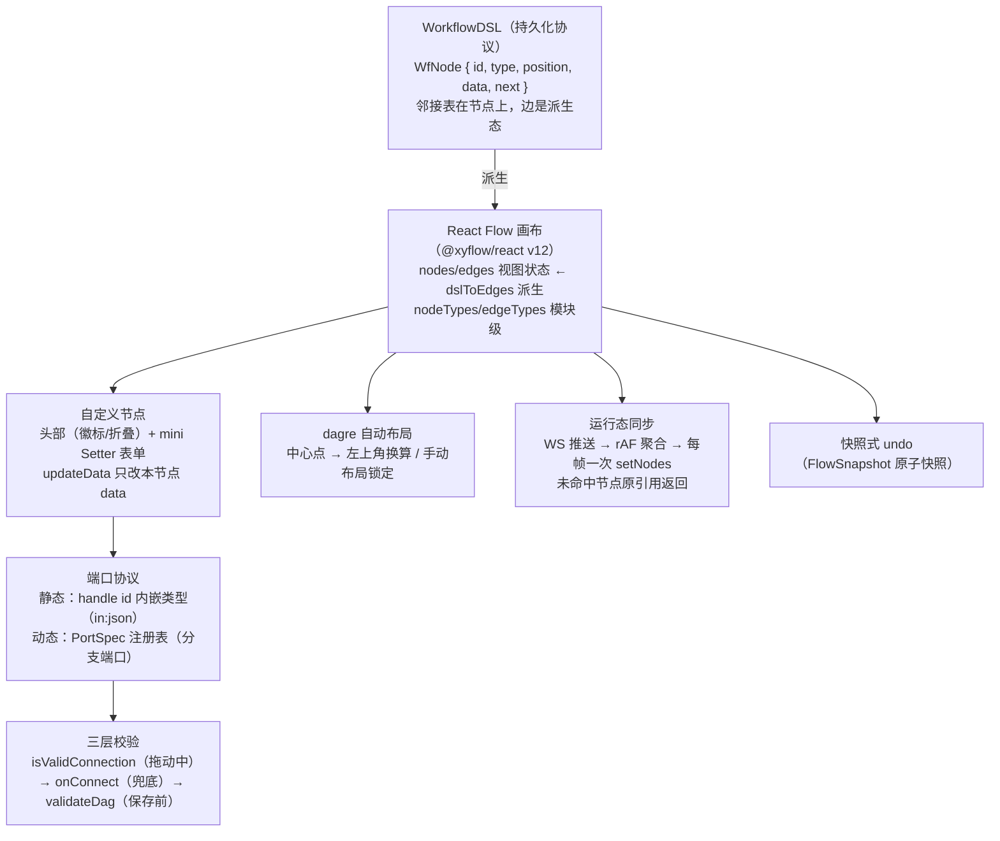

# 场景 2 · 工作流编排器（节点图编辑器）复刻手册

> 一句话目标：从零复刻一个 n8n/Dify 式工作流编辑器——`{ id, type, position, data, next }` 的节点 DSL（邻接表本体在节点上）、React Flow 画布、类型化端口协议与三层连线校验、保存前 Kahn 环检测、dagre 自动布局、高频运行态推送的 rAF 聚合。预计工期：2 周。前置要求：已完成本目录《[00-公共底座复用与第二辑增量](00-公共底座复用与第二辑增量-复刻手册.md)》与《[场景 1](01-场景1-低代码页面搭建器-复刻手册.md)》（画布坐标/手势/快照历史的实战经验直接迁移）；图纸：第二辑《[2. 工作流编排器 / 节点图编辑器](../react-高阶场景-第二辑/03-2-工作流编排器-节点图编辑器.md)》2.1–2.6 与 2.8–2.15（按里程碑指路）。
>
> 一个前置认知（图纸开篇的原话）：工作流编辑器 = **图数据结构编辑器** + **每节点一个迷你表单**。前者是本册新知识（DAG、拓扑、连线校验、布局），后者是 Setter 体系的又一次复用——mini Setter 面板直接长在节点上。

## 0. 最终效果与验收清单

- [ ] **DSL 可序列化**：`WorkflowDSL`（`nodes: WfNode[]`，边由 `next` 派生）round-trip 无损；`dslToEdges` 派生的边与画布连线一致
- [ ] **自定义节点**：http 节点卡片 = 头部（标题 + 状态徽标 + 折叠开关）+ mini Setter 表单体（method/url）；折叠后 Handle 仍在（连线不断裂）；`nodeTypes` 定义在模块级（无"new nodeTypes"警告）
- [ ] **连线交互**：从输出端口拖到输入端口建立 `smoothstep` 连线；拖动中类型不匹配的端口不吸附；`onReconnect` 拖端点重连走同一套校验
- [ ] **三层校验**：拖动中 `isValidConnection`（方向/类型/成环）实时拦截 → `onConnect` 兜底 → 保存前 `validateDag` 全量校验；构造 A→B→C→A 的环，`cyclicNodes` 恰为三者且画布标红
- [ ] **缩放平移下的命中**：缩放 0.4× 与 2.5× 下从节点面板拖入新节点，落点与指针一致（`screenToFlowPosition` 换算）；点击端口永远是端口不是节点体（命中扇区）
- [ ] **DAG 校验**：悬空 `next`、自环、重复边、环四类非法各有独立人话报错；删除节点级联清理指向它的 `next`；保存按钮在 `!ok` 时置灰
- [ ] **自动布局**：导入无坐标 DSL → dagre 一键分层（LR 方向、层间 80/同层 40）；dagre 中心点坐标已减半宽高转左上角；用户手动拖过再点布局弹确认
- [ ] **运行态性能**：mock WebSocket 以 50 msg/s 推送 100 节点状态，画布不卡（Profiler 无每消息一次的整树 update）；同帧同节点多次推送只渲染最终态
- [ ] **undo/redo**：连线/拖动/删除/复制/布局各一步回退；`Cmd+D` 复制选中节点（右下 32px 偏移 + 选区内边一起复制 + 副本成为新选区）

## 1. 架构总览



数据流一句话：**DSL 是唯一持久化真相（`next` 即邻接表），nodes/edges 是 React Flow 的视图态；编辑动作三层校验后同时写视图态与 DSL；运行态推送经 rAF 聚合只改 `data.status`；一切破坏性操作前截一张 `{ nodes, edges }` 原子快照。**

技术选型表：

| 库 | 用途 | 选型理由 | 替代项 |
|---|---|---|---|
| @xyflow/react（React Flow v12） | 画布 | 自定义节点/边、连线校验回调、视口管理一站配齐；n8n/Dify/Langflow 同款 | 自研 SVG 画布（本册不做，场景 5 白板会练） |
| @dagrejs/dagre | 自动布局 | 快、小、LR 分层够用 | elkjs（正交边更漂亮、慢一个量级，进阶换装） |
| zustand | 节点配置外置 store（性能选项） | path 级订阅范式的节点版 | 仅用 useNodesState（百节点内够） |
| 00 册快照式 useHistory | undo/redo | FlowSnapshot 零差异接入 | zundo / immer patches |
| vitest | 图算法表驱动测试 | validateDag/createsCycle 天然纯函数 | — |

## 2. 数据模型与协议

### 2.1 节点 DSL（边不单独存储）

```ts
// src/flow/dsl.ts —— 工作流协议：next 放在节点里，邻接表零转换、与调度器同构
export type WfNodeType = 'start' | 'http' | 'condition' | 'parallel' | 'join' | 'loop' | 'end'

export interface WfNode {
  id: string
  type: WfNodeType
  position: { x: number; y: number }  // 画布坐标（编辑器专用，调度器忽略）
  data: Record<string, unknown>       // 类型私有配置：url/method（http）、branches（condition）…
  next: string[]                      // 后继节点 id 列表 —— 邻接表本体
}

export interface WorkflowDSL {
  version: 1
  name: string
  nodes: WfNode[]
}

/** DSL → React Flow 的 edges：渲染层与协议层解耦的派生函数 */
export function dslToEdges(dsl: WorkflowDSL): { id: string; source: string; target: string }[] {
  return dsl.nodes.flatMap(node =>
    node.next.map(target => ({ id: `${node.id}->${target}`, source: node.id, target })),
  )
}
```

**为什么边不单独存**（图纸 2.1 的论证）：校验时邻接表零转换；保存的 JSON 与调度器输入是同一份数据，没有"编辑器格式 ↔ 执行格式"双向同步。代价是 React Flow 需要 nodes/edges 两套视图态——派生函数一行 `flatMap` 解决。**保存时反向收账**：画布 edges 变化必须写回各节点 `next`（M5 给 `edgesToDsl`）。

### 2.2 端口协议（静态内嵌 + 动态注册表）

```ts
// src/flow/ports.ts —— 端口元数据：渲染与校验共用的单一事实来源
export interface PortSpec {
  key: string          // 即 handle id，如 "out:br-a1" / "in:json"；动态端口用稳定 id，绝不用下标
  direction: 'in' | 'out'
  type: string         // 数据类型标签（连线校验用）：'json' | 'table' | ...
  label?: string       // 端口显示名（分支名）
}

export type PortResolver = (data: Record<string, unknown>) => PortSpec[]

const portRegistry = new Map<string, PortResolver>()

export function registerPorts(nodeType: string, resolve: PortResolver): void {
  portRegistry.set(nodeType, resolve)
}

export function resolvePorts(nodeType: string, data: Record<string, unknown>): PortSpec[] {
  return portRegistry.get(nodeType)?.(data) ?? []
}

/** 类型查询：先查注册表（动态端口），回退 id 内嵌协议（静态端口 "in:json"） */
export function portTypeOf(
  node: { type: string; data: Record<string, unknown> },
  handleId: string | null | undefined,
): string {
  if (handleId != null) {
    const port = resolvePorts(node.type, node.data).find(p => p.key === handleId)
    if (port) return port.type
  }
  return handleId?.includes(':') ? handleId.split(':')[1] : 'any'
}
```

http 节点（静态端口）与 condition 节点（动态端口：每分支一个出口 + default 兜底）的注册：

```ts
registerPorts('http', () => [
  { key: 'in:json', direction: 'in', type: 'json' },
  { key: 'out:json', direction: 'out', type: 'json' },
])

interface BranchItem { id: string; when: { field: string; operator: string; value: unknown }; next: string[] }

registerPorts('condition', data => {
  const branches = (data.branches as BranchItem[] | undefined) ?? []
  return [
    { key: 'in:json', direction: 'in', type: 'json' },
    ...branches.map(b => ({
      key: `out:${b.id}`,                    // 稳定 key：分支增删不影响其余端口的边
      direction: 'out' as const,
      type: 'json',
      label: String(b.when.field || b.id),
    })),
    { key: 'out:__default__', direction: 'out', type: 'json', label: '默认' },
  ]
})
```

**动态端口的铁律**（图纸 2.8）：key 用稳定 id（branchId），绝不用数组下标——下标当 key，中间插一个分支，全部边的 `sourceHandle` 语义错位。删端口必同步清边（`removeBranch` 里 `setEdges(filter)` 一次提交）。

### 2.3 贯穿示例（"订单风控流"）

```json
{
  "version": 1,
  "name": "order-risk-flow",
  "nodes": [
    { "id": "start", "type": "start", "position": { "x": 0, "y": 160 }, "data": {}, "next": ["fetch"] },
    { "id": "fetch", "type": "http", "position": { "x": 300, "y": 160 },
      "data": { "title": "拉取订单", "method": "GET", "url": "https://api.example.com/orders", "collapsed": false, "status": "idle" },
      "next": ["cond"] },
    { "id": "cond", "type": "condition", "position": { "x": 640, "y": 160 },
      "data": { "title": "金额路由", "branches": [
        { "id": "br-big", "when": { "field": "amount", "operator": ">", "value": 1000 }, "next": ["notify"] }
      ], "default": ["end"] }, "next": [] },
    { "id": "notify", "type": "http", "position": { "x": 980, "y": 60 },
      "data": { "title": "人工复核通知", "method": "POST", "url": "https://api.example.com/review", "collapsed": false, "status": "idle" },
      "next": ["end"] },
    { "id": "end", "type": "end", "position": { "x": 1320, "y": 160 }, "data": {}, "next": [] }
  ]
}
```

## 3. 复刻主线路径：里程碑 M1–M6

### M1 节点/端口/边数据模型（第 1–2 天）

**目标**：DSL 与端口协议类型落地；`http` 自定义节点（mini Setter + 状态徽标 + 折叠）在画布上可编辑；`nodeTypes` 模块级；表驱动测试起步。

**关键实现**——自定义节点（`updateData` 只改本节点引用；Handle 永远渲染；memo）：

```tsx
// src/flow/HttpNodeView.tsx
import { memo, useCallback } from 'react'
import { Handle, Position, useReactFlow, type Node, type NodeProps } from '@xyflow/react'

/** v12 要求 data 满足 Record：type 别名有隐式索引签名，interface 要额外声明——用 type */
export type HttpNodeData = {
  title: string
  method: 'GET' | 'POST'
  url: string
  collapsed: boolean
  status: 'idle' | 'running' | 'success' | 'error'
}
export type HttpNode = Node<HttpNodeData, 'http'>

const STATUS_META: Record<HttpNodeData['status'], { color: string; label: string }> = {
  idle: { color: '#8c8c8c', label: '空闲' },
  running: { color: '#1677ff', label: '运行中' },
  success: { color: '#52c41a', label: '成功' },
  error: { color: '#ff4d4f', label: '失败' },
}

function HttpNodeView({ id, data, selected }: NodeProps<HttpNode>) {
  const { setNodes } = useReactFlow()

  /** mini Setter 统一写入口：只换本节点 data，其它节点引用不动（M6 性能的命门之一） */
  const updateData = useCallback(
    <K extends keyof HttpNodeData>(key: K, value: HttpNodeData[K]) => {
      setNodes(nodes =>
        nodes.map(n => (n.id === id ? { ...n, data: { ...n.data, [key]: value } } : n)),
      )
    },
    [id, setNodes],
  )

  const badge = STATUS_META[data.status]
  return (
    <div style={{
      minWidth: 240, borderRadius: 8, background: '#fff', fontSize: 12,
      border: selected ? '2px solid #1677ff' : '1px solid #d9d9d9',
      boxShadow: '0 2px 8px rgba(0,0,0,0.08)',
    }}>
      <Handle type="target" position={Position.Left} id="in:json" />
      <div style={{ display: 'flex', alignItems: 'center', gap: 8, padding: '8px 12px' }}>
        <strong style={{ flex: 1 }}>{data.title}</strong>
        <span style={{ color: badge.color, whiteSpace: 'nowrap' }}>● {badge.label}</span>
        <button onClick={() => updateData('collapsed', !data.collapsed)} style={{ border: 'none', cursor: 'pointer' }}>
          {data.collapsed ? '展开' : '折叠'}
        </button>
      </div>
      {!data.collapsed && (
        <div style={{ padding: 12, display: 'grid', gap: 8 }}>
          <label style={{ display: 'grid', gap: 4 }}>
            请求方式
            <select value={data.method} onChange={e => updateData('method', e.target.value as 'GET' | 'POST')}>
              <option value="GET">GET</option>
              <option value="POST">POST</option>
            </select>
          </label>
          <label style={{ display: 'grid', gap: 4 }}>
            URL
            <input value={data.url} onChange={e => updateData('url', e.target.value)} style={{ width: '100%' }} />
          </label>
        </div>
      )}
      <Handle type="source" position={Position.Right} id="out:json" />
    </div>
  )
}

export default memo(HttpNodeView)

// 模块级注册（铁律）：组件内定义 = 每次渲染新对象 = 全部节点卸载重建（焦点丢失）
// src/flow/nodeTypes.ts
// import type { NodeTypes } from '@xyflow/react'
// export const nodeTypes: NodeTypes = { http: HttpNodeView, condition: ConditionNodeView }
```

**验收**：画布渲染示例 DSL 五节点；双击改 URL 只重渲染该节点（React DevTools Highlight 验证）；折叠后连线仍完整；Console 无 `nodeTypes` 警告；`dslToEdges` 输出与画布边一致（Console 比对）。

**常见报错与修复**：

1. `It looks like you've created a new nodeTypes object`——nodeTypes 写在了组件内。修复：提到模块级常量。
2. 节点输入打字画布轻微卡顿——`setNodes` 全数组协调。修复：几十节点可接受；上百节点把 `data` 挪到外部 zustand store、节点组件 selector 只订自己（M6 性能节）。
3. `Node<HttpNodeData>` 报 data 不满足约束——用了 interface。修复：`type` 别名（代码注释已解释）。

### M2 画布变换与连线交互（第 3–4 天）

**目标**：React Flow 画布跑通（视口/小地图/背景）；从端口拖出连线的完整交互；`smoothstep` 默认边型；理解画布坐标换算与 00 册视口模块的关系。

**画布装配**（最小可用编辑器）：

```tsx
// src/flow/FlowEditor.tsx
import { useCallback } from 'react'
import {
  addEdge, Background, BackgroundVariant, Controls, MiniMap, ReactFlow, ReactFlowProvider,
  useEdgesState, useNodesState, type Connection, type Edge, type NodeTypes,
} from '@xyflow/react'
import '@xyflow/react/dist/style.css'
import { nodeTypes } from './nodeTypes'
import type { HttpNode } from './HttpNodeView'

export function FlowEditor({ initialNodes, initialEdges }: {
  initialNodes: HttpNode[]
  initialEdges: Edge[]
}) {
  const [nodes, setNodes, onNodesChange] = useNodesState<HttpNode>(initialNodes)
  const [edges, setEdges, onEdgesChange] = useEdgesState(initialEdges)
  const onConnect = useCallback((c: Connection) => {
    setEdges(eds => addEdge({ ...c, type: 'smoothstep' }, eds)) // M3 会在此接入校验
  }, [setEdges])

  return (
    <div style={{ width: '100vw', height: '100vh' }}>
      <ReactFlow
        nodes={nodes} edges={edges} nodeTypes={nodeTypes}
        onNodesChange={onNodesChange} onEdgesChange={onEdgesChange}
        onConnect={onConnect}
        defaultEdgeOptions={{ type: 'smoothstep' }}
        fitView
      >
        <Background variant={BackgroundVariant.Dots} gap={16} />
        <MiniMap pannable zoomable />
        <Controls />
      </ReactFlow>
    </div>
  )
}

export default function Page() {
  return <ReactFlowProvider><FlowEditor initialNodes={seedNodes} initialEdges={seedEdges} /></ReactFlowProvider>
}
```

**画布变换与 00 册视口的关系**：React Flow 内置了 viewport（`useViewport` / `screenToFlowPosition`），数学与 00 册 `viewport.ts` 同源（scale + offset 双向换算）。本册纪律：**画布内交互一律用 React Flow 的换算 API，自研 overlay（右键菜单、拖入预览）用 00 册的 `screenToCanvas`——两套不许在同一坐标链上混用**。

**贝塞尔连线数学**（自定义边/调试连线走向时的心智模型；React Flow 的 `getBezierPath` 即此实现）：

```ts
// src/flow/bezier.ts —— 三次贝塞尔：水平出线（源右缘）→ 水平入线（目标左缘）
export interface BezierParams {
  sx: number; sy: number   // 源点（源节点右缘中点）
  tx: number; ty: number   // 目标点（目标节点左缘中点）
  curvature?: number       // 控制臂长系数，默认 0.5
}

/** 控制点：源/目标沿各自水平法线伸出 |dx| * curvature */
export function bezierControlPoints({ sx, sy, tx, ty, curvature = 0.5 }: BezierParams) {
  const dx = Math.abs(tx - sx) * curvature
  return {
    c1: { x: sx + dx, y: sy },  // 源侧：向右伸
    c2: { x: tx - dx, y: ty },  // 目标侧：向左伸
  }
}

export function bezierPath(p: BezierParams): string {
  const { c1, c2 } = bezierControlPoints(p)
  // path 的 cubic 指令：M 起点 C c1 c2 终点
  return `M ${p.sx} ${p.sy} C ${c1.x} ${c1.y} ${c2.x} ${c2.y} ${p.tx} ${p.ty}`
}

/** 取曲线上 t∈[0,1] 的点（连线中点放标签/删除按钮用） */
export function bezierPoint(p: BezierParams, t: number): { x: number; y: number } {
  const { c1, c2 } = bezierControlPoints(p)
  const u = 1 - t
  return {
    x: u * u * u * p.sx + 3 * u * u * t * c1.x + 3 * u * t * t * c2.x + t * t * t * p.tx,
    y: u * u * u * p.sy + 3 * u * u * t * c1.y + 3 * u * t * t * c2.y + t * t * t * p.ty,
  }
}
```

**验收**：拖动 `out:json` 到另一节点 `in:json` 建边；`fitView` 初始铺满；画布平移缩放流畅；Console 打印 `bezierPath` 的 d 属性与 React Flow 默认边（type 暂改 `default`）形状同族。

**常见报错与修复**：

1. 连线拖到画布空白松手边没出现——正常（React Flow 默认空白不建边）；若需求"自动创建节点"，那是 drop-on-edge（图纸 2.9 机制三，进阶扩展）。
2. 边全叠在左上角——节点没有 position 或 measured 未就绪。修复：DSL 导入时保证每节点有初始坐标（无坐标先随机铺开再 M6 自动布局）。

### M3 连接合法性校验（第 5–6 天）

**目标**：三层防线落地——拖动中实时校验（画不出坏线）、connect 兜底、保存全量校验（M5）。

**关键实现**——环检测（DFS 可达性）与规则回调：

```ts
// src/flow/connection-rules.ts —— 若从 target 沿现有边可达 source，则新增 source→target 必成环
export function createsCycle(
  edges: { source: string; target: string }[],
  source: string,
  target: string,
): boolean {
  const adjacency = new Map<string, string[]>()
  for (const edge of edges) {
    const list = adjacency.get(edge.source) ?? []
    list.push(edge.target)
    adjacency.set(edge.source, list)
  }
  const visited = new Set<string>()
  const stack = [target] // 从 target 出发找 source：target 的下游绕回 source 即闭环
  while (stack.length > 0) {
    const id = stack.pop()!
    if (id === source) return true
    if (visited.has(id)) continue
    visited.add(id)
    stack.push(...(adjacency.get(id) ?? []))
  }
  return false
}

/** 规则总入口：方向（source/target 语义由 Handle type 决定）+ 类型 + 拓扑 */
export function checkConnection(
  connection: { source: string; target: string; sourceHandle: string | null; targetHandle: string | null },
  edges: { source: string; target: string }[],
  nodeOf: (id: string) => { type: string; data: Record<string, unknown> } | undefined,
): boolean {
  if (connection.source === connection.target) return false                    // 规则 1：禁自连
  const sourceNode = nodeOf(connection.source)
  const targetNode = nodeOf(connection.target)
  if (!sourceNode || !targetNode) return false
  const from = portTypeOf(sourceNode, connection.sourceHandle)                // 规则 2：类型匹配
  const to = portTypeOf(targetNode, connection.targetHandle)
  if (from !== 'any' && to !== 'any' && from !== to) return false
  return !createsCycle(edges, connection.source, connection.target)           // 规则 3：不能成环
}
```

接线（`isValidConnection` 拖动中每次悬停候选端口都会调；`onConnect` 兜底程序化触发）：

```tsx
const isValidConnection = useCallback(
  (c: Connection) => checkConnection(c, edges, id =>
    nodes.find(n => n.id === id) as { type: string; data: Record<string, unknown> } | undefined),
  [edges, nodes],
)
const onConnect = useCallback((c: Connection) => {
  if (!isValidConnection(c)) return               // 兜底：绕过拖拽的 connect 也过规则
  setEdges(eds => addEdge({ ...c, type: 'smoothstep' }, eds))
}, [isValidConnection, setEdges])
// <ReactFlow isValidConnection={isValidConnection} onConnect={onConnect} ... />
```

**验收**：`out:json` 拖到 `in:table`（临时改一个端口类型）不吸附；把 A→B 连上后再从 B 拖回 A，不吸附（环）；三个规则各自的 Console 日志（临时打点）能区分命中哪条。

**常见报错与修复**：

1. "类型一样还是连不上"——handle 没写 id（默认 null），`portTypeOf` 拿到 any 之外的空值比较失败。修复：所有自定义端口显式写 id 并守 `in:<type>`/`out:<type>` 协议。
2. 环没被拦——`isValidConnection` 闭包里 edges 是旧值（依赖数组漏了 edges）。修复：依赖 `[edges]`（上面已含）。
3. 端口级专属规则（join 只收 parallel）——画布级之外给单个 `<Handle isValidConnection={...}>`；两级同时存在时都过才可连（图纸 2.3 末段）。

### M4 缩放平移下的命中（第 7 天）

**目标**：任何缩放/平移状态下，"从节点面板拖入新节点"的落点准确；端口命中优先于节点体；理解 React Flow 的事件换算链。

**关键实现一：落点换算**——`screenToFlowPosition` 把**屏幕坐标**换成**画布坐标**（内部已吃掉缩放与平移；这就是 00 册 `screenToCanvas` 的 React Flow 版）：

```tsx
// src/flow/Palette.tsx —— 节点面板：HTML5 拖出 + onDrop 落点换算
import { useReactFlow } from '@xyflow/react'
import { useCallback } from 'react'

export function useDropNode(defaultDataOf: (type: string) => Record<string, unknown>) {
  const { screenToFlowPosition, setNodes } = useReactFlow()
  return useCallback((event: React.DragEvent) => {
    event.preventDefault()
    const type = event.dataTransfer.getData('application/reactflow-node')
    if (!type) return
    // 关键：屏幕坐标 → 画布坐标。任何缩放/平移下落点都与指针一致
    const position = screenToFlowPosition({ x: event.clientX, y: event.clientY })
    setNodes(nodes => [...nodes, {
      id: crypto.randomUUID(),
      type,
      position,
      data: defaultDataOf(type),
    }])
  }, [screenToFlowPosition, setNodes, defaultDataOf])
}
// 面板侧 onDragStart：e.dataTransfer.setData('application/reactflow-node', type); e.dataTransfer.effectAllowed = 'move'
```

**关键实现二：端口命中扇区**——自研 overlay（如"连线中显示候选端口高亮"）需要判断"指针在不在某端口的命中扇区"时，扇区 = 以端口圆心为顶点、朝节点外侧的一个矩形区域（比圆形命中大 2–3 倍，才好用）：

```ts
// src/flow/port-hit.ts —— 端口命中扇区：端口半径 4px，命中区扩到 12px 且向节点外延伸
export interface PortHitZone {
  /** 扇区矩形（画布坐标）：以端口为内边中点、向外延伸 extension */
  x: number; y: number; w: number; h: number
  nodeId: string
  handleId: string
}

export function portHitZone(
  port: { x: number; y: number; direction: 'in' | 'out' },
  nodeId: string,
  handleId: string,
  radius = 4,
  extension = 16, // 向外延伸：连线松手时"差一点"也能命中
): PortHitZone {
  const hit = radius + 8 // 命中区比可视半径大 8px
  return port.direction === 'out'
    ? { x: port.x - hit, y: port.y - hit - 4, w: hit * 2 + extension, h: hit * 2 + 8, nodeId, handleId }
    : { x: port.x - hit - extension, y: port.y - hit - 4, w: hit * 2 + extension, h: hit * 2 + 8, nodeId, handleId }
}

export function pointInZone(p: { x: number; y: number }, z: PortHitZone): boolean {
  return p.x >= z.x && p.x <= z.x + z.w && p.y >= z.y && p.y <= z.y + z.h
}
```

**验收**：缩放 0.4×/1×/2.5× 三档下从面板拖入 http 节点，落点与指针重合（截图对比）；平移到远处再拖入，同样准确；React Flow 原生连线（不用自研扇区）在缩放下命中正常——自研扇区只在自研 overlay 时启用，两套不叠加。

**常见报错与修复**：

1. **落点漂移**——用 `event.clientX` 直接减容器 rect 再忘了除 zoom（绕过了 `screenToFlowPosition`）。修复：一律走 API；自研路径用 00 册 `screenToCanvas`。
2. **面板拖拽无反应**——`getData` 的 MIME 与 `setData` 不一致，或忘了 `event.preventDefault()`（onDragOver 也要 prevent 才允许 drop）。修复：统一常量 + onDragOver preventDefault。

### M5 DAG 校验与环检测（第 8–10 天）

**目标**：保存前全量校验（Kahn 拓扑排序 + 环成员定位 + 结构预检）；画布 ↔ DSL 双向同步（`edgesToDsl` 收账）；删除节点级联清理。

**关键实现**——完整校验器（图纸 2.1 的原版，本手册逐行可用）：

```ts
// src/flow/validate.ts —— Kahn 拓扑排序：出队数 < 节点数 = 有环，剩下的就是环成员
export interface DagValidation {
  ok: boolean
  cyclicNodes: string[]  // 画布高亮用
  errors: string[]       // 人话报错，直接可展示
}

export function validateDag(dsl: WorkflowDSL): DagValidation {
  const errors: string[] = []

  // 步骤 1：结构预检——重复 id、悬空 next、自环、重复边（比环更常见，先挡掉）
  const ids = new Set(dsl.nodes.map(n => n.id))
  if (ids.size !== dsl.nodes.length) errors.push('存在重复的节点 id')
  const edgeKeys = new Set<string>()
  for (const node of dsl.nodes) {
    for (const next of node.next) {
      if (!ids.has(next)) { errors.push(`节点 ${node.id} 的 next 指向不存在的节点 ${next}`); continue }
      if (next === node.id) { errors.push(`节点 ${node.id} 自连（自环）`); continue }
      const key = `${node.id}->${next}`
      if (edgeKeys.has(key)) errors.push(`重复连线：${key}`)
      edgeKeys.add(key)
    }
  }
  if (errors.length > 0) return { ok: false, cyclicNodes: [], errors }

  // 步骤 2：入度表（邻接表就是 node.next）
  const indegree = new Map<string, number>(dsl.nodes.map(n => [n.id, 0]))
  const nodeById = new Map(dsl.nodes.map(n => [n.id, n]))
  for (const node of dsl.nodes) {
    for (const next of node.next) indegree.set(next, (indegree.get(next) ?? 0) + 1)
  }

  // 步骤 3：入度 0 全部入队
  const queue: string[] = [...indegree.entries()].filter(([, d]) => d === 0).map(([id]) => id)
  const ordered: string[] = []

  // 步骤 4：出队 → 后继入度减一 → 归零入队
  while (queue.length > 0) {
    const id = queue.shift()!
    ordered.push(id)
    for (const next of nodeById.get(id)!.next) {
      const remain = (indegree.get(next) ?? 0) - 1
      indegree.set(next, remain)
      if (remain === 0) queue.push(next)
    }
  }

  // 步骤 5：摘不完 = 有环；剩下的就是环成员
  if (ordered.length === dsl.nodes.length) return { ok: true, cyclicNodes: [], errors: [] }
  const cyclicNodes = dsl.nodes.filter(n => !ordered.includes(n.id)).map(n => n.id)
  return { ok: false, cyclicNodes, errors: [`检测到环，涉及节点：${cyclicNodes.join(' → ')}`] }
}
```

画布 → DSL 的收账与级联删除：

```ts
// src/flow/sync.ts —— edges 写回 next + 删除节点级联清理
import type { WfNode } from './dsl'

/** 视图 edges → 协议 next：保存前调用（画布是编辑真相，DSL 是持久化真相） */
export function edgesToDsl(nodes: WfNode[], edges: { source: string; target: string }[]): WfNode[] {
  const nextOf = new Map<string, string[]>()
  for (const e of edges) {
    const list = nextOf.get(e.source) ?? []
    list.push(e.target)
    nextOf.set(e.source, list)
  }
  return nodes.map(n => ({ ...n, next: nextOf.get(n.id) ?? [] }))
}

/** 删除节点：级联清掉所有指向它的 next（悬空边在派生时不渲染、错误不可见——必须源头清） */
export function removeNodeCascade(nodes: WfNode[], id: string): WfNode[] {
  return nodes
    .filter(n => n.id !== id)
    .map(n => ({ ...n, next: n.next.filter(t => t !== id) }))
}
```

保存按钮接线：`const check = validateDag(edgesToDsl(nodes, edges))`；`!check.ok` → 保存置灰 + 错误面板 + `cyclicNodes` 存 state、自定义节点读它渲染红框。

**验收**（vitest 表驱动，图纸 2.15 的测试策略）：合法 DAG 过；A→B→C→A 报环且 `cyclicNodes` 恰为三个；悬空/自环/重复边各有独立报错；删除中间节点后 `next` 无悬空、再保存通过。画布手工验证：故意连成环，保存置灰 + 三节点红框。

**常见报错与修复**：

1. 校验通过但业务断言缺 start/end——补业务断言：恰一个 `start`、至少一个 `end`、除 end 外 `next.length > 0`（图纸 2.1 坑 1）。
2. condition 的 `next` 恒空导致"除 end 外必须有后继"误报——condition 的有效邻接 = `branches[].next ∪ default`，校验器对该类型做 next 合并预处理（图纸 2.7 的口径）。
3. 引入循环节点（图纸 2.7 的 loop：子段引用而非回边）被环检测误杀——循环语义放 `data`（bodyStart/bodyEnd），邻接表保持无环。这是协议设计的关键权衡：**正确性靠结构，灵活性靠语义**。

### M6 自动布局一瞥（第 11–12 天）

**目标**：dagre 一键分层；中心点 → 左上角换算；手动布局锁定（三种策略取"全局标记 + 确认"）；ELK 知道何时换。

```ts
// src/flow/layout.ts —— dagre 布局：注意返回的是中心点坐标，React Flow 要左上角
import dagre from '@dagrejs/dagre'
import type { Edge, Node } from '@xyflow/react'

export function layoutWithDagre(nodes: Node[], edges: Edge[], direction: 'LR' | 'TB' = 'LR'): Node[] {
  const g = new dagre.graphlib.Graph()
  g.setGraph({ rankdir: direction, nodesep: 40, ranksep: 80, marginx: 40, marginy: 40 })
  g.setDefaultEdgeLabel(() => ({})) // dagre 要求每条边有 label（可为空对象）

  for (const node of nodes) {
    // v12 的真实尺寸在 node.measured；未测量（未渲染过）时回退估算值
    g.setNode(node.id, { width: node.measured?.width ?? 260, height: node.measured?.height ?? 90 })
  }
  for (const edge of edges) g.setEdge(edge.source, edge.target)

  dagre.layout(g)

  return nodes.map(node => {
    const { x, y, width, height } = g.node(node.id) // 中心点
    return { ...node, position: { x: x - width / 2, y: y - height / 2 } } // 转左上角
  })
}
```

布局工具栏（手动布局锁定 + 布局一次一步 undo + 下一帧 fitView）：

```tsx
import { useCallback, useRef } from 'react'
import { Panel, useReactFlow } from '@xyflow/react'

export function LayoutToolbar({ onCommit }: { onCommit: () => void }) {
  const { getNodes, getEdges, setNodes, fitView } = useReactFlow()
  const manuallyLaid = useRef(false)

  const onAutoLayout = useCallback(() => {
    if (manuallyLaid.current && !window.confirm('自动布局会覆盖手动排列的位置，继续？')) return
    onCommit() // 快照：一次布局 = 一步 undo（场景 1 册同款纪律）
    setNodes(nodes => layoutWithDagre(nodes, getEdges()))
    manuallyLaid.current = false
    requestAnimationFrame(() => void fitView({ padding: 0.15, duration: 300 })) // 等状态落地再 fit
  }, [setNodes, getEdges, fitView, onCommit])

  return <Panel position="top-right"><button onClick={onAutoLayout}>自动布局</button></Panel>
}
// <ReactFlow onNodeDragStop={() => { manuallyLaid.current = true }} ... />
```

**验收**：导入无坐标 DSL（position 全 0）→ 首帧渲染后点布局 → LR 分层清晰、层间 80；布局后 undo 一步回到布局前；拖动一个节点后再点布局弹确认。ELK 换装（`layoutWithElk` 异步 API、返回即左上角、正交边 bends）进阶再做——判断信号：要 n8n 级观感或分组/复杂端口时。

**常见报错与修复**：

1. 布局后节点挤成一坨——首渲染前就布局，`measured` 全空回退默认值。修复：先渲染一帧再布局（`requestAnimationFrame` 或 useEffect 二段）。
2. 布局把 undo 打断成几十步——每节点 position 变化独立入栈。修复：布局前一次 commit（上面代码）。

## 4. 运行态性能专节：rAF 聚合与数百节点的虚拟化（第 13–14 天）

**问题还原**：点"运行"后引擎以 50 msg/s 推送节点状态。反例（每消息一次 setNodes + map 全量换新对象）= 每秒 50 次全图协调 × 100 节点全部重渲染 = 每秒 5000 次节点组件渲染，主线程持续过载，"点运行画布冻住"（图纸 2.5 的数字推演）。

**修法一：rAF 聚合 + 引用稳定性**（完整实现，图纸 2.5 的核心）：

```tsx
// src/flow/useStatusSync.ts —— 高频推送 → 帧队列去重 → 每帧最多一次 setNodes
import { useCallback, useEffect, useRef } from 'react'
import { useReactFlow, type Node } from '@xyflow/react'

export type NodeRunStatus = 'idle' | 'running' | 'success' | 'error'

interface StatusPatch { nodeId: string; status: NodeRunStatus }

export function useStatusSync() {
  const { setNodes } = useReactFlow()
  const pendingRef = useRef(new Map<string, StatusPatch>()) // 同帧同节点多次推送只留最新
  const rafIdRef = useRef<number | null>(null)

  const flush = useCallback(() => {
    rafIdRef.current = null
    const pending = pendingRef.current
    if (pending.size === 0) return
    const patches = new Map(pending)
    pending.clear()
    setNodes(nodes =>
      nodes.map((node): Node => {
        const patch = patches.get(node.id)
        if (!patch) return node            // ★ 命门：未命中节点原引用返回——memo 才能生效
        return { ...node, data: { ...node.data, status: patch.status } }
      }),
    )
  }, [setNodes])

  const applyPatch = useCallback((patch: StatusPatch) => {
    pendingRef.current.set(patch.nodeId, patch)
    if (rafIdRef.current === null) {
      rafIdRef.current = requestAnimationFrame(flush) // 与渲染节拍对齐，每帧最多一次
    }
  }, [flush])

  useEffect(() => () => {
    if (rafIdRef.current !== null) cancelAnimationFrame(rafIdRef.current)
  }, [])

  return { applyPatch }
}
```

与 mock WebSocket 的接线（验收用 50 msg/s × 100 节点压测）：

```ts
// src/flow/mockRun.ts —— 验收用：按拓扑序以 50msg/s 推状态
export function startMockRun(nodes: string[][], apply: (p: { nodeId: string; status: NodeRunStatus }) => void) {
  let i = 0
  const timer = setInterval(() => {
    const layer = nodes[i % nodes.length]
    for (const id of layer) apply({ nodeId: id, status: i % 3 === 0 ? 'running' : 'success' })
    if (++i > 200) clearInterval(timer)
  }, 20) // 50 msg/s
  return () => clearInterval(timer)
}
```

**修法二：视口裁剪 + 折叠 + 外部 store（数百节点虚拟化）**：

1. `<ReactFlow onlyRenderVisibleElements>`——视口外节点不渲染（React Flow 内建虚拟化）；
2. 运行态全量折叠表单体（`collapsed: true` 默认，徽标在头部行不受影响）；
3. 节点配置外置 zustand：节点组件 `useFlowStore(s => s.dataById[id])` 只订自己——`setNodes` 不再触发全量协调，配合 memo 百节点输入如丝（图纸 2.2 坑 1 的正解）。

**验收**：100 节点 + 50 msg/s 压测——Profiler 无每消息一次的 update（一帧一次）；打字/拖拽与推送并存不掉帧；`onlyRenderVisibleElements` 开启后缩放到全图，节点渲染数明显下降（React DevTools 计数）。

**常见报错与修复**：

1. 状态延迟数秒——后端还叠了一层消息合并或 flush 用了非函数式 set。修复：后端合并不超 50ms；`setNodes` 一律函数式。
2. 闪旧状态——WS 重连重放乱序。修复：补丁带递增序号，flush 时丢弃比已应用序号老的（图纸 2.5 坑 2）。
3. 拖拽仍卡——更新频率解决了但渲染总量没变。修复：修法二的三板斧。

## 5. 复刻坑清单

1. **nodeTypes/edgeTypes 组件内定义**：每次渲染新引用 → 全节点卸载重建。→ 模块级常量。
2. **折叠裁掉 Handle**：连线视觉断裂。→ Handle 永远渲染，折叠只裁表单体。
3. **动态端口用下标当 key**：插入分支后边全接错。→ 稳定 id（branchId）；删端口同步清边。
4. **`setEdges(addEdge(...))` 读闭包旧 edges**：边时灵时不灵。→ 永远函数式 `setEdges(eds => addEdge(...))`。
5. **删除节点不级联清 next/边**：悬空引用在校验/渲染两头炸。→ `removeNodeCascade`；一切破坏性操作走同一入口。
6. **undo 半步**（节点回来边没回来）：nodes 与 edges 快照不同时刻。→ `FlowSnapshot { nodes, edges }` 原子进出栈。
7. **Cmd+D 副本与原件重叠**：忘了 32px 偏移；或只复制节点没复制选区内边（孤岛）。→ 偏移 + 两端都在选区内的边一起复制 + 副本成为新选区（图纸 2.6）。
8. **dagre 中心点当左上角**：布局整体偏右下半个节点宽。→ 减半宽高的那两行是本体。
9. **循环语义写进 next**：DAG 校验被迫开洞。→ loop 语义进 data（bodyStart/bodyEnd 子段引用），图结构永 DAG。
10. **`measured` 未就绪布局**：全默认尺寸挤成一坨。→ 先渲染一帧再布局。

## 6. 与底座/其他手册的衔接

| 本册产出/复用 | 去处 |
|---|---|
| WorkflowDSL + validateDag + createsCycle | 毕业项目（流程板块）、场景 3 的条件树嵌进 condition 节点 `data`（图纸明示的嵌套关系） |
| 端口注册表（PortSpec/portTypeOf） | 场景 5 白板（图元端口的同构设计） |
| rAF 聚合管道（useStatusSync） | 任何高频推送场景（协同光标、实时指标）——00 册公共件候选 |
| mini Setter 面板模式 | 场景 3 值编辑器、场景 1 属性面板同源（Setter 第 N 次复用） |
| 快照历史 + 手动布局锁定 | 场景 5 |

进阶扩展全部指路图纸：语义升级（条件/并行/循环 + mini 调度器，2.7）、动态端口全量（2.8）、边路由与重连/线上插入（2.9）、框选对齐与只读锁定（2.10）、执行态可视化与回放（2.11）、节点面板三添加方式（2.12）、子流程（2.13）、失败处理与人工节点（2.14）、测试策略（2.15）。做完本手册六里程碑后，2.7 的 mini 调度器强烈建议做——它是"协议语义可执行化"的最佳练习。
