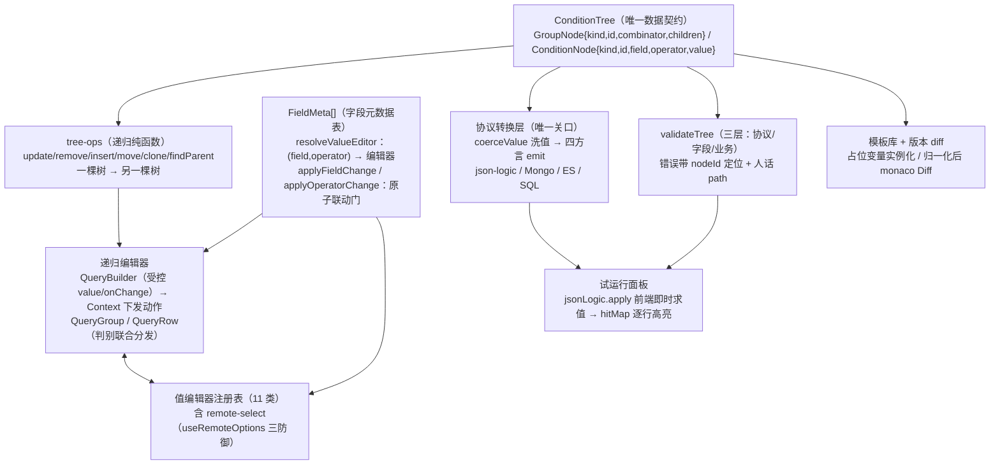

# 场景 3 · 动态查询构建器（规则引擎 UI）复刻手册

> 一句话目标：从零复刻一个"给非程序员用的图形化布尔表达式编辑器"——递归条件树（QueryGroup/QueryRow）、字段元数据驱动（field schema）、Setter 二维化的值编辑器体系、远程 options 防抖取消、条件树 ↔ json-logic 协议转换、定位到行的校验、json-logic-js 试运行面板、模板库与版本 diff。产出即完整的高频业务功能："编辑一次，处处可执行"。预计工期：2–3 周（第二辑最重的全量场景）。前置要求：本目录《[00-公共底座复用与第二辑增量](00-公共底座复用与第二辑增量-复刻手册.md)》（`useRemoteOptions`/快照历史/LazyMonaco 三件直接消费）；图纸：第二辑场景 3 全部 11 篇——[总览](../react-高阶场景-第二辑/04-3-动态查询构建器-规则引擎-UI-全量展开.md)、[3.1 协议](../react-高阶场景-第二辑/05-3-1-核心技术总览.md)、[3.2 递归渲染](../react-高阶场景-第二辑/06-3-2-递归渲染-QueryGroup-QueryRow.md)、[3.3 字段元数据](../react-高阶场景-第二辑/07-3-3-字段元数据驱动-field-schema.md)、[3.4 值编辑器与远程 options](../react-高阶场景-第二辑/08-3-4-值编辑器体系-Setter-复用-远程-options-懒加载-防抖-取消.md)、[3.5 协议转换层](../react-高阶场景-第二辑/09-3-5-协议转换层-前后端契约关键-条件树-json-logic-Mongo-query.md)、[3.6 校验](../react-高阶场景-第二辑/10-3-6-校验-空值-类型不匹配-between-要两个值-嵌套深度上限-条件数上限.md)、[3.7 试运行](../react-高阶场景-第二辑/11-3-7-试运行面板-json-logic-js-前端即时求值.md)、[3.8 模板与 diff](../react-高阶场景-第二辑/12-3-8-高级-规则模板库-协议-占位变量-规则版本-diff-monaco-diff.md)、[3.9 坑](../react-高阶场景-第二辑/13-3-9-坑-查询构建器常见翻车点与修法.md)、[3.10 复用关系](../react-高阶场景-第二辑/14-3-10-与内核的复用关系-为什么它被列为三星.md)。
>
> 一条主线认知（图纸 3.0 的抽象）：**规则 = 条件树（何时） + 动作（做什么），本章只做条件树这一半**。条件树是递归渲染器内核的第 N 次复用——树从"N 种注册表分发"收缩为"2 种判别联合分发"，但**编辑难度反而更高**：每个节点都要支持增、删、复制、换位置，递归不止用在渲染，还要用在不可变更新与协议转换上。

## 0. 最终效果与验收清单

- [ ] **协议**：条件树 `ConditionTree`（kind 判别联合 + 节点 id + combinator 属于组）round-trip 无损；"金额复核规则"（`amount > 100 AND (city IN [北京,上海] OR isVip = true)`）能徒手写出对应 JSON
- [ ] **递归编辑器**：增删条件/子组、复制（id 全量重发、紧跟原件）、行间"且/或" chip 点击切换、组内拖拽排序 + 跨组拖拽（含"组拖进自己子树"防环拦截）；删除组最后一行时整组自动剪枝
- [ ] **元数据驱动**：换一张 `FieldMeta[]` 表（订单域 → 工单域），编辑器零改动变身为工单筛选器；字段切换时操作符退回该字段第一个合法操作符、值按新编辑器原子重置（无类型残留）
- [ ] **值编辑器**：11 类编辑器按 `(field, operator)` 二维查一维派发；between 双框、in 多选、isEmpty 无值、日期走 ISO 字符串
- [ ] **远程 options**：连续输入 5 字符只发 1 个请求；旧请求被 abort（Network canceled）；乱序响应被序号守卫丢弃；首次聚焦才拉（懒加载）
- [ ] **协议转换**：同一棵树转出 json-logic / Mongo query / ES DSL / SQL WHERE 四种方言，golden case 快照测试通过；SQL 侧值全参数化、字段名白名单 + 命名规则双校验
- [ ] **校验**：空值、between 缺一端/上下颠倒、in 空数组、字段悬空（含 deprecated）、深度/条件数上限全部报出，错误按 `nodeId` 定位到行标红，SaveBar 有错禁存
- [ ] **试运行**：样例数据防抖 300ms 求值；根命中大结果 + 逐行命中高亮（命中绿/未命中灰，色盲可辨）；组节点不短路（全子节点求值供高亮）
- [ ] **模板与 diff**：带占位变量的模板一键套用（`{{threshold}}` 替换 + id 重发）；两版本规则 diff 前先归一化（去 id + 按签名排序），monaco DiffEditor 并排展示（LazyMonaco 按需加载）
- [ ] **性能**：单键输入 < 16ms（Profiler 均值）；30 条件 `validateTree` / `toJsonLogic` 各 < 5ms / 2ms（CI 阈值放宽 10 倍防噪声）

## 1. 架构总览



数据流主线：**整棵树只住在根组件一个 state（受控 value/onChange）；任何编辑 = tree-ops 纯函数变换；字段/操作符切换必经两个 apply 原子门；树在校验（体验层）与转换（契约层）两个关口出编辑器；试运行复用转换层的单条件函数。**

技术选型表（图纸 3.1 补充二的全量论证，此处摘决策）：

| 依赖 | 用途 | 关键理由 |
|---|---|---|
| @dnd-kit/core + sortable | 行排序 + 跨组拖拽 | 传感器/碰撞可控；rbd 已停维护 |
| json-logic-js（3.x） | 前端求值 + 后端契约 | 跨语言序列化标准；锁 minor，升级跑 golden case |
| @types/json-logic-js | 类型 | CJS 互操作坑的解药（M7 详述） |
| zustand（可选，M4 后按需） | 树外置 + 节点级订阅 | 出现第二个树消费者（URL 同步/只读预览）再上 |
| 00 册 useRemoteOptions / LazyMonaco / 快照历史 | 公共件 | 不重写 |

状态方案起步：**方案 A（useState + tree-ops）**——行数 < 50、动作 ≤ 8 时是性能最优解（手写展开即结构共享）；换档信号与方案 B/D 的迁移路径见图纸 3.1 补充一（决策树），本手册主线按 A 施工，动作函数全部押在纯函数上保证随时可迁。

## 2. 数据模型与协议（M1 前置阅读）

条件树协议（图纸 3.1 的完整版，全章唯一数据契约）：

```ts
// src/qb/condition-tree.ts
export type Combinator = 'and' | 'or'

/** 操作符全集：同时是"协议常量"和"UI 下拉项来源"，扩操作符先扩这里 */
export type Operator =
  | '=' | '!=' | '>' | '>=' | '<' | '<='
  | 'in' | 'notIn'
  | 'contains' | 'notContains'
  | 'between' | 'notBetween'
  | 'isEmpty' | 'isNotEmpty'

export interface ConditionNode {
  kind: 'condition'      // 判别字段：switch 穷尽 + 编译器强制处理所有情况
  id: string             // React key / 错误定位 / 拖拽标识
  field: string          // 必须存在于字段元数据表
  operator: Operator
  value: unknown         // 类型由 (field, operator) 二元组决定
}

export interface GroupNode {
  kind: 'group'
  id: string
  combinator: Combinator // 组合器属于组，不属于行——行间怎么连由父组决定
  children: ConditionTreeNode[]
}

export type ConditionTreeNode = ConditionNode | GroupNode
export type ConditionTree = GroupNode // 根必须是组：序列化结果永远是完整表达式

export function genId(): string {
  if (typeof crypto !== 'undefined' && 'randomUUID' in crypto) return crypto.randomUUID()
  return `q_${Date.now().toString(36)}_${Math.random().toString(36).slice(2, 8)}`
}
```

两条设计补丁（相对"原始最小协议"，图纸 3.1 的论证）：**`kind` 判别字段**替代"有没有 conditions 键"的宽松判别（运行时一旦两键同现静默判错）；**节点 `id`** 是整个交互层的地基（没有 id 只能下标当 key，增删行状态串行）。

字段元数据协议（M2 的核心，先挂出来建立全貌）：

```ts
// src/qb/field-meta.ts（M2 全量实现，此处先给形状）
export interface FieldMeta {
  name: string           // 与数据对象键一致：json-logic {var} 靠它取值，三处同键
  label: string
  valueType: 'number' | 'string' | 'enum' | 'boolean' | 'date'
  operators: Operator[]  // 操作符下拉唯一来源
  valueEditor: ValueEditorType | ((operator: Operator) => ValueEditorType)
  options?: { label: string; value: string }[]  // 枚举本地选项
  remote?: { url: string; labelKey?: string; valueKey?: string }  // 外键远程选项
  defaultValue?: unknown
  deprecated?: boolean   // 已下线：新规则不可选，存量标红
}
```

## 3. 复刻主线路径：里程碑 M1–M8

### M1 条件树数据模型与递归渲染（第 1–4 天）

**目标**：`condition-tree.ts` + `tree-ops.ts` 全套纯函数（含单测）+ QueryBuilder/QueryGroup/QueryRow 递归编辑器（先不含拖拽）。做完即可"点选搭建任意且/或嵌套"。

**依赖链**：没有协议没有渲染依据，没有 tree-ops 没有编辑能力，没有递归组件没有 UI——三者一组，本里程碑一体的三面。

**关键实现一：tree-ops（递归纯函数全家桶）**——完整可抄的核心子集（`countConditions`/`treeDepth` 等统计函数同构，图纸 3.2 有全量）：

```ts
// src/qb/tree-ops.ts —— 所有编辑动作都归结为"一棵树 → 另一棵树"
import type { ConditionNode, ConditionTree, ConditionTreeNode, Combinator, GroupNode, Operator } from './condition-tree'
import { genId } from './condition-tree'

export function createCondition(field: string, operator: Operator = '=', value: unknown = null): ConditionNode {
  return { kind: 'condition', id: genId(), field, operator, value }
}

export function createGroup(children: ConditionTreeNode[] = [], combinator: Combinator = 'and'): GroupNode {
  return { kind: 'group', id: genId(), combinator, children }
}

/** 深拷贝并重发全部 id——复制行/组、套用模板（M8）都必须走这里，id 绝不能撞 */
export function deepCloneWithNewIds(node: ConditionTreeNode): ConditionTreeNode {
  if (node.kind === 'group') {
    return { ...node, id: genId(), children: node.children.map(deepCloneWithNewIds) }
  }
  return { ...node, id: genId() }
}

export function findNodeById(node: ConditionTreeNode, id: string): ConditionTreeNode | null {
  if (node.id === id) return node
  if (node.kind === 'group') {
    for (const child of node.children) {
      const hit = findNodeById(child, id)
      if (hit) return hit
    }
  }
  return null
}

export function findParentGroup(root: ConditionTree, nodeId: string): GroupNode | null {
  if (root.children.some(c => c.id === nodeId)) return root
  for (const child of root.children) {
    if (child.kind === 'group') {
      const hit = findParentGroup(child, nodeId)
      if (hit) return hit
    }
  }
  return null
}

/** candidateId 是否在 ancestorId 子树内（不含自身）——拖拽防环用 */
export function isInSubtree(root: ConditionTree, ancestorId: string, candidateId: string): boolean {
  const ancestor = findNodeById(root, ancestorId)
  if (!ancestor || ancestor.kind !== 'group') return false
  const contains = (g: GroupNode, id: string): boolean =>
    g.children.some(c => c.id === id) || g.children.some(c => c.kind === 'group' && contains(c, id))
  return contains(ancestor, candidateId)
}

/** 通用改写：按 id 换节点。不可变：只克隆路径上的节点（结构共享 → memo 的物理基础） */
export function updateNodeById(
  root: ConditionTree,
  id: string,
  updater: (n: ConditionTreeNode) => ConditionTreeNode,
): ConditionTree {
  const walk = (n: ConditionTreeNode): ConditionTreeNode => {
    if (n.id === id) return updater(n)
    if (n.kind === 'group') return { ...n, children: n.children.map(walk) }
    return n
  }
  return walk(root) as ConditionTree
}

/** 删除：被掏空的组整组剪枝（删掉子组最后一行，预期子组也消失）；根组不可删，兜底空组 */
export function removeNodeById(root: ConditionTree, id: string): ConditionTree {
  const walk = (n: ConditionTreeNode): ConditionTreeNode | null => {
    if (n.id === id) return null
    if (n.kind === 'group') {
      const children = n.children.map(walk).filter((c): c is ConditionTreeNode => c !== null)
      return children.length > 0 ? { ...n, children } : null
    }
    return n
  }
  return walk(root) ?? createGroup()
}

export function insertChild(root: ConditionTree, groupId: string, node: ConditionTreeNode, index?: number): ConditionTree {
  return updateNodeById(root, groupId, g => {
    if (g.kind !== 'group') return g
    const children = [...g.children]
    children.splice(index ?? children.length, 0, node)
    return { ...g, children }
  })
}

/** 拖拽统一入口：跨组移动 + 组内排序，含两处关键修正 */
export function moveNode(root: ConditionTree, sourceId: string, targetGroupId: string, targetIndex: number): ConditionTree {
  if (sourceId === targetGroupId) return root
  const source = findNodeById(root, sourceId)
  if (!source) return root
  // 修正一：把组拖进它自己的子树 = 制造环，直接拒绝
  if (source.kind === 'group' && isInSubtree(root, sourceId, targetGroupId)) return root

  const parent = findParentGroup(root, sourceId)
  if (parent?.id === targetGroupId) {
    // 修正二：同组排序不能"先删后插"（删除让目标下标位移），一步完成并补偿
    return updateNodeById(root, targetGroupId, g => {
      if (g.kind !== 'group') return g
      const from = g.children.findIndex(c => c.id === sourceId)
      if (from < 0) return g
      const children = [...g.children]
      const [moved] = children.splice(from, 1)
      children.splice(from < targetIndex ? targetIndex - 1 : targetIndex, 0, moved)
      return { ...g, children }
    })
  }
  // 跨组：先摘下（原父组掏空自动剪枝），再插入目标组
  const removedRoot = removeNodeById(root, sourceId)
  return insertChild(removedRoot, targetGroupId, source, targetIndex)
}
```

**关键实现二：递归编辑器骨架**（受控根组件 + Context 下发动作；完整版含 dnd 的接线在图纸 3.2，本手册给"无拖拽最小版"+ 拖拽接入点）：

```tsx
// src/qb/QueryBuilder.tsx —— 根组件：持有状态 + 下发动作（校验错误 M6 再接）
import { createContext, useCallback, useContext, useMemo, useState, type ReactNode } from 'react'
import type { Combinator, ConditionNode, ConditionTree, ConditionTreeNode, GroupNode } from './condition-tree'
import { createCondition, createGroup, deepCloneWithNewIds, findNodeById, findParentGroup, insertChild, removeNodeById, updateNodeById } from './tree-ops'
import { type FieldMeta, OPERATOR_LABELS, applyFieldChange, applyOperatorChange, resolveValueEditor } from './field-meta'
import { valueEditorRegistry } from './value-editors'

interface QBContextValue {
  fieldMap: Map<string, FieldMeta>
  fieldList: FieldMeta[]
  updateNode(id: string, updater: (n: ConditionTreeNode) => ConditionTreeNode): void
  removeNode(id: string): void
  addCondition(groupId: string): void
  addGroup(groupId: string): void
  duplicateNode(id: string): void
  setCombinator(groupId: string, combinator: Combinator): void
}

const QBContext = createContext<QBContextValue | null>(null)
const useQB = (): QBContextValue => {
  const ctx = useContext(QBContext)
  if (!ctx) throw new Error('QueryGroup / QueryRow 必须渲染在 <QueryBuilder> 内部')
  return ctx
}

export function QueryBuilder({ fields, value, onChange }: {
  fields: FieldMeta[]
  value: ConditionTree
  onChange: (next: ConditionTree) => void
}) {
  const fieldMap = useMemo(() => new Map(fields.map(f => [f.name, f])), [fields])

  const ctxValue = useMemo<QBContextValue>(() => ({
    fieldMap, fieldList: fields,
    updateNode: (id, updater) => onChange(updateNodeById(value, id, updater)),
    removeNode: id => onChange(removeNodeById(value, id)),
    addCondition: groupId => {
      const f = fields[0]
      onChange(insertChild(value, groupId,
        f ? createCondition(f.name, f.operators[0], f.defaultValue ?? null) : createCondition('')))
    },
    addGroup: groupId =>
      onChange(insertChild(value, groupId, createGroup([createCondition(fields[0]?.name ?? '')]))),
    duplicateNode: id => {
      const node = findNodeById(value, id)
      const parent = findParentGroup(value, id)
      if (!node || !parent) return
      const index = parent.children.findIndex(c => c.id === id)
      onChange(insertChild(value, parent.id, deepCloneWithNewIds(node), index + 1)) // 复制件紧跟原件
    },
    setCombinator: (groupId, combinator) =>
      onChange(updateNodeById(value, groupId, g => (g.kind === 'group' ? { ...g, combinator } : g))),
  }), [fields, fieldMap, value, onChange])

  return (
    <QBContext.Provider value={ctxValue}>
      <QueryGroup node={value} depth={1} isRoot />
    </QBContext.Provider>
  )
}

function QueryGroup({ node, depth, isRoot = false }: { node: GroupNode; depth: number; isRoot?: boolean }) {
  const { addCondition, addGroup, duplicateNode, removeNode, setCombinator } = useQB()
  return (
    <div className="qb-group" data-depth={Math.min(depth, 4)} style={{ marginLeft: depth > 1 ? 16 : 0, border: '1px solid #d8dde5', borderRadius: 8, padding: 8 }}>
      <div style={{ display: 'flex', gap: 6, alignItems: 'center', marginBottom: 6 }}>
        <select aria-label="组合器" value={node.combinator}
          onChange={e => setCombinator(node.id, e.target.value as Combinator)}>
          <option value="and">全部满足（且）</option>
          <option value="or">任一满足（或）</option>
        </select>
        <span style={{ flex: 1 }} />
        <button type="button" onClick={() => addCondition(node.id)}>+ 条件</button>
        <button type="button" onClick={() => addGroup(node.id)}>+ 子组</button>
        {!isRoot && <>
          <button type="button" onClick={() => duplicateNode(node.id)}>复制组</button>
          <button type="button" onClick={() => removeNode(node.id)}>删除组</button>
        </>}
      </div>
      {node.children.map((child, i) => (
        <div key={child.id}>
          {i > 0 && <InlineCombinator groupId={node.id} combinator={node.combinator} />}
          {child.kind === 'group'
            ? <QueryGroup node={child} depth={depth + 1} />
            : <QueryRow node={child} />}
        </div>
      ))}
    </div>
  )
}

/** 行间且/或 chip：点击切换所属组组合器——与组头下拉操作同一个字段 */
function InlineCombinator({ groupId, combinator }: { groupId: string; combinator: Combinator }) {
  const { setCombinator } = useQB()
  return (
    <button type="button" onClick={() => setCombinator(groupId, combinator === 'and' ? 'or' : 'and')}
      style={{ alignSelf: 'center', border: '1px dashed #b6bec9', borderRadius: 10, padding: '0 10px', fontSize: 12 }}>
      {combinator === 'and' ? '且' : '或'}
    </button>
  )
}

function QueryRow({ node }: { node: ConditionNode }) {
  const { fieldMap, fieldList, updateNode, removeNode, duplicateNode } = useQB()
  const field = fieldMap.get(node.field)
  const editorType = field ? resolveValueEditor(field, node.operator) : 'none'
  const ValueEditor = valueEditorRegistry[editorType]
  return (
    <div style={{ display: 'flex', flexWrap: 'wrap', gap: 6, alignItems: 'center' }}>
      <select aria-label="字段" value={node.field}
        onChange={e => updateNode(node.id, n => applyFieldChange(n as ConditionNode, e.target.value, fieldMap))}>
        {fieldList.filter(f => f.deprecated !== true || f.name === node.field).map(f => (
          <option key={f.name} value={f.name}>{f.label}</option>
        ))}
      </select>
      <select aria-label="操作符" value={node.operator} disabled={!field}
        onChange={e => updateNode(node.id, n => applyOperatorChange(n as ConditionNode, e.target.value as ConditionNode['operator'], field))}>
        {(field?.operators ?? []).map(op => <option key={op} value={op}>{OPERATOR_LABELS[op]}</option>)}
      </select>
      <ValueEditor value={node.value} onChange={next => updateNode(node.id, n => ({ ...(n as ConditionNode), value: next }))}
        field={field} operator={node.operator} />
      <button type="button" title="复制" onClick={() => duplicateNode(node.id)}>⧉</button>
      <button type="button" title="删除" onClick={() => removeNode(node.id)}>✕</button>
    </div>
  )
}
```

拖拽接入（图纸 3.2 的完整版三要点）：把手独立成元素（listeners 只绑 ⠿，不吞行内控件点击）；每组一个 `SortableContext` + 根一个 `DndContext`（跨组移动在 `onDragEnd` 里翻译成 `moveNode(sourceId, targetGroupId, index)`——空组用 `group-body:<id>` 前缀的 droppable 兜底落点）；`distance: 5` 激活约束区分点击与拖拽。

**验收**：徒手搭出"金额复核规则"（含嵌套或组）；复制行后 `<pre>{JSON.stringify(tree)}</pre>` 里新行 id 全新且紧跟原件；删子组最后一行整组消失；根组删不掉；tree-ops 单测覆盖 `moveNode` 的两处修正（同组向下移动下标补偿、组拖进自己子树拒绝）。

**常见报错与修复**：

1. **删行后值串行**——`key={index}`。修复：一律 `key={child.id}`（协议从第一天就带 id）。
2. **拖拽组进自己子树页面白屏**——递归渲染栈溢出。修复：`moveNode` 的 `isInSubtree` 拦截（上面已含）。
3. **同组向下拖一行差一位**——"先删后插"的下标位移。修复：修正二的补偿（`from < targetIndex ? targetIndex - 1 : targetIndex`）。

### M2 field-schema 驱动（第 5–6 天）

**目标**：`FieldMeta` 全量协议、`resolveValueEditor` 二维查一维、两个 apply 原子门、订单域字段表；换表即换产品。

**关键实现**（联动门是本里程碑的灵魂——坑 1"操作符切换后旧 value 类型残留"的正解）：

```ts
// src/qb/field-meta.ts —— 元数据 + 编辑器推导 + 原子联动（与 §2 形状合体）
import type { ConditionNode, Operator } from './condition-tree'

export type ValueEditorType =
  | 'none' | 'input' | 'number' | 'number-range' | 'select' | 'multi-select'
  | 'date' | 'date-range' | 'switch' | 'remote-select' | 'remote-multi-select'

export interface FieldOption { label: string; value: string }
export interface RemoteSource { url: string; labelKey?: string; valueKey?: string }

export interface FieldMeta {
  name: string
  label: string
  valueType: 'number' | 'string' | 'enum' | 'boolean' | 'date'
  operators: Operator[]
  valueEditor: ValueEditorType | ((operator: Operator) => ValueEditorType)
  options?: FieldOption[]
  remote?: RemoteSource
  defaultValue?: unknown
  deprecated?: boolean
}

export const OPERATOR_LABELS: Record<Operator, string> = {
  '=': '等于', '!=': '不等于',
  '>': '大于', '>=': '大于等于', '<': '小于', '<=': '小于等于',
  in: '属于（任一）', notIn: '不属于',
  contains: '包含', notContains: '不包含',
  between: '介于', notBetween: '不介于',
  isEmpty: '为空', isNotEmpty: '不为空',
}

const VALUELESS: Operator[] = ['isEmpty', 'isNotEmpty']
export const isValuelessOperator = (op: Operator): boolean => VALUELESS.includes(op)

/** (field, operator) → 编辑器：全编辑器只有一个真相源 */
export function resolveValueEditor(field: FieldMeta, operator: Operator): ValueEditorType {
  if (isValuelessOperator(operator)) return 'none'
  if (typeof field.valueEditor === 'function') return field.valueEditor(operator)
  if (operator === 'between' || operator === 'notBetween') {
    return field.valueType === 'date' ? 'date-range' : 'number-range' // between 恒二元值
  }
  return field.valueEditor
}

/** 每种编辑器的"干净默认值"——切换后旧 value 必须回到这里 */
export function defaultValueFor(field: FieldMeta, editor: ValueEditorType): unknown {
  switch (editor) {
    case 'none': return null
    case 'multi-select': case 'remote-multi-select': return []
    case 'number-range': case 'date-range': return [null, null]
    case 'switch': return false
    case 'number': return null // 宁可空着交给校验，不替用户编造业务值
    default: return field.defaultValue ?? ''
  }
}

/** 操作符变更：换操作符 + 按新编辑器重置值，一次原子完成 */
export function applyOperatorChange(
  node: ConditionNode,
  nextOperator: Operator,
  field: FieldMeta | undefined,
): ConditionNode {
  if (!field) return { ...node, operator: nextOperator }
  const editor = resolveValueEditor(field, nextOperator)
  return { ...node, operator: nextOperator, value: defaultValueFor(field, editor) }
}

/** 字段变更：操作符退回该字段第一个合法操作符，值一并重置 */
export function applyFieldChange(
  node: ConditionNode,
  nextField: string,
  fieldMap: Map<string, FieldMeta>,
): ConditionNode {
  const field = fieldMap.get(nextField)
  if (!field) return { ...node, field: nextField } // 悬空字段：只改名，渲染层标红
  const operator = field.operators[0]
  const editor = resolveValueEditor(field, operator)
  return { ...node, field: nextField, operator, value: defaultValueFor(field, editor) }
}
```

订单域字段表（`ORDER_FIELDS`：amount/city/created_at/is_vip/owner_id/order_no 六字段，覆盖五类典型形态——图纸 3.3 有全量 JSON，照抄即可）。**命名纪律**：`created_at`、`owner_id` 蛇形与后端同键——json-logic 的 `{ "var": "created_at" }` 靠它取数，前端、样例数据、后端三处必须同键，否则试运行全绿、上线取不到值。

**验收**：城市字段切 `in` 编辑器变多选、切回 `=` 变单选，值干净重置（无数组残留）；订单金额配 `contains` 在 TS 层就被拒（用图纸 3.3 坑的字面量联合收紧 operators 类型）；复制一份字段表改标签，编辑器变成"工单筛选器"零组件改动。

**常见报错与修复**：`value.includes is not a function`（多选切单选崩溃）——某条切换路径没走 apply 门。修复：所有切换收敛到 `applyFieldChange`/`applyOperatorChange` 两个门 + 编辑器入口防御性规整（`Array.isArray(value) ? ... : ...`）双保险。

### M3 Setter 体系（第 7–8 天）

**目标**：`ValueEditorProps` 契约 + 11 类编辑器 + 注册表；between 双框整体替换；日期 ISO 字符串直传。

```tsx
// src/qb/value-editors.tsx —— 值编辑器注册表（节选核心四件，其余同构，全量见图纸 3.4）
import { useState, type ComponentType } from 'react'
import type { Operator } from './condition-tree'
import type { FieldMeta, ValueEditorType } from './field-meta'

export interface ValueEditorProps {
  value: unknown
  onChange: (next: unknown) => void
  field?: FieldMeta
  operator: Operator
}

function NoneEditor(_props: ValueEditorProps) { return null } // isEmpty/isNotEmpty：无值

function NumberEditor({ value, onChange }: ValueEditorProps) {
  return (
    <input type="number" value={typeof value === 'number' ? value : ''}
      onChange={e => onChange(e.target.value === '' ? null : Number(e.target.value))} />
  )
}

/** between 专用：value 恒为 [min, max]；onChange 永远整体替换（复合编辑器纪律一） */
function NumberRangeEditor({ value, onChange }: ValueEditorProps) {
  const pair = Array.isArray(value) ? (value as [number | null, number | null]) : [null, null]
  const set = (i: 0 | 1, v: number | null) => {
    const next: [number | null, number | null] = [pair[0], pair[1]]
    next[i] = v
    onChange(next)
  }
  return (
    <span>
      <input type="number" placeholder="最小" value={pair[0] ?? ''}
        onChange={e => set(0, e.target.value === '' ? null : Number(e.target.value))} />
      <span> ~ </span>
      <input type="number" placeholder="最大" value={pair[1] ?? ''}
        onChange={e => set(1, e.target.value === '' ? null : Number(e.target.value))} />
    </span>
  )
}

/** 日期统一 ISO-8601（yyyy-MM-dd）：字符串字典序即时间序，转换层无需再转 */
function DateRangeEditor({ value, onChange }: ValueEditorProps) {
  const pair = Array.isArray(value) ? (value as [string | null, string | null]) : [null, null]
  const set = (i: 0 | 1, v: string) => {
    const next: [string | null, string | null] = [pair[0], pair[1]]
    next[i] = v === '' ? null : v
    onChange(next)
  }
  return (
    <span>
      <input type="date" value={pair[0] ?? ''} onChange={e => set(0, e.target.value)} />
      <span> ~ </span>
      <input type="date" value={pair[1] ?? ''} onChange={e => set(1, e.target.value)} />
    </span>
  )
}

function MultiSelectEditor({ value, onChange, field }: ValueEditorProps) {
  const selected = Array.isArray(value) ? (value as string[]) : []
  return (
    <select multiple size={Math.min(4, Math.max(2, (field?.options ?? []).length))} value={selected}
      onChange={e => onChange(Array.from(e.target.selectedOptions, o => o.value))}>
      {(field?.options ?? []).map(o => <option key={o.value} value={o.value}>{o.label}</option>)}
    </select>
  )
}

/** 远程单选：搜索框 + 结果下拉（useRemoteOptions 是 M4 主角，此处先接形状） */
function RemoteSelectEditor({ value, onChange, field }: ValueEditorProps) {
  const [keyword, setKeyword] = useState('')
  const { options, loading, error } = useRemoteOptionsStabilized(field?.remote, keyword) // M4
  return (
    <span>
      <input placeholder="搜索…" value={keyword} onChange={e => setKeyword(e.target.value)} />
      <select value={typeof value === 'string' ? value : ''} onChange={e => onChange(e.target.value)}>
        <option value="">{loading ? '加载中…' : '请选择'}</option>
        {options.map(o => <option key={o.value} value={o.value}>{o.label}</option>)}
      </select>
      {error && <span role="alert" style={{ color: '#f5222d' }}>{error}</span>}
    </span>
  )
}

export const valueEditorRegistry: Record<ValueEditorType, ComponentType<ValueEditorProps>> = {
  none: NoneEditor,
  input: InputEditor, number: NumberEditor, 'number-range': NumberRangeEditor,
  select: SelectEditor, 'multi-select': MultiSelectEditor,
  date: DateEditor, 'date-range': DateRangeEditor, switch: SwitchEditor,
  'remote-select': RemoteSelectEditor, 'remote-multi-select': RemoteMultiSelectEditor,
}
// InputEditor / SelectEditor / DateEditor / SwitchEditor 四件为 10 行内的受控直写，同图纸 3.4。
```

**验收**：金额 between 双框值恒为二元数组；`isNotEmpty` 行值编辑器消失；开关字段渲染 checkbox；全部编辑器受控（无 uncontrolled 警告）。

**常见报错与修复**：`NaN` 静默进树（图纸坑 10）——数字编辑器对非有限值上树。修复：`Number.isFinite` 判空回 null，交给校验报"条件值不能为空"。

### M4 远程 options 懒加载防抖取消（第 9 天）

**目标**：00 册 `useRemoteOptions` 接入编辑器 + 首次聚焦才拉 + 提交节奏档位。

**完整防御模式**（00 册 §7 的实现为本体，此处给场景侧的两层包装——懒加载与 source 引用稳定）：

```tsx
// src/qb/RemoteEditorCore.tsx —— 懒加载包装：首次聚焦才拉，之后关键词驱动
import { useMemo, useState } from 'react'
import { useRemoteOptions, type RemoteSourceSpec } from '../../remote/useRemoteOptions' // 00 册公共件

export function useLazyRemoteOptions(spec: RemoteSourceSpec | undefined) {
  const [armed, setArmed] = useState(false)   // 懒加载闸门：聚焦前不发任何请求
  const [keyword, setKeyword] = useState('')
  // ★ 引用稳定：useMemo 住 spec，否则每渲染新对象 → effect 每帧重跑 → 防抖失效（00 册坑 7）
  const stableSpec = useMemo(() => (armed && spec ? { ...spec } : undefined), [armed, spec?.url, spec?.labelKey, spec?.valueKey])
  const state = useRemoteOptions(stableSpec, keyword)
  return { ...state, keyword, setKeyword, arm: () => setArmed(true) }
}
```

三防御回顾（详细论证在 00 册 §7 与图纸 3.4）：**防抖 300ms** 治接口被打爆；**AbortController** 治在途请求占连接（Network canceled）；**序号守卫** 治乱序覆盖（abort 管不到已回到浏览器的响应）。懒加载治"一屏 20 行远程字段同时拉"。

**验收**：owner_id 行首次聚焦前 Network 零请求；聚焦后连续输入"张三丰"只 1 个请求；快速换词旧请求 canceled；mock 两个不同延迟接口，乱序时最终结果与最后输入一致。

**常见报错与修复**：

1. 首屏 20 个请求——没做懒加载闸门。修复：`armed` 状态（上面已含）。
2. 防抖失效——spec 引用不稳。修复：`useMemo` 三依赖（url/labelKey/valueKey）而非整对象。

### M5 协议转换层：条件树 ↔ json-logic（第 10–13 天）

**目标**：`toJsonLogic` 完整转换（含 coerceValue 洗值）；转换器注册表两段式（IR）；Mongo/ES/SQL 三方言按同一骨架扩；golden case 快照测试。**本里程碑是前后端契约的关键**——关口唯一，才能统一做值矫正、注入防护、方言兜底。

**关键实现一：json-logic 转换（完整）**：

```ts
// src/qb/converters.ts —— 一棵树 → json-logic（标杆方言）
import type { ConditionNode, ConditionTree, ConditionTreeNode, GroupNode, Operator } from './condition-tree'
import type { FieldMeta } from './field-meta'
import { isValuelessOperator } from './field-meta'

export type JsonLogicRule = Record<string, unknown>

/** 值矫正（转换关口的洗手池）：数字字段串着来的值在这里转 number——"9" > "10" 按字符串比较是 true，埋雷 */
function coerceValue(field: FieldMeta | undefined, operator: string, value: unknown): unknown {
  if (isValuelessOperator(operator as Operator)) return null
  if (field?.valueType === 'number') {
    if (Array.isArray(value)) return value.map(v => (typeof v === 'string' && v.trim() !== '' ? Number(v) : v))
    if (typeof value === 'string' && value.trim() !== '') return Number(value)
  }
  return value
}

export function toJsonLogic(tree: ConditionTree, fieldMap: Map<string, FieldMeta>): JsonLogicRule {
  const walk = (node: ConditionTreeNode): JsonLogicRule =>
    node.kind === 'group'
      ? { [node.combinator]: node.children.map(walk) }   // combinator 恰为 'and'|'or'，直译
      : conditionToRule(node, fieldMap)
  return walk(tree)
}

/** 单条件 → json-logic。试运行面板（M7）复用这个函数逐行求值，因此单独导出 */
export function conditionToRule(c: ConditionNode, fieldMap: Map<string, FieldMeta>): JsonLogicRule {
  const field = fieldMap.get(c.field)
  const varRef = { var: c.field }                        // 取数原语：读数据对象的 c.field 键
  const v = coerceValue(field, c.operator, c.value)
  switch (c.operator) {
    case '=': return { '==': [varRef, v] }               // json-logic 用 == 表示宽松相等
    case '!=': return { '!=': [varRef, v] }
    case '>': case '>=': case '<': case '<=':
      return { [c.operator]: [varRef, v] }
    case 'in': return { in: [varRef, v] }                // needle=字段值, haystack=选项数组
    case 'notIn': return { '!': { in: [varRef, v] } }
    case 'contains': return { in: [v, varRef] }          // ★ 参数序反转：子串在前、整串在后
    case 'notContains': return { '!': { in: [v, varRef] } }
    case 'between': case 'notBetween': {
      const [min, max] = Array.isArray(v) ? v : [null, null]
      const rule: JsonLogicRule = { '<=': [min, varRef, max] } // 三参链式比较：min <= field <= max
      return c.operator === 'between' ? rule : { '!': rule }
    }
    case 'isEmpty': return { '==': [varRef, ''] }        // 空定义=空串；null 口径写进契约（见验收）
    case 'isNotEmpty': return { '!=': [varRef, ''] }
    default: {
      const exhausted: never = c.operator                // 穷尽性防御：运行时兜显式报错
      throw new Error(`未支持的操作符: ${String(exhausted)}`)
    }
  }
}
```

**关键实现二：转换器注册表（两段式管线）**——把四方言收进一个入口（图纸 3.5.1 的精简版）：

```ts
// src/qb/converter-registry.ts —— 前段归一化（洗值/白名单/能力检查）只跑一次，后段 emit 只做纯映射
import type { ConditionTree, Operator } from './condition-tree'
import type { FieldMeta } from './field-meta'

export interface Converter<Output> {
  id: string                              // 'json-logic' | 'mongo' | 'es' | 'sql'
  capabilities: ReadonlySet<Operator>     // 方言能力清单
  emit: (tree: ConditionTree, fieldMap: Map<string, FieldMeta>) => Output
}

const REGISTRY = new Map<string, Converter<unknown>>()

export function registerConverter<Output>(c: Converter<Output>): void {
  REGISTRY.set(c.id, c)
}

export function convert<Output>(tree: ConditionTree, fieldMap: Map<string, FieldMeta>, id: string): Output {
  const converter = REGISTRY.get(id)
  if (!converter) throw new Error(`未注册的转换器：${id}`)
  return converter.emit(tree, fieldMap) as Output // 前段（IR 归一化）按图纸 3.5.1 扩展
}
```

三方言的映射表速记（完整实现照图纸 3.5 抄，骨架与 toJsonLogic 完全同构——组映射 + 条件 switch 穷尽）：

| 操作符 | json-logic | Mongo | ES DSL | SQL |
|---|---|---|---|---|
| `=` / `>` / `between` | `{'==': [var, v]}` / `{'>': [var, v]}` / `{'<=': [min, var, max]}` | `{$eq: v}` / `{$gt: v}` / `{$gte, $lte}` | `term` / `range gt` / `range gte+lte` | `col = $1` / `col > $1` / `BETWEEN $1 AND $2` |
| `in` | `{in: [var, arr]}` | `{$in: arr}` | `terms` | `IN ($1, $2…)`（空集防御 FALSE） |
| `contains` | `{in: [v, var]}`（参数序反转） | `{$regex: 转义}` | `wildcard *v*` | `LIKE '%v%'`（转义） |
| 取反族 | 包 `{'!': ...}` | `$not` | `must_not` | `NOT (...)` |
| 组 | `{and: [...]}` | `{$and: [...]}` | `bool must`（或 `should` + **显式 `minimum_should_match: 1`**） | `( ... AND ... )` 括号保优先级 |

SQL 的注入防护两半场：**值**全参数化（`$1/$2` 占位符 + params 数组）；**标识符**白名单（fieldMap 必须有）+ 命名规则正则双校验——占位符不能出现在列名位置。

**验收**：golden case 快照测试——"金额复核规则" × 四方言的输出与固定快照深相等；构造 `"100"`（字符串）的 amount 值，转换产物里已是 number；`in` 空数组转 SQL 出 `FALSE` 不出语法错误；ES 的嵌套或组带 `minimum_should_match: 1`。

**常见报错与修复**：

1. 试运行全绿、后端永 false——空值口径/日期格式/`==` 语义三选一没对齐。修复：把"空值口径、日期格式、`==`/`===`、布尔字段类型"写进契约文档 + golden case（图纸 3.5 坑 1）。
2. `contains` 语义反转——参数序写反（`{in: [varRef, v]}`）。修复：口诀"子串在前、整串在后"；golden case 必含 contains 用例。
3. 四方言各写一遍 coerce——复制粘贴漏一处。修复：注册表两段式，前段统一洗值，emit 里禁止防御性代码。

### M6 校验（第 14–15 天）

**目标**：`validateTree` 纯函数（错误带 nodeId + 人话 path）；QueryBuilder 集中算一次 → Context 下发 → 行内标红；SaveBar 有错禁存。

**关键实现**（完整版，图纸 3.6 原版）：

```ts
// src/qb/validator.ts —— 保存前的门卫，错误定位到节点
import type { ConditionNode, ConditionTree, ConditionTreeNode } from './condition-tree'
import { countConditions, treeDepth } from './tree-ops'
import { type FieldMeta, isValuelessOperator } from './field-meta'

export interface TreeValidationError {
  nodeId: string  // 定位：QueryRow 据此标红
  path: string    // 人读路径："根组 › 2 › 内层组 › 1"
  message: string
}

export interface ValidationOptions { maxDepth: number; maxConditions: number }

export function validateTree(
  root: ConditionTree,
  fieldMap: Map<string, FieldMeta>,
  options: ValidationOptions,
): TreeValidationError[] {
  const errors: TreeValidationError[] = []
  const total = countConditions(root)
  if (total > options.maxConditions) {
    errors.push({ nodeId: root.id, path: '根组', message: `条件总数 ${total} 超过上限 ${options.maxConditions}，请拆分为多条规则` })
  }
  const depth = treeDepth(root)
  if (depth > options.maxDepth) {
    errors.push({ nodeId: root.id, path: '根组', message: `嵌套深度 ${depth} 超过上限 ${options.maxDepth}` })
  }

  const walk = (node: ConditionTreeNode, path: string): void => {
    if (node.kind === 'group') {
      if (node.children.length === 0) {
        errors.push({ nodeId: node.id, path, message: '条件组不能为空，请添加条件或删除该组' })
      }
      node.children.forEach((child, i) => walk(child, `${path} › ${i + 1}`))
      return
    }
    validateCondition(node, path)
  }

  const validateCondition = (c: ConditionNode, path: string): void => {
    const field = fieldMap.get(c.field)
    if (!field) {
      errors.push({ nodeId: c.id, path, message: `未知字段「${c.field}」，可能已被下线，请重新选择` })
      return // 字段悬空，后续校验无意义（协议级短路）
    }
    if (field.deprecated) {
      errors.push({ nodeId: c.id, path, message: `字段「${field.label}」已下线，规则将失效，请替换` })
    }
    if (!field.operators.includes(c.operator)) {
      errors.push({ nodeId: c.id, path, message: `操作符「${c.operator}」不适用于字段「${field.label}」` })
      return
    }
    if (isValuelessOperator(c.operator)) return

    const v = c.value
    switch (c.operator) {
      case 'between': case 'notBetween': {
        if (!Array.isArray(v) || v.length !== 2 || v[0] == null || v[1] == null) {
          errors.push({ nodeId: c.id, path, message: '区间条件需要完整的两个值（最小值与最大值）' })
          return
        }
        const [min, max] = v as [number | string, number | string]
        if (typeof min === 'number' && typeof max === 'number' && min > max) {
          errors.push({ nodeId: c.id, path, message: `区间下限 ${min} 不能大于上限 ${max}` })
        }
        if (typeof min === 'string' && typeof max === 'string' && min > max) {
          errors.push({ nodeId: c.id, path, message: `日期区间起止颠倒：${min} 晚于 ${max}` }) // ISO 字典序即时间序
        }
        return
      }
      case 'in': case 'notIn': {
        if (!Array.isArray(v) || v.length === 0) {
          errors.push({ nodeId: c.id, path, message: '请至少选择一个候选项' })
          return
        }
        if (field.options) { // 枚举字段：取值必须都在合法选项内（防脏数据回填）
          const legal = new Set(field.options.map(o => o.value))
          v.forEach(item => {
            if (!legal.has(String(item))) {
              errors.push({ nodeId: c.id, path, message: `选项「${String(item)}」不在字段「${field.label}」的合法取值内` })
            }
          })
        }
        return
      }
      default: {
        if (v == null || v === '' || (Array.isArray(v) && v.length === 0)) {
          errors.push({ nodeId: c.id, path, message: '条件值不能为空' })
          return
        }
        if (field.valueType === 'number' && typeof v !== 'number') {
          errors.push({ nodeId: c.id, path, message: `字段「${field.label}」需要数字类型的值` })
        }
      }
    }
  }

  walk(root, '根组')
  return errors
}
```

集成（QueryBuilder 里 `useMemo` 集中算 → `Map<nodeId, error>` 进 Context → QueryRow 查 `errors.get(node.id)` 标红）；SaveBar（图纸 3.6 的 SaveBar 原样：errors.length > 0 禁用保存 + 错误列表摊开）。三层校验（协议/字段/业务）的拆分与业务规则注册表进阶见图纸 3.6.1——本里程碑的 `validateTree` 即"协议级 + 字段级"合体，业务级按需加。

**验收**：between 只填一端报错、填反报"颠倒"；in 空选报错；字段表删掉 city 后旧规则标红"未知字段"；深度 6 层的树报深度超限；有错时保存禁用且错误列表显示人话 path。

**常见报错与修复**：同节点多条错误只见一条——`Map<nodeId, error>` 覆盖。修复：Map 值改数组，或展示层聚合（图纸坑 5）。

### M7 试运行面板：json-logic-js 集成（第 16–17 天）

**目标**：左树右数据的试运行面板；防抖求值；`hitMap` 逐行高亮；自定义算子注册纪律。

**安装与 CJS 互操作坑**（图纸 3.1 补充二，先装对再写）：

```bash
npm i json-logic-js && npm i -D @types/json-logic-js
# tsconfig 确认 "esModuleInterop": true；仍异常时改 import * as jsonLogicNs from 'json-logic-js' 后取 .apply
```

**关键实现**（evaluateTree 的命门：组节点**不短路**——短路就拿不到子节点命中状态做高亮）：

```tsx
// src/qb/TrialRunPanel.tsx —— 核心求值（面板 UI 与样式见图纸 3.7，命中/未命中色盲可辨）
import { useEffect, useState } from 'react'
import jsonLogic from 'json-logic-js'
import type { ConditionTree, ConditionTreeNode } from './condition-tree'
import { type FieldMeta } from './field-meta'
import { conditionToRule } from './converters'

/** 规则动态生成，类型做一次窄化断言 */
const applyLogic = (rule: Record<string, unknown>, data: unknown): boolean =>
  Boolean(jsonLogic.apply(rule as never, data))

/** 自定义算子：必须纯函数 + 双端注册同名实现（纪律见下） */
jsonLogic.add_operation('dateAfter', (dateStr: unknown, boundary: unknown): boolean =>
  typeof dateStr === 'string' && typeof boundary === 'string' && dateStr > boundary)

export function evaluateTree(tree: ConditionTree, data: unknown, fieldMap: Map<string, FieldMeta>) {
  const hitMap = new Map<string, boolean>()
  const walk = (node: ConditionTreeNode): boolean => {
    if (node.kind === 'group') {
      const childHits = node.children.map(walk)          // ★ 不短路：全子节点先求
      const hit = node.combinator === 'and' ? childHits.every(Boolean) : childHits.some(Boolean)
      hitMap.set(node.id, hit)
      return hit
    }
    const rule = conditionToRule(node, fieldMap)         // 复用 M5 的单条件转换
    const hit = applyLogic(rule, data)
    hitMap.set(node.id, hit)
    return hit
  }
  const rootHit = walk(tree)
  return { rootHit, hitMap }
}

export function TrialRunPanel({ tree, fieldMap }: { tree: ConditionTree; fieldMap: Map<string, FieldMeta> }) {
  const [dataText, setDataText] = useState(
    '{\n  "amount": 150,\n  "city": "BJ",\n  "is_vip": false,\n  "order_no": "SO-2026-001",\n  "created_at": "2026-11-01"\n}',
  )
  const [state, setState] = useState<{ error: string | null; rootHit: boolean | null; hitMap: Map<string, boolean> }>(
    { error: null, rootHit: null, hitMap: new Map() },
  )

  useEffect(() => { // 防抖 300ms：打字过程不卡
    const timer = setTimeout(() => {
      try {
        const parsed = JSON.parse(dataText) as Record<string, unknown>
        const { rootHit, hitMap } = evaluateTree(tree, parsed, fieldMap)
        setState({ error: null, rootHit, hitMap })
      } catch (e) {
        setState({ error: `样例数据不是合法 JSON：${(e as Error).message}`, rootHit: null, hitMap: new Map() })
      }
    }, 300)
    return () => clearTimeout(timer)
  }, [dataText, tree, fieldMap])

  return (
    <div>
      <div>{state.error ? '—' : state.rootHit ? '命中：将执行动作' : '未命中：不执行'}</div>
      <PreviewNode node={tree} hitMap={state.hitMap} fieldMap={fieldMap} />
      <textarea value={dataText} onChange={e => setDataText(e.target.value)} rows={14} spellCheck={false} />
      {state.error && <p role="alert">{state.error}</p>}
    </div>
  )
}

/** 只读预览：条件行/组按命中状态上色（绿底实线 = 命中，灰底虚线 = 未命中） */
function PreviewNode({ node, hitMap, fieldMap, depth = 1 }: {
  node: ConditionTreeNode; hitMap: Map<string, boolean>; fieldMap: Map<string, FieldMeta>; depth?: number
}) {
  const hit = hitMap.get(node.id)
  if (node.kind === 'condition') {
    return <div className={`qb-preview-row ${hit ? 'is-hit' : 'is-miss'}`}>
      <code>{fieldMap.get(node.field)?.label ?? node.field} {String(node.operator)} {JSON.stringify(node.value)}</code>
      <span>{hit === undefined ? '' : hit ? '✓ 命中' : '✗ 未命中'}</span>
    </div>
  }
  return (
    <div className="qb-preview-group" data-depth={Math.min(depth, 4)}>
      {node.combinator === 'and' ? '全部满足（且）' : '任一满足（或）'}
      {node.children.map(child => <PreviewNode key={child.id} node={child} hitMap={hitMap} fieldMap={fieldMap} depth={depth + 1} />)}
    </div>
  )
}
```

自定义算子三条纪律（图纸 3.7.2）：**纯函数**（禁闭包捕获状态/时间/随机——golden case 的前提）；**无 IO**；**异常契约**（要么 false 要么抛带名字的错，写进双端契约）。双端求值器差异是"试运行全绿、线上全不命中"的根因——golden case（一棵树 × N 样例 × 双端比对）随契约文档维护。

**验收**：改样例 amount 从 150 → 50，根结果与逐行高亮即时切换（300ms 内）；且组里一个子条件未命中时该组灰、根灰；非法 JSON 就地报错不打断编辑。

### M8 模板库与 diff（第 18–19 天）

**目标**：模板协议（占位变量）+ 实例化；版本 diff 的归一化预处理 + LazyMonaco DiffEditor。

**关键实现一：模板实例化**：

```ts
// src/qb/rule-template.ts —— 模板 = 协议 + 占位变量；套用 = 替换 + id 重发
import type { ConditionTree, ConditionTreeNode } from './condition-tree'
import { deepCloneWithNewIds } from './tree-ops'

export interface TemplateVariable { key: string; label: string; defaultValue: string | number }
export interface RuleTemplate {
  id: string
  name: string
  description: string
  variables: TemplateVariable[]
  tree: ConditionTree // 标准协议树，值里可嵌 {{key}} 占位符
}

/** 占位符替换：支持字符串值与数组元素两种位置；未提供保留原文（M6 校验逼用户填） */
function resolvePlaceholder(v: unknown, values: Record<string, string | number>): unknown {
  if (typeof v === 'string') {
    const m = /^\{\{(\w+)\}\}$/.exec(v)
    if (m) return values[m[1]] ?? v
  }
  if (Array.isArray(v)) return v.map(item => resolvePlaceholder(item, values))
  return v
}

/** 套用模板：替换占位符 + 重新发 id（同一模板反复套用不撞 id） */
export function instantiateTemplate(tpl: RuleTemplate, values: Record<string, string | number>): ConditionTree {
  const cloned = deepCloneWithNewIds(tpl.tree)
  const walk = (n: ConditionTreeNode): ConditionTreeNode =>
    n.kind === 'group'
      ? { ...n, children: n.children.map(walk) }
      : { ...n, value: resolvePlaceholder(n.value, values) }
  return walk(cloned) as ConditionTree
}
```

**关键实现二：diff 归一化 + 懒加载 DiffEditor**：

```tsx
// src/qb/RuleVersionDiff.tsx —— 去id + 按签名排序，再喂 DiffEditor（LazyMonaco 同款懒加载）
import { Suspense, lazy, useMemo } from 'react'
// 懒加载 DiffEditor：与 00 册 LazyMonaco 同构（模块级 lazy + Suspense，monaco chunk 按需拉取）
const DiffEditor = lazy(() => import('@monaco-editor/react').then(m => ({ default: m.DiffEditor })))
import type { ConditionTree, ConditionTreeNode } from './condition-tree'

/** diff 前归一化：去 id（每次保存 id 都变，不归一化全屏飘红）+ 子节点按签名排序（顺序变化若语义无关就不刷屏） */
function normalizeForDiff(node: ConditionTreeNode): ConditionTreeNode {
  if (node.kind === 'condition') {
    return { kind: 'condition', id: '', field: node.field, operator: node.operator, value: node.value }
  }
  const children = node.children.map(normalizeForDiff).sort((a, b) => signature(a).localeCompare(signature(b)))
  return { kind: 'group', id: '', combinator: node.combinator, children }
}

function signature(n: ConditionTreeNode): string {
  return n.kind === 'condition'
    ? `${n.field}|${n.operator}|${JSON.stringify(n.value)}`
    : `${n.combinator}:(${n.children.map(signature).join(',')})`
}

export function RuleVersionDiff({ current, previous, height = 420 }: {
  current: ConditionTree; previous: ConditionTree; height?: number
}) {
  const original = useMemo(() => JSON.stringify(normalizeForDiff(previous), null, 2), [previous])
  const modified = useMemo(() => JSON.stringify(normalizeForDiff(current), null, 2), [current])
  return (
    <Suspense fallback={<div style={{ height }} />}>
      <DiffEditor original={original} modified={modified} language="json" theme="vs" height={height}
        options={{ readOnly: true, renderSideBySide: true, minimap: { enabled: false }, fontSize: 12 }} />
    </Suspense>
  )
}
```

（工程细节：DiffEditor 与 Editor 同属 `@monaco-editor/react`，上面的 `lazy(() => import(...).then(m => ({ default: m.DiffEditor })))` 就是 00 册 `LazyMonaco` 的 Diff 变体；monaco worker 本地化遵循第一辑 04 册 M5 的 `monaco-setup.ts`，懒加载不替代本地化。）

**验收**：建"大额订单复核"模板（threshold/vipGrade 两个变量），套用弹小表单、只填变量；套用两 id 全新；保存两版规则（第二版改一个值 + 调换两行顺序），diff 只显示值的变更（id 与顺序不产生噪音）；首次打开 diff 拉 monaco chunk、第二次零请求。

**常见报错与修复**：

1. 套用模板保存报"未知字段"——模板引用的字段已下线（模板是协议快照）。修复：模板入库走同一套 `validateTree` + "模板体检"批量扫描（与坑 2 存量悬空同源：凡引用元数据的数据都要有体检机制）。
2. diff 全屏飘红——没归一化（id 变化 + 顺序变化全是噪音）。修复：`normalizeForDiff` 两步必做。

## 4. 进阶扩展（可选，全部指路图纸）

1. **大树第二引擎**（扁平化 + 虚拟滚动）：图纸 3.2.1——千级条件时启用，`@tanstack/react-virtual`。
2. **深度与环的三重保险**（入口检测/更新拦截/渲染熔断）：图纸 3.2.2——接后端数据前必做。
3. **受控递归性能解剖**（memo 边界/Context 拆分/三放大器）：图纸 3.2.3——预算 1 超标时的排查地图。
4. **FLIP 位移动画**：图纸 3.2.4。
5. **状态方案迁移**（A→B→D 决策树与换档信号）：图纸 3.1 补充一。
6. **字段表三种来源**（静态/后端元数据/OpenAPI 推导）：图纸 3.3.1；类型注册 3.3.2；缓存保鲜 3.3.3。
7. **提交节奏三档**（eager/lazy/debounced 与 useLocalCommit）：图纸 3.4.1。
8. **复合值编辑器**（TagList 等）：图纸 3.4.2；远程缓存层 3.4.3。
9. **三层校验拆分 + 异步校验（命中数预估）+ 增量校验**：图纸 3.6.1–3.6.3。
10. **试运行三形态**（明细/统计/执行解释）与算子注册表沙箱：图纸 3.7.1–3.7.3。
11. **模板占位变量类型系统、实例化闭环、结构化 diff**：图纸 3.8.1–3.8.3。
12. **交互规范清单**（焦点/动效/复制/键盘可达性 + E2E 断言）：图纸 04 号文件补充三——验收升级时做。

## 5. 复刻坑清单（施工版速查，全量见[图纸 3.9](../react-高阶场景-第二辑/13-3-9-坑-查询构建器常见翻车点与修法.md)）

1. **操作符切换后 value 类型残留**（坑 1）：多选切 `=` 崩 `value.includes is not a function`。→ 一切切换走两个 apply 门 + 编辑器入口防御性规整。
2. **元数据删字段后存量规则悬空**（坑 2）：不物理删，`deprecated: true` 软下线 + 校验标红 + 迁移指引。
3. **深层嵌套 UI 溢出**（坑 3）：缩进封顶（`data-depth` 色阶到 4 层）+ 折叠。
4. **父组件每帧新建初始树**（坑 4）：`useState(createGroup(...))` 传函数或 `useMemo` 初始树，别在渲染表达式里 `createGroup()`。
5. **同节点多错误只见一条**（坑 5）：`Map<nodeId, error[]>` 或展示聚合。
6. **URL 序列化超长被截**（坑 6）：压缩编码（短键映射）+ 版本号进 query。
7. **并发编辑后保存覆盖**（坑 7）：保存带 version 乐观锁，冲突给 diff 让用户合并。
8. **SSR/水合期 id 不一致**（坑 8）：id 生成放 effect 或客户端专用路径。
9. **触屏拖不动**（坑 9）：容器 `touch-action: none`。
10. **NaN 静默进树**（坑 10）：数字编辑器 `Number.isFinite` 判空。

## 6. 与底座/其他手册的衔接

- **向上消费**（本册从哪拿件）：00 册 `useRemoteOptions`（M4）、`LazyMonaco`（M8）、快照式历史（结构操作 undo）、底座注册表范式（M3 的二维化）、递归渲染器（M1 的判别联合收缩版）。
- **向下输出**（谁复用本册）：场景 2 的 condition 节点 `data.branches[].when` 是条件树的轻量版（完整版直接嵌树，图纸 2.7 明示）；场景 8 权限树 = 同构第四棵树（图纸 3.10 的预演：三问判断法全 yes，工作量从"一个项目"缩到"两个函数"）；毕业项目的"告警规则配置页"是编辑器族与平台能力族的合流点。
- **迁移练习**（图纸 3.10 练习册，强烈推荐）：审批流条件网关 / 权限数据范围 / CDP 人群圈选 / URL 持久化 / IM 消息过滤——每个一晚，"在第二个场景里用过的知识才是你的"。
