## 引言：开工之前，先看清这条暗线

前三份文档的关系一句话说清：《学习大纲》给了你 React 本身的地图；《进阶大纲》用五大场景（动态表单 → 表单设计器 → 仪表盘 → JSON 编辑器 → 低代码平台）逼你写出了一个**通用内核**；《全景图》把这个内核放到 23 个高阶场景里定位。本篇是第四份，做两件事：把搭建器/编辑器族里剩下的 6 个场景**增量补完**（场景 1、2、4、5、6），再把 SaaS 平台能力三件套**全量展开**（场景 8、9、10）。

### 0.1 暗线是什么：递归渲染器内核的第 N 次复用

先回顾内核本体。《进阶大纲》§1.2（组件注册表）+ §1.3（递归渲染器）的成果，浓缩成下面这不到 30 行的代码——**本篇一切"树形协议 → UI"的场景，源头都是它**：

```tsx
import type { ComponentType, ReactNode } from 'react';

/** 任何树形协议的节点：类型 + props + 可选 children */
export interface SchemaNode {
  id: string;                     // 稳定 id：diff/key/撤销补丁全部依赖它
  type: string;                   // 物料类型，注册表的 key
  props: Record<string, unknown>; // 物料 props（场景 1 的数据映射就注入在这里）
  children?: SchemaNode[];        // 容器类物料才有，递归的来源
}

/** 物料组件统一签名：拿到自己的节点协议与子节点插槽 */
export interface WidgetProps {
  node: SchemaNode;
  children?: ReactNode;
}

/** §1.2 注册表：type → 组件 的映射，物料的唯一登记处 */
export const widgetRegistry: Record<string, ComponentType<WidgetProps>> = {
  /* input: InputWidget, grid: GridWidget, kpi: KpiWidget, ... */
};

/** §1.3 内核本体：一个递归组件，吃任何符合 SchemaNode 协议的树 */
export function SchemaRenderer({ node }: { node: SchemaNode }) {
  const Widget = widgetRegistry[node.type];
  if (!Widget) return null; // 未注册物料：不渲染也不抛错（脏数据防线）
  return (
    <Widget node={node}>
      {node.children?.map(child => (
        // key 用 nodeId 绝不用数组 index——增删节点时状态错乱的根源（§1.3 铁律）
        <SchemaRenderer key={child.id} node={child} />
      ))}
    </Widget>
  );
}
```

它为什么值得反复复用？因为这个组件解决的是一类问题的**不动点**：只要你的业务数据满足三个条件——(1) 可序列化的树或图；(2) 渲染规则是"按 type 分发到组件"；(3) 声明式（协议里不含可执行代码，逻辑走 §1.4 的表达式引擎）——那么"协议 → UI"这一层就**永远不需要重写**，你写的只是新的注册表映射和新的交互外壳。

本篇 9 个场景与这个内核的复用关系，一张图看全：

```mermaid
flowchart TD
  root["《进阶大纲》§1 通用底座"]
  m12["§1.2 组件注册表 —— widgetRegistry(type → 组件 的唯一登记处)"]
  m13["§1.3 递归渲染器 —— SchemaRenderer(内核本体)"]
  m15["§1.5 Undo/Redo —— 命令栈/immer patches(场景 1、2 直接搬)"]
  m16["§1.6 拖拽原理 —— dnd-kit(场景 1 图层调序、场景 4 字段排序复用)"]
  m3["§3 Setter 体系 —— 属性面板“字段声明 + 值编辑器”"]
  r1["第 1 次复用:§2 Schema 动态表单 —— schema → 表单控件树"]
  r2["第 2 次复用:§3 表单设计器 —— 画布 = 渲染器 + 选中/拖拽壳,右侧 = Setter"]
  r3["第 3 次复用:§4 拖拽仪表盘 —— dashboard schema → 图表卡片布局"]
  r4["第 4 次复用:§6 低代码平台 —— 页面 schema → 组件树(含容器嵌套)"]
  rn["本篇 = 第 N 次复用(9 个场景逐个对号)"]
  sc1["场景 1 大屏/低代码搭建器:页面 schema 照搬 §6;数据映射把接口数据注入 props;图层面板 = 同一棵组件树的第二个视图"]
  sc2["场景 2 工作流编排器:节点 data 的编辑 = Setter;DSL 仍是“注册表 + 类型分发”思想在图数据结构上的投影"]
  sc3["场景 3 条件树 ★全量:combinator/conditions 递归 → QueryGroup 嵌套 QueryGroup,全新场景但零新内核——暗线的最佳例证"]
  sc4["场景 4 schema 树 ★全量:编辑的“对象”本身就是递归结构:用 schema 描述 schema(元编程)"]
  sc5["场景 5 无限画布/白板:不复用:视口数学/双坐标系是独立内核"]
  sc6["场景 6 富文本/块编辑器:不复用递归渲染器:ProseMirror 文档模型自带渲染体系"]
  sc8["场景 8 细粒度权限:声明式配置 + 渲染时统一过滤(Provider 模式的变体)"]
  sc9["场景 9 多租户主题:主题编辑器 = 给租户运营做的 Setter 表单,Setter 又登场"]
  sc10["场景 10 动态 i18n:schema 的 label 存 i18n key,渲染器统一翻译(协议加一维)"]
  root --> m12
  root --> m13
  root --> m15
  root --> m16
  root --> m3
  root --> r1
  root --> r2
  root --> r3
  root --> r4
  root --> rn
  rn --> sc1
  rn --> sc2
  rn --> sc3
  rn --> sc4
  rn --> sc5
  rn --> sc6
  rn --> sc8
  rn --> sc9
  rn --> sc10
```



注意图里两个"不复用"的场景并非失败案例：**判断"能不能复用"本身就是架构能力**。场景 5 的难点在几何与视口（连续数学），场景 6 的难点在文档模型与选区（ProseMirror 内核），它们的输入不是"声明式树形协议"，硬套递归渲染器只会两边都别扭。给你一个三问判断法，以后遇到任何新场景先过一遍：

1. 数据是不是**可序列化的树/图**？（能存 JSON、能 diff、能撤销）
2. 渲染是不是**按类型分发**？（type → 组件的映射稳定存在）
3. 协议是不是**纯声明**？（不含 `eval`，逻辑走表达式或独立引擎）

三个都 yes——写一份新的 registry 映射，复用 `SchemaRenderer` 与整套编辑器外壳；任何一个 no——老老实实为它找独立内核（本篇的场景 5、6 就是这么处理的）。

### 0.2 增量篇与全量篇的读法差异

本篇两类内容深度刻意不同，读法也不同：

- **增量篇（场景 1、2、4、5、6）**：假设你已做完《进阶大纲》对应章节。基本概念（注册表、Setter、拖拽、undo）不再重复教学，直接写"这一场景在上一个场景之上**多出来的那部分**"——所以你会看到大量"与 §x 的差异点"式表述。没做过前置场景也能读，但收获会打折。
- **全量篇（场景 3、8、9、10）**：从零讲起，协议、实现路线、坑完整给出，是本篇的"正文"。

两个场景（1 和 2）虽是增量篇，但增量幅度大到大屏/工作流几乎自成一个子领域，本篇给它们的篇幅并不"增量化"——它们是 Part A 的主角。

---

## 附:ASCII 图替换清单

本文档图形化改版,原 ASCII 字符图与 Mermaid 图表对应关系如下:

| 原图位置 / 标题 | 处理结果 |
| --- | --- |
| §0.1 暗线是什么:通用底座 → 历次复用 → 本篇 9 个场景 | 替换为 flowchart TD |

