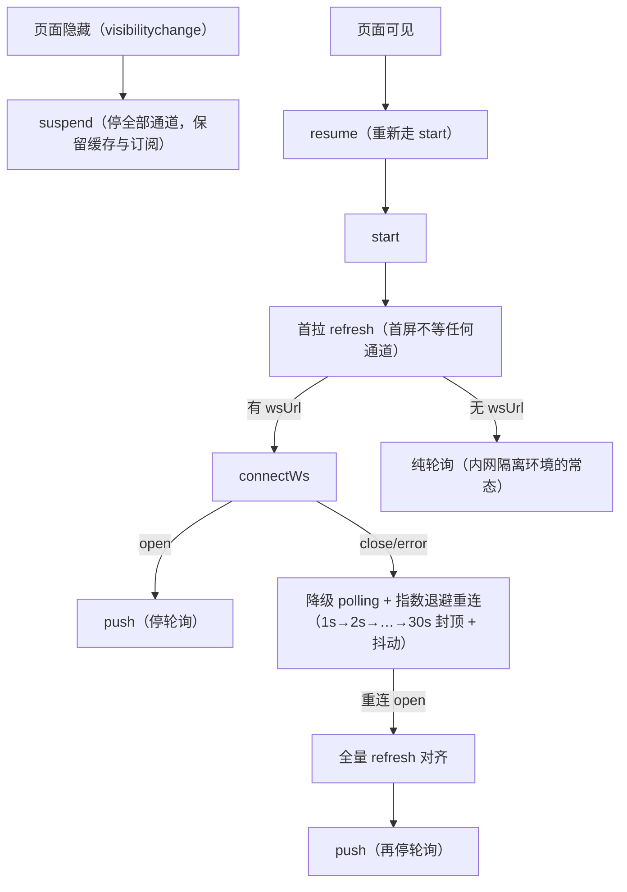

# Part A：搭建器族（增量篇）

Part A 收拢五类编辑器：大屏（场景 1）、工作流（场景 2）、查询构建器（场景 3）、schema 编辑器（场景 4）、白板（场景 5）、块级编辑器（场景 6）。它们共享一批"编辑器公因子"——选中态、拖拽、撤销重做、快捷键、网格吸附——这些公因子在《进阶大纲》§3 表单设计器里第一次集体亮相，本篇不再重教，只在新场景引入新公因子时展开（比如场景 2 的连线校验、场景 5 的视口模型）。

---

---

## 1. 低代码页面搭建器 / 可视化大屏编辑器

**基础**：《进阶大纲》§6（低代码平台）+ §4（拖拽大盘）。本章写**大屏编辑器特有增量**：

1. **分辨率适配（大屏第一坑）**：设计稿 1920×1080 → 任意屏幕/投屏。三方案对比：
   - 整体 `transform: scale()`：等比缩放，两侧留白，实现最快
   - vw/vh 单位：填满但大屏组件会拉伸变形
   - rem + postcss-pxtorem：折中
   - 注意 canvas 图表需监听容器尺寸重绘（ResizeObserver）
2. **自由画布 vs 栅格**：大屏组件是绝对定位（x/y/w/h/rotation），八向缩放 handle、对齐吸附线、网格与标尺
3. 图层面板：z-index 管理、锁定、隐藏（树形 + 拖拽调序）
4. **数据映射配置**：API 响应字段 → 组件 props 的映射规则（映射编辑器本质又是 Setter）；多组件共享一份数据源（数据转发/广播）
5. 定时轮播多页大屏、全屏模式、截图导出（html2canvas 的坑：跨域图片、字体渲染）

✅ 产出：在《进阶大纲》§4 的 dashboard 上叠加自由布局 + 分辨率适配 + 图层管理。

先把"大屏编辑器"和《进阶大纲》§4 的拖拽仪表盘做个切割，免得做重：§4 的 dashboard 是**栅格 + 流式布局**（组件按 12 栅格排队，容器变宽组件跟着重排），面向 PC 中后台；大屏编辑器是**自由画布 + 绝对定位**（每个组件有 x/y/w/h，像素级摆放），面向会议室投屏/指挥中心电视墙。两者共享"物料 + Setter + schema"三件套，差在画布模型与适配策略——这正是本章增量所在。

### 1.1 分辨率适配（大屏第一坑）：设计稿 1920×1080 → 任意屏幕/投屏

**是什么**：设计师按 1920×1080 出稿，开发者按设计稿坐标摆好每个组件；而最终运行环境可能是 2K/4K 显示器、超宽拼接屏、投影仪——分辨率与宽高比都不可控。适配方案要回答"整屏内容如何映射到任意视口"。

**为什么需要**：大屏是"给墙上看的"不是"给手上用的"。一台 1080p 投影和一面 3840×1600 拼接墙之间，如果不适配，要么内容只占左上角一小块，要么溢出被裁掉。大屏项目验收时第一个被演示的就是"换块屏看看"——所以它是"第一坑"：不解决，后面全部白做。

**三方案对比总表**（先给结论，再逐个展开）：

| 维度 | transform: scale 整体缩放 | vw/vh 视口单位 | rem + postcss-pxtorem |
|---|---|---|---|
| 还原度 | 等比 100% 还原，两侧/上下留白 | 填满视口，但两轴缩放比不同会变形 | 宽度方向等比，高度方向可滚动/流式 |
| 实现成本 | 一个容器组件 + 一个 hook | 样式全量改写为 vw/vh | 构建配置 + 运行时根字号 |
| 组件要求 | 零要求（px 写死即可） | 组件内部尺寸也要跟 vw 联动 | 样式走构建期 px→rem 转换 |
| canvas 图表 | 需注意缩放模糊 | echarts 内部 px 不跟随，要手动换算 | 同 vw，需 rem→px 换算注入 |
| 适用 | 指挥中心大屏、像素级还原 | 组件本身响应式的中后台 dashboard | 折中：要求铺满又不能明显变形 |

#### 方案一：整体 transform: scale()（等比缩放，两侧留白，实现最快）

**机制分步**：

1. 视口宽高分别除以设计稿宽高，得到两个缩放比 `scaleX`、`scaleY`；
2. 取**较小者**作为统一缩放比（等比的关键：保证内容完整可见，代价是另一维留白）；
3. 用较小比换算内容实际占用的宽/高，与视口的差值除以 2，得到居中偏移；
4. 容器按设计稿尺寸渲染，再 `translate(offset) scale(r)`，`transform-origin: left top`；
5. 监听 `window.resize`，任何一步变化都重算。

完整 hook 代码：

```tsx
import { useCallback, useEffect, useState, type ReactNode } from 'react';

/** 缩放计算结果：scale 为缩放比，offsetX/Y 为居中留白量（屏幕像素） */
interface ScaleMeta {
  scale: number;
  offsetX: number;
  offsetY: number;
}

/**
 * 大屏等比缩放适配器：设计稿尺寸 → 当前视口的缩放比与居中偏移。
 * 策略：宽高两个缩放比取小者（等比），另一维居中留白。
 */
export function useScaleAdapter(designWidth = 1920, designHeight = 1080): ScaleMeta {
  const calc = useCallback((): ScaleMeta => {
    const scaleX = window.innerWidth / designWidth;
    const scaleY = window.innerHeight / designHeight;
    const scale = Math.min(scaleX, scaleY); // 等比：以更"挤"的那一维为准
    return {
      scale,
      // 内容实际尺寸 = 设计稿尺寸 × scale；与视口的差值一半即居中留白
      offsetX: (window.innerWidth - designWidth * scale) / 2,
      offsetY: (window.innerHeight - designHeight * scale) / 2,
    };
  }, [designWidth, designHeight]);

  const [meta, setMeta] = useState<ScaleMeta>(calc); // 初始值直接用首次计算结果，避免首帧闪烁

  useEffect(() => {
    const onResize = () => setMeta(calc());
    window.addEventListener('resize', onResize);
    return () => window.removeEventListener('resize', onResize);
  }, [calc]);

  return meta;
}

/** 缩放容器：大屏应用的根组件，内部一切按设计稿 px 摆放 */
export function ScreenContainer({
  designWidth = 1920,
  designHeight = 1080,
  children,
}: {
  designWidth?: number;
  designHeight?: number;
  children: ReactNode;
}) {
  const { scale, offsetX, offsetY } = useScaleAdapter(designWidth, designHeight);
  return (
    <div style={{ position: 'fixed', inset: 0, overflow: 'hidden', background: '#05060a' }}>
      <div
        style={{
          width: designWidth, // 内部永远按设计稿尺寸布局
          height: designHeight,
          // transform 从右往左执行：先以左上角为原点缩放，再平移到居中留白后的位置
          transform: `translate(${offsetX}px, ${offsetY}px) scale(${scale})`,
          transformOrigin: 'left top',
          background: '#0b1c3c',
        }}
      >
        {children}
      </div>
    </div>
  );
}
```

**常见坑（scale 方案）**：

- **症状**：echarts 文字与线条发虚。**根因**：canvas 先按设计稿 px 光栅化，再被 GPU 非整数倍缩放（如 0.667），插值采样丢失锐度。**修法**：初始化图表时把容器尺寸设为 `设计稿尺寸 × scale`、`devicePixelRatio` 传 `window.devicePixelRatio × scale`，让 canvas 物理像素与屏幕 1:1，再用反除补偿内部字号；或业务上接受轻微模糊（指挥中心观看距离远，多数可接受）。
- **症状**：弹窗/下拉菜单位置错乱，`position: fixed` 元素不跟随。**根因**：`transform` 会创建新的 containing block，其内的 `fixed` 元素改为相对该容器定位，且 portal 弹层挂在 body 上不受缩放，两套坐标系不一致。**修法**：弹层 portal 挂到缩放容器内部的专用节点；或对弹层单独按 scale 反算坐标。
- **症状**：点击命中偏移。**根因**：自研的画布交互若用 `getBoundingClientRect()` 换算坐标，读到的是缩放后的屏幕尺寸，而组件坐标是设计稿坐标。**修法**：所有屏幕坐标 → 画布坐标一律 `除以 scale`，封装成唯一的换算函数，禁止散落手算。

#### 方案二：vw/vh 视口单位（填满但会变形）

**机制**：样式尺寸不用 px，改用视口百分比单位——`1vw = 视口宽的 1%`。设计稿 1920 宽下，一个 480px 的卡片写成 `25vw`，在任何屏幕上都占视口宽的四分之一，天然"铺满"：

```text
/* 设计稿 1920×1080：480px 卡片 = 25vw；324px 高 = 30vh（CSS） */
.kpi-card {
  width: 25vw;
  height: 30vh;
  font-size: 1.2vw; /* 字号也跟视口宽走，避免与图形比例失衡 */
}
```

**变形的根因**：宽、高分别绑定 `vw`、`vh`，而 `scaleX = 视口宽/1920` 与 `scaleY = 视口高/1080` 通常不相等（如 2560×1080 的带鱼屏：scaleX≈1.33、scaleY=1.0）。任何"等比图形"——圆、图标、echarts 饼图、带边框的卡片——都会被两轴不同比例拉扯成椭圆/压扁。字号若用 px 写死，还会出现"容器变大字没变大"的失衡。

**适用边界**：组件本身响应式（内部布局流式、图形可拉伸）、不追求像素级还原的**中后台 dashboard**——正好就是《进阶大纲》§4 那类栅格仪表盘的场景。纯大屏慎用；要用，则必须把 echarts 的 `fontSize`、`grid` 边距等内部 px 一并按 vw 换算注入（`px2vw(12) => (12 / 1920) * 100 + 'vw'`），成本反而高于方案一。

**常见坑**：**症状**：换了超宽屏后饼图变椭圆、头像变胖。**根因**：两轴缩放比不等。**修法**：要么改用方案一保等比，要么对该组件局部改用单轴单位（只跟 vw）+ 高度自适应内容。

#### 方案三：rem + postcss-pxtorem（折中）

**机制**：构建期把样式里的 px 编译成 rem，运行时让根字号 `html { font-size }` 随视口宽度变化——于是"一切走 rem 的尺寸"都与视口宽等比。折中在于：**只有宽度方向严格等比**，高度方向内容可流式伸展（超出滚动或留白），兼顾了"铺满宽度"与"不明显变形"。

构建配置（postcss）：

```text
// postcss.config.cjs（CommonJS 版；ESM 工程写 export default）
module.exports = {
  plugins: {
    // 打包时把样式里的 px 编译为 rem
    'postcss-pxtorem': {
      rootValue: 192, // 1rem = 192px（设计稿 1920 / 10 列），与下方运行时基准对齐
      unitPrecision: 5, // rem 保留 5 位小数，减少转换精度误差
      propList: ['*'], // 转换所有 CSS 属性
      selectorBlackList: ['.no-rem'], // 例外类名（如需要固定 px 的边框装饰）
      replace: true, // 直接替换而非追加
      mediaQuery: false, // 媒体查询里的 px 不转换
      minPixelValue: 2, // 小于 2px 不转，保住 1px 边框
    },
  },
};
```

运行时的另一半——根字号跟随视口宽（少了这一步，构建配置只是空转）：

```ts
/**
 * rem 方案运行时基准：根字号 = 视口宽 / columns。
 * 与 postcss-pxtorem 的 rootValue 严格对应：1920 视口下 1rem = 192px。
 */
export function setupRemBaseline(designWidth = 1920, columns = 10): () => void {
  const apply = () => {
    document.documentElement.style.fontSize = `${window.innerWidth / columns}px`;
  };
  apply();
  window.addEventListener('resize', apply);
  // 返回清理函数，微前端/多次初始化场景下防重复监听
  return () => window.removeEventListener('resize', apply);
}
```

**常见坑**：**症状**：echarts 图表尺寸、字号完全不跟屏变。**根因**：postcss 只转换 CSS 里的 px，JS 里传给 echarts 的配置（`fontSize: 12`、`grid: { top: 40 }`）不经过构建管线。**修法**：封装 `rem(px) => px * (window.innerWidth / designWidth)` 换算函数，所有 JS 侧尺寸入参一律过它；或维护一份设计 token 的 rem 版本（场景 9 的 token mirror 是同一思想）。

#### canvas 图表的 ResizeObserver 重绘要点

**为什么 window.resize 不够**：大屏里图表容器的尺寸除了随视口变，还随**容器自身**变——缩放方案的 scale 变化、面板折叠、Tab 切换、自由画布里用户拖拽改了组件 w/h。`window.resize` 只覆盖第一种。`ResizeObserver` 监听的是元素自身 content box，三种全覆盖。

完整可用的 echarts 封装 hook：

```tsx
import { useEffect, useRef } from 'react';
import * as echarts from 'echarts';
import type { EChartsOption } from 'echarts';

/**
 * echarts 实例生命周期 + 尺寸自适应：
 * 1. 挂载时 init；2. option 变化时 setOption；3. 容器尺寸变化时 resize 重绘；4. 卸载时 dispose。
 */
export function useEchart(option: EChartsOption) {
  const containerRef = useRef<HTMLDivElement>(null);
  const chartRef = useRef<echarts.ECharts | null>(null);

  useEffect(() => {
    const el = containerRef.current;
    if (!el) return;
    const chart = echarts.init(el);
    chartRef.current = chart;

    // 关键：监听"容器"而不是 window——自由画布里拖拽改宽高也要触发重绘
    const observer = new ResizeObserver(() => chart.resize());
    observer.observe(el);

    return () => {
      observer.disconnect(); // 先断开观察再销毁实例，避免销毁后回调踩空
      chart.dispose();
      chartRef.current = null;
    };
  }, []);

  useEffect(() => {
    chartRef.current?.setOption(option);
  }, [option]);

  return containerRef;
}
```

**常见坑**：**症状**：控制台报 `ResizeObserver loop completed with undelivered notifications`。**根因**：resize 回调里同步改了容器尺寸（如设 height），触发下一轮观察，形成循环。**修法**：`chart.resize()` 只重绘画布不写布局，一般安全；自绘 canvas 若需改尺寸，用 `requestAnimationFrame` 包一层延后一帧。

### 1.2 自由画布 vs 栅格：绝对定位、八向缩放 handle、对齐吸附线、网格与标尺

**是什么**：两种画布模型。栅格（§4 已做）：组件占格子，容器决定位置；自由画布：每个组件自带几何 `{x, y, w, h, rotation}`，画布只提供坐标系与参考物（网格、标尺、吸附线）。Figma/PPT/大屏编辑器都是自由画布。

**为什么需要**：大屏的设计稿是像素级摆放的——KPI 卡片压着地图边缘、装饰线条斜穿画面，栅格模型表达不了；且指挥中心大屏组件数量少（一屏 10–30 个）、位置语义强（"左上角永远是核心指标"），绝对定位反而最简单可靠。

**元素几何模型**：

```ts
/** 画布坐标系下的矩形：所有交互计算的输入 */
interface ScreenRect {
  x: number; // 左上角 x
  y: number; // 左上角 y
  w: number;
  h: number;
}

/** 大屏组件完整模型：矩形 + 编辑器状态 + 物料配置 */
interface ScreenComponent extends ScreenRect {
  id: string;
  type: string; // 物料类型，注册表 key（暗线：与 SchemaNode 同构）
  rotation: number; // 旋转角（度），顺时针
  locked: boolean; // 锁定：画布上不可选中/拖动，图层面板可解锁
  hidden: boolean; // 隐藏：编辑态不渲染，运行态按配置决定
  props: Record<string, unknown>; // 物料 props，数据映射的注入点（1.4）
}

/** 一页大屏的 schema：自由画布是"扁平数组 + 数组顺序即层级"，不是嵌套树 */
interface ScreenSchema {
  id: string;
  version: 1;
  components: ScreenComponent[];
}
```

注意与大屏渲染的关系：渲染时不需要递归（扁平数组直接 `map`），但组件本身仍走注册表分发——暗线在"注册表 + 类型分发"这一层依然成立，只是这棵"树"退化成了深度为 1 的森林。

#### 八向缩放 handle：pointer 事件 + 反向拖拽计算

**机制分步**：

1. 选中组件后，在四角与四边中点渲染 8 个小方块 handle，每个 handle 用 `sx/sy` 标记自己控制哪条边（-1 起始边 / 1 结束边 / 0 不影响该轴）；
2. `pointerdown` 时记录"起始矩形 + 起始指针坐标"，并对 handle 元素 `setPointerCapture`——之后指针移出 handle、甚至移出窗口，事件仍派发到它，拖拽不丢；
3. `pointermove` 时算出指针位移 `(dx, dy)`，按 handle 方向换算新矩形。**反向拖拽计算**是核心：拖"西/北"把手时，固定的是**对侧边**——`x` 跟指针走而 `w = 起始宽 - dx`，与拖"东/南"把手（`x` 不动、`w = 起始宽 + dx`）方向相反；
4. 钳制最小尺寸，防止拖穿成负宽高；
5. `pointerup` 结束，写回正式状态（一次 undo 快照）。

```tsx
import { useRef, type PointerEvent as ReactPointerEvent, type ReactNode } from 'react';

/** 八个方向的把手：sx/sy 表示控制哪条边（-1 起始边 / 1 结束边 / 0 该轴不影响） */
const HANDLES = [
  { key: 'nw', cursor: 'nwse-resize', sx: -1, sy: -1 },
  { key: 'n', cursor: 'ns-resize', sx: 0, sy: -1 },
  { key: 'ne', cursor: 'nesw-resize', sx: 1, sy: -1 },
  { key: 'e', cursor: 'ew-resize', sx: 1, sy: 0 },
  { key: 'se', cursor: 'nwse-resize', sx: 1, sy: 1 },
  { key: 's', cursor: 'ns-resize', sx: 0, sy: 1 },
  { key: 'sw', cursor: 'nesw-resize', sx: -1, sy: 1 },
  { key: 'w', cursor: 'ew-resize', sx: -1, sy: 0 },
] as const;

const MIN_SIZE = 20; // 最小尺寸：拖穿的防线

/**
 * 指针位移 → 新矩形。核心是"反向拖拽计算"：
 * 西/北把手拖动时对侧边固定，x/y 与 w/h 反向联动——dx 向右为正时，西把手的宽度在减少。
 */
export function applyResize(
  start: ScreenRect,
  sx: number,
  sy: number,
  dx: number,
  dy: number,
): ScreenRect {
  let { x, y, w, h } = start;
  if (sx === -1) {
    x = start.x + dx; // 西把手：左边界跟随指针
    w = start.w - dx; // 宽度 = 固定的右边界 − 新左边界
  } else if (sx === 1) {
    w = start.w + dx; // 东把手：右边界跟随指针，左边界不动
  }
  if (sy === -1) {
    y = start.y + dy;
    h = start.h - dy;
  } else if (sy === 1) {
    h = start.h + dy;
  }
  // 防拖穿：宽/高小于最小值时，把对应边界钳回最小尺寸
  if (w < MIN_SIZE) {
    if (sx === -1) x = start.x + start.w - MIN_SIZE;
    w = MIN_SIZE;
  }
  if (h < MIN_SIZE) {
    if (sy === -1) y = start.y + start.h - MIN_SIZE;
    h = MIN_SIZE;
  }
  return { x, y, w, h };
}

/** 选中框 + 八向把手：包在物料外层的交互壳（与物料渲染解耦） */
export function ResizeFrame({
  rect,
  selected,
  onChange,
  children,
}: {
  rect: ScreenRect;
  selected: boolean;
  onChange: (next: ScreenRect) => void;
  children: ReactNode;
}) {
  const dragRef = useRef<{
    startRect: ScreenRect;
    startX: number;
    startY: number;
    sx: number;
    sy: number;
  } | null>(null);

  const onHandleDown = (e: ReactPointerEvent<HTMLDivElement>, sx: number, sy: number) => {
    e.stopPropagation(); // 不冒泡给画布的"点空白取消选中"逻辑
    e.currentTarget.setPointerCapture(e.pointerId); // 指针捕获：移出把手也不丢事件
    dragRef.current = { startRect: rect, startX: e.clientX, startY: e.clientY, sx, sy };
  };

  const onHandleMove = (e: ReactPointerEvent<HTMLDivElement>) => {
    const drag = dragRef.current;
    if (!drag) return;
    onChange(
      applyResize(
        drag.startRect,
        drag.sx,
        drag.sy,
        e.clientX - drag.startX, // 位移量基于"按下时刻"，而非上一次 move——避免误差累积
        e.clientY - drag.startY,
      ),
    );
  };

  const onHandleUp = () => {
    dragRef.current = null;
  };

  return (
    <div style={{ position: 'absolute', left: rect.x, top: rect.y, width: rect.w, height: rect.h }}>
      {children}
      {selected &&
        HANDLES.map(h => (
          <div
            key={h.key}
            onPointerDown={e => onHandleDown(e, h.sx, h.sy)}
            onPointerMove={onHandleMove}
            onPointerUp={onHandleUp}
            style={{
              position: 'absolute',
              width: 10,
              height: 10,
              background: '#fff',
              border: '1px solid #1677ff',
              borderRadius: 2,
              cursor: h.cursor,
              // 按把手语义摆位：-1 起始边 / 1 结束边 / 0 居中
              left: h.sx === -1 ? -5 : h.sx === 1 ? rect.w - 5 : rect.w / 2 - 5,
              top: h.sy === -1 ? -5 : h.sy === 1 ? rect.h - 5 : rect.h / 2 - 5,
            }}
          />
        ))}
    </div>
  );
}
```

**带旋转角的进阶处理**：组件有 `rotation` 时，屏幕坐标系的 `(dx, dy)` 不能直接喂给 `applyResize`——要先把位移向量**反旋到元素本地坐标系**（元素顺时针转了 θ 度，就把指针位移按 −θ 旋转）：

```ts
/** 屏幕位移 → 元素本地位移（元素自身旋转了 rotationDeg 度） */
export function toLocalDelta(dx: number, dy: number, rotationDeg: number) {
  const rad = (-rotationDeg * Math.PI) / 180; // 屏幕坐标系 y 轴向下，顺时针为正，故取负角
  return {
    dx: dx * Math.cos(rad) - dy * Math.sin(rad),
    dy: dx * Math.sin(rad) + dy * Math.cos(rad),
  };
}
// 用法：
// const local = toLocalDelta(e.clientX - drag.startX, e.clientY - drag.startY, rotation);
// applyResize(drag.startRect, drag.sx, drag.sy, local.dx, local.dy);
```

同时"旋转后的 x/y 增量"也要做同样的反向补偿，因为视觉上把手指向的边在本地系里。旋转 + 缩放联合交互是自由画布里最绕的一块，建议实现顺序：先做纯平移拖拽 → 无旋转的八向缩放 → 旋转（单独的旋转 handle，绕中心点）→ 最后才把两者复合。

#### 对齐吸附线：算法逐层拆开

**是什么**：拖动组件时，与兄弟元素的边缘/中心线距离小于阈值（如 6px）就"吸附"过去，同时显示一条贯穿画布的红色参考线。Figma/PPT 的"对齐感"就是它。

**为什么需要**：绝对定位模型下，人眼摆放永远差几个像素——两个 KPI 卡"看起来对齐了"，放大后发现差 3px。吸附线把"目测对齐"变成"数学对齐"，是大屏编辑器从玩具到工具的分水岭。

**机制分步（按本节深度校准展开）**：

1. **候选线生成**：每个兄弟元素贡献 6 条线——竖直 3 条（左边缘、水平中心线、右边缘）+ 水平 3 条（上边缘、垂直中心线、下边缘）；
2. **移动中线**：被拖元素同样有 6 条线随指针移动；
3. **距离求解**：拖动的每一帧，被拖元素的每条竖线与所有候选竖线求差（水平线同理），在阈值内取**绝对差最小**的一条作为该轴的吸附目标；
4. **拖动量修正**：吸附不是改指针，而是改组件位置——`修正后 x = 原始 x + (候选线位置 − 移动线位置)`，让组件"跳"到对齐处；
5. **参考线渲染**：命中时把该候选线画成贯穿画布的 1px 线（只在编辑态、只在拖动中存在）；
6. **销毁**：`pointerup` 清空参考线集合。

核心代码：

```ts
/** 一条参考线：v 为竖直线（有 x 坐标），h 为水平线（有 y 坐标） */
interface Guide {
  axis: 'v' | 'h';
  offset: number; // 线的坐标：v 线用 x，h 线用 y
}

const SNAP_THRESHOLD = 6; // 吸附阈值（画布坐标 px），Figma 同量级

/** 一个元素贡献 6 条候选线：左/中/右 + 上/中/下 */
function guidesOfRect(rect: ScreenRect): Guide[] {
  return [
    { axis: 'v', offset: rect.x },
    { axis: 'v', offset: rect.x + rect.w / 2 },
    { axis: 'v', offset: rect.x + rect.w },
    { axis: 'h', offset: rect.y },
    { axis: 'h', offset: rect.y + rect.h / 2 },
    { axis: 'h', offset: rect.y + rect.h },
  ];
}

/** 单轴吸附求解：在阈值内找绝对差最小的候选线，返回修正量与命中的线 */
function snapAxis(
  movingLines: number[],
  candidates: Guide[],
  axis: 'v' | 'h',
): { delta: number; guide: Guide } | null {
  let best: { delta: number; guide: Guide } | null = null;
  for (const line of movingLines) {
    for (const candidate of candidates) {
      if (candidate.axis !== axis) continue;
      const delta = candidate.offset - line; // 正 = 组件需要向正向修正
      if (Math.abs(delta) > SNAP_THRESHOLD) continue;
      if (best === null || Math.abs(delta) < Math.abs(best.delta)) {
        best = { delta, guide: candidate }; // 保留差值最小者：多个候选都在阈值内时选最近的
      }
    }
  }
  return best;
}

/**
 * 吸附主入口：moving 是"未吸附的原始位置"（跟随指针），siblings 不含被拖元素。
 * 返回修正后的矩形 + 应当高亮的参考线（渲染层用）。
 */
export function resolveSnap(
  moving: ScreenRect,
  siblings: ScreenRect[],
): { snapped: ScreenRect; guides: Guide[] } {
  const candidates = siblings.flatMap(guidesOfRect); // 步骤 1：收集全部候选线
  const guides: Guide[] = [];

  // 竖直方向：被拖元素的 3 条竖线 vs 候选竖线
  const v = snapAxis(
    [moving.x, moving.x + moving.w / 2, moving.x + moving.w],
    candidates,
    'v',
  );
  // 水平方向同理
  const h = snapAxis(
    [moving.y, moving.y + moving.h / 2, moving.y + moving.h],
    candidates,
    'h',
  );

  // 步骤 4：吸附修正——不动指针，改组件坐标
  const snapped: ScreenRect = {
    ...moving,
    x: v ? moving.x + v.delta : moving.x,
    y: h ? moving.y + h.delta : moving.y,
  };
  if (v) guides.push(v.guide); // 步骤 5：命中的线进入渲染集合
  if (h) guides.push(h.guide);
  return { snapped, guides };
}
```

与拖拽的集成 + 参考线渲染与销毁：

```tsx
import { useRef, useState, type PointerEvent as ReactPointerEvent } from 'react';

/**
 * 带吸附的组件拖拽：
 * - 拖动中只更新"草稿态"（本地 state），pointerup 才写回正式 schema——保证 undo 粒度是"一次拖拽"而非每一帧；
 * - guides 随拖动实时增删，pointerup 清空（参考线只在拖动中存在）。
 */
export function useDragWithSnap(
  components: ScreenComponent[],
  commit: (next: ScreenComponent) => void, // pointerup 时写回正式状态（外部负责 push undo 快照）
) {
  const [guides, setGuides] = useState<Guide[]>([]); // 步骤 5/6：参考线的渲染与销毁
  const [draft, setDraft] = useState<ScreenComponent | null>(null); // 草稿层：拖动中的临时几何
  const dragRef = useRef<{ startX: number; startY: number; origin: ScreenComponent } | null>(null);

  const onPointerDown = (e: ReactPointerEvent, comp: ScreenComponent) => {
    if (comp.locked) return; // 锁定组件不可拖（1.3 的锁定语义）
    e.currentTarget.setPointerCapture(e.pointerId);
    dragRef.current = { startX: e.clientX, startY: e.clientY, origin: comp };
  };

  const onPointerMove = (e: ReactPointerEvent) => {
    const drag = dragRef.current;
    if (!drag) return;
    // 原始位置：跟随指针，未吸附
    const raw: ScreenRect = {
      x: drag.origin.x + (e.clientX - drag.startX),
      y: drag.origin.y + (e.clientY - drag.startY),
      w: drag.origin.w,
      h: drag.origin.h,
    };
    const siblings = components.filter(c => c.id !== drag.origin.id); // 兄弟元素 = 同画布其余元素
    const { snapped, guides: hit } = resolveSnap(raw, siblings);
    setGuides(hit); // 命中时显示，未命中时自然清空
    setDraft({ ...drag.origin, ...snapped }); // 草稿 = 原组件 + 吸附修正后的几何
  };

  const onPointerUp = () => {
    if (dragRef.current && draft) commit(draft); // 写回正式状态
    setDraft(null); // 清空草稿层
    setGuides([]); // 步骤 6：拖动结束销毁全部参考线
    dragRef.current = null;
  };

  return { guides, draft, onPointerDown, onPointerMove, onPointerUp };
}
// 画布渲染层：const shown = draft ?? components.find(c => c.id === selectedId)，
// 即"拖动中画草稿几何，结束后画正式几何"，两者无缝衔接、只差一次 commit。

/** 参考线渲染层：贯穿画布的 1px 线，pointer-events 穿透，绝不挡交互 */
function GuideLayer({ guides, canvasW, canvasH }: { guides: Guide[]; canvasW: number; canvasH: number }) {
  return (
    <div style={{ position: 'absolute', inset: 0, pointerEvents: 'none', zIndex: 9999 }}>
      {guides.map((g, i) =>
        g.axis === 'v' ? (
          <div
            key={`${g.axis}-${g.offset}-${i}`}
            style={{ position: 'absolute', left: g.offset, top: 0, width: 1, height: canvasH, background: '#f5222d' }}
          />
        ) : (
          <div
            key={`${g.axis}-${g.offset}-${i}`}
            style={{ position: 'absolute', top: g.offset, left: 0, height: 1, width: canvasW, background: '#f5222d' }}
          />
        ),
      )}
    </div>
  );
}
```

说明两点工程决策：其一，`resolveSnap` 在拖动的**每个 pointermove** 上跑一遍，代价是 O(6 × 6 × n)；大屏一页组件数 10–30，完全无压力，上千元素才需要排序 + 二分或空间索引（那是场景 5 白板的课题）；其二，吸附命中后的"手感"取决于阈值——6px 是 Figma 量级，投屏编辑场景可放大到 8–10px。

**常见坑**：

- **症状**：吸附"抖动"——组件在两个位置间来回跳。**根因**：吸附修正把组件挪到了阈值边缘，下一帧指针反向移动 1px 又脱离吸附，状态来回翻转。**修法**：引入磁滞（hysteresis）——进入吸附用 6px 阈值，保持吸附用 10px 阈值，或在一次拖拽内锁定首个命中目标。
- **症状**：参考线时隐时现。**根因**：guides 存在子组件局部 state，React 批处理下时序错乱；或每帧创建新数组引发子树重渲染。**修法**：guides 提升到画布单一 state，`GuideLayer` 用 `memo` 包裹（props 只有数组引用与画布尺寸）。
- **症状**：拖动结束组件弹回原位。**根因**：吸附修正只改了草稿，`pointerup` 时 commit 的是原始 rect。**修法**：commit 必须取草稿层的最终值（上面代码中 `onPointerUp` commit 的 `draft` 正是草稿层的最终值）。

#### 网格与标尺

**网格**：给"手感对齐"提供背景参照，纯 CSS 即可（不开吸附时也有视觉引导）：

```text
/* 20px 网格：两条 1px 渐变线平铺（CSS） */
.screen-canvas {
  background-image:
    linear-gradient(to right, rgba(255, 255, 255, 0.05) 1px, transparent 1px),
    linear-gradient(to bottom, rgba(255, 255, 255, 0.05) 1px, transparent 1px);
  background-size: 20px 20px;
}
```

**网格吸附**：若要"位置永远落在网格倍数上"，在 `resolveSnap` 之前先做一次取整：`x = Math.round(raw.x / GRID) * GRID`——注意网格吸附与对齐吸附的优先级（对齐吸附优先，命中对齐就跳过网格取整）。

**标尺**：画布上边缘与左边缘的刻度条，编辑态帮助定位。实现是"按步长生成刻度数组再渲染"，大屏画布尺寸有限（设计稿尺寸），无需虚拟化：

```tsx
/** 横轴标尺：每 step 画一格刻度并标数值；纵轴同构（换成 top/left） */
function RulerX({ width, step = 100 }: { width: number; step?: number }) {
  const ticks: number[] = [];
  for (let x = 0; x <= width; x += step) ticks.push(x);
  return (
    <div style={{ position: 'relative', height: 20, borderBottom: '1px solid #d9d9d9', background: '#fafafa' }}>
      {ticks.map(x => (
        <div key={x} style={{ position: 'absolute', left: x, top: 0, bottom: 0, borderLeft: '1px solid #d9d9d9' }}>
          <span style={{ fontSize: 10, color: '#8c8c8c', marginLeft: 2 }}>{x}</span>
        </div>
      ))}
    </div>
  );
}
```

**常见坑**：**症状**：标尺与组件位置对不上。**根因**：标尺渲染在缩放容器外（屏幕坐标），组件在容器内（设计稿坐标）。**修法**：编辑器画布不做整体 scale（编辑态 1:1 + 可缩放视口），标尺与画布同坐标系；投屏运行态才用 1.1 的 ScreenContainer。

### 1.3 图层面板：z-index 管理、锁定、隐藏（树形 + 拖拽调序）

**是什么**：编辑器右/左侧的组件列表——PS 图层板的前端版：显示每页全部组件（名称 + 类型图标 + 锁定/隐藏开关），支持点选、拖拽调序（改层级）、重命名。

**为什么需要**：大屏组件互相叠加（装饰线条压在图表上、背景图垫底），画布上被盖住的组件点不到；图层面板是**第二选择入口**，也是层级顺序的唯一可视化工具。

#### z-index 管理策略：数组顺序即层级

三条路线对比后选第三条：

1. 每个组件存显式 `zIndex` 数字——要维护"插入时取 max+1"、调序时重排数字，两处状态（数组顺序与 zIndex 值）可能不一致，是经典 bug 源；
2. 渲染时 `zIndex = 数组 index`——可行但把"层级"与"渲染顺序"耦合在 DOM 属性上，编辑器高亮层、参考线层还要来抢 z-index 空间；
3. **数组顺序即层级**（推荐）：`components` 数组从先到后渲染，后者自然覆盖前者（CSS 同 positioned 上下文中后出现的 DOM 在上）。置顶 = 移到数组末尾，置底 = 移到头部。层级信息零冗余，undo/redo 也天然正确（数组快照自动携带层级）。

操作函数（全部返回新数组，配合不可变状态）：

```ts
/** 图层置顶：数组末尾 = 最上层（渲染顺序即覆盖顺序） */
export function bringToFront<T extends { id: string }>(items: T[], id: string): T[] {
  const index = items.findIndex(item => item.id === id);
  if (index === -1 || index === items.length - 1) return items; // 已在最顶层：返回原引用，避免无谓重渲染
  const next = [...items];
  const [moved] = next.splice(index, 1);
  next.push(moved);
  return next;
}

/** 图层置底：数组头部 = 最底层 */
export function sendToBack<T extends { id: string }>(items: T[], id: string): T[] {
  const index = items.findIndex(item => item.id === id);
  if (index <= 0) return items;
  const next = [...items];
  const [moved] = next.splice(index, 1);
  next.unshift(moved);
  return next;
}

/** 上移/下移一层：与相邻元素交换位置 */
export function moveOneStep<T extends { id: string }>(items: T[], id: string, step: 1 | -1): T[] {
  const index = items.findIndex(item => item.id === id);
  const target = index + step;
  if (index === -1 || target < 0 || target >= items.length) return items;
  const next = [...items];
  [next[index], next[target]] = [next[target], next[index]];
  return next;
}
```

#### 锁定与隐藏

锁定（`locked: true`）：画布上不可点选、不可拖拽缩放（`onPointerDown` 直接 return，见 1.2 的 `useDragWithSnap`），但图层面板仍可选中编辑 props、可解锁——锁的是**画布交互**不是**编辑能力**。隐藏（`hidden: true`）：编辑态画布不渲染（或半透明幽灵渲染），运行态是否渲染由"编辑器隐藏 ≠ 投屏隐藏"的产品语义决定（多数产品把 hidden 仅作编辑辅助，投屏仍渲染——需要"投屏也隐藏"时另加 `visibleOnScreen` 字段，两个维度分开）。

#### 树形 + 拖拽调序：与大纲树复用

大屏是扁平数组（深度 1），但低代码页面（§6）是嵌套树——图层面板做成树形后两个场景共用。树形面板 = 递归渲染（暗线第 N+1 次复用）+ dnd-kit 排序（§1.6）。dnd-kit 部分与 §1.6/§3 的大纲树完全同构，这里只给扁平情形的完整实现（树形在此之上加 `children` 递归与"拖入分组"的碰撞策略，思路一样）：

```tsx
import { useState } from 'react';
import { DndContext, KeyboardSensor, PointerSensor, closestCenter, useSensor, useSensors } from '@dnd-kit/core';
import { SortableContext, arrayMove, sortableKeyboardCoordinates, useSortable, verticalListSortingStrategy } from '@dnd-kit/sortable';
import { CSS } from '@dnd-kit/utilities';

/** 单行图层：名称 + 隐藏/锁定开关 + 拖拽把手 */
function LayerRow({
  comp,
  onToggleHidden,
  onToggleLocked,
}: {
  comp: ScreenComponent;
  onToggleHidden: (id: string) => void;
  onToggleLocked: (id: string) => void;
}) {
  const { attributes, listeners, setNodeRef, transform, transition, isDragging } = useSortable({ id: comp.id });
  return (
    <div
      ref={setNodeRef}
      style={{
        display: 'flex',
        alignItems: 'center',
        gap: 8,
        padding: '4px 8px',
        background: isDragging ? '#e6f4ff' : undefined,
        transform: CSS.Transform.toString(transform),
        transition,
      }}
    >
      {/* 拖拽把手：只绑在把手上，行内按钮（锁定/隐藏）不触发拖拽——§1.6 的启动区域隔离 */}
      <span {...attributes} {...listeners} style={{ cursor: 'grab', color: '#8c8c8c' }}>⠿</span>
      <span style={{ flex: 1, opacity: comp.hidden ? 0.4 : 1 }}>{comp.type}（{comp.id}）</span>
      <button onClick={() => onToggleHidden(comp.id)}>{comp.hidden ? '显示' : '隐藏'}</button>
      <button onClick={() => onToggleLocked(comp.id)}>{comp.locked ? '解锁' : '锁定'}</button>
    </div>
  );
}

/** 图层面板本体：拖拽调序 = 直接改 components 数组顺序 = 改层级（1.3 的策略落地） */
export function LayerPanel({
  components,
  onReorder,
  onToggleHidden,
  onToggleLocked,
}: {
  components: ScreenComponent[];
  onReorder: (next: ScreenComponent[]) => void;
  onToggleHidden: (id: string) => void;
  onToggleLocked: (id: string) => void;
}) {
  const [activeId, setActiveId] = useState<string | null>(null);
  const sensors = useSensors(
    useSensor(PointerSensor, { activationConstraint: { distance: 4 } }), // 移动 4px 才算拖拽，避免误杀点击
    useSensor(KeyboardSensor, { coordinateGetter: sortableKeyboardCoordinates }), // 键盘拖拽（无障碍）
  );

  return (
    <DndContext
      sensors={sensors}
      collisionDetection={closestCenter} // 排序场景：最近的交换目标
      onDragStart={e => setActiveId(e.active.id)}
      onDragEnd={({ active, over }) => {
        setActiveId(null);
        if (!over || active.id === over.id) return;
        const from = components.findIndex(c => c.id === active.id);
        const to = components.findIndex(c => c.id === over.id);
        onReorder(arrayMove(components, from, to)); // 数组顺序 = 层级，调序即改层级
      }}
    >
      {/* 图层面板惯例：顶层在上，与画布覆盖顺序一致，故 reverse 展示 */}
      <SortableContext items={[...components].reverse().map(c => c.id)} strategy={verticalListSortingStrategy}>
        {[...components].reverse().map(comp => (
          <LayerRow key={comp.id} comp={comp} onToggleHidden={onToggleHidden} onToggleLocked={onToggleLocked} />
        ))}
      </SortableContext>
    </DndContext>
  );
}
```

**常见坑**：

- **症状**：图层调序后画布层级不变。**根因**：画布渲染用了显式 `zIndex`（旧字段残留），与数组顺序双轨制打架。**修法**：删除 zIndex 字段做数据迁移，渲染层不再写 z-index（编辑器 chrome——选中框、参考线——用独立的兄弟层承载，见 GuideLayer 的 `zIndex: 9999` 写在画布坐标系之外）。
- **症状**：锁定组件还是能被框选。**根因**：框选按几何求交，没查 `locked`。**修法**：框选命中集合里过滤 `locked || hidden`。
- **症状**：图层面板顺序与画布相反，用户懵。**根因**：设计工具惯例是"顶层在列表最上方"，数组末尾（最上层）应显示在列表顶部。**修法**：展示时 reverse（上面代码），数据存储仍按渲染顺序。

### 1.4 数据映射配置：API 响应字段 → 组件 props

**是什么**：大屏组件不自己发请求。编辑器里配置"数据源"，再把数据源的**响应字段路径**映射到组件的 **props 名**；运行态由渲染器统一拉数、按映射注入。这是"静态原型"与"活的大屏"的分界线。

**为什么需要**：组件与数据解耦后，同一个 KPI 物料既能接"今日 GMV"也能接"在线人数"——物料只认 `props.value`，不关心数据从哪来。数据源变更（换接口、改轮询频率）不触碰组件；多组件共享一份数据只拉一次。这与《进阶大纲》§6 低代码数据绑定的思想同源，大屏侧把它简化成"单层映射 + 轮询"。

#### 映射规则协议设计（TS 类型 + JSON 示例）

```ts
/** 数据源配置：一个大屏页可配多个；kind 决定拉取方式 */
interface DataSourceConfig {
  id: string; // 数据源 id，绑定引用它
  kind: 'api' | 'static' | 'websocket'; // 静态 JSON / 轮询 API / 长连接推送
  url: string;
  method: 'GET' | 'POST';
  interval?: number; // 轮询间隔（ms），仅 kind=api；缺省不轮询
  body?: Record<string, unknown>; // POST 请求体模板
}

/** 单条字段映射：响应里的哪个路径 → 组件的哪个 prop */
interface FieldMapping {
  source: string; // 响应字段路径，如 "data.list.0.amount"（点分，数字为下标）
  target: string; // 组件 prop 名，如 "value"
  transform?: 'number' | 'percent'; // 轻量变换：数字化 / 格式化为百分比字符串
}

/** 一个组件与一个数据源的绑定关系 */
interface Binding {
  sourceId: string; // 引用 DataSourceConfig.id
  mappings: FieldMapping[];
}

/** 数据配置整体：挂在 ScreenSchema 上 */
interface DataBindingSchema {
  sources: DataSourceConfig[];
  bindings: Record<string, Binding>; // key = 组件 id
}
```

对应的 JSON（可直接当测试样例）：

```json
{
  "sources": [
    {
      "id": "ds-order-stats",
      "kind": "api",
      "url": "https://api.example.com/stats/orders",
      "method": "GET",
      "interval": 30000
    }
  ],
  "bindings": {
    "kpi-gmv": {
      "sourceId": "ds-order-stats",
      "mappings": [
        { "source": "data.today.amount", "target": "value", "transform": "number" },
        { "source": "data.today.delta", "target": "trend", "transform": "percent" }
      ]
    },
    "chart-week": {
      "sourceId": "ds-order-stats",
      "mappings": [{ "source": "data.weekly.series", "target": "series" }]
    }
  }
}
```

注意 `kpi-gmv` 与 `chart-week` 指向**同一个** `sourceId`——这就是多组件共享数据源在协议层的表达，运行态只发一次请求（下文广播机制）。

协议的三个执行函数：

```ts
/** 按点分路径取值：getByPath(res, 'data.list.0.amount')；支持数字下标，缺路返回 undefined */
export function getByPath(source: unknown, path: string): unknown {
  return path.split('.').reduce<unknown>((acc, key) => {
    if (acc === null || acc === undefined) return undefined;
    if (typeof acc === 'object') return (acc as Record<string, unknown>)[key];
    return undefined; // 中途撞上原始值：路径越界
  }, source);
}

/** 变换器：目前两个够用，后续按需扩（格式化日期等），注意保持纯函数 */
function applyTransform(raw: unknown, transform: FieldMapping['transform']): unknown {
  if (raw === undefined || raw === null) return raw;
  switch (transform) {
    case 'number':
      return Number(raw);
    case 'percent': {
      const num = Number(raw);
      return Number.isFinite(num) ? `${(num * 100).toFixed(2)}%` : raw;
    }
    case undefined:
      return raw;
  }
}

/** 一组映射 → 一个 props 对象（渲染器注入组件前的最后一站） */
export function applyMappings(data: unknown, mappings: FieldMapping[]): Record<string, unknown> {
  const props: Record<string, unknown> = {};
  for (const mapping of mappings) {
    const raw = getByPath(data, mapping.source);
    props[mapping.target] = applyTransform(raw, mapping.transform);
  }
  return props;
}
```

#### 映射编辑器 = Setter 的论证

把这个编辑器拆开看：它要产出的是 `FieldMapping.source`（一个字段路径字符串）。按《进阶大纲》§3 的 Setter 定义——"给定字段元信息 `{ label, valueType, options }`，渲染对应的值编辑器"——逐项对号：

- 被编辑的字段：目标 prop 的映射（元信息来自物料 Setter 声明：`{ target: 'value', label: '数值', valueType: 'dataPath' }`）；
- 值编辑器类型：`dataPathSetter`——一个"从响应字段树里选路径"的专用编辑器，UI 形态是树形选择器（Cascader/TreeSelect），options 是**响应样例推导出的字段树**；
- 其余（transform 下拉）就是一个普通 `selectSetter`。

结论：所谓"数据映射编辑器"，就是给 Setter 体系**新增一种值编辑器类型**（`dataPathSetter`），协议上 `mappings[].source` 的值由它产出。这与《进阶大纲》§3 的论断一致——属性面板的一切扩展点最终都收敛为"新的 Setter 类型"。字段树推导函数：

```ts
/** 从 API 响应样例推导字段树：映射编辑器（dataPathSetter）的 options 来源 */
interface FieldNode {
  path: string; // 完整路径
  label: string; // 显示名（字段 key）
  type: 'object' | 'array' | 'string' | 'number' | 'boolean' | 'null';
  children?: FieldNode[];
}

function typeOf(v: unknown): FieldNode['type'] {
  if (v === null) return 'null';
  if (Array.isArray(v)) return 'array';
  if (typeof v === 'object') return 'object';
  return typeof v as 'string' | 'number' | 'boolean';
}

export function inferFieldTree(value: unknown, path = '', depth = 0, maxDepth = 5): FieldNode[] {
  if (depth >= maxDepth) return []; // 深度截断：防超深结构与循环引用拖垮编辑器
  if (Array.isArray(value)) {
    const first = value[0];
    return first === undefined ? [] : inferFieldTree(first, `${path}0`, depth + 1, maxDepth); // 数组只采样首元素
  }
  if (value !== null && typeof value === 'object') {
    return Object.entries(value as Record<string, unknown>).map(([key, v]) => {
      const childPath = path ? `${path}.${key}` : key;
      return {
        path: childPath,
        label: key,
        type: typeOf(v),
        children: v !== null && typeof v === 'object' ? inferFieldTree(v, childPath, depth + 1, maxDepth) : undefined,
      };
    });
  }
  return [];
}
```

#### 多组件共享数据源：数据转发/广播的实现思路

**问题**：5 个组件绑同一数据源，若各自订阅各自拉取，一次轮询变 5 次请求（接口压力、数据不一致——先后返回的瞬间同屏数字对不上）。**方案**：数据源管理器做**单点拉取 + 广播**——每个数据源至多一个活动请求/定时器，数据到达后 fan-out 给全部订阅组件。组件侧只订阅，不关心拉取。

```ts
type Listener = (data: unknown) => void;

/** 数据源管理器：单例。拉取唯一化 + 订阅广播 + 轮询生命周期 */
export class DataSourceManager {
  private data = new Map<string, unknown>(); // 最近一份数据（新订阅者立即回放）
  private listeners = new Map<string, Set<Listener>>();
  private timers = new Map<string, ReturnType<typeof setInterval>>();

  subscribe(sourceId: string, listener: Listener): () => void {
    if (!this.listeners.has(sourceId)) this.listeners.set(sourceId, new Set());
    this.listeners.get(sourceId)!.add(listener);
    const cached = this.data.get(sourceId);
    if (cached !== undefined) listener(cached); // 首次订阅立即回放缓存，组件不闪空态
    return () => {
      this.listeners.get(sourceId)?.delete(listener); // 返回退订函数，useEffect 清理直接用
    };
  }

  /** 拉取一次并广播给该源的全部订阅者（数据转发：一次请求，多方分发） */
  async refresh(source: DataSourceConfig): Promise<void> {
    const res = await fetch(source.url, {
      method: source.method,
      headers: { 'Content-Type': 'application/json' },
      body: source.method === 'POST' ? JSON.stringify(source.body ?? {}) : undefined,
    });
    const json = await res.json();
    this.data.set(source.id, json);
    for (const listener of this.listeners.get(source.id) ?? []) listener(json);
  }

  /** 启动轮询：同 id 重复启动先清旧定时器（幂等） */
  start(source: DataSourceConfig): void {
    this.stop(source.id);
    void this.refresh(source); // 启动立刻拉一次，不等第一个 interval
    if (source.kind === 'api' && source.interval && source.interval > 0) {
      this.timers.set(source.id, setInterval(() => void this.refresh(source), source.interval));
    }
  }

  stop(sourceId: string): void {
    const timer = this.timers.get(sourceId);
    if (timer) clearInterval(timer);
    this.timers.delete(sourceId);
  }
}

export const dataSourceManager = new DataSourceManager();
```

React 侧的订阅 hook 与组件注入（运行态渲染器的一段）：

```tsx
import { useEffect, useMemo, useState } from 'react';
import { dataSourceManager } from './DataSourceManager';

/** 订阅一个数据源：挂载即订阅，卸载即退订，收到广播即更新 */
export function useDataSource(sourceId: string): unknown {
  const [data, setData] = useState<unknown>(() => undefined);
  useEffect(() => {
    return dataSourceManager.subscribe(sourceId, next => setData(next));
  }, [sourceId]);
  return data;
}

/** KPI 物料（运行态）：数据映射的终点——props 注入后当普通组件用 */
interface KpiProps {
  title?: string;
  value?: number;
  trend?: string;
}

function KpiWidget({ title = '—', value = 0, trend = '' }: KpiProps) {
  return (
    <div style={{ padding: 16, background: 'rgba(255,255,255,0.06)', borderRadius: 8 }}>
      <div style={{ color: '#8c8c8c', fontSize: 14 }}>{title}</div>
      <div style={{ color: '#fff', fontSize: 42, fontWeight: 700 }}>{value}</div>
      <div style={{ color: trend.startsWith('-') ? '#ff4d4f' : '#52c41a', fontSize: 14 }}>{trend}</div>
    </div>
  );
}

/** 运行态包装：绑定 → 订阅 → 注入。编辑器里这个包装不生效（编辑态吃 mock 数据） */
export function BoundKpi({ binding }: { binding: Binding }) {
  const raw = useDataSource(binding.sourceId);
  const props = useMemo(
    () => (raw === undefined ? {} : applyMappings(raw, binding.mappings)),
    [raw, binding],
  );
  return <KpiWidget {...(props as KpiProps)} />;
}
```

websocket 型数据源同理——把 `refresh` 换成"建立连接，`onmessage` 写缓存并广播"，协议里 `kind: 'websocket'` 已预留。

**常见坑**：

- **症状**：换了数据源接口路径，全部 KPI 显示"—"。**根因**：映射的 `source` 路径悬空（接口响应结构调整），`getByPath` 返回 undefined。**修法**：编辑器保存时用 `inferFieldTree` 校验每条 mapping 的 source 是否存在于当前样例，悬空的标红警示（与场景 3"元数据删除字段后规则悬空"同款问题、同款解法）。
- **症状**：多组件数字"此起彼伏"不同步。**根因**：各组件各自拉取，返回时刻不同。**修法**：就是本节的广播机制——同源只有一份数据、一次更新、同时 fan-out。
- **症状**：轮询接口限流报 429。**根因**：多页大屏同屏轮询多个源、且 interval 配置过短。**修法**：编辑器对 interval 做下限校验（如 ≥10s）；能推不要轮（websocket）。

### 1.5 定时轮播多页大屏、全屏模式、截图导出

#### 定时轮播多页大屏

**是什么**：一个大屏应用包含多页 schema，按配置的停留时长自动切页——指挥中心"一屏看不完就轮着播"的标准玩法。

**机制**：页面数组 + 当前页 index + `setInterval`；用**函数式 setState** 避免闭包里的过期 index；切页即换 schema，整棵渲染树按页重建（`key` 用页 id，避免两页物料组件状态串台）。

```tsx
import { useEffect, useState, type ReactNode } from 'react';

interface CarouselScreenProps {
  pages: ScreenSchema[]; // 多页 schema
  duration?: number; // 每页停留毫秒，默认 15s
  /** 页渲染器：实际项目里 = SchemaRenderer + 数据绑定注入（1.4）*/
  renderPage: (schema: ScreenSchema) => ReactNode;
}

export function CarouselScreen({ pages, duration = 15000, renderPage }: CarouselScreenProps) {
  const [index, setIndex] = useState(0);

  useEffect(() => {
    if (pages.length <= 1) return; // 单页不需要轮播
    const timer = window.setInterval(() => {
      setIndex(i => (i + 1) % pages.length); // 函数式更新：不吃闭包里的旧 index
    }, duration);
    return () => window.clearInterval(timer);
  }, [pages.length, duration]);

  const page = pages[Math.min(index, pages.length - 1)];
  // key 用页 id：切页时整树重建，物料内部 state（echarts 动画等）不跨页残留
  return <div key={page.id}>{renderPage(page)}</div>;
}
```

**常见坑**：**症状**：轮播与数据轮询"打架"——切页瞬间数字闪烁归零。**根因**：切页卸载了订阅组件，`DataSourceManager` 若跟随停轮询、翻回来又冷启动。**修法**：轮询生命周期挂在大屏应用级（进入运行态 `start` 全部源，退出才 `stop`），与页码无关；组件只订阅。

#### 全屏模式

**是什么**：Fullscreen API——把指定 DOM 元素升为全屏（投屏大屏必配，浏览器地址栏/任务栏全部退场）。

**机制**：`element.requestFullscreen()` 进入（必须在**用户手势**里调用，否则被浏览器拒绝）；`document.exitFullscreen()` 退出；`fullscreenchange` 事件同步状态。三个注意点：`requestFullscreen` 返回 Promise（失败要 catch）；`document.fullscreenElement` 判当前态；Safari 老版本前缀 API 已基本退场，标准 API 够用。

```tsx
import { useCallback, useEffect, useRef, useState } from 'react';

export function useFullscreen() {
  const ref = useRef<HTMLDivElement>(null);
  const [isFullscreen, setIsFullscreen] = useState(false);

  useEffect(() => {
    const onChange = () => setIsFullscreen(document.fullscreenElement !== null);
    document.addEventListener('fullscreenchange', onChange);
    return () => document.removeEventListener('fullscreenchange', onChange);
  }, []);

  const enter = useCallback(async () => {
    if (!document.fullscreenElement && ref.current) {
      try {
        await ref.current.requestFullscreen(); // 必须在点击等用户手势调用栈内
      } catch (err) {
        console.error('进入全屏失败', err); // 常见：iframe 未授权 / 非手势调用
      }
    }
  }, []);

  const exit = useCallback(async () => {
    if (document.fullscreenElement) await document.exitFullscreen();
  }, []);

  const toggle = useCallback(() => {
    void (document.fullscreenElement ? exit() : enter());
  }, [enter, exit]);

  return { ref, isFullscreen, enter, exit, toggle }; // ref 挂到要全屏的容器上
}
```

**常见坑**：**症状**：全屏后大屏没重新适配，四周黑边或溢出。**根因**：全屏改变了视口尺寸，但 scale 方案的 `resize` 监听已覆盖——真正漏适配的往往是 vw/vh 方案下 echarts（JS 侧尺寸不跟随）。**修法**：全屏切换后手动触发一次全部图表 `resize()`（`fullscreenchange` 里调）。

#### html2canvas 截图导出

**是什么**：把大屏 DOM 栅格化为 canvas 再下载 PNG——"报表快照/汇报留档"功能。它**不是**浏览器原生截图，而是自己解析 DOM、逐层重绘到 canvas——两个著名大坑都源于这个实现方式。

```tsx
import html2canvas from 'html2canvas';

export async function exportDashboard(el: HTMLElement, filename = 'dashboard.png'): Promise<void> {
  // 坑 2 的第一道保险：等 web font 全部加载完成再截，否则用 fallback 字体绘制
  await document.fonts.ready;

  const canvas = await html2canvas(el, {
    useCORS: true, // 坑 1：图片请求带 CORS 凭证语义（要求图片响应头允许跨域）
    allowTaint: false, // 拒绝"污染画布"：跨域且无 CORS 的图片直接报错，而不是产出无法导出的画布
    backgroundColor: '#0b1c3c',
    scale: window.devicePixelRatio || 2, // 按设备像素比放大栅格化，避免高分屏导出发虚
    logging: false,
  });

  const url = canvas.toDataURL('image/png'); // 若画布已被污染，这一步抛 SecurityError
  const a = document.createElement('a');
  a.href = url;
  a.download = filename;
  a.click();
}
```

**坑 1：跨域图片。症状**：导出的 PNG 里图片区域空白，或控制台 `SecurityError: Failed to execute 'toDataURL'`。**根因**：canvas 的安全模型——画布里绘制了**跨域且未授权**的图片后画布被"污染"（tainted），任何导出操作被浏览器禁止；html2canvas 重绘时图片请求若不带 CORS 头，就会污染。**修法**：(a) 图片服务器返回 `Access-Control-Allow-Origin`，html2canvas 配 `useCORS: true`（让 img 以 CORS 模式加载）；(b) 无法改图片服务器的，走后端代理把图片转成同域/base64 再喂给页面；(c) `allowTaint: true` 只是"允许继续画"，导出照样失败，不要误用。

**坑 2：字体渲染。症状**：导出图里文字不是设计稿字体（变成宋体/默认无衬线）、图标字体变成方块。**根因**：html2canvas 自绘文本时读的是 `document.fonts` 里**当时**的字体；若 web font 异步还没加载完就截（尤其首次访问、字体文件大、CDN 慢），它拿 fallback 字体绘制。另外 iconfont 的 SVG 雪碧图在克隆 DOM 时可能丢 symbol 引用。**修法**：导出前 `await document.fonts.ready`（上面代码第一行）；字体文件尽量走同域/base64 内联（`@font-face` 的 `src: url(data:font/woff2;base64,...)`）；图标优先用 SVG 组件而非 iconfont。

### 验收清单

✅ 产出：在《进阶大纲》§4 的 dashboard 上叠加自由布局 + 分辨率适配 + 图层管理。逐条展开为可勾选的验收项：

- [ ] **分辨率适配**：把 §4 dashboard 的渲染树装进 `ScreenContainer`，在 1920×1080 / 2560×1440 / 1280×720（笔记本）三档下截图对比——等比、居中、无溢出；echarts 无明显发虚；
- [ ] **自由布局**：组件模型升级为 `{x, y, w, h, rotation}`，支持拖拽（含吸附线、6px 阈值、参考线渲染）、八向缩放（含最小尺寸钳制与旋转补偿）、`Cmd+D` 复制带偏移；
- [ ] **网格与标尺**：20px 网格背景 + 上/左标尺，位置读数与组件坐标一致；
- [ ] **图层面板**：数组顺序即层级；置顶/置底/上下移一层、锁定（画布不可选中）、隐藏（编辑态不渲染）、拖拽调序即时反映到画布覆盖关系；
- [ ] **数据映射**：配置一个轮询 API 源，两个组件共享同一源（网络面板确认**一次**轮询只发**一条**请求）；映射路径悬空时编辑器标红；
- [ ] **运行态三件套**：多页定时轮播（函数式 setState）、Fullscreen API 进入/退出（含失败 catch）、html2canvas 导出 PNG（跨域图片与字体双坑已处理，导出图肉眼比对无缺字无空白块）。

做到这里，你已经把《进阶大纲》§4 的栅格 dashboard 升级成了真正的"可视化大屏编辑器"——而物料、注册表、Setter、undo 这些底座一行没重写，这就是引言里那条暗线在场景 1 的兑现。

（追加批次：1.6–1.9 是第二批增量，补齐"物料怎么发、数据怎么活、资产怎么攒"四块工程化能力；画布/图层/映射等编辑器内核仍以 1.1–1.5 为准。）

### 1.6 物料分包与按需加载：元信息与实现分层的异步注册表

**是什么**：把"物料全量打进主包"改为"按需异步加载"。核心设计是注册表拆两层：**元信息层同步注册**（`MaterialMeta`：label、defaultProps、Setter 声明、默认尺寸——物料面板、发布校验、占位符只依赖这些轻数据），**实现层异步加载**（真正的组件代码按 type 独立分包，用到才拉）。

**为什么难**：

1. **重量悬殊**。大屏物料一半以上是"带引擎的重物"——echarts 全量 1MB+、地图物料带 GeoJSON 数 MB、视频/飞线/3D 各自成体系；而一页大屏通常只消费其中 5–8 种。全量打包等于让每个访客为所有可能性付费。
2. **同步 API 被传染**。注册表的消费方全是同步调用（渲染器查组件、校验器查声明、面板查列表），异步化如果只是把 `getMaterial` 改成返回 Promise，所有调用点都得跟着改；分层协议让"轻消费走同步、重消费走异步"各得其所。
3. **构建工具的静态分析**。`import(动态路径)` 在 Vite/webpack 下无法静态分析，构建时根本不会生成对应 chunk——分包失败的第一现场往往在打包层而非运行层。

**关键机制**：

1. `registerMaterial(meta, loader)`——注册不加载；`getMaterialMeta` 同步查元信息，`loadMaterial(type)` 异步拉组件；
2. **并发去重**：画布首帧 10 个同 type 组件同时触发加载，进行中的 Promise 存进 `inflight` Map，只发一次动态 import；
3. 渲染层统一入口 `MaterialRenderer`：`React.lazy` + `Suspense` 包住等待态，占位块尺寸取 `meta.defaultSize`（防布局跳动）；
4. **运行态预取**：入口先扫发布快照里用到的 type，预取完毕再挂渲染树——投屏过程不闪占位。

两层注册表完整实现：

```tsx
import { lazy, Suspense, type ComponentType, type LazyExoticComponent } from 'react';

/** 物料元信息：轻数据，同步注册——编辑器面板、发布校验、Suspense 占位都只依赖它 */
export interface MaterialMeta {
  type: string;
  label: string;
  defaultProps: Record<string, unknown>;
  /** 占位尺寸：异步加载期间占位块的固定几何（1.2 的几何协议） */
  defaultSize: { w: number; h: number };
}

type Loader = () => Promise<{ default: ComponentType<Record<string, unknown>> }>;

const metas = new Map<string, MaterialMeta>();
const loaders = new Map<string, Loader>();
/** 已加载组件缓存：二次进入零成本 */
const loaded = new Map<string, ComponentType<Record<string, unknown>>>();
/** 进行中的加载：并发去重——画布上 10 个同 type 组件首帧只发一次 import */
const inflight = new Map<string, Promise<ComponentType<Record<string, unknown>>>>();

/** 注册 = 声明元信息 + 提交加载器（不加载） */
export function registerMaterial(meta: MaterialMeta, loader: Loader): void {
  metas.set(meta.type, meta);
  loaders.set(meta.type, loader);
}

/** 同步层：元信息永远立即可查（物料面板/校验器不需要 await） */
export function getMaterialMeta(type: string): MaterialMeta | undefined {
  return metas.get(type);
}

export function listMaterialMetas(): MaterialMeta[] {
  return [...metas.values()];
}

/** 异步层：按 type 拉组件实现，带缓存与并发去重 */
export function loadMaterial(type: string): Promise<ComponentType<Record<string, unknown>>> {
  const cached = loaded.get(type);
  if (cached) return Promise.resolve(cached);
  const pending = inflight.get(type);
  if (pending) return pending;
  const loader = loaders.get(type);
  if (!loader) return Promise.reject(new Error(`未注册的物料类型：${type}`));
  const p = loader()
    .then(mod => {
      loaded.set(type, mod.default);
      inflight.delete(type);
      return mod.default;
    })
    .catch(err => {
      inflight.delete(type); // 失败必须清进行中标记：否则一次失败后永远无法重试
      throw err;
    });
  inflight.set(type, p);
  return p;
}
```

渲染层统一入口（画布与运行态共用；编辑器不需要预取——画布上的占位块本身就是"加载中"的合理反馈）：

```tsx
/** lazy 包装按 type 缓存：React.lazy 每次调用返回新组件，不缓存会反复挂起 Suspense */
const lazyCache = new Map<string, LazyExoticComponent<ComponentType<Record<string, unknown>>>>();

function getLazyMaterial(type: string) {
  let comp = lazyCache.get(type);
  if (!comp) {
    comp = lazy(() => loadMaterial(type));
    lazyCache.set(type, comp);
  }
  return comp;
}

/** 物料渲染统一入口：元信息缺失 → 降级占位（策略与《项目复刻》05 的未知物料一致） */
export function MaterialRenderer({
  type,
  props,
}: {
  type: string;
  props: Record<string, unknown>;
}) {
  const meta = getMaterialMeta(type);
  if (!meta) {
    return <div style={{ padding: 12, color: '#ff4d4f' }}>未注册的物料：{type}</div>;
  }
  const LazyMaterial = getLazyMaterial(type);
  return (
    <Suspense
      fallback={
        <div
          style={{
            width: '100%',
            height: '100%',
            background: 'rgba(255,255,255,0.04)',
            borderRadius: 8,
          }}
        />
      }
    >
      <LazyMaterial {...props} />
    </Suspense>
  );
}
```

运行态入口的预取（扫描的是**发布快照**而不是草稿——运行态永远只认已发布内容，见《项目复刻》05 手册 M7 的发布模型）：

```ts
/** 运行态预取：按快照实际用到的物料拉齐，失败降级不阻断（占位符兜底） */
export async function preloadMaterials(types: string[]): Promise<void> {
  await Promise.allSettled(
    [...new Set(types)].map(type =>
      loadMaterial(type).catch(err => {
        console.warn(`物料 ${type} 预取失败，运行时将降级占位`, err);
      }),
    ),
  );
}

// 运行态入口的接线顺序：
// const snapshot = await fetchPublishedSnapshot(screenId);
// await preloadMaterials(snapshot.components.map(c => c.type));
// root.render(<ScreenContainer>{renderScreen(snapshot)}</ScreenContainer>);
```

构建层的一个关键细节——动态 import 的路径必须可静态分析：

```bash
# ❌ 反例：模板字符串动态路径，Vite 构建时不会为物料生成任何 chunk，运行时 404
# const load = () => import(`./widgets/${type}/index.tsx`)
```

```ts
// ✅ Vite：用 import.meta.glob 预收集（webpack 对应 require.context）
import type { ComponentType } from 'react';
const widgetLoaders = import.meta.glob<{ default: ComponentType<Record<string, unknown>> }>(
  './widgets/*/index.tsx',
);
// registerMaterial({ type: 'kpi', label: 'KPI 指标卡', ... }, widgetLoaders['./widgets/kpi/index.tsx']!);
```

**选型与学习路径**：物料总数 < 20 且都是轻 DOM 组件时**不要做分包**——异步注册表的复杂度买不回几百 KB；出现"echarts 级引擎物料 ≥ 3 种"或"物料由独立团队/独立仓库发布"（此时打包侧还要走《项目复刻》05 手册 §4.2 的物料包 external 铁律，React 单实例是硬约束）再上。学习路径：先在同步注册表上把 `MaterialMeta` 抽干净（这步与分包无关但决定成败）→ 加 loader 与缓存 → 画布接 Suspense → 最后做运行态预取。

**常见坑**：

- **症状**：占位块闪一下后组件"跳位"。**根因**：Suspense fallback 没有尺寸，加载完成前后布局重排。**修法**：fallback 占满父容器（上面代码的 100%/100%），父容器的尺寸由组件的 `w/h` 几何（1.2 模型）保证。
- **症状**：控制台 `Invalid hook call`。**根因**：物料 chunk 里二次打包了 react，双实例。**修法**：物料分包构建把 react/react-dom 声明为 external（《项目复刻》05 手册 §4.2 已展开）。
- **症状**：生产环境点开画布才请求物料 chunk，且 404。**根因**：模板字符串动态 import 没被静态分析。**修法**：改 `import.meta.glob` / `require.context` 显式枚举。
- **症状**：某物料第一次加载失败后永远加载不出来，刷新才行。**根因**：失败后 `inflight` 没清，后续请求复用了 rejected Promise。**修法**：catch 分支清 inflight（上面代码已含）。

### 1.7 物料版本管理与向后兼容：页面数据与物料代码的版本协商

**是什么**：物料是**代码**（随发版演进），页面 schema 是**数据**（躺在库里不动）。版本管理回答一个问题：三个月前的页面快照，配哪一版物料跑？协议上给每个物料声明 semver 版本 + props 协议快照 + 迁移链，页面快照记录搭建时的物料版本，打开页面时做一次三方协商（页面要什么 / 物料现在是什么 / 中间有没有桥）。

**为什么难**：注册表是运行时单例，默认"永远只有最新版"；物料改 props 协议（字段改名、类型变更、删字段）后，旧页面不会报错——它只是**静默渲染错**（字段读不到、图表空转），这比崩溃难查一个量级。《项目复刻》05 手册的坑 3（"回滚到三个月前，页面全是未注册类型"）就是同一个问题在物料下线维度的表现；本节把"清单 + 协商"机制补全。

**关键机制**：

1. **物料清单（manifest）**：每个物料声明 `version`、`propsProtocol`（Setter 声明的 `{name, valueType}` 投影）、`migrations`（迁移链）；
2. **页面快照记录引用**：`ScreenSchema` 增加 `materials: MaterialRef[]`——快照与代码的"婚约"落在纸面；
3. **协商三档**：`exact`（版本一致直接跑）/ `migratable`（有迁移链，把旧 props 升级后跑）/ `incompatible`（降级占位并提示）。

协议与 diff 实现：

```ts
/** 物料清单：物料代码侧的自我声明——版本 + props 协议快照 + 迁移链 */
export interface MaterialManifest {
  type: string;
  version: string; // semver：MAJOR.MINOR.PATCH
  /** props 协议快照：Setter 声明的投影，diff 的输入 */
  propsProtocol: { name: string; valueType: string }[];
  /** 迁移链：把旧版 props 升到当前版；from 为该迁移的"起始版本" */
  migrations: {
    from: string;
    migrate: (props: Record<string, unknown>) => Record<string, unknown>;
  }[];
}

/** 页面快照携带的物料引用 */
export interface MaterialRef {
  type: string;
  version: string; // 搭建时物料的版本
}

/** 快照升级：在 1.2 的 ScreenSchema 上追加物料清单 */
export interface VersionedScreenSchema {
  screen: ScreenSchema;
  materials: MaterialRef[];
}

export interface ProtocolDiff {
  breaking: string[]; // 旧页面会坏：字段被删 / 类型变更
  added: string[];    // 新增字段：旧数据用 defaultProps 兜底，非 breaking
}

/** 新旧 props 协议对比：物料的"兼容性报告"是一个纯函数 */
export function diffPropsProtocol(
  oldProtocol: MaterialManifest['propsProtocol'],
  newProtocol: MaterialManifest['propsProtocol'],
): ProtocolDiff {
  const newByName = new Map(newProtocol.map(f => [f.name, f]));
  const oldByName = new Map(oldProtocol.map(f => [f.name, f]));
  const breaking: string[] = [];
  const added: string[] = [];
  for (const field of oldProtocol) {
    const next = newByName.get(field.name);
    if (!next) breaking.push(`字段 ${field.name} 已删除`);
    else if (next.valueType !== field.valueType)
      breaking.push(`字段 ${field.name} 类型 ${field.valueType} → ${next.valueType}`);
  }
  for (const field of newProtocol) if (!oldByName.has(field.name)) added.push(field.name);
  return { breaking, added };
}
```

迁移链与版本协商：

```ts
/** 最小版比较：只做 x.y.z 数值比较；range 匹配请直接用 semver 库，别手写全量 */
function semverGte(a: string, b: string): boolean {
  const pa = a.split('.').map(Number);
  const pb = b.split('.').map(Number);
  return pa[0] !== pb[0] ? pa[0] > pb[0] : pa[1] !== pb[1] ? pa[1] > pb[1] : pa[2] >= pb[2];
}

/** 旧版本 props → 当前版本：沿迁移链逐级升（1.0 → 1.1 → 2.0），每级必须纯函数 */
export function migrateProps(
  manifest: MaterialManifest,
  props: Record<string, unknown>,
  fromVersion: string,
): Record<string, unknown> {
  if (fromVersion === manifest.version) return props;
  const chain = [...manifest.migrations]
    .sort((a, b) => a.from.localeCompare(b.from, undefined, { numeric: true }))
    .filter(m => semverGte(m.from, fromVersion));
  let current = structuredClone(props); // 纯度保证：不污染入参（undo 栈与缓存都依赖引用不可变）
  for (const step of chain) current = step.migrate(current);
  return current;
}

/** 打开页面时的协商：匹配 / 可迁移 / 不可用三档 */
export type Negotiation =
  | { kind: 'exact' }
  | { kind: 'migratable' }
  | { kind: 'incompatible'; reason: string };

export function negotiate(manifest: MaterialManifest, ref: MaterialRef): Negotiation {
  if (ref.version === manifest.version) return { kind: 'exact' };
  const hasPath = manifest.migrations.some(m => semverGte(m.from, ref.version));
  if (hasPath) return { kind: 'migratable' };
  return {
    kind: 'incompatible',
    reason: `页面由 ${ref.type}@${ref.version} 搭建，当前物料 ${manifest.version} 且无迁移路径`,
  };
}
```

一个迁移函数的样例（v1.4 的 `font` 数字改名为 v2.0 的 `fontSize` 字符串——典型的破坏性变更）：

```ts
// 物料 kpi 的 v2.0 迁移链片段
migrations: [
  {
    from: '1.4.0',
    migrate: props => ({
      ...props,
      fontSize: `${props.font ?? 14}px`, // 旧数字 → 新带单位字符串
      font: undefined,
    }),
  },
]
```

把协商接进"打开页面"链路（注册表侧另需一个按 type 取当前 manifest 的 `getMaterialManifest`，与 1.6 的 `getMaterialMeta` 同构）：

```tsx
/**
 * 打开页面的版本协商入口：逐组件三档处置。
 * 迁移结果只用于本次渲染，不回写快照——回写发生在用户下一次保存（草稿），避免"只是看看"也改动数据。
 */
export async function openScreen(
  snapshot: VersionedScreenSchema,
): Promise<{ screen: ScreenSchema; notices: string[] }> {
  const notices: string[] = [];
  const components = snapshot.screen.components.map(component => {
    const ref = snapshot.materials.find(m => m.type === component.type);
    if (!ref) return component; // 无清单的历史快照：按 exact 处理（兼容老数据）
    const manifest = getMaterialManifest(component.type);
    if (!manifest) {
      notices.push(`物料 ${component.type} 已下线，组件 ${component.id} 降级占位`);
      return { ...component, type: 'builtin:placeholder' };
    }
    const result = negotiate(manifest, ref);
    if (result.kind === 'exact') return component;
    if (result.kind === 'migratable') {
      notices.push(
        `物料 ${component.type}：${ref.version} → ${manifest.version}，props 已自动迁移`,
      );
      return { ...component, props: migrateProps(manifest, component.props, ref.version) };
    }
    notices.push(result.reason); // incompatible：占位 + 人话提示，页面其余部分照常渲染
    return { ...component, type: 'builtin:placeholder' };
  });
  return { screen: { ...snapshot.screen, components }, notices };
}
```

**选型与学习路径**：多数团队"**不共存 + 迁移链**"够用——注册表里永远只有最新版物料，旧页面打开时跑 `migrateProps`；只有做开放市场（第三方物料、多租户各锁各的版本）才需要注册表按 `type@major` 存多版并存。学习路径：先在物料构建里产出 manifest（props 协议快照可由 Setter 声明自动生成）→ 快照写入 MaterialRef → 打开链路接协商 → 最后把 `diffPropsProtocol` 挂进 CI（物料发版自动产出兼容性报告，breaking 变更必须显式确认）。

**常见坑**：

- **症状**：迁移后 undo 一步，页面"半新半旧"。**根因**：迁移函数直接改了传入的 props 对象，旧快照被就地污染。**修法**：`migrateProps` 第一行 `structuredClone`（上面代码已含）；迁移函数只返回新对象。
- **症状**：`negotiate` 永远返回 exact，版本管理形同虚设。**根因**：保存快照时 `materials` 写的是**当前最新版**而不是搭建时版本，或干脆没写。**修法**：MaterialRef 在**保存时刻**从注册表读取并冻结；发布校验把"缺 materials 清单"列为 error。
- **症状**：物料改了个字段名，线上五块大屏同时空白，事前毫无感知。**根因**：diff 只存在于代码评审的眼睛里。**修法**：CI 里对比新旧 manifest 的 propsProtocol，breaking 非空则要求 bump MAJOR + 提供迁移函数，否则阻断发布。

### 1.8 运行态取数工程化：推送优先、轮询兜底的混合链路

**是什么**：1.4 的 `DataSourceManager` 让"轮询 API"与"websocket"各自为政（`kind` 二选一）；线上大屏需要的是**混合链路**——能推送就推送（低延迟、低消耗），推送通道断了自动降级轮询（保活），恢复后重连升回推送。本节把 1.4 的管理器升级为一个带状态机的 `HybridDataSource`。

**为什么难**：指挥中心大屏是 7×24 运行的——WS 一定会断（网关空闲超时、网络抖动、代理不支持长连接），断了的那几分钟恰恰是事故发生的时间；降级/恢复的两个切换点都容易出双通道竞争（轮询和推送同时写数据，数字来回跳）；页面切到后台还全速轮询则是白白打接口。

**链路状态机**（先看全景再读代码）：



单个源的完整实现（在 1.4 的 `DataSourceConfig` 之上）：

```ts
export type HybridMode = 'booting' | 'push' | 'polling';

export interface HybridSourceConfig {
  id: string;
  http: { url: string; method: 'GET' | 'POST'; body?: Record<string, unknown> };
  wsUrl?: string; // 提供则推送优先；缺省纯轮询
  pollIntervalMs: number; // 兜底轮询间隔（编辑器侧做下限校验，1.4 坑 3）
  staleAfterMs?: number; // 超过该时长无新数据 → stale 标注，默认 3 × pollIntervalMs
}

/** 广播给订阅者的信封：数据 + 元信息（UI 的"数据延迟"角标就靠它） */
export interface SourceEnvelope {
  data: unknown;
  ts: number; // 最近一次成功更新
  mode: HybridMode;
  stale: boolean;
}

const BACKOFF_BASE_MS = 1000;
const BACKOFF_CAP_MS = 30_000;

export class HybridDataSource {
  private envelope: SourceEnvelope;
  private listeners = new Set<(e: SourceEnvelope) => void>();
  private ws: WebSocket | null = null;
  private pollTimer: number | null = null;
  private reconnectTimer: number | null = null;
  private attempts = 0; // 退避指数
  private suspended = false;
  private disposed = false;
  private closingIntentionally = false; // close/error 连发与主动关闭的幂等闸

  constructor(private readonly config: HybridSourceConfig) {
    this.envelope = { data: undefined, ts: 0, mode: 'booting', stale: true };
  }

  start(): void {
    this.suspended = false;
    void this.fetchOnce(); // 首屏：任何模式都先拉一次，不等通道
    if (this.config.wsUrl) this.connectWs();
    else this.startPolling();
  }

  // ---------- 推送通道 ----------

  private connectWs(): void {
    if (this.disposed || this.suspended) return;
    this.closingIntentionally = false;
    const ws = new WebSocket(this.config.wsUrl!);
    this.ws = ws;
    ws.onopen = () => {
      this.attempts = 0;
      void this.fetchOnce(); // 恢复对齐：补上断线窗口的数据，也防服务端重放旧帧
      this.stopPolling(); // 模式互斥：推送接管立刻停轮询，杜绝双通道竞争
      this.setMode('push');
    };
    ws.onmessage = ev => {
      this.envelope = { data: JSON.parse(ev.data), ts: Date.now(), mode: 'push', stale: false };
      this.emit();
    };
    const onDown = () => {
      if (this.closingIntentionally || this.disposed || this.suspended) return;
      this.degradeToPolling();
      this.scheduleReconnect();
    };
    ws.onclose = onDown; // close 与 error 常常连发：靠上面的幂等闸只降级一次
    ws.onerror = onDown;
  }

  // ---------- 降级与重连 ----------

  private degradeToPolling(): void {
    if (this.envelope.mode === 'polling') return;
    this.setMode('polling');
    this.startPolling();
  }

  private scheduleReconnect(): void {
    if (this.reconnectTimer !== null) return;
    const base = Math.min(BACKOFF_CAP_MS, BACKOFF_BASE_MS * 2 ** this.attempts);
    const delay = base + Math.random() * base * 0.3; // 抖动：防网关恢复瞬间的重连风暴
    this.attempts += 1;
    this.reconnectTimer = window.setTimeout(() => {
      this.reconnectTimer = null;
      this.connectWs();
    }, delay);
  }

  // ---------- 轮询通道 ----------

  private startPolling(): void {
    if (this.pollTimer !== null) return;
    this.pollTimer = window.setInterval(() => void this.fetchOnce(), this.config.pollIntervalMs);
  }

  private stopPolling(): void {
    if (this.pollTimer !== null) {
      clearInterval(this.pollTimer);
      this.pollTimer = null;
    }
  }

  private async fetchOnce(): Promise<void> {
    try {
      const { url, method, body } = this.config.http;
      const res = await fetch(url, {
        method,
        headers: { 'Content-Type': 'application/json' },
        body: method === 'POST' ? JSON.stringify(body ?? {}) : undefined,
      });
      this.envelope = {
        data: await res.json(),
        ts: Date.now(),
        mode: this.envelope.mode === 'booting' ? 'polling' : this.envelope.mode,
        stale: false,
      };
      this.emit();
    } catch {
      // 单次失败保留旧数据不动：stale 与否交给 emit 按时间推导
    }
  }

  // ---------- 生命周期与订阅 ----------

  /** 页面隐藏时挂起：停全部通道，保留缓存与订阅（与《项目复刻》05 手册 M5 的后台暂停同一条纪律） */
  suspend(): void {
    this.suspended = true;
    this.closingIntentionally = true;
    this.ws?.close();
    this.ws = null;
    this.stopPolling();
    if (this.reconnectTimer !== null) {
      clearTimeout(this.reconnectTimer);
      this.reconnectTimer = null;
    }
  }

  private setMode(mode: HybridMode): void {
    this.envelope = { ...this.envelope, mode };
    this.emit();
  }

  private emit(): void {
    const staleAfter = this.config.staleAfterMs ?? this.config.pollIntervalMs * 3;
    const e: SourceEnvelope = {
      ...this.envelope,
      stale: Date.now() - this.envelope.ts > staleAfter,
    };
    for (const listener of this.listeners) listener(e);
  }

  subscribe(listener: (e: SourceEnvelope) => void): () => void {
    this.listeners.add(listener);
    listener(this.envelope); // 新订阅立即回放当前信封（含 mode/stale，角标不闪）
    return () => this.listeners.delete(listener);
  }

  dispose(): void {
    this.disposed = true;
    this.suspend();
    this.listeners.clear();
  }
}
```

管理器（visibilitychange 挂在应用级，多页轮播 1.5 的坑——轮询生命周期与页码无关——在这里兑现为 suspend/resume 与页面切换解耦）：

```tsx
import { useEffect, useState } from 'react';

export class HybridSourceManager {
  private sources = new Map<string, HybridDataSource>();

  constructor() {
    document.addEventListener('visibilitychange', this.onVisibility);
  }

  private onVisibility = (): void => {
    for (const source of this.sources.values()) {
      if (document.hidden) source.suspend();
      else source.start(); // resume = 重新走 start：首拉 + 重连
    }
  };

  register(config: HybridSourceConfig): void {
    if (this.sources.has(config.id)) return; // 幂等：多组件共享同一源（1.4 的广播思想）
    const source = new HybridDataSource(config);
    this.sources.set(config.id, source);
    source.start();
  }

  subscribe(id: string, listener: (e: SourceEnvelope) => void): (() => void) | undefined {
    return this.sources.get(id)?.subscribe(listener);
  }

  destroy(): void {
    document.removeEventListener('visibilitychange', this.onVisibility);
    for (const source of this.sources.values()) source.dispose();
    this.sources.clear();
  }
}

/** 组件侧订阅：信封里的 mode/stale 供角标渲染（"推送中 / 轮询兜底 / 数据延迟"） */
export function useHybridSource(
  manager: HybridSourceManager,
  sourceId: string,
): SourceEnvelope | null {
  const [envelope, setEnvelope] = useState<SourceEnvelope | null>(null);
  useEffect(() => manager.subscribe(sourceId, setEnvelope), [manager, sourceId]);
  return envelope;
}
```

**选型与学习路径**：通道选型三档——只需服务端单向推（大屏绝大多数）选 **SSE**（原生自动重连、HTTP 穿透性好、事件带 id 天然支持断点续传）；需要上行（编辑协同回传）才上 WebSocket；完全隔离的内网环境接受纯轮询。混合链路的实现成本主要在状态机测试：把 `connectWs/fetchOnce` 抽成可注入的 fake，用假时钟跑"断连 30 秒→恢复"用例。

**常见坑**：

- **症状**：断网恢复后数字来回跳。**根因**：降级期间 WS 重连成功，轮询没停，双通道交替写。**修法**：模式切换必须"先停对立通道再开新通道"（`ws.onopen` 里 `stopPolling` 在 `setMode('push')` 之前，上面代码的顺序就是纪律）。
- **症状**：WS 抖一下，同一秒内降级逻辑跑了两次，轮询定时器起了两个。**根因**：`close` 与 `error` 连发；`degradeToPolling` 没有幂等闸。**修法**：mode 判重（已是 polling 直接 return）+ `startPolling` 判 `pollTimer !== null`，双保险（上面两处都有）。
- **症状**：网关重启瞬间全部客户端同时重连，直接把它再打挂。**根因**：退避无抖动。**修法**：`delay = base + random * 0.3 * base`；服务端再配 `Retry-After` 更好。
- **症状**：切走标签页半小时，回来数据是半小时前的。**根因**：`suspend` 后 resume 失败（`start` 里 `suspended` 标记没复位）。**修法**：`start()` 第一行复位 `suspended = false`（上面代码已含），并用 visibilitychange 集成测试覆盖。

### 1.9 资产复用体系：区块抽取、实例化与模板市场

**是什么**：把"搭好的东西"变成可复用资产。两级粒度：**整页模板**（新大屏的起手套件——其数据模型与 `applyTemplate` 的 id/数据源冲突处理，《进阶大纲》§4 仪表盘章的"布局模板"补充节已完整展开，本节不重讲）与**区块**（页内选中的一组组件连同它们的内部配置与数据绑定，存一次、处处可投）。市场 = 资产的发布、搜索、版本与权限闭环。

**为什么难**：复用的死穴是**引用**。资产里的组件 id 进了新页面会与既有组件撞车；资产绑定的 `sourceId` 在目标页面可能不存在（悬空绑定，1.4 的映射直接取不到值）或撞上别人的同 id 源（错拿数据）。资产还会演进——v2 改了配置，已投放的页面要不要跟着变？

**关键机制**：

1. **抽取时占位符化**：`toBlockAsset` 把对外引用（sourceId）替换为 `{{ds:N}}` 占位符（"协议 + 占位变量"与场景 3 的规则模板库 3.8 是同一思想在不同域的实例）；组件 id 暂不替换——同一资产可多次投放，id 重写发生在**投放时**而非抽取时；
2. **投放时幂等重写**：`instantiateBlock` 重写三类 id——组件 id（全量换新）、绑定 key（跟随组件 id 映射）、数据源占位符（经 `resolveSource` 落地为真实源：映射到已有源，或新建）；
3. **拷贝语义**：投放即深拷贝，资产升级不影响已投放页面；另提供"检查更新"（资产当前版 vs 页面内实例的 diff——diff 视图复用《项目复刻》05 手册 M8 的 monaco 双栏方案），由用户决定是否重新投放。

资产协议与抽取：

```ts
/** 区块资产：可整体复用的"组件组 + 数据源模板"（sourceId 已占位符化） */
export interface BlockAsset {
  kind: 'block';
  id: string;
  name: string;
  createdAt: number;
  /** 占位符 → 数据源配置模板：投放时逐个落地为真实数据源 */
  sources: Record<string, DataSourceConfig>; // key 形如 "{{ds:0}}"
  /** 组件几何与 props 原样深拷贝（id 保留，投放时才重写） */
  components: ScreenComponent[];
  /** 组件 id → 绑定（sourceId 已替换为占位符） */
  bindings: Record<string, Binding>;
}

/** 选区 → 资产：核心动作是把对外引用占位符化——时机在"抽取时"，投放时只做重写 */
export function toBlockAsset(
  name: string,
  selected: ScreenComponent[],
  dataConfig: DataBindingSchema,
): BlockAsset {
  const selectedIds = new Set(selected.map(c => c.id));
  const sources: Record<string, DataSourceConfig> = {};
  const placeholderOf = new Map<string, string>(); // 真实 sourceId → 占位符
  const bindings: Record<string, Binding> = {};

  for (const [compId, binding] of Object.entries(dataConfig.bindings)) {
    if (!selectedIds.has(compId)) continue;
    let placeholder = placeholderOf.get(binding.sourceId);
    if (!placeholder) {
      placeholder = `{{ds:${placeholderOf.size}}}`;
      const config = dataConfig.sources.find(s => s.id === binding.sourceId);
      if (!config) continue; // 绑定已悬空：抽取时直接剔除（1.4 的校验会先标红它）
      sources[placeholder] = { ...config, id: placeholder };
      placeholderOf.set(binding.sourceId, placeholder);
    }
    bindings[compId] = { ...binding, sourceId: placeholder };
  }

  return {
    kind: 'block',
    id: crypto.randomUUID(),
    name,
    createdAt: Date.now(),
    sources,
    components: structuredClone([...selected]),
    bindings,
  };
}
```

实例化（投放）：

```ts
/** 资产 → 页面：幂等重写三类 id——组件 id、绑定 key、数据源占位符 */
export function instantiateBlock(
  asset: BlockAsset,
  target: { components: ScreenComponent[]; data: DataBindingSchema },
  /** 占位符落地策略：返回真实 sourceId（映射到已有源或创建新源由调用方决定） */
  resolveSource: (placeholder: string, template: DataSourceConfig) => string,
): { components: ScreenComponent[]; data: DataBindingSchema } {
  // 1. 组件 id 全量换新（同资产多次投放互不干扰）
  const idMap = new Map(asset.components.map(c => [c.id, crypto.randomUUID()]));
  const components: ScreenComponent[] = asset.components.map(c => ({
    ...structuredClone(c),
    id: idMap.get(c.id)!,
    locked: false, // 资产携带的编辑态不进入新页面
    hidden: false,
  }));

  // 2. 数据源占位符落地
  const sourceIdMap = new Map<string, string>();
  for (const [placeholder, template] of Object.entries(asset.sources)) {
    sourceIdMap.set(placeholder, resolveSource(placeholder, template));
  }

  // 3. 绑定重写：key 走 idMap、sourceId 走 sourceIdMap——漏掉任何一边都会悬空
  const bindings: Record<string, Binding> = {};
  for (const [oldCompId, binding] of Object.entries(asset.bindings)) {
    const newCompId = idMap.get(oldCompId);
    const newSourceId = sourceIdMap.get(binding.sourceId);
    if (!newCompId || !newSourceId) continue;
    bindings[newCompId] = { ...binding, sourceId: newSourceId };
  }

  return {
    components: [...target.components, ...components],
    data: {
      sources: target.data.sources, // 是否追加新源由 resolveSource 闭包决定（它持有 target 可变引用）
      bindings: { ...target.data.bindings, ...bindings },
    },
  };
}
```

**市场闭环（产品层，一段带过）**：上架 = `toBlockAsset` + 审核元信息（截图、标签、适用分辨率）；消费 = 搜索（按标签/物料类型过滤）→ 预览（资产渲染成缩略图）→ 投放；权限分"个人 / 团队 / 公开"三档——权限位与多租户的展开在本辑 Part B（细粒度权限章），此处只挂位。**先做私有不做事**：内部效率工具阶段，"我的区块"列表 + 搜索框已经能吃掉 80% 的复用收益，审核流与开放市场是规模之后的事。

**选型与学习路径**：区块化的前置信号是"同一组组件在多块大屏上重复出现"（三个 KPI + 一张趋势图的组合是经典款）。路径：先做抽取/投放的纯函数（本节两个函数，配快照测试：抽取→投放→再抽取，id 全新且绑定完整）→ 编辑器右键菜单接"存为区块 / 投放区块"→ 最后加市场壳子。对标可看 DataV 的模板市场与 Figma Community 的组件发布——前者是"整页模板"路线，后者是"资产 + 版本 + 安装量"路线。

**常见坑**：

- **症状**：投放后组件在，数据全空。**根因**：占位符化做在了投放时（`instantiateBlock` 里才换 sourceId），而抽取时资产存的是真实 sourceId——目标页没有这个源，绑定悬空。**修法**：占位符化只能在 `toBlockAsset`（上面代码的时机），投放时占位符必经 `resolveSource` 落地。
- **症状**：同一资产投放两次，第二次选中第一个实例的组件会联动。**根因**：投放时没重写组件 id，两份实例共享 id。**修法**：`idMap` 全量换新（上面代码）；绑定 key 同步走映射。
- **症状**：从资产投放的组件拖不动也看不见。**根因**：资产抽取时组件带着 `locked/hidden` 状态原样进入新页面。**修法**：实例化时强制复位（上面代码两行）。
- **症状**：资产作者更新了区块，用户页面"部分组件"莫名变了样。**根因**：做成了引用语义且共享了可变对象。**修法**：坚持拷贝语义（投放即 `structuredClone`），更新走显式的"检查更新 + 重新投放"。

（追加批次：1.10–1.13 是第三批增量，补齐"画布外的东西"——多页面与跳页、适配产品化、多选成组、部署形态四块；编辑器内核（1.1–1.5）与工程化两批（1.6–1.9）不变。发布流水线（草稿/预览/发布/回滚）在《项目复刻》05 手册 M7/M8 已完整展开，本批不重复。）

### 1.10 画布外工程（一）：多页面管理、路由与跨页跳转交互

**是什么**：大屏"应用"从来不是一页 schema，而是**项目 → 多页面**的两级结构。画布只编辑单页；页面清单、页面切换、跨页跳转交互全部发生在画布之外——这一块没有拖拽没有吸附，却是把"一块屏"变成"一套大屏系统"的部分。

**为什么难**：1.5 的轮播只回答了"按时翻页"；真实需求是**人驱动**的跳页——点 KPI 卡钻到详情页、点地图某省跳区域页、带着"省份=浙江"的参数过去；页面切换的载体（自研切换器还是路由库）牵连全屏投屏、iframe 嵌入（1.13）、数据源生命周期（1.5 坑 1：轮询与页码无关）；跳页参数要让目标页的**数据源请求**吃到（换页即换查询条件），而不是只换组件 props。

**关键机制**：

1. **页面索引与正文分离**：清单（`PageMeta`：id、标题、缩略图、停留时长）与正文（`ScreenSchema`）分开存储、分开加载——清单永远轻量，正文按需拉。页面索引的 CRUD 与 localStorage 持久化在《项目复刻》05 手册 M1 已有完整 store 实现（`PageSummary[]` + createPage/removePage），本节直接沿用，不重讲；
2. **路由选型**：编辑器工作台（列表页/编辑页/设置页）用 React Router；**运行态用自研切换器**（一个 state + jump 函数）。理由有三：全屏 kiosk 与 iframe 嵌入环境里没有地址栏、history 条目毫无意义；页面切换不能整树 remount（数据源订阅、echarts 实例要跨页存活——1.5 坑 1 的纪律）；路由变化在 iframe 里会触发父系统意想不到的 popstate。Router 基础与 `useBlocker`/`useBeforeUnload` 双防线见《学习大纲》15-4-4；
3. **跳页交互协议**：组件 props 里挂 `interactions` 配置（trigger + actions）。完整的"事件 → 动作链"体系（EventSetter、动作注册表、串行链）在《进阶大纲》14-6 路线 4/6 已展开——大屏侧只消费其中三个动作：`jumpPage`、`openUrl`、`toggleFullscreen`，一句话指路，不重建；
4. **参数池**：跳页参数存运行时单例（不进 React state、不进组件），目标页的数据源请求模板用 `{{param.xxx}}` 插值——参数从"页面 A 的点击"流到"页面 B 的 SQL 条件"；
5. **轮播与手动跳页统一**：1.5 的定时轮播降级为"定时器触发的 jumpPage"；手动跳页后轮播计时是否重置（产品决策，默认重置——用户刚表达了意图，别立刻抢走画面）。

运行态核心（页面切换器 + 参数池 + 轮播统一）：

```tsx
import { useCallback, useEffect, useRef, useState } from 'react';

/** 页面元信息：清单条目。正文按 id 异步取（索引/正文分离，《项目复刻》05 手册 M1/M2） */
export interface PageMeta {
  id: string;
  title: string;
  /** 本页轮播停留时长（ms）；缺省用项目级 globalDuration——1.5 的 duration 升级为页级 */
  duration?: number;
}

export interface ScreenProject {
  id: string;
  pages: PageMeta[];
  globalDuration: number;
}

/** 跳页参数池：单例、可变、非响应式——参数变化不重渲染页面，只在"取数时"被消费 */
const paramsPool = new Map<string, string | number>();

export function getParam(key: string): string | number | undefined {
  return paramsPool.get(key);
}

/**
 * 运行态页面切换器：activeId + schema 缓存 + jump。
 * 注意 renderPage 由外部注入（= SchemaRenderer + 数据绑定 1.4），本 hook 只管"哪页在播、参数是什么"。
 */
export function useScreenRuntime(
  project: ScreenProject,
  fetchPage: (pageId: string) => Promise<ScreenSchema>,
) {
  const [activeId, setActiveId] = useState(project.pages[0]?.id ?? '');
  const [schema, setSchema] = useState<ScreenSchema | null>(null);
  /** 手动跳页的代际号：变了就重置轮播计时（见 useAutoAdvance 的 resetKey） */
  const [manualEpoch, setManualEpoch] = useState(0);

  useEffect(() => {
    let cancelled = false;
    void fetchPage(activeId).then(next => {
      if (!cancelled) setSchema(next);
    });
    return () => {
      cancelled = true; // 快速连续跳页：只有最后一次 fetch 允许落地（竞态防线）
    };
  }, [activeId, fetchPage]);

  const jump = useCallback(
    (pageId: string, params?: Record<string, string | number>) => {
      if (!project.pages.some(p => p.id === pageId)) return; // 悬空 pageId：静默忽略并告警，别白屏
      if (params) for (const [k, v] of Object.entries(params)) paramsPool.set(k, v);
      setActiveId(pageId);
      setManualEpoch(e => e + 1);
    },
    [project.pages],
  );

  return { activeId, schema, jump, manualEpoch };
}

/** 轮播统一：定时器触发的 jump。resetKey 变化（手动跳页）重置计时 */
export function useAutoAdvance(
  project: ScreenProject,
  activeId: string,
  resetKey: number,
  onAdvance: () => void,
) {
  const onAdvanceRef = useRef(onAdvance);
  onAdvanceRef.current = onAdvance; // ref 中转：定时器回调不吃闭包旧值
  const index = project.pages.findIndex(p => p.id === activeId);
  const duration = project.pages[index]?.duration ?? project.globalDuration;

  useEffect(() => {
    if (project.pages.length <= 1) return; // 单页不轮播
    const timer = window.setInterval(() => onAdvanceRef.current(), duration);
    return () => window.clearInterval(timer);
  }, [project.pages.length, duration, resetKey, activeId]);
}
```

跳页交互协议与执行器（组件 props 的 `interactions` 字段；配置 UI 本质是又一个 Setter——动作下拉 + 参数表单，指路《进阶大纲》§3/14-6 路线 4）：

```tsx
import { useCallback } from 'react';

/** 大屏侧只消费三个动作；更完整的动作注册表见《进阶大纲》14-6 路线 6 */
export type InteractionAction =
  | { kind: 'jumpPage'; pageId: string; params?: Record<string, string | number> }
  | { kind: 'openUrl'; url: string; target?: '_blank' | '_self' }
  | { kind: 'toggleFullscreen' };

export interface InteractionConfig {
  trigger: 'click'; // 大屏交互只有 click 一个现实触发器：hover 在投屏环境不存在
  actions: InteractionAction[];
}

/** 动作执行器：纯依赖注入——jump/fullscreen 由运行态壳提供，组件层零依赖 */
export interface InteractionContext {
  jump: (pageId: string, params?: Record<string, string | number>) => void;
  toggleFullscreen: () => void;
}

export function dispatchInteraction(config: InteractionConfig, ctx: InteractionContext): void {
  for (const action of config.actions) {
    switch (action.kind) {
      case 'jumpPage':
        ctx.jump(action.pageId, action.params);
        break;
      case 'openUrl':
        window.open(action.url, action.target ?? '_blank', 'noopener');
        break;
      case 'toggleFullscreen':
        ctx.toggleFullscreen();
        break;
    }
  }
}

/** 运行态包装：任何物料组件套上它就有了跳页能力（编辑态不包——编辑器里点击是"选中"不是"交互"） */
export function Interactive({
  config,
  ctx,
  children,
}: {
  config?: InteractionConfig;
  ctx: InteractionContext;
  children: React.ReactNode;
}) {
  const onClick = useCallback(() => {
    if (config) dispatchInteraction(config, ctx);
  }, [config, ctx]);
  return <div onClick={onClick} style={{ width: '100%', height: '100%' }}>{children}</div>;
}
```

参数注入数据源请求（衔接 1.4 的 `DataSourceConfig.body`/URL——请求模板里的 `{{param.xxx}}` 在发请求前插值）：

```ts
/** 模板插值：{{param.province}} → 参数池的值；未命中保留原样（后端校验兜底），数字转字符串 */
export function interpolateParams(
  template: string,
): string {
  return template.replace(
    /\{\{\s*param\.([A-Za-z0-9_]+)\s*\}\}/g,
    (_, key: string) => {
      const value = getParam(key);
      return value === undefined ? `{{param.${key}}}` : String(value);
    },
  );
}

// DataSourceManager.refresh（1.4）里的两行改造：
// const url = interpolateParams(source.url);
// body: source.method === 'POST' ? JSON.parse(interpolateParams(JSON.stringify(source.body ?? {}))) : undefined,
// 注意 body 走"序列化→插值→反序列化"：字符串模板里的占位符可能在任意深层嵌套位置。
```

**选型与学习路径**：页面数 ≤ 3 且无跳页需求时，1.5 的 CarouselScreen 够用，不要提前引入本节的运行时壳；出现"点击下钻""带参换页"任一需求再上。路径：先做 useScreenRuntime（无参数版）→ 接 interactions 与 Interactive 包装 → 参数池与请求插值 → 最后把 1.5 的轮播迁到 useAutoAdvance（删旧留新，别两套并存）。对标可看 DataV 的"分组轮播 + 交互跳转"与 Sugar 的页面参数（page parameters）设计——后者就是本节参数池的产品化形态。

**常见坑**：

- **症状**：跳页后目标页参数丢失、显示全部数据。**根因**：参数存在页面组件的 state 里，换页即卸载清零。**修法**：参数池是运行时单例（本节实现），生命周期 = 整个大屏应用，与页面无关。
- **症状**：手动跳页 2 秒后被轮播抢走画面。**根因**：轮播定时器没有随手动跳页重置。**修法**：`manualEpoch` 作为 `useAutoAdvance` 的 resetKey（上面代码）；要不要"手动跳页后彻底停轮播"是产品开关，不是遗漏。
- **症状**：两页快速互跳，画面闪回旧页。**根因**：fetchPage 竞态——先发的后到。**修法**：effect 里的 cancelled 标志（上面代码），或请求带代际号丢弃过期响应（与 1.8 的补丁序号同思想）。
- **症状**：A 页跳 B 页、B 页加载完又自动跳回 A。**根因**：交互配置成了环（A 的默认动作跳 B，B 的轮播/交互又跳 A）。**修法**：编辑器保存时对 interactions 的 jumpPage 做环检测（图遍历，节点是页面、边是 jumpPage 配置），环上标红。

### 1.11 适配的产品化：等比/铺满/滚动三模式与设计稿基准

**是什么**：1.1 回答了"用什么 CSS 手段缩放"（scale/vw/rem 三方案的技术对比）；本节回答"怎么把它做成**用户可配置的产品能力**"——每个大屏项目在发布配置里声明两件事：**设计稿基准**（按什么分辨率搭建：1920×1080、3840×2160、竖屏 1080×1920……）与**适配模式**（等比留白 `fit` / 非等比铺满 `fill` / 宽度铺满高度滚动 `scroll-y`）。运行态容器按这两个声明渲染。

**为什么难**：模式不是"一个开关"，它牵连一串下游——echarts 初始化尺寸策略（1.1 的 dpr 补偿只在等比下成立）、轮播容器高度、背景图裁切方式、点击坐标换算；设计稿基准一旦定了就**不能中途改**（全部组件坐标的语义都锚在基准上）；竖屏不是"把横屏转 90 度"，而是另一套布局与另一批物料尺寸。

**关键机制**：

1. **协议**：`ViewportConfig { width, height, mode }` 挂在项目级，页级可覆盖（个别"长页"用 scroll-y，其余 fit——运营大屏常见的"首页横屏 + 明细长页"组合）；
2. **三模式统一数学**：输入基准 + 视口，输出 `{ scaleX, scaleY, offsetX, offsetY, contentHeight }`——fit 取两轴缩放比较小者；fill 两轴各自缩放（`transform: scale(sx, sy)`，零留白零滚动，代价是变形）；scroll-y 只按宽度缩放、内容总高 = 基准高 × 宽度缩放比，外层允许纵向滚动；
3. **设计稿基准预设**：一张预设表约束创建时的选择，创建后锁定（要换 = 新建页 + 迁移工具，不做"改基准"功能）；
4. **模式 × 图表**：fit 沿用 1.1 的 echarts 策略（容器按设计稿 px、dpr 乘 scale）；fill 下图表必然两轴不同比（圆变椭圆）——表格/文字类可接受，图形类不能，产品上按物料声明"是否容忍拉伸"，编辑器在 fill 预览时给不容忍的物料标黄。

协议与三模式的纯函数实现（单一数学出口，容器/编辑器/导出三处共用）：

```ts
export type FitMode = 'fit' | 'fill' | 'scroll-y';

/** 适配配置：项目级声明，页级可覆盖 */
export interface ViewportConfig {
  width: number;  // 设计稿基准宽（px）
  height: number; // 设计稿基准高（px）
  mode: FitMode;
}

/** 适配求解结果：容器 transform 与内容高度的全部事实 */
export interface ViewportTransform {
  scaleX: number;
  scaleY: number;
  offsetX: number;
  offsetY: number;
  /** scroll-y 模式的内容总高（屏幕像素）——滚动容器的 scrollHeight 依据；fit/fill 下等于视口高 */
  contentHeight: number;
}

export function resolveViewportTransform(
  vp: ViewportConfig,
  viewport: { width: number; height: number },
): ViewportTransform {
  const scaleX = viewport.width / vp.width;
  const scaleY = viewport.height / vp.height;
  switch (vp.mode) {
    case 'fit': {
      const scale = Math.min(scaleX, scaleY); // 等比：取更挤的一维，另一维居中留白
      return {
        scaleX: scale,
        scaleY: scale,
        offsetX: (viewport.width - vp.width * scale) / 2,
        offsetY: (viewport.height - vp.height * scale) / 2,
        contentHeight: viewport.height,
      };
    }
    case 'fill':
      return { scaleX, scaleY, offsetX: 0, offsetY: 0, contentHeight: viewport.height };
    case 'scroll-y': {
      const scale = scaleX; // 只跟宽度：高度自然长于视口，交给外层滚动
      return {
        scaleX: scale,
        scaleY: scale,
        offsetX: 0,
        offsetY: 0,
        contentHeight: vp.height * scale,
      };
    }
  }
}
```

三模式统一容器（1.1 的 `ScreenContainer` 是它的 fit 特例；scroll-y 的滚动条样式按投屏审美隐藏但保留滚动能力）：

```tsx
import { useEffect, useState, type ReactNode } from 'react';

export function ModeScreenContainer({
  viewport: vp,
  children,
}: {
  viewport: ViewportConfig;
  children: ReactNode;
}) {
  const [transform, setTransform] = useState(() =>
    resolveViewportTransform(vp, {
      width: window.innerWidth,
      height: window.innerHeight,
    }),
  );

  useEffect(() => {
    const onResize = () =>
      setTransform(
        resolveViewportTransform(vp, { width: window.innerWidth, height: window.innerHeight }),
      );
    window.addEventListener('resize', onResize);
    return () => window.removeEventListener('resize', onResize);
  }, [vp]);

  return (
    <div
      style={{
        position: 'fixed',
        inset: 0,
        overflowY: vp.mode === 'scroll-y' ? 'auto' : 'hidden', // 只有 scroll-y 允许滚动
        background: '#05060a',
      }}
    >
      <div
        style={{
          width: vp.width,  // 内容永远按基准尺寸布局
          height: vp.height,
          transform: `translate(${transform.offsetX}px, ${transform.offsetY}px) scale(${transform.scaleX}, ${transform.scaleY})`,
          transformOrigin: 'left top',
          background: '#0b1c3c',
        }}
      >
        {children}
      </div>
      {/* scroll-y 的"滚动到底"信号条：内容总高已知，可渲染进度指示（投屏没有滚动条可视化时的替代） */}
      {vp.mode === 'scroll-y' && transform.contentHeight > window.innerHeight && (
        <div style={{ position: 'fixed', right: 8, bottom: 8, color: '#8c8c8c', fontSize: 12 }}>
          ↓ 继续滚动
        </div>
      )}
    </div>
  );
}
```

设计稿基准预设（创建向导的数据源；锁定逻辑在保存层——viewport 字段一旦有值，编辑器置灰）：

| 预设 | 基准 | 典型场景 | 默认模式 |
|---|---|---|---|
| 1080p 横屏 | 1920×1080 | 会议投屏、绝大多数大屏 | fit |
| 2K 横屏 | 2560×1440 | 高清指挥中心 | fit |
| 4K 横屏 | 3840×2160 | 电视墙单屏 | fit |
| 超宽拼接 | 5120×1440 | 三联屏拼接墙 | fit |
| 竖屏 | 1080×1920 | 展厅立牌、电梯屏 | scroll-y |
| 长页 | 1920×5000 | 滚动数据长页（页级覆盖用） | scroll-y |

页级覆盖与运行态读取（合并是纯函数——编辑器"页面设置"面板与运行态入口共用同一份逻辑）：

```ts
/** 页级覆盖：通常只覆盖 mode（长页/竖屏页混入横屏项目），基准一般沿用项目级 */
export interface PageViewportOverride {
  mode?: FitMode;
  width?: number;
  height?: number;
}

export function resolveViewport(base: ViewportConfig, override?: PageViewportOverride): ViewportConfig {
  if (!override) return base;
  return {
    width: override.width ?? base.width,
    height: override.height ?? base.height,
    mode: override.mode ?? base.mode,
  };
}

// 运行态入口接线：
// const vp = resolveViewport(project.viewport, pageMeta.viewportOverride);
// <ModeScreenContainer viewport={vp}>{renderScreen(schema)}</ModeScreenContainer>
```

**选型与学习路径**：默认全部 `fit`（1.1 已论证等比是大屏安全默认）；`fill` 只给"表格/文字为主、明确接受拉伸"的项目；`scroll-y` 给竖屏与长页。路径：先把 1.1 的 ScreenContainer 重构为 `resolveViewportTransform` + `ModeScreenContainer` 两层（纯函数与壳分离，编辑器预览直接复用纯函数）→ 基准预设表 + 创建向导 → 页级覆盖 → 最后做 fill 的"不可拉伸物料"标识。对标：DataV 的"拉伸/铺满/自适应"三选项、FineReport 的"绝对定位 + 纸张尺寸"就是这套配置的产品化表达。

**常见坑**：

- **症状**：fill 模式下饼图变椭圆、头像变胖。**根因**：两轴缩放比不等（1.1 方案二的变形根因，在 fill 模式下是**预期行为**）。**修法**：产品上明确 fill 的适用边界；个别保形组件用局部 fit 容器包裹（组件级 `aspect: 'lock'` 声明，容器对该组件用等比缩放 + 居中）。
- **症状**：scroll-y 模式全屏后"滚动到底"按钮的判断失灵。**根因**：全屏改变了视口高，但判断写在渲染时一次性求值（`window.innerHeight` 快照）。**修法**：高度判断放进 transform 状态派生（resize 已监听），或用容器的 `scrollHeight/clientHeight` 实时比较。
- **症状**：项目改了基准分辨率，全部组件错位。**根因**：组件坐标语义锚在基准上，基准变 = 全部坐标失效。**修法**：基准创建后锁定；确需迁移时做"基准迁移工具"（坐标按比例换算 + 人工走查），不做在线改基准。
- **症状**：编辑器里排版完美，投屏后溢出。**根因**：编辑器画布 1:1（1.2 标尺坑的约定），而运行态模式是 scroll-y——编辑器没有暴露"模式预览"。**修法**：编辑器顶栏加模式切换预览（复用 `resolveViewportTransform` 把画布壳套上同一数学），所见即所播。

### 1.12 多选与成组：选择模型、框选与 Group 的相对坐标体系

**是什么**：从"一次操作一个组件"到"批量"的三层能力：**选择模型**（单选 / Shift 加选 / 框选多选，外加"主选元素"概念）、**成组**（把多个组件编为一个 Group，整体移动/缩放/锁定）、**批量命令**（对齐/分布——几何算法与 03-2 的 2.10 完全同构，本节不重写，一句指路）。

**为什么难**：选择是几乎所有交互的**前提状态**（拖拽、缩放、删除、成组、对齐都消费 selection），它的状态设计错了后面全别扭；成组引入第二层坐标系——子组件坐标是"画布绝对"还是"组内相对"，决定组移动/缩放的实现复杂度，也决定 1.2/1.3 已写好的扁平渲染要不要推翻。

**关键机制**：

1. **选择模型**：`{ ids: string[], primary: string | null }`——`primary`（最后点选的元素）是对齐命令的锚、也是属性面板显示的对象；reducer 化的四个事件（click / marquee / remove / replaceAll）让选中逻辑有唯一入口；
2. **框选**：空白处按下拖出橡皮筋矩形，与组件 bbox 求交即命中（几何与《16-5 白板》路线 4 的框选完全同构，指路不重讲；编辑器画布 1:1 时无需坐标换算，若有视口缩放，屏幕位移先除 zoom——1.2 的吸附换算同一条纪律）；命中集过滤 `locked || hidden`（1.3 坑 2）；
3. **批量拖动**：所有选中项同步同一个位移 delta；吸附参考线升级为**选集 bbox 的 6 条线**（选集作为一个整体与外部元素对齐，而不是组内每个组件各自吸附——否则拖多选会"散架"）；
4. **成组协议（相对坐标方案）**：`type: 'group'` 的特殊组件持有 `children: string[]`；**子组件坐标系改为"组内左上角原点"**。两种方案对比后选相对：绝对坐标（子组件仍存画布坐标，组移动时批量改子坐标）实现直觉但每次拖组都是 O(n) 写入、undo 快照膨胀；相对坐标拖组只改组的 x/y（O(1)），代价是成组/解组时做一次坐标换算；
5. **成组不换 id**：子组件 id 原样保留——1.4 的数据绑定以组件 id 为 key，换 id = 全部绑定悬空；
6. **undo 粒度**：成组/解组/批量拖动都是"单命令单快照"（一批次一个 commit，与 03-2 的 2.10 对齐命令同一条纪律）。

选择模型 reducer：

```ts
/** 选择状态：ids 无序集合语义（实现用数组保序，primary 永远是 ids 最后一项） */
export interface SelectionState {
  ids: string[];
  primary: string | null;
}

export type SelectionEvent =
  | { type: 'click'; id: string; shift: boolean }
  | { type: 'marquee'; ids: string[]; additive: boolean }
  | { type: 'remove'; ids: string[] } // 组件被删除后清引用，防悬空选中
  | { type: 'replaceAll'; ids: string[] }; // 成组后选中新建的组

export function selectionReducer(state: SelectionState, event: SelectionEvent): SelectionState {
  switch (event.type) {
    case 'click': {
      if (event.shift) {
        // Shift 加选/减选：已在集合中则切换移除，否则追加并成为主选
        const has = state.ids.includes(event.id);
        const ids = has ? state.ids.filter(i => i !== event.id) : [...state.ids, event.id];
        return { ids, primary: ids[ids.length - 1] ?? null };
      }
      return { ids: [event.id], primary: event.id }; // 单击：收敛为单选
    }
    case 'marquee': {
      const ids = event.additive
        ? [...new Set([...state.ids, ...event.ids])] // 加选框选：并集去重
        : event.ids;
      return { ids, primary: ids[ids.length - 1] ?? null };
    }
    case 'remove': {
      const removed = new Set(event.ids);
      const ids = state.ids.filter(i => !removed.has(i));
      return { ids, primary: ids[ids.length - 1] ?? null };
    }
    case 'replaceAll':
      return { ids: event.ids, primary: event.ids[event.ids.length - 1] ?? null };
  }
}
```

成组协议与三个核心纯函数：

```ts
/** 组组件：持有 children；子组件坐标是"组内相对坐标"（原点 = 组左上角） */
export interface GroupComponent extends ScreenComponent {
  type: 'group';
  children: string[];
}

export function isGroup(c: ScreenComponent): c is GroupComponent {
  return c.type === 'group';
}

/** 子组件的父组查找表：渲染"顶层元素"（未被任何组引用）与吸附的"兄弟集合"都要用它 */
export function buildParentMap(components: ScreenComponent[]): Map<string, string> {
  const parentOf = new Map<string, string>();
  for (const c of components) {
    if (isGroup(c)) for (const childId of c.children) parentOf.set(childId, c.id);
  }
  return parentOf;
}

/** 成组：求选集 bbox → 建组 → 子组件坐标平移到组内坐标系。返回新数组 + 新组 id */
export function groupComponents(
  components: ScreenComponent[],
  ids: string[],
): { components: ScreenComponent[]; groupId: string } | null {
  if (ids.length < 2) return null; // 单元素成组没有意义
  const selected = components.filter(c => ids.includes(c.id));
  const left = Math.min(...selected.map(c => c.x));
  const top = Math.min(...selected.map(c => c.y));
  const right = Math.max(...selected.map(c => c.x + c.w));
  const bottom = Math.max(...selected.map(c => c.y + c.h));
  const groupId = crypto.randomUUID();

  const movedInside = new Map(
    selected.map(c => [c.id, { ...c, x: c.x - left, y: c.y - top }]), // 换算到组内坐标
  );

  const next: ScreenComponent[] = [];
  const group: GroupComponent = {
    id: groupId,
    type: 'group',
    x: left,
    y: top,
    w: right - left,
    h: bottom - top,
    rotation: 0,
    locked: false,
    hidden: false,
    props: {},
    children: selected.map(c => c.id), // 顺序即组内层级（数组顺序即层级的约定延续到组内）
  };
  // 组插入到原选集中"最顶层"元素的位置，尽量不打乱视觉层级。
  // 注意：子组件必须全部保留在数组里（渲染层按 group.children 从数组取成员，见下方 CanvasLayers）
  const topmostIndex = Math.max(
    ...selected.map(c => components.findIndex(x => x.id === c.id)),
  );
  components.forEach((c, i) => {
    const converted = movedInside.get(c.id);
    if (converted) {
      next.push(converted); // 子组件留在数组（坐标已换算为组内相对）
      if (i === topmostIndex) next.push(group); // 组占据原最顶层元素之后的槽位
    } else {
      next.push(c);
    }
  });
  return { components: next, groupId };
}

/** 解组：组删除，子组件坐标换算回画布绝对坐标，插回组原来的位置 */
export function ungroupComponents(components: ScreenComponent[], groupId: string): ScreenComponent[] {
  const group = components.find(c => c.id === groupId);
  if (!group || !isGroup(group)) return components;
  const childIds = new Set(group.children);
  return components
    .flatMap(c => {
      if (c.id === groupId) {
        // 用子组件（已按组内坐标存储）换算回绝对坐标，替换组的位置
        return components
          .filter(ch => childIds.has(ch.id))
          .map(ch => ({ ...ch, x: ch.x + group.x, y: ch.y + group.y }));
      }
      return childIds.has(c.id) ? [] : [c];
    });
}

/** 组整体移动：相对坐标的红利——只改组 x/y，O(1) */
export function moveGroup(
  components: ScreenComponent[],
  groupId: string,
  dx: number,
  dy: number,
): ScreenComponent[] {
  return components.map(c =>
    c.id === groupId && isGroup(c) ? { ...c, x: c.x + dx, y: c.y + dy } : c,
  );
}
```

渲染层的两级结构（顶层元素 = 未被任何组引用的组件；组内子组件渲染在组的 div 里——DOM 嵌套让 transform 天然复合，缩放/平移组自动作用于子树）：

```tsx
import { memo, type CSSProperties } from 'react';

/** 顶层渲染：只 map"没有父组"的元素（1.3 的扁平 map 升级为两级） */
export function CanvasLayers({
  components,
  renderLeaf,
}: {
  components: ScreenComponent[];
  renderLeaf: (c: ScreenComponent) => React.ReactNode;
}) {
  const parentOf = buildParentMap(components);
  const topLevel = components.filter(c => !parentOf.has(c.id));
  return (
    <>
      {topLevel.map(c =>
        isGroup(c) ? (
          <GroupFrame key={c.id} group={c} components={components} renderLeaf={renderLeaf} />
        ) : (
          <div
            key={c.id}
            style={{ position: 'absolute', left: c.x, top: c.y, width: c.w, height: c.h }}
          >
            {renderLeaf(c)}
          </div>
        ),
      )}
    </>
  );
}

/** 组容器：选中时显示边框；子组件按组内相对坐标绝对定位（DOM 嵌套 = transform 复合） */
const GroupFrame = memo(function GroupFrame({
  group,
  components,
  renderLeaf,
}: {
  group: GroupComponent;
  components: ScreenComponent[];
  renderLeaf: (c: ScreenComponent) => React.ReactNode;
}) {
  const children = components.filter(c => group.children.includes(c.id));
  const style: CSSProperties = {
    position: 'absolute',
    left: group.x,
    top: group.y,
    width: group.w,
    height: group.h,
    outline: '1px dashed rgba(22,119,255,0.5)', // 组的视觉边界（编辑态）
  };
  return (
    <div style={style}>
      {children.map(c => (
        <div
          key={c.id}
          style={{ position: 'absolute', left: c.x, top: c.y, width: c.w, height: c.h }}
        >
          {renderLeaf(c)}
        </div>
      ))}
    </div>
  );
});
```

**选型与学习路径**：成组的前置信号是"批量元素反复被整体挪动/锁定"（一套 KPI 卡片阵列每次都要框选重拖）。路径：选择 reducer + 框选（几何指路 16-5 路线 4）→ 多选批量拖动（选集 bbox 吸附）→ 成组/解组纯函数（配快照测试：成组→解组→坐标必须回到原值）→ 渲染两级 map → 图层面板升级为两级树（1.3 预留的树形伏笔在此兑现）。对齐/分布命令的几何实现直接看 03-2 的 2.10——同一套 bbox 数学，把 `node.position/measured` 换成本章的 `x/y/w/h` 即可。

**常见坑**：

- **症状**：拖动多选"散架"——各组件各自吸附到不同参考线。**根因**：吸附按每个组件独立算。**修法**：多选时吸附对象换成**选集 bbox** 的 6 条线（1.2 的 `resolveSnap` 入参从单组件 rect 换成选集 bbox，命中后 delta 应用到全部选中项）。
- **症状**：成组后子组件还能被框选单独拖走。**根因**：框选/点击的候选集没按"当前选择层级"过滤。**修法**：引入**进入组**状态（Figma 模式：单击选组、双击进入组、Esc 退出）；未进入组时命中判定把组当原子（子组件 pointer 事件被组壳拦截），进入组后候选集限定为该组 children。
- **症状**：成组后数据绑定全断（组件显示"—"）。**根因**：成组时给子组件换了新 id，`bindings` 的 key 悬空（1.4 坑 1 的变体）。**修法**：成组**永不换 id**（上面代码只有组是新 id）；发布校验加断言"组 children 与绑定 key 交集非空"。
- **症状**：undo 一次只回到"半个组"。**根因**：建组与子组件坐标换算分两次 commit。**修法**：成组/解组是单命令，先 commit 旧快照再一次性写入（2.10 对齐命令同款纪律）。
- **症状**：组缩放后子组件里的 echarts 尺寸错乱。**根因**：组缩放只改了几何数值，图表实例没感知。**修法**：子组件容器挂 ResizeObserver（1.1 的 useEchart 已内置）——DOM 尺寸变了自然触发 resize；只改 schema 不落 DOM 的路径（如批量命令直接 setState）要确保渲染层真正应用了几何。

### 1.13 运行态部署形态：URL 参数协议、iframe 嵌入与投屏环境

**是什么**：大屏最终活在"会议室那台永远不关机的机器"上。三种部署形态：**整页独立打开**（电视墙盒子浏览器、开机自启 kiosk）、**嵌进第三方系统**（iframe：集团门户里嵌你搭的大屏）、**投屏环境常驻**（7×24 轮播）。对应三条工程线：URL 参数协议、postMessage 双向通信、投屏自愈。

**为什么难**：编辑器里永远正常，投屏现场总有意外——iframe 里全屏被浏览器策略拒绝；盒子浏览器内存泄漏跑三天白屏；URL 里带 token 被网关日志与截图泄露；父系统想控制翻页，但大屏是独立应用，控制通道要自己定义。这三条线共同点：**它们都在你的 React 树之外**，出了问题控制台都看不着。

**关键机制**：

1. **URL 参数协议**：运行态入口解析白名单参数——`?screen=&page=&theme=&kiosk=1&token=&param.*`；初始页（1.10 的 jump 种子）、主题（动态主题体系在 Part B 场景 9 展开，这里只接开关）、kiosk（全屏 + 禁右键 + 禁选择）、token（鉴权）。白名单外的一律忽略——URL 是公开输入面，别把它当可信配置；
2. **postMessage 双向协议**：大屏（子）↔ 宿主（父）的消息信封 `{ source: 'screen-runtime', type, payload }`。子 → 父广播 `ready` / `pageChange` / `stale`（1.8 的信封元信息在这里变成对外事件）；父 → 子下发 `jumpPage` / `nextPage` / `setParams`（复用 1.10 的运行时接口）。**origin 双向校验**是安全底线。注意与《进阶大纲》14-6 路线 2 的 iframe 隔离画布区分：那是**编辑器内部**预览的隔离手段，本节是**运行态被第三方嵌入**的对外契约，方向相反；
3. **投屏自愈**：kiosk 模式的全屏有"用户手势"约束（1.5），盒子方案绕开它（浏览器 `--kiosk` 启动参数、或首屏"点击进入大屏"按钮）；常驻进程配**低峰自愈 reload**（凌晨 3 点）与**空闲超时 reload**（连续运行 24h）——内存缓慢膨胀（echarts 实例、定时器、WS 重连残留）是慢性病，治不了就按时重启；
4. **安全底线**：token 优先走 postMessage 注入或一次性 code 换取，URL 直带只用于短时效场景；渲染器对数据源返回值不做 HTML 直插（映射注入 props，物料层禁止 `dangerouslySetInnerHTML`）；权限模型指路 Part B 场景 8 细粒度权限章。

URL 参数解析（白名单 + 类型化输出）：

```ts
export interface ScreenQuery {
  screenId?: string;
  pageId?: string;
  theme?: 'dark' | 'light';
  kiosk: boolean;
  token?: string;
  /** 业务参数：param.xxx=yyy 全部收进 here（跳页参数池的种子） */
  params: Record<string, string>;
}

const FLAG_KEYS = new Set(['screen', 'page', 'theme', 'kiosk', 'token']);

export function parseScreenQuery(search: string): ScreenQuery {
  const qs = new URLSearchParams(search);
  const theme = qs.get('theme');
  const result: ScreenQuery = {
    screenId: qs.get('screen') ?? undefined,
    pageId: qs.get('page') ?? undefined,
    theme: theme === 'light' || theme === 'dark' ? theme : undefined, // 非法值静默回退默认主题
    kiosk: qs.get('kiosk') === '1',
    token: qs.get('token') ?? undefined,
    params: {},
  };
  for (const [key, value] of qs.entries()) {
    if (!FLAG_KEYS.has(key) && key.startsWith('param.')) {
      result.params[key.slice('param.'.length)] = value; // param.province=浙江 → params.province
    }
  }
  return result;
}

/** kiosk 行为装配：禁右键/禁选中 + 首屏手势全屏（--kiosk 启动参数之外的第二条路） */
export function setupKiosk(query: ScreenQuery, requestFullscreen: () => Promise<void>): () => void {
  if (!query.kiosk) return () => {};
  const onContextMenu = (e: MouseEvent) => e.preventDefault();
  document.addEventListener('contextmenu', onContextMenu);
  document.body.style.userSelect = 'none';
  void requestFullscreen(); // 若非用户手势调用被拒绝：保留"点击进入"按钮兜底（1.5 的 catch 已覆盖）
  return () => {
    document.removeEventListener('contextmenu', onContextMenu);
    document.body.style.userSelect = '';
  };
}
```

postMessage 双向桥（复用 1.10 的运行时接口，父系统由此获得控制权）：

```tsx
import { useEffect } from 'react';

/** 父 → 子指令：与 1.10 的 InteractionAction 对齐（复用执行器，不造第二套语义） */
export type EmbedCommand =
  | { type: 'jumpPage'; pageId: string; params?: Record<string, string | number> }
  | { type: 'nextPage' }
  | { type: 'setParams'; params: Record<string, string | number> };

/** 子 → 父事件：把内部状态变化广播给宿主 */
export type EmbedEvent =
  | { type: 'ready'; pageId: string }
  | { type: 'pageChange'; pageId: string }
  | { type: 'stale'; stale: boolean };

/** 信封判别联合：方向由 source 标签区分——子发出的标 runtime，宿主下发的标 host，互不混淆 */
export type EmbedEnvelope =
  | { source: 'screen-host'; command: EmbedCommand }
  | { source: 'screen-runtime'; event: EmbedEvent };

/**
 * 嵌入桥：双向 postMessage + origin 双向校验。
 * 用法：const bridge = useEmbedBridge({ allowedOrigins, onCommand }); bridge.emit({ type: 'ready', ... })
 */
export function useEmbedBridge(options: {
  allowedOrigins: string[];
  onCommand: (cmd: EmbedCommand) => void;
}): { emit: (event: EmbedEvent) => void } {
  const { allowedOrigins, onCommand } = options;

  useEffect(() => {
    if (window.parent === window) return; // 未被嵌入：桥直接不启动，零开销
    const onMessage = (message: MessageEvent) => {
      if (!allowedOrigins.includes(message.origin)) return; // ① 校验来源：陌生 origin 的消息直接丢弃
      const data = message.data as EmbedEnvelope | null;
      if (data?.source !== 'screen-host') return; // ② 校验信封：只认宿主方向的协议标签
      onCommand(data.command);
    };
    window.addEventListener('message', onMessage);
    return () => window.removeEventListener('message', onMessage);
  }, [allowedOrigins, onCommand]);

  const emit = (event: EmbedEvent) => {
    if (window.parent === window) return;
    const envelope: EmbedEnvelope = { source: 'screen-runtime', event };
    // targetOrigin 绝不用 '*'：明确写允许清单里的第一个（多宿主场景应记录当前宿主 origin）
    window.parent.postMessage(envelope, allowedOrigins[0]);
  };

  return { emit };
}
```

投屏自愈（低峰 reload + 空闲超时 reload；reload 前先把内存态落盘——轮播进度、当前页）：

```ts
/** 凌晨低峰自愈：小时命中即 reload（比定时 24h 更稳——总在没人看的时段重启） */
export function setupNightlyReload(hour = 3): () => void {
  let timer: number | null = null;
  const schedule = () => {
    const now = new Date();
    const next = new Date(now);
    next.setHours(hour, 0, 0, 0);
    if (next.getTime() <= now.getTime()) next.setDate(next.getDate() + 1); // 已过点则排明天
    timer = window.setTimeout(() => window.location.reload(), next.getTime() - now.getTime());
  };
  schedule();
  return () => {
    if (timer !== null) clearTimeout(timer);
  };
}

/** 空闲超时自愈：连续运行超过 limit 即 reload；用户交互会刷新计时（有人看着时不重启） */
export function setupIdleReload(limitMs = 24 * 60 * 60 * 1000): () => void {
  let lastActive = Date.now();
  const onActivity = () => {
    lastActive = Date.now();
  };
  ['pointerdown', 'keydown'].forEach(type =>
    window.addEventListener(type, onActivity, { passive: true }),
  );
  const timer = window.setInterval(() => {
    if (Date.now() - lastActive > limitMs) window.location.reload();
  }, 60_000); // 每分钟检查一次足够
  return () => {
    clearInterval(timer);
    ['pointerdown', 'keydown'].forEach(type => window.removeEventListener(type, onActivity));
  };
}
```

**选型与学习路径**：三种形态按需求递进——只有"会议室投屏"时 URL 协议只需要 `screen/page` 两个参数；被门户集成才上 postMessage 桥（先和宿主团队把 `EmbedCommand/EmbedEvent` 两张表评审成文档，跨团队契约变更比代码贵）；常驻投屏再加自愈。路径：parseScreenQuery + 运行态入口接线 → embed 桥（ready/pageChange 先行，指令后行）→ kiosk 装配 → 自愈策略。对标：Grafana 的 embed 模式（`?kiosk` 参数 + 禁 chrome）、Tableau 的 `toolbar=no` 嵌入参数——都是"运行态认 URL"的同款设计。

**常见坑**：

- **症状**：iframe 里点全屏按钮无效，控制台报 fullscreen 被拒。**根因**：iframe 的全屏能力受 `allow` 属性/Permissions-Policy 限制，默认不放开。**修法**：宿主侧 `<iframe allow="fullscreen">`（或响应头 `Permissions-Policy: fullscreen=*`）；改不了宿主就降级为"iframe 自身占满父容器"的伪全屏。
- **症状**：宿主收不到大屏事件，或收到乱七八糟的第三方消息。**根因**：emit 用了 `postMessage(envelope, '*')`；监听没校验 `event.origin` 与信封 `source`。**修法**：双向校验都上（上面代码 ①②）；`'*'` 只允许出现在本地开发的 origin 白名单为空时。
- **症状**：盒子浏览器跑三天后白屏，手动刷新恢复。**根因**：常驻进程的慢性内存膨胀（echarts 反复 init 未 dispose、WS 重连残留、定时器泄漏）。**修法**：先把确定性问题修掉（1.1 的 dispose、1.8 的 reconnect 清理），剩下的交给自愈 reload（本节两个策略）；监控侧加页面性能 API 上报（`performance.memory` 仅 Chromium，够盒子场景）。
- **症状**：URL 里的 token 被网关日志/浏览器历史明文留痕。**根因**：长效凭证放进了公开输入面。**修法**：改"一次性 code 换 token"（URL 只带 5 分钟有效的 code，入口立刻交换并 `history.replaceState` 清地址栏），或宿主通过 postMessage 注入。
- **症状**：iframe 嵌入后大屏不适配——尺寸变了但没触发 resize。**根因**：iframe 尺寸变化不改变 `window.innerWidth` 语义的监听时机（或宿主用 CSS 动画改 iframe 尺寸，window.resize 事件根本不触发）。**修法**：适配容器同时观察 window resize 与自身 ResizeObserver（1.1 的结论在 iframe 场景再次生效——观察容器比观察窗口可靠）。

---

## 附:ASCII 图替换清单

本文档图形化改版,原 ASCII 字符图与 Mermaid 图表对应关系如下:

| 原图位置 / 标题 | 处理结果 |
| --- | --- |
| §1.8 运行态取数工程化:推送优先、轮询兜底的混合链路状态机 | 替换为 flowchart TD |


