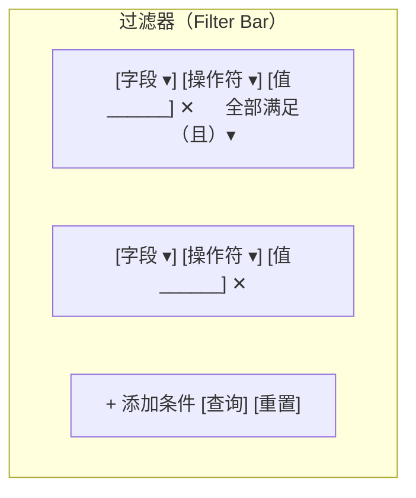
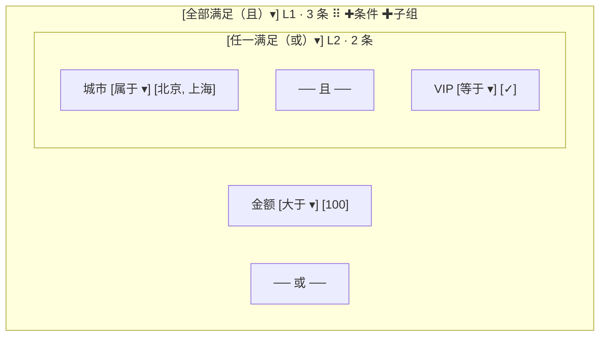
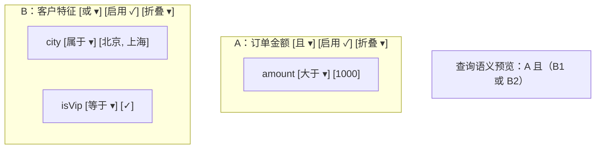

## 3. 动态查询构建器 / 规则引擎 UI ★全量展开

**画像**："当 `amount > 100` 且 `city ∈ [北京, 上海]` 时触发告警"——告警规则、自动化条件、高级筛选、审批流条件分支，中后台高频刚需。

先把"画像"两个字拆开看：这一章做的不是"一个查询输入框"，而是**给非程序员用户一个图形化的布尔表达式编辑器**。用户在界面上点选字段、选操作符、填值、用"且/或"组织起来，最终产出一棵**可序列化为 JSON 的条件树**。这棵树可以被前端即时求值（试运行），也可以转换成 json-logic 交给后端规则引擎、转换成 SQL 交给数据库、转换成 ES DSL 交给搜索引擎——**编辑一次，处处可执行**。这就是它在全书场景表里被标为 ★★★（"新且高价值，优先做"）的原因：内核全是现成的，产出却是一个完整的高频业务功能。

### 3.0 画像展开：四类业务与共同抽象

#### 3.0.1 四类业务的产品形态

**① 告警规则（监控 / 风控 / SaaS 计费告警）**
产品形态：一个"规则列表页 + 配置抽屉"。用户创建规则时填三样东西——**触发条件（本章主角）**、通知方式（电话/短信/钉钉）、静默期（多久内不重复告）。执行方是后端规则引擎：数据流（指标、订单、日志）每来一条，后端取出该租户的规则集，逐条求值，命中则触发动作。典型条件："`cpu > 80%` 持续 5 分钟 **且** `env = 生产`"。特点：规则**低频编辑、高频执行**，一条规则一天可能被求值百万次——所以保存时转成 json-logic 这类可被后端直接执行的结构，而不是每次执行前再解析 UI 协议。

**② 自动化条件（营销自动化 / 工作流触发器，对标 n8n、HubSpot Workflow）**
产品形态：工作流编辑器（本书场景 2）里的"触发节点"或"条件分支节点"的配置面板。"当 `订单金额 > 1000` **且**（`客户等级 = VIP` **或** `复购次数 > 3`）时，发送感谢邮件并分配专属客服"。特点：条件树嵌在工作流 DSL 内部，是节点 `data` 的一部分；条件命中决定流程走哪条边——所以它和场景 2 的节点 DSL 是**嵌套关系**而非并列关系。

**③ 高级筛选（数据表格的 Filter，对标 Retool、Jira 的过滤面板）**
产品形态：表格上方的一组"过滤行 + 添加条件按钮"，支持把若干行包成一组切换且/或。用户想要的往往是一个**临时查询**："给我看 `金额 between 100–500` **且**（`城市 in [北京, 上海]` **或** `销售 = 张三`）的订单"。特点：**高频编辑、即编即用**，条件树通常序列化进 URL（分享筛选视图），提交时转换成 SQL/Mongo/ES 查询发给数据接口；用户不会点"保存规则"，关闭即丢。这对编辑器的"开箱即用性"要求最高——初始只渲染一行，不要一上来甩一个空组给用户。

**④ 审批流条件分支（OA / BPM）**
产品形态：流程设计器里的"条件网关节点"，每个出边挂一棵条件树。"金额 < 1000 → 主管直批；否则 → 部门总监 **与** 财务会签"。特点：多棵条件树并排展示（每条出边一棵），且通常要求**互斥且完备**（任何数据恰好命中一条边）——这引出独有的校验需求：分支覆盖检查（这属于工作流引擎范畴，本章只负责单棵树的编辑与校验）。

#### 3.0.2 共同抽象：一条公式

四类业务的"动作端"完全不同（通知 / 执行流 / 过滤 / 路由），但"条件端"完全同构：

```text
规则 = 条件树（何时） + 动作（做什么）
              ↑ 本章只做这一半
```

条件端可以抽象成四件套，也正是本章"核心技术"8 条的目录：

1. **协议**：一棵递归的条件树 JSON（§3.1）——所有业务的唯一数据契约；
2. **编辑器**：递归渲染的 QueryGroup/QueryRow（§3.2）+ 元数据驱动的字段/操作符/值联动（§3.3、§3.4）；
3. **转换层**：一棵树 → json-logic / Mongo / ES DSL / SQL（§3.5）——同一编辑器服务四种执行端；
4. **质量保障**：校验（§3.6）+ 试运行（§3.7）+ 模板与版本 diff（§3.8）。

还要点破一层：条件树是《进阶大纲》§1 递归渲染器内核的**第 N 次复用**——本文档开头那条"暗线"说的就是它。动态表单渲染的是"异构节点树"（每个 type 对应不同组件，靠注册表分发），条件树渲染的是"同构二态树"（只有组、行两类节点，靠 discriminated union 分发）。树更简单，但**编辑难度反而更高**：动态表单的树很少在运行时被用户增删挪，条件树的每一个节点都要支持增、删、复制、换位置——递归不止用在渲染，还要用在不可变更新上。

> 以下三节是画像篇（3.0）的补充。说明：本章 3.1～3.8 的编号已按小节拆分被后续文件占用（协议、渲染、元数据、值编辑器、转换、校验、试运行、模板），故本篇补充用"补充："前缀续在 3.0.2 之后。

### 补充：编辑器形态对比——过滤器、分组树、面板式三档产品形态

**是什么**：把"查询构建器"这个词拆开，市面上的产品其实长着三张完全不同的脸。动手前先认清三档形态，才能回答"我的业务到底要建哪一档"——这个选择决定协议暴露多少、组件写多深、交互做多重，是比"用什么库"更靠前的决策。

**形态一：过滤器（Filter Bar）——表格上方的一排条件行**



特征：所有条件行平铺、共享**一个全局组合器**（所有行之间要么全"且"要么全"或"）、不支持嵌套。Jira 的基础过滤、绝大多数中后台列表页的查询区都是它。它的价值是**零学习成本**——用户第一次见就知道怎么用。

**形态二：分组树（Group Tree）——本章主角**



特征：组可嵌套组、每组独立组合器、每个节点可增删复制拖拽（§3.2 的 QueryGroup/QueryRow 就是它）。表达力最强，学习成本也最高——运营人员第一次面对一个空组时会不知所措，所以 Retool 用"渐进式披露"来救（初始只有一行，配置完才浮现更多入口，详见 13-3-9-坑 末尾的对标一节）。

**形态三：面板式（Panel/Section 式，类 Grafana）**



特征：查询被切成**若干个可命名的折叠面板**，每个面板内部是一小组平铺条件（带独立组合器），面板之间还有一个上层组合器（甚至"Reduce"：面板结果取 A/B/C 首个命中之类）。Grafana 的 alert query section、一些日志检索的"多段过滤"是这种形态。它是形态二的一种**横向切分**：把一棵宽树折叠成几个纵向段落，牺牲一点结构自由度，换来"一段一个业务主题"的组织感。

**为什么难**：三档形态不是"低配/高配"的包含关系，而是**表达力与学习成本的两轴取舍**。选低了，业务表达不出来（过滤器写不出"且中带或"，§3.1 开头的风控需求就是反例）；选高了，用户被吓跑（给只筛订单号的用户甩一个空条件组）。表达力对照表：

| 能力 | 形态一 过滤器 | 形态二 分组树 | 形态三 面板式 |
|---|---|---|---|
| 且中带或（嵌套逻辑） | 不能 | 能 | 能（面板内一层 + 面板间一层，共两层） |
| 任意深度嵌套 | 不能 | 能 | 不能（通常固定两层） |
| 每行独立选字段/操作符 | 能 | 能 | 能 |
| 序列化进 URL 分享 | 能（短） | 能（长，需压缩） | 能 |
| 新手 10 秒上手 | 能 | 不能 | 勉强 |
| 条件规模上限 | ~10 行 | 30~百级（配校验上限） | 每面板 ~5 行 |
| 典型用户 | 所有表格用户 | 运营/管理员配规则 | 开发者/SRE 查日志 |

**关键机制——三档形态共享同一棵协议树**。这是本节最重要的结论：形态不是三套协议，而是**同一棵条件树（§3.1）的三种视图**。

1. 过滤器 = 深度 ≤ 1 的条件树：只有根组 + 条件行，组合器全局唯一（就是根组的 combinator）；
2. 分组树 = 完整协议：深度、嵌套、复制、拖拽全部放开；
3. 面板式 = "根组下挂若干个子组，每个子组渲染成一个面板"的受控布局：面板 = 固定深度 2 的分组树 + 折叠状态这个纯 UI 态（不进协议）。

于是正确的工程顺序是：**先写协议与递归编辑器（§3.1/§3.2），再按业务裁剪 UI 形态**——形态是协议的视图裁剪，不是协议本身。这也是"协议按表达力上限设计"的直接推论（见本节坑）。

**最小可行实现——形态一：条件树的受限视图**。复用 §3.2 的 tree-ops，只是"少暴露几个动作"：

```tsx
// FilterBar.tsx —— 形态一：深度 ≤ 1 的条件树视图（同一协议的受限编辑器）
import { useCallback } from 'react'
import { type Combinator, type ConditionTree } from './condition-tree'
import { createCondition, insertChild, removeNodeById, updateNodeById } from './tree-ops'
import { type FieldMeta, applyFieldChange, applyOperatorChange } from './field-meta'

export function FilterBar({ fields, fieldMap, value, onChange }: {
  fields: FieldMeta[]
  fieldMap: Map<string, FieldMeta>
  value: ConditionTree            // 还是那棵 ConditionTree，没有第二份协议
  onChange: (next: ConditionTree) => void
}) {
  // 形态约束全部体现在"暴露哪些动作"：没有 + 子组、没有拖拽、没有复制组
  const addRow = useCallback(() => {
    onChange(insertChild(value, value.id, createCondition(fields[0]?.name ?? '')))
  }, [value, onChange, fields])

  const setGlobalCombinator = useCallback((combinator: Combinator) => {
    onChange({ ...value, combinator }) // 只有根组一个组合器，天然"全局"
  }, [value, onChange])

  return (
    <div className="fb-bar">
      <button
        type="button"
        className={`fb-toggle fb-toggle--${value.combinator}`}
        onClick={() => setGlobalCombinator(value.combinator === 'and' ? 'or' : 'and')}
        aria-label="切换条件关系"
      >
        {value.combinator === 'and' ? '全部满足（且）' : '任一满足（或）'}
      </button>
      {value.children.map((child, i) =>
        child.kind === 'condition' ? (
          <FilterRow
            key={child.id}
            node={child}
            fields={fields}
            fieldMap={fieldMap}
            onChange={next =>
              onChange(updateNodeById(value, child.id, () => next))
            }
            onRemove={() => onChange(removeNodeById(value, child.id))}
            showCombinator={i > 0}
            combinator={value.combinator}
            onToggleCombinator={() =>
              setGlobalCombinator(value.combinator === 'and' ? 'or' : 'and')
            }
          />
        ) : null, // 防御：历史数据若混入子组，过滤器视图隐藏它（数据不丢，切形态二可见）
      )}
      <button type="button" onClick={addRow}>+ 添加条件</button>
    </div>
  )
}
// FilterRow 内部：字段/操作符/值三件套与 §3.2 的 QueryRow 同构，
// 联动同样走 applyFieldChange / applyOperatorChange 两个原子门（§3.3），此处不重复
```

**形态间的无损迁移**——因为共享协议，升级/降级只是换视图：

```ts
// form-migration.ts —— 形态迁移：过滤器 ⇄ 分组树（同一棵树的两个视图）
import { type ConditionTree } from './condition-tree'
import { treeDepth } from './tree-ops'

/** 升级：过滤器的数据永远是分组树的子集，直接换视图组件即可，零转换 */
// <QueryBuilder value={filterTree} onChange={setTree} />   // 形态二的组件直接吃

/** 降级：分组树 → 过滤器，必须先确认深度 ≤ 1，否则降级 = 静默丢掉子组 */
export function canDowngradeToFilterBar(tree: ConditionTree): boolean {
  return treeDepth(tree) <= 1
}
```

产品上这就是"基础模式 / 高级模式"切换（Jira、Grafana 都这么做）：基础模式改一改，点"高级"无缝进入完整树编辑；反之高级模式里只要没有嵌套，随时可以退回基础模式。**切换按钮的禁用条件就是 `canDowngradeToFilterBar`**——这是"渐进式披露"（Retool 三原则，见 13-3-9-坑 对标节）的工程落点。

**选型与学习路径**：决策只问三个问题——① 用户是谁（全员表格用户 → 形态一；运营/管理员 → 形态二；技术角色 → 形态三）；② 有没有"且中带或"的真实需求（没有就别上分组树）；③ 条件会不会被复用/分享（会 → 协议进 URL 或存库，三种形态都支持，序列化能力见 §3.5）。学习路径：先做形态二（本章主线，最难），形态一/三只是它的裁剪视图，各一天就能裁出来——**先做难的，简单的免费送**。

**坑（形态层）**：
- 症状：表格筛选栏做到一半，产品要求"这几个条件之间是或的关系"，发现全局开关表达不了，只能整屏推翻重做。
- 根因：协议按 UI 形态设计（"一排行 + 一个全局开关"的形状直接写成了数据结构），而不是按逻辑表达力设计。UI 形态先于协议，是这类返工的唯一原因。
- 修法：协议永远按表达力上限设计（条件树），UI 形态只是"暴露多少"的开关。过滤器上线第一天，它提交的 value 就应该是 `ConditionTree`——哪怕当前界面只允许深度 1。后续加"高级模式"时，旧数据零迁移。

### 补充：三棵树的同构性——表单 schema、设计器 schema 与条件树

**是什么**：把《进阶大纲》§2 的表单 schema、§3/§6 的设计器页面 schema、本章的条件树三份协议并排放在一起，逐字段对比它们的结构决策——哪里相同、哪里刻意不同、为什么。引言（01）的"暗线"图与 14 号文件的复用关系讲的是**内核组件复用**（同一个 SchemaRenderer、同一套 Setter），本节讲更深的一层：**协议结构本身的同构**——它回答的是"为什么同一个内核吃得下三棵树"。

**为什么需要**：三个场景如果各自孤立地学，你会觉得"写了三次树编辑器"；看出同构后，它们变成"同一份知识的三个投影"——架构评审、面试、以及下次遇到第四棵树（权限树、菜单树、目录树）时的判断力，都从这里来。这也是《全景图》A 族（编辑器家族）把"壁垒最高"给到 Schema 线的原因：这条线的知识是**可迁移**的。

**逐维度对照**：

| 维度 | 表单 schema（§2 动态表单） | 页面 schema（§3/§6 设计器） | 条件树（本章） |
|---|---|---|---|
| 节点判别 | `type: string`（开放集） | `type: 物料名`（开放集） | `kind: 'group' \| 'condition'`（封闭二态） |
| 分发机制 | `registry[type]` 注册表 | `widgetRegistry[type]` 注册表 | `switch (node.kind)` 判别联合 |
| 子节点容器 | 嵌套字段的 children / 数组 | 容器物料的 children | 组节点的 children（行节点无 children） |
| **值的归属** | **不在 schema 里**——住在 form state | props 随节点存 | value 随条件节点存 |
| id | 字段 path（`a.b[0]`） | 物料节点 id（nanoid） | 节点 id（§3.1 的 genId） |
| 运行时增删挪 | 少（显隐/动态添加） | 多（画布编辑） | 极多（每个节点、每次点击） |
| 递归的第二战场 | 校验链路 | 不可变更新 | 不可变更新 + 协议转换（§3.5） |
| 序列化目标 | 表单数据 JSON | 页面 DSL | json-logic / SQL / Mongo / ES |

三条关键洞察：

1. **判别方式跟着"类型集合的开放性"走**。表单/设计器的节点类型是业务方持续新增的（开放集），所以用注册表——`type → 组件` 的映射可以无限外挂；条件树只有组、行两种节点（封闭集），所以用 discriminated union——`switch (kind)` 能拿到编译器的穷尽性检查，漏写分支直接编译失败。两者还能互换：给注册表加一个 `default` 兜底就近似穷尽；给判别联合配 `Record<Kind, Component>` 就是注册表。选哪个只看一件事：**类型集合未来会不会被第二方扩展**。
2. **"值存在哪"决定编辑器架构**，这是三棵树最深刻的差异。表单的 value 住在独立的 form state（RHF/FinalForm 的字段注册表），schema 里只有描述——所以表单渲染器天生带校验、联动、脏值跟踪这些"围绕值"的能力；设计器 props 和条件树的 value **随节点存**，整树就是单一数据源——所以它们不需要表单引擎，但需要"整树不可变更新"（§3.2 的 tree-ops）。把这条想透，你就知道为什么不能拿表单渲染器直接渲染条件树（见本节坑）。
3. **条件树经常作为"一个值"嵌进另外两棵树**。工作流的条件分支节点，`data` 里嵌的就是一棵条件树（03 号文件正是这么设计的——协议是嵌套关系而非并列）；表单里"告警规则"这种字段，字段值本身就是一棵条件树，编辑它的控件就是一个"规则 Setter"（对齐 §3.4 的注册表思路）。**树与树之间是"值嵌入"关系，不是"继承"关系**——这是组合，不是泛型基类。

**最小可行实现——一台发动机，三种协议**。同构性最硬的证据是：一个泛型遍历器 + 三个 adapter，就能服务三棵树：

```ts
// tree-walk.ts —— 泛型树遍历器：协议差异被压缩进 adapter 的三个函数
export interface TreeProtocol<N> {
  /** 取子节点数组；叶子返回 undefined */
  childrenOf(node: N): N[] | undefined
  /** 不可变替换子节点（只在 childrenOf 返回数组时被调用） */
  replaceChildren(node: N, children: N[]): N
  /** 节点 id（用于 key/缓存/定位，三棵树都有） */
  idOf(node: N): string
}

export function mapTree<N>(node: N, proto: TreeProtocol<N>, fn: (n: N) => N): N {
  const next = fn(node)
  const children = proto.childrenOf(next)
  if (!children) return next
  return proto.replaceChildren(next, children.map(c => mapTree(c, proto, fn)))
}

export function countNodes<N>(node: N, proto: TreeProtocol<N>): number {
  const children = proto.childrenOf(node)
  return 1 + (children?.reduce((sum, c) => sum + countNodes(c, proto), 0) ?? 0)
}
```

三个 adapter 各十几行，条件树的先写（本章协议自包含）：

```ts
// adapters.ts —— 三个 adapter：把协议差异钉死在这一层
import { type ConditionTreeNode } from './condition-tree'
import type { SchemaNode } from '../designer/schema'   // 《进阶大纲》§1 的通用节点协议
import type { FormSchemaNode } from '../form/schema'
import type { TreeProtocol } from './tree-walk'

/** 条件树 adapter：判别联合在这里被翻译成"有没有 children" */
export const conditionTreeProtocol: TreeProtocol<ConditionTreeNode> = {
  childrenOf: n => (n.kind === 'group' ? n.children : undefined),
  replaceChildren: (n, children) =>
    n.kind === 'group' ? { ...n, children } : n,
  idOf: n => n.id,
}

/** 设计器页面 schema adapter：children 键名不同而已 */
export const pageSchemaProtocol: TreeProtocol<SchemaNode> = {
  childrenOf: n => n.children,
  replaceChildren: (n, children) => ({ ...n, children }),
  idOf: n => n.id,
}

/** 表单 schema adapter：嵌套属性的子节点从字段定义里取 */
export const formSchemaProtocol: TreeProtocol<FormSchemaNode> = {
  childrenOf: n => (n.type === 'object' ? n.properties : undefined),
  replaceChildren: (n, properties) => (n.type === 'object' ? { ...n, properties } : n),
  idOf: n => n.key,
}

// 用法完全一致：统计、重发 id、遍历校验、生成只读预览，全部一鱼三吃
// const count = countNodes(conditionTree, conditionTreeProtocol)
```

这就是 01 引言"不动点"**泛型工具的第二例——`findPath`（错误定位的通用件）**。§3.6 的错误对象带 `path`（"根组 › 2 › 内层组 › 1"），它就是同一个泛型遍历的产物：

```ts
// tree-walk.ts 续 —— 节点路径查找：三棵树的错误定位共用
export function findPath<N>(
  root: N,
  targetId: string,
  proto: TreeProtocol<N>,
): number[] | null {
  const walk = (node: N, trail: number[]): number[] | null => {
    if (proto.idOf(node) === targetId) return trail
    const children = proto.childrenOf(node)
    if (!children) return null
    for (let i = 0; i < children.length; i++) {
      const hit = walk(children[i], [...trail, i])
      if (hit) return hit
    }
    return null
  }
  return walk(root, [])
}
// 条件树错误路径：findPath(tree, nodeId, conditionTreeProtocol)
// 设计器图层定位：findPath(page, widgetId, pageSchemaProtocol)
// 表单字段全路径：findPath(form, fieldKey, formSchemaProtocol)
```

**第四棵树预演——用三问判断法分析"权限树"**。同构性最有价值的时刻是下一棵树出现之前。拿场景 8 的权限树过一遍 01 的三问：① 可序列化的树？（权限规则是 `{ resource, effect, children }` 的嵌套 JSON——是）；② 按类型分发？（effect 只有 allow/deny 二态，与条件树的 group/condition 同构——是）；③ 纯声明？（规则不含逻辑——是）。三个都 yes，结论：条件树这套协议设计 + 递归渲染 + 不可变更新可以直接平移，你要写的只是"effect 的求值器"与"权限语义的校验"。**同构性分析做完，新场景的工作量从"一个项目"缩到"两个函数"**。

**同构的边界——什么时候不要合并**。反面教材是场景 6 的 ProseMirror 文档树（01 已判"不复用"，这里从协议维度解释为什么）：它的节点携带 marks（行内标记）、inline 内容与选区语义，"编辑"发生在字符粒度而非节点粒度——第 2 条"按类型分发"勉强成立，但"每个节点增删挪"的编辑模型完全不成立（用户编辑的是文本流，节点结构是文本编辑的副产品）。**强行套注册表 + 递归渲染，得到的是两头别扭的混合体**。判断法反着用：三问任何一个 no，就为它找独立内核——"能不能复用"与"该不该复用"都要回答。

同构性的论证到这里收口：三棵树满足同一组前提（可序列化树、按类型/判别分发、纯声明），于是"遍历/更新/校验"这一层**永远不需要重写**，重写的只是 adapter 与交互外壳——这正是 01 引言"不动点"论证在协议层的版本。

**与相邻章节的分工**：本节之外不要重复展开——内核组件复用清单见 01（暗线图）与 14（为什么 ★★★）；"用 schema 编辑 schema"的元编程视角见场景 4（15 号文件）；面板配置抽屉的 Setter 复用见《进阶大纲》§4。

**同一个业务点在三份协议里的样子**（把对照表落到具体 JSON，同构性一眼可见——"订单金额大于 1000"）：

```json
// 表单 schema（§2）：金额是"一个可输入的字段"，值不在这里
{ "key": "amount", "type": "number", "label": "订单金额", "min": 0 }

// 页面 schema（§3/§6）：金额是"一个 KPI 物料的 props 配置"，值随节点存
{ "id": "w_1", "type": "kpi", "props": { "title": "大额订单", "field": "amount", "threshold": 1000 } }

// 条件树（本章）：金额是"一个比较的操作数"，value 是比较的右值
{ "kind": "condition", "id": "c_1", "field": "amount", "operator": ">", "value": 1000 }
```

三段 JSON 的公共骨架都是"id/key + 类型语义 + 值或值描述"，差异只在"值住在哪、谁消费"。架构评审时用这张速记卡表达：**"这是同一棵树的第 N 次投影"**——比"我们再写一个树组件"有说服力得多。

**同构性与后续两维的交集**（协议骨架之上还能叠维度，且已有先例）：label 存 i18n key 是"协议 + 国际化维"（渲染器统一翻译，见场景 10 与毕业项目 2.5 的字段声明）；字段列表按权限裁剪是"协议 + 权限维"（服务端下发即裁剪，见场景 8 与 3.3.1 模式二）。两处改的都不是协议骨架，而是挂在骨架上的元数据列——**骨架的同构性越好，叠加维度的成本越低**，这是同构分析的最后一个实用价值。

**一分钟速记**（本节压缩成三句，面试与评审直接用）：① 三棵树的差异集中在两处——类型集合开放性（注册表 vs 判别联合）与值的归属（form state vs 随节点存）；② 消费侧一切递归问题（渲染、更新、校验、定位）共享同一台泛型发动机，adapter 十行以内；③ 树与树的组合方式只有"值嵌入"一种（条件树作为别的树的字段值），没有继承与合并。

**坑（协议混用）**：
- 症状：把条件树塞进表单 schema 的组件数组里，用动态表单渲染器渲染，结果字段/操作符联动全失效，值存进了 form state 而不是条件节点的 `value`，序列化时树里 value 全是 null。
- 根因：违反了"值的归属"差异——表单渲染器默认"值由我（form state）管"，而条件树的值必须随节点走（§3.5 转换层直接读节点 value）。两套所有权模型叠加，值被拉走了一份。
- 修法：条件树**永远独立渲染**（自己的 QueryBuilder、自己的单一数据源），对外只暴露"一个值编辑器"的接口——正好就是 §3.4 的 `ValueEditorProps` 形状（value/onChange/field/operator）。树嵌树的正确姿势是组合（值嵌入），不是把一棵树拆成另一棵树的节点。

### 补充：交互规范清单——焦点、动效、复制与键盘可达性

**是什么**：§3.2/§3.4 讲的是"机制怎么实现"，本节补的是"交互做到什么程度算合格"——一份可以直接抄进 PRD 与验收清单的交互规范。查询构建器的使用频率高（配置规则的用户一天点几十次"加条件"），交互上的毛刺会被放大一万倍。

**为什么难**：这三类问题（焦点、动效、可达性）在功能演示里全部隐形——演示时用鼠标慢慢点一切正常；真实使用里，键盘用户被 Tab 顺序折磨、新增行后焦点不知道飞到哪里、删除中间行时其余行"瞬移"。它们是"能用"与"好用"之间的全部距离。通用的焦点与 ARIA 功力在《组件库实战大纲》A4（焦点管理）、A5（键盘导航与 ARIA）里系统训练过，此处只列查询构建器特有的清单。

**规范一：焦点管理**（最高优先级——焦点错了，其他都白搭）

1. **新增条件行后**：焦点自动落到新行的**字段下拉**。省一次鼠标移动是小事，键盘用户的唯一通路是大事。实现要点：动作函数 `addCondition` 之后的渲染周期里，通过 id → DOM 的 ref 注册表 `focus()` 新行第一个控件；时序上用 `useEffect`（不是 `useLayoutEffect`——焦点触发滚动，等布局完成再对）。
2. **删除行后**：焦点落到**相邻行**（优先前一行）的删除按钮或把手上，绝不允许焦点丢到 `document.body`——那意味着 Tab 从头开始，多行编辑用户每删一行就重走一遍全表。
3. **删除焦点所在控件自身时**（如点掉自己这行）：先 `relatedTarget` 判断焦点是否在被删子树内，在则先移焦点再删节点，否则浏览器会把焦点重置到 body。
4. **折叠/展开组**：焦点留在折叠开关上（它就是触发器，天然正确）；展开后不抢焦点。

```tsx
// use-focus-registry.ts —— 焦点注册表：id → 行首控件，新增行后自动聚焦
import { createContext, useCallback, useContext, useEffect, useRef, type RefObject } from 'react'

interface FocusRegistry {
  register(id: string, el: HTMLElement | null): void
  focus(id: string): void
}

const FocusContext = createContext<FocusRegistry | null>(null)

export function FocusRegistryProvider({ children }: { children: React.ReactNode }) {
  const map = useRef(new Map<string, HTMLElement>())
  const register = useCallback((id: string, el: HTMLElement | null) => {
    if (el) map.current.set(id, el)
    else map.current.delete(id)
  }, [])
  const focus = useCallback((id: string) => {
    map.current.get(id)?.focus() // 找不到就静默不聚焦（行可能已被删）
  }, [])
  return (
    <FocusContext.Provider value={{ register, focus }}>{children}</FocusContext.Provider>
  )
}

/** QueryRow 内：把字段下拉挂进注册表 */
export function useRegisterRowFocus(id: string): RefObject<HTMLSelectElement> {
  const ctx = useContext(FocusContext)
  const ref = useRef<HTMLSelectElement>(null)
  useEffect(() => {
    ctx?.register(id, ref.current)
    return () => ctx?.register(id, null) // 卸载即注销，防悬空 DOM
  }, [ctx, id])
  return ref
}

/** addCondition 动作的焦点收尾（在根组件的 onChange 包装里）：
 *  onChange(insertChild(value, groupId, row)) 之后，下一个 effect 周期 focus(row.id) */
```

**规范二：动效**（时长与触发约定，实现细节不在此展开）

1. 时长 **150～200ms**、`ease-out`——短于 100ms 人眼感知不到（等于白做），长于 250ms 开始拖累操作节奏；研究共识与《学习大纲》动画章一致。
2. 新增行：高度 0 → auto + 淡入（`max-height` 或 grid-template-rows 动画）；删除行：若做退出动画需要"延迟删除"模式（先标记 leaving 播完再真正 `removeNodeById`），实现成本高，** MVP 阶段建议接受"无退出动画、只有后续行的 FLIP 位移"**——位移动画已经足够传达"删掉了一条"。
3. 行/组的**位置变化**（增、删、复制、拖拽落定）用 FLIP 位移过渡——手写实现见 §3.2 补充的 3.2.4 节，本节只立规范：位置变化必须有过渡，"瞬移"是明确的规范违例。
4. `prefers-reduced-motion: reduce` 时全部关闭（一行 `matchMedia` 判断），无障碍硬要求。
5. 动效只允许动 `transform`/`opacity`（合成器友好），禁止动 `width/top/left`——原理见《学习大纲》渲染管线一节。

**规范三：复制语义**

1. 行复制：新行**紧跟原件**下方，`deepCloneWithNewIds` 全量重发 id（§3.2 已实现），复制件短暂高亮一次（背景闪 300ms）告知"复制到哪了"。
2. 组复制：同样紧跟原件；组内所有子孙 id 一并重发（§3.2 的递归 clone 已保证）。
3. 跨规则复制（进阶）：剪贴板协议就是裸的 `ConditionTreeNode` 子树 JSON（`e.clipboardData.setData('application/x-qb-node', json)`）；**粘贴时必须跑字段存在性检查**——粘贴来源规则的字段表可能与当前域不同，悬空字段按坑 2 的红牌行处理（软删除与迁移见 13-3-9-坑 2）。同时设上限：深度、条件数、JSON 字节数（防粘贴一棵 10MB 的树把编辑器顶爆），上限值与 §3.6 校验共用同一配置。
4. 剪贴板双格式与边界：复制时写两种格式——自定义 MIME（结构化，给自己粘贴用）+ 纯文本 fallback（一行可读摘要如 `amount > 1000 AND city IN (北京, 上海)`，用户粘到聊天工具里也能看）；只在 `paste` 事件里读自定义 MIME，不装全局剪贴板监听（越权的读贴板行为既危险又触发浏览器告警）。文本 fallback 的生成可复用 §3.5 转换层的思路（同一棵树多一种"方言"输出）。

**规范四：键盘可达性**

1. **Tab 顺序 = 视觉顺序**：字段 → 操作符 → 值 → 复制 → 删除 → 把手。DOM 顺序天然如此，不要用 `tabIndex` 正整数去"纠正"。
2. **拖拽必须有键盘替代通路**（可访问性硬要求，没有则功能对键盘用户不存在）：① `Alt+Enter` 新增行、`Alt+G` 新增子组；② `Alt+↑/↓` 当前行/组在组内上移/下移（直接调 `moveNode`，纯数据操作零拖拽）；③ dnd-kit 的 `KeyboardSensor` 让把手可以用键盘"拾起-移动-放下"（§3.2 只配了 PointerSensor，这里补上）：

```tsx
// 键盘拖拽：给 sensors 补上 KeyboardSensor（与 §3.2 的 PointerSensor 并列）
import {
  DndContext, KeyboardSensor, PointerSensor, useSensor, useSensors,
} from '@dnd-kit/core'
import { sortableKeyboardCoordinates } from '@dnd-kit/sortable'

const sensors = useSensors(
  useSensor(PointerSensor, { activationConstraint: { distance: 5 } }),
  // 键盘拾起：焦点落在把手上按空格 → 方向键移动 → 再按空格放下；Esc 取消
  useSensor(KeyboardSensor, { coordinateGetter: sortableKeyboardCoordinates }),
)
```

3. 把手是 `span`/`div`，必须补 `role="button"` + `tabIndex={0}` + `aria-label="拖拽排序（空格拾起）"`（§3.2 的代码里 dnd-kit `attributes` 已自动带，此处立为规范防止自研把手漏掉）。
4. 组容器 `role="group"` + `aria-label`（如 `"条件组，组合器：且，共 3 个条件"`）；错误提示已用 `role="alert"`（§3.2 的 `qb-row-error`）——保持。
5. 行间"且/或" chip 是 `button`（§3.2 已是），天然可聚焦可回车，无需额外处理。
6. 结构变化要有"屏幕阅读器播报"：新增/删除行对视障用户是无声的——在编辑器根部挂一个 `aria-live="polite"` 的哨兵节点，增删时写入"已添加条件，当前共 N 条 / 已删除条件，剩余 N 条"。一句话的投入，键盘与读屏用户获得的是与明眼用户同等的"操作已生效"反馈。

**规范五：撤销/重做的交互契约**。undo/redo 的实现（命令栈/immer patches/zundo 三选型）在《进阶大纲》§1.5，这里只定交互契约：① 每个结构性动作（增删行/组、复制、移动、切组合器）必须可一步撤销——**值编辑不算结构动作**，打字撤销交给输入框原生行为（在输入框里 Cmd+Z 撤文字，焦点移出后 Cmd+Z 撤结构，两个 undo 栈互不抢占——实现要点：输入框 `value` 受控但**不要** `onKeyDown` 拦截 Cmd+Z）；② undo 后焦点恢复到"被恢复节点"上（配合规范一的焦点注册表——`nodeId` 在撤销前后不变，正好复用）；③ redo 同理；④ 删除组这种"大动作"不做二次确认弹窗（弹窗打断高频操作），靠 undo 兜底——**有可靠 undo 的编辑器才配砍掉确认框**，没有 undo 前别学这条。

**交互规范的可测性——把规范写成 E2E 断言**。规范不被测试覆盖就会在迭代中静默腐烂，键盘通路与焦点规范恰好是最容易 E2E 化的两条（纯键盘、无视觉判断）：

```ts
// keyboard-flow.spec.ts —— Playwright：纯键盘完成"加行 → 选字段 → 调序 → 删除"
import { test, expect } from '@playwright/test'

test('纯键盘完成条件编辑全流程', async ({ page }) => {
  await page.goto('/rule-editor')
  const root = page.getByRole('group', { name: /条件组/ })

  // Alt+Enter 新增行：焦点应落在新行的字段下拉（规范一之 1）
  await root.press('Alt+Enter')
  await expect(root.locator('select[aria-label="字段"]').last()).toBeFocused()

  // 原生 select 键盘选择字段（首字母跳转/方向键）
  await page.keyboard.press('ArrowDown')

  // Alt+↑：当前行上移一位（规范四之 2）
  await page.keyboard.press('Alt+ArrowUp')

  // 删除当前行：焦点必须留在相邻行，不能丢到 body（规范一之 2）
  await page.keyboard.press('Delete')
  const focusedTag = await page.evaluate(() => document.activeElement?.tagName)
  expect(focusedTag).not.toBe('BODY')

  // Cmd+Z 撤销删除：被删行回来，焦点回到被恢复行（规范五之 2）
  await page.keyboard.press('Meta+z')
  await expect(root.locator('[data-node-id]').first()).toBeVisible()
})
```

三条经验：键盘类规范用 `page.keyboard` 模拟（别用 `page.click`，那测的不是键盘通路）；焦点断言用 `toBeFocused()`（Playwright 内建）与 `document.activeElement`（兜底）；E2E 只覆盖"规范条目"级别的粗断言（存在、聚焦、顺序），细粒度交互留给组件测试（vitest + Testing Library，`userEvent.keyboard`）。

**验收清单**（可直接勾选）：

- [ ] 新增行后焦点在新行字段下拉（键盘直接能打字选字段）；
- [ ] 删除任意行后 Tab 位置不丢（焦点在相邻行，不是 body）；
- [ ] 纯键盘完成：加行、选字段、填值、`Alt+↑/↓` 调序、删除——全程不碰鼠标；
- [ ] 增/删行时其余行有 150-200ms 位移过渡，无瞬移；系统开启"减弱动态效果"后过渡消失；
- [ ] 复制行后新行紧跟原件、id 全新（可用 `<pre>{JSON.stringify(tree)}</pre>` 目检）、有一次高亮反馈；
- [ ] 屏幕阅读器读出："条件组，组合器：且"；错误时读出行内错误文案；
- [ ] 撤销删除（Cmd+Z）后，被恢复的行回来且焦点落在其字段下拉上（规范五）；
- [ ] 新增行有进入动画（180ms 淡入下移），且与兄弟行的让位动画并行不互抢；
- [ ] 浏览器缩放 200% / 1280px 窄屏：行内控件换行（`flex-wrap`）不横向溢出，操作按钮仍可点——可达性验收里最常翻车的一条。

**坑（交互层）**：
- 症状：焦点管理时灵时不灵——删除第 2 行后焦点跑到第 3 行的**值**里（应为相邻行把手），或新增行后焦点落在上一行。
- 根因：焦点注册表用数组下标做 key（`refs[idx]`），行增删后下标与 id 错位——与 §3.2 渲染层的 key 坑是同一个病根的两处发作。
- 修法：注册表一律 `Map<nodeId, HTMLElement>`，与 React 渲染的 `key={child.id}` 用同一个 id 空间；先移焦点、后改树（焦点目标行必须在新树里仍存在——`relatedTarget` 判断在 `onChange` 之前完成）。

---

## 附:ASCII 图替换清单

本文档图形化改版,原 ASCII 字符图与 Mermaid 图表对应关系如下:

| 原图位置 / 标题 | 处理结果 |
| --- | --- |
| 补充:编辑器形态对比——形态一 过滤器(Filter Bar)线框 | 替换为 flowchart TD(subgraph) |
| 补充:编辑器形态对比——形态二 分组树(Group Tree)线框 | 替换为 flowchart TD(嵌套 subgraph) |
| 补充:编辑器形态对比——形态三 面板式(Panel/Section)线框 | 替换为 flowchart TD(subgraph) |

