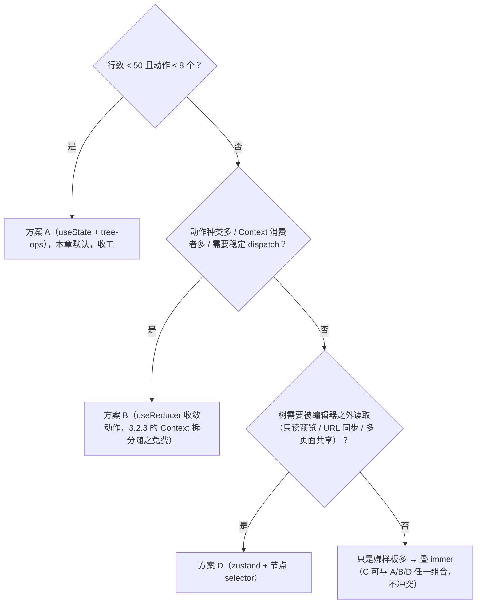

> 本文是《3. 动态查询构建器 / 规则引擎 UI ★全量展开》按小节拆分后的续篇，上一部分见 [04-3-动态查询构建器-规则引擎-UI-全量展开.md](04-3-动态查询构建器-规则引擎-UI-全量展开.md)。

### 核心技术

#### 3.1 条件树协议（递归结构！）

**是什么**：一份 JSON，能表达任意深度的"且/或"条件组合。原文协议长这样：

```json
{ "combinator": "and", "conditions": [
  { "field": "amount", "operator": ">", "value": 100 },
  { "combinator": "or", "conditions": [ ... ] }
]}
```

**为什么需要**：先看一个真实业务需求，理解为什么**必须**递归，而不是"给一排条件行加一个全局且/或开关"就够了。

风控需求原文："订单金额大于 100，且（城市在北京或上海，或者客户是 VIP）时，人工复核"。翻译成逻辑式：

```text
amount > 100 AND (city IN [北京, 上海] OR isVip = true)
```

"且中带或"——`AND` 的一个操作数本身是一个 `OR` 表达式。如果协议只有一层（所有条件平铺 + 一个全局组合器），这个式子表达不出来。理论上可以用分配律展开成析取范式（DNF）：

```text
(amount > 100 AND city = 北京) OR (amount > 100 AND city = 上海) OR (amount > 100 AND isVip = true)
```

能表达了，但代价惨重：`amount > 100` 被复制了 3 份；每多一个 OR 内的分支，重复次数就翻一倍；用户在 UI 上看到的是三条"看起来无关"的规则，改阈值要改三处，漏改一处就是线上事故。**递归分组是唯一既无冗余、又与用户心智模型（"这堆条件是一伙的"）对齐的结构**。这也是为什么 Grafana、react-querybuilder、Retool 的过滤条件全部采用"可嵌套的条件组"。

**怎么做——原文 JSON 逐字段讲解**：

- `combinator`：组级组合器，`"and"`（组内所有子条件都满足，组才为真）或 `"or"`（任一满足即为真）。它属于**组**，不属于单个条件——这是新手最常画错的一笔：条件行自己没有"且/或"属性，行与行之间如何连接由父组的 combinator 决定。
- `conditions`：子节点数组，元素是**异质**的——既可以是条件，也可以是嵌套的组，顺序即求值展示顺序。
- 第 2 行 `field` / `operator` / `value`：条件三要素。`field` 是字段名（必须能在字段元数据表里查到，§3.3）；`operator` 是操作符字符串；`value` 是比较值，**类型随操作符变化**（`>` 配数字、`in` 配数组、`between` 配二元数组、`isEmpty` 配空）——这一条是后面坑 1 的伏笔。
- 第 3 行：又一个 `combinator + conditions` 的对象——递归发生的地方。这个内层组的组合器是 `"or"`，与外层的 `"and"` 独立，于是实现了"且中带或"。深度没有协议上限（上限由 §3.6 的校验把门）。

**这个最小协议有两个生产级缺陷**，扩写时必须补上：

1. **类型判别靠"有没有 `conditions` 键"**。TypeScript 写不出"有 conditions 键就是组"的宽松判别联合（能写，但要靠 `in` 操作符收窄，运行时一旦两个字段同时出现就静默判错）。更稳的做法是给每类节点一个显式的 `kind` 判别字段，形成标准的 discriminated union——`switch (node.kind)` 即可穷尽分支，编译器会强制你处理所有情况。
2. **节点没有 `id`**。没有 id，React 列表只能用数组下标当 key——增删行时 key 错位引发状态串行（输入框里上一位用户填的值跑到下一行）；错误无法定位到具体行（§3.6）；拖拽无法标识拖的是谁（§3.2）；复制粘贴无法去重。id 是整个编辑器交互层的地基。

**代码——完整 TS 协议**：

```ts
// condition-tree.ts —— 条件树协议：全章唯一的数据契约
export type Combinator = 'and' | 'or'

/** 操作符全集。注意：它同时是"协议常量"和"UI 下拉项来源"，扩操作符先扩这里 */
export type Operator =
  | '=' | '!=' | '>' | '>=' | '<' | '<='      // 数值/日期/字符串通用比较
  | 'in' | 'notIn'                            // 值 ∈ 数组（枚举多选）
  | 'contains' | 'notContains'                // 字符串包含
  | 'between' | 'notBetween'                  // 区间（value 恒为二元数组）
  | 'isEmpty' | 'isNotEmpty'                  // 无值操作符（value 恒为 null）

/** 单个条件：字段 + 操作符 + 值 */
export interface ConditionNode {
  kind: 'condition'                // 判别字段：TS 据此做类型收窄
  id: string                       // React key / 错误定位 / 拖拽标识
  field: string                    // 字段名，必须存在于字段元数据表
  operator: Operator
  value: unknown                   // 类型由 (field, operator) 二元组决定，§3.3
}

/** 条件组：组合器 + 任意数量的子节点（条件或更深的组）——递归发生地 */
export interface GroupNode {
  kind: 'group'
  id: string
  combinator: Combinator
  children: ConditionTreeNode[]
}

/** 判别联合：两种节点，一个 switch 穷尽 */
export type ConditionTreeNode = ConditionNode | GroupNode

/** 根必须是组：保证序列化结果永远是一个合法的"完整表达式"，而非裸条件 */
export type ConditionTree = GroupNode

/** id 生成：优先用平台随机 UUID，退化到时间戳+随机数（不引第三方依赖） */
export function genId(): string {
  if (typeof crypto !== 'undefined' && 'randomUUID' in crypto) {
    return crypto.randomUUID()
  }
  return `q_${Date.now().toString(36)}_${Math.random().toString(36).slice(2, 8)}`
}
```

补齐 `kind` 与 `id` 后，本章开头的业务需求落成协议是这样（后面所有小节都拿它当贯穿示例，记作"金额复核规则"）：

```json
{
  "kind": "group",
  "id": "g_root",
  "combinator": "and",
  "children": [
    { "kind": "condition", "id": "c_1", "field": "amount", "operator": ">", "value": 100 },
    {
      "kind": "group",
      "id": "g_2",
      "combinator": "or",
      "children": [
        { "kind": "condition", "id": "c_3", "field": "city", "operator": "in", "value": ["北京", "上海"] },
        { "kind": "condition", "id": "c_4", "field": "isVip", "operator": "=", "value": true }
      ]
    }
  ]
}
```

**常见坑（协议层）**：
- 症状：后端反序列化报 `Cannot read properties of undefined`，排查发现某节点 `kind` 是 `"conditon"`（拼写错误）。
- 根因：协议没有运行时校验，畸形数据一路穿透到渲染层才炸。
- 修法：入口处用 ajv（或 zod）对 ConditionTree 做一次 schema 校验，不合法直接拒收并上报——后端回填的历史数据同样要过这道闸。协议是契约，契约必须有守门人。

> 以下三节是"核心技术"篇的清单化补充（编号 3.2～3.8 已被后续文件占用，故用"补充："前缀）：三张选型矩阵与一张性能预算表，把"技术栈"从名词列表变成可决策、可验收的工程资产。

#### 补充：选型矩阵一——状态容器与不可变更新的五种方案

**是什么**：本章默认实现是"根组件 `useState` 一棵树 + 手写 tree-ops 纯函数（§3.2）"。这够不够，什么时候该换？把候选方案放进同一张矩阵，每个维度打分并给出"换与不换"的触发条件。

**为什么需要**：状态方案是编辑器的地基，中途更换的成本极高（所有动作函数、Context、订阅关系全部重写）。而"越高级越好"是常见误区——zustand/immer 各自解决特定规模的特定痛点，规模不到就引入，代价是依赖、心智与调试链路全部变长。矩阵的意义就是把"规模触发条件"写死。

**矩阵**：

| 方案 | 代码量 | 类型安全 | 结构共享 | undo 接入 | 树规模甜区 | 换入触发条件 |
|---|---|---|---|---|---|---|
| A. `useState` + 手写 tree-ops（本章默认） | 中 | 强（纯函数全签名） | 天然有（§3.2 逐条说明） | 快照式 easiest | ≤ 50 行 | 默认起点 |
| B. `useReducer` + tree-ops | 中 | 强 | 同 A | 同 A（快照进历史栈） | ≤ 200 行 | 动作种类 > 8 个、或需要稳定 dispatch（见 §3.2 补充 3.2.3 的 Context 击穿分析） |
| C. immer `produce` 包 tree-ops | 小 | 中（判别联合在 draft 里收窄偶尔要 as） | immer 保证 | `produceWithPatches` 白送正反补丁 | 同 A/B | 嫌手写 `{...n, children: map(walk)}` 样板多、团队已熟 immer |
| D. zustand（+ immer 中间件） | 中 | 强 | 取决于是否用 immer | zundo 中间件或快照 | 200 ～ 千级行 | 需要"树挂在组件外"（多视图共享：编辑器 + 只读预览 + URL 同步），或需要节点级 selector 订阅 |
| E. jotai（原子粒度） | 中 | 强 | 原子级（更细） | 自建（快照 atom） | 不限 | 值编辑器需要"未提交草稿"这类独立小状态（见 3.4.1 的 useLocalCommit 讨论） |

**逐项展开（只讲矩阵说不清的部分）**：

1. **A 的隐藏优点是结构共享**。`updateNodeById` 手写展开只克隆"从根到目标节点的路径"，未触及的兄弟子树引用不变——这直接决定了 memo 能否拦截无关行的重渲染（3.2.3 节会把这个链路拆开）。手写展开不是"笨办法"，它是性能最优解的直通车。
2. **B 解决的是动作函数的引用稳定性**。`useReducer` 的 `dispatch` 引用永远不变——把所有动作收敛为 `dispatch({type: 'updateNode', id, updater})` 后，Context value 可以完全不依赖树内容，memo 的行组件拿到的动作函数也就永远稳定（3.2.3 的核心修法之一）。代价是多一层 reducer 样板。
3. **C 是"写法减负"，不是"性能升级"**。immer 的 proxy 是惰性的（只代理被访问的路径），produce 一棵 50 行树的耗时与手写展开同数量级；但它换来一个独特的红利——`produceWithPatches` 让"任何 mutation 自动获得正/反补丁"，undo/redo 从此不用写 do/undo 对偶。《进阶大纲》§1.5 已把三种 undo 方案讲透（命令模式 / immer patches / zundo），本章规模（树几十 KB）下快照式与 patches 式都成立，选型讨论不在此重复。
4. **D 与 E 的取舍（本项目结论：主状态 zustand 优于 jotai）**。树形数据的节点之间有强父子结构关系，zustand 的"单 store + selector"与"单一数据源"心智完全一致：`useQBStore(s => findNodeById(s.tree, id))` 一行完成节点订阅（03 号文件的工作流编辑器在百节点规模用的同一招，结论可以直接搬）。jotai 的强项是"粒度天然独立的状态"——用它建模整棵树要靠 atomFamily 按节点 id 建原子，原子间再用派生关系拼出树，模型别扭；但值编辑器的"未提交草稿"恰好是独立小状态，是 jotai 的甜区（也可以就用 `useState`，见 3.4.1）。**主树一个 store、草稿一堆局部 state，是本项目的推荐形态**。
5. **zustand selector 的性能注脚**：`findNodeById` 是 O(n) 遍历，每个订阅行每次 store 变化都要跑一遍——200 行树 × 200 行订阅 = 4 万次比较，仍然便宜；千级行则应换成扁平索引（维护 `Map<id, node>`，思路同 3.2.1 的扁平化），把查询降到 O(1)。

**最小对照——同一个动作，A 与 C 的写法**：

```ts
// 方案 A：手写展开（§3.2 已有，此处引用对照）
export function updateNodeById(
  root: ConditionTree,
  id: string,
  updater: (n: ConditionTreeNode) => ConditionTreeNode,
): ConditionTree {
  const walk = (n: ConditionTreeNode): ConditionTreeNode => {
    if (n.id === id) return updater(n)
    if (n.kind === 'group') return { ...n, children: n.children.map(walk) }
    return n
  }
  return walk(root) as ConditionTree
}

// 方案 C：immer 版——mutation 直写，结构共享由 immer 保证
import { produce } from 'immer'

export const updateNodeByIdImmer = (
  root: ConditionTree,
  id: string,
  updater: (n: ConditionTreeNode) => void,
): ConditionTree =>
  produce(root, draft => {
    const walk = (n: ConditionTreeNode): void => {
      if (n.id === id) { updater(n); return }   // updater 直接改 draft，无需手工克隆
      if (n.kind === 'group') n.children.forEach(walk)
    }
    walk(draft)
  })

// 用法：updateNodeByIdImmer(tree, id, n => { if (n.kind === 'condition') n.value = 100 })
```

注意 C 版的 `updater` 签名从"返回新节点"变成了"原地修改 draft"——语义更直观，但也因此**不能**再用于需要返回 `null` 表达删除的场景（immer 里删除子节点要走 `splice`），这是两个方案不可完全互换的细节。

**决策树**（把矩阵压成三问）：



**迁移路径——方案是渐进升级不是推倒重来**。A → B → D 每步都是"换壳不换芯"：tree-ops 纯函数（§3.2）在三个方案里原封不动，变的只是"谁持有状态、动作怎么进"。A→B：把 `onChange(treeOps(...))` 的每个动作改写成 `dispatch({type, ...})` 的 case（机械搬运，半小时）；B→D：把 `useReducer` 的 state 搬进 `create<QBState>()`，`dispatch` 换成 store 的 action 方法（逻辑零变化）。每步可独立验收（动作的单测直接搬），可回滚——**正因为你从 A 起步时把逻辑全部押在纯函数上，后面的每一步迁移都只是重新接线**。反过来，如果第一版把逻辑写散在组件里（`setTree(t => {...})` 内联展开），任何一次迁移都是全量重写——这才是"A 方案的真正纪律"。

**zustand selector 的浅比较注脚**：selector 返回**节点对象本身**（引用类型）时天然无问题——树不变则引用不变；但要小心返回**新构造对象**的 selector（`s => ({ node: find(...), error: map.get(id) })`）——每次都产新引用，订阅等于白订，所有行照常重渲染。修法是 `useShallow`：

```ts
// zustand v5 起移除了默认浅比较，返回新对象的 selector 必须显式包 useShallow
import { useShallow } from 'zustand/react/shallow'

export function useRowProps(id: string) {
  return useQBStore(
    useShallow(s => ({
      node: findNodeById(s.tree, id),
      error: s.errors.get(id) ?? null,
    })),
  )
}
```

**方案 A 什么时候开始痛（换档信号清单）**——对照自查，出现即换，没出现别预支复杂度：

- 动作函数超过 8 个，且出现"组合宏"（复制并下移、批量粘贴后重排）——动作编排开始需要中间层 → 换 B；
- 任何一次输入让 Profiler 里全树组件亮起（3.2.3 的连坐症状）——Context 分发成为瓶颈 → 先换 B（dispatch 恒稳），仍不够再上 D；
- 编辑器之外出现第二个树消费者（URL 同步、独立挂载的只读预览、模板库要读当前树）——"状态住在组件里"开始碍事 → 换 D；
- undo/redo 需求排期 → 任意方案都能接 §1.5（快照式最省心），但 C（immer patches）让"每个 mutation 自动可逆"，动作种类多时最划算。

两条常见问答：**"A 和 D 能混用吗？"**——能且常见：编辑器内部 `useState`（编辑中的树），把"已保存的树"放 store——纪律是划清真相源（编辑中的树 = 组件态，点保存那一刻才进 store），双写必打架。**"为什么不直接 Redux？"**——RTK 能做但契约重（slice/action creator 样板量与编辑器动作数量不匹配），zustand 用 2KB 达到同样效果；Redux 的优势（时间旅行调试器、中间件生态）对编辑器状态价值有限——树的每次变化本身就是结构化 JSON，`<pre>{JSON.stringify(tree, null, 2)}</pre>`（§3.2 的调试习惯）比时间旅行更直观。

**矩阵之外的落选者**（为什么没有它们的一栏）：Recoil 已停止维护（Meta 2023 年起归档，新项目不应入）；MobX 的响应式模型（observable/action）与"整树不可变替换"的编辑器范式方向相反——它擅长的是"多处细粒度可变状态"，引入它等于放弃 §3.5 转换层依赖的"树即快照"前提；Context 单独成方案也不列——它只解决"分发"不解决"持有"，永远与 A/B/D 之一搭配出现（3.2.3 拆的就是它的分发音量问题）。Valtio（proxy-based）与 immer 思路同族，选 immer 的理由是生态与 §1.5 patches 的无缝衔接。

**矩阵的口径说明**（怎么读那张表）："代码量"按"实现 §3.2 动作清单全集"计（不含编辑器 UI 本身）；"类型安全"看"动作与树操作的签名能否全程类型化"（immer 的 draft 在判别联合收窄上偶尔要 as，扣一分）；"undo 接入"指与 §1.5 三方案的配合成本，不是从零实现 undo；"甜区"以"行数 × 动作频率"估——同一方案在 30 行与 300 行的体感差距远大于方案之间的差距，**先估规模再选方案**。

**坑（immer）**：
- 症状：接入 immer 后，某处旧代码直接 `tree.children.push(row)`（没走 produce），开发期控制台抛 `TypeError: Cannot assign to read only property 'push' of object`。
- 根因：immer 默认开启 autoFreeze——produce 的产物是深度冻结的，任何绕过 produce 的直接修改在开发期就会被拦截（这正是它的设计目的：把"脏写"从静默数据错乱变成显式报错）。
- 修法：这报错是保护不是 bug。把所有对树的写入收敛到 tree-ops/produce 一条通路；确有性能热点要解冻时，用 `setAutoFreeze(false)` 全局关闭（生产构建 immer 本来就不冻结，开发期别关——关了就失去免费守卫）。

#### 补充：选型矩阵二——运行时依赖清单与替代品

**是什么**：本章引入的每个运行时依赖，列出版本纪律、体积量级、替代品与淘汰理由。一张表回答"为什么是它们"，以及"换掉任何一个的代价是什么"。

**为什么需要**：依赖是最容易被"顺手一装"污染的部分——每个依赖都是长期负债（升级、安全补丁、bundle 体积、与 React 版本的耦合）。编辑器类组件寿命长（写一次用五年），负债利息高，装之前多问一句"替代品为什么不选"，五年后你会感谢自己。

**依赖矩阵**：

| 依赖 | 版本纪律 | 体积量级（gzip，含子依赖） | 替代品 | 不选替代品的理由 |
|---|---|---|---|---|
| `@dnd-kit/core` + `@dnd-kit/sortable` | 锁 minor | ~20KB | react-beautiful-dnd；原生 HTML5 DnD；framer-motion `Reorder` | rbd 已被 Atlassian 归档停维护（2022 宣布），新项目不应再入；原生 DnD 移动端不可用、无键盘传感器；Reorder 只覆盖平铺列表排序，嵌套组拖拽要自己造。dnd-kit 的传感器/碰撞/可组合上下文模型详见《进阶大纲》§1.6，本章 §3.2 直接消费其结论 |
| `json-logic-js` | 3.x | ~10KB | json_rules_engine；CEL/SpEL；自研 DSL | json_rules_engine 是 Node 侧执行引擎、不是跨语言序列化标准（后端没法用同一份规则）；CEL/SpEL 是字符串表达式，前端无法安全求值（试运行就没有了，§3.7）；自研 DSL = 重造一个 20 年的跨语言标准。json-logic 的能力边界（单条数据布尔判定、不擅长聚合）在 13-3-9-坑 对标节有详述 |
| `ajv`（可选） | 8.x | 按需（用到的 format 才打包） | zod | 协议入口校验（§3.1 坑的修法）两者皆可。选 ajv 的理由只有一个但很硬：JSON Schema 是后端也能直接消费的开放标准，一份 schema 两边共用；zod 的 schema 格式是 TS 生态私有，后端要再写一份。若全栈 TS 且协议只在内部传递，zod 的开发体验更好 |
| `immer`（可选） | 10.x | ~5KB | immutable.js；手写展开 | immutable.js 体积 30KB+、自定义数据结构（`.get()/.set()`）污染全部下游代码、TS 支持差，2020 年后新项目基本淘汰；手写展开就是本章默认方案 A，见选型矩阵一 |
| `dayjs`（可选） | 2KB | ~2KB + 按需插件 | 原生 `input[type=date]`；date-fns | 本章默认日期编辑器走原生控件（ISO 字符串直传，§3.4），**零依赖**；只有需要"本周/上月"快捷区间、时区换算时再上 dayjs（比 date-fns 小、比 moment 现代）。YAGNI：先不装，需求出现再装 |
| `zustand`（可选） | 5.x | ~2KB | jotai；Redux Toolkit | 见选型矩阵一第 4 条；RTK 对本项目过重（编辑器状态不要求时间旅行调试器级别的工具链） |

安装清单一次到位（`-D` 分组，锁版本的语义交给 lockfile + 升级走 PR）：

```bash
# 运行时依赖
npm i @dnd-kit/core @dnd-kit/sortable @dnd-kit/utilities json-logic-js
# 可选运行时（按选型矩阵一的决策再装）
npm i immer            # 选了方案 C/D 时
npm i zustand          # 选了方案 D 时
# 开发依赖
npm i -D @types/json-logic-js vitest @playwright/test
```

**dnd-kit 三包的职责边界**（为什么是三个包）：`@dnd-kit/core` 管传感器（Pointer/Keyboard/Touch）与碰撞检测、`@dnd-kit/sortable` 在其上叠"排序语义"（`SortableContext`、`arrayMove`）、`@dnd-kit/utilities` 只有 CSS 变换辅助。全按需 tree-shakable——只做拖拽不做排序的场景可以省掉 sortable。§3.2 的实现三包都用（组内排序 + 跨组拖拽），但知道边界后你能在更简单的场景（纯列表调序）里只引两个。

**json-logic-js 的升级纪律**：锁 3.x 主版本，升级（哪怕是 minor）前必跑 §3.7 的 golden case——同一棵树 × N 份样例数据 × 升级前后双版本求值比对，任何一组结果不一致就停下排查（13-3-9-坑 对标节与 §3.7 的坑讲过双端求值器差异是怎么造成"试运行全绿、线上全不命中"的，升级是同一风险的变体：**你自己的前端就是"双端"的一端**）。

**不装清单**——同样是决策，"决定不装什么"要和"装什么"一起留痕：

| 不装 | 理由 | 替代做法 |
|---|---|---|
| lodash（全量） | 150KB 时代产物；90% 用例原生可写 | `debounce` 自写 10 行或用编辑器 hook 里的 `setTimeout` 方案（§3.4）；`clone` 用 `structuredClone`（注意环检测，3.2.2） |
| moment | 已进维护模式，体积 70KB | dayjs（且本章默认零日期依赖，见矩阵） |
| uuid | `crypto.randomUUID()` 原生可用 | §3.1 的 `genId` 正是这么写的（含降级路径） |
| classnames | 模板字符串与条件展开够用 | `` `qb-row${error ? ' qb-row--error' : ''}` ``（§3.2 的写法） |
| ahooks / react-use（全家桶） | 为一两个 hook 引入整包行为依赖 | 需要哪个抄哪个进项目（这些库的价值是参考实现，不是依赖） |

"不装清单"的判断标准只有一条：**这个能力是否小到"抄一遍比依赖它更便宜"**——debounce/uuid/classnames 都是；dnd-kit/immer 不是（抄一遍的价格是 bug）。清单随依赖评审一起维护。

**体积预算的用法**：把这张表的"体积量级"列加总，进 3.1 补充三（性能预算表）的"首屏 bundle"预算行——依赖决策与性能预算是同一件事的两面。数字量级以 bundlephobia 当日为准，表里的值只用于决策（数量级比较），不用于申报。

**版本纪律三条**：① 锁 minor（`^x.y.z` 但升级走 PR）；② 依赖的 peerDependencies 与项目 React 大版本对齐（dnd-kit 对 React 18/19 的支持矩阵发布前看 changelog）；③ 每个依赖在 `package.json` 里留一行注释性的 README 记录"为什么装"（`// 装它：嵌套组拖拽；替代品 rbd 已停维护`——npm 不支持注释，用 `notes.md` 或 pnpm overrides 旁的文档均可），五年后接手的人靠它做升级决策。

**退出成本表**——"哪天要换，改动面在哪"。依赖决策的完整形态不是"现在选谁"，还包括"将来换掉它的代价"（业务五年内大概率会遇到：库停维护、License 变更、体积超标）：

| 依赖 | 被引用面 | 换掉它的改动面 | 隔离层 |
|---|---|---|---|
| dnd-kit | §3.2 的 DndContext/sensors/sortable | 交互层重写（最大） | 把 onDragEnd 的"意图"（source→target）与库事件解耦——06 已这么写 |
| json-logic-js | §3.5 转换层产物、§3.7 求值 | 转换器重写（中） | §3.5 的"关口唯一"原则：转换与求值只在一层出现，换方言不动编辑器 |
| immer | tree-ops 的 produce 包装 | 小：退回手写展开 | tree-ops 纯函数签名（root → root）与实现无关 |
| zustand | store + useNode 订阅 | 小：换回 useReducer | 动作语义（§3.2 的动作清单）不依赖 store 形态 |

这张表的规律值得点破：**改动面大小取决于"库的 API 泄漏得多远"**。dnd-kit 的事件对象如果渗透到 tree-ops（而不是在 onDragEnd 里翻译成 sourceId/targetGroupId），退出成本翻十倍——"隔离层"一列就是选型时对未来的自己做的承诺。

**依赖健康三件套**（周期性跑，CI 里加一条 scheduled job 更好）：

```bash
# 1. 安全审计：高危项当天处理，其余进 backlog
npm audit --audit-level=high

# 2. 过期清单：minor 月度清，major 季度评（评的内容 = 上面的退出成本表）
npm outdated

# 3. 体积分析：预算表（补充三）第 8 行的证据来源
vite build --mode=production && npx vite-bundle-visualizer
# 观察：编辑器 chunk 是否按预期懒加载（动态 import）、json-logic-js 是否被误打进首屏
```

**升级自动化的边界**：Renovate/Dependabot 开 minor 与 patch 的自动 PR（跑通 CI 即合），major 一律人工评审——评审材料就是退出成本表 + golden case（json-logic-js 的升级纪律上面已写）。自动化的原则：**只自动化"回滚成本为零"的升级**，major 升级的风险（breaking change 恰好落在你没测到的路径）不值得自动化。

**锁文件纪律**（依赖健康的第四件，常被漏）：lockfile 必须提交仓库；CI 安装用冻结模式（`npm ci` / `pnpm install --frozen-lockfile`），杜绝"本地能装 CI 装出另一棵依赖树"；任何"删掉 lockfile 重装解决冲突"的操作都是掩耳盗铃——依赖树的变化必须和代码变化走同一个 PR。

**依赖的测试责任划分**——每个依赖至少一条"行为哨兵"测试，防止升级时静默漂移：

| 依赖 | 哨兵测试 | 挡住什么 |
|---|---|---|
| dnd-kit | E2E：拖一行到另一行前，断言树顺序（04 补充三的键盘流程测试顺带覆盖 Alt+↑↓） | 大版本传感器行为变化 |
| json-logic-js | golden case：一棵树 × 样例数据 × 双版本结果比对（§3.7 已有机制，指路） | 求值语义变化 |
| immer | 单测：updateNodeByIdImmer 后未触及子树引用不变（结构共享契约） | autoFreeze/patch 行为变化 |
| zustand | 单测：动作 dispatch 后 selector 返回值符合预期 | 中间件/浅比较语义变化 |

哨兵测试的原则：**测"我们对依赖的假设"，不测依赖本身**（那是它自己的测试该干的）——每条哨兵都是一行"这个库在这个项目里的行为契约"。

**React 版本矩阵**（peerDependencies 对齐，升级 React 前先查这张心态的表）：dnd-kit 6.x 支持 React 16.8+（对 18/19 的并发特性兼容良好，但 `useDroppable` 在 StrictMode 下的重复注册告警属于其已知行为，不是你的 bug）；zustand 5.x 要求 React 18+（`useSyncExternalStore` 基座）；immer 与 React 版本无关（纯 JS 库）。升级 React 大版本的动作清单：先跑这张表 → 逐依赖查 changelog 的 breaking 区 → 跑哨兵测试（上面的测试责任表）→ 再动业务代码。

**License 与供应链**（一句话级但必须有）：四类核心依赖里 dnd-kit（MIT）、zustand（MIT）、immer（MIT）、json-logic-js（MIT）全绿，无需法务介入；引入任何新依赖前过一眼 license（GPL 系在企业产品里是雷）与周下载量/最近发布时间（停维护的库再好用也要三思——react-beautiful-dnd 就是前车之鉴）。供应链投毒的防线是锁文件纪律（上面的 `npm ci`）+ 私有 registry 代理，不展开。

**坑（json-logic-js 的互操作）**：
- 症状：Vite + TS 项目里 `import jsonLogic from 'json-logic-js'`，运行时 `jsonLogic.apply is not a function`；或 TS 报"没有默认导出"。
- 根因：json-logic-js 是 CommonJS 包且无官方类型——默认导出靠打包器的 CJS 互操作垫片，垫片行为随 `esModuleInterop`/`allowSyntheticDefaultImports` 配置而变；类型则要靠 `@types/json-logic-js`（DefinitelyTyped 维护，与包版本松耦合）。
- 修法：`npm i json-logic-js` + `npm i -D @types/json-logic-js`，`tsconfig` 确保 `"esModuleInterop": true`；仍异常时改用具名引入 `import * as jsonLogicNs from 'json-logic-js'` 后取 `jsonLogicNs.apply`。§3.7 的试运行面板同理（那里已经用了 `as never` 的窄化断言，就是这个坑的防御痕迹）。

#### 补充：性能预算表——把"快"写成可验收的数字

**是什么**：一张预算表，把查询构建器的每个高频操作的性能要求写成**具体数字 + 具体测法**。它不是优化技巧合集（优化手法在 3.2.3 与《进阶大纲》§1.7），而是**验收标准**——先有预算，才知道"没达标"发生在哪、优化有没有用。

**为什么需要**："感觉有点卡"无法复盘、无法回归测试、无法写进验收单。预算表把性能从形容词变成名词：每个预算一行"场景 / 数字 / 怎么测"，达标打钩、超标修——与功能验收清单（04 补充三）同一严肃程度。数字来自本章的典型规模假设（30 条件、5 层深、生产构建、M 系列芯片笔记本），**换机器绝对值会变，表格的价值是"差几个数量级"的判断与回归比对，不是绝对毫秒**。

**预算表**：

| # | 场景 | 预算 | 怎么测 | 相关章节 |
|---|---|---|---|---|
| 1 | 值编辑器单键输入 → commit | < 16ms（一帧内完成 render+commit） | React `<Profiler>` 的 `actualDuration`，连续输入 20 键取均值 | 3.2.3（memo 边界，此预算最常超标的场景） |
| 2 | 新增/删除一行（到动画起帧） | < 100ms 感知无顿挫 | Performance 面板录制点击 → 首帧动画；含 `validateTree` 重算 | §3.6 校验、04 补充二动效 |
| 3 | 拖拽帧率 | 60fps，掉帧 < 5% | rAF 埋点（见下方代码）连续拖拽 10 次取分布 | §3.2 dnd-kit |
| 4 | `validateTree` 全树 | < 5ms @ 30 条件；< 30ms @ 100 条件 | 单测内 `performance.now()` 环差（见下方 CI 段） | §3.6 |
| 5 | `toJsonLogic` 全树 | < 2ms @ 30 条件 | 同上 | §3.5 |
| 6 | 首次挂载（注册表 + 首树渲染） | < 200ms | Performance 面板 mount 段；注意扣掉网络（字段元数据接口） | §3.2、§3.3 |
| 7 | 千级条件（最坏情况） | "可用"：允许走降级路径（虚拟化/只读） | 造 1000 条件的合成树实测 | 3.2.1（扁平化 + 虚拟滚动） |
| 8 | 编辑器 bundle（含依赖） | < 80KB gzip（懒加载 chunk 内） | 构建产物分析（`vite build --mode=production` + rollup-plugin-visualizer） | 选型矩阵二的体积列 |
| 9 | 长会话内存稳定 | 连开 10 个规则编辑器再全部关闭，堆快照无持续增长 | DevTools Memory 三次快照对比（隔离编辑器自身泄漏） | 3.4.3 缓存容量上限、订阅清理 |

**测量闭环——预算 1/2/3 的现場测量代码**：

```tsx
// perf-probe.tsx —— Profiler 埋点：开发期一键采集各预算的实际值
import { Profiler, type ProfilerOnRenderCallback } from 'react'

const marks: { phase: string; duration: number }[] = []

const onRender: ProfilerOnRenderCallback = (_id, phase, actualDuration) => {
  marks.push({ phase, duration: actualDuration })
  if (marks.length >= 20) {
    const avg = marks.reduce((s, m) => s + m.duration, 0) / marks.length
    const p95 = [...marks].sort((a, b) => a.duration - b.duration)[Math.floor(marks.length * 0.95)].duration
    console.table({ 场景: '预算1 输入→commit', 平均ms: avg, P95ms: p95, 预算: 16, 达标: avg < 16 })
    marks.length = 0
  }
}

export function withPerfProbe(node: React.ReactElement): React.ReactElement {
  if (import.meta.env.PROD) return node // 探针只在开发期挂；见本节坑：生产测量另走 performance 面板
  return <Profiler id="qb" onRender={onRender}>{node}</Profiler>
}
// 用法：QueryBuilder 渲染处包一层 withPerfProbe(<QueryBuilder ... />)
```

```ts
// fps-probe.ts —— 预算 3：拖拽帧率埋点
export function measureFps(durationMs = 2000): Promise<{ avg: number; min: number }> {
  return new Promise(resolve => {
    const frames: number[] = []
    let last = performance.now()
    const tick = (now: number) => {
      frames.push(now - last)
      last = now
      if (now - framesStart < durationMs) requestAnimationFrame(tick)
      else {
        const sorted = [...frames].sort((a, b) => a - b)
        resolve({
          avg: 1000 / (frames.reduce((s, d) => s + d, 0) / frames.length),
          min: 1000 / sorted[Math.floor(sorted.length * 0.95)], // 最差 5% 帧的帧率
        })
      }
    }
    const framesStart = performance.now()
    requestAnimationFrame(tick)
  })
}
// 拖拽开始时调用，落定后 console.log(await measureFps())
```

**CI 防回归——预算 4/5 的基准测试**（纯函数最稳定，适合进 CI）：

```ts
// perf.budget.test.ts —— vitest：转换/校验预算的回归断言
import { describe, expect, it } from 'vitest'
import { createCondition, createGroup } from './tree-ops'
import { type FieldMeta } from './field-meta'
import { validateTree } from './validator'
import { toJsonLogic } from './converters'

function buildTree(n: number) {
  const rows = Array.from({ length: n }, (_, i) => createCondition('amount', '>', i))
  return createGroup(rows)
}

describe('性能预算', () => {
  const fieldMap = new Map<string, FieldMeta>([
    ['amount', { name: 'amount', label: '金额', valueType: 'number', operators: ['>'], valueEditor: 'number' }],
  ])

  it('validateTree: 30 条件 < 50ms（CI 机器噪声大，阈值放宽 10 倍；本地开发机对照预算 5ms）', () => {
    const tree = buildTree(30)
    const t0 = performance.now()
    validateTree(tree, fieldMap, { maxDepth: 5, maxConditions: 30 })
    expect(performance.now() - t0).toBeLessThan(50)
  })

  it('toJsonLogic: 30 条件 < 20ms（本地对照预算 2ms）', () => {
    const tree = buildTree(30)
    const t0 = performance.now()
    toJsonLogic(tree, fieldMap)
    expect(performance.now() - t0).toBeLessThan(20)
  })
})
```

两条纪律：① CI 机器性能方差大，**CI 阈值放宽 10 倍**只防"数量级劣化"（算法写错从 O(n) 变 O(n²)），精确预算在开发机测；② 基准测试与功能测试分文件，CI 可以单独跳过（`describe.skipIf(process.env.CI === 'true')` 的反向用法），不让性能抖动阻塞功能 PR。

**预算超标的处置流程**（预算表的价值在超标时兑现，流程固定四步，防止"随手优化"）：① **复测确认**——换一台开发机、生产构建下复测，排除测量污染（见本节坑）；② **定位放大器**——用 Profiler 的"why did this render"或火焰图找连坐源头（3.2.3 的三放大器是最常见嫌疑人），别凭直觉改代码；③ **选药**——按定位结果对号入座：输入连坐 → 3.2.3 的 memo/Context 拆分；树太大 → 3.2.1 虚拟化；纯函数慢 → 检查是否意外 O(n²)（如 `errors` 在 walk 里重复 `findParentGroup`）；④ **复测归档**——优化后复测达标，把结论写回预算表的"相关章节"列（预算表是活文档，每次超标处置都让它更准）。四步里最容易被跳过的是①——在污染数据上优化，是性能工作里最大的浪费。

**预算的初始值怎么定**（第一次没有历史数据时的定法）：对已有实现先测现状，预算取"现状 × 0.7"与"体验阈值"两者的较小值——前者保证跳一跳够得着（现状 30ms 定 16ms 是优化目标，定 5ms 是自虐），后者保证用户可感（输入延迟的体验阈值约一帧 16ms、动画起帧约 100ms，超出即"可感知的慢"）。从零开始的新功能直接用体验阈值。预算定完要写进 PRD 验收——**没写进验收的预算，三个月后没人记得它存在**。

**学习路径**：先给预算 1（输入）和预算 4/5（纯函数）建测量，它们最便宜也最常超标；预算 7（千级降级）在做完 3.2.1 虚拟化之前不用碰——没有降级路径之前它必然超标，测了只是自我折磨。

**坑（测量方法）**：
- 症状：本地开发服务器里测输入延迟，Profiler 显示 40ms+，以为预算 1 爆了，花两天优化毫无收获。
- 根因：三个测量污染源叠加——开发构建无压缩且带 HMR 运行时；StrictMode 故意双调用 render（《进阶大纲》§1.7 已把 StrictMode 误判列为常见误判）；React DevTools 的 Profiler 面板开着本身就有开销。三者能把数字放大一个数量级。
- 修法：性能测量只在 `vite build && vite preview`（或对应框架的生产预览）下做；StrictMode 测得的数字用于**相对比较**（改前 vs 改后同条件）尚可，用于对照预算表则必须关掉；DevTools 面板测完即关。预算表里的"怎么测"一列默认指生产构建。

---

## 附:ASCII 图替换清单

本文档图形化改版,原 ASCII 字符图与 Mermaid 图表对应关系如下:

| 原图位置 / 标题 | 处理结果 |
| --- | --- |
| §3.1 状态管理选型决策树(行数/动作数三问) | 替换为 flowchart TD |

