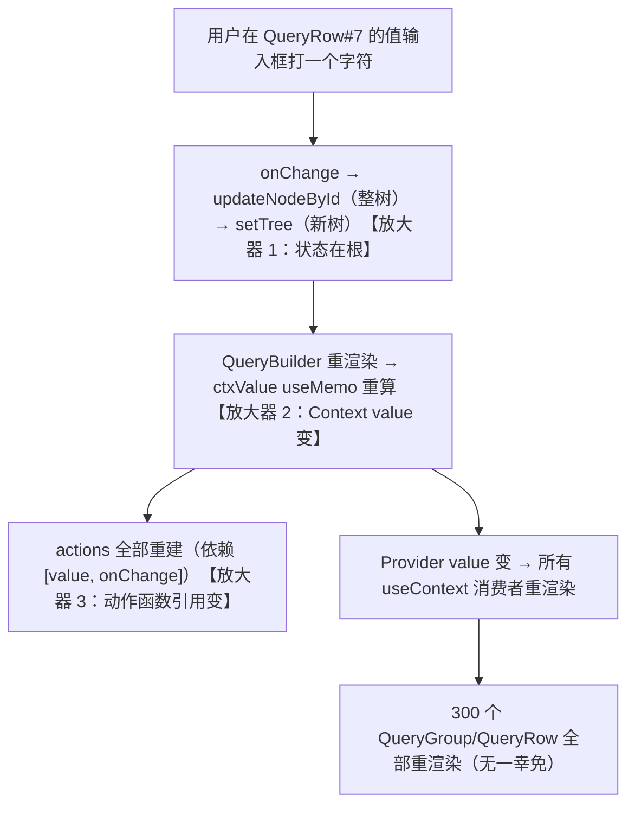

> 本文是《3. 动态查询构建器 / 规则引擎 UI ★全量展开 · 核心技术》按小节拆分后的续篇，上一部分见 [05-3-1-核心技术总览.md](05-3-1-核心技术总览.md)。

#### 3.2 递归渲染 QueryGroup / QueryRow

**是什么**：把上面的协议树递归渲染成两组件树——`QueryGroup`（渲染组：头部工具条 + 子节点列表）与 `QueryRow`（渲染条件行：字段/操作符/值三个控件 + 复制删除拖拽把手）。组的增删、复制、嵌套生成子组、拖拽排序、组合器切换，全部发生在这两层。

**为什么需要**：树形数据配递归渲染，这正是《进阶大纲》§1.3 递归渲染器内核的本行。与动态表单那次的差别只有两点：节点种类从"N 种（注册表分发）"缩到"2 种（discriminated union 分发）"；交互从"只读渲染 + 少量编辑"升级为"每个节点可增删改挪"——于是**不可变树更新**成了与渲染同等重要的第二条递归链。

**怎么做（机制分步）**：

1. **单一数据源**：整棵树只存在根组件一个 `state` 里（受控：`value` + `onChange`），子组件不持有任何树数据，只通过 Context 调动作函数。任何编辑 = "一棵树 → 另一棵树"的纯函数变换。
2. **动作层**：增（`insertChild`）、删（`removeNodeById`，空组自动剪枝）、改（`updateNodeById`）、复制（`deepCloneWithNewIds`——id 必须重新生成，否则 React key 撞车、定位错乱）、挪（`moveNode`，含组内排序下标修正与防环）。
3. **渲染层**：`QueryGroup` 内部再渲染 `QueryGroup`——递归自然表达嵌套；条件行包一层可排序容器参与拖拽。
4. **组合器两处交互**：组头部一个下拉（显式切换），行与行之间一个小 chip（点击即切换所属组的组合器，react-querybuilder 的招牌交互）；两处操作的是同一个字段 `group.combinator`。
5. **视觉层级**：每层组左缩进 + 圆角边框 + 按深度渐变的背景色，深度以角标显示；缩进封顶策略在坑 3 详述。

先装依赖（拖拽用 dnd-kit，《进阶大纲》§1.6 拖拽原理精讲的同款库）：

```bash
npm i @dnd-kit/core @dnd-kit/sortable @dnd-kit/utilities
```

**代码——第一步：树的不可变更新工具集**（纯函数，可单测，与 React 解耦）：

```ts
// tree-ops.ts —— 所有编辑动作都归结为"一棵树 → 另一棵树"
import {
  type ConditionNode,
  type ConditionTree,
  type ConditionTreeNode,
  type Combinator,
  type GroupNode,
  type Operator,
} from './condition-tree'
import { genId } from './condition-tree'

export function createCondition(
  field: string,
  operator: Operator = '=',
  value: unknown = null,
): ConditionNode {
  return { kind: 'condition', id: genId(), field, operator, value }
}

export function createGroup(
  children: ConditionTreeNode[] = [],
  combinator: Combinator = 'and',
): GroupNode {
  return { kind: 'group', id: genId(), combinator, children }
}

/** 深拷贝并重新生成所有 id——复制行/组、套用模板（§3.8）都必须走这里，id 绝不能撞 */
export function deepCloneWithNewIds(node: ConditionTreeNode): ConditionTreeNode {
  if (node.kind === 'group') {
    return { ...node, id: genId(), children: node.children.map(deepCloneWithNewIds) }
  }
  return { ...node, id: genId() }
}

export function findNodeById(node: ConditionTreeNode, id: string): ConditionTreeNode | null {
  if (node.id === id) return node
  if (node.kind === 'group') {
    for (const child of node.children) {
      const hit = findNodeById(child, id)
      if (hit) return hit
    }
  }
  return null
}

/** 找父组：拖拽落点计算、错误路径展示都要用 */
export function findParentGroup(root: ConditionTree, nodeId: string): GroupNode | null {
  if (root.children.some(c => c.id === nodeId)) return root
  for (const child of root.children) {
    if (child.kind === 'group') {
      const hit = findParentGroup(child, nodeId)
      if (hit) return hit
    }
  }
  return null
}

/** candidateId 是否在 ancestorId 的子树内（不含自身）——拖拽防环用 */
export function isInSubtree(root: ConditionTree, ancestorId: string, candidateId: string): boolean {
  const ancestor = findNodeById(root, ancestorId)
  if (!ancestor || ancestor.kind !== 'group') return false
  return containsId(ancestor, candidateId)
}

function containsId(group: GroupNode, id: string): boolean {
  if (group.children.some(c => c.id === id)) return true
  return group.children.some(c => c.kind === 'group' && containsId(c, id))
}

/** 通用改写：按 id 找到节点，替换为新节点（不可变：一路浅拷贝路径上的节点） */
export function updateNodeById(
  root: ConditionTree,
  id: string,
  updater: (n: ConditionTreeNode) => ConditionTreeNode,
): ConditionTree {
  const walk = (n: ConditionTreeNode): ConditionTreeNode => {
    if (n.id === id) return updater(n)
    if (n.kind === 'group') return { ...n, children: n.children.map(walk) }
    return n
  }
  return walk(root) as ConditionTree
}

/** 删除：被掏空的组整组剪掉（用户删掉子组最后一行，预期子组也消失）；根组不可删，兜底空组 */
export function removeNodeById(root: ConditionTree, id: string): ConditionTree {
  const walk = (n: ConditionTreeNode): ConditionTreeNode | null => {
    if (n.id === id) return null
    if (n.kind === 'group') {
      const children = n.children
        .map(walk)
        .filter((c): c is ConditionTreeNode => c !== null)
      return children.length > 0 ? { ...n, children } : null
    }
    return n
  }
  return walk(root) ?? createGroup()
}

export function insertChild(
  root: ConditionTree,
  groupId: string,
  node: ConditionTreeNode,
  index?: number,
): ConditionTree {
  return updateNodeById(root, groupId, g => {
    if (g.kind !== 'group') return g
    const children = [...g.children]
    children.splice(index ?? children.length, 0, node) // 不传 index = 追加到末尾
    return { ...g, children }
  })
}

/** 拖拽统一入口：跨组移动 + 组内排序，含两处关键修正 */
export function moveNode(
  root: ConditionTree,
  sourceId: string,
  targetGroupId: string,
  targetIndex: number,
): ConditionTree {
  if (sourceId === targetGroupId) return root
  const source = findNodeById(root, sourceId)
  if (!source) return root
  // 修正一：把组拖进它自己的子树 = 制造环（组成为自己的祖先），直接拒绝
  if (source.kind === 'group' && isInSubtree(root, sourceId, targetGroupId)) return root

  const parent = findParentGroup(root, sourceId)
  if (parent?.id === targetGroupId) {
    // 同组内排序：不能"先删后插"（删除会让目标下标位移），一步完成并补偿下标
    return updateNodeById(root, targetGroupId, g => {
      if (g.kind !== 'group') return g
      const from = g.children.findIndex(c => c.id === sourceId)
      if (from < 0) return g
      const children = [...g.children]
      const [moved] = children.splice(from, 1)
      // 修正二：向下移动时，原位置的删除让目标位"前移"一位，这里减回来
      children.splice(from < targetIndex ? targetIndex - 1 : targetIndex, 0, moved)
      return { ...g, children }
    })
  }
  // 跨组：先摘下（原父组若被掏空会自动剪枝），再插入目标组
  const removedRoot = removeNodeById(root, sourceId)
  return insertChild(removedRoot, targetGroupId, source, targetIndex)
}

/** 条件总数与嵌套深度——§3.6 校验上限的计算基础 */
export function countConditions(node: ConditionTreeNode): number {
  if (node.kind === 'condition') return 1
  return node.children.reduce((sum, c) => sum + countConditions(c), 0)
}

export function treeDepth(node: ConditionTreeNode): number {
  if (node.kind === 'condition') return 0
  return 1 + Math.max(0, ...node.children.map(treeDepth)) // 空组深度记 1（根组 = 1）
}
```

**代码——第二步：编辑器组件族**。Context 下发动作与上下文，根组件组装状态、校验（§3.6 的 `validateTree` 此处先当黑盒，下一文件实现）与 DnD：

```tsx
// QueryBuilder.tsx —— 编辑器根组件：持有状态 + 组织拖拽 + 下发错误信息
import {
  createContext,
  useCallback,
  useContext,
  useMemo,
  useState,
  type ReactNode,
} from 'react'
import {
  DndContext,
  PointerSensor,
  closestCenter,
  useDroppable,
  useSensor,
  useSensors,
  type DragEndEvent,
} from '@dnd-kit/core'
import { SortableContext, useSortable, verticalListSortingStrategy } from '@dnd-kit/sortable'
import { CSS } from '@dnd-kit/utilities'
import {
  type Combinator,
  type ConditionNode,
  type ConditionTree,
  type ConditionTreeNode,
  type GroupNode,
  type Operator,
} from './condition-tree'
import {
  countConditions,
  createCondition,
  createGroup,
  deepCloneWithNewIds,
  findNodeById,
  findParentGroup,
  insertChild,
  moveNode as moveNodeInTree,
  removeNodeById,
  updateNodeById,
} from './tree-ops'
import {
  type FieldMeta,
  OPERATOR_LABELS,
  applyFieldChange,
  applyOperatorChange,
  resolveValueEditor,
} from './field-meta'
import { validateTree, type TreeValidationError, type ValidationOptions } from './validator'
import { valueEditorRegistry } from './value-editors'

/* ---------------- Context：动作 + 上下文，一次下发，深层取用 ---------------- */

interface QueryBuilderContextValue {
  fieldMap: Map<string, FieldMeta>
  fieldList: FieldMeta[]
  errors: Map<string, TreeValidationError> // nodeId → 错误（§3.6 产出，行内标红用）
  updateNode(id: string, updater: (n: ConditionTreeNode) => ConditionTreeNode): void
  removeNode(id: string): void
  addCondition(groupId: string): void
  addGroup(groupId: string): void
  duplicateNode(id: string): void
  setCombinator(groupId: string, combinator: Combinator): void
  moveNode(sourceId: string, targetGroupId: string, targetIndex: number): void
}

const QueryBuilderContext = createContext<QueryBuilderContextValue | null>(null)

function useQueryBuilder(): QueryBuilderContextValue {
  const ctx = useContext(QueryBuilderContext)
  if (!ctx) throw new Error('QueryGroup / QueryRow 必须渲染在 <QueryBuilder> 内部')
  return ctx
}

/* ---------------- 根组件 ---------------- */

export interface QueryBuilderProps {
  fields: FieldMeta[]                                  // 字段元数据表（§3.3）
  value: ConditionTree                                 // 受控：树由外部持有
  onChange: (next: ConditionTree) => void
  validation?: Partial<ValidationOptions>              // 深度/条件数上限（§3.6）
}

export function QueryBuilder({ fields, value, onChange, validation }: QueryBuilderProps) {
  const fieldMap = useMemo(() => new Map(fields.map(f => [f.name, f])), [fields])

  // 校验错误集中计算一次，按 nodeId 建索引下发给行（定位到行的 UI 提示，§3.6）
  const errors = useMemo(() => {
    const list = validateTree(value, fieldMap, {
      maxDepth: validation?.maxDepth ?? 5,
      maxConditions: validation?.maxConditions ?? 30,
    })
    return new Map(list.map(e => [e.nodeId, e]))
  }, [value, fieldMap, validation?.maxDepth, validation?.maxConditions])

  /* 动作层：全部是 tree-ops 纯函数的一行包装 */
  const updateNode = useCallback(
    (id: string, updater: (n: ConditionTreeNode) => ConditionTreeNode) =>
      onChange(updateNodeById(value, id, updater)),
    [value, onChange],
  )
  const removeNode = useCallback(
    (id: string) => onChange(removeNodeById(value, id)),
    [value, onChange],
  )
  const addCondition = useCallback(
    (groupId: string) => {
      const firstField = fields[0] // 新行默认选第一个字段，操作符/值由元数据推导
      const row = firstField
        ? createCondition(firstField.name, firstField.operators[0], firstField.defaultValue ?? null)
        : createCondition('')
      onChange(insertChild(value, groupId, row))
    },
    [value, onChange, fields],
  )
  const addGroup = useCallback(
    (groupId: string) => onChange(insertChild(value, groupId, createGroup([createCondition(fields[0]?.name ?? '')]))),
    [value, onChange, fields],
  )
  const duplicateNode = useCallback(
    (id: string) => {
      const node = findNodeById(value, id)
      if (!node) return
      const parent = findParentGroup(value, id)
      if (!parent) return
      const index = parent.children.findIndex(c => c.id === id)
      onChange(insertChild(value, parent.id, deepCloneWithNewIds(node), index + 1)) // 复制件紧跟原件
    },
    [value, onChange],
  )
  const setCombinator = useCallback(
    (groupId: string, combinator: Combinator) =>
      onChange(updateNodeById(value, groupId, g => (g.kind === 'group' ? { ...g, combinator } : g))),
    [value, onChange],
  )
  const doMove = useCallback(
    (sourceId: string, targetGroupId: string, targetIndex: number) =>
      onChange(moveNodeInTree(value, sourceId, targetGroupId, targetIndex)),
    [value, onChange],
  )

  const ctxValue = useMemo<QueryBuilderContextValue>(
    () => ({
      fieldMap, fieldList: fields, errors,
      updateNode, removeNode, addCondition, addGroup, duplicateNode, setCombinator, moveNode: doMove,
    }),
    [fields, fieldMap, errors, updateNode, removeNode, addCondition, addGroup, duplicateNode, setCombinator, doMove],
  )

  /* 拖拽：distance:5 激活约束——按下未移动 5px 内不算拖拽，保住行内控件的点击 */
  const sensors = useSensors(useSensor(PointerSensor, { activationConstraint: { distance: 5 } }))

  const handleDragEnd = useCallback(
    (event: DragEndEvent) => {
      const { active, over } = event
      if (!over) return
      const activeId = String(active.id)
      const overId = String(over.id)
      if (activeId === overId) return

      if (overId.startsWith('group-body:')) {
        // 落在组的"身体"空白区（空组/折叠组的兜底落点）→ 追加到该组末尾
        const groupId = overId.slice('group-body:'.length)
        const group = findNodeById(value, groupId)
        if (group?.kind === 'group') doMove(activeId, groupId, group.children.length)
        return
      }

      const overNode = findNodeById(value, overId)
      if (overNode?.kind === 'group') {
        doMove(activeId, overId, overNode.children.length) // 落在组标题上 → 追加进该组
        return
      }
      const parent = findParentGroup(value, overId)
      if (!parent) return
      const index = parent.children.findIndex(c => c.id === overId)
      doMove(activeId, parent.id, index) // 落在某一行上 → 插到它前面
    },
    [value, doMove],
  )

  return (
    <DndContext sensors={sensors} collisionDetection={closestCenter} onDragEnd={handleDragEnd}>
      <QueryBuilderContext.Provider value={ctxValue}>
        <style>{QB_CSS}</style>
        <div className="qb-root">
          <QueryGroup node={value} depth={1} isRoot />
        </div>
      </QueryBuilderContext.Provider>
    </DndContext>
  )
}

/* ---------------- 组：头部工具条 + 子节点列表 ---------------- */

function QueryGroup({ node, depth, isRoot = false }: {
  node: GroupNode
  depth: number
  isRoot?: boolean
}) {
  const { removeNode, addCondition, addGroup, duplicateNode, setCombinator } = useQueryBuilder()
  const sortable = useSortable({ id: node.id, disabled: isRoot }) // 根组没有同级，不可拖
  const body = useDroppable({ id: `group-body:${node.id}` })      // 空组的兜底落点

  return (
    <div
      ref={sortable.setNodeRef}
      className="qb-group"
      data-depth={Math.min(depth, 4)}                              // 深度 → 边框色阶（CSS 见下）
      style={{
        transform: CSS.Transform.toString(sortable.transform),
        transition: sortable.transition,
        opacity: sortable.isDragging ? 0.4 : 1,
      }}
    >
      <div className="qb-group-header">
        {/* 组合器交互第 1 处：组头下拉，显式、可发现性好，适合新手 */}
        <select
          aria-label="组合器"
          className="qb-combinator"
          value={node.combinator}
          onChange={e => setCombinator(node.id, e.target.value as Combinator)}
        >
          <option value="and">全部满足（且）</option>
          <option value="or">任一满足（或）</option>
        </select>
        <span className="qb-depth-badge">L{depth} · {countConditions(node)} 条</span>
        <span className="qb-spacer" />
        {!isRoot && (
          /* 拖拽把手必须独立成元素：把 listeners 铺在整块容器上会吞掉组内按钮的点击 */
          <span className="qb-drag-handle" title="拖拽整组" {...sortable.attributes} {...sortable.listeners}>⠿</span>
        )}
        <button type="button" onClick={() => addCondition(node.id)}>+ 条件</button>
        <button type="button" onClick={() => addGroup(node.id)}>+ 子组</button>
        {!isRoot && (
          <>
            <button type="button" onClick={() => duplicateNode(node.id)}>复制组</button>
            <button type="button" onClick={() => removeNode(node.id)}>删除组</button>
          </>
        )}
      </div>
      <SortableContext items={node.children.map(c => c.id)} strategy={verticalListSortingStrategy}>
        <div className="qb-group-body" ref={body.setNodeRef}>
          {node.children.map((child, i) => (
            <div className="qb-child" key={child.id}>
              {/* 组合器交互第 2 处：行间 chip，点击即切换所属组且/或——两处改的是同一个字段 */}
              {i > 0 && <InlineCombinator groupId={node.id} combinator={node.combinator} />}
              {child.kind === 'group'
                ? <QueryGroup node={child} depth={depth + 1} />
                : <SortableRow id={child.id}><QueryRow node={child} /></SortableRow>}
            </div>
          ))}
        </div>
      </SortableContext>
    </div>
  )
}

/* 行间的且/或 chip：react-querybuilder 的招牌交互，高级用户最爱 */
function InlineCombinator({ groupId, combinator }: { groupId: string; combinator: Combinator }) {
  const { setCombinator } = useQueryBuilder()
  return (
    <button
      type="button"
      className={`qb-chip qb-chip--${combinator}`}
      title="点击切换 且/或"
      onClick={() => setCombinator(groupId, combinator === 'and' ? 'or' : 'and')}
    >
      {combinator === 'and' ? '且' : '或'}
    </button>
  )
}

/* ---------------- 条件行 ---------------- */

function QueryRow({ node }: { node: ConditionNode }) {
  const { fieldMap, fieldList, errors, updateNode, removeNode, duplicateNode } = useQueryBuilder()
  const field = fieldMap.get(node.field)
  const error = errors.get(node.id)                       // 校验错误定位到行（§3.6）
  const editorType = field ? resolveValueEditor(field, node.operator) : 'none'
  const ValueEditor = valueEditorRegistry[editorType]     // 元数据驱动：查表得组件（§3.3/§3.4）

  return (
    <div className={`qb-row${error ? ' qb-row--error' : ''}`}>
      <select
        aria-label="字段"
        value={node.field}
        onChange={e =>
          updateNode(node.id, n => applyFieldChange(n as ConditionNode, e.target.value, fieldMap))
        }
      >
        {/* deprecated 字段对"新选择"隐藏，但已选中时仍可见（坑 2 的下线策略） */}
        {fieldList.filter(f => f.deprecated !== true || f.name === node.field).map(f => (
          <option key={f.name} value={f.name}>{f.label}</option>
        ))}
      </select>
      <select
        aria-label="操作符"
        value={node.operator}
        disabled={!field}
        onChange={e =>
          updateNode(node.id, n =>
            applyOperatorChange(n as ConditionNode, e.target.value as Operator, field),
          )
        }
      >
        {(field?.operators ?? []).map(op => (
          <option key={op} value={op}>{OPERATOR_LABELS[op]}</option>
        ))}
      </select>
      <ValueEditor
        value={node.value}
        onChange={next => updateNode(node.id, n => ({ ...(n as ConditionNode), value: next }))}
        field={field}
        operator={node.operator}
      />
      <button type="button" className="qb-icon-btn" title="复制" onClick={() => duplicateNode(node.id)}>⧉</button>
      <button type="button" className="qb-icon-btn" title="删除" onClick={() => removeNode(node.id)}>✕</button>
      {error && <div className="qb-row-error" role="alert">{error.message}</div>}
    </div>
  )
}

/* 行的可排序外壳：拖拽把手 + 位移动画 */
function SortableRow({ id, children }: { id: string; children: ReactNode }) {
  const { attributes, listeners, setNodeRef, transform, transition, isDragging } = useSortable({ id })
  return (
    <div
      ref={setNodeRef}
      className="qb-sortable-row"
      style={{
        transform: CSS.Transform.toString(transform),
        transition,
        opacity: isDragging ? 0.4 : 1,
      }}
    >
      <span className="qb-drag-handle" title="拖拽排序" {...attributes} {...listeners}>⠿</span>
      {children}
    </div>
  )
}

/* ---------------- 视觉层级：缩进 + 边框 + 深度色阶 ---------------- */
const QB_CSS = `
.qb-root { font: 13px/1.6 system-ui, 'PingFang SC', sans-serif; color: #1f2329; }
.qb-group {
  border: 1px solid #d8dde5; border-radius: 8px; padding: 8px;
  margin-left: 16px;                       /* 每深一层缩进 16px——封顶策略见坑 3 */
  background: #fff;
}
.qb-group[data-depth="1"] { margin-left: 0; background: #fafbfc; }
.qb-group[data-depth="2"] { background: #f7f9fb; }
.qb-group[data-depth="3"] { background: #f3f6f9; border-color: #c6d0dc; }
.qb-group[data-depth="4"] { background: #eff3f7; border-color: #b9c6d6; } /* 4 层以上同色，靠边框叠加表达层级 */
.qb-group-header { display: flex; align-items: center; gap: 6px; margin-bottom: 6px; }
.qb-depth-badge { font-size: 11px; color: #8a919c; }
.qb-spacer { flex: 1; }
.qb-child { display: flex; flex-direction: column; align-items: stretch; }
.qb-sortable-row { display: flex; align-items: center; gap: 6px; background: #fff; border-radius: 6px; }
.qb-row {
  display: flex; flex-wrap: wrap; align-items: center; gap: 6px; flex: 1;
  padding: 4px 6px; border: 1px solid transparent; border-radius: 6px;
}
.qb-row--error { border-color: #f5222d; background: #fff1f0; }
.qb-row-error { flex-basis: 100%; color: #f5222d; font-size: 12px; }
.qb-chip {
  align-self: center; border: 1px dashed #b6bec9; background: #fff; border-radius: 10px;
  padding: 0 10px; font-size: 12px; color: #4e5969; cursor: pointer; line-height: 18px;
}
.qb-chip--or { border-color: #ff9c6e; color: #d4380d; }
.qb-drag-handle { cursor: grab; color: #98a2b3; padding: 0 2px; user-select: none; }
.qb-icon-btn { border: none; background: none; cursor: pointer; color: #667085; }
`
```

使用方式（受控组件，和任何表单库都能拼）：

```tsx
// App.tsx —— 最小使用示例：初始为"金额复核规则"
import { useState } from 'react'
import { QueryBuilder } from './QueryBuilder'
import { createCondition, createGroup, type ConditionTree } from './condition-tree'
import { ORDER_FIELDS } from './field-meta'

const initialTree: ConditionTree = createGroup([
  createCondition('amount', '>', null),
  createGroup([createCondition('city', 'in', [])], 'or'),
])

export function AlertRuleEditor() {
  const [tree, setTree] = useState<ConditionTree>(initialTree)
  return (
    <div>
      <QueryBuilder fields={ORDER_FIELDS} value={tree} onChange={setTree} />
      <pre>{JSON.stringify(tree, null, 2)}</pre> {/* 调试期永远把协议亮出来 */}
    </div>
  )
}
```

**拖拽要点小结**（上面代码里分散落位，这里收拢）：

1. **把手独立成元素**：dnd-kit 的 `listeners` 若铺在组/行整块容器上，会把子控件（select、按钮）的 pointerdown 一并吞掉——表现为"点开字段下拉就变成拖拽"。正解是把 listeners 只绑在 ⠿ 把手上。
2. **每个组一个 `SortableContext`**：dnd-kit 的排序是"组内"语义，嵌套组的正确模型是"每组一个上下文 + 根一个 `DndContext`"，跨组移动在 `onDragEnd` 里自己算（代码里的 `group-body:` 前缀 droppable 就是跨组落点的兜底）。
3. **防环**：组可以拖进组，但"组拖进自己的子树"必须拦截（`moveNode` 里的 `isInSubtree` 检查），否则树结构成环，递归渲染直接栈溢出。
4. **激活约束 `distance: 5`**：区分"点击行内控件"与"拖拽行"两种意图，没有它，select 一点开就触发拖拽取消。
5. 生产提示：条件行超过百级规模时，给 `QueryGroup`/`QueryRow` 包 `memo` 并把动作函数收敛到 reducer（动作随 `value` 每帧重建会击穿 memo）——思路同《进阶大纲》§1.7 大 Schema 树性能。

**常见坑（渲染层）**：
- 症状：删除第 2 行后，原第 3 行的输入框里显示着第 2 行填过的值；或拖拽后两行值互换错乱。
- 根因：`children.map((child, index) => <QueryRow key={index} ...>)` 用数组下标当 key。React diff 认为下标没变，复用了旧组件实例与未受控的内部状态。
- 修法：协议里必须有 `id`，渲染一律 `key={child.id}`（本文协议从 §3.1 起就带 id，正是为此）。顺带一条纪律：值编辑器全部做成受控组件，不留半受控状态，即便 key 错了也不会脏读。

> 以下 3.2.1～3.2.4 为递归渲染的进阶补充小节（编号续接本文件 3.2 一节）：大树的扁平化与虚拟滚动、深度与环的防御纵深、受控递归的性能解剖、FLIP 位移动画。

##### 3.2.1 树的扁平化渲染与虚拟滚动——大条件树的第二引擎

**是什么**：把递归树**前序遍历拍平成一行数组**（每行携带深度、父组、组内位置等元信息），然后用**平铺虚拟滚动**只渲染视口内的行。递归渲染（§3.2 主体）与扁平化渲染是同一棵协议树的两个渲染引擎：前者天然表达嵌套、代码量最小；后者牺牲结构直观性，换来对千级条件的支撑。

**为什么需要**：递归渲染的成本是 O(行数) 的 DOM 节点——300 条件的树，每行 6~10 个控件节点（字段/操作符/值编辑器内部还有节点），加上组的容器与缩进结构，DOM 轻松破万。症状是：首挂载 1s+、滚动掉帧、每次树更新 React 要协调整棵组件树。虚拟化把 DOM 数量降到"视口内 20 行 + overscan"，与总量无关。《学习大纲》4.3 列表场景给过结论"一两百条不要上虚拟列表"——条件树同理：**这是百行以上的第二引擎，不是默认引擎**；30 条件的常规规则用递归渲染就是最优解。

**为什么不用现成的树虚拟化组件**：《进阶大纲》§1.7 用 react-arborist 虚拟化大纲树——但那是"行 = 纯展示的树节点"。查询构建器的行是"编辑器组合体"（三个受控控件 + 按钮 + 把手），且行与行之间还有"且/或" chip 这种**结构性装饰**，组的视觉边界靠缩进与边框表达。用 arborist 要先对抗它内置的展开/选中/拖拽交互，再自己塞编辑器行——成本高于自己拍平。平铺虚拟化（react-window / @tanstack/react-virtual）假设更少：给我行数组与行高，我只管窗口。

**关键机制**：

1. **拍平时带上渲染所需的全部结构信息**：深度（算缩进）、是否组内首个（决定行间 chip 渲不渲染）、父组 id（拖拽落点用）、组开/闭标记（组头行、可选的"组尾"行）。
2. **组的边界两种画法**：缩进式（行按 `depth × 16px` 缩进 + 左侧连线）或括号式（组头行 + 显式的组尾行）。扁平化后没有了嵌套 DOM，边框圆角那种"容器感"必须由这两种画法之一重建——推荐括号式，它对虚拟滚动最友好（边界本身就是数组里的行）。
3. **行高动态测量**：值编辑器种类不同（单框/双框/多选框）+ 错误文案展开，行高不均——虚拟化必须支持 `measureElement` 动态测量，否则滚动跳跃。
4. **与拖拽的冲突要直面**（见下）。

**最小可行实现**：

```ts
// flatten-tree.ts —— 条件树 → 扁平行数组：前序遍历，保留全部结构元信息
import type { ConditionTree, ConditionTreeNode } from './condition-tree'

export type FlatRow =
  | {
      kind: 'node'                                      // 条件行 或 组头行
      node: ConditionTreeNode
      depth: number
      parentId: string
      isFirstInGroup: boolean                           // 组内首个子节点：不渲染行间 chip
    }
  | {
      kind: 'group-end'                                 // 组尾行（括号式画法的右边界）
      groupId: string
      depth: number
    }

export function flattenTree(tree: ConditionTree): FlatRow[] {
  const rows: FlatRow[] = []
  const walk = (node: ConditionTreeNode, depth: number, parentId: string, isFirst: boolean): void => {
    rows.push({ kind: 'node', node, depth, parentId, isFirstInGroup: isFirst })
    if (node.kind === 'group') {
      node.children.forEach((child, i) => walk(child, depth + 1, node.id, i === 0))
      rows.push({ kind: 'group-end', groupId: node.id, depth })
    }
  }
  walk(tree, 0, '', true)
  return rows
}
```

```bash
npm i @tanstack/react-virtual
```

```tsx
// VirtualQueryBuilder.tsx —— 扁平行 + 虚拟窗口：千级条件的渲染层
import { useMemo, useRef } from 'react'
import { useVirtualizer } from '@tanstack/react-virtual'
import { type ConditionTree } from './condition-tree'
import { flattenTree } from './flatten-tree'

export function VirtualQueryBuilder({ tree, renderRow }: {
  tree: ConditionTree
  /** 行渲染器：编辑器族在这里分发（§3.4 的注册表原样可用） */
  renderRow: (row: FlatRow, index: number) => React.ReactNode
}) {
  const rows = useMemo(() => flattenTree(tree), [tree])
  const scrollRef = useRef<HTMLDivElement>(null)

  const virtualizer = useVirtualizer({
    count: rows.length,
    getScrollElement: () => scrollRef.current,
    estimateSize: () => 44,          // 估算行高（含 chip 行高）；真实行高靠 measureElement 校正
    overscan: 8,                     // 视口外多渲染 8 行：快速滚动不白屏
  })

  return (
    <div ref={scrollRef} className="qb-virtual" style={{ height: '100%', overflow: 'auto' }}>
      <div style={{ height: virtualizer.getTotalSize(), position: 'relative' }}>
        {virtualizer.getVirtualItems().map(virtualRow => {
          const row = rows[virtualRow.index]
          return (
            <div
              key={row.kind === 'node' ? row.node.id : `end:${row.groupId}`}
              data-index={virtualRow.index}
              ref={virtualizer.measureElement}        // 动态行高：首测后校正偏移
              style={{
                position: 'absolute',
                top: 0,
                left: 0,
                width: '100%',
                transform: `translateY(${virtualRow.start}px)`, // 虚拟定位只动 transform
                paddingLeft: row.kind === 'node' ? row.depth * 16 : undefined,
              }}
            >
              {renderRow(row, virtualRow.index)}
            </div>
          )
        })}
      </div>
    </div>
  )
}
// renderRow 内：node.kind === 'group' 渲染组头（组合器下拉 + 深度徽标），
// 'condition' 渲染 QueryRow（§3.2 的行组件原样复用），
// isFirstInGroup === false 时行首补 InlineCombinator chip，'group-end' 渲染组尾括号线
```

**与拖拽的冲突及取舍**（虚拟化最真实的代价）：dnd-kit 的 `SortableContext` 只认识**已渲染**的行——虚拟化后视口外的行没有注册，跨组长距离拖拽的落点计算就不完整。三档取舍：① 小于视口的组内排序照常可用（同屏行都在注册表里）；② 长距离移动降级为 `Alt+↑/↓` 键盘移动（04 补充三的键盘通路在这里从"无障碍加分项"升级为"功能必需品"）；③ 拖拽开始时临时放开虚拟化（渲染全部行，树千级时会卡一拍）——按产品预期选一档，别硬做"虚拟化 + 全树自由拖拽"，那是白板场景（场景 5）的视口数学，不属于列表编辑器。

**扁平化的两个免费红利**：

1. **扁平索引让 O(n) 查找变 O(1)**。`findNodeById`/`findParentGroup`（§3.2）都是递归遍历——3.2.3 的 zustand 订阅与 §3.6 的错误路径定位在高频下都吃这个成本。拍平的同时顺手产出索引，一份遍历两份收益：

```ts
// flatten-tree.ts 续 —— 附赠扁平索引：id → 节点、id → 父组
export interface FlatIndex {
  rows: FlatRow[]
  nodeById: Map<string, ConditionTreeNode>
  parentById: Map<string, string>   // nodeId → 父组 id（根的值为 ''）
}

export function flattenWithIndex(tree: ConditionTree): FlatIndex {
  const rows: FlatRow[] = []
  const nodeById = new Map<string, ConditionTreeNode>()
  const parentById = new Map<string, string>()
  const walk = (node: ConditionTreeNode, depth: number, parentId: string, isFirst: boolean): void => {
    rows.push({ kind: 'node', node, depth, parentId, isFirstInGroup: isFirst })
    nodeById.set(node.id, node)
    parentById.set(node.id, parentId)
    if (node.kind === 'group') {
      node.children.forEach((child, i) => walk(child, depth + 1, node.id, i === 0))
      rows.push({ kind: 'group-end', groupId: node.id, depth })
    }
  }
  walk(tree, 0, '', true)
  return { rows, nodeById, parentById }
}
// 树不变时索引不变（结构共享保证）——useMemo(() => flattenWithIndex(tree), [tree]) 直接可用；
// 3.2.3 的 useNode 订阅从 nodeById 取，订阅成本与树规模解耦
```

2. **只读预览共享同一份扁平产物**。§3.7 试运行面板的 `PreviewNode` 是另一棵递归组件树——大树场景它同样要虚拟化。扁平化后，预览只是 `FlatRow` 的另一种行渲染器（同样的行、不同的样式：命中绿/未命中灰），编辑态与预览态共用 `flattenWithIndex`，结构计算只做一次。这也是"编辑器 = 数据 + 视图"分层的再次兑现：**flatten 是数据准备层，编辑视图与预览视图是它的两个消费者**。

**选型与学习路径**：递归渲染（§3.2）→ 扁平化函数 + 括号式渲染（不虚拟化，先验证结构信息够不够）→ 接 @tanstack/react-virtual → 最后才处理拖拽降级。每步都可独立验收，不要一步到位。

**坑（扁平化层）**：
- 症状：滚动到第 200 行附近行高跳变、滚动条"抽搐"，越滚越歪。
- 根因：`estimateSize` 给了 44px，但 between 双框行实际 68px、错误文案展开行 84px——估算与真实的累计偏差让虚拟窗口的偏移计算失效（虚拟滚动的数学基础是"起始偏移 = 之前所有行高之和"，行高不准一切皆不准）。
- 修法：`ref={virtualizer.measureElement}` 动态测量（上面代码已带）+ 行内样式不改变已测量高度（错误文案用绝对定位浮层而不是撑高行，或接受二次测量抖动）；把"行高稳定"写进值编辑器的组件规范（固定 padding、min-height，禁止随内容撑开）。

##### 3.2.2 深度上限与循环引用防护——递归的三重保险

**是什么**：一套防御纵深，让"深度超限"与"环引用"这两种结构性非法数据**在任何入口都杀不死页面**。三重保险各有分工：入口检测（数据进门时验）、更新拦截（动作产生非法态之前拒绝）、渲染兜底（万一漏网，渲染层熔断而不是栈溢出白屏）。

**为什么需要**：§3.6 的 `maxDepth` 校验管的是"用户**保存**时提示"，坑 3 管的是"合法但太深的 UI 策略"——但它们都假设数据已经进了编辑器。真实世界的威胁在更早：后端接口事故返回 5000 层嵌套的规则、历史库里的脏数据、或自己代码的 bug 把组塞进了它自己的子树。递归渲染遇到环直接栈溢出（Maximum call stack size exceeded）整页白屏；遇到超深树是同样结局。**渲染是最后的消费者，它必须有独立于校验的保险丝**。

先厘清两种威胁的来源差异（决定防线位置）：**深度超限**可以从"门"进——JSON 文本完全可以合法地嵌一万层（`[[[...]]]`），`JSON.parse` 不会拦；**环引用**进不了 JSON 的门（序列化带环结构时 `JSON.stringify` 就抛错了），它只能诞生于**运行时代码**——`moveNode` 的防环检查漏了一种情况、或者某处把父节点的引用直接塞给了子节点。所以：深度防在入口 + 渲染，环防在更新 + 渲染。

**入口检测——`assertTreeSafe`（深度硬上限 + 环检测一体）**：

```ts
// guards.ts —— 结构安全检测：进门验一次，O(n)
import type { ConditionTree, ConditionTreeNode } from './condition-tree'

export class TreeUnsafeError extends Error {}

const HARD_MAX_DEPTH = 64  // 渲染硬上限：远高于 §3.6 的业务上限（默认 5），只为防事故不防用户

export function assertTreeSafe(root: ConditionTree, maxDepth = HARD_MAX_DEPTH): void {
  const WHITE = 0, GRAY = 1, BLACK = 2
  const color = new Map<string, number>()

  const visit = (node: ConditionTreeNode, depth: number): void => {
    if (depth > maxDepth) {
      throw new TreeUnsafeError(`嵌套深度超过硬上限 ${maxDepth}，拒绝载入`)
    }
    const c = color.get(node.id) ?? WHITE
    if (c === GRAY) {
      // GRAY = 在当前递归栈上：再次遇到说明绕回来了，这就是环
      throw new TreeUnsafeError(`检测到循环引用：节点 ${node.id} 是自己的祖先`)
    }
    if (c === BLACK) return // BLACK = 已完整访问过的子树（同 id 共享子图也算安全，直接跳过）
    color.set(node.id, GRAY)
    if (node.kind === 'group') node.children.forEach(child => visit(child, depth + 1))
    color.set(node.id, BLACK)
  }
  visit(root, 1)
}
```

三色标记法（WHITE 未访问 / GRAY 在栈上 / BLACK 已完成）是 DFS 环检测的标准做法，比"记录访问过的集合"多识别一种情况：同一个节点被两个不同分支引用（DAG）不是环，不应误报。接入点：`JSON.parse` 之后、`setState(tree)` 之前——回填历史规则、粘贴导入（04 补充三的剪贴板）、URL 反序列化，三个入口都过这道闸。

**检测器自身的栈安全——递归版有个自我矛盾**：上面 `assertTreeSafe` 是递归实现，而它要防的威胁之一恰是"5000 层深树"——递归检测器自己先栈溢出（默认栈深大约撑一万层调用，每层 visit 一个节点）。检测代码必须比被检测数据更能扛，所以生产版用**显式栈的迭代遍历**：

```ts
// guards.ts 续 —— 迭代版深度检测：检测器不能先于被测数据倒下
export function assertDepthSafeIterative(root: ConditionTree, maxDepth = HARD_MAX_DEPTH): void {
  const stack: Array<{ node: ConditionTreeNode; depth: number }> = [{ node: root, depth: 1 }]
  while (stack.length > 0) {
    const { node, depth } = stack.pop()!
    if (depth > maxDepth) {
      throw new TreeUnsafeError(`嵌套深度超过硬上限 ${maxDepth}，拒绝载入`)
    }
    if (node.kind === 'group') {
      for (const child of node.children) stack.push({ node: child, depth: depth + 1 })
    }
  }
}
// 环检测的迭代版同理：把三色标记搬到显式栈上（进栈 GRAY、出栈 BLACK）。
// 两个检测合并跑也行：迭代 DFS 一趟同时做深度计数与 GRAY 检测，O(n) 一次通过
```

顺带一提：React 的递归组件渲染同理有栈深上限——渲染兜底的 `RENDER_HARD_LIMIT` 不是装饰，它是与检测器对称的最后一道栈保护。

防护层的单测要覆盖"防护自己别成为漏洞"（深树、环树、DAG 共享子树三个用例）：

```ts
// guards.test.ts —— 三种结构性输入：超深、成环、共享子图（合法）
import { describe, expect, it } from 'vitest'

function deepTree(depth: number): ConditionTree {
  let node = createGroup([createCondition('amount', '>', 1)])
  for (let i = 1; i < depth; i++) node = createGroup([node])
  return node
}

describe('assertTreeSafe', () => {
  it('合法深度的树通过', () => {
    expect(() => assertTreeSafe(deepTree(10))).not.toThrow()
  })
  it('超硬上限的树被拒（且检测器自身不栈溢出）', () => {
    expect(() => assertTreeSafe(deepTree(100_000))).toThrow(TreeUnsafeError)
  })
  it('环被检测出来', () => {
    const g = createGroup([])
    g.children.push(g) // 运行时制造环——绕过 tree-ops，模拟事故数据
    expect(() => assertTreeSafe(g)).toThrow(/循环引用/)
  })
})
```

**更新拦截——把非法结构挡在产生之前**：§3.2 的 `moveNode` 已有环检查（`isInSubtree`），本节补的是**深度钳制**——"添加子组"这个动作在目标位置已达到上限时应直接拒绝（按钮禁用或动作静默返回原树），而不是加完再靠校验报错：

```ts
// tree-ops 的补充：深度感知的 addGroup——在产生非法态之前拒绝
import { findNodeById, insertChild, treeDepth } from './tree-ops' // 复用 §3.2 已有工具
import { createGroup, createCondition } from './tree-ops'

export function tryAddGroup(
  root: ConditionTree,
  parentGroupId: string,
  maxDepth: number,        // 与 §3.6 校验共用同一配置（业务上限，如 5）
): { ok: true; tree: ConditionTree } | { ok: false; reason: string } {
  const parent = findNodeById(root, parentGroupId)
  if (!parent || parent.kind !== 'group') {
    return { ok: false, reason: '目标组不存在' }
  }
  // 新组会给子树深度 +1：以 parent 为根的深度 + 1 若超上限，拒绝
  if (treeDepth(parent) + 1 > maxDepth) {
    return { ok: false, reason: `已达嵌套上限 ${maxDepth} 层，建议拆分规则` }
  }
  const group = createGroup([createCondition('')])
  return { ok: true, tree: insertChild(root, parentGroupId, group) }
}
// UI 侧：ok === false 时按钮置灰 + title 显示 reason——"让非法状态无法被点出来"
// 优于"点出来再标红"（§3.6 校验兜底的是协议层，这里拦的是交互层，两道不冗余）
```

**渲染兜底——熔断而不是白屏**：万一漏网数据到了渲染层（入口闸被绕过、或未来某个新入口忘了接），递归组件自己带深度保险丝：

```tsx
// SafeQueryGroup.tsx —— 渲染层熔断：深度超硬上限时渲染错误占位，绝不振爆调用栈
const RENDER_HARD_LIMIT = 64

function SafeQueryGroup({ node, depth }: { node: GroupNode; depth: number }) {
  if (depth > RENDER_HARD_LIMIT) {
    return (
      <div className="qb-guard" role="alert">
        此处嵌套超过 {RENDER_HARD_LIMIT} 层，已停止渲染——数据异常，请检查规则来源
      </div>
    )
  }
  // 正常递归：return <QueryGroup node={node} depth={depth} />
}
```

环引用在渲染层的症状同样是栈溢出，熔断条件与深度共用（环必然表现为"深度无限"）——但 `assertTreeSafe` 在入口已拦住环，这里是纵深防御的最后一格。

顺带两个免费的检测点：`structuredClone(tree)` 遇环抛 `DataCloneError`、`JSON.stringify(tree)` 遇环抛 `TypeError: Converting circular structure to JSON`——任何要序列化/克隆树的下游操作（§3.5 转换、§3.8 diff）天然是环的检测器，报错栈会把事故现场指回源头。

**与相邻机制的分界**（三道防线不重复建设）：§3.6 校验 = 用户能否**保存**（业务上限 5 层，提示与拦截在保存链路）；本节 = 非法数据能否**进入与渲染**（硬上限 64 层 + 环检测，门在入口与动作层）；坑 3 = 合法深度的 **UI 可用性**（缩进封顶、折叠、面包屑）。三者分别回答"能不能存、能不能进、能不能用"。一张速记表收口本节：

| 保险丝 | 位置 | 拦什么 | 放过什么 |
|---|---|---|---|
| `assertTreeSafe` | 入口（parse 后、setState 前） | 超深树、环引用 | 一切合法数据（含业务上限内的深树） |
| `tryAddGroup` / moveNode 防环 | 动作层 | 产生非法结构的操作 | 用户合法编辑 |
| `RENDER_HARD_LIMIT` 熔断 | 渲染层 | 漏网的极端数据 | —（它是最后一格，被触发即说明前两道有 bug，要上报） |

**坑（防护层）**：
- 症状：联调环境打开某条历史规则，页面白屏，错误上报里全是 `Maximum call stack size exceeded`，且发生在 React 渲染帧里（没有业务栈）。
- 根因：后端某次数据迁移把规则的 `children` 数组里塞回了祖先组的引用（树成了环），或事故数据 5000 层——入口没有结构安全检测，脏数据直达递归渲染。
- 修法：三个入口（接口回填/粘贴/URL）统一走 `assertTreeSafe`，不安全数据降级为"错误占位 + 联系管理员"（对齐坑 2 悬空字段的降级思路：**渲染层对任何非法数据的回答都是"占位"而不是"崩溃"**）；`TreeUnsafeError` 上报时带上规则 id，方便后端定位脏数据源。

##### 3.2.3 受控递归的性能解剖——memo 边界与 Context 拆分

**是什么**：把"改一个值编辑器的一个字符"这条最频繁的更新链路逐帧解剖：它为什么会连坐整棵树、在哪里切断、切断的边界（memo 边界、Context 边界、store 边界）各自拦截什么。§3.2 末尾的第 5 条生产提示（"动作收敛到 reducer，否则击穿 memo"）是本节的结论预告，这里把论证补全。

**为什么它是本章的性能主战场**：编辑器的动作频率极度不均——拖拽一分钟几次、加行一小时几十次，而**打字一分钟上百次**。预算 1（单键输入 < 16ms，见核心技术篇补充三）能不能达标，几乎完全取决于这条链路。

**连坐链路解剖**（以 §3.2 的实现为样本，它有三处放大器）：



三个放大器是叠加关系，只堵一个没用。逐个拆：

**修法一：memo + 结构共享——让"没变的行"引用不变**。`updateNodeById` 手写展开只克隆根到目标的路径，其余子树**引用不变**；给 `QueryRow` 包 `memo` 后，`node` prop 引用没变的行会被浅比较拦截。这是 §3.2 选手写展开（而不是每次 `JSON.parse(JSON.stringify())` 式深拷贝）的隐藏红利——结构共享 + memo 是一对，缺一个另一个无意义：

```text
updateNodeById 后的树：
root' ── children: [A', B(引用不变), C(引用不变)]
                  A' ── children: [row7'(新), row8(引用不变)]
memo(QueryRow)：node === prev.node → 跳过渲染。299 行里只有 row7 真正重渲染
```

但注意：这一步只挡住了 **props 驱动**的重渲染——Context 消费者的重渲染（放大器 2/3）memo 挡不住，`useContext` 的读取发生在组件内部，组件照样被调度。所以必须继续：

**修法二：Context 拆分——"不变的东西"与"每版都变的东西"分家**。把单一 Context 拆成两个：动作 Context（引用稳定）与状态 Context（随树变）。行组件只订阅动作 Context，就能在 Provider value 变化时幸免：

```tsx
// context 拆分：动作与状态分离
interface Actions {
  updateNode(id: string, updater: (n: ConditionTreeNode) => ConditionTreeNode): void
  removeNode(id: string): void
  // ...§3.2 Context 里其余动作签名原样搬过来
}
const QueryBuilderActionsContext = createContext<Actions | null>(null)  // 引用恒稳
const QueryBuilderStateContext = createContext<{ errors: Map<string, TreeValidationError> } | null>(null) // errors 等随树变

// 关键在动作的稳定性：useReducer 的 dispatch 恒稳，动作函数全部包装成 dispatch 的一行调用
type Action =
  | { type: 'updateNode'; id: string; updater: (n: ConditionTreeNode) => ConditionTreeNode }
  | { type: 'removeNode'; id: string }
  | { type: 'addCondition'; groupId: string }
  | { type: 'addGroup'; groupId: string }
  | { type: 'duplicateNode'; id: string }
  | { type: 'setCombinator'; groupId: string; combinator: Combinator }
  | { type: 'moveNode'; sourceId: string; targetGroupId: string; targetIndex: number }

function reducer(state: ConditionTree, action: Action): ConditionTree {
  switch (action.type) {
    case 'updateNode': return updateNodeById(state, action.id, action.updater)
    case 'removeNode': return removeNodeById(state, action.id)
    // ...每个 case 是 tree-ops 纯函数的一行接线，逻辑零重复
  }
}

// 根组件：
const [tree, dispatch] = useReducer(reducer, initialTree)
// dispatch 是 React 保证恒稳的引用——动作 Context 的 value 从此不依赖树内容
const actions = useMemo<Actions>(() => ({
  updateNode: (id, updater) => dispatch({ type: 'updateNode', id, updater }),
  removeNode: id => dispatch({ type: 'removeNode', id }),
  // ...
}), [])   // 空依赖：永远同一个对象
```

**修法三（被忽视的第五个放大器）：errors Map 的引用**。§3.2 原实现里 `errors = new Map(validateTree(...))` 在每次树变时重建——如果它进了行组件的 props 或被行组件从 Context 读取，Map 引用每次都变，前面所有 memo 全部击穿。两条修法：① 行组件**不接收 Map**，由父层算好 `error = errors.get(node.id)` 把**单个错误对象**（或其序列化键）作为 prop 传入；② errors 的重算加内容比较（错误 id+message 拼串相等就复用旧 Map 引用），让"值没变的打字"连状态 Context 都不变。

**终局形态：外置 store + 节点级订阅**（树到几百行、或编辑器与只读预览/URL 同步多视图共享时）。zustand 的 selector 订阅把"重渲染范围"从"Context 消费者"精确到"订阅了这个节点的组件"：

```ts
// query-builder-store.ts —— 千行树的终局：节点级订阅（选型对比见核心技术篇补充一）
import { create } from 'zustand'
import { type ConditionTree, type ConditionTreeNode } from './condition-tree'
import { findNodeById, updateNodeById } from './tree-ops'

interface QBState {
  tree: ConditionTree
  updateNode: (id: string, updater: (n: ConditionTreeNode) => ConditionTreeNode) => void
}

export const useQBStore = create<QBState>()((set, get) => ({
  tree: createGroup([]),
  updateNode: (id, updater) => set({ tree: updateNodeById(get().tree, id, updater) }),
}))

/** 行组件用：只订阅自己那个节点——别的行打字，本行 selector 返回值不变，零渲染 */
export function useNode(id: string): ConditionTreeNode | undefined {
  return useQBStore(s => findNodeById(s.tree, id))
}
// 大树优化：s.tree 换成维护好的扁平索引 Map<id, node>（3.2.1 的 flatten 产物），
// findNodeById 的 O(n) 降为 O(1)，订阅成本与树规模解耦
```

**量化验证的操作步骤**（改动前后各跑一遍，只对比同一条件下的数字）：

1. 生产构建 + 本地预览（`vite build && vite preview`），打开 React DevTools 的 Profiler；
2. 点录制 → 在值输入框连续输入 10 个字符 → 停止录制；
3. 看 commit 列表：预算 1 达标时应有约 10 个 commit、每个 `actualDuration` < 16ms；
4. 点开某个 commit 的组件树，看哪些组件亮（重渲染了）——理想态只有"被输入的那一行"亮；亮一片就点其中一个组件看 "Why did this render?"，答案（props 变 / context 变 / 父渲染）直接指向三个放大器之一；
5. 改一处 → 重复 2～4 → 对比数字归档（进核心技术篇补充三的预算表）。

**修法二的补全——errors 引用稳定的完整实现**（上面只说了思路，这是代码）：

```tsx
// QueryBuilder 内：errors 内容不变时复用旧 Map 引用——行级 memo 的最后一块拼图
const errorsKeyRef = useRef('')
const errorsRef = useRef(new Map<string, TreeValidationError>())

const errors = useMemo(() => {
  const list = validateTree(value, fieldMap, { maxDepth: 5, maxConditions: 30 })
  const key = list.map(e => `${e.nodeId}:${e.message}`).join('|')
  if (key === errorsKeyRef.current) return errorsRef.current   // 内容没变：旧引用，memo 不破
  errorsKeyRef.current = key
  errorsRef.current = new Map(list.map(e => [e.nodeId, e]))
  return errorsRef.current
}, [value, fieldMap])
// key 的成本是一次字符串拼接（微秒级），换来的是"值没变的打字"连 errors 相关的重渲染都省掉。
// 这个模式叫"内容寻址的引用稳定"——任何"每次重算的新容器"（Map/Set/数组）要过 memo 边界都用得上
```

**常见误诊速查**（症状 → 直觉误判 → 真因）：

| 症状 | 直觉误判 | 真因（按概率排序） |
|---|---|---|
| memo 了还全树重渲染 | "memo 没用" | 行组件读了 Context（放大器 2/3）；或回调内联箭头函数让浅比较必假 |
| 打字卡但 Profiler 显示 render 很快 | "React 不行" | commit 后的同步副作用：每次输入重跑 `validateTree` + `new Map`（未 memo 的重计算在渲染之外） |
| 树一大输入延迟线性变差 | "该上虚拟化了" | 先查是否所有行都在订阅整树 Context（放大器 2）——修掉它常常就够了，虚拟化是最后手段 |

**memo 边界的两条纪律**：① memo 放**行**不放组——行是数量级大头（组通常不到行的 1/5），且行的 props（node）天然享受结构共享；② 递归组件**禁止自定义深比较函数**——`memo(QueryRow, lodash.isEqual)` 会把省下的渲染时间花在深比较整棵子树上，《进阶大纲》§1.7 的坑有量化对比，结论是保持默认浅比较。

**修法阶梯**（按投入成本升序，逐级升级，每级都可独立验收）：

1. memo(QueryRow) + 稳定回调（半天）——拦住 props 连坐；
2. errors 单值下传 + 内容寻址的引用稳定（半天，修法二的补全代码）——拦住 Context 状态连坐；
3. useReducer 收敛动作 + Context 拆分（一天）——拦住动作函数连坐；
4. zustand + 节点 selector（一至两天）——把重渲染范围从"组件树"缩到"订阅组件"；
5. 扁平化 + 虚拟化（3.2.1，两到三天）——把 DOM 规模本身降下来。
   前四级不改变 DOM 数量，第五级才动它——**先让"不必要的渲染"归零，再动"必要的渲染"**，顺序反了就是把简单问题做难。

**坑（性能层）**：
- 症状：照 §3.2 加了 `memo(QueryRow)`，Profiler 里打一个字仍然全树重渲染，memo 好像完全没生效。
- 根因：三处最常见漏点任占其一——行组件从 Context 读了 `errors`（Map 引用每次变）；`onRemove={() => removeNode(node.id)}` 内联箭头函数让 memo 的 props 浅比较必然失败（每次渲染新引用）；动作函数依赖 `[value, onChange]` 重建，进了 props 或 Context。
- 修法：按本节修法一/二/三顺序排查——先确认 `node` 引用真的没变（结构共享生效），再把回调收敛为稳定引用（dispatch 或 useCallback 空依赖包装），最后把 errors 改为行级单值传递。用 React DevTools的 "Why did this render?" 面板逐项对号，别猜。

##### 3.2.4 FLIP 动画——增删行/组的位移过渡

**是什么**：FLIP（First-Last-Invert-Play）让"列表里删了一行、其余行上移补位"这类**位置变化**有平滑过渡而不是瞬移。原理（First 记录旧位置 → Last 记录新位置 → Invert 用 transform 反向补偿让元素看起来还在原地 → Play 补间到零）在《学习大纲》阶段 4.7 动画章讲过，framer-motion 的 `layout` 属性就是全自动 FLIP——本节不重讲原理，专注两件事：**不引库的手写实现**（理解 + 编辑器不想为此背 30KB）与**查询构建器场景的三个特有冲突**。

**为什么需要**：位置变化动画是"操作因果"的视觉延续——删掉第 2 行时，用户眼睛需要追踪"下面的行去哪了"，瞬移等于掐断追踪线索（04 补充二的动效规范把它列为规范违例）。另一个现实原因：dnd-kit sortable 自带的 transition 只覆盖**拖拽过程中**的排序预览；删除、复制、粘贴、键盘移动（`Alt+↑/↓`）导致的位置变化它一概不管——这些恰是查询构建器的高频操作。

**最小可行实现——`useFlipRows`**（容器级 hook，行加 `data-flip-id` 即生效）：

```tsx
// use-flip-rows.ts —— 手写 FLIP：监听 children 顺序变化，做位移补间
import { useLayoutEffect, useRef } from 'react'

export function useFlipRows(deps: unknown[]) {
  const containerRef = useRef<HTMLDivElement | null>(null)
  const prevPositions = useRef(new Map<string, number>()) // id → 上次的 top

  useLayoutEffect(() => {
    const container = containerRef.current
    if (!container) return
    if (window.matchMedia('(prefers-reduced-motion: reduce)').matches) {
      prevPositions.current = snapshot(container) // 无障碍：记录位置但不动画
      return
    }

    const current = snapshot(container)                    // Last：布局后的新位置
    current.forEach((top, id) => {
      const prevTop = prevPositions.current.get(id)
      if (prevTop === undefined || Math.abs(prevTop - top) < 1) return // 新增行/没动：跳过
      const el = container.querySelector<HTMLElement>(
        `[data-flip-id="${CSS.escape(id)}"]`,
      )
      if (!el) return
      el.style.transition = 'none'
      el.style.transform = `translateY(${prevTop - top}px)` // Invert：视觉上拉回原位
      requestAnimationFrame(() => {
        el.style.transition = 'transform 180ms ease-out'
        el.style.transform = ''                             // Play：补间到新位置
      })
    })
    prevPositions.current = current
  }, deps) // deps 决定"什么变化触发 FLIP"——见下方坑，绝不能传整棵树

  return containerRef
}

function snapshot(container: HTMLElement): Map<string, number> {
  const map = new Map<string, number>()
  container.querySelectorAll<HTMLElement>('[data-flip-id]').forEach(el => {
    map.set(el.dataset.flipId!, el.getBoundingClientRect().top)
  })
  return map
}
```

接入 `QueryGroup` 的组体（§3.2 的 `.qb-group-body`）：

```tsx
// QueryGroup 内：行容器套上 hook，行的 id 作为 flip 标识
function GroupBody({ node }: { node: GroupNode }) {
  // deps 用"子节点 id 序列"：只有顺序/增删变化才触发测量，打字（值变化）不触发
  const flipRef = useFlipRows([node.children.map(c => c.id).join('\u0000')])
  return (
    <div className="qb-group-body" ref={flipRef}>
      {node.children.map(child => (
        <div key={child.id} data-flip-id={child.id}>
          {/* 行或子组；子组内部的 FLIP 由子组自己的 GroupBody 负责（分层自治） */}
        </div>
      ))}
    </div>
  )
}
```

两个设计决定说一下：**分层自治**——每组只管自己组体内的 FLIP，跨组移动（拖去另一个组）时原组与新组各自触发一次，中间态由两个容器的动画拼出来，比全局 FLIP 简单且够用；**deps 用 id 序列**——见坑。

**新增行的进入动画**（与 FLIP 位移配对的另一半——位移管"别人去哪了"，进入管"新来的从哪来"）。FLIP 快照里没有新行的旧位置，天然跳过它；进入动画用 CSS 完成，首帧挂 `data-appearing` 标记、下一帧移除：

```tsx
// 行外壳：首帧标记 appearing，effect 里移除——CSS 动画只跑一次
function AppearingRow({ id, children }: { id: string; children: ReactNode }) {
  const ref = useRef<HTMLDivElement | null>(null)
  useEffect(() => {
    const el = ref.current
    if (!el?.hasAttribute('data-appearing')) return
    requestAnimationFrame(() => el.removeAttribute('data-appearing'))
  }, [])
  return (
    <div key={id} ref={ref} data-appearing data-flip-id={id}>
      {children}
    </div>
  )
}
```

```css
/* 进入动画：从 -8px 高度内淡入——只动 transform/opacity（04 补充二的规范五） */
[data-appearing] {
  animation: qb-row-in 180ms ease-out;
}
@keyframes qb-row-in {
  from { opacity: 0; transform: translateY(-8px); }
  to   { opacity: 1; transform: translateY(0); }
}
@media (prefers-reduced-motion: reduce) {
  [data-appearing] { animation: none; }
}
```

时序细节：进入动画与兄弟行的 FLIP 位移**天然并行**（一个播 keyframes、一个播 transition，互不抢占 transform 的所有权——keyframes 结束后 transform 归零，transition 接管静止态），这正是"新增行淡入 + 下方行让位"能同时发生的原因。

**场景特有的三个冲突**：

1. **与 dnd-kit 的 transform 打架**：sortable 的行本身带 `transform`/`transition` 内联样式（§3.2 的 `CSS.Transform.toString(sortable.transform)`），FLIP 也要写同一批样式——同时写必打架（表现为拖拽结束后的"弹跳"）。修法：拖拽进行中跳过 FLIP（hook 外部传入 `disabled = isDraggingAny`，或简单地在本轮 deps 触发时检查 `document.querySelector('.qb-sortable-row[data-dragging]')` 存在即跳过）。
2. **与虚拟化互斥**（3.2.1 指回）：FLIP 依赖"同一元素在布局前后被测量"，虚拟化会把视口外的行卸载——卸载的行没有 First 位置，回滚回来的行是新 DOM。两者二选一：大树（虚拟化）接受无位移动画，小树（完整渲染）上 FLIP。这不是损失：大树滚动本身就是"位置变化"的主要来源，用户对滚动位移没有动画预期。
3. **删除行的退出动画与 FLIP 的时序**：如果做了"延迟删除"（先 leaving 态播 150ms 再真正 remove），FLIP 的 deps 在真正删除时才变——于是退出动画播完、其余行才瞬移补位，因果错乱。正确时序：leaving 态挂上时就从 FLIP 的快照里"预登记"（把 leaving 行按 `position: absolute` 脱离文档流），其余行的补位动画与退出动画**并行**。这是 framer-motion `mode="popLayout"` 解决的同一问题（它内部做了脱离文档流的处理），手写版要自己做——嫌麻烦就退一档：不做退出动画，只做 FLIP 补位（04 补充二的 MVP 建议）。

**复制行的"分裂"动画变体**（可选增强，讲清思路即可）：复制产生的新行紧贴原件，视觉上从原件"分裂"出来最有因果感——新行首帧的 transform 不是 `translateY(-8px)` 而是相对原件的偏移（零偏移，即与原件重叠）+ 零透明度，再补间到自己的位置。实现要点：`duplicateNode` 动作（§3.2）知道"原件 id"，把它作为动画参数下传（Context 里挂一个 `lastInsertedFrom` 状态，新行渲染时读它决定首帧偏移），新行的 `AppearingRow` 变成 `SplitRow({ fromElement })`——首帧测量原件位置 `getBoundingClientRect`，把自己 transform 到与原件重叠，再播到零。这是"04 补充三复制语义"里"复制件短暂高亮"的升级版，两者选一个即可（高亮便宜、分裂炫技）。

**FLIP 的性能上限与作用域拆分**：一次 FLIP 的成本 = 两次全容器测量（`getBoundingClientRect` × 行数）+ N 次样式写 + N 个 rAF 补间。几十行的组完全无感；单组几百行时测量本身就要 10ms+（强制同步布局），还可能与 dnd-kit 的碰撞检测抢主线程。缓解手段是**作用域拆分**：FLIP 的容器是"组体"而非整树（分层自治已天然如此），所以策略是控制单组行数——产品上鼓励"超过 15 行拆子组"（校验层可给提示，§3.6 的条件数上限就是它的上层约束），工程上组体行数就是 FLIP 的成本上界。

**什么时候明确不用 FLIP**（关闭它的三个开关，与 hook 里的 reduced-motion 分支并列）：① 拖拽进行中（与 sortable transform 冲突，见上）；② 虚拟化已启用（3.2.1，行的卸载让 First 位置不存在）；③ 用户偏好减弱动效（`prefers-reduced-motion`，hook 已内置）。把三个条件做成 `useFlipRows` 的 `enabled` 入参而不是调用方各自 if——动效开关收在一处，规范五（04 补充二）才可执行。

**FLIP 与组折叠动画的配合**（坑 3 的折叠策略启用后必然遇到）：折叠/展开改变组体高度，该组在父组里的位置不变、但**兄弟组**集体位移——行级 `useFlipRows` 管不到组（组的 flip 容器是父组体）。分层自治在这里显出设计红利：给组的外壳（`qb-group`）也挂 `data-flip-id`，父组体的 `useFlipRows` 就会驱动"兄弟组的让位动画"，与被折叠组自身的 height 过渡（CSS `grid-template-rows: 0fr → 1fr` 或 max-height）并行播放——**嵌套 FLIP 的层级划分与组件递归层级天然同构**，每层容器只对自己的直接子元素负责，这是递归结构给动效设计的免费架构。

**实现顺序建议**（从零加动效的四步，每步独立可验收）：① 先做 FLIP 位移（价值最大、无退出动画依赖）；② 再做新增行进入动画（独立 CSS，零冲突）；③ 视产品需要加复制"分裂"变体；④ 折叠动画最后做（要同时动组内布局与兄弟让位，协调成本最高）。反向顺序（先做折叠）会把最难的部分放在没有动效基建的裸地上。

**坑（FLIP 层）**：
- 症状：值输入框每打一个字符，行就"抖一下"；Performance 面板里每次输入都多出一段 layout/measure。
- 根因：`useFlipRows([tree])` 把整棵树当 deps——每次 `updateNodeById` 产生新树引用，effect 重跑，全容器重新 `getBoundingClientRect`（强制同步布局），虽然大部分行位移 < 1px 被跳过，但**测量成本**每次都付了（layout thrashing）。
- 修法：deps 收窄为"子节点 id 的序列"（上面代码的 `children.map(c => c.id).join('\u0000')`）——id 序列不变（打字）就不测量；序列变（增删挪）才做 FLIP。这个坑的一般化教训：**动效的触发条件必须是"引起位移的最小信号"，而不是"任何状态变化"**。

---

## 附:ASCII 图替换清单

本文档图形化改版,原 ASCII 字符图与 Mermaid 图表对应关系如下:

| 原图位置 / 标题 | 处理结果 |
| --- | --- |
| §3.2.3 受控递归的性能解剖:打一个字符的连坐链路(三处放大器) | 替换为 flowchart TD |

