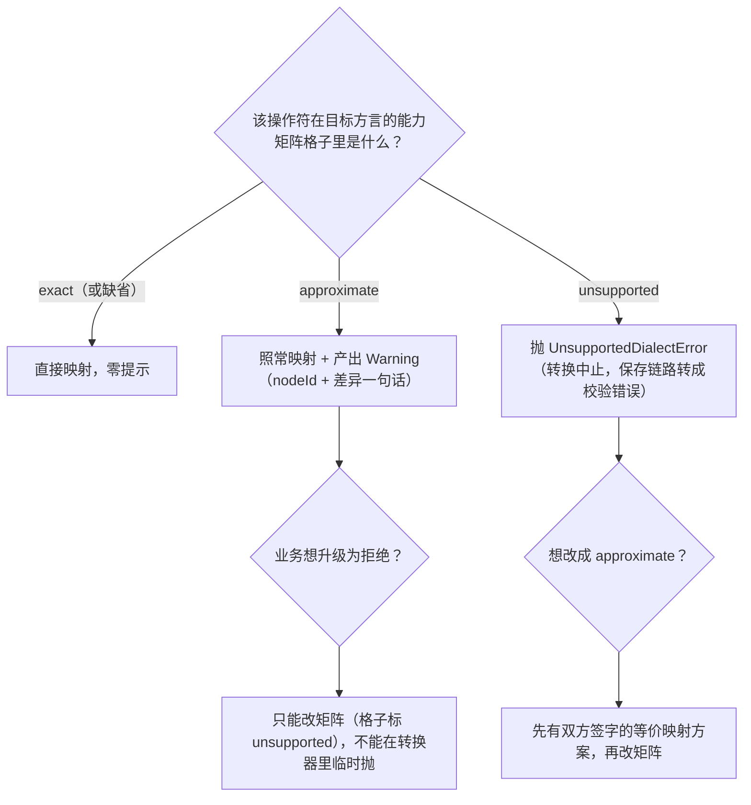

> 本文是《3. 动态查询构建器 / 规则引擎 UI ★全量展开 · 核心技术》按小节拆分后的续篇，上一部分见 [08-3-4-值编辑器体系-Setter-复用-远程-options-懒加载-防抖-取消.md](08-3-4-值编辑器体系-Setter-复用-远程-options-懒加载-防抖-取消.md)。

#### 3.5 协议转换层（前后端契约关键）：条件树 ↔ json-logic / Mongo query / ES DSL / SQL WHERE

**是什么**：一组纯函数，把同一棵条件树翻译成四种后端方言——json-logic（规则引擎通用格式）、Mongo query（文档库）、ES DSL（搜索）、SQL WHERE（关系库与参数化查询），以及一条反向链路：用 node-sql-parser 把 SQL WHERE 解析回条件树，实现"存量 SQL 规则回填进可视化编辑器"。

**为什么需要**：编辑器协议（带 id、kind、为 UI 服务）和执行协议（各引擎的方言）不该是同一个东西——前者改起来要顾 UI 状态，后者要顾执行效率与安全。转换层是两边之间**唯一**的翻译关口：关口唯一，才能统一做值类型矫正、注入防护、方言差异兜底；关口散落在各业务页面，每个页面都是一次安全事故的候选现场。回看 3.0.2 的抽象：四类业务执行端不同（规则引擎/数据库/搜索引擎/工作流引擎），靠这一层，**编辑器一份代码通吃**。

**怎么做（机制分步，以 json-logic 为标杆）**：

1. 组映射：`GroupNode` → `{"and":[...]}` / `{"or":[...]}`——json-logic 的 `and`/`or` 操作符恰好与 `combinator` 同名同义，直译即可。
2. 条件映射：`ConditionNode` → `{ 操作符: [{var: field}, value] }`——`{ "var": "amount" }` 是 json-logic 取数原语，等价于"从数据对象读 amount 键"。
3. 特殊操作符逐个对齐：`in` 的参数序是 `[needle, haystack]`（值在前数组在后，与直觉相反）；`between` 用 json-logic 的**三参链式比较** `{"<=":[min, {var}, max]}`；`contains` 复用 `in`（json-logic 的 `in` 同时支持字符串与数组）；取反类（`notIn`/`notContains`/`notBetween`）包一层 `{"!": ...}`；无值操作符转成与空串比较。
4. **value 类型必须在转换前与 json-logic 语义对齐**：json-logic 的比较运算走 JS 的隐式转换，`"100" > 99` 能侥幸为 true，但 `"9" > "10"` 按字符串比较得到 true（实际 9 < 10）——数字字段的 value 若是字符串（输入框没转数字）就会埋雷；日期必须统一 ISO-8601 才能靠字典序正确比较。所以转换函数接收 `fieldMap`，入口先做 `coerceValue` 矫正，**脏值在关口统一洗掉，而不是指望每个编辑器都守规矩**。

**代码——条件树 → json-logic（完整转换函数）**：

```ts
// converters.ts —— 协议转换层：一棵树，四种方言
import type { ConditionNode, ConditionTree, ConditionTreeNode, GroupNode, Operator } from './condition-tree'
import type { FieldMeta } from './field-meta'
import { isValuelessOperator } from './field-meta'

export type JsonLogicRule = Record<string, unknown>

/** 值矫正：转换关口的"洗手池"。数字字段串着来的值在这里转 number */
function coerceValue(field: FieldMeta | undefined, operator: string, value: unknown): unknown {
  if (isValuelessOperator(operator as Operator)) return null
  if (field?.valueType === 'number') {
    if (Array.isArray(value)) return value.map(v => (typeof v === 'string' && v.trim() !== '' ? Number(v) : v))
    if (typeof value === 'string' && value.trim() !== '') return Number(value)
  }
  return value
}

export function toJsonLogic(tree: ConditionTree, fieldMap: Map<string, FieldMeta>): JsonLogicRule {
  const group = (g: GroupNode): JsonLogicRule => {
    // 空组/单子节点：json-logic 的 and/or 接受单元素数组，语义不受影响
    const parts = g.children.map(node => nodeToRule(node, fieldMap))
    return { [g.combinator]: parts } // combinator 恰为 'and' | 'or'，直译
  }
  return group(tree)
}

function nodeToRule(node: ConditionTreeNode, fieldMap: Map<string, FieldMeta>): JsonLogicRule {
  return node.kind === 'group' ? groupToRule(node, fieldMap) : conditionToRule(node, fieldMap)
}

function groupToRule(g: GroupNode, fieldMap: Map<string, FieldMeta>): JsonLogicRule {
  const parts = g.children.map(n => nodeToRule(n, fieldMap))
  return { [g.combinator]: parts }
}

/** 单条件 → json-logic 规则。§3.7 试运行面板也复用这个函数逐行求值，因此单独导出 */
export function conditionToRule(c: ConditionNode, fieldMap: Map<string, FieldMeta>): JsonLogicRule {
  const field = fieldMap.get(c.field)
  const varRef = { var: c.field }                       // 取数原语：读数据对象的 c.field 键
  const v = coerceValue(field, c.operator, c.value)

  switch (c.operator) {
    case '=': return { '==': [varRef, v] }              // json-logic 用 == 表示宽松相等
    case '!=': return { '!=': [varRef, v] }
    case '>': case '>=': case '<': case '<=':
      return { [c.operator]: [varRef, v] }              // 如 {">": [{"var":"amount"}, 100]}
    case 'in':
      return { in: [varRef, v] }                        // needle=字段值, haystack=选项数组
    case 'notIn':
      return { '!': { in: [varRef, v] } }
    case 'contains':
      return { in: [v, varRef] }                        // 注意参数序反转：子串在前, 整串在后
    case 'notContains':
      return { '!': { in: [v, varRef] } }
    case 'between': case 'notBetween': {
      const [min, max] = Array.isArray(v) ? v : [null, null]
      // 三参链式比较：min <= field <= max，json-logic 原生支持
      const rule: JsonLogicRule = { '<=': [min, varRef, max] }
      return c.operator === 'between' ? rule : { '!': rule }
    }
    case 'isEmpty':
      return { '==': [varRef, ''] }                     // 空定义：空串或 null（按业务口径可再并 null）
    case 'isNotEmpty':
      return { '!=': [varRef, ''] }
    default: {
      // 穷尽性防御：TS 的 never 检查在运行时兜一层显式报错
      const exhausted: never = c.operator
      throw new Error(`未支持的操作符: ${String(exhausted)}`)
    }
  }
}
```

**双向对照**——"金额复核规则"（§3.1 末尾那棵树）转出的 json-logic：

```text
条件树                                    json-logic
─────────────────────────────           ─────────────────────────────────────
group(and)                              {"and":[
 ├─ amount > 100                          {">":   [{"var":"amount"}, 100]},
 └─ group(or)                             {"or":[
     ├─ city in [北京, 上海]                {"in":  [{"var":"city"}, ["北京","上海"]]},
     └─ isVip = true                       {"==":  [{"var":"isVip"}, true]}
                                         ]}
```
<!-- 保留原 ASCII 图:此处本质是"条件树 ↔ json-logic"逐行左右对照表,右列是字面代码输出且按行对齐阅读,Mermaid 无等价图表类型(转图表会丢失逐行代码映射语义),故不做替换 -->

对齐注意点再列三条：① `in` 的参数序（`contains` 与 `in` 同构但前后互换，写反了语义反转且不报错，最阴险）；② `==` 与 `===` 语义差异——json-logic 的 `==` 宽松相等（`1 == "1"` 为 true），若后端要严格相等应改用 `"==="` 操作符，这是接口契约里要写死的决定；③ 日期两侧必须同格式（都 `yyyy-MM-dd` 或都完整 ISO 时间戳），一边带时区一边不带，字典序比较就会错位。

**代码与对照——条件树 → Mongo query**：

```ts
type MongoQuery = Record<string, unknown>

/** 用户输入若含正则元字符，$regex 直拼会被注入/误匹配，先转义 */
function escapeRegExp(s: string): string {
  return s.replace(/[.*+?^${}()|[\]\\]/g, '\\$&')
}

export function toMongoQuery(tree: ConditionTree, fieldMap: Map<string, FieldMeta>): MongoQuery {
  const group = (g: GroupNode): MongoQuery => {
    const parts = g.children.map(n => nodeToMongo(n, fieldMap))
    return { [g.combinator === 'and' ? '$and' : '$or']: parts }
  }
  const nodeToMongo = (n: ConditionTreeNode, fm: Map<string, FieldMeta>): MongoQuery =>
    n.kind === 'group' ? group(n) : conditionToMongo(n, fm)
  const conditionToMongo = (c: ConditionNode, fm: Map<string, FieldMeta>): MongoQuery => {
    const v = coerceValue(fm.get(c.field), c.operator, c.value)
    switch (c.operator) {
      case '=': return { [c.field]: { $eq: v } }
      case '!=': return { [c.field]: { $ne: v } }
      case '>': return { [c.field]: { $gt: v } }
      case '>=': return { [c.field]: { $gte: v } }
      case '<': return { [c.field]: { $lt: v } }
      case '<=': return { [c.field]: { $lte: v } }
      case 'between': {
        const [min, max] = v as [unknown, unknown]
        return { [c.field]: { $gte: min, $lte: max } }   // between = 双边 range，一个算子收拢
      }
      case 'notBetween': {
        const [min, max] = v as [unknown, unknown]
        return { [c.field]: { $not: { $gte: min, $lte: max } } }
      }
      case 'in': return { [c.field]: { $in: v } }
      case 'notIn': return { [c.field]: { $nin: v } }
      case 'contains': return { [c.field]: { $regex: escapeRegExp(String(v)), $options: 'i' } }
      case 'notContains': return { [c.field]: { $not: { $regex: escapeRegExp(String(v)), $options: 'i' } } }
      case 'isEmpty': return { [c.field]: { $in: ['', null] } }
      case 'isNotEmpty': return { [c.field]: { $nin: ['', null] } }
      default: {
        const exhausted: never = c.operator
        throw new Error(`未支持的操作符: ${String(exhausted)}`)
      }
    }
  }
  return group(tree)
}
```

同一棵"金额复核规则"的对照：

```text
条件树片段                          Mongo query 片段
────────────────────────          ──────────────────────────────────────
group(and)                        { "$and": [
 ├─ amount > 100                     { "amount": { "$gt": 100 } },
 └─ group(or)                        { "$or": [
     ├─ city in [北京, 上海]             { "city": { "$in": ["北京","上海"] } },
     └─ isVip = true                     { "isVip": { "$eq": true } }
                                      ]}
```
<!-- 保留原 ASCII 图:此处本质是"条件树 ↔ Mongo query"逐行左右对照表,右列是字面代码输出且按行对齐阅读,Mermaid 无等价图表类型(转图表会丢失逐行代码映射语义),故不做替换 -->

差异注意：Mongo 的组合子是 `$and`/`$or` 算子对象（与 json-logic 结构同构）；同一字段多条件在 Mongo 里可合并进一个 `{field: {$gt, $lt}}`（between 就是这么干的），但跨字段必须用 `$and` 展开——转换层选择"永远显式 `$and`/`$or`"牺牲一点查询体积，换来结构完全同构、好排查。

**代码与对照——条件树 → ES DSL**：

```ts
export function toEsDsl(tree: ConditionTree, fieldMap: Map<string, FieldMeta>): Record<string, unknown> {
  const group = (g: GroupNode): Record<string, unknown> => {
    const clauses = g.children.map(n => nodeToEs(n, fieldMap))
    return g.combinator === 'and'
      ? { bool: { must: clauses } }
      // should 单独出现时默认 minimum_should_match=1，但一旦并入外层 bool 语境默认值会变 0——
      // 显式写死 1，防止"嵌套后或条件全部失活"的经典事故
      : { bool: { should: clauses, minimum_should_match: 1 } }
  }
  const nodeToEs = (n: ConditionTreeNode, fm: Map<string, FieldMeta>): Record<string, unknown> =>
    n.kind === 'group' ? group(n) : conditionToEs(n, fm)
  const conditionToEs = (c: ConditionNode, fm: Map<string, FieldMeta>): Record<string, unknown> => {
    const v = coerceValue(fm.get(c.field), c.operator, c.value)
    switch (c.operator) {
      case '=': return { term: { [c.field]: v } }            // 精确匹配：keyword 字段
      case '!=': return { bool: { must_not: { term: { [c.field]: v } } } }
      case '>': return { range: { [c.field]: { gt: v } } }
      case '>=': return { range: { [c.field]: { gte: v } } }
      case '<': return { range: { [c.field]: { lt: v } } }
      case '<=': return { range: { [c.field]: { lte: v } } }
      case 'between': {
        const [min, max] = v as [unknown, unknown]
        return { range: { [c.field]: { gte: min, lte: max } } }
      }
      case 'notBetween': {
        const [min, max] = v as [unknown, unknown]
        return { bool: { must_not: { range: { [c.field]: { gte: min, lte: max } } } } }
      }
      case 'in': return { terms: { [c.field]: v } }
      case 'notIn': return { bool: { must_not: { terms: { [c.field]: v } } } }
      case 'contains': return { wildcard: { [c.field]: `*${escapeRegExp(String(v))}*` } }
      case 'notContains': return { bool: { must_not: { wildcard: { [c.field]: `*${escapeRegExp(String(v))}*` } } } }
      case 'isEmpty': return { term: { [c.field]: '' } }
      case 'isNotEmpty': return { bool: { must_not: { term: { [c.field]: '' } } } }
      default: {
        const exhausted: never = c.operator
        throw new Error(`未支持的操作符: ${String(exhausted)}`)
      }
    }
  }
  return group(tree)
}
```

对照（bool/must/should 与且/或一一对应）：

```json
{
  "bool": {
    "must": [
      { "range": { "amount": { "gt": 100 } } },
      {
        "bool": {
          "should": [
            { "terms": { "city": ["北京", "上海"] } },
            { "term": { "isVip": true } }
          ],
          "minimum_should_match": 1
        }
      }
    ]
  }
}
```

两个 ES 特有差异要在转换层文档里写死：`term`/`terms` 只对 `keyword` 子字段精确命中，对分词的 `text` 字段要用 `match`（映射取决于索引 mapping，转换层可让 FieldMeta 增加 `esFieldType` 声明）；`wildcard` 带 `*` 前缀无法利用倒排索引，大数据量下应建议业务改用 `match_phrase`——转换层给 warning 而不是替用户决定。

**代码——条件树 → SQL WHERE（拼接思路与注入防护参数化）**：

```ts
export interface SqlWhereResult {
  where: string       // 只含占位符（PostgreSQL $1/$2…），不含任何用户值
  params: unknown[]   // 与占位符顺序一一对应的参数数组
}

export function toSqlWhere(tree: ConditionTree, fieldMap: Map<string, FieldMeta>): SqlWhereResult {
  const params: unknown[] = []
  const placeholder = (v: unknown): string => {
    params.push(v)
    return `$${params.length}`            // PostgreSQL 风格；MySQL 换成 '?' 即可
  }
  /** 值永远参数化；字段名无法参数化 → 白名单 + 命名规则双重校验，这是防注入的两半 */
  const identifier = (name: string): string => {
    if (!fieldMap.has(name)) throw new Error(`字段不在白名单: ${name}`)
    if (!/^[a-z_][a-z0-9_]*$/i.test(name)) throw new Error(`非法字段名: ${name}`)
    return `"${name}"`
  }

  const condition = (c: ConditionNode): string => {
    const col = identifier(c.field)
    const v = coerceValue(fieldMap.get(c.field), c.operator, c.value)
    switch (c.operator) {
      case '=': return `${col} = ${placeholder(v)}`
      case '!=': return `${col} <> ${placeholder(v)}`
      case '>': return `${col} > ${placeholder(v)}`
      case '>=': return `${col} >= ${placeholder(v)}`
      case '<': return `${col} < ${placeholder(v)}`
      case '<=': return `${col} <= ${placeholder(v)}`
      case 'between': case 'notBetween': {
        const [min, max] = v as [unknown, unknown]
        const range = `${col} BETWEEN ${placeholder(min)} AND ${placeholder(max)}`
        return c.operator === 'between' ? range : `NOT (${range})`
      }
      case 'in': case 'notIn': {
        const list = (Array.isArray(v) ? v : []).map(x => placeholder(x))
        if (list.length === 0) return c.operator === 'in' ? 'FALSE' : 'TRUE' // 空集防御：IN () 是语法错误
        return `${col} ${c.operator === 'in' ? 'IN' : 'NOT IN'} (${list.join(', ')})`
      }
      case 'contains': case 'notContains': {
        const like = `${col} LIKE ${placeholder(`%${escapeRegExp(String(v))}%`)}`
        return c.operator === 'contains' ? like : `NOT (${like})`
      }
      case 'isEmpty': return `COALESCE(${col}, '') = ''`
      case 'isNotEmpty': return `COALESCE(${col}, '') <> ''`
      default: {
        const exhausted: never = c.operator
        throw new Error(`未支持的操作符: ${String(exhausted)}`)
      }
    }
  }

  const node = (n: ConditionTreeNode): string => (n.kind === 'group' ? group(n) : condition(n))
  const group = (g: GroupNode): string => {
    if (g.children.length === 1) return node(g.children[0]) // 单子节点不加括号，减少嵌套噪音
    const joiner = g.combinator === 'and' ? ' AND ' : ' OR '
    return '(' + g.children.map(node).join(joiner) + ')'   // 组 = 括号：优先级由结构保证，不靠运算符优先级心算
  }

  return { where: group(tree), params }
}
```

注入防护的两个半场：**值**走参数化占位符，值里藏 `'; DROP TABLE` 也只是一个普通字符串参数；**标识符**没法参数化（占位符不能出现在列名位置），必须"白名单（fieldMap 里必须有）+ 命名规则正则"双重校验——`"amount; DROP TABLE orders"`在第一关就被拒。使用侧：

```ts
import { toSqlWhere } from './converters'
import { ORDER_FIELDS } from './fields-order'

// const client = 数据库客户端（pg / postgres.js 等，参数化查询是标配能力）
const fieldMap = new Map(ORDER_FIELDS.map(f => [f.name, f]))
const { where, params } = toSqlWhere(tree, fieldMap)
const sql = `SELECT * FROM orders WHERE ${where} LIMIT 100`
// const rows = await client.query(sql, params)   // 永远 params 单独传，别拼进 sql 字符串
```

**代码——反向解析：node-sql-parser 把 SQL WHERE 解析回条件树**（存量 SQL 规则迁移进可视化编辑器的通路）：

```bash
npm i node-sql-parser
```

```ts
// sql-to-tree.ts —— SQL → 条件树（回填编辑器）。支持子集：AND/OR/比较/IN/BETWEEN/LIKE
import { Parser } from 'node-sql-parser'
import {
  type ConditionNode,
  type ConditionTree,
  type ConditionTreeNode,
  type Operator,
} from './condition-tree'
import { createCondition, createGroup } from './tree-ops'

interface AstNode {
  type: string
  operator?: unknown
  left?: unknown
  right?: unknown
  column?: unknown
  value?: unknown
}

const parser = new Parser()

export function sqlToConditionTree(sql: string): ConditionTree {
  const ast = parser.astify(sql) as { where?: AstNode }
  if (!ast.where) return createGroup() // 无 WHERE → 空组
  const node = exprToNode(ast.where)
  return node.kind === 'group' ? node : createGroup([node]) // 裸条件也包进根组
}

function exprToNode(expr: AstNode): ConditionTreeNode {
  if (expr.type !== 'binary_expr') {
    throw new Error(`暂不支持的表达式类型: ${expr.type}（子查询/函数等请人工迁移）`)
  }
  const op = String(expr.operator).toUpperCase()

  // AND / OR：left/right 各是一个表达式 → 收敛为组，天然表达优先级括号
  if (op === 'AND' || op === 'OR') {
    const children = [exprToNode(expr.left as AstNode), exprToNode(expr.right as AstNode)]
    return createGroup(children, op === 'AND' ? 'and' : 'or')
  }

  const left = expr.left as AstNode
  if (left.type !== 'column_ref') {
    throw new Error(`暂不支持：左侧必须是字段名，得到 ${left.type}`)
  }
  const field = String(left.column)
  const right = expr.right as AstNode

  switch (op) {
    case '=': case '!=': case '>': case '>=': case '<': case '<=':
      return createCondition(field, op as Operator, literalValue(right))
    case 'IN': case 'NOT IN': {
      const list = (right.type === 'expr_list' ? (right.value as AstNode[]) : [right]).map(literalValue)
      return createCondition(field, op === 'IN' ? 'in' : 'notIn', list)
    }
    case 'BETWEEN': {
      const [min, max] = (right.value as AstNode[]).map(literalValue) // BETWEEN 右侧是二元 expr_list
      return createCondition(field, 'between', [min, max])
    }
    case 'LIKE': case 'NOT LIKE': {
      const pattern = String(literalValue(right))
      let operator: Operator = 'contains'
      let needle = pattern
      if (pattern.startsWith('%') && pattern.endsWith('%') && pattern.length >= 2) {
        needle = pattern.slice(1, -1)          // %xx% → contains
      } else if (pattern.endsWith('%')) {
        operator = '='                          // xx% 前缀匹配：本章协议无 startsWith，退化为 = 并给出告警
        needle = pattern.slice(0, -1)
        console.warn(`字段 ${field} 的前缀 LIKE 已退化为 =，请人工确认`)
      } else if (pattern.startsWith('%')) {
        needle = pattern.slice(1)
      }
      return createCondition(field, operator, needle)
    }
    default:
      throw new Error(`暂不支持的操作符: ${op}`)
  }
}

function literalValue(node: AstNode): unknown {
  switch (node.type) {
    case 'number': return Number(node.value)
    case 'string': case 'single_quote_string': return String(node.value) // 新旧版本的字符串节点类型都认
    case 'bool': case 'boolean': return Boolean(node.value)
    case 'null': return null
    default: throw new Error(`暂不支持的值类型: ${node.type}`)
  }
}
```

反向解析的工程定位要说清：它**不是**完备的 SQL 兼容层——子查询、函数、算术表达式都超出"字段-操作符-值"三段式协议的表达力，代码里一律显式抛错提示人工迁移；它的价值是把"九十年代攒下的平面 WHERE 迁进编辑器"这件苦力活自动化掉九成，剩下的一成靠报错清单兜底。这也是协议设计能力的反面教材：**协议表达力决定生态兼容面**，当初若在协议里加 `startsWith`/`endsWith` 操作符，LIKE 的映射就不用退化。

**常见坑（转换层）**：
- 症状：联调时前端试运行全绿，后端规则引擎执行结果永远 false。
- 根因：前后端对"空"的口径不一致——前端 `isEmpty` 转成 `{"==":[{"var":"x"},""]}`，后端数据里该字段是 `null` 不是 `''`；或日期一边 `2026-01-01` 一边 `2026-01-01T00:00:00Z`，字典序比较错位。
- 修法：把"空值口径、日期格式、`==`/`===`、布尔字段类型"四项写进前后端契约文档并写成转换层的单测快照（同一棵树 × 四种方言的 golden case）；`isEmpty` 若业务上要覆盖 null，转成 `{"or":[{"==":[{"var":"x"},""]},{"==":[{"var":"x"},null]}]}` 并两边签字确认。

> 以下 3.5.1～3.5.3 为协议转换层的进阶补充小节（编号续接本文件 3.5 一节）：多目标转换器架构（注册表 + 中间表示）、方言能力差异表与降级策略、协议版本迁移。

##### 3.5.1 多目标转换器架构——转换器注册表与两段式管线（中间表示 IR）

**是什么**：把 §3.5 主体的四个平行函数（`toJsonLogic` / `toMongoQuery` / `toEsDsl` / `toSqlWhere`）收进一张**转换器注册表**，并把每次转换拆成两段：**前段（归一化）**——树 → 中间表示（IR），做所有方言都要做的事：值矫正（coerceValue）、字段白名单校验、能力检查（3.5.2 的差异表在这里消费）；**后段（发射）**——IR → 方言产物，每个方言只写自己独有的映射逻辑。IR 不引入新的数据结构，它就是"**清洗后的条件树 + 已解析的 FieldMeta + 警告收集器**"——即保证进入后段的树是干净的，后段可以放心地做纯映射。

**为什么难**：主体实现里每个函数各自调一遍 `coerceValue`、各自写一遍 `default` 分支的穷尽性防御、各自拼一遍组结构。方言只有两个时这算"可以容忍的重复"；到第四个方言，重复已经变成事故温床——新增 ClickHouse 方言的同学从 `toMongoQuery` 复制粘贴开改，忘了带上 `$regex` 转义那一行，注入防护就出现了一个洞；忘了 `coerceValue`，字符串数字的雷（§3.5 开头 `"9" > "10"` 的例子）在第五种方言里重新埋一遍。**关口唯一的原则要求"进关口的路只有一条"，但四个平行函数本身就是四条路**。注册表把"路"收敛到 `convert(tree, target)` 一个入口，把"每个方言的独有知识"压缩进注册项。

**关键机制**：

1. **注册项自描述**：每个方言注册 `{ id, label, capabilities, emit }` 四样——capabilities 是它能精确支持的操作符/语义清单（3.5.2 展开），emit 是"IR → 方言"的纯函数。
2. **前段只跑一次**：coerce、白名单、能力检查在 IR 阶段统一完成，后段永远拿到干净数据——`emit` 里可以删掉所有防御性代码，变得极薄。
3. **统一返回形状**：`{ output, warnings }`——警告是一等公民而不是 console 副产品（3.5.2 的降级通道）。
4. **导出面收口**：`convert` 是模块对外的唯一导出，四个 `emit` 是模块私有——绕过关口的代码在 code review 里一眼可见。

**最小可行实现**：

```ts
// converter-registry.ts —— 转换器注册表 + 两段式管线
import type { ConditionTree, ConditionTreeNode, Operator } from './condition-tree'
import type { FieldMeta } from './field-meta'

/** 中间表示：清洗后的树节点（条件节点带上已解析的字段元数据与矫正后的值） */
export interface IrCondition {
  kind: 'condition'
  id: string
  field: string
  fieldMeta: FieldMeta            // 前段已解析：后段不用再查表
  operator: Operator
  value: unknown                  // 前段已矫正：后段不用再 coerce
}
export interface IrGroup {
  kind: 'group'
  id: string
  combinator: 'and' | 'or'
  children: IrNode[]
}
export type IrNode = IrCondition | IrGroup

export type Warning = { nodeId: string; code: string; message: string }

export interface ConverterContext {
  root: IrGroup
  warnings: Warning[]
}

export interface Converter<Output> {
  id: string                      // 'json-logic' | 'mongo' | 'es' | 'sql' | ...
  label: string                   // UI 与日志里的人话名
  /** 3.5.2 的能力描述：emit 前的能力检查消费它 */
  capabilities: ReadonlySet<Operator>
  /** 后段：IR → 方言。契约：输入已清洗，本函数不做防御、不产生副作用 */
  emit: (ir: ConverterContext) => Output
}

const REGISTRY = new Map<string, Converter<unknown>>()

export function registerConverter<Output>(converter: Converter<Output>): void {
  if (REGISTRY.has(converter.id)) {
    throw new Error(`转换器「${converter.id}」已注册——重复注册通常是 HMR，检查导入路径（3.3.2 同款坑）`)
  }
  REGISTRY.set(converter.id, converter)
}

/** 前段：树 → IR。coerce / 白名单 / 能力检查全部在这一段完成 */
function toIr(tree: ConditionTree, fieldMap: Map<string, FieldMeta>, target: Converter<unknown>): ConverterContext {
  const warnings: Warning[] = []
  const walk = (node: ConditionTreeNode): IrNode => {
    if (node.kind === 'group') {
      return { kind: 'group', id: node.id, combinator: node.combinator, children: node.children.map(walk) }
    }
    const fieldMeta = fieldMap.get(node.field)
    if (!fieldMeta) {
      // 不抛错改记警告：悬空字段是数据问题，报告给上层（坑 2 的红牌行体系），转换继续
      warnings.push({ nodeId: node.id, code: 'dangling-field', message: `字段 ${node.field} 不在白名单` })
    }
    if (!target.capabilities.has(node.operator)) {
      warnings.push({ nodeId: node.id, code: 'unsupported-operator', message: `方言 ${target.label} 不支持操作符 ${node.operator}，该条件将被跳过（见降级策略）` })
    }
    // coerceValue：§3.5 主体的实现，此处应导出后复用（export function coerceValue）
    const value = coerceValue(fieldMeta, node.operator, node.value)
    return {
      kind: 'condition',
      id: node.id,
      field: node.field,
      fieldMeta: fieldMeta as FieldMeta, // 已在上面记警告，后段跳过该节点
      operator: node.operator,
      value,
    }
  }
  return { root: walk(tree) as IrGroup, warnings }
}

/** 唯一对外入口：一棵树 → 任意已注册方言 */
export function convert<Output>(tree: ConditionTree, targetId: string, fieldMap: Map<string, FieldMeta>): { output: Output; warnings: Warning[] } {
  const target = REGISTRY.get(targetId)
  if (!target) throw new Error(`未注册的转换目标: ${targetId}（已注册: ${[...REGISTRY.keys()].join(', ')}）`)
  const ir = toIr(tree, fieldMap, target)
  return { output: target.emit(ir) as Output, warnings: ir.warnings }
}
```

后段薄到什么程度，看 json-logic 的注册项（对照主体实现，防御代码全消失）：

```ts
// converters-json-logic.ts —— 后段示例：emit 只剩纯映射
import { registerConverter, type ConverterContext, type IrCondition, type IrNode } from './converter-registry'

registerConverter<Record<string, unknown>>({
  id: 'json-logic',
  label: 'json-logic（规则引擎）',
  capabilities: new Set(['=', '!=', '>', '>=', '<', '<=', 'in', 'notIn',
    'contains', 'notContains', 'between', 'notBetween', 'isEmpty', 'isNotEmpty']),
  emit(ir) {
    const condition = (c: IrCondition): Record<string, unknown> => {
      const varRef = { var: c.field }
      switch (c.operator) {
        case '=': return { '==': [varRef, c.value] }
        case 'between': {
          const [min, max] = c.value as [unknown, unknown]
          return { '<=': [min, varRef, max] }
        }
        // …其余 case 与主体 conditionToRule 相同，但不再需要 coerce 与 default 兜底
        default: throw new Error(`IR 已保证操作符受支持，走到这里说明前段漏检: ${c.operator}`)
      }
    }
    const walk = (n: IrNode): Record<string, unknown> =>
      n.kind === 'group'
        ? { [n.combinator]: n.children.map(walk) }
        : condition(n)
    return walk(ir.root)
  },
})
```

**与 §3.7 的关系**：试运行面板逐行求值用的是 `conditionToRule`（单条件转换）——它同样应该从"前段"取数。接入注册表后，`evaluateTree` 内每个条件先过一遍轻量 IR（单条件也做 coerce），保证"试运行求的值"与"保存后后端执行的值"出自同一条清洗管线——这是"试运行全绿、线上全不命中"这类双端事故在前端内部的第一道防线。

**选型与学习路径**：rule of three——方言 ≤ 2 时不抽象，重复两份是学费（你会借这两份看清哪些是共性、哪些是方言私有）；第 3 个方言出现时收编成注册表，收编本身就是对前两份的 code review。学习材料首推 react-querybuilder 的 `formatQuery` 源码（13-3-9-坑 对标节已指路）：它正是"一份内部查询对象 + 多个 format 出口"的注册表形态，读它的 `sql` 与 `mongodb` 两个 format 实现的差异处理，等于对照检查本节 IR 的切分线切得对不对。

**坑（架构层）**：
- 症状：新方言 ClickHouse 上线三个月后，安全审计发现某页面拼的查询字符串没有字段白名单校验，且该页面规则里出现字符串数字比较的事故。
- 原因：业务页面绕过了 `convert` 入口，直接 import 了某个 `emit`（或干脆自己拼字符串）——关口被侧翼绕开，前段的 coerce/白名单/警告全部失守。注册表只收敛了"守规矩的路"，守不住"不守规矩的路"。
- 修法：导出面收口——`converter-registry.ts` 只导出 `convert` / `registerConverter` / 类型，`emit` 函数全部模块私有（或放 `internal` 子目录且 lint 禁止业务目录 import）；再配一条单测：对每个已注册方言跑同一棵 golden 树，断言输出与快照一致——有人绕开管线改了行为，golden case 会对不上。

##### 3.5.2 方言能力差异表与降级策略——能力矩阵、降级三档与警告通道

**是什么**：一张**能力矩阵**（操作符语义 × 四种方言：完全一致 / 近似有差 / 无法表达），一套**降级三档**策略（精确直译 / 语义近似 + warning / 拒绝转换），和一条把差异送达用户的**警告通道**。转换层的诚实义务：方言之间语义有差是事实，工程上能做的是把差异从"静默"变成"显式"。

**为什么难**：§3.5 主体的四个函数各自为政时，方言差异散落在注释与个别 if 分支里（ES 的 `minimum_should_match`、Mongo 的 `$regex` 转义、SQL 的 `COALESCE`）——知识存在，但没有结构。真正的难点是**试运行与执行端不同方言**：前端试运行跑的是 json-logic（§3.7），后端可能是 ES——`contains` 在 json-logic 里是子串判定（大小写敏感），在 ES 的 `wildcard` 里也是子串，但若字段是分词的 `text` 类型，行为完全不同。用户在试运行里看到命中、上线后查不到，第一反应是"规则引擎坏了"，排查一圈才发现是方言差异——**转换层不做差异显性化，这笔排查成本就由每个用户付一遍**。

**能力矩阵**（以本章操作符为行、四种方言为列，"≈"表示近似、括号里是差异点）：

| 操作符/语义 | json-logic | Mongo | ES DSL | SQL WHERE |
|---|---|---|---|---|
| `=` 精确相等 | `==` 宽松相等（`1 == "1"` 为 true） | `$eq` 严格（类型不同不匹配 BSON） | `term`：只对 keyword 子字段精确命中；text 字段会被分词 | `=` 语义由列类型决定，参数化后由驱动转 |
| `contains` 子串 | `in`（子串在前，大小写**敏感**） | `$regex`（默认大小写敏感，`$options: 'i'` 才不敏感） | `wildcard *x*`（走倒排扫描，text 分词字段语义漂移） | `LIKE '%x%'`（多数库默认大小写**不**敏感，Postgres 例外） |
| `in` 集合 | 数组 `includes` 语义 | `$in`（严格类型） | `terms`（keyword 精确；最多 65536 项） | `IN (...)`（空集是语法错误，须短路成 FALSE） |
| `between` | 三参 `<=` 链（隐式转换比较） | `$gte` + `$lte` 一个算子对象 | `range: { gte, lte }` | `BETWEEN AND`（边界**含**两端） |
| `isEmpty` 空值 | 与 `''` 比较（null 不算空） | `$in: ['', null]`（**含** null，与 json-logic 口径不同！） | `term: ''`（缺字段文档不命中——与 Mongo 口径不同） | `COALESCE(col, '') = ''`（含 null） |
| 大小写敏感性 | 敏感 | 默认敏感 | text 分词后基本"不敏感" | 视库与 collation |
| 日期比较 | 字符串字典序（须同格式） | BSON Date 类型优先（字符串会当字典序） | `range` 对 date 类型字段（时区看 mapping） | 视列类型；字符串列是字典序 |

这张表的用法不是背下来，而是**进契约文档、进 3.5.1 的 `capabilities` 描述、进单测快照**。三处引用同一个真相源——表本身可以就是一段结构化数据，注册表的 `capabilities` 与降级登记都从它生成：

```ts
// dialect-capabilities.ts —— 矩阵即数据：一张表喂三个消费方（capabilities / APPROXIMATE / 文档）
import type { Operator } from './condition-tree'

type Cell = { level: 'exact' } | { level: 'approximate'; note: string } | { level: 'unsupported' }

/** 操作符 × 方言 → 格子。exact 的格子可以省略（缺省即 exact），表里只写"有话说"的格子 */
export const MATRIX: Record<string, Record<string, Cell>> = {
  contains: {
    es: { level: 'approximate', note: 'wildcard 对分词 text 字段语义会漂移，建议 keyword 或 match_phrase' },
    sql: { level: 'approximate', note: '多数数据库 LIKE 默认不区分大小写，与试运行（区分）不一致' },
  },
  isEmpty: {
    mongo: { level: 'approximate', note: '$in: ["", null] 把 null 也算空，与试运行（仅空串）口径不同' },
  },
  notContains: {
    es: { level: 'approximate', note: 'must_not + wildcard：缺字段文档不会被排除' },
  },
  // 自定义算子同理：'dateAfter': { sql: { level: 'unsupported', note: 'SQL 方言未实现该算子' } }
}

/** 从矩阵派生某方言的 capabilities（3.5.1 注册表消费）与 APPROXIMATE（降级登记消费） */
export function capabilitiesOf(dialect: string): Set<Operator> {
  return new Set(
    Object.entries(MATRIX)
      .filter(([, cells]) => cells[dialect]?.level !== 'unsupported')
      .map(([op]) => op as Operator),
  )
}
export function approximatesOf(dialect: string): Record<string, string> {
  return Object.fromEntries(
    Object.entries(MATRIX)
      .filter(([, cells]) => cells[dialect]?.level === 'approximate')
      .map(([op, cells]) => [`${op}:${dialect}`, (cells[dialect] as { note: string }).note]),
  )
}
```

**降级三档**（转换器遇到方言差异时的固定动作）：

1. **精确直译**：语义完全一致，直接映射——上表无括号的格子。零提示。
2. **语义近似 + warning**：能表达但有差（`isEmpty` 的 null 口径、contains 的大小写）——照发，但产出 `Warning`，UI 侧在保存前展示"此规则在 ES 上 contains 不区分大小写"这类提示。**转换器只警告、不替用户决定**（§3.5 主体对 `wildcard` 的立场：给 warning 而不是擅自改 `match_phrase`）。
3. **拒绝转换**：方言完全无法表达（SQL 方言遇自定义算子 `dateAfter`、ES 不支持 `notContains` 且业务禁止 must_not）——抛错。宁可失败，不可静默错译：**错误的结果比报错贵一百倍**（告警规则静默查错数据 = 该告的没告）。

**最小可行实现**——降级作为管线的一等产物：

```ts
// degradation.ts —— 降级报告：转换的"第二张收据"
export type DegradationLevel = 'exact' | 'approximate' | 'unsupported'

export interface DegradationReport {
  nodeId: string
  operator: string
  level: DegradationLevel
  detail: string                 // 人话：差异是什么、影响是什么
}

/** 语义近似登记表：哪些（操作符 × 方言）组合是 approximate，一句话说明差异 */
const APPROXIMATE: Record<string, string> = {
  'isEmpty:mongo': 'Mongo 的 $in: ["", null] 把 null 也算空，与前端试运行（仅空串）口径不同',
  'contains:es': 'ES 的 wildcard 对分词 text 字段语义会漂移，建议字段映射为 keyword 或改用 match_phrase',
  'contains:sql': "多数数据库 LIKE 默认不区分大小写，与前端试运行（区分）不一致",
  'notContains:es': 'must_not 包裹 wildcard：未索引/缺字段文档不会被排除，与 Mongo $not 口径不同',
}

export function classify(nodeId: string, operator: string, dialect: string, supported: boolean): DegradationReport | null {
  if (!supported) {
    return { nodeId, operator, level: 'unsupported', detail: `方言 ${dialect} 无法表达操作符 ${operator}，转换中止` }
  }
  const detail = APPROXIMATE[`${operator}:${dialect}`]
  return detail ? { nodeId, operator, level: 'approximate', detail } : null
}
```

接入 3.5.1 的 `toIr`（能力检查那一段升级为分类登记）：

```ts
// toIr 内，替换原"unsupported-operator"分支：
const report = classify(node.id, node.operator, target.label, target.capabilities.has(node.operator))
if (report?.level === 'unsupported') {
  throw new UnsupportedDialectError(report.detail)   // 三档之"拒绝"：抛错中止
}
if (report) warnings.push({ nodeId: node.id, code: `degraded:${report.level}`, message: report.detail })
```

**警告通道**——warning 从转换器到用户的三条路，缺一不可：① 保存链路（SaveBar 拿到 warnings 列表展示为黄色警示条，与 §3.6 校验错误的红色并列——**降级不是错误，不阻止保存**，但用户必须有机会看见）；② 试运行面板（§3.7 顶部常驻"方言差异提示"区，试运行是 json-logic 方言，若该规则的执行端是 ES，提示"试运行结果与线上执行可能存在以下差异"）；③ 契约文档（APPROXIMATE 表定期同步给后端，双端对同一差异有同一份认知）。保存链路的呈现：

```tsx
// SaveBar 内的降级警示区：黄色（区别于校验错误的红色），可逐条忽略但不静默
import { convert, type Warning } from './converter-registry'

function DialectWarnings({ tree, fieldMap, targetId }: {
  tree: ConditionTree
  fieldMap: Map<string, FieldMeta>
  targetId: string
}) {
  const warnings: Warning[] = (() => {
    try {
      return convert(tree, targetId, fieldMap).warnings   // 保存前先转一次收警告
    } catch {
      return []   // 拒绝转换的抛错由校验链路兜（那已是 error 级），这里不重复展示
    }
  })()
  if (warnings.length === 0) return null
  return (
    <ul className="qb-degrade-warnings" role="status">
      {warnings.map(w => (
        <li key={`${w.nodeId}:${w.code}`} className="qb-degrade-warning">
          ⚠ {w.message}
        </li>
      ))}
    </ul>
  )
}
```

**降级的决策树**（实现时对着走，防止档位判断随意）：



**选型与学习路径**：先写矩阵再写转换器——把上表补全成你们业务的真实方言清单（加 ClickHouse/OpenSearch/CEL 按需），每种差异落一行 APPROXIMATE 登记；矩阵为空的部分才允许"直译无提示"。学习材料：react-querybuilder 的 `formatQuery` 文档明确列出各方言的 limitations（如 SQL 导出不支持某些操作符时的行为），它是把能力差异写进文档的正面样本；Elasticsearch 官方文档的 `term` vs `match` 章节是 text/keyword 差异的权威出处。

**坑（降级层）**：
- 症状：ES 执行端上线半年后，运营投诉"高级筛选里搜'iPhone'搜不到 'iphone 15' 的记录"，前端试运行明明能命中。
- 原因：`contains` 在 ES 上走了 `wildcard`，但该字段 mapping 是分词的 `text`——分词后倒排表里没有 "iphone 15" 这个整体词条，wildcard 语义漂移。降级 warning 早就产生了，但只 `console.warn` 在浏览器控制台里，没有任何人看见。
- 修法：warning 必须走完上面三条通道（保存链路 UI、试运行面板、契约文档），**控制台不算通道**——它只服务开发者，而降级影响的是做决策的用户。检查清单：grep 项目里 `console.warn` 出现在 converters 相关文件的每一处，逐个换成返回 Warning 对象。

##### 3.5.3 协议版本迁移——version 字段、v1→v2 迁移管线与数据 codemod

**是什么**：条件树协议本身会演进（本章 §3.1 已经历过一次：原始协议没有 `kind` 与 `id`，扩写后补上——那就是 v1→v2）。本节把"协议升级时存量数据怎么办"变成工程流程：树根加 `version` 字段、迁移函数链（v1→v2、v2→v3 各一个纯函数）、读端惰性迁移 + 存量批量的数据 codemod。它与《组件库实战大纲》C5 的 jscodeshift codemod 是姊妹篇——**那边迁移的是源代码（AST 变换），这边迁移的是库里的 JSON 数据（树变换）**，方法论同构：小步、幂等、快照验证、宁少改不错改。

**为什么难**：协议演进的三难——**存量数据不能丢**（两年前配的告警规则还在执行）、**读写两端不能同时升级**（前端周二发版、后端周四发版，中间两天是混合世界）、**迁移不能错**（错一条迁移 = 一条生产规则静默变义）。没有 version 字段时更糟：你甚至不知道手里这棵树是哪个版本的协议，只能靠结构猜测。

**关键机制**：

1. **version 字段进协议**：`GroupNode` 增加可选的 `version?: number`（根节点携带，子节点不重复）。**缺省推断规则**要写死：无 `version` 且无 `kind`（有 `conditions` 键）→ v1；无 `version` 但有 `kind` → v2（v2 上线初期写入的数据）；显式 `version` → 以它为准。推断逻辑只允许存在于一个函数里。
2. **迁移函数是纯函数**：`(v1Tree) => v2Tree`，无 IO、无 Date.now、无随机——同样输入永远同样输出（幂等），这是可重跑、可回放的前提。`deepCloneWithNewIds` 在迁移里**不能用**（id 会变——存量规则的 id 已被审计日志、错误上报引用，迁移必须保 id 稳定；只有 v1 本来就没有 id 时才发新 id）。
3. **读端惰性迁移 + 写端固化版本**：读到 v1 先迁到最新版再进编辑器（用户无感），保存时写回 `version: CURRENT`。存量数据的批量 codemod 只是加速器（省去每次读取的迁移成本），不是必需品——惰性迁移保证"就算批量脚本永远没跑，系统也是对的"。
4. **golden case 锁迁移行为**：每个迁移函数配"输入 → 输出"快照对，快照来自**真实存量数据的脱敏样本**（各业务形态至少一例），不是手写的理想树。

**最小可行实现**：

```ts
// migrations.ts —— 协议版本迁移：推断、链式迁移、注册表
import type { ConditionTree, ConditionTreeNode } from './condition-tree'
import { genId } from './condition-tree'

export const CURRENT_VERSION = 2

/** v1 树形状：无 kind 判别、无 id、子节点键叫 conditions */
interface V1Group {
  combinator: 'and' | 'or'
  conditions: Array<V1Group | { field: string; operator: string; value: unknown }>
}

type Migration = (tree: Record<string, unknown>) => Record<string, unknown>
const MIGRATIONS: Record<number, Migration> = {}   // fromVersion → 迁移函数

export function registerMigration(from: number, fn: Migration): void {
  MIGRATIONS[from] = fn
}

/** 缺省版本推断：全部协议形态的知识收口在这一个函数 */
export function detectVersion(raw: Record<string, unknown>): number {
  if (typeof raw.version === 'number') return raw.version
  if ('kind' in raw) return 2          // v2 上线初期的数据：有 kind 忘写 version
  if ('conditions' in raw) return 1    // v1：靠 conditions 键判别
  throw new Error('无法识别的条件树协议：既无 version 也无 kind/conditions 判别键')
}

/** 链式迁移：v1→v2→v3→…，逐版本小步走完 */
export function migrateToCurrent(raw: Record<string, unknown>): ConditionTree {
  let version = detectVersion(raw)
  let tree = raw
  while (version < CURRENT_VERSION) {
    const migrate = MIGRATIONS[version]
    if (!migrate) throw new Error(`缺少 v${version} → v${version + 1} 的迁移函数`)
    tree = migrate(tree)
    version += 1
  }
  return { ...(tree as ConditionTree), version: CURRENT_VERSION }
}

/* ---- v1 → v2：补 kind 判别字段 + 补 id ---- */
const KNOWN_OPERATORS: readonly string[] = [
  '=', '!=', '>', '>=', '<', '<=', 'in', 'notIn',
  'contains', 'notContains', 'between', 'notBetween', 'isEmpty', 'isNotEmpty',
]
function isKnownOperator(v: string): v is Operator {
  return KNOWN_OPERATORS.includes(v)
}

registerMigration(1, raw => {
  const v1 = raw as unknown as V1Group
  const walk = (node: V1Group | V1Group['conditions'][number]): ConditionTreeNode => {
    if ('conditions' in node) {
      return {
        kind: 'group', id: genId(), combinator: node.combinator,
        children: node.conditions.map(walk),   // v1 无 id：id 只能新发（唯一允许发新 id 的迁移）
      }
    }
    // 操作符守卫：v1 时代的 startsWith 等本章协议没有的操作符，迁移宁停不错（抛错进 pending_review）
    if (!isKnownOperator(node.operator)) {
      throw new Error(`规则含当前协议不支持的操作符「${node.operator}」，请人工迁移`)
    }
    return {
      kind: 'condition', id: genId(),
      field: node.field, operator: node.operator,
      value: node.value,
    }
  }
  return { ...walk(v1), version: 2 } as unknown as Record<string, unknown>
})
```

**存量批量 codemod**——惰性迁移的加速器（Node 侧脚本，思路与 13-3-9-坑 2 的审计脚本同源）：

```bash
# 迁移脚本的三条纪律：先备份、干跑、再落库
# 1. 备份：mongodump / pg_dump 或导出 JSON 快照，迁移脚本永远不裸跑生产库
# 2. 干跑：DRY_RUN=1 node scripts/migrate-rules.mjs 只产出报告不写库
# 3. 落库：报告里 unsupported 条目（未知操作符等）标 pending_review，人工处理后才允许二次跑
```

```ts
// scripts/migrate-rules.mjs —— 批量数据 codemod 主循环（Node，与前端共享 migrations.ts）
// 前置：import { MongoClient } from 'mongodb'; const db = (await MongoClient.connect(uri)).db('rules')
import { migrateToCurrent, detectVersion } from '../src/migrations'

const DRY_RUN = process.env.DRY_RUN === '1'
let migrated = 0, skipped = 0, failed = 0

for await (const rule of db.rules.find({})) {
  if (detectVersion(rule.tree) >= 2) { skipped++; continue }
  try {
    const tree = migrateToCurrent(rule.tree)
    if (!DRY_RUN) await db.rules.updateOne({ _id: rule._id }, { $set: { tree } })
    migrated++
  } catch (e) {
    failed++
    await db.ruleMigrations.insertOne({ ruleId: rule._id, error: String(e), status: 'pending_review' })
  }
}
console.log(`迁移 ${migrated}，已跳过 ${skipped}，待人工 ${failed}（${DRY_RUN ? '干跑未写库' : '已写库'}）`)
```

**双写期与发布顺序**（混合世界的生存法则）：后端先支持"读双版"（v1/v2 都能解析执行）→ 前端发版只写 v2 → 批量 codemod 把存量刷成 v2 → 后端下线 v1 解析。顺序反了（前端先写 v2、后端还不认识）就是生产事故：规则保存成功、执行端解析失败、告警全部静默失效。

**选型与学习路径**：协议第一版就把 `version` 字段写进去（哪怕永远是 1）——它的成本是一个字段，它买到的是未来每次演进的退路。学习路径：先读《组件库实战大纲》C5 的 codemod 一节（快照测试、宁可少改不可错改的纪律是通用的）；再做 14 号文件练习册的第 4 题（URL 持久化的版本迁移，本节思想在 URL 场景的变体——旧链接打开不报错，惰性迁移到当前协议）。

**坑（迁移层）**：
- 症状：协议 v2 上线当天，所有历史规则打开都白屏，错误上报全是 `Cannot read properties of undefined (reading 'kind')`。
- 原因：读端直接把 v1 数据当 v2 渲染——v1 节点没有 `kind` 字段，`switch (node.kind)` 全部落空。version 字段是新加的，历史数据里没有，而代码假设"没有 version 就是当前版"。
- 修法：入口统一过 `migrateToCurrent`（含缺省推断 `detectVersion`），推断规则集中在它一处；配套单测三类样本：显式 v1、无 version 的 v1、无 version 的 v2——三个都能被正确识别并迁到当前版。**"没有 version"本身是一种信息，不能当"最新版"处理**。

---

## 附:ASCII 图替换清单

本文档图形化改版,原 ASCII 字符图与 Mermaid 图表对应关系如下:

| 原图位置 / 标题 | 处理结果 |
| --- | --- |
| §3.5.1 条件树 → json-logic 双向对照 | 保留原图(逐行代码左右对照表,右列为字面代码输出,Mermaid 无等价图表类型) |
| §3.5.1 条件树 → Mongo query 对照 | 保留原图(逐行代码左右对照表,右列为字面代码输出,Mermaid 无等价图表类型) |
| §3.5.2 降级的决策树(能力矩阵格子三档) | 替换为 flowchart TD |

