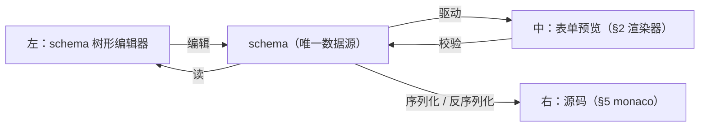

## 4. JSON Schema 编辑器 / 配置可视化编辑器

**基础**：《进阶大纲》§5（monaco）+ §3（Setter）。增量——这次**编辑的对象是 schema 本身**（元编程视角）。

先把"元编程视角"说透，它决定了本章所有组件的分工。《进阶大纲》§2 里，schema 是**数据**——你写好一份 schema，动态表单把它渲染出来；§3 里，Setter 是**编辑值的控件**——Select、Switch、InputNumber。而本章，schema 变成了**被编辑的值**：树形编辑器在编辑一棵 schema 树，元信息面板是一堆 Setter 在编辑 schema 节点的字段——于是出现了一个套娃结构：**用 Setter 编辑 schema，schema 又驱动中间列的表单预览，预览表单里又是一堆 Setter**。三层各自独立：



一个贯穿全章的决策：**不引入中间模型，直接以标准 JSON Schema（draft-07 子集）为唯一数据源**。好处是导出零转换、ajv 直接吃、与后端契约一致；代价是必须直面 schema 协议里几个"反直觉"的设计（后面会逐个踩到，第一个就是 `required` 不挂在字段上而挂在父对象上）。Stoplight、jsonschema.net 这类产品也是这么选的——编辑器壳再复杂，内核永远是"一份 schema JSON 的结构化编辑"。

### 实现路线

1. 树形 schema 编辑器：字段增删、类型切换、拖拽排序（树 = 递归渲染 + dnd-kit）
2. 元信息面板：type/title/required/enum/default/description 的 Setter 表单
3. **双视图同步**：左"表单树"右"源码"，切换时机（失焦切换/脏状态保护），源码光标 ↔ 树节点互跳（JSONPath 定位）
4. 实时校验闭环：编辑 schema → ajv 实时校验右侧样例数据 → 错误高亮
5. `$ref` / `definitions`：引用节点折叠展示与跳转链接

### 路线 1：树形 schema 编辑器 —— 递归渲染 + dnd-kit 树拖拽

**是什么**。把 `properties`/`items` 嵌套结构渲染成一棵可操作的树：每行显示字段名、类型徽标、title 预览；object 节点下挂子字段，array 节点下挂唯一的 `items` 行；行上可增删字段、改字段名、拖拽换位（同级排序 + 跨级移动）。

**为什么需要**。schema 的嵌套深度无上限，必然复用《进阶大纲》§1 的递归渲染器思路；而"拖拽排序"在树上有三种语义（拖到某行**上方**=成为其前兄弟、**下方**=后兄弟、**中间**=成为其子字段），比平铺列表的 dnd 复杂一层——这正是本章相对 §4 拖拽大盘的增量。

**怎么做（机制分步）**：

1. 定义 schema 类型（未 UI 化的关键字用索引签名保留，编辑器不许丢用户手写的 `minLength`）。
2. **扁平化**：递归渲染不等于递归挂 dnd。dnd-kit 需要一个平铺的行列表做碰撞检测，我们把"可见的"树节点拍平成 `Row[]`（折叠的不进列表），行的 id 直接用 JSONPath——这样行的地址和右侧源码的地址是**同一套坐标**，路线 3 的互跳就免费了。
3. 每行用 `useSortable` 注册；`DndContext.onDragMove` 里根据指针在目标行内的**纵向比例**计算落区（上 30% / 中 40% / 下 30%，中间区仅在目标是 object 时生效），画出插入线/高亮框。
4. `onDragEnd` 用不可变路径操作改 schema：同级重排 = 重排 `properties` 的键序（JS 对象键序即展示序）；跨级移动 = 从旧父级删除 + 插入新父级（键冲突自动改名）；同时**禁止把节点拖进自己的子孙**。
5. 删除/重命名字段时，同步维护父节点的 `required` 数组（本章第一坑，见"难点与坑"）。

**代码**。先定类型与路径工具（不可变操作是树编辑的地基，值得手写一遍而不是 immer 一把梭——路径语义要暴露给 dnd 落点计算）：

```ts
// src/schema-workbench/schemaTypes.ts
export type JsonType = 'string' | 'number' | 'integer' | 'boolean' | 'object' | 'array' | 'null';

export interface JsonSchemaNode {
  type?: JsonType;
  title?: string;
  description?: string;
  default?: unknown;
  enum?: (string | number)[];
  $ref?: string;
  properties?: Record<string, JsonSchemaNode>; // type=object：子字段（键序即展示序）
  items?: JsonSchemaNode;                      // type=array：唯一子节点
  required?: string[];                         // ★ 挂在 object 自身，不是挂在子字段上
  [key: string]: unknown;                      // minLength 等：原样保留，UI 不删用户数据
}

/** '$.properties.user.items' → ['properties','user','items']
 *  本编辑器的树只经 properties/items 下钻（无数组下标），按 '.' 切分即可 */
export function pathToSegs(path: string): string[] {
  return path.slice(2).split('.').filter(Boolean);
}

/** 不可变读取：按 segs 逐层下钻 */
export function getAt(root: JsonSchemaNode, segs: string[]): unknown {
  let cur: unknown = root;
  for (const s of segs) {
    if (cur === null || typeof cur !== 'object') return undefined;
    cur = (cur as Record<string, unknown>)[s];
  }
  return cur;
}

/** 不可变写入：写时复制路径上的每一层（copy-on-write），返回新根 */
export function setAt<T extends object>(obj: T, segs: string[], value: unknown): T {
  const [head, ...rest] = segs;
  if (rest.length === 0) {
    const copy = Array.isArray(obj) ? ([...obj] as unknown as T) : { ...obj };
    (copy as Record<string, unknown>)[head] = value;
    return copy;
  }
  const child = (obj as Record<string, unknown>)[head];
  const copy = Array.isArray(obj) ? ([...obj] as unknown as T) : { ...obj };
  (copy as Record<string, unknown>)[head] = setAt(
    (child ?? {}) as Record<string, unknown>,
    rest,
    value,
  ) as unknown;
  return copy;
}

/** 删除属性节点时连带清理由此产生的 required 残留 */
export function deleteProperty(root: JsonSchemaNode, parentPath: string, key: string): JsonSchemaNode {
  const parentSegs = pathToSegs(parentPath);
  const parent = getAt(root, parentSegs) as JsonSchemaNode;
  const nextProperties = { ...(parent.properties ?? {}) };
  delete nextProperties[key];
  const nextRequired = (parent.required ?? []).filter((k) => k !== key);
  const nextParent: JsonSchemaNode = {
    ...parent,
    properties: nextProperties,
    ...(parent.required ? { required: nextRequired } : {}),
  };
  return setAt(root, parentSegs, nextParent);
}

/** 同级重排：利用"对象键序即展示序"重建 properties */
export function reorderProperty(
  root: JsonSchemaNode,
  parentPath: string,
  fromKey: string,
  toIndex: number,
): JsonSchemaNode {
  const parentSegs = pathToSegs(parentPath);
  const parent = getAt(root, parentSegs) as JsonSchemaNode;
  const entries = Object.entries(parent.properties ?? {});
  const from = entries.findIndex(([k]) => k === fromKey);
  if (from < 0) return root;
  const [moved] = entries.splice(from, 1);
  const adjusted = from < toIndex ? toIndex - 1 : toIndex; // 删除导致的索引前移要补偿
  entries.splice(adjusted, 0, moved);
  return setAt(root, parentSegs, { ...parent, properties: Object.fromEntries(entries) });
}

/** 跨级移动：删除 + 插入；目标已有同名键时自动改名（key、key-2、key-3…） */
export function moveProperty(
  root: JsonSchemaNode,
  fromParentPath: string,
  key: string,
  toParentPath: string,
  toIndex: number,
): JsonSchemaNode {
  if (fromParentPath === toParentPath) return reorderProperty(root, fromParentPath, key, toIndex);
  const fromSegs = pathToSegs(fromParentPath);
  const toSegs = pathToSegs(toParentPath);
  const fromParent = getAt(root, fromSegs) as JsonSchemaNode;
  const toParent = getAt(root, toSegs) as JsonSchemaNode;
  const movedNode = fromParent.properties?.[key];
  if (!movedNode) return root;

  // 防环：目标父级不能是自己的子孙
  if (toParentPath === `${fromParentPath}.${key}` || toParentPath.startsWith(`${fromParentPath}.${key}.`)) {
    return root;
  }

  const nextRoot = deleteProperty(root, fromParentPath, key);
  const freshTo = getAt(nextRoot, toSegs) as JsonSchemaNode; // 删除后父级对象已换新引用
  const entries = Object.entries(freshTo.properties ?? {});
  let finalKey = key;
  const existing = new Set(entries.map(([k]) => k));
  let n = 2;
  while (existing.has(finalKey)) finalKey = `${key}-${n++}`;
  entries.splice(Math.min(toIndex, entries.length), 0, [finalKey, movedNode]);
  const withInserted: JsonSchemaNode = { ...freshTo, properties: Object.fromEntries(entries) };
  const finalRoot = setAt(nextRoot, toSegs, withInserted);
  // 键改名时 required 同步迁移
  if (finalKey !== key && (fromParent.required ?? []).includes(key)) {
    const toRequired = [...(withInserted.required ?? []), finalKey];
    return setAt(finalRoot, toSegs, { ...withInserted, required: toRequired });
  }
  return finalRoot;
}
```

扁平化与递归渲染：

```ts
// src/schema-workbench/flatten.ts
import type { JsonSchemaNode } from './schemaTypes';

export interface Row {
  id: string;          // JSONPath，与右侧源码同一套地址系统
  parentPath: string | null;
  key: string;         // 字段名；array 的子行固定为 'items'
  node: JsonSchemaNode;
  depth: number;
  expandable: boolean; // 有 properties 或 items 即可展开
}

export function isExpandable(node: JsonSchemaNode): boolean {
  return Boolean(node.items) || Object.keys(node.properties ?? {}).length > 0;
}

export function flattenRows(root: JsonSchemaNode, expanded: Set<string>): Row[] {
  const rows: Row[] = [{ id: '$', parentPath: null, key: '$', node: root, depth: 0, expandable: isExpandable(root) }];
  const walk = (node: JsonSchemaNode, parentId: string, depth: number) => {
    const entries: [string, JsonSchemaNode][] = Object.entries(node.properties ?? {});
    if (node.items) entries.push(['items', node.items]);
    for (const [key, child] of entries) {
      const id = key === 'items' ? `${parentId}.items` : `${parentId}.${key}`;
      rows.push({ id, parentPath: parentId, key, node: child, depth, expandable: isExpandable(child) });
      if (isExpandable(child) && expanded.has(id)) walk(child, id, depth + 1);
    }
  };
  if (expanded.has('$')) walk(root, '$', 1);
  return rows;
}
```

dnd 树主体（落区计算 + 拖拽视觉 + 增删改的胶水）：

```tsx
// src/schema-workbench/SchemaTree.tsx
import { useState, useRef, useMemo } from 'react';
import {
  DndContext, DragOverlay, PointerSensor, useSensor, useSensors,
  type DragStartEvent, type DragMoveEvent, type DragEndEvent,
} from '@dnd-kit/core';
import { SortableContext, useSortable, verticalListSortingStrategy } from '@dnd-kit/sortable';
import { CSS } from '@dnd-kit/utilities';
import type { JsonSchemaNode } from './schemaTypes';
import { flattenRows, isExpandable, type Row } from './flatten';
import { moveProperty, reorderProperty, deleteProperty, setAt, pathToSegs, getAt } from './schemaTypes';

type DropZone = { targetId: string; mode: 'before' | 'after' | 'inside' } | null;

const TYPE_COLORS: Record<string, string> = {
  string: '#1890ff', number: '#722ed1', integer: '#722ed1', boolean: '#13c2c2',
  object: '#fa8c16', array: '#eb2f96', null: '#8c8c8c',
};

export function SchemaTree({
  schema, expanded, selectedId,
  onSchemaChange, onExpandedChange, onSelect,
}: {
  schema: JsonSchemaNode;
  expanded: Set<string>;
  selectedId: string | null;
  onSchemaChange: (next: JsonSchemaNode) => void;
  onExpandedChange: (next: Set<string>) => void;
  onSelect: (id: string) => void;
}) {
  const rows = useMemo(() => flattenRows(schema, expanded), [schema, expanded]);
  const [draggingId, setDraggingId] = useState<string | null>(null);
  const [dropZone, setDropZone] = useState<DropZone>(null);
  const rowRefs = useRef(new Map<string, HTMLDivElement>());

  // pointerSensor 设 5px 激活距离：避免点选行时误判为拖拽
  const sensors = useSensors(useSensor(PointerSensor, { activationConstraint: { distance: 5 } }));

  const findRow = (id: string) => rows.find((r) => r.id === id);

  const onDragStart = (e: DragStartEvent) => setDraggingId(String(e.active.id));

  // 核心：指针纵向位置 → before / inside / after 三落区
  const onDragMove = (e: DragMoveEvent) => {
    const overId = e.over?.id ? String(e.over.id) : null;
    if (!overId || overId === draggingId || overId === '$') { setDropZone(null); return; }
    const rowEl = rowRefs.current.get(overId);
    const target = findRow(overId);
    if (!rowEl || !target || !draggingId) { setDropZone(null); return; }

    // 防环：目标在拖拽节点的子树里 → 不给任何落区
    if (overId === `${draggingId}` || overId.startsWith(`${draggingId}.`)) { setDropZone(null); return; }

    const rect = rowEl.getBoundingClientRect();
    const pointerY = (e.activatorEvent as PointerEvent).clientY + e.delta.y; // 起点 + 位移 = 当前指针
    const ratio = (pointerY - rect.top) / rect.height;
    const canInside = target.key !== 'items' && (target.node.type === 'object' || !target.node.type) && target.id !== '$';
    const mode: 'before' | 'after' | 'inside' =
      ratio < 0.3 ? 'before' : ratio > 0.7 ? 'after' : canInside ? 'inside' : ratio < 0.5 ? 'before' : 'after';
    setDropZone({ targetId: overId, mode });
  };

  const onDragEnd = (e: DragEndEvent) => {
    const activeId = String(e.active.id);
    setDraggingId(null);
    const zone = dropZone;
    setDropZone(null);
    if (!zone || zone.targetId === activeId) return;

    const source = findRow(activeId)!;
    const target = findRow(zone.targetId)!;
    if (source.key === 'items' || target.id === '$') return; // items 行（array 的子节点）不参与移动

    if (zone.mode === 'inside') {
      // 成为目标的最后一个子字段
      const targetProps = Object.keys(target.node.properties ?? {}).length;
      onSchemaChange(moveProperty(schema, source.parentPath!, source.key, target.id, targetProps));
      onExpandedChange(new Set([...expanded, target.id])); // 落进去后自动展开，给用户即时反馈
    } else {
      // 同级：重排；跨级：插入为目标的前/后兄弟
      const sameParent = source.parentPath === target.parentPath;
      const targetIndex = Object.keys(
        (getAt(schema, pathToSegs(target.parentPath!)) as JsonSchemaNode).properties ?? {},
      ).indexOf(target.key);
      const insertAt = zone.mode === 'before' ? targetIndex : targetIndex + 1;
      if (sameParent) {
        onSchemaChange(reorderProperty(schema, source.parentPath!, source.key, insertAt));
      } else {
        onSchemaChange(moveProperty(schema, source.parentPath!, source.key, target.parentPath!, insertAt));
      }
    }
  };

  const addProperty = (parentId: string) => {
    const segs = pathToSegs(parentId);
    const parent = getAt(schema, segs) as JsonSchemaNode;
    const existing = new Set(Object.keys(parent.properties ?? {}));
    let key = 'field';
    let n = 2;
    while (existing.has(key)) key = `field${n++}`;
    const next = setAt(schema, segs, {
      ...parent,
      properties: { ...(parent.properties ?? {}), [key]: { type: 'string', title: key } },
    }) as JsonSchemaNode;
    onSchemaChange(next);
    onSelect(parentId === '$' ? `$.${key}` : `${parentId}.${key}`);
  };

  const draggingRow = draggingId ? findRow(draggingId) : null;

  return (
    <DndContext
      sensors={sensors}
      onDragStart={onDragStart}
      onDragMove={onDragMove}
      onDragEnd={onDragEnd}
      onDragCancel={() => { setDraggingId(null); setDropZone(null); }}
    >
      <SortableContext items={rows.map((r) => r.id)} strategy={verticalListSortingStrategy}>
        {rows.map((row) => (
          <TreeRow
            key={row.id}
            row={row}
            schema={schema}
            expanded={expanded}
            selectedId={selectedId}
            dropZone={dropZone?.targetId === row.id ? dropZone.mode : null}
            registerRef={(el) => {
              if (el) rowRefs.current.set(row.id, el);
              else rowRefs.current.delete(row.id);
            }}
            onSelect={onSelect}
            onToggle={() => {
              const next = new Set(expanded);
              next.has(row.id) ? next.delete(row.id) : next.add(row.id);
              onExpandedChange(next);
            }}
            onAdd={addProperty}
            onDelete={(rowToDelete) => onSchemaChange(deleteProperty(schema, rowToDelete.parentPath!, rowToDelete.key))}
          />
        ))}
      </SortableContext>
      {/* 拖拽幽灵：跟手预览，原行半透明 */}
      <DragOverlay>
        {draggingRow ? (
          <div style={{ background: '#fff', border: '1px solid #d9d9d9', borderRadius: 4, padding: '4px 8px', boxShadow: '0 4px 12px rgba(0,0,0,.12)' }}>
            {draggingRow.key} : {draggingRow.node.type ?? 'object'}
          </div>
        ) : null}
      </DragOverlay>
    </DndContext>
  );
}

function TreeRow({
  row, schema, expanded, selectedId, dropZone, registerRef,
  onSelect, onToggle, onAdd, onDelete,
}: {
  row: Row;
  schema: JsonSchemaNode;
  expanded: Set<string>;
  selectedId: string | null;
  dropZone: 'before' | 'after' | 'inside' | null;
  registerRef: (el: HTMLDivElement | null) => void;
  onSelect: (id: string) => void;
  onToggle: () => void;
  onAdd: (parentId: string) => void;
  onDelete: (row: Row) => void;
}) {
  const { attributes, listeners, setNodeRef, setActivatorNodeRef, transform, transition, isDragging } = useSortable({ id: row.id });
  const required = row.parentPath
    ? ((getAt(schema, pathToSegs(row.parentPath)) as JsonSchemaNode).required ?? []).includes(row.key)
    : false;

  return (
    <div
      ref={registerRef}
      style={{
        display: 'flex', alignItems: 'center', gap: 4,
        paddingLeft: row.depth * 18 + 4,
        height: 30, opacity: isDragging ? 0.4 : 1,
        transform: CSS.Transform.toString(transform), transition,
        background: selectedId === row.id ? '#e6f4ff' : undefined,
        borderTop: dropZone === 'before' ? '2px solid #1890ff' : undefined,
        borderBottom: dropZone === 'after' ? '2px solid #1890ff' : undefined,
        outline: dropZone === 'inside' ? '2px solid #1890ff' : undefined,
        cursor: 'default',
      }}
    >
      <span
        onClick={row.expandable ? onToggle : undefined}
        style={{ width: 16, cursor: row.expandable ? 'pointer' : 'default', color: '#999', fontSize: 10 }}
      >
        {row.expandable ? (expanded.has(row.id) ? '▼' : '▶') : ''}
      </span>
      {/* ⠿ 拖拽把手：把手才是 drag activator，行本体留给点击选中 */}
      <span ref={setActivatorNodeRef} {...attributes} {...listeners} style={{ cursor: 'grab', color: '#bbb', fontSize: 12 }}>⠿</span>
      <span onClick={() => onSelect(row.id)} style={{ cursor: 'pointer', fontWeight: 500 }}>
        {row.key}
        {required && <span style={{ color: '#ff4d4f' }}> *</span>}
      </span>
      <span style={{ fontSize: 10, padding: '0 6px', borderRadius: 3, background: TYPE_COLORS[row.node.type ?? 'object'] ?? '#d9d9d9', color: '#fff' }}>
        {row.node.type ?? 'object'}
      </span>
      {row.node.title && row.node.title !== row.key && (
        <span style={{ color: '#8c8c8c', fontSize: 12 }}>{row.node.title}</span>
      )}
      <span style={{ marginLeft: 'auto', display: 'flex', gap: 6 }}>
        {(row.node.type === 'object' || !row.node.type) && row.key !== 'items' && (
          <button onClick={() => onAdd(row.id)} title="加子字段">＋</button>
        )}
        {row.key !== 'items' && row.id !== '$' && (
          <button onClick={() => onDelete(row)} title="删除字段">×</button>
        )}
      </span>
    </div>
  );
}
```

**常见坑（症状 → 根因 → 修法）**：

- 症状：拖拽跨级移动后，字段"消失"了，预览表单里却仍有一个同名的幽灵必填项。根因：`required` 挂在**旧父对象**上，移动只搬了 `properties`，没搬 `required`；`deleteProperty` 清了旧父的 required，但插入新父时若键被自动改名，required 没跟着改名。修法：上面 `moveProperty` 末尾的 required 迁移逻辑——**凡是动 `properties` 键的操作（删、改名、移动），都必须把 required 数组当作它的影子同步维护**。这是 schema 编辑器与普通树编辑器最大的协议差异。
- 症状：把字段拖进自己的子级，整棵子树凭空消失（数据没丢但渲染栈溢出或树断裂）。根因：树落点没有防环校验，`A.properties.self = A` 造成循环引用。修法：`onDragMove` 里判断目标 id 是否以 `${draggingId}.` 开头（同一地址系统的好处：字符串前缀判断就是子孙判断），是则不给落区。

### 路线 2：元信息面板 —— 每个元字段一个 Setter

**是什么**。右侧（或左侧第二栏）一张表单，编辑选中节点的元信息：`type`、`title`、`required`、`enum`、`default`、`description`。每个字段就是一个 §3 的 Setter——受控组件，`{value, onChange}` 签名。

**为什么需要**。树只解决"结构"（有哪些字段、怎么嵌套），元信息解决"语义"（这个字段叫什么、必填吗、枚举值有哪些）。把两者拆开，树保持轻（一行 30px 能塞下），元信息面板按 type 条件渲染——这是 schema 编辑器信息密度的关键取舍：**结构操作在树上、语义编辑在面板上**，比 Notion 式"全部内联"效率高得多。

**怎么做**。每个元字段一个小组件，全部遵循 §3 Setter 约定；面板按 `node.type` 决定显示哪些 Setter：

- `type`：Select。**切类型是破坏性操作**（object→string 会丢整棵子树），要二次确认；切换后清洗不兼容的元字段（见坑 3）。
- `title`：Input，失焦提交（避免每个字符触发一次全树重渲染）。
- `required`：Switch。写入位置在**父节点**的 `required` 数组—— Setter 操作的目标和它所在面板的节点不是同一个对象，这是元编程的典型错位。
- `enum`：标签编辑器（string 逐项 Input + 回车加入；number 用 InputNumber）。
- `default`：按 type 分发——string→Input、number→InputNumber、boolean→Switch、object/array→JSON 多行文本（带解析错误行内提示）。default 还要**过一遍 enum 校验**：default 不在 enum 里是用户最常见的自相矛盾。
- `description`：Textarea。

**代码**（面板主体 + 最有代表性的三个 Setter）：

```tsx
// src/schema-workbench/MetaPanel.tsx
import { useEffect, useState } from 'react';
import type { JsonSchemaNode, JsonType } from './schemaTypes';
import { setAt, pathToSegs, getAt } from './schemaTypes';

export function MetaPanel({
  schema, selectedId, onSchemaChange,
}: {
  schema: JsonSchemaNode;
  selectedId: string;
  onSchemaChange: (next: JsonSchemaNode) => void;
}) {
  const segs = pathToSegs(selectedId);
  const node = (segs.length === 0 ? schema : getAt(schema, segs)) as JsonSchemaNode;
  const parent = selectedId.includes('.')
    ? (getAt(schema, segs.slice(0, -1)) as JsonSchemaNode)
    : null;
  const key = segs.length ? segs[segs.length - 1]! : '$';

  // 局部写 helper：改当前节点的某个字段
  const patch = (partial: Partial<JsonSchemaNode>) => {
    const next = { ...node, ...partial };
    // type 切换时清洗不兼容元字段，避免残留脏数据
    if (partial.type && partial.type !== node.type) {
      if (partial.type !== 'string' && partial.type !== 'number' && partial.type !== 'integer') delete next.enum;
      if (next.type !== 'array') delete next.items;
      if (next.type !== 'object') { delete next.properties; delete next.required; }
      if (next.type === 'object' || next.type === 'array') delete next.default;
    }
    onSchemaChange(segs.length === 0 ? (next as JsonSchemaNode) : (setAt(schema, segs, next) as JsonSchemaNode));
  };

  // required 写在父节点上：读父算当前值，写父改数组
  const required = parent?.required?.includes(key) ?? false;
  const toggleRequired = (v: boolean) => {
    if (!parent) return;
    const segsParent = segs.slice(0, -1);
    const arr = new Set(parent.required ?? []);
    v ? arr.add(key) : arr.delete(key);
    const nextParent = { ...parent, required: [...arr] };
    onSchemaChange(setAt(schema, segsParent, nextParent) as JsonSchemaNode);
  };

  return (
    <div style={{ display: 'grid', gap: 12, padding: 12 }}>
      <Field label="字段名">
        <input
          defaultValue={key}
          disabled={!parent || key === 'items'}
          onBlur={(e) => {
            const nextKey = e.target.value.trim();
            if (!parent || !nextKey || nextKey === key) return;
            if (Object.keys(parent.properties ?? {}).includes(nextKey)) {
              e.target.value = key; // 重名：回滚 + 行内提示（真实项目换成受控错误态）
              return;
            }
            const entries = Object.entries(parent.properties ?? {}).map(([k, v]) => [k === key ? nextKey : k, v] as const);
            const nextParent: JsonSchemaNode = { ...parent, properties: Object.fromEntries(entries) };
            const withRequired = parent.required?.includes(key)
              ? { ...nextParent, required: (parent.required ?? []).map((k) => (k === key ? nextKey : k)) }
              : nextParent;
            onSchemaChange(setAt(schema, segs.slice(0, -1), withRequired) as JsonSchemaNode);
          }}
          style={inputStyle}
        />
      </Field>

      <Field label="类型">
        <select value={node.type ?? 'object'} onChange={(e) => {
          const nextType = e.target.value as JsonType;
          const willLoseChildren = (node.properties || node.items) && nextType !== 'object' && nextType !== 'array';
          if (willLoseChildren && !window.confirm(`切换为 ${nextType} 将丢弃子字段，确定？`)) return;
          patch({ type: nextType });
        }} style={inputStyle}>
          {(['string', 'number', 'integer', 'boolean', 'object', 'array'] as JsonType[]).map((t) => (
            <option key={t} value={t}>{t}</option>
          ))}
        </select>
      </Field>

      <Field label="标题（title）">
        <InputCommit initial={node.title} onCommit={(v) => patch({ title: v || undefined })} />
      </Field>

      <Field label="必填（required，写于父对象）">
        <input type="checkbox" checked={required} onChange={(e) => toggleRequired(e.target.checked)} />
      </Field>

      {(node.type === 'string' || node.type === 'number' || node.type === 'integer') && (
        <Field label="枚举（enum）">
          <EnumSetter value={node.enum} isNumber={node.type !== 'string'} onChange={(enum_) => patch({ enum: enum_ })} />
        </Field>
      )}

      <Field label="默认值（default）">
        <DefaultSetter node={node} onChange={(d) => patch({ default: d })} />
      </Field>

      <Field label="描述（description）">
        <textarea
          defaultValue={node.description}
          onBlur={(e) => patch({ description: e.target.value || undefined })}
          rows={3} style={inputStyle}
        />
      </Field>
    </div>
  );
}

const inputStyle: React.CSSProperties = { width: '100%', padding: '4px 8px', border: '1px solid #d9d9d9', borderRadius: 4, boxSizing: 'border-box' };

function Field({ label, children }: { label: string; children: React.ReactNode }) {
  return (
    <label style={{ display: 'grid', gap: 4, fontSize: 12, color: '#555' }}>
      <span>{label}</span>
      {children}
    </label>
  );
}

/** 失焦才提交的受控 Input：打字不触发上层 schema 更新 */
function InputCommit({ initial, onCommit }: { initial: string | undefined; onCommit: (v: string) => void }) {
  const [text, setText] = useState(initial ?? '');
  useEffect(() => setText(initial ?? ''), [initial]);
  return <input value={text} onChange={(e) => setText(e.target.value)} onBlur={() => onCommit(text)} style={inputStyle} />;
}

/** enum Setter：string 用标签流，number 强转数值；并联动校验 default 是否仍在枚举内 */
function EnumSetter({ value, isNumber, onChange }: { value: (string | number)[] | undefined; isNumber: boolean; onChange: (v: (string | number)[]) => void }) {
  const [draft, setDraft] = useState('');
  const items = value ?? [];
  const add = () => {
    const t = draft.trim();
    if (!t || items.includes(isNumber ? Number(t) : t)) return;
    onChange([...items, isNumber ? Number(t) : t]);
    setDraft('');
  };
  return (
    <div style={{ display: 'flex', flexWrap: 'wrap', gap: 4, alignItems: 'center' }}>
      {items.map((it, i) => (
        <span key={`${it}-${i}`} style={{ background: '#f0f5ff', border: '1px solid #adc6ff', borderRadius: 3, padding: '1px 6px', fontSize: 12 }}>
          {String(it)}
          <button onClick={() => onChange(items.filter((_, j) => j !== i))} style={{ border: 'none', background: 'none', cursor: 'pointer', color: '#999' }}>×</button>
        </span>
      ))}
      <input
        value={draft}
        type={isNumber ? 'number' : 'text'}
        onChange={(e) => setDraft(e.target.value)}
        onKeyDown={(e) => { if (e.key === 'Enter') { e.preventDefault(); add(); } }}
        onBlur={add}
        placeholder="输入后回车"
        style={{ width: 110, padding: '2px 6px', border: '1px solid #d9d9d9', borderRadius: 4 }}
      />
    </div>
  );
}

/** default Setter：按 type 分发控件；object/array 走 JSON 文本 + 即时解析反馈 */
function DefaultSetter({ node, onChange }: { node: JsonSchemaNode; onChange: (d: unknown) => void }) {
  const [jsonText, setJsonText] = useState(node.default === undefined ? '' : JSON.stringify(node.default, null, 2));
  const [jsonError, setJsonError] = useState<string | null>(null);
  useEffect(() => setJsonText(node.default === undefined ? '' : JSON.stringify(node.default, null, 2)), [node.default]);

  switch (node.type) {
    case 'boolean':
      return <input type="checkbox" checked={node.default === true} onChange={(e) => onChange(e.target.checked)} />;
    case 'object':
    case 'array': {
      const commit = (text: string) => {
        if (!text.trim()) { onChange(undefined); setJsonError(null); return; }
        try {
          const parsed = JSON.parse(text) as unknown;
          setJsonError(null);
          onChange(parsed);
        } catch (err) {
          setJsonError((err as Error).message); // 解析失败：不写回 schema，行内报错
        }
      };
      return (
        <div>
          <textarea value={jsonText} onChange={(e) => setJsonText(e.target.value)} onBlur={(e) => commit(e.target.value)} rows={4} style={inputStyle} />
          {jsonError && <div style={{ color: '#ff4d4f', fontSize: 12 }}>{jsonError}</div>}
        </div>
      );
    }
    case 'number':
    case 'integer': {
      const num = typeof node.default === 'number' ? node.default : undefined;
      const inEnum = !node.enum || num === undefined || node.enum.includes(num);
      return (
        <div>
          <input type="number" value={num ?? ''} onChange={(e) => onChange(e.target.value === '' ? undefined : Number(e.target.value))} style={inputStyle} />
          {!inEnum && <div style={{ color: '#fa8c16', fontSize: 12 }}>default 不在 enum 内</div>}
        </div>
      );
    }
    default: // string
      return (
        <InputCommit initial={typeof node.default === 'string' ? node.default : undefined} onCommit={(v) => onChange(v || undefined)} />
      );
  }
}
```

**常见坑（症状 → 根因 → 修法）**：症状——type 从 string 切成 object 后，enum 标签还残留在 schema 里，导出给后端时被严格校验器拒绝。根因：元字段与 type 是**多对一**关系（enum 只对三种标量合法，items 只对 array 合法），Setter 各改各的，没人负责联动清理。修法：`patch` 里的类型切换清洗段——**type 变更必须携带一次元字段相容性清洗**，这段逻辑写在面板（唯一知道"变了什么"的地方），而不是分散在每个 Setter 里。

### 路线 3：双视图同步 —— 切换时机与光标 ↔ JSONPath 互跳

**是什么**。左树（含元信息面板）与右侧 monaco 源码编辑同一份 schema，两边要同步：结构同步（树改了，源码变；源码改了，树变）+ 光标同步（光标落在源码某属性上，树高亮该节点；点树节点，源码滚过去并选中）。

**为什么需要**。树视图善于结构操作但看不见"原始真相"；源码视图精确但手写嵌套 JSON 极易出错。双视图 = 两种用户（配置员 / 程序员）+ 两种任务（结构 / 精修）各取所需。同步做不好（互相覆盖、光标乱跳），双视图就从生产力变成数据丢失事故现场。

**怎么做——先解决"谁是权威"**。两套策略，代码里做成可切换：

- **策略 A：失焦切换（blur-commit）**。默认树是权威；用户点进源码 → 源码变权威，此刻把最新 schema 序列化进编辑器（一次性 `setValue`）；源码编辑期间树**冻结**在进入时的快照；源码失焦（blur）或切换回树时，尝试 `JSON.parse`：成功 → 写回 schema、树解冻；失败 → 阻止切换 + 错误提示。适合"偶尔去源码改一改"的团队。
- **策略 B：脏状态保护（dirty-guard）**。两个视图永远同时展示，源码一被编辑就置 `codeDirty`；dirty 期间禁止树编辑（树面板遮罩 + "源码有未应用的修改"），同时对源码做 400ms 防抖解析，一旦解析成功就自动应用回 schema 并清 dirty。好处是**任何时刻都不会有第二份真相**；代价是 dirty 期间树只读。Stoplight Studio 的表单/代码模式就是 B 的变体（显式"应用"按钮）。

两策略共用一个控制器：

```ts
// src/schema-workbench/useDualView.ts
import { useCallback, useEffect, useRef, useState } from 'react';
import type { JsonSchemaNode } from './schemaTypes';

export type DualViewMode = 'tree' | 'code';
export type SyncStrategy = 'blur-commit' | 'dirty-guard';

export function useDualView(initialSchema: JsonSchemaNode, strategy: SyncStrategy) {
  const [mode, setMode] = useState<DualViewMode>('tree');
  const [schema, setSchema] = useState(initialSchema);            // 权威 schema（树消费）
  const [code, setCode] = useState(() => JSON.stringify(initialSchema, null, 2)); // 源码文本（monaco 消费）
  const [codeDirty, setCodeDirty] = useState(false);               // 源码有未应用修改
  const [codeError, setCodeError] = useState<string | null>(null); // 源码当前解析错误
  const lastGoodCode = useRef(code);                               // 最近一次可解析的源码（树冻结用）
  const timer = useRef<number | undefined>(undefined);

  // dirty-guard：源码编辑后防抖解析，合法即自动应用
  const onCodeChange = useCallback((next: string) => {
    setCode(next);
    setCodeDirty(true);
    setCodeError(null);
    if (strategy !== 'dirty-guard') return;
    window.clearTimeout(timer.current);
    timer.current = window.setTimeout(() => {
      try {
        const parsed = JSON.parse(next) as JsonSchemaNode;
        lastGoodCode.current = next;
        setSchema(parsed);   // 合法 → 立即成为新的权威
        setCodeDirty(false); // dirty 清除，树解除冻结
      } catch (err) {
        setCodeError((err as Error).message); // 非法 → 保持 dirty，树继续冻结
      }
    }, 400);
  }, [strategy]);

  // blur-commit：失焦时一次性提交
  const onCodeBlur = useCallback(() => {
    if (strategy !== 'blur-commit' || !codeDirty) return;
    try {
      const parsed = JSON.parse(code) as JsonSchemaNode;
      lastGoodCode.current = code;
      setSchema(parsed);
      setCodeDirty(false);
      setCodeError(null);
    } catch (err) {
      setCodeError((err as Error).message); // 失焦但非法：不切走、不丢字
    }
  }, [code, codeDirty, strategy]);

  // 树 → 源码：把权威 schema 序列化进源码（仅 blur-commit 且源码不脏时）
  const onSchemaChange = useCallback((next: JsonSchemaNode) => {
    setSchema(next);
    if (strategy === 'blur-commit' && !codeDirty) {
      const text = JSON.stringify(next, null, 2);
      setCode(text);
      lastGoodCode.current = text;
    }
    // dirty-guard 下 code 由防抖解析回写，树永远不改源码文本，避免覆盖用户输入
  }, [codeDirty, strategy]);

  const switchTo = useCallback((next: DualViewMode) => {
    if (next === 'tree' && codeDirty) {
      try {
        const parsed = JSON.parse(code) as JsonSchemaNode;
        setSchema(parsed);
        setCodeDirty(false);
        setCodeError(null);
        setMode('tree');
      } catch {
        setCodeError('源码不是合法 JSON，无法切回树视图'); // 拒绝切换：脏保护兜底
      }
      return;
    }
    setMode(next);
  }, [code, codeDirty]);

  useEffect(() => () => window.clearTimeout(timer.current), []);

  return {
    mode, switchTo, schema, onSchemaChange,
    code, onCodeChange, onCodeBlur, codeDirty, codeError,
    frozenCode: lastGoodCode, // 树冻结时渲染的快照
  };
}
```

**光标 ↔ JSONPath 互跳——地址系统**。双向同步的本质是给每个 schema 节点建一个"双地址"：树侧是 JSONPath（`$.properties.user.properties.name`，就是路线 1 的 Row.id），源码侧是文本 offset 区间。`JSON.parse` 不给位置，需要一个扫描器。生产可用 `json-source-map` 一步拿到 pointer→区间映射；这里手写（它同时是路线 4 把 ajv 错误映射回文本的基石）：

```ts
// src/schema-workbench/pathMap.ts —— 文本 offset ↔ JSONPath 的地址系统
export interface NodeRef {
  path: string;    // '$.properties.user.properties.name'
  isKey: boolean;  // true = 键名 token（"name" 这两个引号之间），false = 值或容器
  start: number;   // 文本区间 [start, end)，字符 offset
  end: number;
}
export interface PathMap {
  nodes: NodeRef[];  // 按 start 升序（递归下降天然有序）
  value: unknown;    // 顺手返回解析结果，省一次 JSON.parse
}

/** 简化 JSON 扫描器：对象/数组/字符串（含转义）/数字/true/false/null；不合法返回 null */
export function buildPathMap(text: string): PathMap | null {
  let pos = 0;
  const nodes: NodeRef[] = [];
  const ws = () => { while (pos < text.length && ' \t\r\n'.includes(text[pos]!)) pos++; };
  const ch = () => text[pos];

  function str(): { v: string; s: number; e: number } {
    const s = pos;
    pos++; // 开头引号
    let raw = '';
    while (pos < text.length && ch() !== '"') {
      if (ch() === '\\') { raw += text[pos]! + (text[pos + 1] ?? ''); pos += 2; } // 转义原样保留，反转义交给 JSON.parse
      else { raw += text[pos]!; pos++; }
    }
    if (ch() !== '"') throw new Error('字符串未闭合');
    pos++;
    return { v: JSON.parse(`"${raw}"`) as string, s, e: pos };
  }

  function val(path: string): unknown {
    ws();
    const c = ch();
    if (c === '{') return obj(path);
    if (c === '[') return arr(path);
    if (c === '"') { const t = str(); nodes.push({ path, isKey: false, start: t.s, end: t.e }); return t.v; }
    const m = /^(?:true|false|null|-?\d+(?:\.\d+)?(?:[eE][+-]?\d+)?)/.exec(text.slice(pos));
    if (!m) throw new Error(`offset ${pos} 意外字符`);
    pos += m[0].length;
    nodes.push({ path, isKey: false, start: pos - m[0].length, end: pos });
    return m[0] === 'true' ? true : m[0] === 'false' ? false : m[0] === 'null' ? null : Number(m[0]);
  }

  function obj(path: string): Record<string, unknown> {
    const s = pos;
    pos++;
    const idx = nodes.length;
    nodes.push({ path, isKey: false, start: s, end: -1 }); // 容器 end 回填
    const out: Record<string, unknown> = {};
    ws();
    if (ch() === '}') { pos++; nodes[idx]!.end = pos; return out; }
    for (;;) {
      ws();
      const k = str();
      nodes.push({ path: `${path}.${k.v}`, isKey: true, start: k.s, end: k.e }); // 键单独记录：点树时高亮键更直观
      ws();
      if (ch() !== ':') throw new Error('对象缺少 :');
      pos++;
      out[k.v] = val(`${path}.${k.v}`);
      ws();
      if (ch() === ',') { pos++; continue; }
      if (ch() === '}') { pos++; break; }
      throw new Error('对象格式错误');
    }
    nodes[idx]!.end = pos;
    return out;
  }

  function arr(path: string): unknown[] {
    const s = pos;
    pos++;
    const idx = nodes.length;
    nodes.push({ path, isKey: false, start: s, end: -1 });
    const out: unknown[] = [];
    ws();
    if (ch() === ']') { pos++; nodes[idx]!.end = pos; return out; }
    for (;;) {
      out.push(val(`${path}[${out.length}]`));
      ws();
      if (ch() === ',') { pos++; continue; }
      if (ch() === ']') { pos++; break; }
      throw new Error('数组格式错误');
    }
    nodes[idx]!.end = pos;
    return out;
  }

  try {
    ws();
    const value = val('$');
    ws();
    if (pos !== text.length) throw new Error('根元素后有多余内容');
    return { nodes, value };
  } catch {
    return null; // 半成品文本（正删着括号）很常见：返回 null，调用方沿用旧映射
  }
}

/** 光标 offset → 命中的最深节点：nodes 有序，后命中（更深层）覆盖外层容器 */
export function pathAtOffset(nodes: NodeRef[], offset: number): NodeRef | null {
  let hit: NodeRef | null = null;
  for (const n of nodes) {
    if (n.start > offset) break;
    if (offset < n.end) hit = n;
  }
  return hit;
}

/** 反向：path → 文本区间（优先键名，键在行首更好认） */
export function rangeOfPath(nodes: NodeRef[], path: string): { start: number; end: number } | null {
  const keyNode = nodes.find((n) => n.path === path && n.isKey);
  const anyNode = nodes.find((n) => n.path === path);
  const t = keyNode ?? anyNode;
  return t ? { start: t.start, end: t.end } : null;
}
```

monaco 侧接线（两个方向 + 防环闸门）：

```tsx
// src/schema-workbench/CodePane.tsx
import { useEffect, useMemo, useRef, useState } from 'react';
import Editor, { type OnMount } from '@monaco-editor/react';
import type { editor as monacoEditor } from 'monaco-editor';
import { buildPathMap, pathAtOffset, rangeOfPath, type PathMap } from './pathMap';

export function CodePane({
  code, onChange, onBlur, highlightPath, onCursorPath,
}: {
  code: string;
  onChange: (next: string) => void;
  onBlur: () => void;
  highlightPath: string | null;      // 树点击 → 要定位/高亮的 path
  onCursorPath: (path: string | null) => void; // 光标移动 → 通知树
}) {
  const editorRef = useRef<monacoEditor.IStandaloneCodeEditor | null>(null);
  const monacoRef = useRef<typeof import('monaco-editor') | null>(null);
  const decosRef = useRef<monacoEditor.IEditorDecorationsCollection | null>(null);
  const suppressUntil = useRef(0); // ★ 防环闸门：程序化定位后 150ms 内忽略光标事件

  const pathMap: PathMap | null = useMemo(() => buildPathMap(code), [code]);
  const mapRef = useRef(pathMap);
  mapRef.current = pathMap;

  const handleMount: OnMount = (editor, monaco) => {
    editorRef.current = editor;
    monacoRef.current = monaco;
    decosRef.current = editor.createDecorationsCollection([]);

    // 方向一：源码光标 → JSONPath → 通知树
    editor.onDidChangeCursorPosition((e) => {
      if (Date.now() < suppressUntil.current) return; // 自己 setSelection 触发的：忽略
      const model = editor.getModel();
      const map = mapRef.current;
      if (!model || !map) return;
      const offset = model.getOffsetAt(e.position);
      const hit = pathAtOffset(map.nodes, offset);
      onCursorPath(hit?.path ?? null);
    });

    // 失焦提交钩子（blur-commit 策略用）：monaco 的失焦事件，不是 React 的 onBlur
    editor.onDidBlurEditorText(() => onBlur());
  };

  // 方向二：树点击 → revealRangeInCenter 定位（有精确区间时）
  useEffect(() => {
    const editor = editorRef.current;
    const monaco = monacoRef.current;
    const model = editor?.getModel();
    if (!editor || !monaco || !model || !pathMap || !highlightPath) return;
    const range = rangeOfPath(pathMap.nodes, highlightPath);
    if (!range) return;
    suppressUntil.current = Date.now() + 150; // 先抬闸门再动光标
    const s = model.getPositionAt(range.start);
    const e = model.getPositionAt(range.end);
    const r = new monaco.Range(s.lineNumber, s.column, e.lineNumber, e.column);
    editor.setSelection(r);
    editor.revealRangeInCenter(r); // 精确区间 → 区间居中（比 revealLineInCenter 更准）
    editor.focus();
    decosRef.current?.set([{
      range: r,
      options: { className: 'schema-tree-highlight', overviewRuler: { color: '#f5c518', position: 4 } },
    }]);
  }, [highlightPath, pathMap]);

  return (
    <Editor
      defaultLanguage="json"
      value={code}
      onMount={handleMount}
      onChange={(v) => onChange(v ?? '')}
      options={{ automaticLayout: true, minimap: { enabled: false }, tabSize: 2 }}
    />
  );
}
```

树的选中 path 要传给 `highlightPath`；树侧收到 `onCursorPath` 后把该 id 滚动到可见并高亮（`expanded` 同步展开祖先链：`$.a.b.c` 逐级 `.slice` 入 set 即可）。**防环是双向同步的命门**：`setSelection` 会触发 `onDidChangeCursorPosition`，不加闸门就会"点树 → 源码定位 → 光标事件 → 树高亮 → …"循环跳动；闸门用时间戳（150ms）最简单，比 source 判断可靠——monaco 光标事件的 `source` 字段对程序化操作不保证有值。

**常见坑（症状 → 根因 → 修法）**：

- 症状：在源码里改了半个属性名，切回树视图，改动全没了。根因：blur-commit 策略下树是权威，切换时直接用权威 schema 重新 `setValue` 覆盖了源码。修法：切走前先 parse（`switchTo` 里的 try/catch），失败则**拒绝切换并报错**，任何情况下不允许"未解析成功就覆盖源码"。
- 症状：光标在源码里每动一下，整棵树重渲染卡顿。根因：`onDidChangeCursorPosition` 高频触发，每次都 setState 导致树全量重渲染。修法：path 不变就不 setState（在 `onCursorPath` 回调里比较），或对 path 变化做 50ms 节流；树的行组件用 `React.memo`。

### 路线 4：ajv 实时校验闭环

**是什么**。一条完整链路：编辑 schema → 校验 schema 自身合法性 → 编译 → 校验右侧样例数据 → 把错误定位回源码高亮。三秒内反馈，用户对 schema 的每次修改都立刻知道"这改对了没有、样例数据还满足吗"。

**为什么需要**。schema 是给程序消费的契约，写错的代价在下游（表单渲染异常、后端校验拒绝）。闭环把错误拦截在编辑时；同时"样例数据"是 schema 的可执行文档——ajv 报错比读十遍协议都快。这与场景 3 的"试运行面板"是同一信任感来源。

**怎么做（链路四步）**：

1. **schema 自检**：`ajv.validateSchema(schema)` 用 draft-07 元 schema 校验 schema 本身（type 拼错、required 不是字符串数组都在这步抓住）。
2. **编译**：`ajv.compile(schema)`。`$ref` 指向不存在的 definitions 会在这里抛异常——必须 try/catch，这是"schema 自身错误"的第二来源。
3. **样例数据语法层**：`JSON.parse(sampleText)`，语法错不让它进第 4 步。
4. **样例数据语义层**：`validate(sample)`，错误对象带 `instancePath`（指向**数据**的 JSON Pointer，如 `/user/name`）——把它转换成 JSONPath 后查路线 3 的 `PathMap`，得到文本区间，最后 `monaco.editor.setModelMarkers` 打上错误波浪线。

**代码**：

```ts
// src/schema-workbench/validateLoop.ts —— 编辑 schema → 校验样例 → 错误定位 全链路
import Ajv, { type ErrorObject } from 'ajv';
import type { NodeRef } from './pathMap';

const ajv = new Ajv({ allErrors: true, strict: false }); // allErrors：报全部错而不是第一个

export interface LoopResult {
  schemaErrors: { schemaPath: string; message: string }[]; // schema 自身非法
  dataErrors: { instancePath: string; message: string; keyword: string }[]; // 样例不满足 schema
  sampleSyntaxError: string | null;  // 样例 JSON 语法错
}

export function runValidateLoop(schema: unknown, sampleText: string): LoopResult {
  // 第 1 步：schema 自检（元 schema 校验）
  if (!ajv.validateSchema(schema)) {
    return {
      schemaErrors: (ajv.errors ?? []).map((e) => ({ schemaPath: e.schemaPath, message: e.message ?? '' })),
      dataErrors: [], sampleSyntaxError: null,
    };
  }
  // 第 2 步：编译（$ref 笔误在这抛异常）
  let validate: ReturnType<Ajv['compile']>;
  try {
    validate = ajv.compile(schema as object); // #/definitions/... 内部引用由 ajv 自动解析
  } catch (err) {
    return { schemaErrors: [{ schemaPath: '', message: (err as Error).message }], dataErrors: [], sampleSyntaxError: null };
  }
  // 第 3 步：样例语法
  let sample: unknown;
  try {
    sample = JSON.parse(sampleText);
  } catch (err) {
    return { schemaErrors: [], dataErrors: [], sampleSyntaxError: (err as Error).message };
  }
  // 第 4 步：样例语义
  const dataValid = validate(sample);
  const dataErrors = dataValid
    ? []
    : ((validate.errors ?? []) as ErrorObject[]).map((e) => ({
        instancePath: e.instancePath,
        message: e.message ?? '',
        keyword: e.keyword,
      }));
  return { schemaErrors: [], dataErrors, sampleSyntaxError: null };
}

/** instancePath（JSON Pointer）→ JSONPath：'/user/name/0' → '$.user.name[0]' */
export function pointerToJsonPath(pointer: string): string {
  if (!pointer) return '$';
  let p = '$';
  for (const seg of pointer.split('/').slice(1).map(decodeURIComponent)) {
    p = /^\d+$/.test(seg) ? `${p}[${seg}]` : `${p}.${seg}`;
  }
  return p;
}

/** ajv 数据错误 + 样例 PathMap → monaco marker（offset 区间） */
export function dataErrorsToMarkers(
  errors: LoopResult['dataErrors'],
  sampleNodes: NodeRef[],
): { start: number; end: number; message: string }[] {
  return errors.map((err) => {
    const path = pointerToJsonPath(err.instancePath);
    // required 缺字段的 instancePath 是父对象：标在父对象节点上，仍可定位
    const node = sampleNodes.find((n) => n.path === path && !n.isKey) ?? sampleNodes.find((n) => n.path === path);
    const range = node ? { start: node.start, end: node.end } : { start: 0, end: 1 }; // 定位失败退化为根
    return { ...range, message: `[${err.keyword}] ${err.message}${err.instancePath}` };
  });
}
```

把 marker 真正打到样例编辑器上（样例也是一个 monaco 实例，语法错误交给内置 json worker，语义错误由我们接管）：

```ts
// src/schema-workbench/applyMarkers.ts
import type { editor as monacoEditor } from 'monaco-editor';

export function applyAjvMarkers(
  monaco: typeof import('monaco-editor'),
  editor: monacoEditor.IStandaloneCodeEditor,
  items: { start: number; end: number; message: string }[],
) {
  const model = editor.getModel();
  if (!model) return;
  monaco.editor.setModelMarkers(
    model,
    'ajv', // owner 命名空间：与 json worker 的 'json' 分开，互不覆盖
    items.map((m) => {
      const s = model.getPositionAt(m.start);
      const e = model.getPositionAt(Math.max(m.end, m.start + 1)); // 空区间 monaco 不显示，兜底 +1
      return {
        startLineNumber: s.lineNumber,
        startColumn: s.column,
        endLineNumber: e.lineNumber,
        endColumn: e.column,
        message: m.message,
        severity: monaco.MarkerSeverity.Error,
        source: 'ajv',
      };
    }),
  );
}
```

编排层（300ms 防抖把三块屏幕串起来。schema 自身错误同时打到**源码编辑器**——`schemaPath` 如 `#/properties/age/type` 转成 `$.properties.age.type` 后走同一套 `rangeOfPath`；此处编排聚焦数据侧错误的高亮链路）：

```tsx
// src/schema-workbench/Workbench.tsx —— 左树 · 中表单预览 · 右源码 + 底部样例：ajv 闭环编排层
import { useEffect, useMemo, useRef, useState } from 'react';
import Editor, { type OnMount } from '@monaco-editor/react';
import type { editor as monacoEditor } from 'monaco-editor';
import type { JsonSchemaNode } from './schemaTypes';
import { SchemaTree } from './SchemaTree';
import { MetaPanel } from './MetaPanel';
import { CodePane } from './CodePane';
import { buildPathMap } from './pathMap';
import { runValidateLoop, dataErrorsToMarkers } from './validateLoop';
import { applyAjvMarkers } from './applyMarkers';

export function Workbench({ initialSchema }: { initialSchema: JsonSchemaNode }) {
  // 左：树 + 元信息面板
  const [schema, setSchema] = useState(initialSchema);
  const [expanded, setExpanded] = useState<Set<string>>(new Set(['$']));
  const [selectedId, setSelectedId] = useState('$');

  // 中：表单预览编辑的是"样例数据"——预览表单与样例 JSON 是同一份数据的两个视图
  const [sampleText, setSampleText] = useState('{}');
  const setSamplePath = (key: string, value: unknown) => {
    try {
      const obj = JSON.parse(sampleText) as Record<string, unknown>;
      obj[key] = value;
      setSampleText(JSON.stringify(obj, null, 2)); // 预览改动回写样例文本，右侧底栏即时可见
    } catch {
      // 样例当前是非法 JSON：忽略本次写入（底栏红线已在提示语法错误）
    }
  };

  // 右上：源码（本例直接展示权威 schema 的序列化结果；
  // 接入路线 3 的 useDualView 后，这里换成策略化的双视图控制器）
  const code = useMemo(() => JSON.stringify(schema, null, 2), [schema]);

  // 右下：样例数据编辑器 + ajv marker
  const sampleEditorRef = useRef<monacoEditor.IStandaloneCodeEditor | null>(null);
  const monacoRef = useRef<typeof import('monaco-editor') | null>(null);
  const sampleMount: OnMount = (editor, monaco) => {
    sampleEditorRef.current = editor;
    monacoRef.current = monaco;
  };

  // ★ 全链路 300ms 防抖：打字期间不跑 ajv、不重建映射
  const [debounced, setDebounced] = useState({ schema, sampleText });
  useEffect(() => {
    const t = window.setTimeout(() => setDebounced({ schema, sampleText }), 300);
    return () => window.clearTimeout(t);
  }, [schema, sampleText]);
  const report = useMemo(() => runValidateLoop(debounced.schema, debounced.sampleText), [debounced]);
  const sampleMap = useMemo(() => buildPathMap(debounced.sampleText), [debounced.sampleText]);

  useEffect(() => {
    const editor = sampleEditorRef.current;
    const monaco = monacoRef.current;
    if (!editor || !monaco || !editor.getModel()) return;
    if (report.sampleSyntaxError || !sampleMap) {
      monaco.editor.setModelMarkers(editor.getModel()!, 'ajv', []); // 语法错交给内置 json worker 显示
      return;
    }
    applyAjvMarkers(monaco, editor, dataErrorsToMarkers(report.dataErrors, sampleMap.nodes));
  }, [report, sampleMap]);

  return (
    <div style={{ display: 'grid', gridTemplateColumns: '300px 1fr 1.2fr', height: '100vh', fontSize: 14 }}>
      <aside style={{ borderRight: '1px solid #eee', overflow: 'auto' }}>
        <SchemaTree
          schema={schema}
          expanded={expanded}
          selectedId={selectedId}
          onSchemaChange={setSchema}
          onExpandedChange={setExpanded}
          onSelect={setSelectedId}
        />
        {selectedId !== '$' && (
          <MetaPanel schema={schema} selectedId={selectedId} onSchemaChange={setSchema} />
        )}
      </aside>
      <main style={{ borderRight: '1px solid #eee', overflow: 'auto', padding: 12 }}>
        <SchemaPreview schema={schema} sampleText={sampleText} onSamplePath={setSamplePath} />
      </main>
      <section style={{ display: 'grid', gridTemplateRows: '1fr 1fr' }}>
        <div style={{ borderBottom: '1px solid #eee', minHeight: 0 }}>
          <CodePane
            code={code}
            onChange={() => undefined}     // 只读镜像：策略 A/B 接入后换成 useDualView 的回调
            onBlur={() => undefined}
            highlightPath={selectedId}
            onCursorPath={(p) => p && setSelectedId(p)}
          />
        </div>
        <div style={{ minHeight: 0 }}>
          {report.sampleSyntaxError && (
            <div style={{ color: '#ff4d4f', fontSize: 12, padding: '2px 8px' }}>样例语法错误：{report.sampleSyntaxError}</div>
          )}
          {report.schemaErrors.length > 0 && (
            <div style={{ color: '#fa8c16', fontSize: 12, padding: '2px 8px' }}>
              schema 自身错误：{report.schemaErrors[0]?.message}
            </div>
          )}
          <Editor
            defaultLanguage="json"
            value={sampleText}
            onMount={sampleMount}
            onChange={(v) => setSampleText(v ?? '')}
            options={{ automaticLayout: true, minimap: { enabled: false }, tabSize: 2 }}
          />
        </div>
      </section>
    </div>
  );
}

/** 中列预览：§2 动态表单的最小子集——只处理顶层标量字段，演示"schema 驱动表单"这层套娃 */
function SchemaPreview({
  schema, sampleText, onSamplePath,
}: {
  schema: JsonSchemaNode;
  sampleText: string;
  onSamplePath: (key: string, value: unknown) => void;
}) {
  let value: Record<string, unknown> = {};
  try { value = JSON.parse(sampleText) as Record<string, unknown>; } catch { value = {}; }
  const entries = Object.entries(schema.properties ?? {});
  const required = new Set(schema.required ?? []);
  if (!entries.length) return <div style={{ color: '#999' }}>左侧先添加字段</div>;
  return (
    <div style={{ display: 'grid', gap: 12 }}>
      {entries.map(([key, node]) => {
        const label = (
          <span style={{ fontSize: 12, color: '#555' }}>
            {node.title ?? key}
            {required.has(key) && <span style={{ color: '#ff4d4f' }}> *</span>}
          </span>
        );
        const v = value[key];
        if (node.enum?.length) {
          return (
            <label key={key} style={{ display: 'grid', gap: 4 }}>
              {label}
              <select value={String(v ?? '')} onChange={(e) => onSamplePath(key, node.type === 'number' ? Number(e.target.value) : e.target.value)}
                style={{ padding: '4px 8px', border: '1px solid #d9d9d9', borderRadius: 4 }}>
                <option value="">（未选择）</option>
                {node.enum.map((opt) => <option key={String(opt)} value={String(opt)}>{String(opt)}</option>)}
              </select>
            </label>
          );
        }
        if (node.type === 'boolean') {
          return (
            <label key={key} style={{ display: 'flex', gap: 8, alignItems: 'center' }}>
              <input type="checkbox" checked={v === true} onChange={(e) => onSamplePath(key, e.target.checked)} />
              {label}
            </label>
          );
        }
        if (node.type === 'number' || node.type === 'integer') {
          return (
            <label key={key} style={{ display: 'grid', gap: 4 }}>
              {label}
              <input type="number" value={typeof v === 'number' ? v : ''} onChange={(e) => onSamplePath(key, e.target.value === '' ? undefined : Number(e.target.value))}
                style={{ padding: '4px 8px', border: '1px solid #d9d9d9', borderRadius: 4 }} />
            </label>
          );
        }
        return (
          <label key={key} style={{ display: 'grid', gap: 4 }}>
            {label}
            <input value={typeof v === 'string' ? v : ''} onChange={(e) => onSamplePath(key, e.target.value)}
              style={{ padding: '4px 8px', border: '1px solid #d9d9d9', borderRadius: 4 }} />
          </label>
        );
      })}
    </div>
  );
}
```

**常见坑（症状 → 根因 → 修法）**：症状——错误信息随光标移动不断闪烁、或 json worker 的语法错误和 ajv 的语义错误互相覆盖。根因：`setModelMarkers` 的 `owner` 是覆盖单位，不同来源共用一个 owner 就互相清掉；而每次 keystroke 都同步跑 ajv 也会和 worker 的异步校验赛跑。修法：owner 分命名空间（`'json'` / `'ajv'`），ajv 链路整体防抖 300ms；`compile` 抛出的异常必须捕获——它不是"校验失败"而是"无法校验"，混为一谈会让面板报错丢层级。

### 路线 5：`$ref` / `definitions` —— 折叠展示与跳转链接

**是什么**。真实 schema 一定有复用：`address` 在五处出现，就该在 `definitions`（draft-07）/`$defs`（2019-09+）定义一次、五处 `$ref: '#/definitions/Address'` 引用。编辑器要做两件事：树上把 `$ref` 节点渲染成**折叠芯片**（不递归展开引用体，否则循环引用直接栈溢出）；提供**跳转**（点击芯片 → 源码滚到定义处并高亮；源码里 Ctrl/Cmd+点击引用字符串 → 同样跳转）。

**为什么需要**。`$ref` 是 schema 的函数调用——不折叠则树指数级膨胀（自引用类型如树形结构直接无限展开）；不跳转则用户永远在"这个 `#/definitions/Address` 里到底定义了啥"的滚动地狱里。ajv 编译时自动解析内部 `$ref`（上一步已享受），编辑器 UI 只欠"人能看懂"这一层。

**怎么做**：

1. **树侧折叠**：递归渲染遇到 `node.$ref` 时渲染芯片行（显示 `→ Address`），其下**不再下钻 children**。想看引用体？点击芯片跳到 definitions；想在原地展开（deref 视图）属于进阶功能，实现是"渲染时把引用体按 path 内联为只读子树"，注意与编辑的边界（在 deref 视图上的编辑应写回 definitions 还是就地解除引用，需要产品决策——Stoplight 的做法是原地展开只读）。
2. **跳转（共用路线 3 的 reveal 基建）**：解析 `$ref` 得到目标 path——`#/definitions/Address` → `$.definitions.Address`（正则一位转换），然后走 `rangeOfPath` + `revealRangeInCenter`。
3. **源码侧 Ctrl/Cmd+点击**：monaco `onMouseDown` 里读按键修饰符与行内容，命中 `#/definitions/xxx` 字面量即跳转。

**代码**（芯片行 + Ctrl/Cmd 点击）：

```tsx
// src/schema-workbench/RefChip.tsx —— 树上的引用芯片
import type { NodeRef } from './pathMap';

export function refName(ref: string): string {
  // '#/definitions/Address' → 'Address'（兼容 '#/$defs/Address'）
  const m = /^#\/(?:definitions|\$defs)\/([A-Za-z0-9_-]+)$/.exec(ref);
  return m ? m[1]! : ref;
}

export function refToPath(ref: string): string {
  return `$.${ref.slice(2).replace('/', '.')}`; // #/definitions/Address → $.definitions.Address
}

export function RefChip({ ref, onJump }: { ref: string; onJump: (path: string) => void }) {
  return (
    <button
      onClick={() => onJump(refToPath(ref))} // 跳到 definitions 并展开/高亮
      style={{ fontSize: 10, padding: '1px 8px', borderRadius: 10, border: '1px dashed #722ed1', color: '#722ed1', background: '#f9f0ff', cursor: 'pointer' }}
      title={`跳转到定义 ${ref}`}
    >
      → {refName(ref)} ↗
    </button>
  );
}
```

```ts
// 源码侧：Ctrl/Cmd + 点击 $ref 字面量跳转（接在 CodePane 的 handleMount 里）
function bindRefJump(
  editor: monacoEditor.IStandaloneCodeEditor,
  reveal: (ref: string) => void,
) {
  editor.onMouseDown((e) => {
    const pos = e.target.position;
    if (!pos || !(e.event.ctrlKey || e.event.metaKey)) return; // 仅 Ctrl/Cmd+左键
    const model = editor.getModel();
    if (!model) return;
    const before = model.getLineContent(pos.lineNumber).slice(0, pos.column - 1);
    const m = /(#\/(?:definitions|\$defs)\/[A-Za-z0-9_-]+)"?$/.exec(before); // 光标左侧紧邻的 ref 字面量
    if (m) reveal(m[1]!);
  });
}
```

跳转落地（复用路线 3 的 `highlightPath` 通道，同时展开树的 `$.definitions` 祖先链）。另外给 `$ref` 值加 decoration（下划虚线 class）提示可点击，体验对齐 IDE 的"转到定义"。

**常见坑（症状 → 根因 → 修法）**：症状——点击芯片后源码跳到了 definitions，但树上一片白，用户不知道自己到了哪。根因：只同步了源码视图，没同步树（definitions 默认折叠 + 选中态没变）。修法：跳转是**三视图广播**（树展开+选中、源码 reveal、元信息面板切到目标节点），单向同步是这类"导航型交互"最常见的半成品。

### 难点与坑（本章汇总）

1. **required 与 properties 影子同步**（路线 1 已展开）：删字段/改键名/移动字段都要同步维护父级 `required`。症状：预览表单出现幽灵必填项；根因：协议把"必填"存在父对象而 UI 把它画在子行上；修法：收口到 `deleteProperty` / `moveProperty` / 重命名三处统一处理，禁止组件直接改 `properties` 键。
2. **双视图互相覆盖丢改动**（路线 3 已展开）：症状：源码半成品被树状态覆盖；根因：没有"权威"概念，两视图都在写；修法：blur-commit / dirty-guard 任选其一，底线是**parse 不成功绝不覆盖**。
3. **元字段类型漂移**（路线 2 已展开）：症状：type 切换后 enum/default 残留脏值；根因：Setter 各自独立，无人负责相容性；修法：type 变更统一走带清洗的 `patch`。
4. **性能：每次键入全链路重跑**。症状：源码打字卡顿。根因：`buildPathMap` + `runValidateLoop` + 树全量重渲染都挂在每次 onChange 上。修法：三层防抖（映射 300ms、ajv 300ms、树的 `frozenCode` 快照兜底）；树行 `React.memo`；`pathAtOffset` 对大 nodes 数组可换二分（已有序）。

### ✅ 产出：验收清单

一个"Schema 工作台"：左树 · 中表单预览 · 右源码。逐条验收：

- [ ] 树：增删字段、改键名（重名被拒）、object/array 递归展开、同级拖拽排序、跨级拖入 object（含落区三态视觉：上边线/下边线/外框）
- [ ] 拖拽安全：不可拖入自身子树；跨级移动后 required 正确迁移；键冲突自动改名
- [ ] 元信息面板：六个 Setter 齐备；required 开关写父级；type 切换弹确认且清洗不兼容元字段；default 不在 enum 内有行内警示
- [ ] 双视图：树改 → 源码即时变（或按策略防抖变）；源码改 → 树按策略同步；源码非法时**拒绝**切回树并显示错误行
- [ ] 光标互跳：源码光标移动，树高亮对应节点并自动展开祖先；点树节点，源码 `revealRangeInCenter` 居中 + 装饰高亮；无循环跳动
- [ ] 校验闭环：改 schema 后 300ms 内，样例编辑器出现 ajv 语义错误（owner='ajv'）且定位到具体值；schema 自身错误（含 $ref 笔误）单独提示在源码侧
- [ ] $ref：树上芯片展示、点击三视图同步跳转；源码 Ctrl/Cmd+点击引用可跳转；自引用类型不导致树栈溢出
- [ ] 导出：工作台产出的 schema JSON 可直接被后端 `ajv.compile` 消费（手写的 minLength 等未 UI 化字段不丢失）

### 对标：jsonschema.net、Stoplight Studio

- **jsonschema.net**：在线 JSON Schema 编辑器，"左树/表单 + 右源码"布局的鼻祖级参照。重点体验它的双视图切换手感和 $ref 支持，注意它的"从 JSON 实例推断 schema"功能——这是本章没展开的方向（推断算法本质是：遍历实例值类型 → 归并出最小相容 schema，值得作为扩展练习）。
- **Stoplight Studio**（开源）：桌面级 API 设计工具，编辑 OpenAPI/JSON Schema。精读价值有三：① 表单/代码双模式的脏状态保护策略（切到代码模式后表单锁定，正是路线 3 策略 B 的工程级实现）；② 元信息面板按 type 条件渲染的密度控制；③ `$ref` 体系（内部/外部引用、引用自动补全）的完整产品化处理。源码在 GitHub `stoplightio/studio`，MIT，可跑起来打断点研究其双向同步的实现差异（它用 mobx-state-tree 做权威状态，值得对比本章的 reducer 方案）。

### 补充：表单预览 ↔ 节点树的双向定位 —— 把"套娃"三层真正接起来

**是什么**。Workbench 的三块屏幕里，"树 ↔ 源码"的双向定位在路线 3 已经打通（`onCursorPath` / `highlightPath` 两个通道），但中列的表单预览是"哑的"：在预览输入框里点哪个字段，树不知道；在树上选中哪个节点，预览也不高亮。本节补上这层：**预览字段 focus → 树选中该节点并滚进可视区；树选中 → 预览对应字段高亮滚动**。做完后，"用 Setter 编辑 schema、schema 驱动表单预览、预览里又是一堆 Setter"的套娃三层才真正互相认识。（树 ↔ 源码的互跳机制与《进阶大纲》§13-5 路线 6 同族，那里编辑的是 JSON 数据、这里编辑的是 schema，光标/地址系统不再复述。）

**为什么难**。预览表单是《进阶大纲》§2 动态表单渲染器渲染出来的——渲染器是通用组件，它**不知道调用方是谁**，更不知道"我的第 3 个字段对应 schema 树的哪个节点"，没有一条从渲染器"往外报路径"的通道，双向定位就无从谈起。第二个难处是时序：树的行只有展开才存在（`flattenRows` 只渲染可见行），预览点一个深层字段，必须**先把祖先链展开，下一帧才能滚动定位**——先滚动后展开就是"点了没反应"。

**怎么做（机制）**：

1. **注入协议**：一个 `PreviewSyncContext`，两个方向各一个口——`onFocusField(path)`（预览 → 树）与 `focusPath`（树 → 预览）。渲染器在每个字段外面包一层 `FieldShell`，用 DOM 的 focus 冒泡上报自己的 JSONPath。路径由渲染器递归时拼装（`parentPath` 一路传下去），与树/源码用**同一套地址系统**（路线 1 的既定设计），三视图互跳零转换。
2. **正向（预览 → 树）**：`FieldShell` 上报 → `setSelectedId(path)` + 把祖先链并进 `expanded` → 下一帧（等 `flattenRows` 重算出新行集合）滚动该行到可视区。
3. **反向（树 → 预览）**：`selectedId` 变化 → context 下发 `focusPath` → 命中的 `FieldShell` 画 outline 并 `scrollIntoView`。匹配用**精确相等**而不是前缀——父节点高亮不应殃及所有子字段。
4. **同步时机**：只挂 `onFocus`，不挂 `onChange`——用户在预览里打字时树不能跳（选中态每键一闪 = "我的输入被打断"的错觉）。

**代码**。注入协议与字段外壳：

```tsx
// src/schema-workbench/previewSync.tsx —— 预览 ↔ 树 双向定位的注入协议
import { createContext, useContext, useEffect, useRef, type ReactNode } from 'react';

interface PreviewSyncValue {
  /** 树当前选中节点的 JSONPath；预览侧命中同路径的字段画高亮（反向通道） */
  focusPath: string | null;
  /** 预览字段获得焦点时上报自己的 JSONPath（正向通道） */
  onFocusField: (path: string) => void;
}

const PreviewSyncContext = createContext<PreviewSyncValue>({
  focusPath: null,
  onFocusField: () => undefined,
});

export function PreviewSyncProvider({
  focusPath, onFocusField, children,
}: PreviewSyncValue & { children: ReactNode }) {
  return (
    <PreviewSyncContext.Provider value={{ focusPath, onFocusField }}>
      {children}
    </PreviewSyncContext.Provider>
  );
}

export const usePreviewSync = () => useContext(PreviewSyncContext);

/** 每个预览字段包一层：focus 冒泡上报路径；命中 focusPath 时高亮并滚进可视区 */
export function FieldShell({ path, children }: { path: string; children: ReactNode }) {
  const { focusPath, onFocusField } = usePreviewSync();
  const ref = useRef<HTMLDivElement>(null);
  const hit = focusPath === path;

  useEffect(() => {
    if (hit) ref.current?.scrollIntoView({ block: 'nearest', behavior: 'smooth' });
  }, [hit]);

  return (
    <div
      ref={ref}
      data-schema-path={path}              // 调试口：DevTools 里能直接查字段地址
      onFocus={() => onFocusField(path)}   // ★ focus 冒泡：字段内部任意输入框聚焦都上报
      style={{ outline: hit ? '2px solid #1890ff' : undefined, outlineOffset: 2, borderRadius: 4 }}
    >
      {children}
    </div>
  );
}
```

祖先链展开 helper 与树侧滚动接线（对路线 1 的 `SchemaTree` 打两个补丁）：

```ts
// src/schema-workbench/expandAncestors.ts
import { pathToSegs } from './schemaTypes';

/** '$.properties.user.properties.name' → { '$', '$.properties.user' }（不含自身，含根） */
export function ancestorPaths(path: string): Set<string> {
  const segs = pathToSegs(path);
  const out = new Set<string>(['$']);
  let cur = '$';
  for (let i = 0; i < segs.length - 1; i++) {
    cur = `${cur}.${segs[i]!}`;
    out.add(cur);
  }
  return out;
}
```

```tsx
// SchemaTree.tsx 的增量补丁（主体见路线 1，这里只列两处新增）：
// ① TreeRow 根 div 上加 data-row-id（rowRefs 已有，无需新增注册逻辑）：
//    <div ref={registerRef} data-row-id={row.id} ...>
// ② SchemaTree 里新增 effect：选中变化（含展开导致的行集合变化）时滚动到可见
useEffect(() => {
  if (!selectedId) return;
  const el = rowRefs.current.get(selectedId);
  el?.scrollIntoView({ block: 'nearest' });
}, [selectedId, rows.length]); // rows.length 进依赖：展开祖先链后行集合变了，要补滚一次
```

Workbench 装配（中列换成包了 Provider 的预览；object 字段渲染只读摘要——嵌套字段的输入是 §2 渲染器的事，本章预览保持"标量可编、嵌套摘要"以免与样例写入耦合）：

```tsx
// Workbench.tsx 装配增量（对照路线 4 的主体）
<PreviewSyncProvider
  focusPath={selectedId}
  onFocusField={(p) => {
    setSelectedId(p);
    // 祖先链先展开：flattenRows 只渲染展开的行，不展开就"滚不到"
    setExpanded((prev) => new Set([...prev, ...ancestorPaths(p)]));
  }}
>
  <SchemaPreview schema={schema} sampleText={sampleText} onSamplePath={setSamplePath} />
</PreviewSyncProvider>
```

```tsx
// SchemaPreview 的改造：每个字段包 FieldShell（原 §2 渲染逻辑不动，这里展示包裹方式）
import { FieldShell } from './previewSync';

function SchemaPreview({ schema, sampleText, onSamplePath }: {
  schema: JsonSchemaNode;
  sampleText: string;
  onSamplePath: (key: string, value: unknown) => void;
}) {
  let value: Record<string, unknown> = {};
  try { value = JSON.parse(sampleText) as Record<string, unknown>; } catch { value = {}; }
  const entries = Object.entries(schema.properties ?? {});
  if (!entries.length) return <div style={{ color: '#999' }}>左侧先添加字段</div>;
  return (
    <div style={{ display: 'grid', gap: 12 }}>
      {entries.map(([key, node]) => (
        <FieldShell key={key} path={`$.properties.${key}`}>
          {node.type === 'object' ? (
            // 嵌套：只读摘要（focus 即定位树；展开编辑留给 §2 渲染器）
            <div style={{ border: '1px dashed #eee', borderRadius: 6, padding: '6px 10px', color: '#888', fontSize: 12 }}>
              object · {Object.keys(node.properties ?? {}).length} 个子字段
            </div>
          ) : (
            <label style={{ display: 'grid', gap: 4, fontSize: 12, color: '#555' }}>
              <span>{node.title ?? key}</span>
              <input
                value={typeof value[key] === 'string' ? (value[key] as string) : ''}
                onChange={(e) => onSamplePath(key, e.target.value)}
                style={{ padding: '4px 8px', border: '1px solid #d9d9d9', borderRadius: 4 }}
              />
            </label>
          )}
        </FieldShell>
      ))}
    </div>
  );
}
```

**选型与学习路径**。这套"Context 注入 + 路径上报"是宿主与通用渲染器解耦的最小 contract——VS Code 的 Reveal in Explorer、IDE 的 "Go to Symbol" 都是这个形状。产品级参照 Stoplight Studio 的表单/树联动。大 schema（几千字段）时树本身要上虚拟滚动，行 id → index 的换算见《项目复刻》04 手册 M3 与《进阶大纲》§1-7，本节的滚动定位在虚拟列表里改为 `scrollToIndex(index)`，协议不变。

**常见坑（症状 → 根因 → 修法）**：

- 症状：在预览输入框打字，树每敲一键闪一次。根因：上报挂在了 `onChange`（或树滚动 effect 依赖了 schema）。修法：只挂 `onFocus`；树滚动 effect 的依赖是 `[selectedId, rows.length]`，与 schema 内容无关。
- 症状：点深层字段树毫无反应。根因：祖先未展开，`flattenRows` 里根本没有那一行，`scrollIntoView` 拿不到元素。修法：`onFocusField` 里先并祖先链再 setState；滚动 effect 依赖里加 `rows.length`，展开后的行集合变化会补滚一次。
- 症状：Tab 连续切换预览字段时两个字段同时带高亮框。根因：outline 只看 `focusPath === path`，而 focus 事件先于 blur 的渲染完成，短暂出现"新旧并存"的视觉。修法：以最后上报为准（setState 天然覆盖）；或用 `:focus-within` 样式区分"用户聚焦"与"树选中"两种高亮语义。

### 补充：`$ref` 的反向引用与 definitions 的安全编辑 —— 引用导航的另一半

**是什么**。路线 5 打通了"正向导航"：引用芯片 → 跳到 definitions。真实编辑器还需要"另一半"：站在 definition 上能看到**谁在引用我**（反向引用列表）；删除/改名 definition 时做**引用保护**（有引用就拦下来，列出位置可跳转）；悬停引用芯片时**原地 deref 预览**（peek，不用跳走）；从未被引用的 definition 标灰提示（unused 检测）。

**为什么难**。`$ref` 是字符串——改名绝不能"全文档子串替换"（`Address` 会殃及 `AddressList`）；反向索引要在 schema 每次变更后增量维护（或防抖重建）；悬停 peek 的内容是"定义体在当前上下文的展开"，**自引用类型**（树形结构 `Node.children` 引用 `Node`）不截断就是栈溢出。这三个难题的共同解法是一张**引用索引表**：`Map<定义名, 引用处 path[]>`。

**怎么做（机制）**：

1. **收集**：深度遍历整棵 schema（含 `definitions` 子树自身——定义体内部也会引用别的/自己的定义），收集所有 `{ ref, path }`，按 ref 分组建成反向索引。
2. **改名 = 双写**：改 `definitions` 的键 + 精确替换每一个引用点的 `$ref` 值（整值匹配，从索引取位置，绝不 `String.replace` 全文）。
3. **删除 = 保护 + 两种善后**：有引用先弹确认；确认后二选一——`inline`（每个引用点原地替换为定义体的深拷贝，"解除引用"）或 `purge`（引用点所在属性一并删除）。inline 前必须检查定义体是否自引用（内联自引用 = 制造循环结构）。
4. **peek**：悬停芯片渲染只读迷你树，深度截断 2 层、遇 `$ref` 只显示芯片不递归。
5. **unused**：`definitions` 键集合 − 索引键集合，UI 标灰 + "清理未引用定义"入口。

**代码**。反向索引与三个安全操作：

```ts
// src/schema-workbench/refIndex.ts —— 反向引用索引：$ref 导航的"另一半"地基
import type { JsonSchemaNode } from './schemaTypes';
import { pathToSegs, getAt, setAt } from './schemaTypes';

type Defs = Record<string, JsonSchemaNode>;
const defsOf = (root: JsonSchemaNode): Defs => (root.definitions as Defs | undefined) ?? {};

export interface RefSite { ref: string; path: string; }

/** 收集全部引用点。★ 必须遍历 definitions 子树：定义体内部的自引用/互引用也在表内，
 *  否则"改名"会漏改定义体内部、删除保护会漏算引用计数 */
export function collectRefSites(root: JsonSchemaNode): RefSite[] {
  const sites: RefSite[] = [];
  const walk = (node: unknown, path: string): void => {
    if (node === null || typeof node !== 'object') return;
    const n = node as JsonSchemaNode;
    if (typeof n.$ref === 'string') sites.push({ ref: n.$ref, path });
    for (const [key, child] of Object.entries(n.properties ?? {})) {
      walk(child, `${path}.properties.${key}`);
    }
    if (n.items) walk(n.items, `${path}.items`);
  };
  walk(root, '$');
  for (const [name, def] of Object.entries(defsOf(root))) walk(def, `$.definitions.${name}`);
  return sites;
}

/** 反向索引：'#/definitions/Address' → 引用处 path 列表（悬停 chips 上标数字、删除保护都读它） */
export function buildRefIndex(root: JsonSchemaNode): Map<string, string[]> {
  const index = new Map<string, string[]>();
  for (const { ref, path } of collectRefSites(root)) {
    const list = index.get(ref);
    if (list) list.push(path);
    else index.set(ref, [path]);
  }
  return index;
}

/** 从未被引用的 definitions（UI 标灰 + 清理入口的数据源） */
export function unusedDefinitions(root: JsonSchemaNode, index: Map<string, string[]>): string[] {
  return Object.keys(defsOf(root)).filter((name) => (index.get(`#/definitions/${name}`) ?? []).length === 0);
}
```

改名与删除（键寻址路径的顺序无关性是这段代码敢"顺序处理"的原因——删兄弟属性不会改变其它属性的路径）：

```ts
// src/schema-workbench/defOps.ts —— definitions 的两个破坏性操作：改名与删除
import type { JsonSchemaNode } from './schemaTypes';
import { pathToSegs, getAt, setAt } from './schemaTypes';
import { collectRefSites } from './refIndex';

type Defs = Record<string, JsonSchemaNode>;
const defsOf = (root: JsonSchemaNode): Defs => (root.definitions as Defs | undefined) ?? {};
const refOf = (name: string) => `#/definitions/${name}`;

/** 改名 = 双写：① 重建 definitions 键序（保持位置） ② 按索引精确替换每个引用点的 $ref 整值 */
export function renameDefinition(root: JsonSchemaNode, from: string, to: string): JsonSchemaNode {
  if (from === to || !defsOf(root)[from]) return root;
  const sites = collectRefSites(root).filter((s) => s.ref === refOf(from));
  const entries = Object.entries(defsOf(root)).map(([k, v]) => [k === from ? to : k, v] as const);
  let next: JsonSchemaNode = { ...root, definitions: Object.fromEntries(entries) };
  for (const site of sites) {
    const segs = pathToSegs(site.path);
    const node = getAt(next, segs) as JsonSchemaNode | undefined;
    if (node) next = setAt(next, segs, { ...node, $ref: refOf(to) }) as JsonSchemaNode;
  }
  return next;
}

export function deleteDefinition(
  root: JsonSchemaNode,
  name: string,
  mode: 'inline' | 'purge',
): { ok: boolean; next: JsonSchemaNode; reason?: string } {
  const def = defsOf(root)[name];
  if (!def) return { ok: false, next: root, reason: `definition 不存在：${name}` };
  const defRef = refOf(name);
  // 定义体自身（及内部）的引用点不算"外部引用"，删除保护只看 body 外的引用
  const sites = collectRefSites(root).filter((s) => s.ref === defRef && !s.path.startsWith('$.definitions.'));
  if (mode === 'inline' && sites.length > 0 && collectRefSites(def).some((s) => s.ref === defRef)) {
    return { ok: false, next: root, reason: '定义体内部引用了自身，内联会产生循环引用；请改用级联删除或先解除自引用' };
  }

  let next = root;
  for (const site of sites) {
    const segs = pathToSegs(site.path);
    if (mode === 'inline') {
      next = setAt(next, segs, def) as JsonSchemaNode; // 引用点原地换成定义体（深引用共享无害：都是不可变使用）
      continue;
    }
    // purge：引用点在 properties 下 → 连属性一起删；在 items 下 → 退化为空 schema（结构必须有个 items）
    const parentSegs = segs.slice(0, -1);
    const key = segs[segs.length - 1]!;
    if (key !== 'items') {
      const parent = getAt(next, parentSegs) as JsonSchemaNode | undefined;
      if (parent?.properties?.[key]) {
        const properties = { ...parent.properties };
        delete properties[key];
        const required = (parent.required ?? []).filter((k) => k !== key);
        next = setAt(next, parentSegs, {
          ...parent, properties,
          ...(parent.required ? { required } : {}),
        }) as JsonSchemaNode;
      }
    } else {
      next = setAt(next, segs, { type: 'string' }) as JsonSchemaNode; // 占位：产品上应弹窗让用户选新 items 类型
    }
  }
  const rest: Defs = { ...defsOf(next) };
  delete rest[name];
  return { ok: true, next: { ...next, definitions: rest } };
}
```

悬停 peek（复用路线 5 的 `refName`；深度截断 + 不递归 `$ref` 是防循环的两道闸）：

```tsx
// src/schema-workbench/RefPeek.tsx —— 悬停引用芯片的原地 deref 预览
import { useState } from 'react';
import type { JsonSchemaNode } from './schemaTypes';
import { refName } from './RefChip';

export function RefPeek({ root, ref: refValue }: { root: JsonSchemaNode; ref: string }) {
  const [show, setShow] = useState(false);
  const def = ((root.definitions as Record<string, JsonSchemaNode> | undefined) ?? {})[refName(refValue)];
  return (
    <span style={{ position: 'relative' }} onMouseEnter={() => setShow(true)} onMouseLeave={() => setShow(false)}>
      <button className="ref-chip">→ {refName(refValue)} ↗</button>
      {show && (
        <div style={{
          position: 'absolute', left: 0, top: '100%', zIndex: 50, minWidth: 220,
          background: '#fff', border: '1px solid #e5e5e5', borderRadius: 6,
          boxShadow: '0 4px 16px rgba(0,0,0,.12)', padding: 8, fontSize: 12,
        }}>
          {def ? <PeekNode node={def} depth={0} /> : <span style={{ color: '#ff4d4f' }}>找不到定义 {refValue}</span>}
        </div>
      )}
    </span>
  );
}

/** 只读迷你树：最多两层；遇到 $ref 显示芯片不再下钻（自引用在这里天然安全） */
function PeekNode({ node, depth }: { node: JsonSchemaNode; depth: number }) {
  return (
    <div style={{ paddingLeft: depth * 12 }}>
      <div>
        <code>{node.type ?? 'object'}</code>
        {node.title ? <span style={{ color: '#888' }}> · {node.title}</span> : null}
        {typeof node.$ref === 'string' && (
          <span style={{ color: '#722ed1' }}> → {refName(node.$ref)}（不展开）</span>
        )}
      </div>
      {depth < 1 && Object.entries(node.properties ?? {}).map(([k, child]) => (
        <div key={k}>
          <code>{k}</code>
          <PeekNode node={child} depth={depth + 1} />
        </div>
      ))}
      {depth < 1 && node.items && <PeekNode node={node.items} depth={depth + 1} />}
      {depth >= 1 && (Object.keys(node.properties ?? {}).length > 0 || node.items) && (
        <div style={{ paddingLeft: 12, color: '#bbb' }}>…（更深层级已折叠）</div>
      )}
    </div>
  );
}
```

**选型与学习路径**。这一节的所有操作在 IDE 里有精确对应物：Find References、Rename Symbol、Safe Delete、peek definition——Stoplight Studio 全部做了产品化。进阶阅读 `@apidevtools/json-schema-ref-parser` 的 deref 策略（`$RefParser.dereference` 的循环检测实现与本节的 `inline` 闸门是同一问题的两种解法）。索引维护策略：schema 小（< 200 节点）每次变更重建即可；大了挂到路线 4 的 300ms 防抖之后。

**常见坑（症状 → 根因 → 修法）**：

- 症状：改名 `Address` 后 ajv 编译报 `can't resolve reference #/definitions/AddressList`。根因：用 `JSON.stringify` 全文子串替换——`#/definitions/Address` 是 `#/definitions/AddressList` 的前缀，替换殃及无辜；或漏改了定义体内部的自引用。修法：只按索引精确整值替换（`s.ref === defRef` 才动），`collectRefSites` 必须遍历 definitions 子树。
- 症状：删除 definition 后预览表单整页白屏 / 渲染栈溢出。根因：某处渲染逻辑突破了路线 5 的边界去 deref 展开引用体（或 inline 了自引用定义）。修法：UI 层永不 deref（芯片只读、peek 有深度闸）；`deleteDefinition` 的 inline 分支先做自引用检查并拒绝。
- 症状：删除保护一直弹"还有 1 处引用"，点进去却发现源码里的 ref 拼写和 definitions 键大小写差一个字母。根因：`$ref` 与键都是普通字符串，`#/definitions/address` ≠ `#/definitions/Address`，索引视为两个键。修法：保护弹窗列出全部引用位置（点击跳转人工裁决）；顺手在"schema 自检"（路线 4 第 1 步）里加一条"引用指向不存在的 definition"的显式报错——ajv 的 compile 异常信息不友好，提前一步更清楚。

### 补充：schema 演进与样例数据迁移 —— 双视图联动的深水区

**是什么**。schema 与样例数据是两份独立编辑的数据（右上源码 / 右下样例）。当 schema 变化——改字段名、改类型、删字段——已有样例怎么办？本节给出三策略与统一迁移管线：**rename 同步迁移样例**（意图明确时）、**type 变更不迁移只标记**（数据语义变化，强转是撒谎）、**错误驱动修复闭环**（ajv 错误一点即达 schema 节点，"按样例修 schema / 按 schema 清样例"双向可走）。

**为什么难**。树上改字段名是**结构化操作**，带着意图元信息（"我在重命名"）；源码里改 JSON 是**文本编辑**，同一个结果 JSON 可以由无数条编辑路径产生——两种来源必须区别对待。迁移做错比不迁移更糟（静默改数据 = 不可信编辑器），所以启发式推断必须有兜底：**宁可不动，不可错动**，且动过必须可感知、可撤销。

**怎么做（机制）**：

1. **策略表**（每个 schema 操作对应一条样例策略）：

   | schema 操作 | 样例策略 | 理由 |
   |---|---|---|
   | 改字段名（结构化来源） | 同步迁移键名，值原样保留 | 意图明确：面板 onBlur 明确知道 from/to |
   | 改字段名（源码来源） | 启发式推断 rename 对，一换一 + 类型不变才迁移，否则不动 | 文本编辑无意图，只能靠 diff 猜 |
   | type 变更 | 不迁移；样例值与新 type 不符由 ajv 报错驱动 | number→string 强转是数据语义变化 |
   | 删字段 | 样例保留（ajv 默认不报多余字段），错误列表标"多余" | 数据是用户的，不悄悄删 |
   | enum 收窄 | default/样例不在 enum 内 → 行内警示（路线 2 已有） | 已有机制，指路 |

2. **重命名对检测**（源码来源用）：同一父节点下"消失键集合"与"出现键集合"都恰好一个、且两者类型相同 → 判定 rename；多对多/类型变了一律放弃。
3. **路径映射**：schema path → 样例 path，规则是"跳过 `properties` 段、`items` 段映射为数组（对每个元素生效）、`definitions` 之前截断"。
4. **接线收口**：树/面板的改名与源码解析成功（`useDualView` 的 dirty-guard 回调）**统一走一个 `applySchema(next, pairs?)`**——迁移、setSchema、setSampleText 一体，任何来源不许旁路。

**代码**。检测、映射与迁移：

```ts
// src/schema-workbench/sampleMigration.ts —— schema 演进驱动的样例数据迁移
import type { JsonSchemaNode } from './schemaTypes';
import { pathToSegs } from './schemaTypes';

export interface RenamePair { parentPath: string; from: string; to: string; }

/** 启发式：before/after 两棵 schema 的 diff 中找出"一换一且类型不变"的重命名对。
 *  规则宁严勿松——多对多、类型变了、跨父节点，都放弃（宁可不动，不可错动） */
export function detectRenamePairs(before: JsonSchemaNode, after: JsonSchemaNode): RenamePair[] {
  const pairs: RenamePair[] = [];
  const walk = (b: JsonSchemaNode, a: JsonSchemaNode, parentPath: string): void => {
    const bProps = b.properties ?? {};
    const aProps = a.properties ?? {};
    const aKeys = new Set(Object.keys(aProps));
    const bKeys = new Set(Object.keys(bProps));
    const removed = Object.keys(bProps).filter((k) => !aKeys.has(k));
    const added = Object.keys(aProps).filter((k) => !bKeys.has(k));
    if (removed.length === 1 && added.length === 1) {
      const from = removed[0]!;
      const to = added[0]!;
      if (bProps[from]!.type === aProps[to]!.type) pairs.push({ parentPath, from, to });
    }
    for (const key of Object.keys(bProps)) {
      if (aProps[key]) walk(bProps[key]!, aProps[key]!, `${parentPath}.properties.${key}`);
    }
    if (b.items && a.items) walk(b.items, a.items, `${parentPath}.items`);
  };
  walk(before, after, '$');
  return pairs;
}

/** schema 父路径 → 样例路径段：跳过 properties；items → 数组（改名要对每个元素生效）；
 *  definitions 不属于数据，遇到即截断 */
function sampleSegs(schemaPath: string): (string | number)[] {
  const out: (string | number)[] = [];
  for (const seg of pathToSegs(schemaPath)) {
    if (seg === 'properties') continue;
    if (seg === 'items') { out.push(-1); continue; } // -1 = "当前层是数组，对每个元素递归"
    if (seg === 'definitions') break;
    out.push(seg);
  }
  return out;
}

/** 不可变迁移：在样例的对应位置把键 from 改名为 to，值原样引用（不做序列化往返，防类型漂移） */
export function renameInSample(sample: unknown, pairs: RenamePair[]): unknown {
  let next = sample;
  for (const { parentPath, from, to } of pairs) {
    next = renameAt(next, sampleSegs(parentPath), from, to);
  }
  return next;
}

function renameAt(value: unknown, segs: (string | number)[], from: string, to: string): unknown {
  if (Array.isArray(value)) return value.map((el) => renameAt(el, segs, from, to)); // items：每个元素
  if (value === null || typeof value !== 'object') return value;
  const record = value as Record<string, unknown>;
  if (segs.length === 0) return renameKeys(record, from, to);
  const [head, ...rest] = segs;
  if (typeof head !== 'string' || !(head in record)) return value;
  return { ...record, [head]: renameAt(record[head], rest, from, to) };
}

function renameKeys(record: Record<string, unknown>, from: string, to: string): Record<string, unknown> {
  if (!(from in record)) return record;
  const { [from]: val, ...rest } = record;
  const entries = Object.entries(rest);
  const insertAt = Math.min(Object.keys(record).indexOf(from), entries.length);
  entries.splice(insertAt, 0, [to, val]); // 保持原键位：视觉上"原地改名"而不是"搬到末尾"
  return Object.fromEntries(entries);
}
```

统一收口（树/面板的明确意图直接带 pair；源码来源走检测）：

```ts
// Workbench 里的收口：任何 schema 变更都从这进，迁移不许有旁路
const schemaRef = useRef(schema);
const sampleRef = useRef(sampleText);
schemaRef.current = schema;
sampleRef.current = sampleText;

const applySchema = (next: JsonSchemaNode, intent?: { rename?: RenamePair[] }) => {
  const pairs = intent?.rename ?? detectRenamePairs(schemaRef.current, next);
  setSchema(next);
  if (!pairs.length) return;
  try {
    const sample = JSON.parse(sampleRef.current) as unknown;
    setSampleText(JSON.stringify(renameInSample(sample, pairs), null, 2));
    // 产品上加 Toast："已同步迁移样例字段 user → account（撤销）"——迁移必须可感知、可撤销
  } catch {
    /* 样例当前是非法 JSON：跳过迁移，等它合法后由错误闭环驱动修复 */
  }
};

// 元信息面板的改名（结构化来源，意图明确）——onBlur 里原本直接 setAt 的地方改成：
// applySchema(setAt(schema, segs.slice(0, -1), renamedParent), { rename: [{ parentPath: parentPathOf, from: oldKey, to: newKey }] });
// useDualView 的 dirty-guard 解析成功回调（源码来源）——setSchema(parsed) 改成：
// applySchema(parsed);
```

错误驱动定位（把 ajv 错误变成"点击即达 schema 节点"；只需在 `runValidateLoop` 的 map 里多保留一个 `e.schemaPath` 字段）：

```ts
/** ajv 的 schemaPath（如 '#/properties/age/minimum'）→ 树/源码共用的节点 path。
 *  尾段常是关键字（minimum/required/…），用"存在性回退"逐级上溯到真实节点，比背关键字清单稳 */
export function errorToSchemaNodePath(root: JsonSchemaNode, schemaPath: string): string {
  let segs = schemaPath.replace(/^#\/?/, '').split('/').filter(Boolean);
  while (segs.length > 0) {
    if (getAt(root, segs) !== undefined) return `$.${segs.join('.')}`;
    segs = segs.slice(0, -1);
  }
  return '$';
}

// 错误列表点击 → 三视图广播（树选中+展开祖先、源码 highlightPath、预览 focusPath，一次全亮）
<div onClick={() => {
  const nodePath = errorToSchemaNodePath(schema, err.schemaPath);
  setSelectedId(nodePath);
  setExpanded((prev) => new Set([...prev, ...ancestorPaths(nodePath)]));
}} />
```

**选型与学习路径**。这是后端"数据库 migration"在前端编辑器里的镜像：加列（backfill）、改列（lazy 双读）、删列（drop or keep）三策略一一对应；OpenAPI 生态的 breaking-change 检测工具（oasdiff）是同一思想的 diff 版。学习路径：先把三策略表写成测试（rename 迁移、type 标记、删字段保留），再接启发式——测试先行能挡住 90% 的"错迁"事故。

**常见坑（症状 → 根因 → 修法）**：

- 症状：源码里把 `user` 改成 `account`，样例没迁移。根因：dirty-guard 的解析成功回调里只 `setSchema(parsed)`，没走统一收口。修法：所有写入路径汇聚到 `applySchema`——"迁移管线只有一条"是这类双数据源编辑器的纪律。
- 症状：用户"删 a 加 b"（本意是替换字段），样例里 a 的值被错误地搬到了 b 上。根因：启发式一换一 + 类型相同就判 rename，但意图其实是替换。修法：结构化来源（面板）不走检测直接带意图；源码来源的启发式迁移必须配可感知反馈（Toast + 撤销），并在检测规则上再加一道"值类型兼容"校验（样例中 from 的值类型与新字段的 type 相符才迁）。
- 症状：迁移后样例里 `18` 变成了 `"18"`。根因：迁移实现走了 `JSON.stringify` → 字符串拼接 → `JSON.parse` 的往返，数值被字符串化。修法：如上实现——只 rename 键，**值保持原引用**，全程不可变结构共享，零序列化。

---

## 附:ASCII 图替换清单

本文档图形化改版,原 ASCII 字符图与 Mermaid 图表对应关系如下:

| 原图位置 / 标题 | 处理结果 |
| --- | --- |
| §4 元编程视角:树形编辑器 ↔ schema ↔ 表单预览/源码 三层套娃数据流 | 替换为 flowchart LR |

