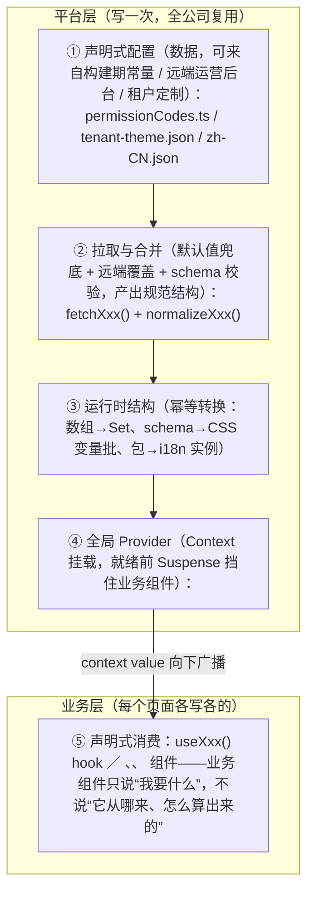

# Part B：SaaS 平台能力族（8/9/10 全量展开）

> 三章合称 **"SaaS 企业能力三件套"**，共同模式：**声明式配置 + 运行时注入 + 全局 Provider**。做完这三章，你就懂了企业级 SaaS 前端的"平台层"和"业务层"如何分离。

## Part B 总论：先把"共同模式"讲透，三章都只是它的实例

这三章表面上做的是三件不相干的事——权限（谁能做什么）、主题（界面长什么样）、国际化（文案说什么语言）。但如果只学三个孤立方案，你到了下一家公司的 SaaS 项目还是要重新摸索一遍。真正值得带走的是一个共同模式，这三章只是它的三次实例化。

### 模式的三个词，逐个拆开

**第一个词：声明式配置（Declarative Config）**。"声明式"的反面是"命令式"。命令式的权限代码是 `if (user.canExport) showButton()`——把"谁有权限"的知识散落在几百个组件里；声明式则是一份**数据**：

```ts
// 权限的声明式配置：它只是一份可序列化的数据，不是代码
const accessConfig = {
  roles: {
    operator: ['order:read', 'order:export'],
    admin:    ['order:*', 'refund:audit'],
  },
};
```

同样，主题的声明式配置是 `{ brand: { primary: '#0A7CFF' }, radius: { card: 12 } }`，语言包是 `{ 'order.export': '导出订单' }`。它们共同的特征：**JSON 可序列化、可存数据库、可由运营后台修改、可不发版下发**。这是 SaaS 的商业需求倒逼出来的技术形态——租户 A 要绿色主题、租户 B 的管理员要英文界面、某客户临时收回导出权限，这些都不可能等一个前端发版。

**第二个词：运行时注入（Runtime Injection）**。配置是数据，数据必须在**运行时**变成界面可用的东西，这个转变过程叫注入。权限码数组注入成 `Set<string>`、主题 schema 注入成一批 CSS 变量、语言包合并进 i18n 实例。注入这个动作有三个关键属性：一是**时机**（登录后、切换租户后、运营下发变更后都会再注入一次）；二是**幂等**（同一份配置注入两次结果相同，否则热更新就会错乱）；三是**有 normalize 层**（远端数据不可信，要补默认值、做校验，坏数据不能打挂整个应用）。

**第三个词：全局 Provider**。注入后的运行时结构放在哪？React 的答案只有一个：Context。因为这三样东西都是"全局单例语义"——当前用户是谁、当前租户什么主题、当前什么语言，整个应用在任一时刻只有一份真相。Provider 之下所有组件通过 hook 消费（`usePermission()` / `useTheme()` / `useTranslation()`），**组件永远不直接碰远端接口**——它拿到的永远是"已经注入完成的运行时结构"。

### 抽象的注入流程图



这张图的分界线（⑤ 上面那条横线）就是"平台层与业务层分离"的物理位置。分离的含义有三条：

1. **数据流单向**：业务层永远不直接发请求拿配置，只能通过 hook 读 Provider 里的值；要改也只能调 Provider 暴露的方法（如 `refreshPermissions()`），由平台层重新走 ①→④。谁绕过 Provider 直接 `fetch('/api/permissions')`，谁就制造了第二份数据源，从此两处开始漂移。
2. **知识单向**：权限码叫什么、主题有哪些 token、文案 key 怎么命名，这些**契约**定义在平台层（通常是一份带 TS 类型的常量文件），业务层 import 它，而不是自己发明字符串。反过来平台层不知道任何具体业务页面的存在。
3. **变更隔离**：运营后台改了配置 → 只有平台层重新注入 → 业务层因 context 变化自动重渲染。业务层代码零改动，这就是"不发版生效"的实现机制。

### 抽象代码范式：任何一个"平台能力"都能套进这个模具

```tsx
// platform/PlatformFeature.ts —— 平台能力通用范式（三章共用的模具）
import { createContext, useContext, useEffect, useState, type ReactNode } from 'react';

/** 一个平台能力的完整定义：配置长什么样、怎么拉、怎么转、怎么消费 */
export interface PlatformFeature<TConfig, TRuntime> {
  /** 构建期默认配置：远端挂了/没配的时候兜底，保证应用永远可用 */
  defaultConfig: TConfig;
  /** 拉取远端配置（登录后/租户切换后调用） */
  fetchConfig: () => Promise<TConfig>;
  /** 注入的核心：数据 → 运行时结构。必须幂等（同样输入产出同样输出） */
  normalize: (raw: TConfig) => TRuntime;
}

/** 通用的平台 Provider 工厂：三个平台能力共用这一套状态机 */
export function createPlatformProvider<TConfig, TRuntime>(
  feature: PlatformFeature<TConfig, TRuntime>,
) {
  const Context = createContext<TRuntime | null>(null);

  function Provider({ children }: { children: ReactNode }) {
    // ready=false 表示"配置还没注入完成"，业务层会被 Suspense 挡住（坑 2 的解法）
    const [runtime, setRuntime] = useState<TRuntime | null>(
      () => feature.normalize(feature.defaultConfig), // 先注入默认值，避免首帧空白
    );

    useEffect(() => {
      let alive = true; // 防止卸载后 setState
      feature.fetchConfig().then((raw) => {
        if (alive) setRuntime(feature.normalize(raw)); // 远端到达后重新注入（幂等保证安全）
      });
      return () => { alive = false; };
    }, []);

    return <Context.Provider value={runtime}>{children}</Context.Provider>;
  }

  /** 业务层唯一的消费入口：拿不到值时 throw，交给最近的 Suspense 兜底 */
  function useRuntime(): TRuntime {
    const value = useContext(Context);
    if (value === null) {
      throw new Error('PlatformProvider 未挂载：请检查应用入口的 Provider 嵌套顺序');
    }
    return value;
  }

  return { Provider, useRuntime, Context };
}
```

这个 80 行的模具，接下来三章各实例化一次：权限章的 `TRuntime` 是 `Set<PermissionCode>`，主题章是 `Record<cssVarName, string>`，i18n 章是合并后的 messages 对象。读懂这个范式，三章的骨架你就都懂了，剩下的是各章特有的难点（权限的粒度分级、主题的 CSS 变量体系、语言包的合并策略）。

### 三章实例化对照表

| | 场景 8 权限 | 场景 9 主题 | 场景 10 国际化 |
|---|---|---|---|
| 声明式配置 | 权限码表 + 角色定义 | `{ brand, logo, radius, font }` | 静态基线包 + 远端覆盖包 |
| 配置来源 | 登录接口返回 / 角色管理后台 | 租户运营后台 | 翻译平台 CMS |
| 运行时结构 | `Set<PermissionCode>` | CSS 变量批（+ antd token） | i18next 实例的 resources |
| Provider | AuthProvider | ThemeProvider | I18nProvider |
| hook 消费 | `usePermission().has(...)` | `useTheme().token(...)` | `useTranslation().t(...)` |
| 声明式组件 | `<Can I a>` | `<ThemedXxx>`（组件内部消费语义 token） | `<Trans>` |
| 动态变更 | 切角色热更新 / 权限下发 | 运营改主题不发版生效 | 切语言不刷新 |
| 就绪前表现 | Suspense + 骨架屏 | 骨架屏 + 首屏变量内联 | Suspense + 默认语言 |

最后一点提醒：这三章共用模式，也共用**坑的形态**——"数据未就绪时闪烁"（权限的 403 闪现 = 主题的 FOUC = i18n 的 key 裸奔）、"字符串写错无报错"（权限码 typo = CSS 变量名 typo = i18n key typo）。所以坑的解法也是通用的：Suspense 统一挡加载态、TS 字面量类型统一管字符串契约。第 8 章会把这个解法讲透，9/10 两章直接复用。

## 补充：租户上下文——三份配置共用的坐标系，与它在异步边界的丢失

**是什么**。回头看本文第二节的注入流程图：三份配置在"拉取与合并"那一步带着同一个参数——权限按当前租户的角色集拉、主题按租户 ID 拉、语言包的租户覆盖层（场景 10 的 10.11）也按租户拉。**tenantId 是三份配置共用的查询参数**。把它自身工程化——一份"租户上下文"（tenantId + 套餐 + 租户默认语言等会话事实）——就是排在三件套之前的"第 0 个平台能力"。反例是三章各自去 localStorage 或 URL 里取一遍租户 ID：同一个知识点抄三遍，还抄出三个版本（有的带默认值有的不带，有的校验有的不校验）。

**为什么难**。租户上下文有两类消费位置，而 React Context 只覆盖其中一类：

- **组件树内**：顶栏显示租户名、按套餐降级功能入口——`useContext` 一调就到；
- **组件树外**：bootstrap 的 fetcher、查询构建器的远程 options 缓存（场景 3 的 3.4.3——缓存键的 `scope` 字段"从会话上下文取，绝不能省"）、WebSocket 的 `onmessage` 回调——这些是模块级代码，**hook 出了组件树就是普通函数调用，`useContext` 无从谈起**。

于是常见两种走偏：全塞 Context（组件外代码到处手工传 tenantId，传丢只是时间问题）；或全用模块级单例（组件读它不触发重渲染、测试之间还串状态）。难点不在写出来，而在**两类位置共用同一份真相**。

**关键机制：先判断租户上下文是什么性质的状态**。判断标准是老问题——*这份状态的变化，需要驱动 UI 局部重渲染吗？* 主题 token 变化需要（按钮颜色要立即变）；租户切换**不需要局部渲染，而是整个应用换血**：路由、菜单、缓存全部作废重来。所以租户上下文的正确形态是"会话事实"而非"响应式状态"，推荐双层结构：

1. **非响应式 holder（模块级）**：登录后、bootstrap 前同步写入一次，全应用唯一写入点，组件外代码显式读取；
2. **薄 Provider（Context）**：不做任何状态管理，把 holder 的值原样放进 Context，供组件树类型安全地消费。

租户切换 = 登出重来（或整树 `key` 重挂），两层自然一致，不存在"Context 与单例不同步"这种病——因为它根本没有第二份需要同步的状态。

**最小可行实现**：

```ts
// src/platform/tenant/holder.ts —— 租户事实的非响应式持有者：组件树外代码的唯一读取口
export interface TenantInfo {
  id: string;
  plan: 'free' | 'pro' | 'enterprise';
  locale: string; // 租户默认语言：场景 10 的 10.11 租户覆盖层的输入之一
}

let current: TenantInfo | null = null;

/** 全应用唯一写入点：只允许登录/切租户流程与 bootstrap 调用 */
export function setTenant(t: TenantInfo): void {
  current = t;
}

/** 未注入就读 = 时序错误，当场 throw（比返回 undefined 让各处 ?./ 兜底好得多） */
export function requireTenant(): TenantInfo {
  if (current === null) {
    throw new Error('tenant 未注入：requireTenant 只能在登录/setTenant 之后调用');
  }
  return current;
}

/** 测试专用：vitest 的 beforeEach 里重置，防止模块级单例把用例串味 */
export function resetTenantForTest(): void {
  current = null;
}
```

```tsx
// src/platform/tenant/TenantProvider.tsx —— 薄壳：把 holder 的值放进 Context，组件树内声明式消费
import { createContext, useContext, type ReactNode } from 'react';
import { requireTenant, type TenantInfo } from './holder';

const TenantContext = createContext<TenantInfo | null>(null);

export function TenantProvider({ children }: { children: ReactNode }) {
  // 值来自 holder，Provider 不持有自己的 state——租户切换是整树重挂，不存在"Context 过期"
  return <TenantContext.Provider value={requireTenant()}>{children}</TenantContext.Provider>;
}

export function useTenant(): TenantInfo {
  const t = useContext(TenantContext);
  if (t === null) throw new Error('TenantProvider 未挂载：请检查 App 入口的 Provider 嵌套顺序');
  return t;
}
```

```ts
// src/platform/tenant/tenantFetch.ts —— 请求级快照：tenantId 在发起时就固化进 URL，回调里绝不再读 holder
import { requireTenant } from './holder';

export async function tenantFetch(path: string, init?: RequestInit): Promise<Response> {
  const tenant = requireTenant(); // 快照点：此刻的租户
  const headers = new Headers(init?.headers);
  headers.set('Authorization', `Bearer ${window.localStorage.getItem('app:token') ?? ''}`);
  const res = await fetch(`/api/tenant/${tenant.id}${path}`, { ...init, headers });
  if (!res.ok) throw new Error(`tenantFetch ${path} -> HTTP ${res.status}`);
  return res;
}
```

挂载顺序与毕业项目（22 号文件 2.2 节）对齐：登录拿到 `{ token, tenantId }` → `setTenant(...)` → `bootstrap()` 内三份 fetcher 全部走 `tenantFetch` → 渲染 Provider 树。**setTenant 必须先于任何一次 requireTenant**——顺序错了不是 undefined 飘过去，而是当场 throw，这正是上面设计的目的：把时序错误从"偶发数据错位"提前成"启动期明确报错"。22 号文件 fetchers.ts 里的 `fetchTenantTheme(tenantId)` 已经是显式传参的正确形态，本节只是把它标准化：fetcher 不再各自拼 URL、各自读 localStorage。

**异步边界丢失：症状、原因、修法**。这是模块级 holder 独有的坑形态，值得单独讲透：

- **症状**：偶发"数据进了别的租户"——快速切换账号/租户时，某个晚到的响应被写进新租户的缓存或列表；测试里表现为"偶尔串用例"。
- **原因**：holder 是可变全局变量，**读到它的时机决定读到什么**。请求回调、`setTimeout`、`await` 之后这些"异步边界后"的代码，执行时租户可能已经换了。组件树内的 Context 没有这个问题（每次渲染拿到的是快照），模块级 holder 没有任何机制保护你：

```ts
// 反例：回调里"晚读"holder——异步边界丢失的标准形态
async function loadRule(id: string) {
  const res = await tenantFetch(`/rules/${id}`);   // 发起时是租户 A
  const data = await res.json();
  await new Promise((r) => setTimeout(r, 2000));   // 等待期间用户切到租户 B（整树重挂）
  const tenant = requireTenant();                  // 此刻读到的是 B！
  cache.set(`${tenant.id}:rule:${id}`, data);      // A 的规则进了 B 的缓存键
}

// 修法：发起时快照，回调内只用自己的快照
async function loadRuleFixed(id: string) {
  const tenant = requireTenant();                  // 快照在 await 之前
  const res = await tenantFetch(`/rules/${id}`);
  const data = await res.json();
  cache.set(`${tenant.id}:rule:${id}`, data);      // 期间切租户也不会串
}
```

- **修法三件套**：① **请求级快照**（上例）：tenantId 固化进 URL/参数，回调里只用自己的快照；② **响应落地前校验**：响应体带租户标记（后端网关注入），与快照不一致直接丢弃——与场景 10 的 10.12"拉取竞态"是同一条纪律（旧语言包响应晚到不得覆盖新语言）；③ **切换即作废**：切租户流程统一 `abort()` 在途请求，让它们根本没有落地的机会。

**为什么不用 AsyncLocalStorage**。Node 的 ALS 靠 async_hooks 让"异步调用链自动携带上下文"，浏览器主线程没有等价物；React 的 `cache()` 只在 RSC/渲染期有效，出了渲染管线就失效。所以前端的答案不是找"魔法线程局部"，而是一条纪律：**显式传参优先（快照进参数/URL），环境读取兜底（holder），同一个回调里绝不混用**。

**选型表**：

| 方案 | 组件内消费 | 组件外消费 | 变更驱动渲染 | 适用 |
|---|---|---|---|---|
| 纯 React Context | 好 | 做不到 | 自动 | 纯 UI 响应式状态 |
| 纯模块级单例 | 能 | 能 | 不会 | 非渲染代码为主的小工具 |
| holder + 薄 Provider（本节） | 好 | 能 | 切租户 = 整树重挂，天然全量生效 | 会话级事实：租户、用户身份 |
| URL 路由段 `/t/:tenant/...` | 好 | 经路由参数 | 导航即切换 | 多租户并开 Tab、深链直达租户 |

**坑**：

- 症状：vitest 用例偶发串租户。原因：holder 是模块级单例，同文件用例共享同一个 `current`。修法：`beforeEach(() => { resetTenantForTest(); setTenant(fixture); })`——与 store 单测"每用例整表重置"是同一条纪律。
- 症状：HMR 后页面 throw "tenant 未注入"。原因：模块热替换重新执行了 holder 模块，`current` 归 null。修法：开发态接受"热更新后重新登录"，或仅 dev 把 holder 挂到 `globalThis`（带类型断言）跨模块重执行存活。
- 症状：模块顶层写 `const tenant = requireTenant()`，一启动就 throw。原因：import 求值早于登录完成——这不是 bug，是设计在报警。修法：租户只能在函数体内读；顶层读取 = 时序错误，越早炸越好。

## 补充：feature flag——把"可灰度"提升为平台机制，与三件套各自的灰度粒度

**是什么**。feature flag 又是一份声明式配置：`key → on/off/变体值`，走完同一套"拉取 → normalize → Provider → hook"的管线。它恰好能直接套进本文的 `PlatformFeature` 模具——这本身就是对"共同模式"泛化能力的验收：**第四个平台能力，零新概念**。flag 与三件套的关系用一句话分清：权限管"谁能用"（安全维度，长期稳定），主题与文案管"长什么样、说什么"（租户维度），flag 管"这个能力现在是否存在"（时间维度——发布节奏）。

**为什么难**。三件事：

1. **粒度**：按租户开、按百分比放量、按用户白名单——三种目标规则的实现成本差一个量级，学习项目先做最便宜的那种（见下文取舍）；
2. **清理**：flag 是技术债里的高利贷，每个 flag 都有拆除成本，"临时开关"活了三年的故事每个团队都有；
3. **与三件套的交叉**：flag 关掉主题远端包怎么办？关掉远端文案包怎么办？答案不是新写一套降级逻辑，而是**三件套的降级路径本来就在**（默认主题、基线包）——flag 只是把"谁走到哪条路径"变成可运营的开关。这是共同模式的又一笔红利：凡是"基线 + 远端覆盖"结构的能力，天然全部可灰度。

**三件套已有的灰度实践**（各章已讲透，此处只归档指路，不重复实现）：

| 能力 | 已有的灰度实践 | 粒度 | 失败/关掉的回落 | 章节 |
|---|---|---|---|---|
| 权限 | 权限变更事件广播、实时生效 | 角色精确匹配 | 无权限 → 403/隐藏/禁用 | 场景 8 路线 8 |
| 主题 token | 品牌配置发布门禁（校验流水线） | 按租户 | 默认品牌主题 | 场景 9 补充 |
| 远端文案包 | CDN 发布卡口、按租户/百分比发布 | 按租户/百分比 | 基线包 | 场景 10 坑 4、10.14 |
| feature flag | 本节补上 | 租户/百分比/白名单组合 | 注册表默认值 | 本节 |

注意表里唯一"不许抽样灰度"的是权限：安全语义没有"50% 生效"，要么有要么没有——这是权限与 flag 的本质分界，**别用 flag 系统去发权限**。

**最小可行实现**——先立注册表（key 契约），再套模具：

```ts
// src/platform/flags/registry.ts —— flag 契约：key 联合类型 + 元数据（注册表模式的一个小实例）
export interface FlagDef {
  /** 默认值：拉不到/缺失时的回落——新 flag 一律 false（安全侧） */
  default: boolean | string;
  /** 团队命名空间：cleanup 责任到人 */
  owner: string;
}

export const FLAG_REGISTRY = {
  'rule-team.builder-v2': { default: false, owner: 'rule-team' },
  'platform.remote-theme': { default: true, owner: 'platform' },
  'platform.remote-copy': { default: true, owner: 'platform' },
} as const satisfies Record<string, FlagDef>;

export type FlagKey = keyof typeof FLAG_REGISTRY;
export type FlagsRuntime = Readonly<Partial<Record<FlagKey, boolean | string>>>;

/** normalize：白名单逐 key 校验，坏一个丢一个——与语言包合并（场景 10 的 10.4）同一纪律 */
export function normalizeFlags(raw: unknown): FlagsRuntime {
  const out: Record<string, boolean | string> = {};
  if (typeof raw !== 'object' || raw === null || Array.isArray(raw)) return out;
  for (const [k, v] of Object.entries(raw)) {
    if (!(k in FLAG_REGISTRY)) continue;                           // 未知 key：丢弃（可能是别的环境的残留）
    if (typeof v !== 'boolean' && typeof v !== 'string') continue; // 畸形值：丢弃
    out[k] = v;
  }
  return out as FlagsRuntime;
}
```

```tsx
// src/platform/flags/index.tsx —— 套进总论的 PlatformFeature 模具：第四个平台能力，零新概念
import { createPlatformProvider } from '../PlatformFeature';
import { requireTenant } from '../tenant/holder';
import { FLAG_REGISTRY, normalizeFlags, type FlagsRuntime } from './registry';

export const { Provider: FlagsProvider, useRuntime: useFlags } =
  createPlatformProvider<unknown, FlagsRuntime>({
    defaultConfig: {}, // 空配置 = 全部走注册表默认值，站点永远可用
    fetchConfig: () =>
      fetch(`/api/flags?tenant=${encodeURIComponent(requireTenant().id)}`)
        .then((r) => (r.ok ? r.json() : Promise.reject(new Error(`HTTP ${r.status}`))))
        .catch(() => ({})), // 降级级：flag 拉不到不阻塞启动（失败等级表见 22 号文件 2.2）
    normalize: normalizeFlags,
  });

/** 业务层唯一消费入口：缺失/未知 key → 注册表默认值，永不 throw */
export function useFlag(key: FlagKey): boolean | string {
  return useFlags()[key] ?? FLAG_REGISTRY[key].default;
}
```

```tsx
// 消费示例（节选）：flag 切的是"实现选择"，不是数据结构——两版构建器共用页面层的同一份 tree state
function AlertRulePage() {
  const [tree, setTree] = useState(initialTree);            // state 在页面层（见本节坑 1）
  const useV2 = useFlag('rule-team.builder-v2') === true;
  const Builder = useV2 ? QueryBuilderV2 : QueryBuilderV1;  // 分支只发生在组件选择这一处
  return <Builder node={tree} onChange={setTree} fields={visibleFields} />;
}
```

三个刻意的取舍：

- **未知 key 落在安全侧**：`useFlag` 对缺失/未知 key 返回注册表里的 `default`（新 flag 一律 `default: false`），永不 throw——flag 系统自己挂了不能连累业务；
- **normalize 逐 key 校验**：远端 flag 数据与主题包、语言包同样不可信，白名单之外、类型不对的逐个丢弃，坏一个不坏一包；
- **变更传播先做"路由级生效"**：flag 变化后不立即广播，下一次路由切换重新读一次即可——成本近乎为零，学习项目足够。要"即时生效"再接场景 8 路线 8 的事件广播，那是第二步，不是第一步。

**flag 卫生（工程纪律，比实现更重要）**：

- 生命周期四阶段：born（PR 里建）→ ramp（放量）→ 100% → cleanup（删代码）。**创建 flag 的 PR 必须同时建拆除 issue**，没有例外；
- 命名带团队命名空间（`rule-team.builder-v2`），出了问题知道找谁；
- 活跃 flag 给自己划上限（>30 个是坏味道）；定期静态扫描：某 key 的 `useFlag('x')` 源码引用数为 0 且远端值恒 true → 列入 cleanup 清单。

**坑**：

- 症状：flag 切换瞬间，用户正在编辑的规则树丢了。原因：条件渲染把 V1 组件卸载，其内部 state 随之销毁。修法：状态上移（tree state 放页面层，V1/V2 都是纯视图），或把切换点收敛到路由边界——进页面时定版本，页面内不切。
- 症状：kill switch 已经关掉，刷新页面后功能闪现一下又消失。原因：上次拉到的 flag 值被持久化（localStorage），启动时先用了旧值。修法：flag 是纯内存态，每次启动重新拉；要抗抖动就缩短后端缓存 TTL，而不是在前端持久化。
- 症状：为了"v2 文案不同"，基线包里出现 `title.v1`/`title.v2` 两套 key。原因：拿文案 key 当 flag 用。修法：flag 分叉组件，文案 key 保持一套；确需并存时把两个 key 都纳入 check:i18n 覆盖（场景 10 的 10.9），不许游离在扫描之外。

## 补充：元数据注册表——权限点表、token 表、文案 key 表与 field-schema 的同构性

**是什么**。三章各自维护着一张"字符串契约表"：权限章有权限码表（补充篇的 codegen 从后端清单生成 TS 联合类型）、主题章有 token 表（路线 1/2 的语义 token 清单）、i18n 章有文案 key 表（10.9 的 key 扫描与类型化 key）。把它们并排放开，再加上查询构建器的 field-schema（场景 3 的 3.3）与转换器注册表（3.5.1），会发现是**同一张表的多个实例**——这就是"元数据注册表"模式：一份"合法标识符 + 每项元数据 + 派生物"的声明，撑起类型生成、运行时守门、漂移检测三件事。

**同构性对照**（看懂这张表，三章的工程化部分就不用分开记了）：

| 维度 | 权限点表（场景 8） | token 表（场景 9） | 文案 key 表（场景 10） | field-schema（场景 3 的 3.3） |
|---|---|---|---|---|
| 唯一标识 | 权限码 | CSS 变量名 | i18n key | 字段 name |
| 真源 | 后端权限点清单 | 平台 design token 仓库 | 翻译平台 | 字段元数据接口/OpenAPI（3.3.1） |
| 类型生成 | codegen 出 TS 联合类型（补充篇） | 类型化 token 常量 | CustomTypeOptions（10.9） | FieldMeta 接口 |
| 运行时守门 | has() 白名单 | 远端主题包 schema 校验 | 合并前结构校验（10.4） | 值编辑器按类型分发（3.4） |
| 孤儿检测 | 权限点引用扫描 | stylelint 禁硬编码（逼你引用 token，路线 8） | check:i18n 冗余警告 | 元数据引用审计（3.3.3） |
| 消费方式 | `useCan()` / `<Can>` | `var(--token)` / `useTheme()` | `t()` | valueEditorRegistry 二维分发 |
| 漂移的代价 | typo → 永远无权限 | typo → 变量不生效回落默认 | typo → 页面裸 key | typo → 字段悬空成幽灵节点 |

最后一行是注册表存在的理由：**任何字符串契约都会漂移**（手滑、删了没人知道、两个来源各写各的），注册表模式把漂移从"上线后的运行时惊吓"变成"CI 里的一条红线"。

**关键机制：注册表的五步生命周期**。定义（一处定义，禁止散落字符串）→ 生成（类型/常量，机器产出）→ 守门（远端数据进来前的运行时校验）→ 消费（hook/组件查表）→ 审计（孤儿与漂移检测）。三章的工程化小节（场景 8 补充、场景 9 路线 8、场景 10 的 10.9）各自走完了这五步，只是表的名字不同。**写第四张表时你该做的不是再抄一遍流程，而是抽出 defineRegistry 这样的底座**：

```ts
// src/platform/registry/defineRegistry.ts —— 字符串契约的统一注册表（三章共用一个底座）
export interface RegistryApi<K extends string, M> {
  keys: readonly K[];
  /** 类型守卫 + 运行时白名单（hasOwnProperty 防原型链上的假 key） */
  has: (k: string) => k is K;
  meta: Readonly<Record<K, M>>;
  /** 远端数据守门：只收白名单 key 且通过校验的值；坏一个丢一个，绝不整包拒绝 */
  pick: (raw: unknown, isValid: (v: unknown) => boolean) => Partial<Record<K, unknown>>;
}

export function defineRegistry<K extends string, M>(meta: Record<K, M>): RegistryApi<K, M> {
  const keys = Object.keys(meta) as K[];
  const has = (k: string): k is K => Object.prototype.hasOwnProperty.call(meta, k);
  return {
    keys,
    meta,
    has,
    pick(raw, isValid) {
      const out: Record<string, unknown> = {};
      if (typeof raw !== 'object' || raw === null || Array.isArray(raw)) return out;
      for (const [k, v] of Object.entries(raw)) {
        if (has(k) && isValid(v)) out[k] = v;
      }
      return out as Partial<Record<K, unknown>>;
    },
  };
}
```

三章实例化（示意权限与主题两张，文案 key 表同型——`isValid` 换成 `typeof v === 'string'`，守门对象换成远端语言包）：

```ts
// 实例一：权限码表（真实链路是 codegen 生成 keys，见场景 8 补充篇；这里示意静态版）
export const PERMISSIONS = defineRegistry({
  'alert:rule:view': { level: 'route' },
  'alert:rule:edit': { level: 'button' },
  'order:export': { level: 'button' },
});

// 实例二：token 表——远端主题包进来前的白名单 + 形状校验
const HEX = /^#(?:[0-9a-f]{3}|[0-9a-f]{6}|[0-9a-f]{8})$/i;
export const THEME_TOKENS = defineRegistry({
  'color-brand-primary': { layer: 'semantic', appliesTo: 'background,border' },
  'color-brand-primary-hover': { layer: 'semantic', appliesTo: 'background' },
  'radius-card': { layer: 'semantic', appliesTo: 'border-radius' },
});

async function applyTenantTheme(tenantId: string): Promise<void> {
  const raw = await fetchTenantTheme(tenantId);
  // 一行完成"白名单 + hex 形状校验"：逐 key 丢弃后，剩下的都是白名单内、形状合法的子集
  const tokens = THEME_TOKENS.pick(raw, (v) => typeof v === 'string' && HEX.test(v));
  applyThemeTokens(tokens); // 场景 9 路线 3 的注入函数
}
```

**零 codegen 的类型派生**。`defineRegistry` 的 keys 本身就是类型材料——小团队没有 codegen 流水线时，联合类型可以直接从注册表派生，不必手写、也不必先搭 workflow：

```ts
// 从注册表派生联合类型：keys 是 readonly 数组，[number] 索引类型即得联合
type PermissionCode = (typeof PERMISSIONS.keys)[number];
// 'alert:rule:view' | 'alert:rule:edit' | 'order:export'
// useCan 的入参从此收口——传错字符串编译期即报错，效果等价于场景 8 补充篇 codegen 的产物
declare function useCan(code: PermissionCode): boolean;
// useCan('alert:rule:edti'); // ❌ 编译错误：typo 当场现形，不用等运行时
```

代价要讲清楚：注册表是手写的，**真源就还在前端**（场景 8 补充篇用后端权限点清单做 codegen，真源在后端、漂移由 CI 把关）。类型派生只消灭"手写类型与表不同步"，不消灭"表与后端不同步"——团队规模到了再上 codegen，升级路径是现成的：注册表不动，把"手写 meta"换成"生成 meta"。

**与 field-schema 的同源分析**。field-schema 注册的是"字段类型 → 值编辑器组件"的派生关系（3.4 的二维分发），三件套契约表注册的是"字符串 → 类型/校验"的派生关系——形态不同，但**都是"先声明、后派生"**：schema 驱动渲染，注册表驱动类型与守门。场景 3 的 3.5.1 转换器注册表（协议名 → 转换器）是同族的又一实例。这也解释了一个学习现象：先做完场景 3 再学 8/9/10 会明显更快——注册表模式你已经练过两遍，看 10.9 的类型化 key 会直接认出它是 field-schema 的远亲。毕业项目 22 第 8 节 review 清单里的"文案 key 四处对齐（代码引用、基线包、类型定义、翻译平台）"，其实就是"每张注册表都有自己的四处"——权限码的四处是代码引用、后端清单、联合类型、路由表。

**对开篇"三章实例化对照表"的增补**。原表（本文第三节）列到"就绪前表现"为止；下面按三章补充篇的新内容增补七行，原表不动：

| | 场景 8 权限 | 场景 9 主题 | 场景 10 国际化 |
|---|---|---|---|
| 契约注册表 | 权限码表 | 语义 token 表 | 文案 key 表 |
| 类型生成 | codegen 出联合类型 + CI 同步 | 类型化 token 常量 | CustomTypeOptions |
| 远端数据守门 | 登录响应过 has() 白名单 | pick + hex/资源形状校验 | 结构校验 + 逐 key 合并 |
| 孤儿/漂移检测 | 权限点引用扫描 | stylelint 禁硬编码色值 | check:i18n 缺失阻断/冗余警告 |
| 缓存与版本 | 权限版本 + 变更事件广播 | 主题包版本号 | 语言包 version + 增量拉取 |
| 灰度粒度 | 不灰度（安全语义不许抽样） | 按租户/百分比（发布门禁） | 按租户/百分比（CDN 卡口） |
| 组件外消费入口 | fetcher 显式传参 | bootstrap 同步写入 CSS 变量 | i18n 实例（模块级单例） |

**坑**：

- 症状：注册表越长越大，业务字段（某页面的专有权限码、某活动文案）被塞进平台表。原因：图方便。修法：分层注册表——平台契约一张表，业务元数据一张表（field-schema 留在 modules，场景 3 的模式），平台表只收"全站契约"；毕业项目 22 的 dependency-cruiser 纪律管的就是这条边。
- 症状：pick/校验把远端数据丢得只剩一半，运营懵了。原因：运行时守门越权做了语义校验（比如顺手校验对比度）。修法：分清两道门——运行时守门只验**形状**（是 string、是合法 hex）；**语义**（对比度达标、文案通顺）归发布门禁（场景 9 补充的校验流水线、10.14 的翻译审校），两道门别合并。
- 症状：codegen 产物被人手改，或后端加了权限点但前端联合类型没更新。原因：生成物进了 git 却没有保鲜机制。修法：CI 里跑生成再 `git diff --exit-code`（场景 8 补充的 permissions-sync workflow 就是这么做的），产物与源永远同步。

---

## 附:ASCII 图替换清单

本文档图形化改版,原 ASCII 字符图与 Mermaid 图表对应关系如下:

| 原图位置 / 标题 | 处理结果 |
| --- | --- |
| §抽象的注入流程图:平台层 ①→④ 与业务层 ⑤ 的分层注入管线 | 替换为 flowchart TD(subgraph 平台层/业务层) |

