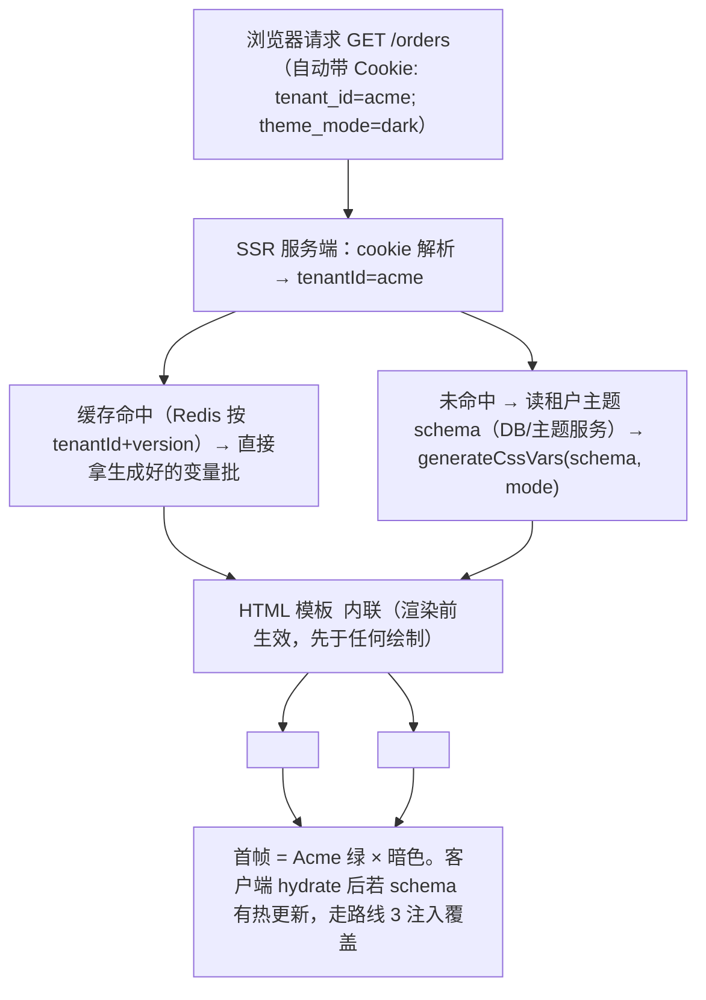
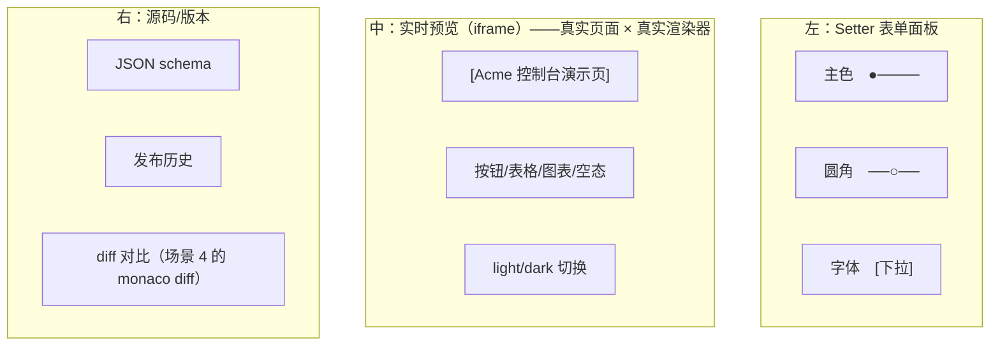

## 9. 多租户动态主题

**画像**：SaaS 每个租户品牌定制——色板/logo/圆角/字体，运营配置后不发版即时生效。

把这句话拆成技术指标：**色板/logo/圆角/字体**是四个可变维度（其实是一份主题 schema 的四个字段）；**运营配置**意味着修改发生在管理后台而不是代码仓库；**不发版即时生效**意味着主题数据与代码彻底解耦——运行时从远端拉取、注入、渲染，全链路没有一个 `if (tenant === 'acme')`；**每个租户**意味着同一份代码同时服务 N 套主题（并发正确性：切租户/亮暗切换时不能出现两套主题的混色帧）。它与场景 8 是同一个 Part B 模式的两次实例化：权限注入的是"能力集合"，主题注入的是"视觉常量"；Provider 消费、单一数据源、热更新的骨架完全一致，本章不再重复论证这些，专注主题特有的三个难题——**Token 分层、两个正交维度的组合、canvas 世界的同步**。

### 实现路线

1. **Design Token 三层体系**：
   - 基础 token（色板：blue-500...）
   - 语义 token（`--color-primary`、`--radius-card`）
   - 组件只消费语义 token——**这是铁律**，违反一处主题就漏一处
2. **租户主题 schema**：`{ brand, logo, radius, font }` → 生成器输出 CSS 变量批 + 组件库配置（antd v5 `ConfigProvider theme` 动态 token / 自研主题算法）
3. 运行时注入：`:root[data-tenant="acme"] { --color-primary: ... }` 或 JS `setProperty` 批量写
4. **亮暗模式 × 租户主题正交组合**：两个独立维度，2×2 组合都要正确（暗色下的租户品牌色可能对比度不足）
5. **FOUC 防治**：主题配置异步拉取期间用骨架屏；首屏关键变量内联（SSR 场景从 cookie 注入，服务端就知道租户）
6. echarts 等 canvas 渲染的组件读不到 CSS 变量 → 维护一份 JS 侧 token mirror 同步
7. **主题编辑器 = Setter 又登场**：给租户运营做的主题配置后台，就是一个配置可视化编辑器
8. lint 守护：stylelint 规则禁硬编码色值（漏网之鱼是主题系统的头号敌人）

八条路线的数据流全景：**租户主题 schema（运营后台产出）→ 生成器（schema → CSS 变量批 + antd token）→ 注入（data-tenant 选择器 / setProperty）→ 消费（语义 token / ConfigProvider / token mirror）**，路线 7 是这条流水线的供给侧（编辑器），路线 8 是消费侧的纪律保障。

#### 路线 1：Design Token 三层体系——为什么"组件只消费语义 token"是铁律

**是什么**：Token 是"设计决策的变量化"。三层各有职责：**基础 token 层**（palette）是原材料——`--blue-500`、`--gray-100` 这些与任何品牌无关的色阶（或一个租户的品牌色阶 `--tenant-primary-500`）；**语义 token 层**（semantic）是角色——`--color-primary`（主操作色）、`--color-bg-page`（页面底色）、`--color-text-danger`（危险文案）这些"在这个界面里承担什么职责"的命名；**组件消费层**——所有业务组件的样式里只允许出现语义 token，出现基础 token 即违规。

**为什么需要**：换主题 = 重定义"语义 → 具体值"的映射。组件只依赖语义层，映射一改全线生效；任何组件直接依赖基础层，就绕过了映射——换租户时它不换。铁律的理由不是美学，是**完备性**：主题系统是一个"全量替换"的合同，每个消费点要么在合同里（语义层），要么是合同外的钉子户。

**违反一处漏一处的具体例子**：

```css
/* 订单页的成本徽标，开发者图省事直接用了色板 token */
.cost-badge {
  color: var(--blue-500);          /* ← 违规：直接依赖基础层 */
  background: var(--color-bg-elevated); /* ✓ 合规 */
}
```

租户 Acme 品牌色是绿色，主题生成器把 `--color-primary` 重映射到 `--tenant-green-500`。上线当天全站变绿——唯独成本徽标还是蓝色。更隐蔽的变体：租户 B 同时要求"危险色改用品牌橙"，语义层有 `--color-text-danger` 可以重映射，而某处写了 `color: red`（连基础层都没走），第三种主题又漏一处。**漏的不是"一处样式"，是"主题合同的一个条款"**——这类 bug 的排查成本极高（要等每个租户各自配置后才会暴露），所以用铁律 + 路线 8 的 lint 在写代码当下拦截，而不是等租户反馈。

**怎么做**：三层的完整 CSS（默认主题作为基线，租户注入只是覆盖语义层）：

```css
/* src/theme/tokens.css —— 三层 Token 体系（默认主题基线） */

/* ========= 第一层：基础 token（色板）。只描述"有什么颜色"，不描述"用在哪" ========== */
:root {
  /* 中性灰阶 */
  --gray-50: #f7f8fa;  --gray-100: #f0f1f3; --gray-200: #e5e6eb;
  --gray-400: #a9aeb8; --gray-700: #4e5969; --gray-900: #1d2129;
  /* 品牌色阶：默认主题用蓝色系（租户注入时整组替换为 --tenant-* 系列） */
  --brand-100: #e8f3ff; --brand-300: #94c1ff; --brand-500: #0a7cff;
  --brand-600: #0064d8;  --brand-700: #004eb0;
}

/* ========= 第二层：语义 token。只描述"这个值在界面里扮演什么角色" ========== */
/* 换主题（租户/亮暗）只动这一层的映射，第一层与第三层都不动 */
:root {
  --color-primary: var(--brand-500);          /* 主操作色：主按钮、链接、选中态 */
  --color-primary-hover: var(--brand-300);
  --color-primary-active: var(--brand-700);
  --color-on-primary: #ffffff;                /* 主色上的文字（按钮字色） */
  --color-bg-page: var(--gray-50);            /* 页面底 */
  --color-bg-elevated: #ffffff;               /* 卡片/弹层底 */
  --color-bg-hover: var(--gray-100);
  --color-text: var(--gray-900);              /* 主文案 */
  --color-text-secondary: var(--gray-700);
  --color-text-disabled: var(--gray-400);
  --color-text-danger: #f53f3f;
  --color-border: var(--gray-200);
  --radius-card: 12px;                        /* 语义层不只颜色：圆角/间距同体系 */
  --radius-button: 6px;
  --shadow-card: 0 1px 2px rgb(0 0 0 / 6%);
}

/* ========= 第三层：组件消费。业务样式只写语义 token ========== */
/* 好的组件库也这么做——自研组件的样式文件里搜不到任何 --brand-* / --gray-* / 裸色值 */
.order-card {
  background: var(--color-bg-elevated);
  border: 1px solid var(--color-border);
  border-radius: var(--radius-card);
  box-shadow: var(--shadow-card);
}
.order-card__export-btn {
  background: var(--color-primary);
  color: var(--color-on-primary);
  border-radius: var(--radius-button);
}
```

命名判据可以一句话记住：**语义层命名回答"这是什么"，基础层命名回答"这是哪个"**。`--color-bg-elevated` 是"这是什么"（一个悬浮层底色），`--gray-100` 是"这是哪个"（灰阶第 100 号）。组件里问自己"我在用什么"而不是"我在用几号灰"，写出来的就自然是语义层。

#### 路线 2：租户主题 schema 与生成器——schema → CSS 变量批 + antd v5 动态 token

**是什么**：运营后台配置的是一份**业务友好的粗粒度 schema**（品牌色、logo、圆角、字体），而界面需要的是**全量语义 token**。生成器（generator）负责这个升维：从"一个品牌主色"推导出整套色阶、映射出全部语义 token，同时输出 antd v5 的 `theme` 配置让组件库一起换肤。

**为什么需要**：不能要求运营理解 30 个语义 token。也不能让每个组件自己从"品牌色"推导衍生色（hover 色、active 色、禁用色……）——推导逻辑散落到组件里，等于三层体系名存实亡。推导必须是**纯函数**：同一份 schema 永远产出同一批 token（幂等，可测试，可缓存——Part B 总论 normalize 的要求）。

**怎么做（机制分步）**：

1. 定义 schema 类型（运营后台的表单协议就是它，路线 7 的 Setter 也由它驱动）；
2. 色阶推导：从单一品牌色生成 1~10 号色阶（本教程用 HSL 亮度插值，够用且无依赖；产品级建议 OKLCH，见对标段）；
3. 语义映射：色阶 + 圆角 + 字体 → `Record<语义token名, 值>`，亮暗两套；
4. antd 接入：同一份 schema 构造 `ConfigProvider` 的 `theme`。

```ts
// src/theme/tenantTheme.ts —— 租户主题 schema 与类型
export interface TenantThemeSchema {
  /** 发布版本号：坑 3 的主角。每次发布 +1，用于缓存键与 CDN 破缓存 */
  version: number;
  brand: {
    primary: string;    // 品牌主色 hex，如 '#0ea5a4'
    secondary?: string; // 辅助色（图表第二序列等），缺省由主色推导
  };
  logo: {
    /** logo 的 CDN 相对路径；完整 URL = `${cdnBase}/tenants/{tenantId}/logo.svg?v={version}` */
    path: string;
    cdnBase?: string;
  };
  radius: { card: number; button: number };  // px
  font: { family: string; baseSize: number }; // 逻辑字号（rem 基准）
  /** 运营手工微调语义层的逃生舱：覆盖生成器对个别 token 的推导结果 */
  overrides?: Partial<Record<string, string>>;
}

/** 语义 token 名的全集（TS 字面量联合——和权限码同款治理：typo 编译期报错） */
export type SemanticTokenName =
  | '--color-primary' | '--color-primary-hover' | '--color-primary-active'
  | '--color-bg-page' | '--color-bg-elevated' | '--color-bg-hover'
  | '--color-text' | '--color-text-secondary' | '--color-text-danger'
  | '--color-border' | '--radius-card' | '--radius-button'
  | '--shadow-card' | '--font-family';

export type ThemeMode = 'light' | 'dark';
```

```ts
// src/theme/generator.ts —— 生成器核心：schema → CSS 变量批（纯函数，可单测）
import type { SemanticTokenName, TenantThemeSchema, ThemeMode } from './tenantTheme';

// ---- 步骤 1：品牌色 → 10 级色阶（HSL 亮度插值。够用的教程实现，生产建议 OKLCH） ----
function hexToHsl(hex: string): [number, number, number] {
  const n = hex.replace('#', '');
  const r = parseInt(n.slice(0, 2), 16) / 255;
  const g = parseInt(n.slice(2, 4), 16) / 255;
  const b = parseInt(n.slice(4, 6), 16) / 255;
  const max = Math.max(r, g, b), min = Math.min(r, g, b);
  const l = (max + min) / 2;
  if (max === min) return [0, 0, l]; // 灰色无色相
  const d = max - min;
  const s = l > 0.5 ? d / (2 - max - min) : d / (max + min);
  let h = 0;
  if (max === r) h = ((g - b) / d + (g < b ? 6 : 0)) / 6;
  else if (max === g) h = ((b - r) / d + 2) / 6;
  else h = ((r - g) / d + 4) / 6;
  return [h * 360, s, l];
}

function hslToHex(h: number, s: number, l: number): string {
  // h：0~360 度；s、l：0~100（百分比）。约定与 buildScale 的锚点表一致
  const f = (p: number, q: number, t: number) => {
    if (t < 0) t += 1; if (t > 1) t -= 1;
    if (t < 1 / 6) return p + (q - p) * 6 * t;
    if (t < 1 / 2) return q;
    if (t < 2 / 3) return p + (q - p) * (2 / 3 - t) * 6;
    return p;
  };
  s /= 100; l /= 100;
  const q = l < 0.5 ? l * (1 + s) : l + s - l * s;
  const p = 2 * l - q;
  const to = (x: number) => Math.round(x * 255).toString(16).padStart(2, '0');
  return `#${to(f(p, q, h / 360 + 1 / 3))}${to(f(p, q, h / 360))}${to(f(p, q, h / 360 - 1 / 3))}`;
}

/** 从品牌主色生成 1（最浅）~10（最深）色阶：500 号 = 主色本身 */
export function buildScale(primary: string): Record<`${number}`, string> {
  const [h, s] = hexToHsl(primary); // hslToHex 的 s 约定是 0~100，此处换算
  // 手工调的亮度锚点：浅端接近白、深端可作文字色。饱和度在两端略微收敛（避免荧光浅色）
  const anchors: Record<string, number> = {
    '100': 96, '200': 90, '300': 82, '400': 70, '500': 52,
    '600': 44, '700': 36, '800': 28, '900': 20, '1000': 14,
  };
  const out: Record<string, string> = {};
  for (const [step, l] of Object.entries(anchors)) {
    const sat = s * 100 * (l > 90 ? 0.7 : 1); // 极浅端降饱和
    out[step] = hslToHex(h, sat, l);
  }
  return out;
}

// ---- 步骤 2：色阶 + schema → 语义 token 映射（亮暗两套，正交设计见路线 4） ----
export function generateCssVars(
  schema: TenantThemeSchema,
  mode: ThemeMode,
): Record<SemanticTokenName | `--tenant-brand-${number}`, string> {
  const scale = buildScale(schema.brand.primary);
  const vars: Record<string, string> = {};

  // 先输出租户色阶（基础层）：租户维度只负责"提供原材料"
  for (const [step, color] of Object.entries(scale)) vars[`--tenant-brand-${step}`] = color;

  // 再输出语义映射：mode 维度决定"原材料里选哪一号"（铁律：语义层引用基础层变量而非复制值，
  // 这样运营微调色阶时语义层自动跟随）
  if (mode === 'light') {
    vars['--color-primary'] = 'var(--tenant-brand-500)';
    vars['--color-primary-hover'] = 'var(--tenant-brand-400)';
    vars['--color-primary-active'] = 'var(--tenant-brand-600)';
    vars['--color-bg-page'] = '#f7f8fa';
    vars['--color-bg-elevated'] = '#ffffff';
    vars['--color-bg-hover'] = '#f0f1f3';
    vars['--color-text'] = '#1d2129';
    vars['--color-text-secondary'] = '#4e5969';
    vars['--color-border'] = '#e5e6eb';
  } else {
    // 暗色映射：主色取更浅一号（深底上提亮），底色翻深、文字翻浅
    vars['--color-primary'] = 'var(--tenant-brand-400)';
    vars['--color-primary-hover'] = 'var(--tenant-brand-300)';
    vars['--color-primary-active'] = 'var(--tenant-brand-500)';
    vars['--color-bg-page'] = '#101418';
    vars['--color-bg-elevated'] = '#1a2029';
    vars['--color-bg-hover'] = '#232a35';
    vars['--color-text'] = '#f2f3f5';
    vars['--color-text-secondary'] = '#a9aeb8';
    vars['--color-border'] = '#333a45';
  }
  // mode 无关的维度直接透传
  vars['--color-text-danger'] = mode === 'light' ? '#f53f3f' : '#ff6b4a';
  vars['--radius-card'] = `${schema.radius.card}px`;
  vars['--radius-button'] = `${schema.radius.button}px`;
  vars['--shadow-card'] = mode === 'light'
    ? '0 1px 2px rgb(0 0 0 / 6%)'
    : '0 1px 2px rgb(0 0 0 / 40%)';
  vars['--font-family'] = schema.font.family;

  // 逃生舱最后应用：运营的手工微调优先级最高
  return { ...vars, ...schema.overrides } as Record<SemanticTokenName | `--tenant-brand-${number}`, string>;
}
```

antd v5 的接入——同一份 schema 喂给 `ConfigProvider` 的 `theme`，让组件库与自研组件同源换肤（antd v5 的动态主题是运行时能力，`token` 变化会通过 cssinjs 重新生成样式并缓存）：

```tsx
// src/theme/AntdThemeBridge.tsx —— schema → antd v5 ConfigProvider theme
import type { ReactNode } from 'react';
import { ConfigProvider, theme as antdTheme } from 'antd';
import type { TenantThemeSchema, ThemeMode } from './tenantTheme';
import { buildScale } from './generator';

export function AntdThemeBridge({
  schema, mode, children,
}: { schema: TenantThemeSchema; mode: ThemeMode; children: ReactNode }) {
  const scale = buildScale(schema.brand.primary);

  return (
    <ConfigProvider
      theme={{
        // algorithm 决定 antd 从 seed token 派生 map token 的规则：亮/暗模式的关键开关
        algorithm: mode === 'dark' ? antdTheme.darkAlgorithm : antdTheme.defaultAlgorithm,
        token: {
          // seed token：只给种子值（品牌主色/圆角/字体），色阶由 antd 的算法派生，
          // 派生结果与我们的 CSS 变量体系同源（同一 buildScale 输入）
          colorPrimary: scale['500'],
          colorInfo: scale['500'],
          borderRadius: schema.radius.button,
          fontFamily: schema.font.family,
        },
        // 组件级 token：个别组件与自研 token 对齐（antd 的 map token 名是公开契约）
        components: {
          Card: { borderRadiusLG: schema.radius.card },
          Button: { borderRadius: schema.radius.button },
        },
      }}
    >
      {children}
    </ConfigProvider>
  );
}
```

这里有个必须想清楚的取舍：antd 的 `colorPrimary` 是**具体色值**，绕过了 CSS 变量——切租户时 React 重渲染、cssinjs 重新生成样式，链路成立；但 antd 组件内部弹层（Modal、Select 下拉）在 v5 默认渲染在当前 React 树里（非 v4 的 body 直挂），所以同树生效。若你的项目里 antd 弹层被 `getPopupContainer` 挂去了 body 外的静态节点，要确认该节点仍在 ConfigProvider 的 hash 作用域内（antd v5 通过 className 而非 DOM 层级关联样式，一般无碍，但老项目升级时要测）。

#### 路线 3：运行时注入两法——`[data-tenant]` 选择器块 vs JS `setProperty` 批量

**是什么**：生成器产出的是 `Record<token名, 值>`，把它变成"页面真正生效的 CSS"有两条路。方法 A：拼成一段 `:root[data-tenant="acme"] { --color-primary: ...; }` 的 CSS 文本塞进 `<style>`（或由主题服务预构建成 `https://cdn/tenants/acme/theme.css` 由 `<link>` 引入）；方法 B：遍历 Record 逐个 `document.documentElement.style.setProperty(name, value)`。

**为什么需要分开讲**：两法的生效时机、缓存行为、SSR 兼容性完全不同，选错会在 FOUC（路线 5）和缓存（坑 3）上还债。先给代码再给对比。

```ts
// src/theme/inject.ts —— 两法实现
import type { SemanticTokenName, ThemeMode, TenantThemeSchema } from './tenantTheme';
import { generateCssVars } from './generator';

/** 方法 A：构造 [data-tenant] 选择器块，替换页面上专用 <style id="tenant-theme"> 的内容。
 *  优点：整批原子生效（一次 style 更新，浏览器同一帧应用全部变量——不存在半套主题的中间态）；
 *  选择器带 data-tenant，留了 CSS 层面的调试入口。 */
export function injectThemeBlock(tenantId: string, schema: TenantThemeSchema, mode: ThemeMode) {
  const vars = generateCssVars(schema, mode);
  const decls = Object.entries(vars)
    .map(([name, value]) => `  ${name}: ${value};`)
    .join('\n');
  const css = `:root[data-tenant="${tenantId}"][data-mode="${mode}"] {\n${decls}\n}`;
  let styleEl = document.getElementById('tenant-theme') as HTMLStyleElement | null;
  if (!styleEl) {
    styleEl = document.createElement('style');
    styleEl.id = 'tenant-theme';
    document.head.appendChild(styleEl);
  }
  styleEl.textContent = css; // 整体替换：同租户重复注入天然幂等
}

/** 方法 B：JS 逐变量 setProperty 到根元素。
 *  优点：不需要拼 CSS 字符串、对每个变量可单独控制（动画式换肤——逐个过渡时唯一选择）。
 *  缺点：N 次 DOM API 调用之间理论上存在中间态（实际上浏览器同步样式计算，一次 task 内完成，
 *  渲染前不会出现"半套主题"，但要注意别在循环里夹杂 await）。 */
export function injectThemeByJS(schema: TenantThemeSchema, mode: ThemeMode) {
  const vars = generateCssVars(schema, mode);
  const root = document.documentElement;
  for (const [name, value] of Object.entries(vars)) {
    root.style.setProperty(name, value);
  }
  // 换租户时必须先清旧值：setProperty 是覆盖式，但"上一租户有、这一租户没有"的 token 会残留
  for (const stale of Array.from(root.style)) {
    if (stale.startsWith('--') && !(stale in vars)) root.style.removeProperty(stale);
  }
  // 通知 canvas 世界同步（路线 6）
  window.dispatchEvent(new CustomEvent('theme:changed'));
}
```

两法对比与选型：

| | A：`[data-tenant]` 选择器块 | B：JS `setProperty` |
|---|---|---|
| 生效方式 | CSS 文本替换，一次原子生效 | N 次 DOM API，循环内需保证同步完成 |
| HTTP 缓存 | 可预构建成租户 CSS 文件走 CDN（`theme.css?v=版本`），二次访问零生成成本 | 配置走 API JSON，每次登录都要重算 |
| SSR 兼容 | 服务端可直接输出 `<link>` 或内联 `<style>`（渲染前生效，无 FOUC） | 必须客户端脚本执行后生效，纯 SSR 场景有闪烁窗口 |
| 属性管理 | `data-tenant`/`data-mode` 写在 `<html>` 上，选择器自动隔离 | 变量直接挂在 root 的 style 上，切租户要记得清残留 |
| 粒度 | 整批替换 | 可逐 token 操作（做颜色过渡动画的唯一选择） |

选型结论：**默认 A**（生产 SaaS 的主流做法：主题服务把生成器跑在发布时，CDN 发 CSS）；**B 作为运行时补充**——主题编辑器实时预览（未发布的 schema 没有对应 CDN 文件）、局部 token 动画（如"夜间模式渐变过渡"）。两法注入的 token 名必须同源（都来自 `generateCssVars`），否则两套注入互相打架。

#### 路线 4：亮暗模式 × 租户主题正交——2×2 组合的变量命名设计与对比度检测

**是什么**：主题有两个独立的开关——租户（tenant，N 选 1）和外观模式（mode，亮/暗 2 选 1）。**正交**的意思是：任一租户 × 任一模式都必须正确，即 2N 种组合全部要成立，而不是"每个租户调一次亮色主题就完了"。变量命名的设计目标是让两个维度**各自只写自己的那一层**，互不干扰。

**为什么需要**：非正交的典型烂法是给每个 (tenant, mode) 组合生成一整套平铺变量（`--acme-dark-primary`、`--acme-light-primary`、`--beta-dark-primary`……）——租户数 ×2 的组合爆炸，且加第 11 个租户时暗色忘了调，第 11 个租户的暗色模式就是蓝底黑字的灾难。正交设计（上文生成器已经体现）只有两步：**租户维度提供原材料（`--tenant-brand-*` 色阶），模式维度定义映射（`--color-primary` 在 light 下指向 500 号、dark 下指向 400 号）**。`--color-primary` 的最终值由两个维度共同决定，但每个维度只改自己那一层的变量：

```css
/* 维度一：租户。data-tenant 只替换基础层（原材料） */
:root[data-tenant='acme'] { --tenant-brand-400: #5eead4; --tenant-brand-500: #0ea5a4; /* ...整组色阶 */ }
:root[data-tenant='beta'] { --tenant-brand-400: #a5b4fc; --tenant-brand-500: #6366f1; /* ... */ }

/* 维度二：模式。data-mode 只替换语义映射（选材规则），不认识任何具体租户 */
:root[data-mode='light'] {
  --color-primary: var(--tenant-brand-500);
  --color-bg-page: #f7f8fa;  --color-text: #1d2129;
}
:root[data-mode='dark'] {
  --color-primary: var(--tenant-brand-400);  /* 深底提亮一号 */
  --color-bg-page: #101418;  --color-text: #f2f3f5;
}
```

2×2 验证矩阵（Acme 绿 × Beta 紫两个租户，写单测断言 `getComputedStyle` 结果）：

| | light | dark |
|---|---|---|
| acme | `--color-primary` = 绿500 ✓ | = 绿400（提亮）✓ |
| beta | = 紫500 ✓ | = 紫400 ✓ |

组合切换（同租户切模式）只改 `data-mode` 属性——CSS 变量级联自动重算，React 层甚至不用 re-render，这是把正交性做进 CSS 命名而不是 JS 状态的最大红利。

**暗色下租户品牌色对比度不足的检测**：深色底上"500 号品牌色按钮"很可能对比度不足（WCAG 要求文本对比 ≥ 4.5:1，大字号/图形 ≥ 3:1）。租户是运营随便选的颜色，**不能假设它可读**，所以生成器/编辑器必须内置检测。思路：对"主色 × 按钮文字色"和"主色 × 页面底色"两对组合各算一次对比度，不足则自动向色阶的更亮端借一档并在编辑器里提示：

```ts
// src/theme/contrast.ts —— WCAG 对比度检测与自动修正
/** 相对亮度（WCAG 2.x 定义）：先线性化 RGB，再按系数加权 */
function relativeLuminance(hex: string): number {
  const n = hex.replace('#', '');
  const [r, g, b] = [0, 2, 4].map((i) => parseInt(n.slice(i, i + 2), 16) / 255)
    .map((c) => (c <= 0.03928 ? c / 12.92 : Math.pow((c + 0.055) / 1.055, 2.4)); // gamma 线性化
  return 0.2126 * r + 0.7152 * g + 0.0722 * b;
}

/** 对比度：(亮者+0.05) / (暗者+0.05)，范围 1~21 */
export function contrastRatio(a: string, b: string): number {
  const [la, lb] = [relativeLuminance(a), relativeLuminance(b)];
  const [hi, lo] = la > lb ? [la, lb] : [lb, la];
  return (hi + 0.05) / (lo + 0.05);
}

/** 主色在暗色底上不够亮时，沿色阶向浅端找第一个达标档位 */
export function pickAccessibleStep(
  scale: Record<string, string>,
  background: string,
  minRatio = 3,            // 图形/大字号标准；文本场景请传 4.5
): { step: string; color: string; autoAdjusted: boolean } {
  if (contrastRatio(scale['500'], background) >= minRatio) {
    return { step: '500', color: scale['500'], autoAdjusted: false }; // 本来就达标
  }
  for (const step of ['400', '300', '200', '100']) {
    if (contrastRatio(scale[step], background) >= minRatio) {
      return { step, color: scale[step], autoAdjusted: true };  // 编辑器提示"已为你提亮至 N 档"
    }
  }
  return { step: '100', color: scale['100'], autoAdjusted: true }; // 兜底：最浅档
}

// 编辑器保存前的校验（路线 7 的一环）：
// const { autoAdjusted, step } = pickAccessibleStep(buildScale(schema.brand.primary), '#101418');
// if (autoAdjusted) warning(`暗色模式下品牌色对比度不足，已自动提亮至 ${step} 档（可手动覆盖）`);
```

检测的三组关键配对别漏：主色 × 按钮文字（`--color-on-primary` 是否仍是白色？深黄品牌色上白字会挂）、主色 × 页面底（链接可读性）、文字 × 背景（正文，一般由暗色算法保证，但运营 `overrides` 可能改坏）。

#### 路线 5：FOUC 防治——异步拉取期间骨架屏、首屏关键变量内联、SSR cookie 注入

**是什么**：FOUC（Flash of Unstyled Content，无样式内容闪现）在本场景的具体形态——主题配置是异步拉的，首帧可能渲染出"默认蓝色主题"，300ms 后 Acme 的绿色变量到达、整页闪变。用户感知是"这网站是假的/被劫持了"。防治三件套：**首屏关键变量内联**（HTML 里带上默认主题的十几个关键 token，保证首帧"有主题"，只是可能不是租户主题）、**骨架屏**（租户主题到达前，强品牌区（logo、导航、主视觉）用中性骨架，不渲染带色内容）、**SSR 从 cookie 注入**（服务端就知道租户，直接把租户变量内联进 HTML，连"默认主题闪一下"都没有）。

**怎么做**：先讲清三者的适用梯度，再给 SSR 流程。

- **纯 CSR 项目**：`index.html` 的 `<head>` 里静态内联默认主题关键变量（构建时从 `generateCssVars(默认schema, 'light')` 生成），首帧即有完整默认主题；租户配置到达后 `injectThemeBlock` 覆盖语义层。闪烁从"无主题 → 租户主题"变成"默认主题 → 租户主题"，观感弱很多；再配合强品牌区骨架（logo 位给灰块）就基本无感。
- **SSR/同构项目**：请求带 `tenant_id` cookie，服务端取租户 schema、跑同一个生成器、把租户变量内联进首屏 HTML——首帧就是租户主题，零闪烁。流程：



```tsx
// server/render.tsx —— SSR 侧关键代码（Node/Express 形态，Next.js 同理放进根 layout）
import type { Request, Response } from 'express';
import { generateCssVars } from '../src/theme/generator';
import { fetchTenantTheme, type TenantThemeSchema } from './tenantThemeService'; // 读 DB/缓存

function parseCookie(header: string): Record<string, string> {
  return Object.fromEntries(
    header.split(';').map((pair) => {
      const idx = pair.indexOf('=');
      return idx === -1 ? [pair.trim(), ''] : [pair.slice(0, idx).trim(), pair.slice(idx + 1).trim()];
    }),
  );
}

export async function renderPage(req: Request, res: Response) {
  const cookie = parseCookie(req.headers.cookie ?? '');
  const tenantId = cookie['tenant_id'] ?? 'default';
  const mode = (cookie['theme_mode'] as 'light' | 'dark') ?? 'light';

  const schema: TenantThemeSchema = await fetchTenantTheme(tenantId); // 内部按 version 做 Redis 缓存
  const vars = generateCssVars(schema, mode);
  const decls = Object.entries(vars).map(([k, v]) => `${k}:${v}`).join(';');
  // 变量内联进 head；data-tenant/data-mode 同时打到 <html> 上（antd 算法开关也要这两个值）
  const html = `<!doctype html>
<html data-tenant="${tenantId}" data-mode="${mode}">
<head>
  <style>:root{${decls}}</style>
</head>
<body><div id="root"></div><script src="/app.js" defer></script></body>
</html>`;
  res.type('html').send(html);
}
```

注意两个细节：一是 CSS 变量内联后仍可能 FOUC——如果你的 JS 产物是阻塞渲染的 `<script>`（非 defer/async），把它挪走；二是 cookie 里只有 `tenant_id`，**用户未登录也能拿到租户主题**（租户由访问域名决定，`acme.app.com` → tenant=acme，比 cookie 更可靠——多租户 SaaS 通常按子域名路由，服务端从 Host 头解析，cookie 只存 mode）。

#### 路线 6：canvas 组件读不到 CSS 变量——JS 侧 token mirror 同步

**是什么**：echarts（canvas 渲染）里的颜色不会跟随 CSS 变量变。原因在渲染机制：CSS 变量的求值发生在 **CSS 级联**里，作用域是 DOM 树；而 canvas 是一张**位图**，绘图 API（`fillStyle`/`strokeStyle`）接收的是"绘制那一刻的具体颜色字符串"，传 `var(--color-primary)` 过去只会得到一个非法值或按字面量处理的黑色。换主题时 DOM 侧变量变了、canvas 已画好的像素不会自动重画。

**为什么需要 mirror（镜像）而不是每次绘制时现读**：技术上 `getComputedStyle` 确实能读到 CSS 变量的**计算值**（已解析的具体色值），所以"每次 setOption 前现读一次"可行。但图表的主题色用在几十处（坐标轴、图例、系列色、tooltip 边框……），散在各组件里现读等于"权限 if 散落"的换皮重演——收敛为一个全局 mirror 对象 + 变更事件，图表组件只订阅不取数：

```ts
// src/theme/tokenMirror.ts —— JS 侧 token 镜像：CSS 变量 → JS 常量的唯一桥梁
/** 需要暴露给 canvas/WebGL/图表世界的语义 token 清单（显式列举，而非全量复制——
 *  全量复制会在 token 改名时静默漏更，显式列举配合启动期校验零漂移） */
const MIRRORED_TOKENS = [
  '--color-primary', '--color-primary-hover',
  '--color-bg-elevated', '--color-bg-page', '--color-bg-hover',
  '--color-text', '--color-text-secondary', '--color-border',
] as const;

export type MirroredToken = (typeof MIRRORED_TOKENS)[number];
export type TokenMirror = Record<MirroredToken, string>;

/** 全局唯一镜像。图表组件从这里读色值，永不直接 getComputedStyle */
export const tokenMirror: TokenMirror = Object.fromEntries(
  MIRRORED_TOKENS.map((t) => [t, '']),
) as TokenMirror;

/** 从 CSS 重新读一遍全部镜像 token 并广播变更。注入主题（路线 3）后必须调用 */
export function syncTokenMirror(): TokenMirror {
  const computed = getComputedStyle(document.documentElement);
  for (const name of MIRRORED_TOKENS) {
    tokenMirror[name] = computed.getPropertyValue(name).trim();
  }
  window.dispatchEvent(new CustomEvent<TokenMirror>('theme:changed', { detail: { ...tokenMirror } }));
  return tokenMirror;
}
```

echarts 侧的接入——把 mirror 转成 echarts 主题并注册，图表实例订阅变更事件重绘：

```ts
// src/charts/echartsTheme.ts —— mirror → echarts 主题注册与热更新
import * as echarts from 'echarts';
import { tokenMirror, syncTokenMirror, type TokenMirror } from '../theme/tokenMirror';

/** mirror → echarts 主题对象（registerTheme 的第二参是普通对象，只声明颜色/字体的
 *  全局默认，具体图表不再写死任何颜色） */
function buildEchartsTheme(t: TokenMirror): Record<string, unknown> {
  return {
    color: [t['--color-primary'], '#94a3b8', '#f59e0b', '#10b981'], // 系列色：第一序列跟主题
    backgroundColor: 'transparent',
    textStyle: { color: t['--color-text'], fontFamily: 'inherit' },
    legend: { textStyle: { color: t['--color-text-secondary'] } },
    // 坐标轴与分隔线
    categoryAxis: {
      axisLine: { lineStyle: { color: t['--color-border'] } },
      axisLabel: { color: t['--color-text-secondary'] },
      splitLine: { lineStyle: { color: t['--color-border'] } },
    },
    valueAxis: {
      axisLine: { lineStyle: { color: t['--color-border'] } },
      axisLabel: { color: t['--color-text-secondary'] },
      splitLine: { lineStyle: { color: t['--color-border'] } },
    },
  };
}

let themeVersion = 0;
/** 注册（或重注册）主题。重注册用新名字（v+版本号）——echarts 主题注册表按名字缓存，
 *  同名覆盖对已初始化实例不生效，换名 + setOption 才会真正重算 */
export function applyEchartsTheme(): string {
  syncTokenMirror(); // 确保镜像最新（幂等）
  const themeName = `tenant-v${++themeVersion}`;
  echarts.registerTheme(themeName, buildEchartsTheme(tokenMirror));
  return themeName;
}
```

```tsx
// src/charts/ThemedChart.tsx —— 图表组件：订阅 theme:changed，自动换主题重绘
import { useEffect, useRef } from 'react';
import * as echarts from 'echarts';
import { applyEchartsTheme } from './echartsTheme';

export function ThemedChart({ option }: { option: echarts.EChartsOption }) {
  const ref = useRef<HTMLDivElement>(null);
  const chartRef = useRef<echarts.ECharts | null>(null);
  const themeRef = useRef<string>(''); // 主题名在 effect 里注册（渲染期不能有 getComputedStyle 副作用）

  useEffect(() => {
    if (!ref.current) return;
    themeRef.current = applyEchartsTheme(); // 初次挂载即注册主题（含一次 mirror 同步）
    chartRef.current = echarts.init(ref.current, themeRef.current); // 按主题名初始化
    return () => { chartRef.current?.dispose(); };
  }, []);

  // option 变化 → setOption
  useEffect(() => { chartRef.current?.setOption(option); }, [option]);

  // 主题变化 → dispose + 按新主题名重建（echarts 实例初始化后不能换主题，重建是官方推荐路径）
  useEffect(() => {
    const onThemeChanged = () => {
      const next = applyEchartsTheme();
      if (next === themeRef.current) return;
      themeRef.current = next;
      if (ref.current) {
        chartRef.current?.dispose();
        chartRef.current = echarts.init(ref.current, next);
        chartRef.current.setOption(option); // 重建后必须重新 setOption
      }
    };
    window.addEventListener('theme:changed', onThemeChanged);
    return () => window.removeEventListener('theme:changed', onThemeChanged);
  }, [option]);

  return <div ref={ref} style={{ width: '100%', height: 320 }} />;
}
```

mirror 的适用面不止 echarts：SVG 图表（`fill="currentColor"` 可以吃 CSS 变量）、WebGL（three.js 材质颜色同理要 mirror）、`canvas.drawImage` 自绘仪表盘——一切"像素/绘图 API 接收具体值"的世界都靠这个模式同步。反过来的纪律：**mirror 只读不写**——JS 侧永远不要成为 token 的第二定义处。

#### 路线 7：主题编辑器 = Setter 又登场——主题配置后台的构成

**是什么**：给租户运营做的主题配置后台。论证它的身份：它就是一个**配置可视化编辑器**——《进阶大纲》§3 的 Setter 体系 + 场景 4 的"schema 工作台"（左配置 / 中实时预览 / 右源码）换了个领域。主题编辑器的"配置对象"是 `TenantThemeSchema`，"预览对象"是运行真实渲染器的预览页。

**为什么是 Setter 复用而不是新写一套**：Setter 的定义就是"某种类型的值 → 专用编辑 UI"（《进阶大纲》§3）。主题 schema 的字段类型恰好都是 Setter 覆盖过的：`brand.primary: string`（hex）→ ColorSetter（色板 + 取色器 + 对比度实时校验，路线 4 的 `pickAccessibleStep` 就是它的校验器）；`radius.card: number` → NumberSetter（滑杆 + 单位）；`font.family: string` → SelectSetter（字体选项 + 预览字形）；`logo.path: string` → UploadSetter（上传到租户 CDN，回填 URL）；`overrides` → KVSetter（token 名下拉 + 色值）。**一个新 Setter 都不用写，主题编辑器就"长"出来了**——这是搭建器族的复利在本章的兑现。

界面构成（三栏，与场景 4 同构）：



关键机制是**实时预览链路**：编辑器的 schema 变更 → `generateCssVars`（与生产完全同一个生成器函数——编辑器所见即生产所得的唯一保证）→ 通过 `iframe.contentWindow.postMessage` 发给预览 iframe → 预览页收到后 `injectThemeBlock` + `syncTokenMirror`。预览页就是路线 3/6 的消费者，编辑器只是往它肚子里喂 schema：

```ts
// src/theme-editor/previewBridge.ts —— 编辑器 → 预览 iframe 的单向投递
import type { TenantThemeSchema } from '../theme/tenantTheme';

export function pushSchemaToPreview(iframe: HTMLIFrameElement, schema: TenantThemeSchema, mode: 'light' | 'dark') {
  iframe.contentWindow?.postMessage({ type: 'theme-preview', schema, mode }, '*'); // 同源部署可用具体 origin
}

// 预览页侧（iframe 内）：
// window.addEventListener('message', (e) => {
//   if (e.data?.type !== 'theme-preview') return;
//   injectThemeBlock('preview', e.data.schema, e.data.mode);
//   syncTokenMirror();  // 图表也跟着变
// });
```

版本发布按钮的语义：`schema.version + 1` → 写入主题服务 → 主题服务重建租户 CSS（若走 CDN 方案）→ 通知在线用户（BroadcastChannel/SSE，同场景 8 路线 8 的两条通道原样复用）。编辑器里的"保存草稿/发布"分离是运营后台标配——草稿只进编辑器自己看，发布才动生产。

#### 路线 8：lint 守护——stylelint 禁硬编码色值

**是什么**：路线 1 的铁律（组件只消费语义 token）靠自觉守不住，用 stylelint 的 `stylelint-declaration-strict-value` 插件把"color 类属性必须写 `var(--...)`（或合法具名值）"变成 CI 红灯。

**为什么需要**：铁律违反的成本发生在"下个租户上线时"，而违反的收益（少敲几个字符）发生在写代码当下——时间差决定了纯靠 review 必然漏。lint 把违规成本提前到提交瞬间。这就是"漏网之鱼是主题系统的头号敌人"的工程化表述。

**怎么做**：

```json
// .stylelintrc.json —— 禁硬编码色值规则
{
  "plugins": ["stylelint-declaration-strict-value"],
  "rules": {
    "scale-unlimited/declaration-strict-value": [
      ["color", "background-color", "border-color", "outline-color", "fill", "stroke", "box-shadow"],
      {
        "ignoreValues": [
          "transparent", "inherit", "currentColor",
          "none",
          "/^var\\(--/"
        ],
        "expandShorthand": true,
        "message": "禁止硬编码色值：请使用语义 token（var(--color-*)）；确需新颜色，先在 tokens.css 补 token 并说明用途"
      }
    ]
  }
}
```

配置逐项解说：`expandShorthand: true` 让 `border: 1px solid #e5e6eb` 这种简写里的颜色也被检查（默认只查完整属性名）；`ignoreValues` 白名单放行 `transparent/inherit/currentColor`（这些是"语义性"的具名值，不是硬编码）与任何 `var(--` 开头的值（合法消费）；`box-shadow` 一并纳入（阴影色是漏网高发区——暗色模式下浅色阴影在深底上会变成刺眼的亮边）。

误报的两类豁免姿势（不要用 `// stylelint-disable-line` 满天飞）：一是确实只有一处使用的装饰色（如某营销页的特效光晕）——正确姿势仍是加语义 token（`--glow-hero`），语义层就是"全站变体清单"，孤例也入册；二是第三方覆盖文件（坑 1 的 `!important` 补丁层）——单独目录 `src/theme/overrides/` 配 `"ignoreFiles": null` 之外，在根 stylelintrc 用 `overrides` 给该目录单独放宽：

```json
{
  "overrides": [
    {
      "files": ["src/theme/overrides/**/*.{css,less}"],
      "rules": {
        "scale-unlimited/declaration-strict-value": null
      }
    }
  ]
}
```

再补一条 TS 侧的守护（自研组件库走 CSS-in-JS 时 stylelint 管不到）：把语义色收敛成一个 TS 常量对象并只导出类型，组件里 `color: tokens.semantic.primary`——对 `tokens.raw.blue500` 的直接引用靠 lint 规则 `no-restricted-properties` 封死。双引擎（CSS 文件走 stylelint、JS 走 ESLint）才没有缝。

### 坑

- ⚠️ 第三方组件内联样式无法换肤
- ⚠️ 图片类资源换肤（logo 按租户 CDN 路径，非 CSS）
- ⚠️ 主题配置缓存与版本（改了主题用户看不到 → 版本号破缓存）

**坑 1｜第三方组件内联样式无法换肤（症状 → 根因 → 修法）**

- 症状：全站切到租户主题，某第三方库的日历弹层/水印组件纹丝不动保持蓝色；切暗色模式，它保持白底黑字，在暗色页面里像一块发亮的补丁。开发者工具一看，它的元素上挂着 `style="color: #1890ff"` 的内联样式。
- 根因：内联 style 属性的优先级高于任何选择器（除 `!important`），第三方库把颜色作为运行时值直接写在 DOM 的 style 上，CSS 变量体系对它天然失效。这类库内部往往维护一份 JS 常量色板，不走任何样式层。**买组件时的技术尽调项就该包括"是否支持 CSS 变量/主题 API"**——事后发现是最贵的发现时机。
- 修法：按代价从低到高四选。①**主题 API**：正规库（echarts、monaco、video.js）都有主题配置入口，用路线 6 的 token mirror 喂给它——首选；②**CSS 覆盖层**：库若用 class 而非内联（部分内联），在 `src/theme/overrides/` 里写高优先级选择器 + `!important` 强制指向语义 token，该目录豁免 stylelint（见路线 8）；③**props 传值**：React 组件库常接受 `style`/`color` props，包一层适配组件把 token mirror 的值传进去；④**换库/fork patch**：全是内联样式的库没有别的路——这也是把"主题兼容性"写进选型清单的原因。

**坑 2｜图片类资源换肤（症状 → 根因 → 修法）**

- 症状：租户主题已生效，但浏览器标签页 favicon、登录页大 logo、PDF 导出的页眉图标还是默认品牌的；或者反过来：logo 换了但缓存了 7 天，新租户主题发布后所有用户还看着旧 logo。
- 根因：**CSS 变量只管得了 CSS 渲染的属性**。logo 是 ``、favicon 是 `<link rel="icon" href>`、PDF 页眉是绘图库里的图片对象——它们换肤的唯一途径是"换 URL"，这与变量体系是两套机制。而 URL 一旦进了 CDN/浏览器缓存，"改配置"与"用户看到"之间隔着缓存 TTL。
- 修法：把图片资源纳入主题 schema 统一管理（`logo.path` 本来就在 schema 里），URL 由版本号参与拼装：

```ts
// src/theme/assets.ts —— 换肤资源 URL 的统一出口
import type { TenantThemeSchema } from './tenantTheme';

/** 资源 URL 三要素：租户隔离路径 + 版本破缓存 + 加载失败兜底 */
export function tenantAssetUrl(schema: TenantThemeSchema, tenantId: string, file: string): string {
  const base = schema.logo.cdnBase ?? 'https://cdn.example.com';
  // ?v= 每次发布变化 → CDN 与浏览器把新版本当新资源，旧缓存自然失效（坑 3 同款思路）
  return `${base}/tenants/${tenantId}/${file}?v=${schema.version}`;
}

// 消费侧： { e.currentTarget.src = '/default-logo.svg'; }} />
// favicon：<link rel="icon" href={tenantAssetUrl(theme, 'acme', 'favicon.ico')} /> —— 需用 useEffect 动态改 link 节点
```

配套两个实践：单色图标优先"CSS mask + currentColor"方案（图标 SVG 转成 mask-image，颜色走 CSS——图标就回到了变量体系内，且支持亮暗自适应）；彩色 logo 的暗色版本进 schema 二选一（`logo.path` 按 mode 出两个变体，或暗色直接用白色反色版）。

**坑 3｜主题配置缓存与版本（症状 → 根因 → 修法）**

- 症状：运营在后台把品牌色从绿改成紫、点了发布，测试同学刷新页面看到了新主题，但昨天访问过的老用户刷新后还是绿色；客服让"强刷（Cmd+Shift+R）"就好了——但不可能让全租户用户强刷。
- 根因：主题配置走了**三层缓存**——浏览器 HTTP 缓存（CDN 的 `Cache-Control: max-age`）、租户 CSS 文件的 CDN 边缘缓存、应用内的 localStorage 启动缓存（为了 FOUC 防治路线 5 里"首帧内联"的 CSR 版本，常用 localStorage 存上一份变量批）。三层里任何一层没有"发布事件"感知，改配置就到不了用户。**缓存的失效从来不能靠 TTL 到期，要靠"内容变了身份就变"**。
- 修法：给每次发布分配单调递增 `version`，让版本号参与**每一层的资源身份**：

```ts
// src/theme/themeClient.ts —— 带版本的启动加载（CSR 版）
import type { TenantThemeSchema } from './tenantTheme';

const CACHE_KEY_PREFIX = 'tenant-theme:'; // 完整键 = tenant-theme:{tenantId}:v{version}

/** 启动序列：先用缓存版本画首帧（无 FOUC），再验证最新版本（无陈旧） */
export async function loadTenantTheme(tenantId: string): Promise<{
  firstPaint: TenantThemeSchema | null;   // 立即可用的（可能陈旧）
  latest: TenantThemeSchema;              // 确认最新的
}> {
  // ① 先问"当前生效版本号"——这个轻请求必须禁缓存（时间戳参数），它是唯一不能陈旧的信息
  const { version } = await fetch(`/api/tenants/${tenantId}/theme/version?_=${Date.now()}`)
    .then((r) => r.json() as Promise<{ version: number }>);

  // ② 按版本命名的 localStorage 键：新版本 = 新键 = 旧缓存自然作废
  const key = `${CACHE_KEY_PREFIX}${tenantId}:v${version}`;
  const cached = localStorage.getItem(key);
  const firstPaint = cached ? (JSON.parse(cached) as TenantThemeSchema) : null;
  // 顺手清理旧版本的键（前缀相同但版本不同），避免 localStorage 无限膨胀
  for (let i = localStorage.length - 1; i >= 0; i--) {
    const k = localStorage.key(i);
    if (k?.startsWith(`${CACHE_KEY_PREFIX}${tenantId}:v`) && k !== key) localStorage.removeItem(k);
  }

  // ③ 拉全量 schema。URL 带版本 → 浏览器/CDN 缓存对新版本天然 miss，对同版本天然 hit
  const latest = await fetch(`/api/tenants/${tenantId}/theme?v=${version}`)
    .then((r) => r.json() as Promise<TenantThemeSchema>);
  localStorage.setItem(key, JSON.stringify(latest)); // 写入"版本命名"的新键

  return { firstPaint, latest };
}
```

CDN 层同理：租户 CSS 的 URL 固定为 `.../theme.css?v={version}`（发布时主题服务重算并刷新 CDN），版本号变了 URL 变了，边缘缓存对新 URL miss、回源取新文件；同版本用户继续命中旧缓存零成本。三层缓存的失效策略统一为"**版本号进身份**"这一条规则——运营点发布 → version+1 → 三层缓存同时自然过期，不需要任何"清缓存"操作。版本号的分发本身（①步）是唯一的非缓存请求，保持它轻量（只回 `{version}`）。

对标：antd v5 动态主题、Radix Colors 语义色阶设计。

**antd v5 动态主题**：v5 全面转向 cssinjs（`@ant-design/cssinjs`），主题从"构建期换 less 变量"变成"运行时换 token 配置"。它的内部机制值得借走三层思想：**Seed Token**（种子，`colorPrimary`/`borderRadius`，即路线 2 里我们喂的 `theme.token`）→ **算法**（`defaultAlgorithm`/`darkAlgorithm`/`compactAlgorithm`，从种子派生出几百个 **Map Token**——hover 色、禁用色、各组件间距；这正是我们 `buildScale` 的官方版本）→ **组件 Token**（`theme.components` 按组件微调）。性能上它用 `useCacheToken` 按"种子+算法"生成 hash 缓存派生结果——同一主题只算一次，这与"生成器必须幂等可缓存"是同一课。切暗色的正确姿势就是路线 2 代码里的 `algorithm: theme.darkAlgorithm`（暗色不是把颜色反转，而是换一套派生规则——租户品牌色交给暗色算法后自动产出暗色下的 Map Token，对比度问题它处理了大部分，路线 4 的检测兜运营选的极端色）。组件内取派生后的真实值用 `theme.useToken()`（`const { token } = antdTheme.useToken()`，返回该上下文里 `colorPrimary` 派生后的具体值）——这其实就是 antd 官方版的"token mirror"（喂 canvas 图表时正好用）。

**Radix Colors 语义色阶设计**：Radix 的 Colors 体系是"语义色阶"的教科书——每个颜色不是单值而是 **12 步色阶**，且**每一步都有固定的语义角色**：1–2 页面底色，3 组件底色/hover，4 低强调边框，5–6 常规边框，7–8 低对比文字，9 **实心背景色（品牌色的"正身"所在档）**，10 实心 hover，11 实心底上的低对比文字，12 高对比文字。它回答了本章两个悬而未决的问题：一是"`--color-primary` 的 hover/active 到底该取色阶哪一档"——按步号语义映射（9→10 作 hover），而不是凭感觉调亮度；二是"暗色模式怎么用同一体系"——Radix 每个色阶都提供 `dark` 变体（同为 12 步但明度分布重排：浅档在暗色下反而承担"高对比文字"角色），租户品牌色若要接入 Radix 风格体系，生成器应做"品牌色 → OKLCH 空间向白/黑两端插值出 12 步"（OKLCH 感知均匀，插值出来的中间色不会像 HSL 那样发灰发脏），而不是本章教程级的 HSL 亮度锚点——这是从"能跑的 demo"到"产品级主题系统"的最短升级路径。

### 补充：主题热切换的闪屏治理——标记 class 过渡、@property 插值与 View Transitions

**是什么**。路线 5 治的是"首次到达"的 FOUC（无主题 → 有主题），本节治"从 A 到 B"的切换突变：亮暗切换、租户切换、运营发布后的热更新——变量整批替换的那一帧，全站颜色离散跳变，canvas 图表还要再晚一拍重绘，观感是"页面闪了一下"。治理手段按成本递增三档：标记 class 过渡 → `@property` 注册（让变量本身可插值）→ View Transitions API（整页快照过渡）。

**为什么难**。三个机制层面的原因：一是 CSS 自定义属性默认**不可插值**——未注册的 custom property 在浏览器眼里是不透明字符串，`--color-primary` 从 `#0a7cff` 换到 `#0ea5a4` 没有"中间值"，写在消费属性上的 `transition: background-color` 拦不住这种变化（transition 监听的是属性计算值的变化，而未注册变量的值是令牌流，变化被视为瞬时替换）；二是整批替换是**全局重绘**——40 个变量同时变，任何一处遗漏（第三方组件内联色、图表）就出现"半新半旧"的混色帧；三是 canvas 图表的重绘走 dispose/重建（路线 6），天然与 DOM 的变化不同拍。

**关键机制与最小实现**。

方案 A——**标记 class 过渡**（兼容性最好，后台系统首选）。原理：平时不给元素挂任何颜色过渡（避免 hover 变色也带 250ms 延迟的体验税）；切主题前给 `<html>` 挂 `.theme-fading` 标记类，该类下对颜色类属性统一开放过渡，替换变量，定时摘类：

```ts
// src/theme/fade.ts —— 把一次主题变更包进"过渡窗口"
const FADING_CLASS = 'theme-fading';
const FADE_MS = 250;

export function withThemeFade(apply: () => void): void {
  const root = document.documentElement;
  const reduceMotion = window.matchMedia('(prefers-reduced-motion: reduce)').matches;
  if (reduceMotion) { apply(); return; } // 无障碍：用户要求减动效时直接切换

  root.classList.add(FADING_CLASS);
  apply(); // 路线 3 的 injectThemeBlock / injectThemeByJS 在这里执行
  window.setTimeout(() => root.classList.remove(FADING_CLASS), FADE_MS + 50);
}
```

```css
/* 仅在过渡窗口内开放的全局过渡。列举的是"消费颜色的属性"，不是变量本身 */
.theme-fading *,
.theme-fading *::before,
.theme-fading *::after {
  transition:
    background-color 250ms ease,
    color 250ms ease,
    border-color 250ms ease,
    fill 250ms ease,
    stroke 250ms ease,
    box-shadow 250ms ease !important; /* 压过组件库自带 transition，保证帧同步 */
}
```

两个刻意决策：`*` 选择器加 `!important` 只在 250ms 窗口内存在，一次性全量样式重算的性能税可以接受；`fill`/`stroke` 列入清单让 SVG 图标跟随（canvas 图表仍走路线 6 的 `theme:changed` 事件，见本节末）。用法：`withThemeFade(() => applyMode(next))`。

方案 B——**@property 注册**（CSS Properties and Values API：注册了类型与初值的变量才能参与 transition，且插值发生在每个消费点，无需全局 `*`）：

```css
/* src/theme/properties.css —— 只注册高频变化的十来个变量（Chrome 85+ / Safari 16.4+ / Firefox 128+） */
@property --color-primary       { syntax: '<color>'; inherits: true; initial-value: #0a7cff; }
@property --color-primary-hover { syntax: '<color>'; inherits: true; initial-value: #94c1ff; }
@property --color-bg-page       { syntax: '<color>'; inherits: true; initial-value: #f7f8fa; }
@property --color-bg-elevated   { syntax: '<color>'; inherits: true; initial-value: #ffffff; }
@property --radius-card         { syntax: '<length>'; inherits: true; initial-value: 12px; }

:root {
  /* 注册后的变量可以像普通属性一样被 transition，值变化会平滑传播到所有 var() 消费点 */
  transition: --color-primary 250ms, --color-bg-page 250ms, --radius-card 250ms;
}
```

两个边界必须说清：生成器输出的全部 token 里只有注册过的变量参与平滑过渡，未注册的（多数 token）仍是瞬时替换——所以方案 B 要与方案 A **并用**（注册的高频变量走平滑插值，其余靠窗口类兜住整体观感）；`syntax` 写错（把 `<length>` 写成 `<color>`）注册会静默失效且无报错，DevTools 的 Computed 面板里能看到变量是否真的带上了注册信息，切换不生效时先查这里。

方案 C——**View Transitions API**（整页快照级过渡，体验上限最高）：

```ts
// src/theme/switchTheme.ts —— View Transitions 包装（含降级链）
import type { TenantThemeSchema, ThemeMode } from './tenantTheme';
import { injectThemeBlock } from './inject';
import { syncTokenMirror } from './tokenMirror';

export function switchTheme(
  tenantId: string, schema: TenantThemeSchema, mode: ThemeMode,
): void {
  const apply = () => {
    injectThemeBlock(tenantId, schema, mode);
    syncTokenMirror(); // 图表镜像同步放在 update 回调内：旧状态已被截图，重绘发生在新帧
  };

  const reduceMotion = window.matchMedia('(prefers-reduced-motion: reduce)').matches;
  if (!('startViewTransition' in document) || reduceMotion) {
    apply(); // 不支持或用户要求减动效：直接切换
    return;
  }
  document.startViewTransition(apply); // 默认整页 cross-fade：旧快照淡出、新状态淡入
}
```

机制：`startViewTransition(callback)` 对当前页面截屏（旧状态）→ 执行 callback（DOM/样式变更）→ 渲染新状态 → 两层快照以伪元素 `::view-transition-old/new` 叠放做透明度过渡。它天然规避"插值中间态发灰"（不存在逐帧混色，只有两层透明度），代价是截屏一次的光栅化成本——超长列表页在低端机上可感。想做"圆形扩散揭示新主题"之类的方向性过渡，给 `::view-transition-new(root)` 加 clip-path 动画即可，属于锦上添花。

**选型**。三案不是三选一：后台系统先用 A（半天工时覆盖九成场景）；登录页、营销页这类品牌展示位上 C；B 是 A/C 的地基（注册之后，A 的窗口类可以缩小到圆角/阴影等非 color 项）。无论哪案，图表重绘都统一走 `theme:changed` 事件（路线 6），不要在过渡帧里逐帧喂 echarts——过渡是 CSS 的职责，重绘是事件驱动的离散动作。

**坑（症状 → 根因 → 修法）**。症状一——加了 transition 但切换仍是瞬间跳变。根因——三个可能：变量未注册就试图 transition 变量本身；过渡窗口类挂在了 `<body>` 而 antd 弹层等 portal 节点不在其子树内；过渡写成了常驻样式但被组件库更高优先级的 `transition: none` 覆盖。修法——逐项排查：@property 注册清单覆盖目标变量；窗口类挂在 `<html>` 上（`html.theme-fading *` 能命中 body 与全部 portal）；窗口类自带 `!important`。症状二——hover 按钮时背景色要 250ms 才变，操作"发粘"。根因——过渡窗口类没摘掉（setTimeout 被异常打断）或有人把过渡写成了常驻全局样式。修法——窗口类必须"定时摘"，常驻 transition 只允许出现在 `:root` 的注册变量上；code review 见到全局 `* { transition: ... }` 一律打回。症状三——切暗色过程中出现一帧"灰蒙蒙"的界面。根因——颜色插值的中间值落在低饱和区（蓝 → 深蓝的中点明度/饱和度都不讨好），叠加文字与背景同时过渡。修法——缩短时长（250ms → 150ms）；或改用 View Transitions（两层快照没有逐帧中间态）；或只对背景类开过渡、文字色瞬切——视觉上反而更干净。

### 补充：租户品牌配置的校验流水线——schema 校验、资源校验与发布门禁

**是什么**。从运营点"保存"到用户浏览器注入之前，主题配置要过三道校验：**编辑器即时校验**（保存前，路线 7 的 Setter 校验器扩展到全字段）、**发布门禁**（发布时服务端跑同一套校验函数，坏配置到不了 CDN）、**客户端兜底**（生成器对异常值 clamp，防历史脏数据与中间层改写）。路线 4 只覆盖了对比度一个维度，本节补成完整流水线。

**为什么难**。主题配置的填写者是运营人员，没有"这会搞挂全租户"的心智模型；坏配置的爆炸半径是该租户的全部页面；而暴露时机最晚——暗色下的白 logo、超大圆角撑爆表格，都要等特定 mode/特定组件渲染到才发现。校验必须前移：离"填写"的动作越近，修复成本越低——这与场景 10 坑 4"校验放共享包、发布流水线复用"是同一条原则。

```text
运营编辑 → [编辑器即时校验] → 保存草稿 → [发布门禁：服务端跑同一校验函数] → 主题服务/CDN
                                                                     → 客户端注入前 clamp 兜底
```

**最小可行实现**。校验器本体（纯函数，编辑器与服务端共用同一文件——monorepo 里是同一个包，跨仓库则发私有 npm 包）：

```ts
// src/theme/validation.ts —— 租户主题 schema 的完整校验器
import type { TenantThemeSchema } from './tenantTheme';
import { contrastRatio } from './contrast'; // 路线 4 已实现
import { buildScale } from './generator';

export interface ThemeIssue {
  level: 'error' | 'warning'; // error 阻断发布；warning 提示但放行
  field: string;              // 'brand.primary' / 'radius.card' / ...
  message: string;
}

export const HEX = /^#([0-9a-f]{6}|[0-9a-f]{3})$/i;
export const FONT_WHITELIST = ['inherit', 'system-ui', '"PingFang SC"', '"HarmonyOS Sans"', 'Inter'];

export function validateTenantTheme(schema: TenantThemeSchema): ThemeIssue[] {
  const issues: ThemeIssue[] = [];

  // ---- 色值：格式 + 亮暗两模式下的关键对比度（把路线 4 的检测纳入流水线） ----
  if (!HEX.test(schema.brand.primary)) {
    issues.push({ level: 'error', field: 'brand.primary', message: '品牌主色必须是 6 位 hex（如 #0ea5a4）' });
  } else {
    const scale = buildScale(schema.brand.primary);
    const whiteOnPrimary = contrastRatio('#ffffff', scale['500']);
    if (whiteOnPrimary < 3) {
      issues.push({
        level: 'warning', field: 'brand.primary',
        message: `白色文字在主色按钮上的对比度 ${whiteOnPrimary.toFixed(1)}:1，建议按钮文字改深色或选更深的品牌色`,
      });
    }
    if (contrastRatio(scale['500'], '#101418') < 3) {
      issues.push({
        level: 'warning', field: 'brand.primary',
        message: '暗色模式下主色对比度不足，生成器将自动提亮（请在暗色预览里确认）',
      });
    }
  }

  // ---- 圆角：范围约束。超范围不是"不好看"，是布局破坏（圆角大于内边距时内容视觉溢出） ----
  if (!(schema.radius.card >= 0 && schema.radius.card <= 24)) {
    issues.push({ level: 'error', field: 'radius.card', message: '卡片圆角允许 0-24px' });
  }
  if (!(schema.radius.button >= 0 && schema.radius.button <= 12)) {
    issues.push({ level: 'error', field: 'radius.button', message: '按钮圆角允许 0-12px' });
  }

  // ---- 字体：白名单（版权 + 加载稳定性，见本节坑三） ----
  if (!FONT_WHITELIST.includes(schema.font.family)) {
    issues.push({
      level: 'error', field: 'font.family',
      message: `字体必须在白名单内（${FONT_WHITELIST.join(' / ')}），新增字体需设计侧评审并配套预加载`,
    });
  }
  if (![14, 15, 16].includes(schema.font.baseSize)) {
    issues.push({ level: 'error', field: 'font.baseSize', message: '基准字号只支持 14/15/16' });
  }

  // ---- overrides 逃生舱：键必须是合法 CSS 变量名，防止拼错后"看似配置了实则没生效" ----
  for (const key of Object.keys(schema.overrides ?? {})) {
    if (!key.startsWith('--')) {
      issues.push({ level: 'error', field: `overrides.${key}`, message: '覆盖键必须是 CSS 变量名（-- 开头）' });
    }
  }
  return issues;
}
```

logo 等资源类校验（同步部分 + 位图解码的异步部分）：

```ts
// src/theme/assetChecks.ts —— logo 资源校验：上传组件的 beforeUpload 阶段调用
export const LOGO_LIMITS = { maxSizeMB: 1, minSide: 96, allowed: ['image/svg+xml', 'image/png'] } as const;

export function checkLogoSync(file: File): string[] {
  const errors: string[] = [];
  if (!LOGO_LIMITS.allowed.includes(file.type)) {
    errors.push(`logo 仅支持 SVG/PNG（当前 ${file.type || '未知类型'}）`);
  }
  if (file.size > LOGO_LIMITS.maxSizeMB * 1024 * 1024) {
    errors.push(`logo 体积须 ≤ ${LOGO_LIMITS.maxSizeMB}MB（当前 ${(file.size / 1024 / 1024).toFixed(1)}MB）`);
  }
  return errors;
}

/** 异步部分：PNG 解码查最小边长与透明通道（白底 logo 在暗色模式下就是一块白砖，见坑二）。
 *  SVG 是矢量无尺寸问题、且 createImageBitmap 对 SVG 支持不完整，只对位图做解码检查。 */
export async function inspectPngBitmap(file: File): Promise<{ minSide: number; hasAlpha: boolean }> {
  const bitmap = await createImageBitmap(file);
  const canvas = new OffscreenCanvas(bitmap.width, bitmap.height);
  const ctx = canvas.getContext('2d');
  if (!ctx) throw new Error('OffscreenCanvas 2D 上下文不可用');
  ctx.drawImage(bitmap, 0, 0);
  const data = ctx.getImageData(0, 0, bitmap.width, bitmap.height).data;
  let hasAlpha = false;
  for (let i = 3; i < data.length && !hasAlpha; i += 4) {
    if (data[i] < 255) hasAlpha = true;
  }
  const minSide = Math.min(bitmap.width, bitmap.height);
  bitmap.close();
  return { minSide, hasAlpha };
}
```

发布门禁（服务端跑同一个 `validateTenantTheme`）与 staging 预览：

```ts
// server/themePublish.ts —— 发布门禁：error 级 issue 一票否决（Node 侧，校验函数与前端同源）
import { validateTenantTheme } from '../src/theme/validation';
import type { TenantThemeSchema } from '../src/theme/tenantTheme';

export async function publishTheme(
  tenantId: string,
  schema: TenantThemeSchema,
  saveTheme: (tenantId: string, schema: TenantThemeSchema) => Promise<number>,
): Promise<{ ok: true; version: number; previewUrl: string } | { ok: false; issues: ReturnType<typeof validateTenantTheme> }> {
  const issues = validateTenantTheme(schema);
  if (issues.some((i) => i.level === 'error')) {
    return { ok: false, issues }; // 编辑器把 issues 按 field 标回表单
  }
  const version = await saveTheme(tenantId, schema); // 写库 + version 自增（坑 3 的版本机制）
  return {
    ok: true,
    version,
    previewUrl: `https://${tenantId}.staging.example.com/?theme-preview=v${version}`,
  };
}
```

客户端兜底——生成器对异常值 clamp（校验可能被绕过：历史脏数据、API 网关改写、编辑器版本滞后）：

```ts
// src/theme/generator.ts —— 在路线 2 的 generateCssVars 开头补的兜底三行
function clampNum(n: unknown, min: number, max: number, fallback: number): number {
  return typeof n === 'number' && Number.isFinite(n) ? Math.min(max, Math.max(min, n)) : fallback;
}
// generateCssVars 函数体内：
const primary = HEX.test(schema?.brand?.primary ?? '') ? schema.brand.primary : '#0a7cff'; // 坏色回落默认蓝
const cardRadius = clampNum(schema?.radius?.card, 0, 24, 12);
const buttonRadius = clampNum(schema?.radius?.button, 0, 12, 6);
```

**选型与学习路径**。校验器分层：本节这种"扁平 schema + 字段级规则"自写最划算（几十行、零依赖、错误信息可控）；主题 schema 将来膨胀出嵌套结构（多品牌色、组件级 token 树）再引入 zod——编辑器表单与校验共享一份 schema 定义，错误信息能直接映射回对应 Setter。学习路径：先把 `validateTenantTheme` 接到编辑器保存按钮 → 把同一文件接进发布服务 → 最后给 staging 预览链接挂"亮暗双截图"（下一节的矩阵测试直接复用这个入口当采样源）。

**坑（症状 → 根因 → 修法）**。症状一——运营上传 40MB 的设计稿原图，保存成功，全租户首屏多背 40MB。根因——前端只拦了类型没拦体积，服务端发布门禁也没复查。修法——三道都拦：Upload 的 `beforeUpload`（用 `checkLogoSync`，体验最好、在选文件当下就报）+ 发布服务再验一次（防绕过前端直调 API）；错误信息里给出建议尺寸与压缩工具链接，降低运营重试成本。症状二——租户 logo 在暗色模式下变成一块刺眼的白色方块。根因——PNG 没有透明通道（白底），暗色页面上整个矩形区域是白的。修法——上传时用 `inspectPngBitmap` 检测 `hasAlpha`：无透明通道且未提供暗色变体时给 warning，并在预览里强制展示暗色效果让运营亲眼确认；采购侧建议租户优先提供 SVG（矢量、可 currentColor 化，顺带回到变量体系内）。症状三——运营填了一个系统里没有的字体，发布后全站文字回退成默认衬线体，观感"网站坏了"。根因——字体没进白名单，客户端 `font-family` 解析不到，逐级回退到浏览器默认。修法——白名单校验（本节）+ 白名单内每个自定义字体配套 `preload` 与 `font-display: swap`（加载期文字不隐形）；新增字体走设计侧评审（版权与子集切片是评审项，不是前端随手加）。

### 补充：主题的矩阵化视觉回归——极端色 fixture × 亮暗组合的快照与对比度断言

**是什么**。把"租户主题 × 外观模式"的 2N 组合变成自动化断言：Playwright 按矩阵逐组合打开真实页面、mock 主题接口、截图与基线比对；同时在像素层之下加一层**计算值断言**——读 `getComputedStyle` 的 token 值直接算 WCAG 对比度。像素 diff 告诉你"变了"，计算值断言告诉你"变得对不对"。

**为什么难**。主题 bug 的形态是"特定组合独有"：Acme 的绿在暗色下对比度不足、Beta 的紫在禁用态上发灰——人工巡检要覆盖 2N 组合 × 每个页面，且每次发版都要重巡一遍；而截图测试本身又天然脆弱——字体加载时机、动画帧、页面上的时间显示都会造成假阳性，不治理脆性，矩阵测试活不过三次 CI。

**关键机制**。三件套：**极端色 fixture 集**（不是全量租户，是挑出的 2-3 个边界品牌色：极浅、极深、高饱和——用边界代表全集）、**矩阵生成**（fixture × mode 双层循环生成用例）、**双层断言**（`toHaveScreenshot` 带阈值 + token 计算值/对比度的硬断言）。

**最小可行实现**。fixture 与 spec：

```ts
// e2e/theme-matrix/fixtures.ts —— 极端色样本：每个 fixture 各自瞄准一类已知风险
import type { TenantThemeSchema } from '../../src/theme/tenantTheme';

export const THEME_FIXTURES: Array<{ id: string; risk: string; schema: TenantThemeSchema }> = [
  { id: 'pale', risk: '极浅黄：暗色底上的高危对比度',
    schema: { version: 1, brand: { primary: '#facc15' }, logo: { path: 'logo.svg' },
              radius: { card: 12, button: 6 }, font: { family: 'system-ui', baseSize: 14 } } },
  { id: 'deep', risk: '极深蓝：亮色底上白字对比度不足',
    schema: { version: 1, brand: { primary: '#1e3a8a' }, logo: { path: 'logo.svg' },
              radius: { card: 12, button: 6 }, font: { family: 'system-ui', baseSize: 14 } } },
  { id: 'neon', risk: '高饱和绿：过渡中间态发灰检测',
    schema: { version: 1, brand: { primary: '#22c55e' }, logo: { path: 'logo.svg' },
              radius: { card: 4, button: 2 }, font: { family: 'system-ui', baseSize: 15 } } },
];

export const MODES = ['light', 'dark'] as const;
```

```ts
// e2e/theme-matrix/theme.spec.ts —— 矩阵截图 + 双层断言
import { expect, test } from '@playwright/test';
import { MODES, THEME_FIXTURES } from './fixtures';

for (const { id, schema } of THEME_FIXTURES) {
  for (const mode of MODES) {
    test.describe(`租户 fixture ${id} × ${mode}`, () => {
      test.beforeEach(async ({ page }) => {
        // 主题接口 mock：注入 fixture schema（对应毕业项目 2.2 的第 ② 份配置）
        await page.route('**/api/tenant/*/theme', (route) => route.fulfill({ json: schema }));
        await page.addInitScript((m) => {
          // mode 的持久化方式按项目实际调整（cookie / localStorage / 接口参数）
          window.localStorage.setItem('app:theme-mode', m);
        }, mode);
      });

      test('仪表盘截图稳定', async ({ page }) => {
        await page.goto('/dashboard');
        await page.evaluate(() => document.fonts.ready); // 字体就绪前截图是假阳性头号来源
        await expect(page.locator('.dashboard-grid')).toHaveScreenshot(`${id}-${mode}-dashboard.png`, {
          maxDiffPixelRatio: 0.01,                    // 1% 容差：吸收亚像素渲染差异
          animations: 'disabled',                      // 冻结 CSS 动画与过渡
          mask: [page.locator('[data-volatile]')],     // 时间/头像等动态区打码
        });
      });

      test('主色 × 页面底色对比度达标（非像素层的硬断言）', async ({ page }) => {
        await page.goto('/dashboard');
        const ratio = await page.evaluate(() => {
          const cs = getComputedStyle(document.documentElement);
          // 计算值可能是 hex 也可能是 rgb()，统一归一化后再算相对亮度
          const toRGB = (v: string): [number, number, number] => {
            const s = v.trim();
            if (s.startsWith('#')) {
              const n = s.slice(1);
              return [0, 2, 4].map((i) => parseInt(n.slice(i, i + 2), 16)) as [number, number, number];
            }
            const m = s.match(/rgba?\((\d+)[,\s]+(\d+)[,\s]+(\d+)/);
            if (!m) throw new Error(`无法解析颜色: ${s}`);
            return [Number(m[1]), Number(m[2]), Number(m[3])];
          };
          const lum = (v: string): number => {
            const [r, g, b] = toRGB(v).map((c) => {
              const x = c / 255;
              return x <= 0.03928 ? x / 12.92 : ((x + 0.055) / 1.055) ** 2.4;
            });
            return 0.2126 * r + 0.7152 * g + 0.0722 * b;
          };
          const ratioOf = (a: string, b: string): number => {
            const [la, lb] = [lum(a), lum(b)].sort((x, y) => y - x);
            return (la + 0.05) / (lb + 0.05);
          };
          return ratioOf(
            cs.getPropertyValue('--color-primary'),
            cs.getPropertyValue('--color-bg-page'),
          );
        });
        expect(ratio).toBeGreaterThanOrEqual(3); // 图形/大字号标准；正文文本场景另测 4.5
      });
    });
  }
}
```

计算值断言的不可替代性：像素 diff 对"对比度从 3.2 降到 2.9"这种劣化几乎无感（肉眼看两张图都"正常"），而 `expect(ratio).toBeGreaterThanOrEqual(3)` 是精确的硬门槛——路线 4 的 `pickAccessibleStep` 自动提亮有没有真的生效，用这条断言验收。

**与组件库视觉回归的分工**。《组件库实战》C3 的 Chromatic 跑在 Storybook 用例上（组件级、多浏览器云、按组件隔离）；本节跑在真实页面与真实注入链路上（组合级、租户矩阵、含 CSS 变量写入与图表 mirror）。两者互补：组件级保证"砖头"没变形，组合级保证"装配 + 注入"没漏——主题系统的事故多数出在后者（变量名拼错、mirror 忘同步），这正是组件级测试覆盖不到的缝隙。

**坑（症状 → 根因 → 修法）**。症状一——截图在 CI 偶发红，重跑就绿。根因——字体子集异步加载完成前截了图（FOUT 的某一帧被拍下），或页面上有动画没冻结。修法——截图前 `await page.evaluate(() => document.fonts.ready)`；`animations: 'disabled'` 只冻结 CSS 动画/过渡，字体仍要单独等；时间/随机内容用 `mask` 或 `[data-volatile]` 标记打码。症状二——真实租户从 2 个涨到 12 个后，矩阵测试在 CI 跑 20 分钟，团队开始想删它。根因——fixture 用了全量真实租户，矩阵规模 = 租户数 × 2 × 页面数，线性膨胀。修法——极端色样本原则：fixture 固定为边界色集合（本节的三个），真实租户做抽样轮换（每次 CI 随机抽 2 个真实 schema 跑同款断言）；测试时长封顶，覆盖率靠"边界覆盖"而非"穷举"。症状三——像素 diff 稳定红了，但没人看得出哪里不对。根因——基线过期：设计改了（间距、字号），基线没更新，红的是"故意的变更"。修法——基线更新必须显式：`npx playwright test --update-snapshots` 产出的基线文件变更随 PR 提交、review 可见；禁止在 CI 里自动更新基线（那等于把裁判权交给被告）。

---

## 附:ASCII 图替换清单

本文档图形化改版,原 ASCII 字符图与 Mermaid 图表对应关系如下:

| 原图位置 / 标题 | 处理结果 |
| --- | --- |
| 路线 5 FOUC 防治:SSR 从 cookie 注入租户主题流程 | 替换为 flowchart TD |
| 路线 7 主题编辑器:界面构成三栏(Setter 表单/实时预览/源码版本) | 替换为 flowchart TD(三栏 subgraph) |


