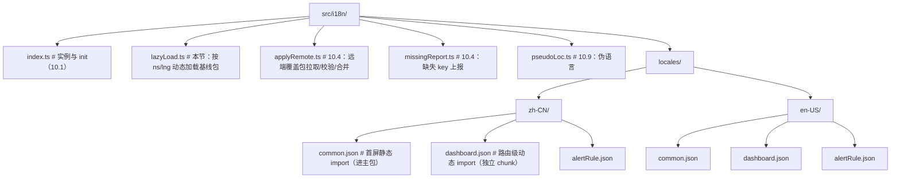
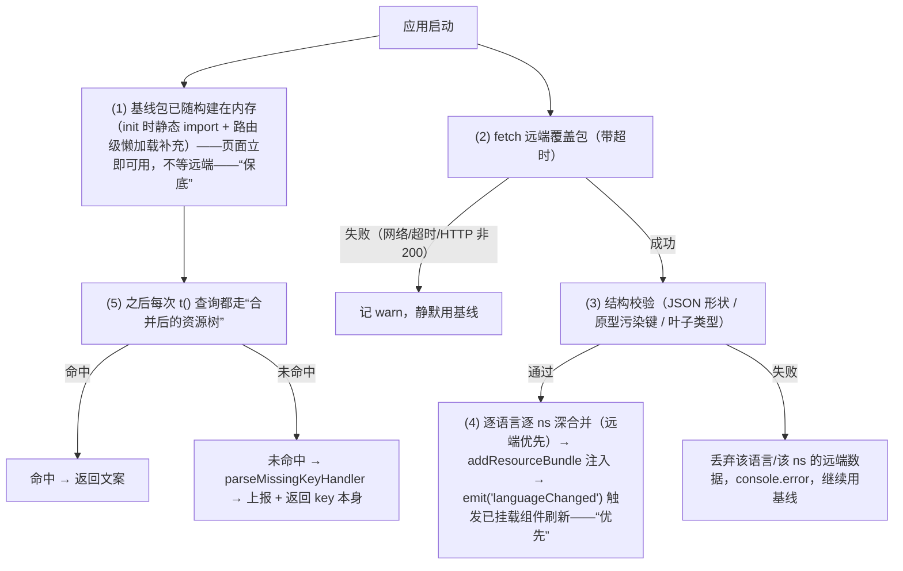
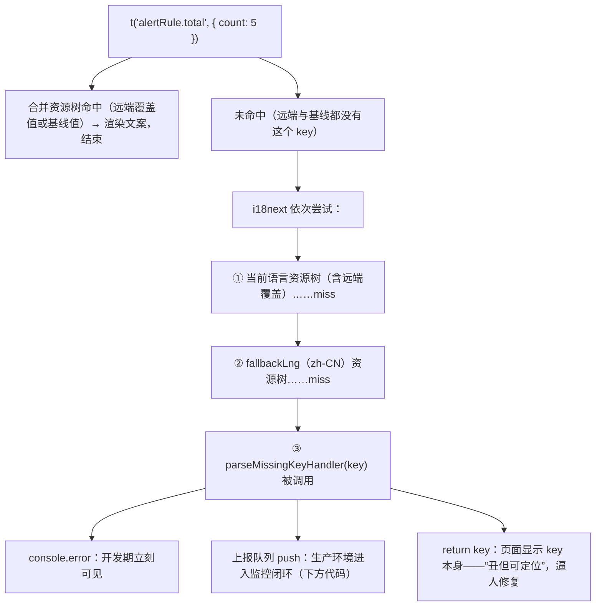
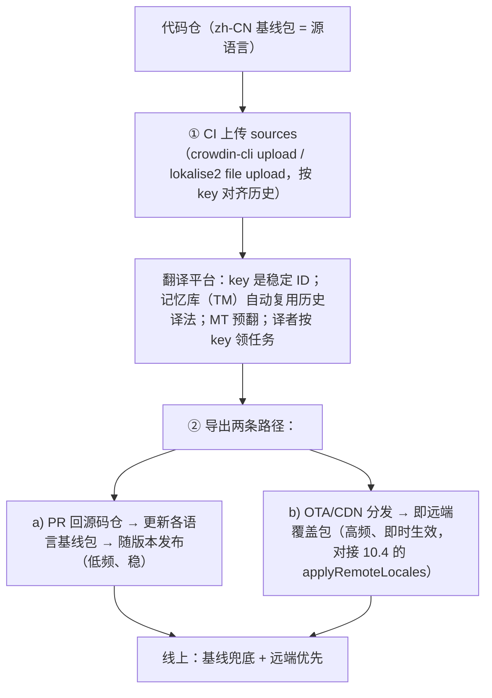
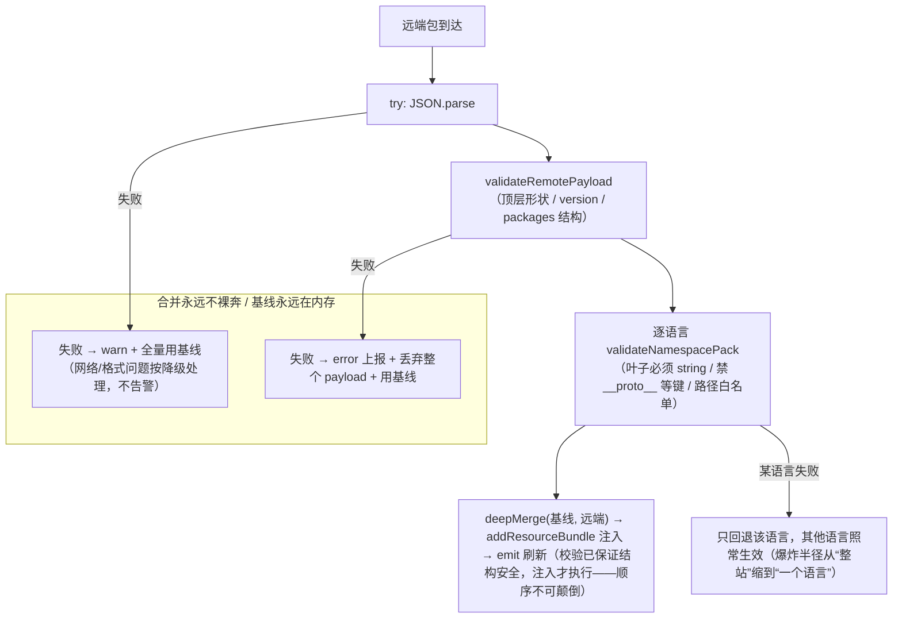

## 10. 国际化与动态语言包

**画像**：多语言，且**语言包由运营/租户随时改，不发版生效**（静态 i18n 与动态语言包是两个难度）。

这句话里的括号是全章的题眼。"静态 i18n"是工程问题：把写死的中文换成 key，接入 react-i18next，随构建打包语言资源——一次性劳动，做完就结束。"动态语言包"是**架构问题**：语言包变成一份**运行时数据**，由运营在 CMS、租户在管理后台随时修改，立即对所有在线用户生效。它带来三个静态方案里不存在的要求：

1. **容错**：远端数据可能拉取失败、格式错误、被人误传坏包——静态包不可能坏，远端包一定会坏（不是会不会，是什么时候）；
2. **合并**：代码里还有一份随构建发布的"基线"文案，远端只是"覆盖增量"，两份如何合成一份、谁优先；
3. **观测**：文案缺失从"编译期就能发现"变成"线上运行时才暴露"，必须有缺失 key 的上报与监控闭环。

本章按"实现路线"的 9 条逐条展开，其中第 3 条（合并策略）是灵魂，密度最高；Intl/RTL/工程化各自独立成节，读完即可直接落地一套生产级方案。

### 实现路线

1. 基础：react-i18next + **ICU MessageFormat**（复数/性别/选择：`{count, plural, =0 {无订单} other {# 条订单}}`）
2. 命名空间：按页面/组件域拆包，路由级懒加载 namespace
3. **动态语言包合并策略（本章灵魂）**：
   - 静态基线包：随构建发布，**保底**
   - 远端覆盖包：CMS/翻译平台下发，**优先**
   - merge 后注入 i18n 实例；fallback 链：远端 → 基线 → key 本身 + 缺失上报（文案缺失监控面板）
4. 运行时切换语言：语言 Context，切换不刷新页面；Suspense 处理加载态；`<html lang>` 同步
5. 格式化 Intl 全家桶：日期/数字/货币/复数规则；**时区**（用户时区显示 vs 数据存储时区，两个概念）
6. 富文案：Trans 组件内嵌 JSX/链接；同名中文不同英文的上下文消歧 key
7. **RTL**：`dir="rtl"` + CSS 逻辑属性迁移（`margin-inline-start`、`text-align: start`）、方向性图标镜像
8. 工程化：key 扫描 lint（未使用/缺失）、TS 类型化 key（`as const`）、**伪语言测试**（pseudo-loc 把文案拉长 40% 提前暴露布局溢出）、翻译平台流程概念（Crowdin/Lokalise）
9. 与 schema 联动：动态表单 label 存 i18n key，渲染时翻译；切语言后 schema 表单整体重渲染

下面 10.1–10.10 与上述 9 条一一对应（路线 1 拆为 10.1/10.2 两节）。

---

#### 10.1 基础接入：react-i18next 与 t 函数

**是什么**。react-i18next 是 i18next 核心的 React 绑定：核心负责资源管理、语言切换、插值与查找；React 侧提供 `useTranslation` hook（订阅语言变化、组件级重渲染）、`Trans` 组件（富文案）、`I18nextProvider`（实例注入）。它是 React 生态事实标准，命名空间、后端加载、ICU 插件、TypeScript 类型增强等生态位全部齐备——这是相对 FormatJS/Lingui 的决定性优势。

**为什么需要**。没有 i18n 层时，文案散落在 JSX 里，"翻译"意味着逐文件人工替换，且翻译完成后没有任何机制保证"改一处两种语言同步更新"。i18n 层的本质是给每条文案一个**稳定 ID（key）**，代码只引用 ID，各语言文件按 ID 提供值——ID 与值的分离是后面一切（远端覆盖、翻译平台、类型化 key、缺失监控）的地基。

**怎么做（机制分步）**：

1. 安装：`npm i i18next react-i18next`（10.2 再加 `i18next-icu`）；
2. 建立基线语言包（随构建发布，10.4 的"保底"就是它）；
3. 模块级 `init`，把资源、默认语言、fallback 语言一次性交给 i18next；
4. 组件里 `useTranslation` 拿 `t`，按 key 渲染。

**代码示例**——完整的最小接入：

```ts
// src/i18n/index.ts —— i18n 实例：模块级单例，main.tsx 里 import 一次即可生效
import i18n from 'i18next';
import { initReactI18next } from 'react-i18next';

// 基线包：import JSON 要求 tsconfig 开 "resolveJsonModule": true
import zhCommon from './locales/zh-CN/common.json';
import enCommon from './locales/en-US/common.json';

/** 默认命名空间，见 10.3 */
export const defaultNS = 'common' as const;

/** 项目支持的语言列表：一处定义，语言切换器 / RTL 判断 / 远端拉取都用它 */
export const SUPPORTED_LNGS = ['zh-CN', 'en-US'] as const;
export type AppLanguage = (typeof SUPPORTED_LNGS)[number];

/** 初始语言：登录用户偏好 > 浏览器语言 > 中文兜底 */
function detectInitialLanguage(): AppLanguage {
  const stored = window.localStorage.getItem('app:lng');
  if (stored && (SUPPORTED_LNGS as readonly string[]).includes(stored)) {
    return stored as AppLanguage;
  }
  const nav = window.navigator.language; // 如 "zh-CN" / "en-US" / "zh"
  const hit = SUPPORTED_LNGS.find((l) => l === nav || l.startsWith(nav));
  return hit ?? 'zh-CN';
}

void i18n.use(initReactI18next).init({
  resources: {
    'zh-CN': { common: zhCommon },
    'en-US': { common: enCommon },
  },
  lng: detectInitialLanguage(),
  fallbackLng: 'zh-CN', // 某语言缺 key 时回退到中文基线
  supportedLngs: [...SUPPORTED_LNGS],
  defaultNS,
  ns: [defaultNS],
  interpolation: {
    // React 渲染文本本身会做 XSS 转义，i18next 侧再转义一次是画蛇添足
    escapeValue: false,
  },
  react: {
    useSuspense: true, // 资源未就绪时组件走 Suspense（10.5 详述）
  },
  // fallback 链的最后一环：key 彻底找不到时返回什么（10.4 详述）
  parseMissingKeyHandler: (key) => key,
});

export default i18n;
```

```json
// src/i18n/locales/zh-CN/common.json —— 基线包（节选）
{
  "app": { "title": "运维控制台" },
  "action": { "save": "保存", "cancel": "取消" },
  "order": {
    "list": {
      "title": "订单列表",
      "total": "共 {{count}} 条订单"
    }
  }
}
```

```json
// src/i18n/locales/en-US/common.json
{
  "app": { "title": "Ops Console" },
  "action": { "save": "Save", "cancel": "Cancel" },
  "order": {
    "list": {
      "title": "Orders",
      "total": "{{count}} orders in total"
    }
  }
}
```

```tsx
// main.tsx —— 只需 import 一次实例
import React from 'react';
import { createRoot } from 'react-dom/client';
import './i18n'; // 副作用导入：模块内完成 init
import App from './app/App';

createRoot(document.getElementById('root')!).render(
  <React.StrictMode>
    <App />
  </React.StrictMode>,
);
```

```tsx
// 使用方：useTranslation 拿 t
import { useTranslation } from 'react-i18next';

export function OrderListHeader({ count }: { count: number }) {
  // 参数是命名空间；不给则用 defaultNS
  const { t } = useTranslation('common');
  return (
    <header>
      {/* key 用点路径；插值用 {{ }}（i18next 原生语法，10.2 换 ICU 后统一为 { }） */}
      <h1>{t('order.list.title')}</h1>
      <span>{t('order.list.total', { count })}</span>
    </header>
  );
}
```

**机制说明（为什么切语言组件会自动重渲染）**：`useTranslation` 内部用 `useSyncExternalStore` 订阅 i18next 实例的 `languageChanged` 事件——`changeLanguage` 一旦完成，所有调用过该 hook 的组件整体重渲染，`t` 返回新语言的文案。这个机制是 10.10（schema 联动）与 10.5（无刷新切换）的共同基础。

**常见坑（症状 → 根因 → 修法）**：

- 症状：页面直接显示 `order.list.title` 这样的 key。
  根因：当前语言资源里没有该 key，且 `fallbackLng` 也没有；i18next 默认返回 key 本身。
  修法：这是设计行为（让缺失可见），配套方案是 10.4 的缺失上报与 CI key 扫描（10.9），不要试图把 missing 值写成中文——那会掩盖问题。
- 症状：`t` 返回的插值出现 `[object Object]`。
  根因：把对象传进了插值：`t('k', { user })` 而文案里写 `{{user}}`。
  修法：插值只传标量，展开为 `{{user.name}}` 时传 `{ user: { name } }` 或直接 `{ name: user.name }`。

---

#### 10.2 ICU MessageFormat 专题

**是什么**。ICU MessageFormat 是 Unicode CLDR 定义的"消息语法标准"，专门描述**自然语言里依赖变量而变化的语法现象**：复数（plural）、序数（selectordinal）、选择（select，如性别）、嵌套组合。浏览器侧由 `IntlMessageFormat`（FormatJS 维护）实现，`i18next-icu` 插件把它接入 i18next。

**为什么需要——为什么中文拼接"共" + n + "条"无法翻译**。这是全章最重要的认知，展开讲三层：

第一层：**语序**。中文"共 3 条订单"的语序是"前缀 + 数字 + 量词 + 名词"；英语是"3 orders in total"（数字开头）；日语是「合計 3 件の注文」。拼接模板假设了"数字夹在固定前后缀中间"这一中文语序，换成任何语序不同的语言直接报废。翻译的本质单位是**整句**，不是碎片。

第二层：**复数类别**。CLDR 把世界语言的名词复数分为 6 个语法类别：zero / one / two / few / many / other。每种语言启用其中若干个：

| 语言 | 启用类别 | 例子 |
|---|---|---|
| 中文（zh） | other（仅 1 类） | 1 条订单 / 3 条订单——数量词不变 |
| 英文（en） | one / other | 1 item / 2 items |
| 法文（fr） | one / many / other | 0 jour / 1 jour / 2 jours（0 和 1 都算 one） |
| 俄文（ru） | one / few / many / other | 1 товар / 2 товара / 5 товаров / 1.5 товара |
| 波兰文（pl） | one / few / many | 1 produkt / 2 produkty / 5 produktów |
| 阿拉伯文（ar） | 全部 6 类 | zero/one/two/few/many/other 各有词形 |

英语至少要 2 个分支，俄语 4 个，阿拉伯语 6 个。`"共" + n + "条"` 这种拼接连英语的 2 分支都表达不了，更别提 6 分支。而且这些"数字落到哪个类别"的规则（俄语：末位 1 且非 11 为 one；末位 2-4 且非 12-14 为 few；其余 many）**不可能也不应该由前端手写**——CLDR 已经写好了，ICU 运行时自动判类别。

第三层：**数字本身的本地化**。同一个 1234567.89，德语渲染为 `1.234.567,89`，印地语分组是 `12,34,567.89`（ lakh 分组）。ICU 复数分支里的 `#` 占位符会自动按当前 locale 格式化数字，拼接 `n.toString()` 做不到。

**怎么做（语法逐个讲）**。以下所有示例都假定接入了 `i18next-icu`（安装见本节末尾），插值统一用 ICU 的 `{var}` 写法。注意：接入 ICU 插件后消息由 `IntlMessageFormat` 解析，**同一 key 里不要再混用 i18next 原生的 `{{var}}`**——团队约定一套语法用到底，本章约定 ICU 风格。

**plural（基数复数）**——`{变量, plural, 分支…}`，分支写法是"类别或精确匹配 { 文案 }"，文案里的 `#` 表示当前数字：

```json
// zh-CN
{ "order": { "totalIcu": "{count, plural, =0 {无订单} other {共 # 条订单}}" } }
```

```json
// en-US
{ "order": { "totalIcu": "{count, plural, =0 {No orders yet} one {# order} other {# orders in total}}" } }
```

```json
// ru-RU（演示 4 分支）
{ "order": { "totalIcu": "{count, plural, one {# товар} few {# товара} many {# товаров} other {# товара}}" } }
```

渲染结果对照（`t('order.totalIcu', { count })`）：

| count | zh-CN | en-US | ru-RU |
|---|---|---|---|
| 0 | 无订单 | No orders yet | 0 товаров |
| 1 | 共 1 条订单 | 1 order | 1 товар |
| 2 | 共 2 条订单 | 2 orders in total | 2 товара |
| 5 | 共 5 条订单 | 5 orders in total | 5 товаров |
| 21 | 共 21 条订单 | 21 orders in total | 21 товар |

注意两条：`=0` 是精确匹配（优先于类别，中文用 `other` 一个分支 + `=0` 特判就是惯用法）；21 在俄语落回 one 类别（末位 1 且非 11）——这就是"手写 if (n === 1) 必挂"的铁证。

**select（选择/性别）**——`{变量, select, 值1 {…} 值2 {…} other {…}}`，用于枚举型变量决定文案，**必须有 other 分支**：

```json
// zh-CN
{ "invite": { "message": "{gender, select, male {他} female {她} other {该用户}}邀请你协作「{docName}」" } }
```

```json
// en-US
{ "invite": { "message": "{gender, select, male {He} female {She} other {They}} invited you to collaborate on \"{docName}\"" } }
```

```json
// fr-FR —— 法语里"邀请"过去分词要随性别变位，拼接方案在此彻底死亡
{ "invite": { "message": "{gender, select, male {Il t'a invitée} female {Elle t'a invitée} other {Invitation à collaborer}} sur « {docName} »" } }
```

渲染：`t('invite.message', { gender: 'female', docName: 'Q3 复盘' })` → 中文"她邀请你协作「Q3 复盘」"。

**selectordinal（序数）**——结构与 plural 相同，但分支按"序数语法类别"匹配：

```json
// en-US：1st / 2nd / 3rd / 4th / 21st
{ "rank": "{place, selectordinal, one {#st} two {#nd} few {#rd} other {#th}} in the leaderboard" }
```

```json
// zh-CN：序数在中文不变形，一个 other 即可，但保留写法统一
{ "rank": "排行榜第 {place, selectordinal, other {#}} 名" }
```

渲染：place=1 → "1st in the leaderboard" / "排行榜第 1 名"；place=21 → "21st …"。

**嵌套**——分支内部可以继续放复数/选择/插值，解决"性别 × 复数"叠加的真实难题：

```json
// zh-CN
{
  "team": {
    "host": "{gender, select, female {{name} 和她的 {count, plural, one {# 位同事} other {# 位同事}}} male {{name} 和他的 {count, plural, one {# 位同事} other {# 位同事}}} other {{name} 和 {count, plural, one {# 位同事} other {# 位同事}}}}在等你会面"
  }
}
```

```json
// en-US：英文里嵌套复数直接决定 colleague 的单复数
{
  "team": {
    "host": "{gender, select, female {{name} and her {count, plural, one {colleague} other {colleagues}}} male {{name} and his {count, plural, one {colleague} other {colleagues}}} other {{name} and {count, plural, one {one colleague} other {# colleagues}}}} are waiting"
  }
}
```

**其他占位符**（知道即可）：`{ts, date, long}` 按当前 locale 格式化日期，`{ratio, number, percent}` 格式化百分比，`{count, number, integer}` 强制整数格式。

**与 i18next 的集成**：

```bash
npm i i18next-icu
```

```ts
// src/i18n/index.ts —— 在 init 之前 use(ICU)，注意顺序：插件在 react 绑定之前或之后均可，但都必须在 init 前
import i18n from 'i18next';
import ICU from 'i18next-icu';
import { initReactI18next } from 'react-i18next';

void i18n
  .use(ICU) // 关键：消息解析交给 IntlMessageFormat
  .use(initReactI18next)
  .init({ /* 10.1 的配置原样不变 */ });
```

接入后调用方式不变：`t('order.totalIcu', { count: 5 })`，i18next-icu 自动把 options 传给 IntlMessageFormat 渲染。还有一个隐性收益：**Crowdin / Lokalise 等翻译平台原生支持 ICU 语法编辑**（对译者高亮显示复数分支表单）——远端语言包（10.4）里的 ICU 语法因此是安全可下发的。

**常见坑（症状 → 根因 → 修法）**：

- 症状：控制台报 `SyntaxError: EXPECT argument style` 或消息原样输出带 `{count, plural...}` 字样。
  根因：ICU 语法写错——最常见的是分支间漏空格（`other{#}` 应为 `other {#}`）、`#` 写在 select（只有 plural/selectordinal 支持 `#`）、花括号不配对。
  修法：语法错误发生在**运行时渲染每条消息时**，静态包能靠 code review + 单测兜住，远端包要靠 10.4 的合并前校验 + CI 里对基线包跑一遍"全 key 渲染冒烟"。
- 症状：英文正确、法文/俄文数量词仍错。
  根因：译者按英文模板只翻了一个分支，few/many 分支缺失。
  修法：`IntlMessageFormat` 对缺失类别会回退 other，因此要靠翻译平台"分支覆盖率"检查 + 对关键 key 的多语言单测（枚举 count = 0/1/2/5/21 渲染快照）。

---

#### 10.3 命名空间拆包与路由级懒加载

**是什么**。i18next 的 namespace（ns）是语言包内的二级拆分维度：资源结构是 `resources[语言][命名空间][key 路径]`。一个 ns 就是一个 JSON 文件、一个独立加载与覆盖的单元。

**为什么需要**。所有文案塞一个 `translation.json`，很快会膨胀到几千 key：首屏要背着"告警规则页"的文案加载；远端覆盖（10.4）的 diff 粒度太粗，改一条文案要下发全量包；多人协作翻译时的文件冲突也集中在一个文件。按"页面/组件域"拆 ns 后，加载、覆盖、权限（谁能翻哪个域）都以 ns 为单位，三个问题一起解决。

**怎么做（机制分步）**：

1. 拆分约定：`common`（全局：按钮/菜单/通用提示，**始终随首屏加载**）+ 每个页面域一个 ns（`dashboard`、`alertRule`、`member`……）；
2. 基线包按 `locales/{lng}/{ns}.json` 组织，用**动态 import** 实现按 ns 代码分包；
3. 路由声明自己依赖的 ns，进入路由前保证 ns 就绪；
4. 运行时用模块内的 Set 记录"页面用过的 ns"，供语言切换时对目标语言补加载（10.5 用到）。

**代码示例**——目录与懒加载器：



```ts
// src/i18n/lazyLoad.ts —— 命名空间级懒加载（基线包路线：走构建器代码分包）
import i18n from './index';
import type { AppLanguage } from './index';

/** 记录"本会话用过的 ns"：语言切换时要为新语言补齐同一批 ns（见 10.5） */
const touchedNamespaces = new Set<string>(['common']);

/** 语言 → 命名空间 → 动态 import 的映射表（构建器靠静态字符串生成 chunk） */
const loaders: Record<string, Record<string, () => Promise<{ default: object }>>> = {
  'zh-CN': {
    common: () => import('./locales/zh-CN/common.json'),
    dashboard: () => import('./locales/zh-CN/dashboard.json'),
    alertRule: () => import('./locales/zh-CN/alertRule.json'),
  },
  'en-US': {
    common: () => import('./locales/en-US/common.json'),
    dashboard: () => import('./locales/en-US/dashboard.json'),
    alertRule: () => import('./locales/en-US/alertRule.json'),
  },
};

/** 幂等加载一个 ns：已在内存则直接返回；并发调用只触发一次网络/chunk 请求 */
export async function lazyLoadNamespace(lng: string, ns: string): Promise<void> {
  touchedNamespaces.add(ns);
  if (i18n.hasResourceBundle(lng, ns)) return; // 已加载（含 10.4 注入的合并包）
  const loader = loaders[lng]?.[ns];
  if (!loader) throw new Error(`未注册的命名空间: ${lng}/${ns}`);
  const mod = await loader(); // 动态 import：该 ns 单独一个 chunk
  // overwrite=true：远端合并包（10.4）可能先到，这里基线只补缺不覆盖远端
  i18n.addResourceBundle(lng, ns, mod.default, true, true);
}

/** 路由进入前调用：保证一组 ns 就绪 */
export async function ensureNamespaces(lng: string, nss: readonly string[]): Promise<void> {
  await Promise.all(nss.map((ns) => lazyLoadNamespace(lng, ns)));
}

/** 语言切换前调用：为新语言补齐本会话用过的所有 ns */
export async function ensureLanguageLoaded(lng: AppLanguage): Promise<void> {
  await ensureNamespaces(lng, [...touchedNamespaces]);
}
```

路由侧的接入——两种模式：

```tsx
// 模式 A（推荐）：路由懒加载与 ns 懒加载合并在一个 lazy 里
import { lazy } from 'react';
import { lazyLoadNamespace } from '../i18n/lazyLoad';
import i18n from '../i18n';

export const AlertRulePage = lazy(async () => {
  // 先保证语言包 chunk 就绪，再加载组件 chunk，组件首帧就有文案
  await lazyLoadNamespace(i18n.language, 'alertRule');
  const mod = await import('../modules/alert-rule/AlertRulePage');
  return { default: mod.AlertRulePage };
});
```

```tsx
// 模式 B：包裹 Gate 组件（适合 ns 由后端路由配置下发的场景，如低代码页面）
import { useTranslation } from 'react-i18next';
import { ensureNamespaces } from '../i18n/lazyLoad';
import { useEffect, useState } from 'react';
import type { ReactNode } from 'react';

export function NamespaceGate({ ns, children }: { ns: string | string[]; children: ReactNode }) {
  const nss = Array.isArray(ns) ? ns : [ns];
  const { i18n } = useTranslation();
  // 手动管理就绪态，不走 Suspense：适合"整页骨架屏"由页面自己控制的团队规范
  const [ready, setReady] = useState(() => nss.every((n) => i18n.hasResourceBundle(i18n.language, n)));

  useEffect(() => {
    void ensureNamespaces(i18n.language, nss).then(() => setReady(true));
  }, [i18n.language]); // 语言切换时对新语言重复保证（10.5）
  void ready;
  return ready ? <>{children}</> : <PageSkeleton />;
}

function PageSkeleton() {
  return <div aria-busy="true" className="page-skeleton">加载中…</div>;
}
```

**常见坑（症状 → 根因 → 修法）**：

- 症状：页面闪现一帧裸 key 再变正常。
  根因：组件 chunk 与 ns chunk 并行加载，组件先渲染而资源未就绪。
  修法：模式 A 把两次 await 串行（先 ns 后组件）；或 `react.useSuspense: true` 让组件挂起在 Suspense 边界，显示骨架而非裸 key。
- 症状：`i18n.addResourceBundle` 加载了新 ns，但已挂载组件不刷新。
  根因：i18next 只在 `languageChanged` 等事件时通知订阅者，新增资源不触发。
  修法：手动 `i18n.emit('languageChanged', i18n.language)` 强制订阅组件重渲染（10.4 注入远端包后就是这么刷新的）。

---

#### 10.4 动态语言包合并策略（本章灵魂）

**是什么**。"静态基线包 + 远端覆盖包"的双包架构：基线包随前端构建发布，覆盖所有 key、保证**永远可用**；远端覆盖包由 CMS / 翻译平台 OTA 下发，只包含"运营改过的 key"，优先级更高。运行时把两份**深合并**成一份注入 i18n 实例，并补全 fallback 链与缺失上报。

**为什么需要**。只用静态包：运营改一条"法务要求的免责声明"要等一次发版，多语言 SaaS 里这种小改每天发生，发版节奏被文案绑架。只用远端包：远端挂了/错了整站文案全灭——把可用性押在一条网络请求上。双包的本质是**把"可用性"与"时效性"解耦**：基线保证可用性（永远有底），远端提供时效性（改完即生效），合并策略保证两者同时成立。

**怎么做（机制分步）**。整条链路分五步，时序图如下：



**（一）两份包的 JSON 结构**。

基线包（随构建发布，10.3 的 `locales/` 目录，完整覆盖所有 key）：

```json
// src/i18n/locales/zh-CN/alertRule.json（基线，节选）
{
  "title": "告警规则配置",
  "field": {
    "amount": "订单金额",
    "city": "下单城市"
  },
  "total": "{count, plural, other {共 # 条订单}}"
}
```

远端覆盖包（CMS 下发，**顶层带版本元信息，packages 按语言→ns 组织，只含被改过的 key**）：

```json
// GET /api/i18n/overrides?app=console&since=<本地版本>
{
  "version": "2026.11.05-rc3",
  "updatedAt": "2026-11-05T08:00:00Z",
  "packages": {
    "zh-CN": {
      "alertRule": {
        "title": "告警规则配置（内测话术 v3）",
        "total": "{count, plural, =0 {暂无订单} other {当前共 # 条订单}}"
      }
    },
    "en-US": {
      "alertRule": {
        "title": "Alert Rule Builder (Beta wording v3)"
      }
    }
  }
}
```

读结构要注意三点：`title` 是覆盖（基线还在，被压住）；`field.*` 远端没有 → 合并后仍取基线；`total` 远端覆盖的同时**保持了 ICU 语法**——远端是运行时数据，语法错了就是线上事故，所以第 (3) 步校验不能省（见坑 4）。

**（二）深合并函数（远端优先）**：

```ts
// src/i18n/merge.ts
export function isPlainObject(v: unknown): v is Record<string, unknown> {
  return typeof v === 'object' && v !== null && !Array.isArray(v);
}

/**
 * 深合并：远端（override）优先，基线（baseline）保底。
 * 规则：
 *  1. 两侧都是普通对象 → 逐 key 递归；
 *  2. override 里 undefined（不会出现在 JSON，防御性保留）→ 取基线；
 *  3. 其余（字符串/数字/数组）→ 远端整体替换，不与基线"拼接"。
 *     文案树里数组本不该出现；万一出现，半新半旧的拼接比整体替换危险得多。
 */
export function deepMerge<T>(baseline: T, override: unknown): T {
  if (override === undefined) return baseline;
  if (isPlainObject(baseline) && isPlainObject(override)) {
    const out: Record<string, unknown> = { ...baseline };
    for (const key of Object.keys(override)) {
      out[key] = deepMerge((baseline as Record<string, unknown>)[key], (override as Record<string, unknown>)[key]);
    }
    return out as T;
  }
  return override as T;
}
```

**（三）合并前校验**。校验目标不是"内容对不对"（那是翻译平台的事），而是"**结构是否足以安全进入资源树**"：顶层形状、叶子类型、原型污染键。任何一条不过，整个语言的远端数据作废，回退基线。

```ts
// src/i18n/validate.ts
import { isPlainObject } from './merge';

export interface PackValidation {
  ok: boolean;
  errors: string[];
}

/** 原型污染键：JSON.parse 理论上不会产出，但 CMS 的存储层（NoSQL/深拷贝库）可能注入，必须挡 */
const FORBIDDEN_KEYS = new Set(['__proto__', 'constructor', 'prototype']);

/** 递归校验一个"命名空间包"：叶子必须全是 string */
export function validateNamespacePack(pack: unknown, path = ''): PackValidation {
  const errors: string[] = [];
  if (!isPlainObject(pack)) {
    return { ok: false, errors: [`${path || '<root>'} 必须是 JSON 对象，实际是 ${Array.isArray(pack) ? '数组' : typeof pack}`] };
  }
  for (const [key, value] of Object.entries(pack)) {
    const p = path ? `${path}.${key}` : key;
    if (FORBIDDEN_KEYS.has(key)) {
      errors.push(`${p} 是被禁止的键（疑似原型污染）`);
      continue;
    }
    if (isPlainObject(value)) {
      errors.push(...validateNamespacePack(value, p).errors); // 嵌套对象：递归
    } else if (typeof value !== 'string') {
      errors.push(`${p} 的值必须是 string，实际是 ${typeof value}`); // 数字/布尔/null 一律拒绝
    }
  }
  return { ok: errors.length === 0, errors };
}

/** 顶层结构校验：packages 字典 + 每个语言的值是 ns 字典 */
export function validateRemotePayload(payload: unknown): PackValidation {
  const errors: string[] = [];
  if (!isPlainObject(payload)) return { ok: false, errors: ['远端包顶层必须是对象'] };
  if (typeof payload.version !== 'string') errors.push('缺少 string 类型的 version 字段');
  if (!isPlainObject(payload.packages)) {
    return { ok: false, errors: [...errors, 'packages 必须是对象（语言 → 命名空间 → key 树）'] };
  }
  for (const [lng, nsMap] of Object.entries(payload.packages)) {
    if (!isPlainObject(nsMap)) {
      errors.push(`packages.${lng} 必须是对象`);
      continue;
    }
    for (const [ns, pack] of Object.entries(nsMap)) {
      errors.push(...validateNamespacePack(pack, `packages.${lng}.${ns}`).errors);
    }
  }
  return { ok: errors.length === 0, errors };
}
```

**（四）完整注入流程（try/catch 时序，含失败回退）**：

```ts
// src/i18n/applyRemote.ts —— 把远端覆盖包安全地叠到基线之上
import i18n from './index';
import { deepMerge, isPlainObject } from './merge';
import { validateRemotePayload, validateNamespacePack } from './validate';

export type RemoteStatus = 'applied' | 'partially-applied' | 'skipped' | 'fetch-failed';

export interface RemoteResult {
  status: RemoteStatus;
  version?: string;
  appliedLngs: string[];
  reason?: string;
}

/** 带超时的 fetch：远端语言包是"锦上添花"，绝不允许拖慢或卡死启动 */
async function fetchWithTimeout(url: string, ms: number): Promise<Response> {
  const ctrl = new AbortController();
  const timer = setTimeout(() => ctrl.abort(), ms);
  try {
    return await fetch(url, { signal: ctrl.signal, headers: { Accept: 'application/json' } });
  } finally {
    clearTimeout(timer);
  }
}

export async function applyRemoteLocales(
  url: string,
  supported: readonly string[],
  timeoutMs = 5000,
): Promise<RemoteResult> {
  // ---- 第 1 步：拉取。失败 → 整体跳过，基线照常工作 ----
  let payload: unknown;
  try {
    const res = await fetchWithTimeout(url, timeoutMs);
    if (!res.ok) throw new Error(`HTTP ${res.status}`);
    payload = await res.json();
  } catch (err) {
    // 注意日志级别：远端包拉不到是"预期内的降级"，warn 而非 error，不触发告警
    console.warn('[i18n] 远端语言包拉取失败，使用基线包。原因：', err);
    return { status: 'fetch-failed', appliedLngs: [], reason: String(err) };
  }

  // ---- 第 2 步：顶层结构校验。失败 → 丢弃整个 payload ----
  const top = validateRemotePayload(payload);
  if (!top.ok) {
    // 这里是 error 级：数据到达了但格式错误，说明下发链路坏了，需要人介入
    console.error('[i18n] 远端语言包结构校验失败，已整体回退基线：', top.errors.slice(0, 20));
    return { status: 'skipped', appliedLngs: [], reason: top.errors[0] };
  }
  const { packages, version } = payload as { packages: Record<string, Record<string, object>>; version: string };

  // ---- 第 3 步：逐语言、逐命名空间校验 + 深合并 + 注入 ----
  // 粒度到"语言"：一个语言的包坏了，不影响其他语言生效
  const appliedLngs: string[] = [];
  for (const lng of supported) {
    const nsMap = packages[lng];
    if (!nsMap || Object.keys(nsMap).length === 0) continue;

    const lngCheck = validateNamespacePack(nsMap);
    if (!lngCheck.ok) {
      console.error(`[i18n] ${lng} 的远端包校验失败，该语言回退基线：`, lngCheck.errors.slice(0, 20));
      continue;
    }

    for (const [ns, remotePack] of Object.entries(nsMap)) {
      // 基线可能尚未懒加载（比如 dashboard ns 还没进路由）→ getResourceBundle 返回 undefined，
      // 此时直接把远端包作为该 ns 的首个 bundle 注入；基线后到时 deep=true 会补齐缺的 key
      const baseline = i18n.getResourceBundle(lng, ns) ?? {};
      const merged = deepMerge(baseline, remotePack);
      i18n.addResourceBundle(lng, ns, merged, true, true); // deep=true, overwrite=true
    }
    appliedLngs.push(lng);
  }

  // ---- 第 4 步：触发已挂载组件刷新（i18next 新增资源不自动通知）----
  if (appliedLngs.includes(i18n.language)) {
    i18n.emit('languageChanged', i18n.language);
  }

  const status: RemoteStatus =
    appliedLngs.length === 0 ? 'skipped' : appliedLngs.length === supported.length ? 'applied' : 'partially-applied';
  return { status, version, appliedLngs };
}
```

关键设计取舍说明：`fetch 失败 → warn + 基线`（网络问题太常见，不是事故）；`校验失败 → error + 基线`（数据链路坏了，要告警）；`粒度到语言`（en 包坏了不影响 zh 的运营改动生效）；`addResourceBundle(deep, overwrite)` 双 true 保证"远端优先、基线补缺"的语义在注入层再次成立。

**（五）fallback 链与缺失 key 上报**。合并后的查询路径就是标题里的链：**远端 → 基线 → key 本身 + 上报**。



```ts
// src/i18n/missingReport.ts —— 缺失 key 上报：批处理 + sendBeacon
type Ns = string;

export interface MissingKeyRecord {
  key: string;
  ns: Ns;
  lng: string;
  url: string;
  appVersion: string;
  ts: number;
}

const QUEUE: MissingKeyRecord[] = [];
let flushTimer: ReturnType<typeof setTimeout> | null = null;
const MAX_BATCH = 20;
const FLUSH_INTERVAL = 10_000;
const APP_VERSION = __APP_VERSION__; // 由构建器 DefinePlugin/Vite define 注入，如 "3.8.1"

/** 由 index.ts 的 parseMissingKeyHandler 调用 */
export function reportMissingKey(key: string, ns: Ns = 'common', lng: string): string {
  // 1) 开发期：只打 console（红色波浪线都不用等，终端里直接炸出来）
  console.error(`[i18n] missing key: ${ns}:${key} (lng=${lng})`);

  // 2) 生产期：进入上报队列（开发环境不上报，避免污染监控数据）
  if (import.meta.env.PROD) {
    QUEUE.push({ key, ns, lng, url: window.location.pathname, appVersion: APP_VERSION, ts: Date.now() });
    if (QUEUE.length >= MAX_BATCH) {
      void flush();
    } else if (flushTimer === null) {
      flushTimer = setTimeout(() => void flush(), FLUSH_INTERVAL);
    }
  }
  // 3) 返回给 i18next 的"兜底文案"：key 本身
  return key;
}

async function flush(): Promise<void> {
  if (flushTimer !== null) {
    clearTimeout(flushTimer);
    flushTimer = null;
  }
  if (QUEUE.length === 0) return;
  const batch = QUEUE.splice(0, QUEUE.length);
  const body = JSON.stringify(batch);
  // sendBeacon：页面关闭/切后台也能发出去，适合"捎带式"遥测
  if (typeof navigator.sendBeacon === 'function') {
    navigator.sendBeacon('/api/i18n/missing-keys', new Blob([body], { type: 'application/json' }));
  } else {
    await fetch('/api/i18n/missing-keys', { method: 'POST', body, headers: { 'Content-Type': 'application/json' }, keepalive: true });
  }
}

// 页面切到后台立刻冲队列：visibilitychange 比 unload 可靠（移动端）
document.addEventListener('visibilitychange', () => {
  if (document.visibilityState === 'hidden') void flush();
});
```

```ts
// src/i18n/index.ts 里接入（替换 10.1 的占位实现）
import { reportMissingKey } from './missingReport';

void i18n.use(initReactI18next).init({
  // ...其余配置同 10.1
  parseMissingKeyHandler: (key, fallbackValue) => {
    // 通过 options 里的 nsHint 拿到命名空间（i18next 会把解析失败的完整 key 传进来，
    // 形如 "alertRule.total" 或 "namespace:key" 两种形式都可能出现，这里做一次归一）
    const [maybeNs, ...rest] = key.split(':');
    const ns = rest.length > 0 ? maybeNs : 'common';
    const bareKey = rest.length > 0 ? rest.join(':') : key;
    void fallbackValue;
    return reportMissingKey(bareKey, ns, i18n.language);
  },
});
```

**（六）文案缺失监控面板的数据结构**。后端把上报按 `(appVersion, key, lng, ns)` 聚合，面板按版本透视——每个版本上线第一天扫一眼"新增缺失数"，是国际化质量的日常巡检：

```json
// GET /api/i18n/missing-keys/panel?appVersion=3.8.1 返回
{
  "appVersion": "3.8.1",
  "totalMissing": 6,
  "items": [
    {
      "key": "alertRule.builder.addField",
      "ns": "alertRule",
      "lngs": { "en-US": 37, "de-DE": 12 },
      "firstSeen": "2026-11-01T02:11:00Z",
      "lastSeen": "2026-11-05T09:40:00Z",
      "topUrls": [{ "url": "/alert-rule/new", "count": 31 }],
      "status": "open",
      "owner": "intl-guild",
      "suspectedCause": "3.8.0 新增页面未同步 en 包（CI key 扫描未开启）"
    }
  ]
}
```

配套两条告警规则：单日新增缺失 key > 5 → 群通知；缺失 key 涉及 `common` ns → 直达值班（公共文案缺失影响全站）。

**常见坑（症状 → 根因 → 修法）**：

- 症状：远端包生效了，但部分页面要刷新一次才显示新文案。
  根因：注入发生在某些路由懒加载**之前**，那些 ns 的基线包在注入后通过 `addResourceBundle` 补进来，且 `overwrite=true` 把远端值盖掉了；或者注入完成后没有 `emit('languageChanged')`。
  修法：保证注入用"合并后的完整树"一次性写入（`deepMerge` 后再 add），并且懒加载器只写"内存里没有的 ns"（10.3 的 `hasResourceBundle` 判断 + 本节 deep/overwrite 语义）；注入后必须手动 emit 刷新。
- 症状：远端包里一个 key 拼错了层级（如把 `title` 放在了 `alertRule.title` 之外的同名节点下），用户看到基线旧文案但运营以为已生效。
  根因：结构校验只保证"形状安全"（都是 string），不保证"key 路径正确"（路径错误 = 合法但无效）。
  修法：校验层加第三道——**路径白名单**：远端包的每个叶子路径必须存在于基线包（`hasPath(baseline, path)`），对"新增 key"（基线没有）的策略按团队定：默认拒绝，显式放开则要求 CMS 勾选"新增 key"并说明原因。

---

#### 10.5 运行时切换语言

**是什么**。用户点一下语言选择器，全站文案、格式化（10.6）、方向（10.8）立即切换，**不刷新页面**、不丢表单状态、不打断当前操作。

**为什么需要**。整页 reload 切换是最省事的做法，代价是：当前页面临时状态全丢（填了一半的高级筛选、滚动位置）、白屏等待、多租户场景下"预览租户语言"这种运营操作每次都要付出 reload 成本。i18next 的事件驱动机制（10.1 机制说明）本来就能做到无刷新，工程上要做的是把"切换瞬间"的体验处理干净。

**怎么做（机制分步）**：

1. 先 `ensureLanguageLoaded(next)`：为目标语言补齐本会话用过的所有 ns（10.3 的 `touchedNamespaces`）；
2. 再 `i18n.changeLanguage(next)`：资源已在内存，`t` 同步返回新语言文案，零空白；
3. `languageChanged` 事件里同步 `<html lang>` 与 `<html dir>`（无障碍与字体选择都依赖它）；
4. 持久化用户选择（localStorage + 服务端用户资料）。

**切换瞬间的两种策略对比**——这是本节的核心决策点：

| 策略 | 做法 | 体验 | 适用 |
|---|---|---|---|
| A. Suspense 加载态 | 直接 `changeLanguage`，未加载的 ns 让组件挂起，显示 Suspense fallback | 切换瞬间**旧界面整块换成骨架屏**，加载完弹出新语言 | ns 很大/网络慢、接受闪断 |
| B. 预载 + 保留旧文案（推荐） | 先 `ensureLanguageLoaded` 再切换，期间旧文案保持可交互 | 旧界面保持到最后一刻，然后**一次性原子切换** | 绝大多数产品 |

策略 B 的"切换按钮转圈 200ms + 原子切换"远好于"整页骨架 800ms"——用户对"按下后界面仍可读"的容忍度远高于"按下后界面消失"。

**代码示例**：

```ts
// src/i18n/syncDocument.ts —— languageChanged 时同步 <html lang> 与 <html dir>
import i18n from './index';

const RTL_LANGS = new Set(['ar', 'ar-SA', 'he', 'he-IL', 'fa', 'fa-IR', 'ur', 'ur-PK']);
export function dirFor(lng: string): 'rtl' | 'ltr' {
  return RTL_LANGS.has(lng) ? 'rtl' : 'ltr';
}

i18n.on('languageChanged', (lng) => {
  document.documentElement.lang = lng; // 读屏软件选语音、浏览器翻译建议、CSS :lang() 都依赖它
  document.documentElement.dir = dirFor(lng); // 10.8 的总开关
  window.localStorage.setItem('app:lng', lng); // 持久化（10.1 的 detectInitialLanguage 读它）
});
```

```tsx
// src/i18n/LanguageSwitcher.tsx —— 策略 B 完整实现
import { useState } from 'react';
import { useTranslation } from 'react-i18next';
import i18n, { SUPPORTED_LNGS, type AppLanguage } from './index';
import { ensureLanguageLoaded } from './lazyLoad';

const LNG_LABEL: Record<AppLanguage, string> = {
  'zh-CN': '简体中文',
  'en-US': 'English',
};

export function LanguageSwitcher() {
  const { i18n } = useTranslation();
  const [switching, setSwitching] = useState(false); // 切换按钮自身的 pending 态（策略 B 的"转圈"）

  async function switchTo(next: AppLanguage) {
    if (next === i18n.language || switching) return;
    setSwitching(true);
    try {
      // 步骤 1：为目标语言补齐本会话用过的全部 ns —— 期间旧文案保持不变、页面可交互
      await ensureLanguageLoaded(next);
      // 步骤 2：资源就绪后原子切换。重渲染由 useTranslation 的订阅自动驱动（10.1 机制说明），
      //         无需手动 setState，也不会出现 Suspense 闪断
      await i18n.changeLanguage(next);
      // 步骤 3：同步服务端偏好（失败不影响本地体验）
      void fetch('/api/me/preferences', {
        method: 'PUT',
        headers: { 'Content-Type': 'application/json' },
        body: JSON.stringify({ language: next }),
      }).catch(() => undefined);
    } finally {
      setSwitching(false);
    }
  }

  return (
    <select
      aria-label="language"
      value={i18n.language}
      disabled={switching}
      onChange={(e) => void switchTo(e.target.value as AppLanguage)}
    >
      {SUPPORTED_LNGS.map((lng) => (
        <option key={lng} value={lng}>
          {LNG_LABEL[lng]}
          {switching && i18n.language === lng ? ' …' : ''}
        </option>
      ))}
    </select>
  );
}
```

如果选择策略 A（Suspense），只需两件事：`react.useSuspense: true`（10.1 已配）+ 在路由外层包 `<Suspense fallback={<AppSkeleton />}>`；`changeLanguage` 后未加载的 ns 会让组件挂起。再补一个官方备选：接了 i18next-http-backend 的团队可以直接 `await i18n.loadLanguages([next])` 再 `changeLanguage`，语义与 `ensureLanguageLoaded` 相同。

**常见坑（症状 → 根因 → 修法）**：

- 症状：切换后部分组件（表格列头、菜单）还是旧语言，刷新才对。
  根因：这些组件在 `useMemo(..., [])` 里调了 `t`，把首语言的字符串"冻结"进了闭包——订阅机制只重渲染组件，不会重算不带依赖的 memo。
  修法：把 `i18n.language` 加入 useMemo 依赖，或列定义只存 key、渲染期再 `t`（10.10 展开完整对照）。
- 症状：`<html lang>` 一直是 `zh-CN`，读屏软件用中文语音读英文界面。
  根因：忘记在 `languageChanged` 里同步 `document.documentElement.lang`，框架不会替你做。
  修法：10.5 的 `syncDocument.ts`，init 后立即手动触发一次（`i18n.emit('languageChanged', i18n.language)`）覆盖首屏。

---

#### 10.6 Intl 全家桶与时区专题

**是什么**。`Intl` 是浏览器内置的国际化 API 族（底层是 ICU/CLDR 数据）：`DateTimeFormat`（日期时间）、`NumberFormat`（数字/货币/单位/紧凑计数）、`RelativeTimeFormat`（相对时间）、`Collator`（排序）、`ListFormat`（列表连接词）。**不需要任何 npm 依赖**，且和 ICU 消息语法共享同一套 CLDR 数据。

**为什么需要**。10.2 解决"句子怎么变"，Intl 解决"数字和日期怎么变"。同一个值，各语言的"正确写法"差异巨大且不可推导：千分位符号、货币符号位置、周首日、上午/下午有无——任何一处手写 switch 都是给未来埋雷。另一个工程理由：日期/数字格式化是高频调用（表格每行一次），原生 API 比 dayjs + 插件组合更快、体积为零。

**怎么做（机制分步 + locale 差异演示）**。固定使用输入 `2026-11-05T12:00:00Z`，显式指定 `timeZone: 'Asia/Shanghai'`（不指定则跟运行机器走，输出不可复现——演示与快照测试都应显式指定）。

日期——同一时刻、同一显示时区，四种 locale 的输出：

```ts
const t12 = new Date('2026-11-05T12:00:00Z');
const zone = 'Asia/Shanghai';

new Intl.DateTimeFormat('zh-CN', { dateStyle: 'full', timeZone: zone }).format(t12);
// → "2026年11月5日星期四"
new Intl.DateTimeFormat('en-US', { dateStyle: 'full', timeZone: zone }).format(t12);
// → "Thursday, November 5, 2026"
new Intl.DateTimeFormat('de-DE', { dateStyle: 'full', timeZone: zone }).format(t12);
// → "Donnerstag, 5. November 2026"
new Intl.DateTimeFormat('ja-JP', { dateStyle: 'full', timeZone: zone }).format(t12);
// → "2026年11月5日木曜日"

new Intl.DateTimeFormat('en-US', { timeStyle: 'short', timeZone: zone }).format(t12);
// → "8:00 PM"（12 小时制 + AM/PM）
new Intl.DateTimeFormat('zh-CN', { timeStyle: 'short', timeZone: zone }).format(t12);
// → "20:00"（24 小时制）
```

差异点一眼可见：年月日语序、星期书写、是否 12 小时制。还有 `weekday: 'narrow'`、`calendar`（佛历/伊斯兰历）、`hourCycle: 'h23'` 强制覆盖等选项，按需查表。

数字与货币——分组符、小数点、货币符号位置、四舍五入全随 locale：

```ts
new Intl.NumberFormat('zh-CN', { style: 'currency', currency: 'CNY' }).format(1234.5);
// → "¥1,234.50"
new Intl.NumberFormat('en-US', { style: 'currency', currency: 'USD' }).format(1234.5);
// → "$1,234.50"
new Intl.NumberFormat('de-DE', { style: 'currency', currency: 'EUR' }).format(1234.5);
// → "1.234,50 €"（点做分组、逗号做小数、符号在后）
new Intl.NumberFormat('fr-FR', { style: 'currency', currency: 'EUR' }).format(1234.5);
// → "1 234,50 €"（窄不换行空格做分组）
new Intl.NumberFormat('ja-JP', { style: 'currency', currency: 'JPY' }).format(1234.5);
// → "￥1,235"（日元无小数，注意直接四舍五入进位！）

// 纯数字分组的极端例子：印地语的 lakh 分组（两位一组）
new Intl.NumberFormat('hi-IN').format(1234567.89); // → "12,34,567.89"
new Intl.NumberFormat('en-US').format(1234567.89); // → "1,234,567.89"
```

单位与相对时间：

```ts
new Intl.NumberFormat('zh-CN', { style: 'unit', unit: 'kilobyte', unitDisplay: 'long' }).format(5);
// → "5 千字节"
new Intl.NumberFormat('en-US', { style: 'unit', unit: 'kilobyte', unitDisplay: 'long' }).format(5);
// → "5 kilobytes"

const rtfZh = new Intl.RelativeTimeFormat('zh-CN', { numeric: 'auto' });
rtfZh.format(-1, 'day');   // → "昨天"
rtfZh.format(3, 'hour');   // → "3 小时后"
const rtfEn = new Intl.RelativeTimeFormat('en-US', { numeric: 'auto' });
rtfEn.format(-1, 'day');   // → "yesterday"
```

工程上封装一个随语言自动变化的 hook，全站统一走它：

```ts
// src/i18n/useFormatters.ts —— 语言切换时格式化器自动换新（Intl 实例有缓存，重建成本低）
import { useMemo } from 'react';
import { useTranslation } from 'react-i18next';
import { APP_TIME_ZONE_FALLBACK } from '../config';

export function useFormatters(timeZone?: string) {
  const { i18n } = useTranslation();
  const lng = i18n.language;
  return useMemo(() => {
    const tz = timeZone ?? APP_TIME_ZONE_FALLBACK; // 显式时区，输出可复现
    return {
      date: (d: Date, style: 'full' | 'long' | 'medium' | 'short' = 'medium') =>
        new Intl.DateTimeFormat(lng, { dateStyle: style, timeZone: tz }).format(d),
      dateTime: (d: Date) =>
        new Intl.DateTimeFormat(lng, { dateStyle: 'medium', timeStyle: 'short', timeZone: tz }).format(d),
      currency: (n: number, currency: string) =>
        new Intl.NumberFormat(lng, { style: 'currency', currency }).format(n),
      relative: (ms: number) => {
        const diffMin = Math.round((ms - Date.now()) / 60000);
        return new Intl.RelativeTimeFormat(lng, { numeric: 'auto' }).format(diffMin, 'minute');
      },
    };
  }, [lng, timeZone]);
}
```

**时区专题（路线 5 加粗部分的展开）**。原则一句话：**存储与传输一律 UTC（推荐 ISO 8601 带 Z 或带 offset），展示时才换算到用户时区**。"用户时区"与"数据时区"是两个概念：数据时区是后端契约（全系统一个，就是 UTC）；用户时区是显示参数（每个用户一个，取浏览器 `Intl.DateTimeFormat().resolvedOptions().timeZone` 或用户资料里的显式设置，如 `America/New_York`）。两者永远不在同一层出现：API 层不出现"本地时间字符串"，展示层不关心"存的是什么时区"。

为什么不用"统一北京时间"：跨国团队的用户在纽约看"11-05 08:00"会误以为是纽约时间，基于它做"今天"的筛选（"今天的告警"）就会错 12 个小时——**"今天"本身是时区相关的概念**，凡是"按天分组/筛选"都必须先明确"按谁的时区算天"，再把天数边界换算成 UTC 时间戳区间发给后端。

dayjs + utc/timezone 插件的转换示例：

```bash
npm i dayjs
```

```ts
// src/utils/datetime.ts
import dayjs from 'dayjs';
import utc from 'dayjs/plugin/utc';
import timezone from 'dayjs/plugin/timezone';
import 'dayjs/locale/zh-cn';

dayjs.extend(utc);
dayjs.extend(timezone);
dayjs.locale('zh-cn'); // 月份名、星期名走中文（与 Intl 的 locale 选择保持同一来源）

const iso = '2026-11-05T12:00:00Z'; // 后端下发的标准形态：带 Z 的 UTC

// UTC → 各用户时区展示
dayjs.utc(iso).tz('Asia/Shanghai').format('YYYY-MM-DD HH:mm');     // → "2026-11-05 20:00"
dayjs.utc(iso).tz('America/New_York').format('YYYY-MM-DD HH:mm');  // → "2026-11-05 07:00"（11 月已结束夏令时）
dayjs.utc(iso).tz('Europe/Berlin').format('YYYY-MM-DD HH:mm');     // → "2026-11-05 13:00"

// 用户浏览器时区（展示层默认值）
const userTz = Intl.DateTimeFormat().resolvedOptions().timeZone; // 如 "Asia/Shanghai"
dayjs.utc(iso).tz(userTz).format('YYYY-MM-DD HH:mm ddd');        // → "2026-11-05 20:00 周四"

// 反向：用户在柏林时区选了"2026-11-06 09:00" → 转成 UTC 发给后端
dayjs.tz('2026-11-06 09:00', 'Europe/Berlin').utc().format();    // → "2026-11-06T08:00:00Z"

// "按天筛选"的正确姿势：先算用户时区的当天边界，再转 UTC 区间发给后端
function todayRangeUtc(tz: string): { start: string; end: string } {
  const nowInTz = dayjs().tz(tz);
  return {
    start: nowInTz.startOf('day').utc().format(),
    end: nowInTz.endOf('day').utc().format(),
  };
}
```

**常见 bug：服务器返回不带 Z 的字符串**（症状 → 根因 → 修法）：

- 症状：同一条"订单创建时间"，北京用户看到 20:00、纽约用户看到 07:00，而运营在后端日志里看到的是 12:00——三个"真相"。更隐蔽的变体：测试环境（统一时区）一切正常，上线后海外用户时间全偏。
  根因：后端返回 `"2026-11-05 12:00:00"`——**无 Z、无 offset** 的"裸本地时间"字符串。`new Date("2026-11-05 12:00:00")` 会按**浏览器本地时区**解释它（各浏览器对空格分隔格式的行为历史上还有差异），于是每个人都在"用自己所在的时区读一个其实是 UTC 的时间"。根子在后端把 `DATETIME`（无时区类型）直接序列化了。
  修法：分三层堵——①契约层：接口规范写死"时间字段一律 ISO 8601 带 Z（UTC）或带 offset"，新接口 code review 卡死；②后端层：`DATETIME` 改 `TIMESTAMP` 或序列化时显式按 UTC 输出；③前端防御层：对历史接口的裸字符串**显式声明语义**再解析——确认它是 UTC 就 `dayjs.utc(str)`，绝不允许 `new Date(str)` 裸吃：

```ts
// 前端防御：把"裸 UTC 字符串"安全地转成标准 ISO
function parseLegacyUtc(raw: string): dayjs.Dayjs {
  // 历史接口约定：无时区标记即 UTC。显式加 Z，杜绝按本地时区解析
  const normalized = /[Z+]|GMT|UTC$/i.test(raw) ? raw : `${raw.replace(' ', 'T')}Z`;
  return dayjs.utc(normalized);
}
```

**常见坑（症状 → 根因 → 修法）**：

- 症状：`toLocaleDateString()` 在不同用户机器上输出不一样，快照测试时好时坏。
  根因：不传参数的 `toLocaleString` 系列走"机器 locale + 机器时区"，等于把渲染结果交给用户环境掷骰子。
  修法：全站禁用无参调用（lint 自定义规则扫 `toLocale`），统一走 `useFormatters`，locale 与 timeZone 永远显式。

---

#### 10.7 富文案：Trans 组件与上下文消歧 key

**是什么**。`Trans` 是 react-i18next 处理"文案里嵌 JSX"的组件：整句仍然是**一条翻译**（语序自由），但句中的链接、加粗、图标等结构由组件在渲染时"克隆"回来。上下文消歧 key 是 key 命名的组织约定，解决"两个场景同一条中文、却需要不同英文"的冲突。

**为什么需要**。"阅读并同意**服务条款**和**隐私政策**"——服务条款是链接。若拆成三段 key 拼接（`agreePrefix` + `terms` + `and` + `privacy`），英文就得接受中文语序，且链接与文字的包裹关系（链接包哪几个词）无法表达。`Trans` 的机制：把组件 children 编号（文本节点与元素节点都占号），翻译文件里用 `<1>…</1>` 引用编号，渲染时 i18next 按 key 找到译文、解析编号占位、把**原 JSX 元素克隆**进对应位置——译者可以任意调整编号位置（换语序），但不能改结构。

**怎么做（代码示例）**：

```tsx
// src/pages/login/AgreementNotice.tsx
import { Trans, useTranslation } from 'react-i18next';

export function AgreementNotice() {
  const { t } = useTranslation('common'); // Trans 需要拿到对应 ns 的 t（或用 ns prop）
  return (
    <p className="agreement">
      <Trans i18nKey="login.agreement" t={t}>
        登录即表示同意
        <a href="https://example.com/legal/terms" target="_blank" rel="noreferrer">
          服务条款
        </a>
        和
        <a href="https://example.com/legal/privacy" target="_blank" rel="noreferrer">
          隐私政策
        </a>
      </Trans>
    </p>
  );
}
```

children 的编号规则（编号按出现顺序，文本节点也占号）：`"登录即表示同意"`=0、第一个 `<a>`=1、`"和"`=2、第二个 `<a>`=3。翻译文件里引用 1 和 3：

```json
// zh-CN/common.json
{
  "login": {
    "agreement": "登录即表示同意<1>服务条款</1>和<3>隐私政策</3>",
    "unread": "你有 <1>{{count}}</1> 条未读公告，详见<3>公告中心</3>"
  }
}
```

```json
// en-US/common.json —— 注意英语语序与中文完全不同，这正是 Trans 存在的意义
{
  "login": {
    "agreement": "By signing in, you agree to our <1>Terms of Service</1> and <3>Privacy Policy</3>",
    "unread": "You have <1>{{count}}</1> unread announcements — see the<3>Announcement Center</3>"
  }
}
```

```tsx
// 插值对象（{{count}}）同样占编号：<1>；第二个示例的用法
export function UnreadNotice({ count }: { count: number }) {
  const { t } = useTranslation('common');
  return (
    <span>
      <Trans i18nKey="login.unread" t={t} values={{ count }}>
        你有 <b>{{ count }}</b> 条未读公告，详见
        <a href="/announcements">公告中心</a>
      </Trans>
    </span>
  );
}
```

使用守则（写给翻译协作的队友）：①编号标签只能移动位置/增删包裹文本，**不能改变编号对应的结构**（不能把 `<1>` 变成两个）；②不要在 Trans 里放含内部状态的组件（会被克隆两份语义混乱），图标类无状态组件安全；③同一句里结构超过 5 个编号就该拆句子——译者的可维护性也是指标。

**上下文消歧 key 的组织方式**。"同名中文不同英文"的典型：按钮"删除"（Delete）与列表项"移除出团队"（Remove from team）——中文里两个场景都习惯叫"删除"。反过来也有："开票"在财务页是 invoice（动词）、在设置页是 receipt（名词）。这类冲突说明**按中文原文建 key 是错的**，key 应该按"语义位置"建：

```json
// zh-CN/common.json —— 语义化 key：域 + 实体 + 意图
{
  "action": { "delete": "删除" },
  "member": { "list": { "remove": "移除" } }
}
```

```json
// en-US/common.json —— 英文各自最优，互不牵连
{
  "action": { "delete": "Delete" },
  "member": { "list": { "remove": "Remove from team" } }
}
```

判断口诀：**两个场景的同一段中文，如果英文需要不同译法，那它们在语义上就是两条文案，应该有两个 key**——中文恰好同字只是巧合，不要让巧合合并语义。i18next 也内置了 context 参数做轻量消歧：`t('invite', { context: 'email' })` 会优先查 `invite_email`，适合"同一动作在不同渠道提示语微调"这种不想拆 key 的小场景；默认仍推荐独立 key，可读性与删除的自由度都更好。

**常见坑（症状 → 根因 → 修法）**：

- 症状：切语言后链接没了，只剩纯文本。
  根因：翻译文件里的编号与组件 children 对不上（组件加了一个 `<b>`，编号整体后移，旧译文引用的 1 变成了文本节点），i18next 静默降级为纯文本。
  修法：children 结构变更必须同步所有语言的编号（CI 里用 babel 解析组件 children 数量与各语言 JSON 引用编号做交叉校验，i18next-parser 提取时也会重新生成默认值辅助发现）；结构稳定后编号视为接口契约，改动走"加新 key"而非原地改。

---

#### 10.8 RTL 双向排版

**是什么**。RTL（right-to-left）是阿拉伯语、希伯来语、波斯语、乌尔都语的排版方向。支持 RTL 不是"把文字右对齐"，而是整个布局镜像：行进方向、图标指向、面包屑分隔符、进度条方向全部反转，由 `<html dir="rtl">` 一个总开关驱动。

**为什么需要**。出海中东的产品这是硬需求；即使当前不支持，CSS 写法的选择也决定未来迁移成本——用了物理属性（`left`）的代码在迁移时要逐行改，用了逻辑属性（`inline-start`）的代码零改动。

**怎么做（机制分步）**：

1. `dir` 属性挂到 `<html>`（10.5 的 `syncDocument.ts` 已完成切换）；组件内局部覆盖用 `<div dir="ltr">` 包裹（如代码块、电话号码）；
2. CSS 全部迁到**逻辑属性**（对照表见下）；
3. 方向性图标按清单镜像，对称图标不动；
4. 混排文本（用户昵称等未知方向的内容）用 `dir="auto"` 或 `<bdi>` 让浏览器自行判断。

**CSS 逻辑属性迁移对照表**：

| 物理属性（勿用） | 逻辑属性（改用） | 语义 | LTR 下等于 | RTL 下等于 |
|---|---|---|---|---|
| `margin-left` | `margin-inline-start` | 行首外边距 | 左 | 右 |
| `margin-right` | `margin-inline-end` | 行尾外边距 | 右 | 左 |
| `padding-left` | `padding-inline-start` | 行首内边距 | 左 | 右 |
| `padding-right` | `padding-inline-end` | 行尾内边距 | 右 | 左 |
| `border-left` | `border-inline-start` | 行首边框 | 左 | 右 |
| `border-left-width` | `border-inline-start-width` | 行首边框宽 | 左 | 右 |
| `border-top-left-radius` | `border-start-start-radius` | 块首-行首圆角 | 左上 | 右上 |
| `left`（定位） | `inset-inline-start` | 行首偏移 | 左 | 右 |
| `right`（定位） | `inset-inline-end` | 行尾偏移 | 右 | 左 |
| `text-align: left` | `text-align: start` | 行首对齐 | 左 | 右 |
| `text-align: right` | `text-align: end` | 行尾对齐 | 右 | 左 |
| `float: left` | `float: inline-start` | 行首浮动 | 左 | 右 |
| `flex-direction: row` | 默认即逻辑方向 | 主轴随 dir 反转 | → | ← |

注意两类例外：`top/bottom`、块轴方向（`margin-top` 等）没有逻辑属性的必要，照旧用；`width`/`height` 与方向无关，照旧用。stylelint 加一条规则（`property-no-unknown` 组合自定义 or 用 plugin 如 `stylelint-logical-properties` 思路）禁止物理方向属性出现在新代码，是防止回退的唯一可靠手段。

**方向性图标镜像**——先分诊再处理：

```text
需要镜像（表达了"前进/返回"的方向语义）：
  返回箭头 ←/→、chevron、面包屑分隔符 /、进度指示 →→→、
  撤销↶/重做↷、列表缩进、发送纸飞机、喇叭开口方向
不要镜像（方向无关或物理/时间约定）：
  时钟、日历、垃圾桶、放大镜、齿轮、加号、对勾、
  播放▶（媒体惯例保留 LTR）、logo、数字/代码内容
```

```css
/* 方向性图标镜像：只给明确标记的图标加，禁止一刀切 transform */
.icon--directional {
  /* LTR 下原样 */
}
[dir='rtl'] .icon--directional {
  transform: scaleX(-1); /* 水平镜像 */
}

/* 图标带文字时的间距也走逻辑属性 */
.btn {
  display: inline-flex;
  gap: 4px;
  padding-inline: 12px 16px; /* 行首 12 行尾 16，方向反转后自动正确 */
}
```

**常见坑（症状 → 根因 → 修法）**：

- 症状：切到阿拉伯语，布局整体镜像了，但弹层定位飘了（`position: fixed; left: 0` 的抽屉现在从右边推入，遮罩还在左边）。
  根因：`left/right` 物理属性不随 `dir` 反转，与逻辑属性混用后一半镜像一半不镜像。
  修法：弹层定位统一迁 `inset-inline-start`；全仓库 grep `\b(left|right)\s*:` 逐个分诊（CSS in JS 同样处理）。
- 症状：RTL 下列表里混排的英文昵称显示顺序错乱（"张三 replied to John"渲染成 "John replied to 张三" 的错觉）。
  根因：RTL 段落里嵌入 LTR 文本，Unicode 双向算法对"标点 + 混排"的组合会猜错边界。
  修法：用户生成内容一律 `<bdi>` 包裹或容器 `dir="auto"`，把方向判断交给浏览器而不是 CSS。

---

#### 10.9 工程化：key 扫描 / 类型化 key / 伪语言 / 翻译平台

国际化从"功能"变成"长期不出事的系统"，靠的是这四件工程化工具。它们共同守护一件事：**key 的一致性**（代码引用、基线包、远端包、类型定义四者对齐）。

**（一）key 扫描 lint（未使用 / 缺失检查脚本）**。思路：静态扫描代码里的 `t('...')`、`<Trans i18nKey="...">`、`useTranslation('ns')` 收集"已用 key 集合"，与基线包扁平化后的"已定义 key 集合"做双向 diff——已用未定义 = 缺失（运行时会显示 key），已定义未用 = 冗余（翻译成本浪费 + 干扰译者）。脚本版实现：

```js
// scripts/check-i18n-keys.mjs —— node scripts/check-i18n-keys.mjs；CI 中非零退出码即失败
// 升级路线：正则换 ts-morph/babel AST 解析，可消除注释/字符串里的误报，原理不变
import { readFileSync, readdirSync, statSync } from 'node:fs';
import path from 'node:path';

const SRC_DIR = 'src';
const LOCALE_DIR = 'src/i18n/locales';
const BASE_LNG = 'zh-CN';

// ---------- 1. 收集已定义 key：扁平化基线包 ----------
function flatten(node, prefix = '', out = new Set()) {
  for (const [k, v] of Object.entries(node)) {
    const p = prefix ? `${prefix}.${k}` : k;
    if (v && typeof v === 'object' && !Array.isArray(v)) flatten(v, p, out);
    else out.add(p);
  }
  return out;
}

function loadDefined() {
  const dir = path.join(LOCALE_DIR, BASE_LNG);
  const defined = new Map(); // ns -> Set<key>
  for (const file of readdirSync(dir)) {
    if (!file.endsWith('.json')) continue;
    const ns = path.basename(file, '.json');
    defined.set(ns, flatten(JSON.parse(readFileSync(path.join(dir, file), 'utf8'))));
  }
  return defined;
}

// ---------- 2. 收集已用 key：扫描源码 ----------
const T_CALL = /\bt\(\s*['"`]([^'"`\n]+)['"`]/g;             // t('a.b')
const TRANS_KEY = /\bi18nKey=\{?\s*['"`]([^'"`\n]+)['"`]/g; // <Trans i18nKey="a.b" />
const NS_OF_FILE = /useTranslation\(\s*\[?\s*['"`]([^'"`]+)['"`]/g; // 文件级 ns 推断
// 动态 key 白名单：schema.label 等运行时拼接的 key 无法静态扫出，按 ns 前缀放行
const DYNAMIC_ALLOW = [/^alertRule\.field\./, /^common\.(enum|unit)\./];

function walk(dir, files = []) {
  for (const name of readdirSync(dir)) {
    const p = path.join(dir, name);
    if (statSync(p).isDirectory()) walk(p, files);
    else if (/\.(ts|tsx)$/.test(name)) files.push(p);
  }
  return files;
}

/** 在一段源码里用给定正则收集命中结果（复用 lastIndex 继续扫的写法要求每次传入同一份 code） */
function collect(re, code) {
  const hits = [];
  let m;
  while ((m = re.exec(code)) !== null) hits.push(m[1]);
  return hits;
}

function loadUsed() {
  const used = new Map(); // `${ns}:${key}` -> 引用它的文件（输出定位信息用）
  const fileNss = new Map();

  for (const file of walk(SRC_DIR)) {
    const code = readFileSync(file, 'utf8');
    // 文件级 ns 推断：该文件 useTranslation 声明了哪些 ns（没声明则归 defaultNS）
    const nss = collect(NS_OF_FILE, code);
    fileNss.set(file, nss.length ? nss : ['common']);

    const record = (rawKey) => {
      if (rawKey.includes(':')) {
        used.set(rawKey, file); // 显式 'ns:key' 写法（t('alertRule:title')）
      } else {
        for (const ns of fileNss.get(file)) used.set(`${ns}:${rawKey}`, file);
      }
    };
    for (const raw of [...collect(T_CALL, code), ...collect(TRANS_KEY, code)]) record(raw);
  }
  return used;
}

// ---------- 3. 双向 diff ----------
const defined = loadDefined();
const used = loadUsed();
const missing = [];
for (const full of used.keys()) {
  const [ns, key] = full.split(/:(.+)/);
  if (DYNAMIC_ALLOW.some((re) => re.test(`${ns}.${key}`))) continue;
  if (!defined.has(ns)) { missing.push(`未知命名空间 ${full}`); continue; }
  if (!defined.get(ns).has(key)) missing.push(`缺失 ${full}（基线包无此 key）`);
}
const unused = [];
for (const [ns, keys] of defined) {
  for (const key of keys) {
    if (!used.has(`${ns}:${key}`) && !DYNAMIC_ALLOW.some((re) => re.test(`${ns}.${key}`))) {
      unused.push(`冗余 ${ns}:${key}（代码未引用）`);
    }
  }
}

console.log(`已定义 ${[...defined.values()].reduce((s, x) => s + x.size, 0)} 个 key，已引用 ${used.size} 处`);
if (missing.length) console.error('\n[缺失] 运行时会直接显示 key，必须修复：\n' + missing.join('\n'));
if (unused.length) console.warn('\n[冗余] 翻译成本浪费，确认后删除：\n' + unused.join('\n'));
process.exit(missing.length > 0 ? 1 : 0); // 缺失阻断 CI，冗余仅警告
```

对 `common.json` 之外的命名空间同样适用（按文件遍历 locales 目录）。提取侧的标准工具是 **i18next-parser**（`npx i18next-parser --config i18next-parser.config.js`）：按 AST 提取 `t`/`Trans` 用法，自动把新 key 合并进基线包（标记 `_unused` 供冗余检测）——脚本负责"校验"，parser 负责"提取"，两者互补。另一个补充工具：翻译平台侧的 CLI（如 Crowdin 的 `crowdin-cli`、Lokalise 的 CLI）在 CI 上做"基线包与平台侧同步校验"，见本节（四）。

**（二）TS 类型化 key（`as const` + 模块增强）**。让 `t('xxx')` 的参数获得字面量联合类型：typo、删掉的 key、不在当前 ns 的 key，全部编译报错。完整写法：

```json
// tsconfig.json 需开启
{ "compilerOptions": { "resolveJsonModule": true } }
```

```ts
// src/i18n/resources.d.ts —— 用"中文基线"作为 key 的唯一真源做类型
// 原理：i18next 暴露 CustomTypeOptions 接口供项目 augment，t/useTranslation 的泛型据此收窄
import type common from './locales/zh-CN/common.json';
import type alertRule from './locales/zh-CN/alertRule.json';
import type dashboard from './locales/zh-CN/dashboard.json';

declare module 'i18next' {
  interface CustomTypeOptions {
    defaultNS: 'common';
    resources: {
      common: typeof common;
      alertRule: typeof alertRule;
      dashboard: typeof dashboard;
    };
  }
}
```

```ts
// 资源定义侧配合 as const（TS 文件内联资源的写法；JSON import 自带字面量类型，不需要）
import zhCommon from './locales/zh-CN/common.json';

export const resources = {
  'zh-CN': { common: zhCommon },
} as const; // as const 把推断锁到字面量层级，后续 typeof 才能拿到具体 key 而不是 string
```

```tsx
// 使用效果：
import { useTranslation } from 'react-i18next';

function Demo() {
  const { t } = useTranslation('alertRule', { keyPrefix: 'field' }); // keyPrefix 也参与类型收窄
  t('amount');        // ✔ 'alertRule.field.amount'
  t('amout');         // ✘ 编译错误：不存在于 alertRule.field 下的字面量联合
  t('title');         // ✘ 编译错误：title 在 ns 根下，不在 field 前缀内
  const { t: tCommon } = useTranslation('common');
  tCommon('action.save'); // ✔
  tCommon('save');        // ✘ 编译错误：路径少了一级
  return <span>{t('amount')}</span>;
}
```

一个重要的边界认知：**类型化 key 只守护"代码里写死的 key"，不约束远端覆盖包**——远端是运行时数据，TS 管不到。这恰好与双包架构自洽：类型保证"基线里必有这个 key"，而远端的语义是"覆盖已有 key"，所以远端永远不需要提供"新增的必需 key"，类型与运行时各守一层，互不越界。

**（三）伪语言测试（pseudo-loc）**。原理：在开发环境造一门"伪语言"（前缀标记 + 重音字符 + **拉长约 40%** 的填充），把 UI 切到伪语言走一遍，所有"按中文两三个字定宽"的按钮、标签、导航全部当场溢出——**在真翻译进来之前**暴露布局的长度脆弱性。德语平均比英语长 35%，中文到德语常翻 3-5 倍长度，伪语言用 40% 的确定性膨胀把这个风险提前变成肉眼可见的 bug。

```ts
// src/i18n/pseudoLoc.ts —— 仅开发环境使用
const LOWER: Record<string, string> = {
  a: 'à', b: 'ƀ', c: 'ç', d: 'ð', e: 'é', f: 'ƒ', g: 'ĝ', h: 'ĥ', i: 'î',
  j: 'ĵ', k: 'ķ', l: 'ļ', m: 'ɱ', n: 'ñ', o: 'õ', p: 'ƥ', q: 'ǫ', r: 'ŕ',
  s: 'š', t: 'ţ', u: 'ů', v: 'ṽ', w: 'ŵ', x: 'ẋ', y: 'ý', z: 'ẑ',
};

/** 单条文案伪化：重音化 + 对称填充拉长 expandRatio + 括号标记 */
export function pseudoLoc(text: string, expandRatio = 0.4): string {
  // 1) 拉丁字符换重音形态：肉眼立刻识别"这是伪语言"，同时模拟变音符号的行高压力
  const accented = Array.from(text, (ch) => {
    const mapped = LOWER[ch.toLowerCase()];
    if (!mapped) return ch; // 中文、数字、标点原样
    return ch === ch.toUpperCase() ? mapped.toUpperCase() : mapped;
  }).join('');
  // 2) 按比例拉长：两侧对称填充，模拟德语/芬兰语复合词的长度
  const padLen = Math.max(1, Math.round((accented.length * expandRatio) / 2));
  const pad = '≈'.repeat(padLen);
  // 3) 方括号包裹：截图/录屏里一眼可辨，防止伪语言内容混进真文案
  return `[${pad}${accented}${pad}]`;
}

/** 递归伪化整棵语言包树（叶子才处理） */
export function pseudoTransformTree(node: unknown): unknown {
  if (typeof node === 'string') return pseudoLoc(node);
  if (node && typeof node === 'object' && !Array.isArray(node)) {
    const out: Record<string, unknown> = {};
    for (const [k, v] of Object.entries(node)) out[k] = pseudoTransformTree(v);
    return out;
  }
  return node;
}
```

接入方式——注册一门开发专属语言，切换器只在 DEV 暴露：

```ts
// src/i18n/index.ts 末尾（模块顶层 await，目标 ES2022）
if (import.meta.env.DEV) {
  // 以英文包为底（拉丁字母才能吃到重音化），生成伪语言并注册
  const enCommon = await import('./locales/en-US/common.json');
  i18n.addResourceBundle('zz-PSEUDO', 'common', pseudoTransformTree(enCommon.default), true, true);
}
```

```tsx
// 语言切换器的开发选项（与 10.5 的 LanguageSwitcher 合并使用）
const OPTIONS = [
  { value: 'zh-CN', label: '简体中文' },
  { value: 'en-US', label: 'English' },
  ...(import.meta.env.DEV ? [{ value: 'zz-PSEUDO', label: '🧪 Pseudo (布局压力测试)' }] : []),
];
```

两点务实说明：伪化对中文无效（中文没有重音形态、填充符也只能机械加长），所以中文产品的做法是**伪化英文包**——用"膨胀后的最长语言"做全局压力测试；更深一层，把"zz-PSEUDO 语言全页面截图"挂进 Playwright CI，布局溢出就从"人肉巡检"变成"像素级断言"。另外伪语言还有一种冷门用法：**检测硬编码英文**——伪化后页面上仍是"正常英文"的文案，一定是绕过 i18n 层写死的（对应坑 2）。

**（四）翻译平台流程概念（Crowdin / Lokalise 的 key 同步机制）**。双包架构里"远端覆盖包"的工业级来源就是这类平台。流程与机制概念：



key 同步机制的三个要点：**key 是稳定 ID**——重命名 key 在平台侧等价于"删除 + 新增"，翻译记忆全部断链，所以约定"key 一旦下发线上永不改名，只加新 key、废弃 key 打标停用"；**双向校验**——CI 里 `download --dry-run` 对比平台与仓库 diff，防止有人在平台直接改了源语言文案却没人审；**上下文**——平台的截图/评论挂在 key 上（配合 10.7 的消歧），译者的歧义在平台内消化而不是甩回开发群。

---

#### 10.10 与 Schema 联动：动态表单的国际化

**是什么**。Schema 驱动体系（本篇场景 4、以及《进阶大纲》§3 的 Setter）里，表单结构是运行时数据。联动方式：**schema 的 `label`/`placeholder`/`description` 字段不存文案，存 i18n key**，渲染器渲染时翻译。

**为什么需要**。schema 若直接存中文文案，多语言就断了：一份 schema 只能服务一种语言；要么为每种语言复制一份 schema（字段变更要改 N 份，必然漂移）。存 key 则 schema 与语言正交——结构只有一份，语言是渲染参数。另一个收益：**租户定制**走 10.4 的远端覆盖包就能改表单文案（覆盖 `alertRule.field.amount` 这个 key），不需要动 schema 本身。

**怎么做（机制分步）**：

1. schema 约定：文案类字段（label 等）一律是"合法 i18n key"，编辑器侧（场景 4 的 Schema 编辑器）用下拉选择已有 key 而不是自由文本，从源头防脏数据；
2. 渲染器在**渲染期**调用 `t(field.label)`——不是加载期翻译一次存起来；
3. 语言切换的"整体重渲染"不需要额外代码：渲染器组件调用了 `useTranslation`，`languageChanged` 事件自动触发它们重渲染，key 重新走 `t`，文案即变。

**代码示例**：

```ts
// src/modules/alert-rule/schema.ts —— label 存 key
export interface FieldSchema {
  name: string;
  /** 约定：必须是 alertRule 命名空间下已存在的 key（类型化 key 守护，见 10.9） */
  label: string;
  type: 'number' | 'string' | 'select';
  required?: boolean;
}

export const alertRuleSchema: FieldSchema[] = [
  { name: 'amount', label: 'field.amount', type: 'number', required: true }, // → t 后 "订单金额"
  { name: 'city', label: 'field.city', type: 'select' },                     // → "下单城市"
];
```

```tsx
// src/modules/alert-rule/SchemaField.tsx —— 渲染期翻译 + keyPrefix
import { useTranslation } from 'react-i18next';
import type { FieldSchema } from './schema';
import { ValueEditor } from './ValueEditor';

export function SchemaField({ field }: { field: FieldSchema }) {
  // keyPrefix 让 schema 里的 label 只需存 'field.amount' 的尾段，类型也随 keyPrefix 收窄
  const { t } = useTranslation('alertRule', { keyPrefix: '' });
  return (
    <div className="field">
      <label htmlFor={field.name}>{t(field.label)}</label>
      {/* 校验错误文案同样走 key：errors.required = "{label} 为必填项"，label 复数嵌套插值 */}
      <ValueEditor field={field} id={field.name} />
    </div>
  );
}
```

**切语言后表单整体重渲染的机制与一个高发坑**。机制如上：订阅驱动，无需手动刷新。坑在"预翻译缓存"——任何把 `t()` 结果**存进数据**的地方都会脱离订阅：

```tsx
// ❌ 症状代码：切语言后列头不变，仍是旧语言
function OrderTable() {
  const { t } = useTranslation('common');
  const columns = useMemo(
    () => [
      { title: t('order.col.amount'), dataIndex: 'amount' },
      { title: t('order.col.city'), dataIndex: 'city' },
    ],
    [], // ← 根因：依赖数组为空，t 在首语言时被求值一次，结果字符串被冻结
  );
  return <Table columns={columns} />;
}

// ✅ 修法一：把 i18n.language 纳入依赖，语言变了列定义重算
function OrderTable() {
  const { t, i18n } = useTranslation('common');
  const columns = useMemo(
    () => [
      { title: t('order.col.amount'), dataIndex: 'amount' },
      { title: t('order.col.city'), dataIndex: 'city' },
    ],
    [i18n.language, t], // 语言变化 → memo 失效 → 重算 → 新文案
  );
  return <Table columns={columns} />;
}

// ✅ 修法二（更优）：列定义只存 key，渲染期翻译——数据与文案彻底解耦
{ titleKey: 'order.col.amount', dataIndex: 'amount' }
// Table 的 render/title 处统一 t(titleKey)
```

修法二是 schema 联动的正统姿势：**数据里永远只有 key，翻译只发生在渲染的最后一刻**。这也解释了为什么 schema 存 key 是唯一正确解——key 是数据，文案是视图。

---

### 坑

- ⚠️ 中文拼接写法（"共" + n + "条"）无法翻译 → 必须 ICU
- ⚠️ 初期写死中文，回头改造是地狱 → 第一天就上 i18n
- ⚠️ 德语等长文案撑爆按钮布局
- ⚠️ 远端语言包格式错误把整站文案打挂 → 合并前校验 + 基线兜底

四个坑不是并列的"注意事项"，而是一条时间线上的四个阶段：**写代码时**的拼接（坑 1）→ **项目早期**的欠债（坑 2）→ **接入新语言时**的布局（坑 3）→ **上线动态包之后**的容错（坑 4）。逐个按"症状 → 根因 → 修法"展开。

#### 坑 1：中文拼接写法无法翻译

- **症状**：中文一切正常；上英文后出现"Total 3 items"勉强能用，但 1 条时显示"Total 1 items"（单复数错）；上俄语/阿拉伯语后数量词全错；日语语序别扭（"合計 3 件の注文"被拼成"3 合计 件 订单"式的怪句）。另一个变体：不同语言下日期与数字的千分位、货币符号位置各写一套 switch，越写越多。
- **根因**：把中文的语法特性当成了世界通用特性。具体三条（10.2 已详述）：①语序假设——拼接假设"数字夹在前后缀之间"，多数语言不成立；②复数类别——俄语 4 类、阿拉伯语 6 类的词形变化在拼接模型里没有表达位置；③数字格式化——`n.toString()` 不走 locale。本质是**把"翻译单位"搞错了：句子才是翻译单位，碎片不是**。
- **修法**：一律改为整句 key + ICU MessageFormat（10.2 全节）。落地三条纪律：code review 见到 `+ n +` 或模板串里夹变量直接打回；存量代码用 grep `'[^']*'\s*\+` 找疑似拼接点人工分诊；对数量词类 key 补多语言单测（count 取 0/1/2/5/21 断言渲染快照），因为这类错误编译期和 lint 都发现不了，只有渲染能暴露。

#### 坑 2：初期写死中文，回头改造是地狱

- **症状**：项目"先做国内"，三个月后宣布出海。全量扫描发现 4000+ 处中文散落在 JSX 文本、`message: '成功'` 对象字面量、`placeholder="请输入"` 属性、报错字符串里。改造预估三周，实际两个月：每处要判断语境起 key（10.7 消歧）、要处理拼接改 ICU（坑 1）、要处理藏在三元表达式和工具函数里的深层文案；改造期间新旧两种写法并存，merge 冲突不断。
- **根因**：把 i18n 当"翻译需求"而不是"架构约束"。写死中文的成本是 0，改造的成本是 O(全部文案数) 且要补做所有本该顺手做的语境判断——**欠的是认知债，还的是全量人工**。
- **修法**：分三层。**事前**：第一天就接 i18n（哪怕只有中文一种语言），空翻译层也比没层强——`t()` 从第一行业务代码就存在；用 10.9 的扫描脚本加一条"裸中文检测"（扫 JSXText 与字符串字面量中的 CJK 字符，白名单放行正则/单位/测试），新代码零容忍。**事中**（已经写死、尚未出海）：按页面分批改造，先改高频页面，改造一个页面就把该页面的 key 归入对应 namespace（顺手完成 10.3 拆包）。**配套**：翻译层就位后立即启用 pseudo-loc（10.9），让"布局从未考虑过长度"的存量问题同步暴露，而不是等德语翻译回来才炸。

```js
// scripts/no-raw-chinese.mjs —— 坑 2 的自动化守护：扫描写死的 CJK 文案（节选核心逻辑）
import { readFileSync } from 'node:fs';
const CJK = /[\u4e00-\u9fff]/;
const ALLOW = [/\/\*[\s\S]*?\*\//g, /\/\/[^\n]*/g]; // 先剥注释再扫
for (const file of walk('src')) {
  if (!/\.(ts|tsx)$/.test(file)) continue;
  let code = readFileSync(file, 'utf8');
  for (const re of ALLOW) code = code.replace(re, '');
  if (CJK.test(code)) {
    const line = code.split('\n').findIndex((l) => CJK.test(l)) + 1;
    console.warn(`[raw-chinese] ${file}:${line} 存在写死的中文，请改为 i18n key`);
  }
}
// JSX 文本、字符串字面量都会命中；单位（"GB"）、注释已剥；正则匹配中文日期等场景进白名单配置
```

#### 坑 3：德语等长文案撑爆按钮布局

- **症状**：中文验收全绿。上线德语第一周收到截图：工具栏按钮 "Speichern" 没事，但"Einstellungen zurücksetzen"（重置设置）把按钮撑成两行或直接溢出被 `overflow: hidden` 裁掉一半字母；侧边导航"导出"（2 字）变"Exportieren"（13 字）后换行，整栏菜单高度翻倍；表格操作列三个按钮挤在一起触发省略号。芬兰语、希腊语同样重灾区。
- **根因**：**布局是按中文的字符宽度定的**。中文信息密度极高（"重置设置" 4 字），德语是复合词语言，同样语义平均 3-5 倍长度；而 CSS 里写死了 `width: 72px`、`max-width`、单行 `nowrap + ellipsis`。固定宽度把"文案长度"这个变量焊死成了中文常量。
- **修法**：三个层面。**CSS 层**：按钮/标签禁 `width` 定宽，改 `min-width + padding` 自适应；必须限制时用 `max-width` + 提示完整的 `title` 属性 + `text-overflow: ellipsis`（注意：截断的按钮等于功能消失，只用于次级文案）；flex 布局给文本节点加 `min-width: 0` 才能让省略号生效；允许换行的场景检查 `line-height` 与容器高度的联动。**流程层**：pseudo-loc 40% 拉长（10.9）进日常开发与 CI 截图，让"长度"从验收惊喜变成日常约束；设计侧接受"按钮宽度不一致"（等宽按钮本来就是对拉丁文字的不合理假设）。**文案层**：和译者约定 UI 控件文案的字符预算（如按钮 ≤ 20 字符），超长时译者给缩写方案——i18n 是产品行为，不只是技术改造。

```css
/* ❌ 症状代码：按中文定宽，德语必炸 */
.toolbar-btn { width: 72px; white-space: nowrap; overflow: hidden; }

/* ✅ 修法：min-width 自适应 + 允许换行的兜底 */
.toolbar-btn {
  min-width: 72px;            /* 只定下限，不定上限 */
  padding-inline: 12px 20px;  /* 逻辑属性，RTL 顺带正确（10.8） */
  white-space: normal;        /* 允许两行，line-height 撑高按钮而非溢出 */
}
.ellipsis-cell {
  max-width: 160px;
  overflow: hidden;
  text-overflow: ellipsis;
  white-space: nowrap;
}
```

#### 坑 4：远端语言包格式错误把整站文案打挂

- **症状**：下午 3 点运营在 CMS 改了一条文案并发布，10 分钟后客诉涌入：整站按钮显示成 key（`action.save`）、部分页面白屏、控制台刷 `Cannot read properties of undefined`。回滚 CMS 无效（因为坏包已进客户端内存/CDN 缓存）；前端发版回滚要 20 分钟。根因排查发现 CMS 的"富文本编辑器"把某个 value 存成了 `{"html": "..."}` 对象而非 string——一个非 string 叶子。
- **根因**：三个假设叠加出错。①信任假设——远端数据被当成可信输入直接 `addResourceBundle`，没有任何校验；②爆炸半径假设——一个坏 value 只该影响一个 key，实际注入后整棵资源树结构异常，所有查询该 ns 的 `t` 全部 miss 或抛错；③缓存假设——坏包进入了 CDN 与客户端内存，"回滚源头"不等于"收回坏包"。**远端语言包是全站所有文案的唯一上游，它是单点，且是运行时单点**——静态包坏不了（有构建与测试把关），远端包一定会坏（CMS 的人肉操作没有类型系统）。
- **修法**：合并前校验 + 基线兜底，即 10.4 的完整实现。浓缩为必须守住的时序：



三条补充加固：**CDN 侧发布卡口**——平台导出到 CDN 前跑同一个校验函数（校验逻辑放共享包，前端与发布流水线复用），坏包根本到不了线上；**版本协商**——客户端按 `version` 拉增量（`?since=`），坏版本可被精确跳过；**可灰度**——远端包支持按租户/百分比发布，新包先到内部租户，把"整站打挂"的概率再砍一个数量级。这个坑是双包架构存在的根本理由：**基线包买到的不是"保底文案"，是"远端随便坏、站点都不倒"的鲁棒性**。

---

对标：react-i18next、FormatJS、lingui。

- **react-i18next**（本章主线）：生态最全——namespace、backend 插件、ICU 插件、Trans、TypeScript CustomTypeOptions、Suspense 支持、调试工具一应俱全；学习它时精读 `useTranslation` 的实现（`useSyncExternalStore` 订阅 `languageChanged`），能彻底理解"切语言全站重渲染"的机制边界（哪些写法不重渲染，见 10.10 的坑）。
- **FormatJS**（react-intl）：ICU 的正统阵营——`<FormattedMessage>` 的消息格式就是 ICU MessageFormat 本体，配套 `eslint-plugin-formatjs`（ICU 语法 lint）、babel 插件（编译期提取 key）、`@formatjs/intl` 的完整 API。如果团队从第一天就全量 ICU、且主要面向 Web 标准，它的工具链比 i18next 的"插件拼装"更一体。迁移成本高，已用 i18next 的团队重点借鉴它的 lint 与提取工具。
- **lingui**：编译期阵营代表——`t` 宏 + swc/babel 插件在编译期完成提取与编译，运行时极小、消息天然 ICU、TS 体验好。对标点是它的设计取舍："把尽可能多的工作移到编译期"换运行时性能与包体，代价是工具链约束（必须过它的编译器）。三个库的选型本质是同一个问题的三个答案：**动态性（i18next）vs 标准（FormatJS）vs 编译期（lingui）**——而 10.4 的"基线 + 远端合并"策略在三者上都能落地，因为它是架构层的，不绑定任何库。

---

### 10.11 实战变体：三层语言包——基线 × 平台覆盖 × 租户覆盖

**完整需求**。多租户 SaaS 的文案其实有三个来源：随构建发布的**基线包**（开发写）、平台运营在 CMS 下发的**平台覆盖包**（10.4 已实现）、大客户在自己管理后台改的**租户覆盖包**（租户管理员写）。完整需求五条：

1. 优先级基线 < 平台 < 租户——租户把"保存"改成"提交工单"必须赢过平台话术；
2. 租户包走与 10.4 同样的结构校验，它比平台包**更不可信**（填写者是外部租户管理员，没有内部审核链）；
3. 两层远端包的 key 策略不对称：平台允许新增 key（配合发版上新话术是正常流程），租户**只允许覆盖基线已有 key**——新增 key 代码不引用，纯属配置越权；
4. 切换租户、租户撤销全部定制时，租户层要能**整体摘除**，摘除后立即回到"基线 + 平台"视图，不刷新页面；
5. 对懒加载时序免疫：任何时刻任何 ns 的基线 chunk 后到，都不能冲掉已注入的远端层。

**为什么 10.4 的做法直接再叠一层会翻车**。10.4 把合并结果直接 `addResourceBundle` 进资源树——资源树是一张**拍平的表，没有分层元数据**。两层时没问题（基线随时可从构建产物重取）；三层时"摘掉租户层"就做不到了：无法从拍平的表里区分某条文案来自平台还是租户。正确解法是反转数据流：**三层源包各自保存在 i18next 之外的普通 Map 里，资源树只写"重算出来的视图"**——摘层就是清空一层再重算，O(包大小)、无副作用、与到达顺序无关。

```ts
// src/i18n/layered.ts —— 三层语言包：源不可变，视图可重算
import i18n from './index';
import { deepMerge, isPlainObject } from './merge';
import { validateNamespacePack } from './validate';
import { fetchWithTimeout } from './applyRemote'; // 10.4 已实现，补一个 export 即可复用

type NsPack = Record<string, object>; // ns -> 包内容

/** 三层各自独立存放（lng -> NsPack）。只有这里知道"层"的存在，i18next 本身不知道 */
const store = {
  baseline: new Map<string, NsPack>(), // 构建产物，注册后永不修改
  platform: new Map<string, NsPack>(),
  tenant: new Map<string, NsPack>(),
};

/** 注册某层包（不立即注入）：同层后到的 key 覆盖先到的（同层重发语义） */
function setLayer(target: Map<string, NsPack>, lng: string, packs: NsPack): void {
  const prev = target.get(lng) ?? {};
  const next: NsPack = { ...prev };
  for (const [ns, pack] of Object.entries(packs)) {
    next[ns] = deepMerge(prev[ns] ?? {}, pack) as object;
  }
  target.set(lng, next);
}

/** 重算某语言全部 ns 的视图并写回 i18next：deepMerge 右参优先，租户必须排最后 */
function recomputeView(lng: string): void {
  const base = store.baseline.get(lng) ?? {};
  const platform = store.platform.get(lng) ?? {};
  const tenant = store.tenant.get(lng) ?? {};
  const nsAll = new Set([...Object.keys(base), ...Object.keys(platform), ...Object.keys(tenant)]);
  for (const ns of nsAll) {
    const merged = deepMerge(deepMerge(base[ns] ?? {}, platform[ns] ?? {}), tenant[ns] ?? {});
    i18n.addResourceBundle(lng, ns, merged, true, true);
  }
  i18n.emit('languageChanged', lng); // 10.3 坑 2：写入资源不自动通知，手动刷新订阅组件
}

/** 基线注册：替换 10.3 lazyLoadNamespace 里"直接 addResourceBundle"的那一行 */
export function registerBaseline(lng: string, ns: string, pack: object): void {
  const prev = store.baseline.get(lng) ?? {};
  store.baseline.set(lng, { ...prev, [ns]: pack });
  recomputeView(lng); // 新 ns 基线后到时，已有平台/租户覆盖自动叠上——需求 5 在这里兑现
}

// ---- 平台层：拉取与校验和 10.4 的 applyRemoteLocales 完全同构，不重复展开 ----
// 唯一差别在注入：把 addResourceBundle 换成 setLayer(store.platform, lng, nsMap)
// + recomputeView(lng)。失败语义照抄 10.4（拉取失败 warn 保持现状，校验失败该语言
// 跳过）；且不做路径白名单——平台允许新增 key，需求 3 的不对称在这里落地。

// ---- 租户层：结构校验 + 路径白名单（只许覆盖基线已有 key）----
export async function applyTenantPack(
  tenantId: string,
  timeoutMs = 5000,
): Promise<{ ok: boolean; reason?: string }> {
  let payload: { packages: Record<string, NsPack> };
  try {
    const res = await fetchWithTimeout(`/api/i18n/tenant-overrides?tenant=${tenantId}`, timeoutMs);
    if (!res.ok) throw new Error(`HTTP ${res.status}`);
    payload = await res.json();
  } catch (err) {
    console.warn('[i18n] 租户包拉取失败，保持无租户层', err);
    return { ok: false, reason: String(err) };
  }

  // 两阶段：先对全部语言校验，全过才统一应用——杜绝"一半语言有租户层"的中间态
  const pending: Array<[string, NsPack]> = [];
  for (const [lng, nsMap] of Object.entries(payload.packages)) {
    const check = validateNamespacePack(nsMap);
    if (!check.ok) {
      // 外部数据整体拒绝：宁可没有租户定制，也不让脏数据进树
      console.error(`[i18n] 租户包 ${lng} 校验失败，拒绝应用`, check.errors.slice(0, 10));
      return { ok: false, reason: check.errors[0] };
    }
    const baseLng = store.baseline.get(lng) ?? {};
    const offending = Object.entries(nsMap).flatMap(([ns, pack]) =>
      collectUnknownPaths(pack, baseLng[ns]).map((p) => `${ns}.${p}`),
    );
    if (offending.length > 0) {
      console.error('[i18n] 租户包试图新增 key（禁止）:', offending.slice(0, 10));
      return { ok: false, reason: `基线不存在的 key: ${offending[0]}` };
    }
    pending.push([lng, nsMap]);
  }
  for (const [lng, nsMap] of pending) {
    setLayer(store.tenant, lng, nsMap);
    recomputeView(lng);
  }
  return { ok: true };
}

/** 摘除租户层：切换租户前的必经步骤，或租户后台的"恢复默认文案"按钮 */
export function clearTenantLayer(): void {
  const affected = [...store.tenant.keys()];
  store.tenant.clear();
  affected.forEach(recomputeView); // 立即回到"基线 + 平台"视图，无刷新
}

/** 收集"基线中不存在 string 叶子"的路径——租户层路径白名单的实现。
 *  远端包与基线包同步递归：基线叶子全是 string，"覆盖已有 key"等价于"基线同一
 *  位置是 string"；不是 string（缺失或结构错位）一律算越权。 */
function collectUnknownPaths(pack: object, baseline: unknown, prefix = ''): string[] {
  const offending: string[] = [];
  for (const [k, v] of Object.entries(pack)) {
    const p = prefix ? `${prefix}.${k}` : k;
    const baseChild = isPlainObject(baseline) ? (baseline as Record<string, unknown>)[k] : undefined;
    if (isPlainObject(v)) offending.push(...collectUnknownPaths(v, baseChild, p));
    else if (typeof baseChild !== 'string') offending.push(p);
  }
  return offending;
}
```

启动编排的接线：毕业项目 2.2 的第 ③ 份配置随之升级为两份——平台包与租户包的拉取并行进 `Promise.allSettled`，互不阻塞；切换租户的时序是先 `clearTenantLayer()` 再 `applyTenantPack(newTenantId)`。

**关键取舍**。① 不在 i18next 里维护三层——资源树没有分层概念，`addResourceBundle(deep)` 只会越叠越厚；分层状态放在外面的 Map，"摘一层"是 clear + recompute，这是需求 4 能成立的唯一结构。② 租户层路径白名单默认拒绝、平台层默认放行——不对称是刻意的：新增 key 的收益为 0（代码不引用），风险（外部脏数据进树）却真实存在。③ 租户包按 `tenantId + version` 做内存缓存——切回刚访问过的租户直接重放缓存、不发请求；远端包按版本不可变，重放永远安全。

---

### 10.12 边界与防御式写法：拉取竞态、重试预算、轮询热更新与跨标签页同步

10.4 回答了"一次拉取"的容错（超时 + 校验 + 降级）。但动态语言包是长生命周期系统——包会更新、用户会操作、浏览器会开很多标签页，四个新问题只在**时间拉长之后**出现，联调环境几乎必现不了：

1. **拉取竞态**：运营连发两个版本，客户端先发 v1 请求（慢）、又发 v2 请求（快），v2 先回、v1 后回——v1 把 v2 盖掉；更糟的是本地 `version` 记成 v1，下次增量 `?since=v1` 会把 v2 整个跳过。复现只需 DevTools 给第一个请求限速。
2. **重试放大故障**：网关 502 时原地立刻重试 3 次，等于给过载中的服务流量翻倍；而 4xx（契约/权限错误）重试永远不会成功。
3. **定时器与生命周期脱钩**：SPA 里"启动→卸载→再启动"或 StrictMode 双挂载后，多个 interval 并行轮询；页面切到后台仍按 30s 打接口。
4. **跨标签页各自为政**：同一浏览器 3 个 tab 各自轮询、各自拉包——3 倍流量，且可能出现两个 tab 文案版本不一致。

**（一）竞态防御：代际号判"结果作废"，AbortController 判"请求作废"**。两者缺一不可——只 abort 不判代，会把 abort 抛出的错误当真错误处理；只判代不 abort，旧响应继续占用连接白白耗流量。

```ts
// src/i18n/syncController.ts（一）：只有"最新一代"的响应允许落地
export class HttpError extends Error {
  constructor(public status: number) {
    super(`HTTP ${status}`);
  }
}

let generation = 0;
let inFlight: AbortController | null = null;

/** 返回 null = 已被更新的一次调用取代（不是错误）；throw = 我仍是最新一代但失败了 */
async function fetchPackLatest(url: string, timeoutMs: number): Promise<unknown> {
  const myGen = ++generation; // 每次调用自增：此前的调用全部作废
  inFlight?.abort();          // 同时取消旧请求（省流量；不取消结果也正确）
  const ctrl = new AbortController();
  inFlight = ctrl;
  const timer = setTimeout(() => ctrl.abort(), timeoutMs);
  try {
    const res = await fetch(url, { signal: ctrl.signal });
    if (!res.ok) throw new HttpError(res.status);
    return await res.json();
  } catch (err) {
    if (myGen !== generation) return null; // 竞态败者（含被新一代 abort）：静默丢弃
    throw err;
  } finally {
    clearTimeout(timer);
    if (inFlight === ctrl) inFlight = null;
  }
}
```

**（二）重试：只重试可自愈错误，指数退避 + 抖动 + 总预算**。

```ts
// src/i18n/syncController.ts（二）
const sleep = (ms: number) => new Promise((r) => setTimeout(r, ms));

/** 可重试 = 网络错误（fetch 网络层抛 TypeError）或 5xx；4xx 是契约问题，重试无意义 */
function isRetryable(err: unknown): boolean {
  return err instanceof HttpError ? err.status >= 500 : err instanceof TypeError;
}

async function fetchWithRetry(url: string, timeoutMs: number, tries = 3): Promise<unknown> {
  const budgetMs = 8_000; // 总预算：热更新不许吃掉用户操作的时间窗
  const deadline = Date.now() + budgetMs;
  for (let attempt = 0; ; attempt += 1) {
    try {
      const payload = await fetchPackLatest(url, timeoutMs);
      if (payload === null) return null; // 被新一代取代：本轮放弃，不重试
      return payload;
    } catch (err) {
      if (attempt >= tries - 1 || !isRetryable(err) || Date.now() > deadline) throw err;
      const backoff = 500 * 2 ** attempt + Math.random() * 400; // 抖动：多端同时失败时错峰
      await sleep(backoff);
    }
  }
}
```

与 10.4 的分工：**首次拉取（bootstrap 阶段）不重试**——远端包定位是"锦上添花"，失败立即走基线；重试只属于**热更新链路**（探针成功、拉包偶发失败的中间态）。预算的存在是防"重试 3 次每次 5s 超时"把 30s 轮询周期卡死。

**（三）轮询热更新控制器：轻量探针 + 生命周期管理 + 跨标签页去重**。设计三条：轮询探针而不是包（探针是几十字节的版本号）；`setTimeout` 链而不是 `setInterval`（间隔可变、绝不重入）；一个 tab 拉到新版本写 storage，其他 tab 收到 `storage` 事件只做比对、通常零拉包。

```ts
// src/i18n/syncController.ts（三）
export interface LocaleSyncOptions {
  probeUrl: string;                                  // GET 返回纯文本版本号
  packUrl: (version: string) => string;              // 版本进 URL，顺带防 CDN 缓存
  apply: (payload: unknown) => Promise<void> | void; // 即 10.4 的"校验 + 合并 + emit"
  baseIntervalMs?: number;
  maxIntervalMs?: number;
}

export function createLocaleSync(opts: LocaleSyncOptions) {
  const { probeUrl, packUrl, apply, baseIntervalMs = 30_000, maxIntervalMs = 300_000 } = opts;
  let timer: ReturnType<typeof setTimeout> | null = null;
  let stopped = true;
  let interval = baseIntervalMs;
  let knownVersion: string | null = null;

  async function tick(): Promise<void> {
    try {
      const probeRes = await fetch(probeUrl, { cache: 'no-store' });
      if (!probeRes.ok) throw new HttpError(probeRes.status);
      const ver = await probeRes.text();
      interval = baseIntervalMs; // 成功即复位
      if (ver === knownVersion) return;
      const payload = await fetchWithRetry(packUrl(ver), 5000);
      if (payload == null) return; // 被新一代调用取代：本轮作废，什么都不落地
      await apply(payload);        // apply 内部自带校验，坏包进不了树（10.4）
      knownVersion = ver;
      window.localStorage.setItem('app:i18n-version', ver); // 广播给其他标签页
    } catch {
      interval = Math.min(interval * 2, maxIntervalMs); // 失败退避让路，绝不向上抛
    } finally {
      // stopped 的判断必须在排程之前：stop() 在 await 期间被调用时，这里不再排下一轮
      if (!stopped) timer = setTimeout(() => void tick(), interval);
    }
  }

  const onVisible = () => {
    if (document.visibilityState === 'visible' && !stopped) void tick(); // 回前台立即探一次
  };
  const onStorage = (e: StorageEvent) => {
    // 其他 tab 已拉到新版本：本 tab 只需再探一次，探针不变就不拉包
    if (e.key === 'app:i18n-version' && e.newValue && e.newValue !== knownVersion) void tick();
  };

  return {
    start(): void {
      if (!stopped) return; // 幂等：重复 start 不叠加定时器（坑 3 的根治点）
      stopped = false;
      document.addEventListener('visibilitychange', onVisible);
      window.addEventListener('storage', onStorage);
      void tick();
    },
    stop(): void {
      stopped = true;
      if (timer !== null) clearTimeout(timer);
      timer = null;
      document.removeEventListener('visibilitychange', onVisible);
      window.removeEventListener('storage', onStorage);
    },
  };
}
```

**防御性 review 清单**（这类控制器出问题都在细节上，逐条勾）：

- [ ] 竞态败者（返回 null）与真错误（throw）在调用方是两条路径吗？混在一起会导致"旧响应的失败触发新一轮重试"。
- [ ] `stop()` 之后 finally 还会排程吗？（`stopped` 判断的位置在排程之前，且 `start` 幂等。）
- [ ] 两个事件监听器与定时器在 `stop` 里**全部**清理了吗？漏一个就是长会话 SPA 的慢性泄漏 + 重复请求。
- [ ] 探针到拉包之间版本又变了怎么办？（拉包 URL 带 version；`apply` 前核对 payload 的 version 与探针一致，不一致丢弃等下一轮。）
- [ ] 要不要用 SSE/WebSocket 替代轮询？推送即时但需要常驻连接与网关支持；轮询零基础设施依赖，30s 探针的流量约等于每用户每分钟两个小请求。先轮询、有网关再升级——把"传输方式"与 `apply` 应用逻辑分开，就是为了升级时一行不用改。

---

### 10.13 性能量化：订阅重渲染、Intl 构造器与语言包体积的三本账

国际化的性能问题有一个统一结构：**平时零成本，切换语言与长列表场景集中爆发**。三本账对应三个爆发点，每本都给测法、退化阈值与修法。文中数字是 M 系列芯片 Chrome 的参考量级，用于建立数量感，落地以自己环境实测为准。

**第一本：`languageChanged` 的重渲染账**。10.1 的机制：`useTranslation` 用 `useSyncExternalStore` 订阅语言变化——**每个调用 hook 的组件都是一个订阅者**，切语言（以及 10.4/10.11 的每次 `emit`）时全部重渲染。退化点是"订阅者数量 = 渲染单元数量"：1000 行的表格若每行调 `useTranslation`，就是 1000 个订阅者。

```tsx
// dev 专用测量壳：Profiler 统计一次语言切换的提交与耗时
import { Profiler, useRef, type ReactNode } from 'react';

export function MeasureShell({ children }: { children: ReactNode }) {
  const stat = useRef({ commits: 0, totalMs: 0 });
  return (
    <Profiler
      id="app"
      onRender={(_, phase, duration) => {
        if (phase !== 'update') return;
        stat.current.commits += 1;
        stat.current.totalMs += duration;
        console.log('[i18n-perf]', stat.current); // 切一次语言后看这里
      }}
    >
      {children}
    </Profiler>
  );
}
```

判读与修法：

| Profiler 现象 | 结论 | 修法 |
|---|---|---|
| commits 为 1–3 次 | 正常（changeLanguage 与 emit 分两拍触发） | 不修，盯 totalMs：切语言连做 5 次取中位，即用户真实体感 |
| totalMs 高、火焰图里全是列表行 | 订阅者过多 | 列表行**不订阅**：行数据只存 key，由表格壳层（该表唯一的 `useTranslation` 调用者）把列头文案算好随 props 下发 |
| 想用 React.memo 挡住切语言的重渲染 | 方向错误 | 订阅在 hook 内部，memo 挡不住 `useSyncExternalStore` 强制的更新；能减的只有订阅者数量 |

**第二本：Intl 构造器账**。`new Intl.DateTimeFormat(...)` 的构造（解析 locale、合并选项）比一次 `format()` 贵一个数量级，长表格里"每格 new 一次"是高频退化：

```ts
// 退化写法：1000 行 × 5 列，一次渲染 5000 次构造
rows.map((r) => new Intl.DateTimeFormat(lng, { dateStyle: 'medium', timeZone: tz }).format(r.at));
// 量化（参考量级）：每次"构造 + format"约 2–3 µs，缓存实例后仅 format 约 0.2 µs
// → 万格级表格从 ~15ms 降到 ~1.5ms；与大表的重渲染账叠加时差距被进一步放大
```

修法一：10.6 的 `useFormatters`（useMemo 按 `[lng, timeZone]` 缓存）——但 useMemo 只在**同一组件实例**内复用，1000 行各自调用仍然各自构造。列表场景用修法二（跨组件复用的模块级缓存）；组合数 = 语言数 × 时区数 × 样式数，封顶几百条，无需 LRU：

```ts
// src/i18n/formatCache.ts —— 模块级缓存：全站共享同一个 Intl 实例
const cache = new Map<string, Intl.DateTimeFormat>();
export function cachedDateTime(lng: string, tz: string, dateStyle: 'full' | 'long' | 'medium' | 'short'): Intl.DateTimeFormat {
  const key = `${lng}|${tz}|${dateStyle}`;
  let f = cache.get(key);
  if (f === undefined) {
    f = new Intl.DateTimeFormat(lng, { dateStyle, timeZone: tz });
    cache.set(key, f);
  }
  return f;
}
// NumberFormat / RelativeTimeFormat 同款；注意缓存 key 必须覆盖全部影响输出的选项，
// 漏一项就会出现"切了时区数字没变"这类难查的缓存污染
```

**第三本：语言包体积账**。退化点：全语言全 ns 打进主包。测法：Vite 用 `npx vite-bundle-visualizer`、webpack 用 `source-map-explorer dist/*.js`，看主包里 locales 的 gzip 占比，再在 Network 面板确认进入路由时是否按 ns 发出独立 chunk 请求。

参考量级：每 key 压缩后约 40–80 字节；一个 800 key 的 ns 约 30–60 KB（gzip 前）；8 个 ns 全量塞主包约多背 300 KB，而按 10.3 拆分后首屏只带 common。**体积账的关键结论不是"拆完多小"，而是首屏字节与 ns 数量解耦**——此后每加一个页面都不再增加首屏成本，这才是拆包的复利。防回退用 size-limit 给主包设预算（如超出现值 10KB 即 CI 失败）。

三本账的共同点：都是**结构性**问题，出现后再改都伤筋动骨——第一本要把订阅从行组件里抽出来，相当于重写渲染结构。所以规矩要定在第一行业务代码之前：全站唯一的格式化出口（`useFormatters`/`cachedXxx`）、列表行禁止 `useTranslation`、新 ns 一律按路由懒加载。

---

### 10.14 翻译工作流落地：key 提取、机器翻译初稿与人工审校回填

10.9（四）给了翻译平台的流程概念，本节把它落成三条可执行的流水线：**提取**（代码里的 key 变更同步到平台）、**机器翻译初稿**（MT 预翻的质量边界）、**人工审校回填**（审校结果回到代码仓与 OTA 通道）。双包架构（10.4）决定了工作流的形状：基线包走 PR（低频、随版本发），远端覆盖包走 OTA（高频、即时生效）——两条通道对"哪些文案有资格进生产"的要求不同，工作流的每一环都要回答"这个文案现在处于什么状态、能进哪条通道"。

**为什么难**。三个具体困难：一是**提取漏**——`t()` 的 key 存在动态拼接（10.10 的 schema label、`field.${name}` 这类），静态扫描天然扫不全；二是**MT 会把 ICU 翻坏**——机器翻译不理解 `{count, plural, one {} other {}}` 的分支语义，典型输出是丢掉 few/many 分支、翻译占位符本身、破坏花括号配对；三是**回填冲突**——审校完成的文案导出成 PR 时，开发又在基线包里加了新 key，两边同时改同一批 JSON。

**（一）key 提取：i18next-parser 的落地配置**。10.9 的脚本负责"校验"（已用未定义/已定义未用），parser 负责"提取"（代码里的新 key 自动进基线包），两者互补：

```js
// i18next-parser.config.js —— npx i18next-parser --config i18next-parser.config.js
module.exports = {
  input: ['src/**/*.{ts,tsx}'],               // 含 schema 文件（10.10 的 labelKey 在 ts 里）
  output: 'src/i18n/locales/$LOCALE/$NAMESPACE.json',
  // 词法器：让 parser 认识 <Trans>（默认只认 t() 调用）
  lexers: {
    ts: [{ lexer: 'JavascriptLexer' }],
    tsx: [
      {
        lexer: 'JsxLexer',
        transSupportBasicFuncNodes: true,            // <Trans> 内嵌函数节点的 key 提取
        transComponentName: ['Trans', 'I18nText'],   // 团队自定义的文案组件别名也认
      },
    ],
  },
  defaultNamespace: 'common',
  namespaceSeparator: ':',   // t('alertRule:title') 的显式 ns 写法
  keySeparator: '.',         // key 用点路径，与基线包结构一致（10.3）
  locales: ['zh-CN', 'en-US'], // zh-CN 是源语言：代码里的中文作为 defaultValue 写入
  createOldCatalogs: false,  // 不生成 old 目录（10.9 的冗余检查已承担"删除报告"职责）
  resetDefaultValueLocale: null, // 已有翻译值永不被 defaultValue 覆盖
  skipDefaultValues: false,
  failOnWarnings: false,     // 提取警告不阻断（交给 10.9 扫描做精确报告）
  verbose: true,
};
```

提取产物的两条行为约定，决定它与其他工具的衔接方式：新 key 以代码里的中文原文作为值写进 zh-CN 包、en-US 侧写入空字符串——**空串正是 10.9 key 扫描"缺失"判定的输入**，两条工具链在"空值 = 未翻译"上对齐；已有翻译值永不覆盖，提取是纯增量操作，可以放进任何 CI 时机而不怕冲掉翻译成果。

```yaml
# .github/workflows/i18n-sync.yml —— 合并到 main 后：提取 -> 格式化 -> 提交 -> 上传平台
on:
  push:
    branches: [main]
    paths: ['src/**', 'src/i18n/locales/**']
jobs:
  extract-upload:
    runs-on: ubuntu-latest
    steps:
      - uses: actions/checkout@v4
      - run: npx i18next-parser --config i18next-parser.config.js
      - run: npx prettier --write 'src/i18n/locales/**/*.json'  # 键排序+固定缩进，diff 与回填冲突的治理基础
      - name: 提取结果有变更则提交并上传
        run: |
          git config user.name "i18n-bot" && git config user.email "bot@example.com"
          git add src/i18n/locales
          git diff --cached --quiet || (git commit -m "chore(i18n): extract keys" && git push)
          npx crowdin upload sources --config crowdin.yml   # Lokalise 等价：lokalise2 file upload
```

**（二）机器翻译初稿：质量边界与状态标记**。MT 在工作流里的正确定位是"审校的输入，绝不是产出的出口"：

```text
新 key（en-US 侧为空串）
  → 翻译记忆（TM）命中？ → 复用历史译法（零成本、一致性最高）
  → 未命中 → MT 预翻（DeepL / Google / 平台内置）→ 状态标记 mt
  → 人工审校（译员在平台上改）→ 状态 reviewed → 有资格进 OTA 通道
  → owner 抽检 → approved → 随下次基线 PR 回仓
```

三条纪律圈住 MT 的风险。**术语表先行**：产品名词（模块名、功能名）先在平台维护 glossary，MT 引用术语表翻译，保证"Alert Rule"不会被时而译成"告警规则"时而"警报规则"——术语不一致比翻译错误更伤产品感。**ICU 保护**：MT 只允许翻分支内的自然语言片段，不碰 `{count, plural, ...}` 骨架；Crowdin/Lokalise 的 ICU 感知编辑器天然做到（复数分支以表单呈现给 MT 与译员），自建管线则要在请求 MT 前`IntlMessageFormat.parse`拆出"骨架 + 可译片段"、回填后再 parse 校验（复用 10.15 的冒烟）。**状态即门禁**：OTA 导出的过滤条件是 `status in (reviewed, approved)`——`mt` 状态的文案只存在于平台里，永远不下发到用户浏览器；这条过滤写在文案服务的导出配置里，不依赖人的自觉。

**（三）人工审校回填：两条通道的导出策略**。

```bash
# 通道一：回基线包（低频、随版本发布）——bot 定期把已批准文案整理成 PR
npx crowdin download --config crowdin.yml --language en-US --export-only-approved
# .github/workflows/i18n-review-round.yml（节选）：下载结果 -> prettier -> 开 PR
# PR 模板强制两项：已跑 npm run check:i18n（10.9 扫描零缺失）；附 3 个受影响页面的截图
```

```text
通道二：OTA 远端包（高频、即时生效）——平台 webhook 触发
  审校完成（status=reviewed）
    → webhook 通知文案服务
    → 按 10.4 的 payload 结构打包（version=时间戳）
    → 发布前跑 validateRemotePayload（与前端同一个校验函数）
    → CDN + 灰度（内部租户先行，场景 10 坑 4 的"可灰度"落地）
  客户端侧：applyRemoteLocales 与 10.12 的轮询热更新原样复用，零改动
```

回填冲突的解法是**时序约定**而不是合并技巧：审校 PR 合并前必须 rebase 到最新 main 并重跑一次提取（parser 幂等——已有值不动，新 key 以空串进来，不会被审校 PR 的旧快照覆盖）；开发侧则遵守 10.9（四）的 key 稳定原则——"改文案值"也走新 key 而不是原地改，从源头消灭"同一个 key 两边都在改值"的冲突场景。

**坑（症状 → 根因 → 修法）**。症状一——MT 预翻之后，某条文案渲染时报 `SyntaxError`，整句原样输出。根因——MT 破坏了 ICU 语法：多输出一个花括号、丢了 `other` 分支、把 `#` 翻成了别的字符。修法——三层拦截缺一不可：平台编辑器的即时 ICU 校验（译员侧第一道）、OTA 发布前的全 key parse 冒烟（10.15 第一道闸）、客户端 10.4 的结构校验兜底；另外 MT 请求参数里显式声明"保留占位符"（DeepL 的 `preserve_formatting`、平台的 `platform.io` 类标记）。症状二——提取后 CI 报几十个"缺失 key"，全是 `alertRule.field.xxx` 形态。根因——动态 key（schema 里的 labelKey 是运行时拼的）静态提取不到，而 parser 的产物又没对上 10.9 脚本的 `DYNAMIC_ALLOW` 白名单。修法——白名单单一来源化：把 `DYNAMIC_ALLOW` 正则数组抽到独立的 `i18n-allowlist.mjs`，10.9 扫描脚本与提取后的校验步骤共同 import——两份白名单必然漂移，一份白名单不会。症状三——审校回填 PR 与开发 PR 在 common.json 上频繁冲突，团队开始绕过流程手改。根因——两个流水线各自全量重排 JSON，键顺序不稳定，diff 巨大且冲突随机。修法——所有自动写 locales 的步骤（提取、回填、人工）统一过 `prettier --write`（键排序 + 固定缩进）：diff 缩到真实变更，冲突从"整文件"缩到"相邻键"；这比教人解 JSON 冲突便宜两个数量级。

---

### 10.15 文案变更的 diff 与回归：影响面分析、全量渲染冒烟与多语言快照

文案成为运行时数据（10.4）后，"改一句话"从一次前端发版变成一次**数据发布**——它需要数据变更管理应有的两样东西：**diff 报告**（这次到底改了什么、影响哪些页面哪些语言）与**回归手段**（改完后怎么确认没改坏）。10.9 的 key 扫描管"代码与包的一致性"，本节管"版本与版本之间的变更质量"；它与场景 3.8 的规则版本 diff 共用"版本化数据的变更审查"这一个问题原型。

**（一）结构化 diff：两版本语言包的对照报告**。

```ts
// scripts/diff-locale-packs.ts —— npx tsx scripts/diff-locale-packs.ts old.json new.json
import { readFileSync } from 'node:fs';
import { parse, TYPE } from '@formatjs/icu-messageformat-parser'; // 与 10.2 同源的解析器

type FlatPack = Map<string, string>; // 扁平化后的 key 路径 -> 文案

function flatten(node: unknown, prefix = '', out: FlatPack = new Map()): FlatPack {
  if (node && typeof node === 'object' && !Array.isArray(node)) {
    for (const [k, v] of Object.entries(node as Record<string, unknown>)) {
      flatten(v, prefix ? `${prefix}.${k}` : k, out);
    }
  } else if (typeof node === 'string') {
    out.set(prefix, node);
  }
  return out;
}

/** 提取 ICU 占位符集合：{count} {name} 这类变量名。集合变化 = 调用方传参失配的事故源 */
function placeholders(message: string): string[] {
  try {
    const ids: string[] = [];
    for (const el of parse(message)) {
      if (el.type === TYPE.argument && typeof el.value === 'string' && !ids.includes(el.value)) {
        ids.push(el.value);
      }
    }
    return ids;
  } catch {
    return ['<parse-error>']; // 语法坏的文案由下方 syntaxChanged 单独暴露
  }
}

export interface PackDiff {
  added: string[];
  removed: string[];
  changed: Array<{ key: string; from: string; to: string }>;
  /** 改后解析失败，或占位符集合变化（最阴的事故：语法合法，渲染必错） */
  syntaxChanged: string[];
}

export function diffPacks(oldRaw: unknown, newRaw: unknown): PackDiff {
  const oldPack = flatten(oldRaw);
  const newPack = flatten(newRaw);
  const diff: PackDiff = { added: [], removed: [], changed: [], syntaxChanged: [] };

  for (const [key, to] of newPack) {
    const from = oldPack.get(key);
    if (from === undefined) { diff.added.push(key); continue; }
    if (from === to) continue;
    diff.changed.push({ key, from, to });
    const [pOld, pNew] = [placeholders(from), placeholders(to)];
    const sameSet = pOld.length === pNew.length && pOld.every((p) => pNew.includes(p));
    if (!sameSet) diff.syntaxChanged.push(key);
  }
  for (const key of oldPack.keys()) {
    if (!newPack.has(key)) diff.removed.push(key);
  }
  return diff;
}

// ---- CLI 入口：old 通常取 git HEAD 版本或上一版远端包缓存 ----
const [oldFile, newFile] = process.argv.slice(2);
if (oldFile && newFile) {
  const diff = diffPacks(JSON.parse(readFileSync(oldFile, 'utf8')), JSON.parse(readFileSync(newFile, 'utf8')));
  console.log(`新增 ${diff.added.length} / 修改 ${diff.changed.length} / 删除 ${diff.removed.length} / 语法变化 ${diff.syntaxChanged.length}`);
  for (const c of diff.changed.slice(0, 20)) console.log(`  ~ ${c.key}\n    - ${c.from}\n    + ${c.to}`);
  if (diff.syntaxChanged.length) {
    console.error('[diff] 占位符或语法变化的 key（必须人工确认调用方）：', diff.syntaxChanged);
    process.exit(1); // 占位符变化阻断 CI：调用方还在传旧变量名，上线即渲染空位
  }
}
```

占位符变化单列一档的原因：`{count}` 改成 `{total}` 语法完全合法、普通 diff 里也只是"改了一行"，但所有调用方还在传 `{ count }`——上线即渲染出空位。这是文案变更里最隐蔽的事故形态，必须让它从"普通修改"升级为"CI 阻断项"。

**（二）影响面映射：key → 页面**。diff 只回答"改了什么"，review 还需要"改到了哪里"。映射数据已经存在——路由表（毕业项目 2.4）的 `ns` 字段就是 key 到页面的桥：

```ts
// scripts/impact-report.ts —— diff 结果 -> 受影响路由清单（review 的第二双眼睛）
export interface RouteNsEntry { path: string; ns: string }

/** 纯函数：变更 ns -> 路由列表。entries 来自构建期生成的 routes.manifest.json——
 *  不让 node 脚本直接 import 路由表（后者连带 import 懒加载组件与 i18n 实例，副作用跑不动），
 *  构建脚本在生成路由时顺手 JSON.stringify 写出 manifest 即可 */
export function impactReport(
  changedByNs: Record<string, string[]>, // { alertRule: ['total', 'tryRun.hit'] }
  entries: RouteNsEntry[],
): Array<{ ns: string; keys: string[]; routes: string[] }> {
  const nsToRoutes = new Map<string, string[]>();
  for (const { path, ns } of entries) {
    nsToRoutes.set(ns, [...(nsToRoutes.get(ns) ?? []), path]);
  }
  return Object.entries(changedByNs).map(([ns, keys]) => ({
    ns,
    keys,
    routes: nsToRoutes.get(ns) ?? ['<该 ns 未挂到任何路由，检查 ns 拼写或是否为公共包>'],
  }));
}
```

```text
# CI 里的产出形态（PR 评论由 bot 贴出）
[diff] alertRule/zh-CN：修改 3 / 新增 0 / 删除 1 / 占位符变化 0
  ~ alertRule.total        （无订单 -> 暂无订单）
  ~ alertRule.tryRun.hit   （命中 -> 命中告警）
  - alertRule.field.city
[impact] 受影响路由：alertRule -> /alert-rule（配置页与回显共用该 ns）
[review 提示] field.city 已删除：确认 3.3 字段元数据与存量规则回显（幽灵节点）处理已同步
```

**（三）回归三道闸**。

第一道——**全 key ICU 冒烟**（CI，毫秒级）：对基线包（以及即将 OTA 发布的远端包样例）的每个语言每个 ns 全量 parse 一遍，10.2 坑里"运行时渲染才暴露的语法错误"在这里被提前到提交时刻：

```ts
// src/i18n/__tests__/smoke-all-keys.test.ts —— vitest：全语言全 ns 全 key 可解析
import { describe, expect, it } from 'vitest';
import { parse } from '@formatjs/icu-messageformat-parser';
import { readFileSync, readdirSync } from 'node:fs';
import path from 'node:path';

const LOCALE_DIR = path.resolve(process.cwd(), 'src/i18n/locales');

describe('基线包全 key ICU 冒烟', () => {
  for (const lng of readdirSync(LOCALE_DIR)) {
    for (const file of readdirSync(path.join(LOCALE_DIR, lng))) {
      const ns = path.basename(file, '.json');
      const pack: unknown = JSON.parse(readFileSync(path.join(LOCALE_DIR, lng, file), 'utf8'));
      it(`${lng}/${ns} 全部 key 可解析`, () => {
        const bad: string[] = [];
        (function walk(node: unknown, p = '') {
          for (const [k, v] of Object.entries(node as Record<string, unknown>)) {
            const key = p ? `${p}.${k}` : k;
            if (typeof v === 'string') {
              try { parse(v); } catch { bad.push(key); }
            } else if (v && typeof v === 'object') {
              walk(v, key);
            }
          }
        })(pack);
        expect(bad).toEqual([]);
      });
    }
  }
});
```

第二道——**关键 key 多语言渲染快照**（数量词 key × count 边界值 × 语言，正是 10.2 坑二"分支翻译不完整"的自动化验收）：

```ts
// src/i18n/__tests__/plural-snapshots.test.ts
import { describe, expect, it } from 'vitest';
import IntlMessageFormat from 'intl-messageformat';
import zhAlertRule from '../locales/zh-CN/alertRule.json';
import enAlertRule from '../locales/en-US/alertRule.json';

const PACKS = { 'zh-CN': zhAlertRule, 'en-US': enAlertRule } as const;
const COUNTS = [0, 1, 2, 5, 21]; // 21 覆盖俄语"末位 1 回落 one 类别"的分支陷阱

describe.each(Object.keys(PACKS) as Array<keyof typeof PACKS>)('%s 复数渲染快照', (lng) => {
  it('alertRule.total 各 count 分支', () => {
    const message = (PACKS[lng] as Record<string, string>).total;
    const rendered = COUNTS.map((c) => new IntlMessageFormat(message, lng).format({ count: c }));
    expect(rendered).toMatchSnapshot(); // 人工审校改坏分支时，快照 diff 一眼可见
  });
});
```

第三道——**E2E 切换走查**（与 10.9 的伪语言截图合流）：Playwright 断言切语言的"原子性"——一次切换之后 DOM 里不允许新旧语言并存（10.5 策略 B 的验收）：

```ts
// e2e/i18n-switch.spec.ts
import { expect, test } from '@playwright/test';

test('切语言后无旧语言残留（原子性）', async ({ page }) => {
  await page.goto('/alert-rule');
  await expect(page.getByRole('heading', { name: '告警规则配置' })).toBeVisible();

  await page.getByLabel('language').selectOption('en-US');
  // 逐组件翻页式更新会捕获到两种语言并存的中间帧：新标题出现的同时旧标题必须消失
  await expect(page.getByRole('heading', { name: 'Alert Rule Builder' })).toBeVisible();
  await expect(page.getByRole('heading', { name: '告警规则配置' })).toHaveCount(0);
});
```

**（四）diff 查看器的 UI 复用**。运营侧的"文案版本对比"界面不必新造：把两个版本的语言包按行拆开喂给 monaco diff 编辑器即可——场景 3.8 的规则版本 diff 已给过 MonacoDiff 封装与"左旧右新、逐行高亮"的完整模式，这里是它的第二次实例化，不再展开。

**坑（症状 → 根因 → 修法）**。症状一——zh-CN 改了、en-US 没跟着改，diff 报告却全绿。根因——diff 与冒烟只跑了 zh-CN 一个语言。修法——两个工具都对全部语言循环；并给 diff 加一条对称性 warning："某 key 在 zh-CN 被修改，但其他语言与上一版完全一致"——多语言不同步本身就是需要 review 看到的变更。症状二——key 从基线删除后，线上仍显示旧文案，且监控零上报（key 有值，不触发 missing）。根因——删除只发生在基线包；远端覆盖包（10.4）里该 key 还在，远端优先于基线，删除永远"删不干净"。修法——删 key 的发布流程必须包含远端侧同步（平台对该 key 下发删除标记，或全量重发布覆盖）；10.11 租户层的路径白名单思路同样适用于平台层——"基线已删除的 key，远端覆盖一律拒绝"，把残留挡在合并之前。症状三——渲染快照在不同开发机器上结果不一致，CI 与本地互相覆盖快照。根因——ICU 渲染依赖运行环境的 ICU 数据与 locale 支持（node 的 small-icu/full-icu 差异），格式化输出（分组符、数字宽度）随之漂移。修法——CI 镜像固定 node 版本（自带 full-icu）；测试内显式传 locale（不给宿主环境留自由度，与 10.6"显式 timeZone"同一条纪律）；快照文件按 `__snapshots__/` 提交进仓库，任何人本地跑 `--update-snapshots` 的变更都随 PR 可见。

---

## 附:ASCII 图替换清单

本文档图形化改版,原 ASCII 字符图与 Mermaid 图表对应关系如下:

| 原图位置 / 标题 | 处理结果 |
| --- | --- |
| §10.3 命名空间拆包:src/i18n/ 目录结构 | 替换为 flowchart TD |
| §10.4 双包架构:应用启动到合并注入的五步链路 | 替换为 flowchart TD |
| §10.4(五) fallback 链与缺失 key 上报的查询路径 | 替换为 flowchart TD |
| §10.9(四) 翻译平台流程概念(上传/双路径导出/线上) | 替换为 flowchart TD |
| 坑 4:远端包到达后的校验时序(基线兜底) | 替换为 flowchart TD |

