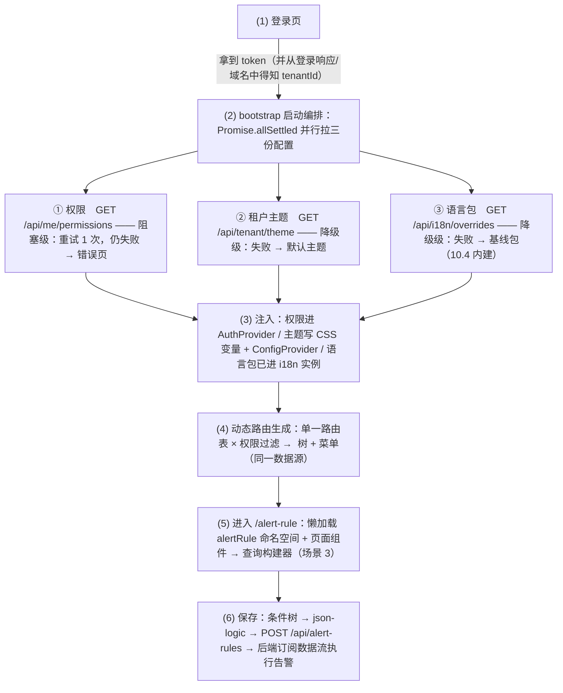
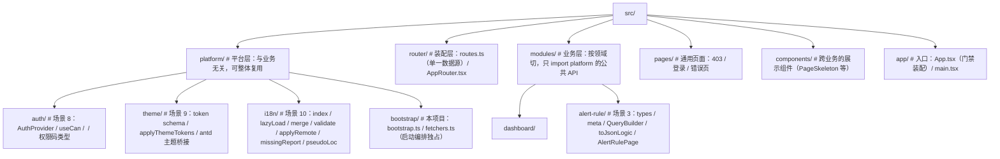
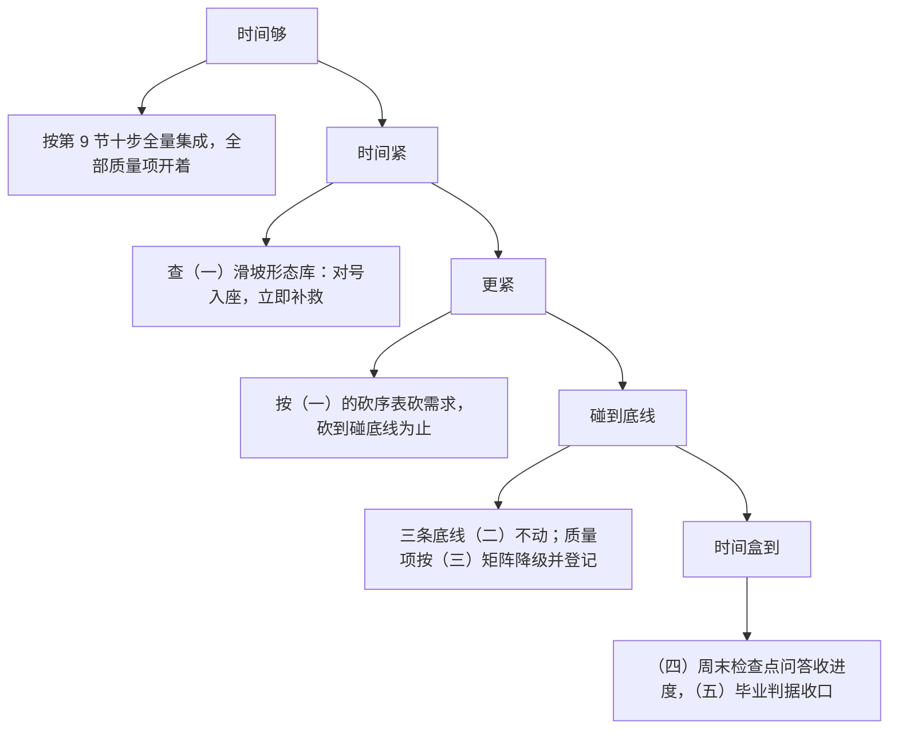

## 组合毕业项目：多租户 SaaS 控制台

把 Part B + 场景 3 组装成一个完整企业 SaaS 前端底座：

```text
登录 → 并行拉取[权限(8) / 租户主题(9) / 语言包(10)] → 动态路由生成+权限过滤
     → 告警规则配置页(3: 查询构建器) → 保存为 json-logic 给后端执行
```

这一套覆盖了企业 SaaS 的"平台层"标准能力，面试讲述时是一个完整的架构故事。

原文这段的精髓在"组装"两个字：8/9/10 三个场景各自做成 Provider/模块并不难，难的是**它们在启动阶段互相纠缠**——路由生成依赖权限、文案依赖语言包、皮肤依赖租户配置、而业务页（场景 3）同时依赖前三者。毕业项目要练的就是把这段时序工程化。下面把 ASCII 图的每一段箭头展开成完整的启动时序说明。

### 0. 分层定位：平台层与业务层在哪里分界

动手前先明确装配边界，这决定目录怎么切（见第 3 节）：

- **平台层（platform/）**：与具体业务无关、可整体复用到任何 SaaS 产品的能力——权限、租户主题、i18n、启动编排。它们只认识"配置数据"，不认识"告警规则"。
- **业务层（modules/）**：告警规则配置这类领域功能。业务层**只消费平台层暴露的 API**（`useCan`、`useTranslation`、语义 token），永远不反向触碰平台层的实现。
- **装配层（app/ + router/）**：把平台层初始化好、把业务模块挂上路由的"胶水"。启动时序（下文）全部发生在这一层。

这样分层的检验标准：把 `modules/alert-rule` 整个目录删掉，平台层照常启动；把 `platform/` 拷到另一个 SaaS 项目，只改 fetcher 的 URL 就能跑。

### 1. 启动时序总览

先把 ASCII 图放大成带编号的时序，再逐段实现：



关键设计决策先行：**为什么三份配置用 `Promise.allSettled` 而不是 `Promise.all`**——`all` 是"一荣俱荣、一损俱损"，主题接口抖动会把权限正常的用户也挡在门外；`allSettled` 让三份配置的失败彼此隔离，然后按"失败等级"分别处理。这是整个启动时序的灵魂。

### 2. 启动时序逐段详解

#### 2.1 登录与引导（时序第 1 段）

```tsx
// src/pages/login/LoginPage.tsx —— 只做两件事：换 token、确定租户
import { useState } from 'react';
import { useNavigate } from 'react-router-dom';

export function LoginPage() {
  const navigate = useNavigate();
  const [loading, setLoading] = useState(false);

  async function handleSubmit(e: React.FormEvent<HTMLFormElement>) {
    e.preventDefault();
    setLoading(true);
    try {
      const res = await fetch('/api/auth/login', {
        method: 'POST',
        headers: { 'Content-Type': 'application/json' },
        body: JSON.stringify({ email: 'demo@acme.com', password: 'demo123' }), // 实际项目接表单
      });
      if (!res.ok) throw new Error(`login failed: ${res.status}`);
      const data = (await res.json()) as { token: string; tenantId: string };
      // token 与租户身份落本地：后续所有请求的鉴权头与租户上下文都从这来
      window.localStorage.setItem('app:token', data.token);
      window.localStorage.setItem('app:tenant', data.tenantId);
      navigate('/', { replace: true }); // 进入 App，触发第 2 段 bootstrap
    } finally {
      setLoading(false);
    }
  }

  return (
    <form onSubmit={handleSubmit}>
      <button type="submit" disabled={loading}>{loading ? '登录中…' : '登录'}</button>
    </form>
  );
}
```

#### 2.2 bootstrap：并行拉取与失败策略（时序第 2 段，项目核心）

三份配置的**失败等级表**——先定策略再写代码，这是"平台层"思考方式：

| 配置 | 失败等级 | 策略 | 为什么是这个等级 |
|---|---|---|---|
| ① 权限 | **阻塞** | 超时 5s + 重试 1 次 → 仍失败 → 错误页（重试/退出登录） | 没有权限集，路由无法过滤、菜单无法生成，"进入哪个页面"都无法决定；且权限缺失可能导致越权 UI 暴露，宁可拒绝服务 |
| ② 租户主题 | 降级 | 超时 5s，失败 → 默认品牌主题，后台静默补拉 | 视觉定制缺失不阻碍任何功能；把用户挡在外面换一块品牌色，得不偿失 |
| ③ 远端语言包 | 降级 | 超时内建（10.4），失败 → 基线包 | 10.4 的双包架构已经把"远端失败"设计成预期路径，这里零额外代码 |

```ts
// src/platform/bootstrap/bootstrap.ts —— 启动编排：唯一的"知道三份配置都存在"的地方
import { fetchPermissions, fetchTenantTheme, type TenantThemeTokens } from './fetchers';
import { applyThemeTokens } from '../theme/apply';
import { applyRemoteLocales, type RemoteStatus } from '../i18n/applyRemote';
import { SUPPORTED_LNGS } from '../i18n';

export interface BootstrapOutcome {
  auth: { ok: true; permissions: Set<string> } | { ok: false; reason: string };
  theme: { ok: boolean; tokens: TenantThemeTokens | null };
  locale: { status: RemoteStatus; version?: string };
  elapsedMs: number;
}

/** 带超时的包装：三份配置都不许把启动卡成黑洞。
 *  注意：race 超时只是"不再等待"，底层请求仍会跑完（fetcher 内部如需真取消，请用 AbortSignal 贯穿）。 */
async function withTimeout<T>(p: Promise<T>, ms: number): Promise<T> {
  return await Promise.race([
    p,
    new Promise<T>((_, reject) =>
      setTimeout(() => reject(new Error(`timeout after ${ms}ms`)), ms),
    ),
  ]);
}

/** 只给"值得重试"的请求用：权限是阻塞级所以重试，两个降级级不值得让用户多等 */
async function retry<T>(fn: () => Promise<T>, times: number): Promise<T> {
  let lastError: unknown;
  for (let i = 0; i <= times; i += 1) {
    try {
      return await fn();
    } catch (err) {
      lastError = err; // 上一轮失败，稍等后重试（这里简单立刻重试；生产可加退避）
    }
  }
  throw lastError;
}

export async function bootstrap(tenantId: string): Promise<BootstrapOutcome> {
  const startedAt = performance.now();

  // ---- 三份配置并行，失败互不传染（Promise.allSettled 是刻意的，见第 1 节说明）----
  const [permRes, themeRes, localeRes] = await Promise.allSettled([
    withTimeout(retry(() => fetchPermissions(), 1), 5000),          // 阻塞级：重试 1 次
    withTimeout(fetchTenantTheme(tenantId), 5000),                   // 降级级：不重试
    applyRemoteLocales(`/api/i18n/overrides?app=console`, SUPPORTED_LNGS, 5000), // 自带降级，永不 reject
  ]);

  // ---- 权限：阻塞级，失败即返回错误页所需信息 ----
  const auth: BootstrapOutcome['auth'] =
    permRes.status === 'fulfilled'
      ? { ok: true, permissions: new Set(permRes.value) }
      : { ok: false, reason: String(permRes.reason) };

  // ---- 主题：降级级，失败用 null（调用方回落默认主题），但先尽力应用远端结果 ----
  let theme: BootstrapOutcome['theme'] = { ok: false, tokens: null };
  if (themeRes.status === 'fulfilled') {
    theme = { ok: true, tokens: themeRes.value };
  } else {
    console.warn('[bootstrap] 租户主题拉取失败，使用默认主题', themeRes.reason);
  }
  if (theme.tokens) applyThemeTokens(theme.tokens); // 场景 9：写 CSS 变量批，立即生效

  // ---- 语言包：降级级，applyRemoteLocales 内部已完成"校验+合并+注入"，这里只收结果 ----
  const locale: BootstrapOutcome['locale'] =
    localeRes.status === 'fulfilled'
      ? { status: localeRes.value.status, version: localeRes.value.version }
      : { status: 'fetch-failed' }; // 理论上不发生（applyRemoteLocales 捕获一切），防御性兜底

  return { auth, theme, locale, elapsedMs: performance.now() - startedAt };
}
```

```ts
// src/platform/bootstrap/fetchers.ts —— 三个数据源的具体形态
export interface TenantThemeTokens {
  brand: { primary: string; primaryHover: string };
  logo: string;
  radius: string;
}

async function authedFetch(url: string): Promise<Response> {
  const token = window.localStorage.getItem('app:token');
  const res = await fetch(url, { headers: { Authorization: `Bearer ${token ?? ''}` } });
  if (!res.ok) throw new Error(`${url} -> HTTP ${res.status}`);
  return res;
}

export async function fetchPermissions(): Promise<string[]> {
  const res = await authedFetch('/api/me/permissions');
  const data = (await res.json()) as { permissions: string[] };
  return data.permissions; // 扁平权限码数组：['alert:rule:view', 'alert:rule:edit', ...]
}

export async function fetchTenantTheme(tenantId: string): Promise<TenantThemeTokens> {
  const res = await authedFetch(`/api/tenant/${tenantId}/theme`);
  return (await res.json()) as TenantThemeTokens;
}
```

App 侧的门禁装配——bootstrap 期间整页骨架（这也顺带完成了场景 9 的 FOUC 防治：主题未决时不渲染真实内容）：

```tsx
// src/app/App.tsx —— 启动门禁：三态（加载中 / 权限失败 / 正常进入）
import { useEffect, useState } from 'react';
import { BrowserRouter } from 'react-router-dom';
import { ConfigProvider } from 'antd';
import { bootstrap, type BootstrapOutcome } from '../platform/bootstrap/bootstrap';
import { AuthProvider } from '../platform/auth/AuthProvider';
import { AppRouter } from '../router/AppRouter';
import { tenantThemeToAntd } from '../platform/theme/apply';

function getTenantId(): string {
  return window.localStorage.getItem('app:tenant') ?? 'acme';
}

export function App() {
  const [outcome, setOutcome] = useState<BootstrapOutcome | null>(null);
  const [attempt, setAttempt] = useState(0);

  useEffect(() => {
    setOutcome(null); // 重试时先回到骨架态
    void bootstrap(getTenantId()).then(setOutcome);
  }, [attempt]);

  // 状态一：配置未决 → 骨架屏（不许白屏，也不许无主题的真实内容闪现）
  if (!outcome) return <BootstrapSkeleton />;

  // 状态二：阻塞级失败 → 明确的错误页，给"重试"出路
  if (!outcome.auth.ok) {
    return (
      <div className="bootstrap-error">
        <p>权限加载失败，无法进入控制台</p>
        <p className="bootstrap-error__reason">{outcome.auth.reason}</p>
        <button onClick={() => setAttempt((n) => n + 1)}>重试</button>
      </div>
    );
  }

  // 状态三：正常进入。降级级失败（主题/语言包）不影响走到这里
  return (
    <AuthProvider permissions={outcome.auth.permissions}>
      <ConfigProvider theme={tenantThemeToAntd(outcome.theme.tokens)}>
        <BrowserRouter>
          <AppRouter />
        </BrowserRouter>
      </ConfigProvider>
    </AuthProvider>
  );
}

function BootstrapSkeleton() {
  return (
    <div className="bootstrap-skeleton" aria-busy="true">
      <div className="bootstrap-skeleton__sidebar" />
      <div className="bootstrap-skeleton__main" />
    </div>
  );
}
```

#### 2.3 注入：三份配置各自落到哪里（时序第 3 段）

| 配置 | 注入方式 | 消费方 | 详见 |
|---|---|---|---|
| 权限 | `AuthProvider` 的 Context 持有 `Set<string>` | `useCan()` / `<Can>` / 路由过滤 | 场景 8 |
| 主题 | `applyThemeTokens` 写 CSS 变量批 + antd `ConfigProvider theme` | 所有组件（只消费语义 token） | 场景 9 |
| 语言包 | `applyRemoteLocales` 已把合并包写进 i18n 实例资源树 | 所有 `useTranslation` 组件 | 场景 10 |

注意三者的注入时机不同：语言包在 bootstrap 内部完成（2.2 里 applyRemoteLocales 自含）；主题在 bootstrap 返回后、渲染前同步写（CSS 变量写入是同步的，保证首帧正确）；权限必须先于路由生成（2.4 的第一行就是它）。

#### 2.4 动态路由生成与权限过滤（时序第 4 段）

单一数据源原则（场景 8 第 3 条）：路由表是唯一真源，路由守卫、菜单、面包屑全部从它派生——三处永远一致，散落维护是最大灾难。

```ts
// src/router/routes.ts —— 唯一的路由数据源
import { lazy } from 'react';
import type { ComponentType, LazyExoticComponent } from 'react';
import { lazyLoadNamespace } from '../platform/i18n/lazyLoad';
import i18n from '../platform/i18n';

export interface AppRouteMeta {
  /** 菜单/面包屑标题：存 i18n key（场景 10 与场景 8 的交叉点） */
  titleKey: string;
  /** 无此字段 = 登录即可见；有则校验权限码 */
  permission?: string;
  hideInMenu?: boolean;
}

export interface AppRoute {
  path: string;
  element: LazyExoticComponent<ComponentType>;
  /** 该路由依赖的 i18n 命名空间（场景 10：路由级懒加载） */
  ns: string;
  meta: AppRouteMeta;
  children?: AppRoute[];
}

/** 组件懒加载与 ns 懒加载合并：首帧就有文案（10.3 模式 A） */
const withNs = (ns: string, load: () => Promise<{ default: ComponentType }>) =>
  lazy(async () => {
    await lazyLoadNamespace(i18n.language, ns);
    return load();
  });

export const routes: AppRoute[] = [
  {
    path: '/dashboard',
    element: withNs('dashboard', () => import('../modules/dashboard/DashboardPage')),
    ns: 'dashboard',
    meta: { titleKey: 'menu:dashboard', permission: 'dashboard:view' },
  },
  {
    path: '/alert-rule',
    element: withNs('alertRule', () => import('../modules/alert-rule/AlertRulePage')),
    ns: 'alertRule',
    meta: { titleKey: 'menu:alertRule', permission: 'alert:rule:view' },
  },
];

/** 权限过滤：递归剔除无权路由（菜单生成复用同一函数，见 AppRouter） */
export function filterRoutesByPermission(
  routes: AppRoute[],
  can: (permission: string) => boolean,
): AppRoute[] {
  return routes
    .filter((r) => !r.meta.permission || can(r.meta.permission))
    .map((r) => (r.children ? { ...r, children: filterRoutesByPermission(r.children, can) } : r));
}
```

```tsx
// src/router/AppRouter.tsx —— 路由树 + 菜单 + 403 兜底，全部从 routes 派生
import { Suspense, useMemo } from 'react';
import { Navigate, Route, Routes, useLocation } from 'react-router-dom';
import { useAuth } from '../platform/auth/AuthProvider';
import { useTranslation } from 'react-i18next';
import { filterRoutesByPermission, routes } from './routes';
import { ForbiddenPage } from '../pages/ForbiddenPage';
import { PageSkeleton } from '../components/PageSkeleton';

export function AppRouter() {
  const { can } = useAuth();
  // 语言切换不重建路由表（路径与权限都不变），只重算菜单文案 → 依赖里不放 i18n.language
  const visibleRoutes = useMemo(() => filterRoutesByPermission(routes, can), [can]);

  return (
    <div className="app-shell">
      <SideMenu routes={visibleRoutes} />
      <main>
        <Suspense fallback={<PageSkeleton />}>
          <Routes>
            {visibleRoutes.map((r) => (
              <Route key={r.path} path={r.path} element={<r.element />} />
            ))}
            {/* 有权限语义的兜底：直接访问无权路由 → 403 而不是静默跳走（用户需要知道"没权限"） */}
            <Route path="/403" element={<ForbiddenPage />} />
            <Route path="*" element={<Navigate to="/dashboard" replace />} />
          </Routes>
        </Suspense>
      </main>
    </div>
  );
}

/** 菜单：同一数据源派生（场景 8"三处一致"的另外两处是守卫和面包屑） */
function SideMenu({ routes }: { routes: ReturnType<typeof filterRoutesByPermission> }) {
  const { t } = useTranslation('menu');
  const location = useLocation();
  return (
    <nav className="side-menu">
      {routes
        .filter((r) => !r.meta.hideInMenu)
        .map((r) => (
          <a
            key={r.path}
            href={`#${r.path}`}
            aria-current={location.pathname === r.path ? 'page' : undefined}
          >
            {t(r.meta.titleKey.replace(/^menu:/, ''))} {/* titleKey 约定挂在 menu ns 下 */}
          </a>
        ))}
    </nav>
  );
}
```

（真实项目把 `<a href="#...">` 换成 react-router 的 `Link`；上面为聚焦主干省去菜单组件库细节。）守卫的另一半：`AlertRulePage` 内部对**按钮级**动作再用 `useCan('alert:rule:edit')` 禁用"保存"——路由级挡"进不来"，按钮级挡"进来了改不了"，两层各司其职（场景 8 第 4/5 条）。

#### 2.5 告警规则配置页（时序第 5 段，场景 3 的组装点）

路由命中 `/alert-rule` 后：`withNs('alertRule', ...)` 先加载语言包 chunk 再加载组件 chunk（组件首帧就有文案）；页面主体是场景 3 的查询构建器。这里是字段元数据与 i18n 的另一个交叉点——字段声明里存 key：

```ts
// src/modules/alert-rule/meta.ts —— 字段元数据：label 是 i18n key（10.10 联动）
import type { FieldMeta } from './types';

export const FIELD_META: FieldMeta[] = [
  {
    name: 'amount',
    type: 'number',
    labelKey: 'field.amount', // → t('field.amount') = "订单金额"
    operators: ['>', '>=', '<', '<=', 'between'],
    valueEditor: 'input',
  },
  {
    name: 'city',
    type: 'string',
    labelKey: 'field.city', // → "下单城市"
    operators: ['in', '='],
    valueEditor: 'multi-select',
    options: [
      { labelKey: 'city.bj', value: '北京' },
      { labelKey: 'city.sh', value: '上海' },
    ],
  },
];
```

```tsx
// src/modules/alert-rule/AlertRulePage.tsx —— 页面骨架：构建器 + 试运行 + 保存
import { useMemo, useState } from 'react';
import { useTranslation } from 'react-i18next';
import jsonLogic from 'json-logic-js';
import { useAuth } from '../../platform/auth/AuthProvider';
import { QueryBuilder } from './QueryBuilder';
import { toJsonLogic } from './toJsonLogic';
import { FIELD_META } from './meta';
import type { ConditionNode } from './types';

const SAMPLE_DATA = { amount: 320, city: '上海' }; // 试运行样例数据

export function AlertRulePage() {
  const { t } = useTranslation('alertRule');
  const { can } = useAuth();
  const editable = can('alert:rule:edit');

  const [tree, setTree] = useState<ConditionNode>({
    combinator: 'and',
    conditions: [{ field: 'amount', operator: '>', value: 100 }],
  });
  const [saving, setSaving] = useState(false);

  const logic = useMemo(() => toJsonLogic(tree), [tree]);      // 条件树 → json-logic
  const sampleHit = useMemo(() => jsonLogic.apply(logic, SAMPLE_DATA) === true, [logic]); // 前端即时试运行

  async function handleSave() {
    setSaving(true);
    try {
      const res = await fetch('/api/alert-rules', {
        method: 'POST',
        headers: { 'Content-Type': 'application/json', Authorization: `Bearer ${window.localStorage.getItem('app:token')}` },
        body: JSON.stringify({ name: '高额订单告警', logic, enabled: true }),
      });
      if (!res.ok) throw new Error(`save failed: ${res.status}`);
    } finally {
      setSaving(false);
    }
  }

  return (
    <section>
      <h1>{t('title')}</h1>
      <QueryBuilder node={tree} onChange={setTree} fields={FIELD_META} />
      <aside className="try-run" data-hit={sampleHit}>
        <pre>{JSON.stringify(logic, null, 2)}</pre>
        <p>{sampleHit ? t('tryRun.hit') : t('tryRun.miss')}（样例 {JSON.stringify(SAMPLE_DATA)}）</p>
      </aside>
      <button disabled={!editable || saving} onClick={() => void handleSave()}>
        {t('common:action.save')}
      </button>
    </section>
  );
}
```

#### 2.6 保存：条件树 → json-logic → 后端执行（时序第 6 段）

前后端契约的关键一环（场景 3 第 5 条"协议转换层"）：前端配置的是**条件树**（人好编辑），传输与执行用 **json-logic**（机器好执行、语言无关、后端有成熟实现）。转换器是纯函数，可单测：

```ts
// src/modules/alert-rule/toJsonLogic.ts —— 条件树 → json-logic（场景 3 协议转换层）
import type { ConditionNode } from './types';

type JsonLogic = Record<string, unknown>;

export function toJsonLogic(node: ConditionNode): JsonLogic {
  // 组节点：{ "and": [子条件...] } / { "or": [...] }（json-logic 原生支持任意深度嵌套）
  if ('combinator' in node) {
    return { [node.combinator]: node.conditions.map(toJsonLogic) };
  }
  // 叶节点：{ "操作符": [{ var: "字段" }, 值] }
  const left: JsonLogic = { var: node.field };

  // 特判 1：between 拆成 >= 与 <= 的 and（json-logic 无原生 between）
  if (node.operator === 'between') {
    const [min, max] = node.value as [number, number];
    return { and: [{ '>=': [left, min] }, { '<=': [left, max] }] };
  }
  // 特判 2：in 的操作数顺序是 [值, 集合]，UI 语义"field ∈ values"恰好同序，直接映射
  if (node.operator === 'in') {
    return { in: [left, node.value] };
  }
  return { [node.operator]: [left, node.value] };
}
```

保存后的分工：**前端只负责"造规则"，后端负责"执行规则"**——规则存库后由后端订阅业务数据流（订单事件），逐条对 `logic` 求值，命中则触发通知。前端不做任何常驻执行（刷新就停了），试运行面板的 `jsonLogic.apply` 只服务于配置期的即时反馈。这个"配置在前端、执行在后端"的分离，正是第 4 章告警类需求的标准架构。

对照样例——配置"当 `amount > 100` 且 `city ∈ [北京, 上海]` 时触发告警"：

```json
{
  "and": [
    { ">": [{ "var": "amount" }, 100] },
    { "in": [{ "var": "city" }, ["北京", "上海"]] }
  ]
}
```

### 3. 目录结构建议



两条目录纪律：`modules/*` 之间禁止互相 import（跨领域复用的东西下沉到 platform 或 components）；`platform/*` 禁止 import `modules/*` 与 `router/*`（平台层不知道任何业务的存在，依赖方向单向）。

### 4. 每一层的章节索引

| 层/目录 | 用到的能力 | 章节索引 | 组装时的关键动作 |
|---|---|---|---|
| platform/auth | 权限三件套、单一数据源消费 | 场景 8 | `Set<string>` 进 Context；`useCan` 供路由过滤与按钮禁用复用 |
| platform/theme | token 三层、CSS 变量注入、FOUC 防治 | 场景 9 | bootstrap 里"先应用再渲染"；canvas 侧 token mirror 若有 echarts 则接入 |
| platform/i18n | init/合并/懒加载/上报 | 场景 10（全章） | `applyRemoteLocales` 直接作为第 ③ 份配置接进 `allSettled`；路由表 `ns` 字段驱动懒加载 |
| platform/bootstrap | 编排与失败分级 | 本毕业项目第 2 节 | 全项目唯一同时 import 三份配置的地方 |
| router | 路由生成 + 权限过滤 + 菜单派生 | 场景 8 第 3/4 条 | `meta.permission` 过滤；`meta.titleKey` 让菜单走 i18n |
| modules/alert-rule | 条件树递归渲染、字段元数据、值编辑器 | 场景 3；《进阶大纲》§1（递归渲染器内核）+ §3（Setter 体系） | QueryGroup/QueryRow 递归组件即 §1 内核第 N 次复用（本篇开篇"暗线"） |
| app | 门禁三态装配 | 本毕业项目第 2.2 节 | 骨架屏同时覆盖场景 9 的 FOUC 问题 |

### 5. 验收清单

逐项可手工验证，全部打勾即毕业（括号内为对应能力）：

| # | 验收项 | 对应场景 |
|---|---|---|
| 1 | 未登录访问任何路由被重定向到 /login | 8 |
| 2 | 登录后三份配置并行拉取，Network 面板可见同时发出 | 毕业项目 |
| 3 | 权限接口断网（DevTools offline）→ 出现错误页而非白屏；点重试可恢复 | 毕业项目 |
| 4 | 主题接口 500 → 站点以默认主题正常进入，无品牌色闪烁（FOUC） | 9 |
| 5 | 语言包接口 500 → 全站文案为基线包内容，功能正常 | 10 |
| 6 | 语言包接口返回坏 JSON（本地 mock）→ 站点正常，console 有校验错误日志 | 10 |
| 7 | 无 `alert:rule:view` 的账号：菜单不显示告警入口，直接输 URL 得到 403 | 8 |
| 8 | 有 view 无 edit 的账号：页面可见，"保存"禁用并带 tooltip 说明 | 8 |
| 9 | 首次进入 /alert-rule：alertRule ns chunk 与页面 chunk 依次加载，首帧无裸 key | 10 |
| 10 | 语言切换为 en-US：菜单、表头、按钮一次性原子切换，无刷新、无骨架闪断 | 10 |
| 11 | 切语言后已填写的规则条件不丢失 | 10 |
| 12 | 运营改远端包文案并发布 → 不刷新页面（等待或触发 languageChanged）后文案更新 | 10 |
| 13 | 人为删除基线包一个 key（本地构建）→ 页面显示 key 本身，监控接口收到上报 | 10 |
| 14 | 构建器可增删组、切换 and/or、嵌套两层以上；between 需两个值、空值不可保存 | 3 |
| 15 | 试运行面板：样例命中/未命中分支高亮正确 | 3 |
| 16 | 保存后的规则 JSON 与配置一致（DevTools 查看请求体，与 2.6 样例结构相同） | 3 |
| 17 | 字段元数据删除 city 后，存量含 city 的规则回显标红提示而非崩溃 | 3 |
| 18 | pseudo-loc 语言下走通主要页面，无按钮溢出/文本截断 | 10 |
| 19 | `npm run check:i18n` 在 CI 通过（无缺失 key；冗余 key 仅警告） | 10 |
| 20 | 删除 modules/alert-rule 目录，站点可正常构建启动（分层检验） | 毕业项目 |

### 6. 面试时如何把这套讲成一个架构故事

面试官问"你做过什么有架构感的项目"时，不要按功能清单报菜名（"我做了权限、主题、国际化……"），要讲成一个有矛盾、有决策、有权衡的故事。推荐框架：

**一句话定位**："我做过一个多租户 SaaS 控制台的前端底座，解决'租户级配置——权限、品牌、文案——在不发版的前提下安全生效'的问题。"

**30 秒电梯版**（HR 面/开场）：

> "SaaS 产品每个租户能自定义权限集、品牌主题和文案，这些配置由运营随时改。我的工作是前端底座：登录后并行拉三份配置，权限决定路由和菜单怎么生成，主题和文案以'基线加远端覆盖'的方式注入，任何一份配置失败都不会打挂整站。业务上第一个跑在这套底座上的，是告警规则配置页——用户配条件树，前端转成 json-logic 交给后端执行。"

**3 分钟完整版**（按五段推进，每段都有"决策点"）：

1. **问题与约束**（30s）：多租户 SaaS，运营要随时改配置且不发版；约束是三份配置来自三个独立服务，可用性等级不同——权限是安全相关的，主题文案是体验相关的。
2. **关键决策一：启动编排**（40s）：三份配置 `Promise.allSettled` 并行拉取、按失败等级分级处理——权限失败重试后阻塞进错误页，主题和文案降级到默认值。"为什么不用 Promise.all""为什么权限阻塞而主题不阻塞"，这两个问题的答案本身就是架构判断力的展示。
3. **关键决策二：基线 + 远端覆盖**（40s）：文案与主题都是"静态基线保底、远端覆盖优先"的双包结构；远端包合并前做结构校验，校验失败回退基线——"远端是运行时数据，一定会坏，架构要保证坏的时候站点不倒"。配缺失 key 的上报与监控闭环。
4. **难点与解决**（50s）：挑两个最深的讲透——a) 切语言不刷新页面：预载目标语言命名空间后原子切换，解决 Suspense 闪断与 useMemo 冻结旧文案两类问题；b) 告警规则的前后端契约：条件树对人、json-logic 对机器，转换器纯函数可测，试运行面板用 json-logic-js 前端即时求值建立用户信任。
5. **结果与反思**（20s）：可量化的收尾（"新租户上线从发版等待变为运营自助，当天完成"；"文案缺失从客诉发现变为监控面板发现"），加一个真实反思（"类型化 key 引入太晚，前期 key typo 靠运行时发现，后来 CustomTypeOptions 收口"）——有反思的故事才可信。

**高频追问与答法要点**：

- "为什么权限失败要阻塞，而不是也给个默认权限？" → 默认权限只能两个方向：全给（越权 UI 暴露）或全不给（等于锁死），都违背"体验层不给看没有的能力"；正确语义是"不知道用户有什么时，不进入"。
- "为什么 json-logic 而不是直接传 SQL WHERE？" → json-logic 是封闭的 JSON 结构，天然免注入（无字符串拼接）、语言无关（前后端都有实现）、可安全存储与 diff；SQL 是给人执行权限的接口，把用户输入导向 SQL 生成是把注入面焊在架构里。
- "为什么切语言不整页刷新，值得吗？" → 值得，但成本要讲：整页刷新丢运行时状态（填了一半的规则）；代价是要处理订阅重渲染的边界（useMemo 冻结问题），这是可控的、有测试兜底的工程问题。
- "三份配置为什么不用一个聚合接口？" → 反问式回答：聚合接口把三个独立服务的可用性焊成一个，还引入接口层的权限问题（语言包不该看到权限码）；如果平台有 BFF 层可以聚合，但失败分级逻辑不会消失，只是搬家。
- "远端包万一被人投毒呢？" → 校验挡的是格式错误；完整性靠传输层 HTTPS + 内容签名（版本号 + hash 校验），纵深防御；这也是为什么合并永远不执行包里任何代码——语言包只是数据。

---

### 7. 进阶变体：规则列表与存量回显——json-logic 的逆向解析与脏状态防御

前面的时序止步于"新建规则 → 保存"。真实系统的另一半更难：**存量规则的回显**——后端只存 json-logic（2.6 的决策），编辑器操作的是条件树，中间缺一个逆向转换器；而且存量数据不会配合你（字段被删、操作符不认识、规则是三年前另一个系统生成的）。完整需求五条：

1. 规则列表：拉取规则数组进表格（名称、启用、更新时间），点击进入编辑；
2. `fromJsonLogic` 把 json-logic 还原成条件树，与 `toJsonLogic`（2.6）互为逆函数，纯函数、可单测；
3. 无法识别的节点**不崩溃也不丢弃**：生成"幽灵节点"标红展示，保存时原样回传——三年后用户还能改他看得懂的部分；
4. 有未保存改动时，应用内路由跳转与应用刷新/关闭都要拦截确认；
5. 乐观锁：保存带 `If-Match: version`，409 冲突时给出"覆盖保存 / 加载最新"两个出口。

**（一）逆向解析器：三个防御点一个不落**。未知字段（验收清单第 17 条：city 元数据已删）、未知操作符（后端新版本先上了 `timeWindow` 之类）、结构不认识（手写规则、旧系统迁移）——全部落到幽灵节点。

```ts
// src/modules/alert-rule/fromJsonLogic.ts —— json-logic → 条件树（纯函数，含幽灵节点）
import type { FieldMeta } from './meta';

/** 幽灵叶子：无法识别时生成。UI 标红 + tooltip 展示 raw；保存时原样回传 */
export interface GhostLeaf {
  field: '__ghost__';
  raw: unknown;
}
export type ParseLeaf =
  | { field: string; operator: string; value: unknown }
  | GhostLeaf;
export type ParseNode =
  | { combinator: 'and' | 'or'; conditions: ParseNode[] }
  | ParseLeaf;

const isObj = (v: unknown): v is Record<string, unknown> =>
  typeof v === 'object' && v !== null && !Array.isArray(v);
const varOf = (v: unknown): string | null =>
  isObj(v) && typeof v.var === 'string' ? v.var : null;

export function fromJsonLogic(logic: unknown, meta: FieldMeta[]): ParseNode {
  if (!isObj(logic)) return { field: '__ghost__', raw: logic }; // 防御 3：顶层就不是对象

  const [[op, args]] = Object.entries(logic);
  const known = new Map(meta.map((m) => [m.name, m]));

  // ---- 组节点：and / or（含 between 的逆合并）----
  if ((op === 'and' || op === 'or') && Array.isArray(args)) {
    // between 逆特判：{ and: [{">=": [var, min]}, {"<=": [var, max]}] }，同字段恰好两条
    if (op === 'and' && args.length === 2) {
      const ge = simpleLeaf(args[0], '>=');
      const le = simpleLeaf(args[1], '<=');
      if (ge && le && ge.field === le.field && known.get(ge.field)?.operators.includes('between')) {
        return { field: ge.field, operator: 'between', value: [ge.value, le.value] };
      }
    }
    return { combinator: op, conditions: args.map((c) => fromJsonLogic(c, meta)) };
  }

  // ---- 叶节点：{ 操作符: [{var: 字段}, 值] } ----
  const operands = Array.isArray(args) ? args : [];
  const field = varOf(operands[0]);
  const m = field !== null ? known.get(field) : undefined;
  // 防御 1：字段不在元数据（已删除）；防御 2：操作符不在该字段支持列表
  if (!m || !m.operators.includes(op)) return { field: '__ghost__', raw: logic };
  return { field, operator: op, value: operands[1] };
}

/** 识别 {">=": [{var: f}, v]} 形态（between 逆合并用） */
function simpleLeaf(node: unknown, op: string): { field: string; value: unknown } | null {
  if (!isObj(node) || !(op in node)) return null;
  const args = node[op];
  if (!Array.isArray(args)) return null;
  const field = varOf(args[0]);
  return field === null ? null : { field, value: args[1] };
}
```

`toJsonLogic`（2.6）在函数最前面补一条幽灵透传：

```ts
// 幽灵叶子原样回传：存量规则里我们看不懂的部分，绝不因为一次编辑而丢失
if ('field' in node && node.field === '__ghost__') return node.raw as JsonLogic;
```

单测要点（转换器是纯函数，测试成本极低、收益极高）：往返性质 `toJsonLogic(fromJsonLogic(x)) === x` 对全部标准形态成立；between 两条路径互逆；三个防御点各一条"输入 → 幽灵"用例；`{and: [同字段两条 >=]}` 这类"看似 between 但不是"的形态必须不合并。

**（二）脏状态：双通道离开拦截 + 乐观锁 409**。

```tsx
// src/modules/alert-rule/RuleEditorPage.tsx —— 回显 / 脏判定 / 冲突处理
import { useEffect, useMemo, useState } from 'react';
import { useTranslation } from 'react-i18next';
import { fromJsonLogic, type ParseNode } from './fromJsonLogic';
import { toJsonLogic } from './toJsonLogic';
import { FIELD_META } from './meta';
import { useBlockerOnce } from '../../router/useBlockerOnce';

export function RuleEditorPage({ id }: { id: string }) {
  const { t } = useTranslation('alertRule');
  const [remote, setRemote] = useState<{ logic: unknown; version: string } | null>(null);
  const [tree, setTree] = useState<ParseNode | null>(null);
  const [saving, setSaving] = useState(false);
  const [conflict, setConflict] = useState(false);

  useEffect(() => {
    let cancelled = false; // 竞态防御：路由参数快速变化时丢弃旧响应
    void (async () => {
      const res = await fetch(`/api/alert-rules/${id}`, { headers: authHeaders() });
      const data = (await res.json()) as { logic: unknown; version: string };
      if (!cancelled) {
        setRemote(data);
        setTree(fromJsonLogic(data.logic, FIELD_META));
      }
    })();
    return () => {
      cancelled = true;
    };
  }, [id]);

  // 脏判定基准是"远端原文重新解析的树"，不是"上次保存的请求体"——
  // 两侧出自同一转换器、形态一致，JSON 比较才可靠（见本节取舍 ③）
  const baseline = useMemo(
    () => (remote ? fromJsonLogic(remote.logic, FIELD_META) : null),
    [remote],
  );
  const dirty =
    tree !== null && baseline !== null && JSON.stringify(tree) !== JSON.stringify(baseline);

  useBlockerOnce(dirty, t('editor.unsaved')); // 应用内路由 + 刷新/关闭，双通道拦截

  async function handleSave(overwrite: boolean): Promise<void> {
    if (!remote || !tree) return;
    setSaving(true);
    setConflict(false);
    try {
      const res = await fetch(`/api/alert-rules/${id}`, {
        method: 'PUT',
        headers: {
          ...authHeaders(),
          'Content-Type': 'application/json',
          // 乐观锁：版本不匹配后端回 409；覆盖保存则不带 If-Match
          ...(overwrite ? {} : { 'If-Match': remote.version }),
        },
        body: JSON.stringify({ logic: toJsonLogic(tree) }),
      });
      if (res.status === 409) {
        setConflict(true);
        return;
      }
      if (!res.ok) throw new Error(`save failed: ${res.status}`);
      const data = (await res.json()) as { version: string };
      setRemote({ logic: toJsonLogic(tree), version: data.version });
    } finally {
      setSaving(false);
    }
  }

  return (
    <section>
      {conflict && (
        <div role="alert">
          {t('editor.conflict')}
          <button onClick={() => void handleSave(true)}>{t('editor.conflictOverwrite')}</button>
        </div>
      )}
      {/* tree && <QueryBuilder node={tree} onChange={setTree} fields={FIELD_META} />
          QueryBuilder 对幽灵叶子的渲染：红框 + tooltip(JSON.stringify(raw)) + 禁用内部控件 */}
      <button disabled={!dirty || saving} onClick={() => void handleSave(false)}>
        {t('common:action.save')}
      </button>
    </section>
  );
}

function authHeaders(): Record<string, string> {
  return { Authorization: `Bearer ${window.localStorage.getItem('app:token') ?? ''}` };
}
```

```tsx
// src/router/useBlockerOnce.ts —— 应用内路由 + 浏览器刷新/关闭，双通道拦截
import { useEffect } from 'react';
import { useBlocker } from 'react-router-dom'; // 6.7+ 稳定 API，数据路由（createBrowserRouter）下生效

export function useBlockerOnce(when: boolean, message: string): void {
  const blocker = useBlocker(when);
  useEffect(() => {
    if (blocker.state !== 'blocked') return;
    // 产品化时换 Modal：确认 → blocker.proceed()，取消 → blocker.reset()
    if (window.confirm(message)) blocker.proceed();
    else blocker.reset();
  }, [blocker, message]);

  useEffect(() => {
    if (!when) return;
    const handler = (e: BeforeUnloadEvent) => e.preventDefault(); // Chrome 需要 preventDefault
    window.addEventListener('beforeunload', handler);
    return () => window.removeEventListener('beforeunload', handler);
  }, [when]);
}
```

一个装配前提：`useBlocker` 只在数据路由（`createBrowserRouter` + `RouterProvider`）下工作，2.2 的 `BrowserRouter` 写法需要升级——这正好是"装配层"该做的事，业务组件一行不改。

**关键取舍**。① 幽灵节点"不丢数据"优先于"界面干净"：静默丢弃未知条件等于悄悄改变告警语义（用户以为删了、后端还在执行），标红 + 原样回传是唯一安全解。② between 只逆合并"恰好两条、同字段"的最简形态——三条及以上（`amount > 100 && amount <= 200 && amount >= 50`）宁可保留 and 组也不猜用户意图。③ 脏判定基准取"远端原文的解析结果"而非请求体快照：两者在幽灵透传、between 合并上存在表示差异，比快照会永远 dirty。

---

### 8. 工程落地：分层依赖门禁、启动质量监控与平台层 review 清单

毕业项目跑通只是"能演示"；进团队仓库要过三道工程关：**目录纪律变成 CI 硬门禁**（第 3 节的两条纪律靠人盯必破）、**启动质量有数字**（降级了没人知道等于没降级）、**平台层 PR 有固定 review 项**（平台层的 bug 是全站性的）。

**（一）分层依赖门禁**。用 dependency-cruiser 把第 3 节的两条纪律变成 CI 硬约束：

```js
// .dependency-cruiser.cjs —— npm i -D dependency-cruiser
// package.json scripts: "lint:arch": "depcruise src --config .dependency-cruiser.cjs"
module.exports = {
  forbidden: [
    {
      name: 'modules-互不引用',
      comment: '跨领域复用的东西必须下沉 platform 或 components（第 3 节纪律 1）',
      severity: 'error',
      from: { path: '^src/modules/([^/]+)/' },
      to: { path: '^src/modules/(?!\\1(?:/|$))' }, // 目标领域目录必须与来源相同（\\1 反向引用）
    },
    {
      name: '平台层不知道业务',
      comment: 'platform 反向依赖业务即分层失败（第 3 节纪律 2）',
      severity: 'error',
      from: { path: '^src/platform/' },
      to: { path: '^src/(modules|router)/' },
    },
    {
      name: '业务与平台不抓装配层',
      severity: 'error',
      from: { path: '^src/(modules|platform)/' },
      to: { path: '^src/(app|router)/' },
    },
  ],
};
// 说明：router → modules 是允许的（路由表 lazy 引用页面组件是装配的正向依赖），
// 禁的是反向；正则里 (?!\\1(?:/|$)) 表示"排除同目录自身"。
```

CI 检查项总表——毕业项目的完整门禁清单，每项对应一条命令：

| 检查项 | 工具 | 阻断级别 |
|---|---|---|
| 分层依赖方向 | dependency-cruiser（上文） | error 阻断 |
| i18n key 缺失/冗余 | `check:i18n`（场景 10 的扫描脚本） | 缺失阻断，冗余警告 |
| 类型化 key 编译 | `tsc --noEmit`（CustomTypeOptions 自动生效） | 阻断 |
| 转换器单测覆盖率 | vitest/jest coverage：fromJsonLogic/toJsonLogic ≥ 90% | 阈值阻断 |
| 伪语言整站截图 | Playwright：切 zz-PSEUDO 跑主要路由，逐页断言无横向溢出 | 新页面阻断，存量警告 |
| 主包体积预算 | size-limit：主包超现值 10KB 即失败 | 阻断 |

**（二）启动质量监控**。2.2 的 `BootstrapOutcome` 本身就是现成的埋点数据源——每个字段都有运维含义，只差发出去：

```ts
// src/platform/bootstrap/report.ts —— 启动质量埋点
import type { BootstrapOutcome } from './bootstrap';

export function reportBootstrap(outcome: BootstrapOutcome): void {
  const body = JSON.stringify({
    kind: 'bootstrap',
    ts: Date.now(),
    appVersion: __APP_VERSION__,        // 构建注入；按版本透视是排查的第一刀
    elapsedMs: Math.round(outcome.elapsedMs),
    authOk: outcome.auth.ok,            // false 占比 = 用户被挡在门外的比例
    themeDegraded: !outcome.theme.ok,   // true = 降级到默认主题
    localeStatus: outcome.locale.status, // applied / partially-applied / skipped / fetch-failed
  });
  if (typeof navigator.sendBeacon === 'function') {
    navigator.sendBeacon('/api/metrics/bootstrap', new Blob([body], { type: 'application/json' }));
  } else {
    void fetch('/api/metrics/bootstrap', { method: 'POST', body, keepalive: true });
  }
}

// App.tsx 接线：
// void bootstrap(getTenantId()).then((o) => { reportBootstrap(o); setOutcome(o); });
```

四条告警规则（面板配好，SLO 有数字才有说服力）：

- 启动 `elapsedMs` p95 > 3000ms 连续两日 → 性能立项（allSettled 让三份配置可分账，先查是哪份拖的）；
- `localeStatus = fetch-failed | skipped` 占比 > 5% → i18n 下发服务/CDN 异常；
- `themeDegraded` 占比环比 +10pp → 主题接口或租户配置服务异常；
- `authOk = false` 中"重试后成功"占比高 → 权限服务抖动而非权限缺失，别让客诉背锅。

**（三）平台层 PR 的固定 review 清单**。平台层改动的爆炸半径是全站，review 不能靠自觉，直接贴进 PR 模板：

- [ ] 引入了新配置源？先在失败等级表（2.2）里定级：阻塞还是降级，理由是什么；
- [ ] 远端数据进入任何 `apply/addResourceBundle` 之前过了结构校验？（场景 10 的时序顺序不可颠倒）
- [ ] fetch 有超时？重试只给阻塞级配置？降级级失败是 warn 不是 error？
- [ ] 新增的事件监听/定时器有成对清理？（场景 10 的同步控制器清单同样适用）
- [ ] 新文案 key 四处对齐：代码引用、基线包、类型定义、翻译平台？（`check:i18n` + `tsc` 双保险）
- [ ] 颜色一律语义 token，无硬编码色值？（场景 9 铁律，stylelint 兜底）
- [ ] 改动放对了层？该下沉 platform 的别留在 modules，反之亦然（depcruise 会拦，review 再确认意图）；
- [ ] 验收清单（第 5 节）需要新增对应手工验证项吗？降级行为的变化必须有可手验的条目。

---

### 9. 端到端组装串讲：告警规则页的四层叠加与缝隙处理

2.5 给了页面骨架，第 7 节补了存量回显，但"组装"真正的难点不在任何一层内部——每一层各章都已讲透（构建器的 04-14、权限的 19、主题的 20、文案的 21）——而在**层与层的接缝**。这一节把告警规则页自下而上拆成四层：先定叠加顺序与每步的验证法，再逐条处理缝隙。

**（一）四层是什么、为什么是这个顺序**：

| 层 | 内容 | 注入时机（本篇已实现） | 该页上的消费点 |
|---|---|---|---|
| L1 租户主题（场景 9） | CSS 变量批 + antd token | bootstrap 内同步写入，先于首帧（2.2/2.3） | 行悬停、错误标红、幽灵节点红框——全部语义 token |
| L2 文案（场景 10） | alertRule ns + common ns | withNs：ns chunk 先于组件 chunk（2.4） | 菜单 titleKey、字段 labelKey、校验消息、试运行文案 |
| L3 权限（场景 8） | 路由级 → 按钮级 → 字段级 | 先于路由生成（路由级）；渲染期（按钮/字段级） | 路由过滤、"保存"禁用、**字段下拉过滤** |
| L4 构建器（场景 3，04-14） | 递归内核 + 元数据 + 值编辑器 + 协议 + 校验 + 试运行 | 路由命中后懒加载 | 页面主体 |

顺序的原则：**越靠下越全局且廉价（注入一次全站受益），越靠上越局部且昂贵（按需懒加载）**；同时下层的注入时机硬约束上层——主题必须先于首帧（否则 FOUC）、ns 必须先于组件 chunk（否则首帧裸 key）、权限必须先于路由生成（否则菜单先渲染再消失）。第 8 节的 dependency-cruiser 只管 import 方向，这一节管**运行时的叠加顺序**——两者合起来才是完整的装配纪律。

**（二）十步叠加顺序，每步带验证法**（顺序做，每步通过再进下一步，禁止"一次全接上再调"）：

1. L1：页面容器与构建器行的样式全部换语义 token —— 验证：改租户主题变量，悬停/边框颜色跟随；
2. L2：路由表挂 ns、FIELD_META 存 labelKey（2.5 已示范）—— 验证：首帧无裸 key（验收清单第 9 条）；
3. L3a 路由级：meta.permission 过滤（2.4）—— 验证：验收清单第 7 条；
4. L3b 按钮级：`useCan('alert:rule:edit')` 禁用"保存"（2.5）—— 验证：验收清单第 8 条；
5. L3c 字段级：FIELD_META 挂 `permission` + `visibleFieldsFor` 过滤（见下）—— 验证：viewer 账号的字段下拉少一项；
6. L4a 内核：QueryBuilder 递归渲染 + FIELD_META（06/07）—— 验证：增删组/行、between 双值输入；
7. L4b 值编辑器与远程 options（08）—— 验证：同字段多行搜索只发一条请求（Network 面板看 3.4.3 的去重生效）；
8. L4c 协议与校验（09/10）—— 验证：空值不可保存、toJsonLogic 往返单测绿；
9. L4d 试运行面板（11）—— 验证：命中/未命中高亮正确（验收清单第 15 条）；
10. 缝隙回扫（下表五条）+ 第 7 节的脏拦截 —— 验证：第 5 节验收清单整表过一遍。

L4 内部的接入点与锚点（全部已在前序列展开，此处只建索引，不复述实现）：

| 构建器能力 | 章节锚点 | 在本页的接入点 | 已有的验证手段 |
|---|---|---|---|
| 递归渲染 + 扁平化/虚拟滚动 | 06 的 3.2 / 3.2.1 | QueryGroup/QueryRow；大树切第二引擎 | 预算 7（千级降级） |
| memo 边界与 Context 拆分 | 06 的 3.2.3 | 输入连坐防治——缝隙 1 的另一半 | 预算 1 |
| 字段元数据（来源三模式/缓存失效） | 07 的 3.3.1 / 3.3.3 | FIELD_META；缓存按版本号失效 | 验收清单 17 |
| 值编辑器 + 远程 options 缓存 | 08 的 3.4（缓存 3.4.3） | valueEditorRegistry；缓存键带 scope——缝隙 4 | 十步验证第 7 步 |
| 协议转换（多方言/IR 两段式） | 09 的 3.5.1 | toJsonLogic；换执行引擎只换 adapter | 保存请求体比对 |
| 校验（三层来源合并） | 10 的 3.6.1 | validateTree → TreeError（缝隙 2） | 验收清单 14 |
| 试运行 | 11 的 3.7 | jsonLogic.apply + 命中高亮 | 验收清单 15 |
| 模板/版本 diff | 12 的 3.8 | 本页不接（第 11 节降级矩阵里整块后置） | —— |

**（三）五条缝隙总表**——每条给"不处理会怎样"与归属，实现给最关键的两段（见四）：

| # | 缝隙（层 × 层） | 不处理会怎样 | 归属 |
|---|---|---|---|
| 1 | 主题 × 构建器 | 租户暗色主题下行悬停不可见；或主题相关 Context 每次变化全树重渲染，输入连坐拖慢（预算 1 超标） | 20 路线 1 铁律 + 06 的 3.2.3 memo 边界/Context 拆分 |
| 2 | 文案 × 校验消息 | 校验器是纯函数拿不到 t()，错误消息硬编码中文无法翻译 | 本节（四）：messageKey + params 约定 |
| 3 | 权限 × 存量回显 | viewer 打开含无权字段的存量规则，字段被静默丢弃——保存即悄悄改变告警语义 | 19 路线 6 + 第 7 节幽灵节点（判定合一，见四） |
| 4 | 权限/租户 × 远程 options | 缓存跨租户/跨角色复用：A 角色搜过的客户名单出现在 B 角色的下拉里 | 08 的 3.4.3 缓存键 scope + 18 号总论补充篇的 tenant holder（组件外读取口） |
| 5 | 文案 × 数据边界 | 用户输入的"规则名称"被塞进语言包，翻译平台被业务数据污染 | 本节（五）：名称是数据不是文案 |

**（四）缝隙 2/3 的实现**。

缝隙 2——校验器（10 号文件 3.6）是纯函数，纯函数拿不到 hook。正确解法不是把 `t` 传进校验器，而是让校验器产出**可翻译的结构**，渲染层负责翻译：

```ts
// src/modules/alert-rule/types.ts —— 校验错误的形状：messageKey + 插值参数，不含最终文案
export interface TreeError {
  nodeId: string;
  messageKey: string;                 // 如 'alertRule:validation.betweenNeedsTwo'
  params?: Record<string, unknown>;   // 动态值（字段名等）——渲染层 t(messageKey, params)
}
// 行内渲染：{t(err.messageKey, err.params)}
// 与 21 的 10.2 ICU 插值直接对接："{field} 的 between 需要 {min} 到 {max} 两个值"
```

缝隙 3——字段级权限（19 路线 6）只过滤"可选项"是不够的：fromJsonLogic（第 7 节）判断"字段是否认识"时必须用**同一个可见性判定**。被权限过滤的字段在语义上恰好等于第 7 节定义的"元数据已删除"——两者都该走幽灵节点路径，缺的只是共用一个函数：

```ts
// src/modules/alert-rule/fieldGuards.ts —— 展示与回显共用：被权限过滤的字段 = 对该用户"不存在"
import type { FieldMeta } from './meta';

/** 展示层：该用户能在下拉里看到哪些字段（19 路线 6 的字段级权限） */
export function visibleFieldsFor(
  fields: FieldMeta[],
  can: (p: string) => boolean,
): FieldMeta[] {
  return fields.filter((f) => !f.permission || can(f.permission));
}

/** 回显层：fromJsonLogic 的 known 判定改用它（第 7 节的 known Map 构造处换一行即可）。
 *  元数据里没有 → 幽灵；被权限过滤 → 同样幽灵 → 标红 + 原样回传，绝不静默丢弃 */
export function isFieldResolvable(
  field: string,
  fields: FieldMeta[],
  can: (p: string) => boolean,
): boolean {
  const meta = fields.find((f) => f.name === field);
  return !!meta && (!meta.permission || can(meta.permission));
}
```

**（五）组装后的页面形态与缝隙 5 的结论**（节选，对照 2.5 骨架版看增量，四层来源逐行标注）：

```tsx
// src/modules/alert-rule/AlertRulePage.tsx —— 四层叠加后的最终形态（节选）
import { useMemo, useState } from 'react';
import { useTranslation } from 'react-i18next';
import jsonLogic from 'json-logic-js';
import { useAuth } from '../../platform/auth/AuthProvider';
import { tenantFetch } from '../../platform/tenant/tenantFetch'; // 缝隙 4：租户快照固化进 URL（18 号总论补充篇）
import { visibleFieldsFor } from './fieldGuards';               // L3c 字段级权限（缝隙 3）
import { QueryBuilder } from './QueryBuilder';                   // L4：06 的递归内核
import { validateTree } from './validate';                       // L4：10 的校验器（签名以其 3.6 为准），产出 TreeError（缝隙 2）
import { toJsonLogic } from './toJsonLogic';                     // L4：09 的协议转换
import { FIELD_META } from './meta';                             // L4：07 的字段元数据

const SAMPLE_DATA = { amount: 320, city: '上海' }; // 试运行样例（11 号文件 3.7）

export function AlertRulePage() {
  const { t } = useTranslation('alertRule'); // L2 文案
  const { can } = useAuth();                 // L3 权限
  const editable = can('alert:rule:edit');   // L3b 按钮级：进来了改不了

  const [tree, setTree] = useState({ combinator: 'and', conditions: [{ field: 'amount', operator: '>', value: 100 }] });
  const visibleFields = useMemo(() => visibleFieldsFor(FIELD_META, can), [can]); // L3c：只过滤"可选项"
  const errors = useMemo(() => validateTree(tree, FIELD_META), [tree]);          // 校验/求值用全量 schema（见坑 3）
  const logic = useMemo(() => toJsonLogic(tree), [tree]);
  const sampleHit = useMemo(() => jsonLogic.apply(logic, SAMPLE_DATA) === true, [logic]);

  async function handleSave() {
    const res = await tenantFetch('/alert-rules', { // 租户已在 tenantFetch 内拼进 /api/tenant/{id}/...
      method: 'POST',
      headers: { 'Content-Type': 'application/json' },
      body: JSON.stringify({ name: '高额订单告警', logic, enabled: true }),
    });
    if (!res.ok) throw new Error(`save failed: ${res.status}`);
  }

  return (
    <section className="alert-rule-page"> {/* 样式表里只引用语义 token——L1 的消费纪律（20 路线 1） */}
      <h1>{t('title')}</h1>
      {/* errors 是新增 props：行内渲染 t(err.messageKey, err.params) */}
      <QueryBuilder node={tree} onChange={setTree} fields={visibleFields} errors={errors} />
      <aside className="try-run" data-hit={sampleHit}>
        <p>{sampleHit ? t('tryRun.hit') : t('tryRun.miss')}</p>
      </aside>
      <button disabled={!editable} onClick={() => void handleSave()}>{t('common:action.save')}</button>
    </section>
  );
}
```

缝隙 5 的结论：规则名称是**用户数据**，不是**界面文案**——直接存原文、原样回显，不进语言包；进语言包的只有界面标签（"规则名称"这个 label 才是文案）。区分标准一条：**换语言时要不要跟着变**——要变的是文案，不变的是数据。

**坑**：

- 症状：viewer 保存存量规则后，无权字段的条件从规则里消失了。原因：有人在加载后"顺手清洗"了幽灵节点（filter 掉再保存）。修法：幽灵节点原样回传是底线（第 7 节取舍 ①）——字段级权限只意味着"对该用户不可编辑"，不是"从世界上消失"。
- 症状：切租户主题后，构建器的行高/悬停样式不跟着变。原因：某处初始化时把 token 的**值**（getComputedStyle 快照）存进了 JS 常量或内联样式。修法：样式引用 `var(--token)` 本身；JS 侧确实需要值时走 token mirror 订阅（20 路线 6）。
- 症状：viewer 的试运行结果把无权字段也算进去了，被质疑"越权"。原因：把展示过滤误用于求值。修法：分清两层语义——**展示按权限过滤（编辑器里看不到），求值按全量 schema（规则在后端本来就是全量执行的）**；试运行面板加一行说明"按后端执行口径求值"即可，这不是漏洞。

---

### 10. 毕业答辩自测清单：对着性能预算表逐项过，每项给"通过判据"

第 5 节的验收清单管"功能对不对"，第 8 节的 CI 表管"机器把不把关"，这一节补第三种：**人前能不能讲、当场能不能测**。素材全部现成——05 号文件的性能预算表（九行预算 + 探针代码 + 四步处置流程）、本篇 2.2 的失败等级、第 8 节的启动埋点——这里把它们编排成"逐项通过判据 + 当场演示法"。

三张清单的分工（答辩被问"这和验收清单什么关系"时就这么答）：

- 第 5 节验收清单 = 功能正确性的**全集**（20 项，现场不可能全演）；
- 本节自测表 = **可当场演示的子集 + 数字判据**；
- 第 8 节 CI 表 = 机器长期把关（人走了一直在跑）。

同一个能力在三张清单里是"功能项 → 演示项 → 门禁项"的递进，不是三套东西。

**30 秒开场白**（站上讲台的第一段话，建议背熟——后面每一项演示都是在给这段话上证据）：

> "这个项目是多租户 SaaS 控制台的前端底座：登录后并行拉取权限、租户主题、语言包三份配置，按失败等级分级处理——权限失败阻塞进错误页，主题和文案降级到默认值；权限决定路由与菜单，主题和文案以基线加远端覆盖的方式注入；跑在底座上的第一个业务是告警规则配置页——条件树编辑，转 json-logic 给后端执行。接下来十分钟按架构、功能、质量三段演示，每项都有数字判据。"

整个自测走一遍的时间预算约两小时（收口命令 30 分钟 + 逐项演示 60 分钟 + 截图归档 30 分钟）——排进日程，别指望答辩前一晚补。

**与第 9 节十步验证的衔接**：十步验证是"边搭边测"（每步通过再进下一步），本节自测表是"搭完总测"——对应关系大致是：十步 1-2 ↔ 自测 1/3/4（底座与降级），十步 3-5 ↔ 自测 5/6/13（权限与拦截），十步 6-9 ↔ 自测 7/8/9/12（构建器与预算），十步 10 ↔ 整表。边搭边测防的是"缝隙带病堆叠"，总测防的是"集成后回归"——两次都要，不能互相替代。

**自测的频度**（同一张表跑三遍，各司其职）：第 9 节十步完成当晚跑一遍建立基线（没有基线数字，后面的"回归"和"超标"都无从谈起）；每次大的结构改动后跑一遍抓回归；答辩前 24 小时跑收口遍出证据。

**自测主表**（先内部全绿，再排演示；判据只写"过线数字 + 测法"，不写形容词）：

| # | 自测项 | 通过判据 | 当场演示法 |
|---|---|---|---|
| 1 | 三份配置并行拉取 | Network 面板三条请求同时 pending，无串行瀑布 | 勾 Disable cache 硬刷新，Network 截图 |
| 2 | 权限失败阻塞 + 可恢复 | 断权限接口 → 错误页（非白屏），点重试可恢复 | Network request blocking 屏蔽 `/api/me/permissions*` |
| 3 | 主题降级无 FOUC | 主题接口 500 → 默认主题整帧进入，无品牌色闪现 | 同法屏蔽 `/api/tenant/*/theme` |
| 4 | 语言包降级 | 远端包 500/坏 JSON → 基线包文案，console 有校验日志 | 屏蔽 `/api/i18n/*`；再 mock 一份坏 JSON |
| 5 | 路由级权限 | 无 view 权限账号：菜单无入口，直输 URL 得 403 | 切 viewer 账号演示 |
| 6 | 按钮级 + 字段级权限 | 保存禁用带 tooltip；viewer 字段下拉少一项 | viewer/editor 两账号各进一次 |
| 7 | 性能预算 1（输入 → commit） | 生产构建 Performance 面板录 20 键，render 段均值 < 16ms；开发态用 05 的 withPerfProbe 快速自测（数字偏高，只看趋势） | Performance 面板录制；开发态 console.table 读数 |
| 8 | 性能预算 4/5（纯函数） | 本地 vitest：validateTree @30 条件 < 5ms、toJsonLogic < 2ms；能解释 CI 为何放宽 10 倍 | 跑 `npx vitest run perf.budget` |
| 9 | 性能预算 8（bundle） | 编辑器 chunk < 80KB gzip；主包里找不到 json-logic-js | `npm run build` + visualizer 截图，圈出 chunk |
| 10 | 启动耗时 | outcome.elapsedMs < 3000ms（对照第 8 节 p95 告警线） | App.tsx 临时 console.info(outcome.elapsedMs)，或读埋点面板 |
| 11 | 切语言原子切换 | 菜单/表头/按钮一次切换，无刷新无闪断；已填条件不丢 | 编辑器先填两个条件再切 en-US |
| 12 | 幽灵节点 | 含已删字段的存量规则：标红展示、可保存、原样回传 | 预置一条脏规则 fixture |
| 13 | 脏状态双通道拦截 | 应用内路由跳转 + 浏览器刷新/关闭都弹确认 | 改一个条件后按 F5 |
| 14 | 分层可拆 | 删 modules/alert-rule 仍构建通过；lint:arch 零 error | 临时 mv 目录 + `npm run build`，演示完恢复 |
| 15 | 远端文案热更新 | 运营改包发布后，不刷新页面文案更新（languageChanged 触发重渲染） | 改 mock 远端包内容，等轮询/手动触发 |
| 16 | 伪语言整站走查 | zz-PSEUDO 下主要页面无溢出/截断（可降级项，见第 11 节） | 切伪语言逐页截图对照 |
| 17 | 启动埋点真的发出去了 | /api/metrics/bootstrap 收到 sendBeacon 请求，字段与第 8 节一致 | Network 面板过滤 metrics |
| 18 | 工程收口全绿 | 本节末的收口命令五条全过 | 贴 CI 截图，或现场跑前两条 |
| 19 | 租户整体切换 | 换登另一租户账号：品牌色、菜单、权限、远端 options 缓存整体切换，旧租户数据不残留 | 两个租户的 fixture 账号来回登（18 号总论补充篇"异步边界丢失"的现场验证） |

**预算实测回填表**（把 05 的预算表复制成本项目的实测记录——答辩时这张表就是"有数字"的物证；空着数字的预算等于没有预算）：

| # | 预算项 | 判据 | 实测值 | 结果 |
|---|---|---|---|---|
| 1 | 值编辑器输入 → commit | < 16ms（生产构建，Performance 面板 20 键均值） | 待填 | 待填 |
| 2 | 新增/删除一行 | < 100ms 感知无顿挫 | 待填 | 待填 |
| 3 | 拖拽帧率 | 60fps，掉帧 < 5% | 待填 | 待填 |
| 4 | validateTree @30 条件 | < 5ms（本地；CI 阈值放宽 10 倍） | 待填 | 待填 |
| 5 | toJsonLogic @30 条件 | < 2ms（本地；CI 阈值放宽 10 倍） | 待填 | 待填 |
| 6 | 首次挂载（注册表 + 首树渲染） | < 200ms（扣掉网络） | 待填 | 待填 |
| 7 | 千级条件（最坏情况） | 走降级路径即算"可用" | 待填 | 待填 |
| 8 | 编辑器 chunk | < 80KB gzip | 待填 | 待填 |
| 9 | 长会话内存 | 10 开 10 关无持续增长 | 待填 | 待填 |
| + | 启动 elapsedMs | < 3000ms（本篇第 8 节的 SLO） | 待填 | 待填 |

判据数字的出处要能答上：1-9 行来自 05 的预算表（初始值定法是"现状 × 0.7 与体验阈值取小"），最后一行来自本篇第 8 节的监控告警线——被追问"16ms 为什么是 16ms"时，答案是一帧（60fps 的帧预算），不是拍脑袋。

**演示环境准备清单**（提前一晚逐项打勾，现场只做"重放"）：

- [ ] 生产构建已起：preview 服务开着，预算类判据全部在它上面测；
- [ ] DevTools 预置三条 request blocking 规则（权限/主题/语言包 URL），演示时逐条启停；
- [ ] 三个 fixture 就位：viewer 账号、缺字段权限的 editor 账号、含已删字段 + 旧 version 的脏规则；
- [ ] 开发构建挂着 withPerfProbe 与启动耗时读数（正式判据仍以生产构建面板为准，见自测 7）；
- [ ] visualizer 截图、CI 绿灯截图、填好的实测回填表——现场网络不稳时的后备证据；
- [ ] 时序图打印一份或画在白板上（投影仪之外的备份——断电也能讲架构）；
- [ ] 演示用浏览器单独开一个干净 Profile——书签栏、插件、自动填充都会在投屏时抢戏。

**证据物归档**：每项自测的截图/录屏/读数贴进 PR 描述或 README 的"验收"小节——现场设备出问题时证据物就是演示本身；平时它就是回归比对的基线（下轮改动后同一张表再填一列）。

**三张清单的同步演进**：新增一条功能验收（第 5 节）时多问一句"它能当场演吗"——能演就在本节自测表补一行判据，机器可判的就同时在第 8 节 CI 表挂一条。三张清单同步生长，演示素材和质量门禁才不会越走越散。

**10 分钟演示脚本**（顺序刻意：先架构、再功能、再质量；降级演示放在功能之后、预算之前——降级是这套底座的差异化卖点，预算是工程成熟度的证据，压轴给可拆分演示）：

| 分钟 | 内容 | 对应自测项 |
|---|---|---|
| 0-2 | 一句话定位 + 启动时序图讲 allSettled 与失败等级（第 6 节的故事骨架） | 1 |
| 2-4 | 三个降级演示（权限阻塞/主题降级/语言包降级），每个 30 秒 | 2/3/4 |
| 4-7 | 告警规则页全流程：两账号权限差异 → 配条件树 → 试运行 → 保存看请求体 | 5/6/11/12 |
| 7-9 | 质量三件：预算读数（探针）、bundle 截图、CI 门禁表 | 7/8/9 |
| 9-10 | 收尾：分层可拆演示（或截图）+ 一段真实反思（第 6 节第 5 段） | 14 |

**高频追问的现场演示对应**（第 6 节给过答法要点，这里补"光说不练假把式"的那一半——追问来了直接演）：

| 高频追问 | 不止回答，还演 |
|---|---|
| "为什么不用 Promise.all？" | 演自测 3：屏蔽主题接口——站点照常进入，这就是 allSettled + 分级买来的 |
| "权限失败为什么阻塞？" | 演自测 2：错误页有重试出口，是"拒绝服务"不是"死路" |
| "远端包坏了怎么办？" | 演自测 4：mock 坏 JSON，console 校验日志 + 基线包兜底 |
| "切语言为什么要不刷新？" | 演自测 11：编辑器里先填两个条件再切，已填状态不丢 |
| "分层有什么用，不分层也能跑？" | 演自测 14：当面 mv 掉业务目录，站点照常构建启动 |
| "为什么 json-logic 而不是直接传 SQL WHERE？" | 演第 6 节的保存请求体：封闭 JSON、无字符串拼接——注入面在架构里就不存在 |
| "前端为什么不做规则执行？" | 演试运行面板的口径说明：前端只做配置期即时反馈，执行在后端订阅数据流 |

**只有 5 分钟时的压缩版**（电梯遭遇战）：开场白 → 自测 1（并行截图）→ 自测 3（降级）→ 自测 5/6（权限差异）→ 自测 9（bundle 截图）。四步覆盖"架构决策、降级、安全、工程"四个维度，比赶着过二十项有说服力得多。

**未达标项的答法**。答辩官要看的不是全绿，是"有数字、有定位、有修法"——这恰好就是 05 号文件预算超标处置的四步流程，照着说即可：

> "预算 1 现在均值 24ms，超标 1.5 倍。Profiler 定位是 QueryRow 的值编辑器没做 memo，输入时整组连坐（06 的 3.2.3 放大器之一）。修法是把 memo 边界收到行级，预计半天。复测达标后我会把结论写回预算表的相关章节列。"

反面教材是辩解（"答辩机太慢""数据量大才会卡"）——预算表的价值就是把"快不快"从争论变成测量，答辩里同样成立。

第二例（bundle 超标版）："编辑器 chunk 现在 112KB，超预算 40%。visualizer 定位是 monaco 被整包打了进来——那是 12 号文件规则 diff 的依赖，MVP 没做模板功能却引了它的 import。修法是把相关 import 改成动态 import 挂到模板入口，预计回到 70KB 以内。"

**自测发现的修复优先级**（时间只够修一部分时，按这个排序）：

- P0（必须全绿）：演示脚本依赖项——自测 1-6、11，坏了现场断片；
- P1（可带伤上台）：判据不过线的质量项——自测 7-10，按上一段的答法讲"数字 + 定位 + 修法"；
- P2（可放弃）：锦上添花——伪语言走查（16）、403 页美化。

优先级本身就是第 11 节降级矩阵在答辩场景的一次应用——两节对照着用。

**答辩前 24 小时的收口命令**（按序跑一遍，五条全绿再睡；任何一条红了先修再上台——带着红条目演示，等于把"未达标答法"的难度调成地狱模式）：

```bash
npm run lint && npm run lint:arch   # eslint + dependency-cruiser 分层门禁（第 8 节）
npx tsc --noEmit                    # 类型化 key 与权限码联合类型在此编译
npm run check:i18n                  # 文案 key 零缺失（第 8 节 CI 表）
npx vitest run                      # 含转换器往返单测与性能预算基准测试
npm run build && npm run preview    # 预算演示的生产构建（预算表的前提就是生产构建）
```

演示辅助读数（自测 10 的一行式实现，答辩完删，别进主干）——一行同时打出耗时与三份配置的成败，正好对应第 8 节埋点的主字段：

```tsx
// App.tsx 的演示辅助（答辩完删）：启动耗时一行读数，现场直接念数字
void bootstrap(getTenantId()).then((o) => {
  console.info(
    `[bootstrap] ${Math.round(o.elapsedMs)}ms · auth=${o.auth.ok} · theme=${o.theme.ok} · locale=${o.locale.status}`,
  );
  setOutcome(o);
});
```

**坑**：

- 症状：现场降级演示翻车——全局 offline 把登录页也断死了。原因：DevTools 全局 offline 波及所有请求。修法：用 Network request blocking 按 URL 精确屏蔽（自测表 2/3/4 的演示法就是这么写的），登录与三份配置接口分开对待。
- 症状：预算数字现场虚高 3-10 倍。原因：用 `vite dev` 开发模式测性能。修法：演示前跑生产构建 + preview（收口命令最后一条）；05 的预算表开头写明前提是生产构建。
- 症状：演示数据太干净，降级/幽灵/冲突路径全靠嘴说。原因：没准备"脏数据账号"。修法：预置三个 fixture——viewer 账号（只读）、缺字段权限的 editor 账号、一条脏规则（含已删字段 + 旧版本号可触发 409），演示脚本里点名使用。
- 症状：被追问"16ms、80KB 这些数字怎么来的"，答不上。原因：只背了判据没记出处。修法：出处就三句话——05 的预算表（初始值 = 现状 × 0.7 与体验阈值取小）、第 8 节的 SLO 告警线、一帧的帧预算（60fps ≈ 16.7ms）。

**答辩当天出门前的最后三项**：preview 服务能起（本地无网也能演）；三条 request blocking 规则还在 DevTools 里；证据物文件夹开着（截图、CI、回填表）——设备与网络是答辩里唯一不受你控制的因素，把这部分风险提前降到零。

---

### 11. 常见交付滑坡与补救：三条底线、质量降级矩阵与时间盒

毕业项目按时间盒做（下面给 3 周参考），滑坡几乎是必然事件——区别只在于**滑得早（有时间补救）还是滑得晚（只剩临场掩盖）**。这一节给三样东西：滑坡形态库（对号入座）、三条不可破的底线、质量项降级矩阵（主动降级，而不是被动缺斤短两）。全节的决策地图：



每一层的出口都通向下一层，唯独"碰到底线"那一站没有出口——这是本节唯一不容商量的地方。

**滑坡的早期信号**（每周自查一次，命中任意两条就该停下来补救，而不是继续堆功能）：

- Network 面板的启动请求出现串行瀑布（滑坡 1 的前兆）；
- console 里 warn/error 越积越多没人看（降级日志混进了真错误，第 8 节的 warn/error 分级形同虚设）；
- 测试文件里 `skip`/`todo` 的数量在涨（happy path 之外全在裸奔）；
- 单个 PR 的改动体积持续变大（没有分层约束，所有东西开始互相纠缠）。

**（一）滑坡形态库**（症状 → 根因 → 补救；前四条占实际滑坡的八成）：

| # | 滑坡形态 | 根因 | 补救 |
|---|---|---|---|
| 1 | 三份配置改成串行 await | "先跑通再说" | 回到 2.2：allSettled + 失败等级表。串行让启动耗时变成三者之和、降级语义全乱——这是时序的灵魂，最先修 |
| 2 | 权限默认全给（本地写死 admin） | mock 两个账号麻烦 | 第一天就建 viewer/editor 两个 fixture 账号，权限码 mock 进 fetcher；"最后一天收权"的结局是越权 UI 满地都是 |
| 3 | 文案硬编码中文，最后一天接 i18n | "回头再包 t()" | 第一天就接 i18n 空壳（t() 包裹 + 基线包空表），前期每天多花 10 分钟；改造地狱的账单在 21 的坑 2，别再结一次 |
| 4 | 只测 happy path | 降级路径"反正不会发生" | 降级演练进日常：request blocking 三连（权限/主题/语言包）每次提测前跑一遍，对应验收清单 3-6 |
| 5 | 构建器打进主包 | import 顺手 | 路由级 lazy 本来就要做（2.4 的 withNs）；visualizer 常备，json-logic-js 进主包一眼可见 |
| 6 | 转换器没单测就前后端联调 | 觉得"界面对了就行" | 单测先行：往返性质 + 三防御点（第 7 节已给用例清单），30 分钟写完，联调少吵一天 |
| 7 | 幽灵节点被砍成"静默丢弃" | 觉得标红"难看" | 触底线 ③（见下）——静默丢弃等于悄悄改变告警语义，生产事故级 |
| 8 | 时序图没画就动手写代码 | "流程在脑子里" | 回到第 1 节的时序图：先把六段时序画在纸上再写 bootstrap——图上每段箭头都是一个待实现函数，图没画清，代码必然返工 |
| 9 | 状态管理反复横跳（Context → zustand → Redux） | 把选型当成了学习目标 | 用 05 的选型矩阵一定型就锁死；构建器状态是"一棵树 + 纯函数更新"（06 的 3.2），换容器救不了结构问题 |
| 10 | 监控埋点最后一晚才加 | "功能还没稳，加埋点白费" | 第 8 节的 reportBootstrap 本来就以现成的 BootstrapOutcome 为数据源，bootstrap 写完当天就接；晚接的代价是没有基线，降没降级全靠嘴说 |
| 11 | 验收清单只在最后一晚整体过 | 平时"心里有数" | 清单拆进第 9 节的十步验证，每步过掉对应的验收项；最后一晚只做整表回放——第一次过清单就排在最后一晚，通常意味着要通宵 |

**砍需求保骨架的砍序**（需求做不完时从上往下砍，砍到三条底线为止——顺序的依据是"离骨架的距离"）：

| 优先砍 | 理由 |
|---|---|
| 规则模板库 + 版本 diff（12 号文件整章） | "高级"章，MVP 之外；砍它不伤任何骨架 |
| 非中文第二语言 | i18n 架构用一个语言即可验证；en-US 包留空壳占位 |
| 主题编辑器（20 的路线 7） | 消费远端主题已验证架构；编辑器是运营侧功能 |
| 多标签页同步（21 的 10.12） | 单标签语义完整；跨标签是增强 |
| 试运行的命中统计与执行解释（11 的 3.7.1） | 保"命中/未命中"最简形态即可 |
| 暗色模式（20 的路线 4） | 正交组合的验证收益低于成本，视觉回归先保亮色 |
| ——到底线—— | 再往下就碰到三条底线，不许砍了 |

配套动作：砍掉的功能在路由表/菜单里**不留死入口**——整段 meta 删掉，而不是 `hideInMenu` 藏起来；留着的入口一定会在答辩时被点开。砍序是默认顺序不是铁律，两个合法例外：干系人点名要模板库 → 用它替换砍序表里等量的其他项（登记进降级清单，理由写"需求方优先级"）；第 2 周结束发现时间富余 → 从表底往上倒序回填（离骨架最近的先回来）。

滑坡 2 的具体补救（第一天就该有的 fixture mock，两个账号让权限差异随时可演）：

```ts
// src/platform/bootstrap/fetchers.ts（节选）—— 开发态权限 mock：不依赖后端也能演示权限分层
const DEV_ACCOUNTS: Record<string, string[]> = {
  'viewer@demo.com': ['alert:rule:view', 'dashboard:view'],
  'editor@demo.com': ['alert:rule:view', 'alert:rule:edit', 'dashboard:view'],
};

export async function fetchPermissions(): Promise<string[]> {
  if (import.meta.env.DEV) {
    const email = window.localStorage.getItem('dev:account') ?? 'editor@demo.com';
    // 模拟网络延迟：让骨架屏与并行时序真的看得见（否则演示"并行拉取"时肉眼无感）
    await new Promise((r) => setTimeout(r, 300));
    return DEV_ACCOUNTS[email];
  }
  const res = await authedFetch('/api/me/permissions');
  const data = (await res.json()) as { permissions: string[] };
  return data.permissions;
}
```

**（二）三条底线**——时间不够时砍需求的刀可以落到任何地方，唯独这三条不行；每条附"最小实现"（时间极限时的底线版）：

1. **数据流单向：Provider 之外无第二份数据源**（18 号总论的分离三含义第 1 条）。砍了会怎样：两处数据开始漂移，降级、热更新、监控全部失效——后面每个能力都建立在"只有一份真相"上。最小实现：权限/主题/文案各一个 Provider，fetch 只出现在 bootstrap 的 fetchers.ts（dependency-cruiser 可以后置，这条纪律不能后置）。
2. **失败分级不倒置：权限阻塞、主题文案降级**。砍了会怎样：主题接口一抖全站进不了门（等级升上去），或权限拿不到时放行默认集（等级降下来 = 越权）。最小实现：就是 2.2 那张失败等级表 + allSettled——代码量已经是最小，这条没有"再简版"。
3. **契约与数据不丢：转换器纯函数可测 + 幽灵节点原样回传 + 乐观锁**。砍了会怎样：存量规则被一次编辑悄悄改变语义（丢掉看不懂的条件）、或被并发编辑静默覆盖——三条里唯一会直接构成生产事故的。最小实现：toJsonLogic/fromJsonLogic + 往返与防御点单测（30 分钟）+ 保存带 If-Match（前端三行）。

**怎么向非技术干系人解释三条底线**（答辩/汇报常被"这不就是少做个功能吗"式追问，备好类比）：

- 底线 ①："账本只能有一本——记两本账的公司永远对不上账"；
- 底线 ②："大门和装修不是一个等级：大门坏了谁都进不来，装修坏了先住着再修"；
- 底线 ③："用户的规则数据是别人的财产，弄丢比页面丑严重一百倍"。

三条底线在 PR 里的体现（让 reviewer 对着查，而不是靠自觉）：

- 底线 ①：PR 里出现新的 `fetch('/api/...')` 且不在 bootstrap 的 fetchers.ts → 打回；业务组件直接 import fetcher 模块 → 打回；
- 底线 ②：改动失败等级表（2.2）的 PR 必须写明理由，并同步更新验收清单第 3/4/5 项的预期表现；
- 底线 ③：动 toJsonLogic/fromJsonLogic 必须带往返单测；保存链路里不允许出现"过滤/清洗幽灵节点"的代码。

**（三）质量降级矩阵**——主动降级 ≠ 降低标准，每项写清"能降到哪、绝不能丢哪、何时恢复"：

| 质量项 | 可以降级到 | 绝不可降的部分 | 恢复时机 |
|---|---|---|---|
| 视觉回归快照（20 补充） | 只保 3 个关键页（登录/列表/编辑器） | 语义 token 纪律（stylelint，零成本） | 第二个租户主题接入前 |
| 伪语言回归（21） | 推迟不做 | check:i18n 缺失阻断（脚本是现成的） | 第一个非中文租户谈成之前 |
| 监控告警（第 8 节） | 只留 elapsedMs 一条告警 | 埋点本身照发（不设阈值也要有数据） | 交给运维接管时 |
| 依赖门禁 lint:arch | 第二周再挂 CI | 目录结构第一天就按第 3 节切（后置的门禁必须能"立刻开"） | 第二周末 |
| E2E | 用"手工验收清单 + 第 10 节演示脚本"替代 | 转换器单测（纯函数，E2E 替代不了） | 第一个跨页面流程（模板套用）出现时 |
| 403/错误页 UI | 朴素文本页 | 403 语义本身：显式页面，不能静默跳转 | 有设计师介入时 |
| 规则模板/版本 diff（12 号文件） | 整块后置（它本来就是"高级"章） | ——（可整体移出 MVP） | 骨架全绿之后 |

降级的纪律：**每一项降级都登记**（一条 issue 几分钟），答辩时主动讲"我降了什么、为什么、何时恢复"。被动被翻出的缺口扣分，主动声明的取舍加分——这是工程判断力，不是偷工减料。

矩阵里"绝不可降"的那一列不是随手定的，每一项都能归到三类之一：**安全类**（403 语义——静默跳转等于掩盖越权）、**数据类**（转换器单测、埋点照发——丢的是可追责性）、**骨架类**（目录结构、语义 token 纪律——它们是零运行成本的纪律，降了没有任何收益）。判断一个新质量项能不能降，先问它属于哪类：安全类和数据类基本不可降，骨架类是纪律不是工作量，真正可谈的只有工程量那一部分。

降级登记模板（一条 issue 五分钟，别省）：

```text
标题：[降级] <质量项>：<降到的程度>
- 为什么降：<时间/依赖原因>
- 绝不可降的部分：<列出>（已保住：是/否）
- 恢复时机：<触发条件或日期>
- 证据：降级前后的对比（截图/数据）
```

**（四）3 周时间盒参考**（含每周末检查点——答不上就说明滑了）：

- 第 0 天 · 准备（半天）：仓库与分支策略、三个 fixture 账号（见本节（一）的 mock）、DevTools 的 request blocking 规则、05 的探针挂进开发构建——第 1 周的速度取决于这半天。
- 第 1 周 · 底座：登录 → bootstrap 三态 → 权限最小闭环（路由过滤 + 403）→ 主题写入。检查点："三份配置的失败等级分别是什么，为什么权限是阻塞级？"
- 第 2 周 · 构建器集成：按第 9 节的十步叠加顺序推进——14 号文件的内核复用热力表就是搬运清单（哪些 ●●● 整机搬、哪些 ●●○ 换注册表）。检查点："viewer 打开含无权字段的存量规则，保存时发生了什么？"
- 第 3 周 · 降级与验收：三条降级演练 → 验收清单整表 → 预算测量（05 的探针）→ 答辩自测（第 10 节）。检查点："预算 1 现在多少？超标了吗？定位在哪、修法是什么？"

时间盒内的并行机会（一个人也能"并行"——按依赖关系排工序，不按功能模块排）：

- 第 1 周等后端联调的空档：先把 14 号文件热力表里 ●●● 的整机件搬进来（内核不依赖平台层）；
- 构建器联调的等待时间：写降级演练脚本与三个 fixture；
- 构建产物的等待时间：过验收清单的手工项。

只有 2 周时的急行军版：第 1 周不变（底座不能压缩）；第 2 周砍掉规则列表与存量回显（第 7 节整体后置，只交"新建规则"闭环）+ 降级只演权限一条 + 预算只测 1/8 两项——按本节砍序表执行，三条底线一条不少。

检查点答不上时的回退动作：周 1 答不上 → 停一天，重画第 1 节时序图 + 重读 2.2；周 2 答不上 → 停半天，纸面推演"viewer 打开脏规则"的每一步（fromJsonLogic 逐节点走一遍）；周 3 答不上 → 当场跑探针先拿数字，再谈定位。三个回退动作的共同点：**退回到更小的可验证单元**，而不是硬冲下一阶段。

**（五）毕业判据与"再往下是什么"**。三周结业的硬判据三条同时成立：第 5 节验收清单全绿；第 10 节自测表 P0 项全绿、P1 项有数字有定位；本节的降级登记要么清零、要么每条挂着恢复时机。满足即毕业——这是一个"能安全地坏"的底座，加一个"能可信地存"的业务页，SaaS 前端平台层的最小完整闭环。

毕业之后再往下还有四样，本项目刻意不展开（知道边界也是毕业的一部分）：灰度发布通道的运营界面（18 号总论补充篇的 flag 只做了机制）；监控的运营化（第 8 节的四条告警要接入值班体系才有意义）；按租户的 SLA 与配额（后端为主，前端只消费）；安全审计与渗透测试（权限码体系要过第三方评审）。那是平台团队的集体工程，不是一个人的毕业项目。

**坑**：

- 症状：降级矩阵变成"降级借口"——答辩时被翻出没声明的缺口。原因：降了没登记。修法：降级登记本身就是交付物的一部分，别省这几分钟。
- 症状：时间不够时选择"重写一个简化版构建器"而不是复用内核。原因：觉得复用"要读懂别人的代码"。修法：14 号文件的迁移练习册早有警告——新学太多就变成新项目；滑坡时刻更要回到热力表找 ●●● 的整机件先搬。
- 症状：第 3 周才发现验收清单第 20 条（删 modules 可构建）失败。原因：第 1 周就违反了目录纪律，越写越歪。修法：这条验收提前到第 1 周末先跑一次——分层是地基，地基歪了上面全是返工。
- 症状：补救动作本身制造了新滑坡——为了修"启动慢"把超时改成 30s，权限服务真挂时用户在骨架屏上干等半分钟。原因：只治症状不看等级表。修法：任何补救先回 2.2 的失败等级表对号入座——超时时长是"阻塞级体验"参数，动它要走底线 ② 的 PR 说明流程。

---

## 附:ASCII 图替换清单

本文档图形化改版,原 ASCII 字符图与 Mermaid 图表对应关系如下:

| 原图位置 / 标题 | 处理结果 |
| --- | --- |
| §1 启动时序总览:登录 → 并行拉配置 → 注入 → 路由 → 业务页 → 保存 | 替换为 flowchart TD |
| §3 目录结构建议:src/ 分层目录树 | 替换为 flowchart TD |
| §11 常见交付滑坡:时间盒决策地图 | 替换为 flowchart TD |
