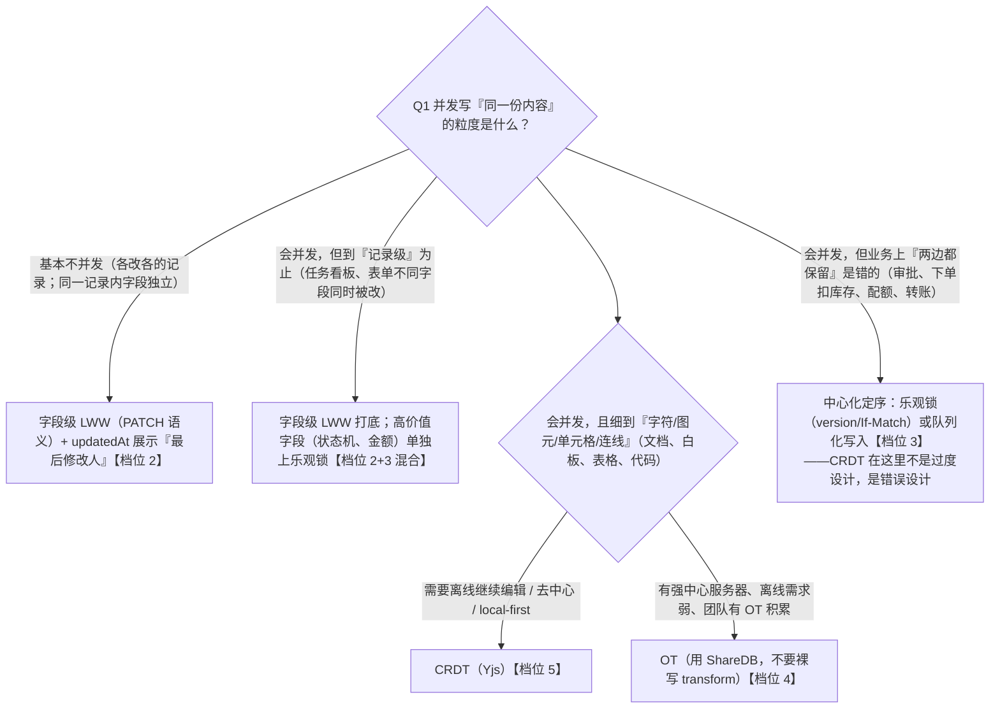
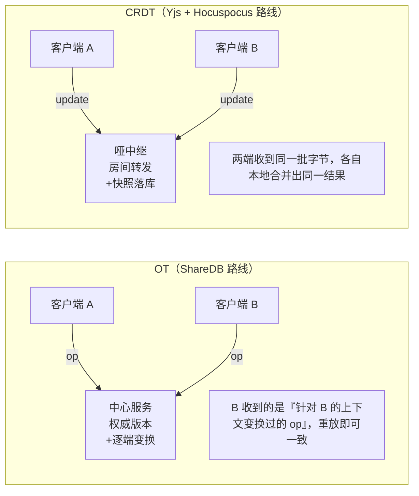

## B. 实时与协同

> 族群共性：状态不再是"我一个人改、刷新看结果"，而是**多个人的修改同时到达、乱序到达、离线后补到达，最终还必须收敛成同一份**。这一族里 React 退化为"UI 壳"，真正的难度在数据结构与协议层（B1 的 CRDT 数学、B2 的消息一致性与虚拟化、B3 的媒体传输协议），所以它们在"React 相关度过滤视图"里大多落在 ③（换框架知识原样保值）。学这族的心态：按通用技术学原理，用 React 练工程实现。

---

### B1. 多人协同编辑 CRDT（★★★★★）

**是什么**。让两个人（或多端）同时编辑同一份文档/表格/白板，所有人的修改实时可见、互不破坏，最终所有端内容完全一致。画像产品：Notion/飞书文档的多人编辑、Figma 的多人画板、Linear 的多端离线同步。协同其实包含三层诉求，混在一起谈会失焦：

1. **收敛（Consistency）**：不管谁在线谁离线、谁先谁后，所有端最终内容一致——这是 CRDT/OT 解决的核心；
2. **意图保留（Intention preservation）**：我插入的字不会被你的并发操作"吞掉"，你删的我不会复活；
3. **即时感知（Presence）**：看到对方光标、选区、头像——这是 awareness 层，和前两层是两套机制。

**为什么难**。因为分布式环境下**没有全局时钟，也没有"真实发生的顺序"**。来看三个递进的翻车现场。

**翻车现场一：last-write-win（按时间戳"后写赢"）会无声丢字。** 文档当前内容是 `Hello`，A 和 B 同时打开：

- A 在末尾追加了 ` World`，本地看到 `Hello World`；
- B 同时在末尾追加了 ` Yjs`，本地看到 `Hello Yjs`；
- 两端先后点保存，服务端按 `updatedAt` 比较：B 后保存 → 整份文档以 B 的版本覆盖 → A 写的 ` World` **无声消失**，没有任何报错、没有任何记录。

这不是实现 bug，是 LWW 合并策略的结构性缺陷：两份合法编辑合并时被迫二选一，必然丢一边。字段级的表单"互相覆盖"（同事改了标题把你改的正文冲掉）也是同一件事。

**翻车现场二：即使只传"操作"，位置在并发世界里也不成立。** 文档是 `AB`（下标 0=`A`、1=`B`）：

- A 在下标 0 前插入 `X`，本地得到 `XAB`；
- B 在下标 1 前插入 `Y`，本地得到 `AYB`；
- 广播重放：A 收到 B 的"在下标 1 前插入 Y"，在 `XAB` 上执行 → `XYAB`；B 收到 A 的"在下标 0 前插入 X"，在 `AYB` 上执行 → `XAYB`。

两端各执一词且都"看起来没错"。问题在于：**下标是相对某个历史版本而言的，版本分叉后下标失去全局意义**。OT 和 CRDT 做的全部努力，本质都是在回答"并发之后，插入位置和删除范围应该落到哪"。

**翻车现场三：删改交叠的语义必须有确定答案。** 初始 `Hello world`。A 选中 `Hello` 删除；B 同时在 `Hello` 后面输入 `!`。合并后 `!` 应该在还是不在？如果 B 的光标在 A 删除的范围内呢？这些都必须被算法严格定义，而不是"看运气"。

**OT vs CRDT：一句话讲清各自本质。**

- **OT（Operational Transformation，操作变换）**：客户端只传操作（`insert(pos, str)` / `delete(pos, len)`），由**中心服务器统一定序**，并让服务器对并发操作做**变换**（transform），使每个客户端重放变换后的操作仍能收敛。一句话：**中心定序 + 改写操作，让操作在别人的上下文里重放后结果一致**。Google Docs 是经典 OT 产品。
- **CRDT（Conflict-free Replicated Data Type，无冲突复制数据类型）**：把"可合并性"内置进数据结构本身——每个字符/值携带全局唯一 ID 和逻辑时钟，文档状态定义为"所有已见操作的集合"，而集合并集满足交换律，所以**无论 update 以什么顺序、从谁那里到达，结果恒定**。一句话：**用元数据换"顺序无关的合并"，天然去中心、天然离线友好**。

记忆钩子：**OT 改"操作"，CRDT 改"状态"；OT 依赖中心，CRDT 依赖元数据**。Yjs 是工业界最成熟的 CRDT 实现，下面全部围绕它展开。

#### 核心技术逐项

**1. Yjs 核心结构：Y.Doc / Y.Text / Y.Map / Y.Array**

- `Y.Doc`：一份协同文档的容器，持有共享类型树、唯一的 `clientID`，发出 `update`/`destroy` 事件；`doc.transact(fn)` 把 fn 内的多次修改合并成一个 update 一次广播（性能关键）。
- `Y.Text`：字符序列 CRDT（基于 YATA 算法），`insert/delete` 之外还支持 `format`（给区间加粗/变色等富文本属性）。文档正文、代码内容用它。
- `Y.Map`：键值 CRDT，值可以是原始值或嵌套的共享类型。注意一个精细区分：**单键内是 LWW（后写赢），但这是安全的**——因为值是原子替换，不存在"半个字段"的丢失；而"翻车现场一"里丢字的是文档级 LWW。文档的元信息、白板图元的属性、块结构（`Y.Map<blockId, Y.Map<props>>`）用它。
- `Y.Array`：列表 CRDT，适合块的有序排列。
- 另有 `Y.XmlFragment/XmlElement/XmlText`：为富文本树设计的类型，y-prosemirror 的对接面。

最小实验（Node 或浏览器跑都行，先不联网，纯本地感受"可合并"）：

```ts
import * as Y from 'yjs';

function simulateOfflineMerge() {
  // 两个端各自一份副本(模拟两个人离线各写各的)
  const alice = new Y.Doc();
  const bob = new Y.Doc();

  // 互不知晓地并发编辑同一位置
  alice.getText('doc').insert(0, 'Hello');
  bob.getText('doc').insert(0, 'World');

  // 上线:互相交换"我见过的全部操作"(全量 update)
  Y.applyUpdate(alice, Y.encodeStateAsUpdate(bob));
  Y.applyUpdate(bob, Y.encodeStateAsUpdate(alice));

  console.log(alice.getText('doc').toString()); // 两端输出完全一致
  console.log(bob.getText('doc').toString());   // 谁的词都没丢;先后由 clientID 确定性决胜
}
```

对照"翻车现场一"：LWW 二选一丢一边，这里**两个词都保留、两端一致**。这就是"合并收敛性做进数据结构"的直观含义。

**2. 更新编码为什么可合并**

Yjs 的 update 不是快照，而是**操作的二进制日志**。每个操作被记录为 `[clientID, clock]`，`clock` 是该客户端内的单调递增序号——这个二元组全局唯一地标识一个操作。于是：

- 文档状态 = 所有已接收操作的**并集**。并集满足交换律（`A∪B = B∪A`）与结合律，所以 update 乱序、重复、迟到都不影响最终状态，重复投递也天然幂等（集合里已有就忽略）；
- **状态向量（State Vector）**：一个迷你摘要 `{clientID → 我见过的最大 clock}`。两个端交换状态向量后，各自能精确算出"对方缺什么"，只传差量——`Y.encodeStateVector` + `Y.diffUpdate` 就是干这个的，也是 y-websocket 同步协议的核心。

```ts
// 增量同步:只发对方缺的部分,而不是全量
const sv = Y.encodeStateVector(alice);                                  // alice 见过什么
const delta = Y.diffUpdate(Y.encodeStateAsUpdate(bob), sv);             // bob 比 alice 多的部分
Y.applyUpdate(alice, delta);                                            // 应用后两者一致
```

**3. awareness 是什么**

CRDT 管"文档内容"——要历史、要精确合并；awareness 管**临时的、只关心最新值的状态**：对方光标位置、选区范围、头像/名字/颜色、"正在输入中"。这类状态毫秒级过期、不需要合并历史，所以走完全不同的机制：各端全量覆盖自己的那一份并广播，谁断线谁的状态自动清除。注意它**不该**用 CRDT 存（白占元数据），也**不该**用高频 DOM 状态塞进去不节流（每帧广播会拖垮房间）。

```ts
import { WebsocketProvider } from 'y-websocket';

const provider = new WebsocketProvider('ws://localhost:1234', 'room-42', ydoc);
// 写:自己这份 awareness 的字段
provider.awareness.setLocalStateField('user', { name: 'Aimy', color: '#f783ac' });
provider.awareness.setLocalStateField('cursor', { anchor: 3, head: 7 });
// 读:房间里所有人的临时状态(clientID -> state)
provider.awareness.on('change', () => {
  for (const [clientID, state] of provider.awareness.getStates()) {
    console.log(clientID, state.user, state.cursor);
  }
});
```

**4. 编辑器绑定：y-prosemirror / y-monaco 的角色**

Yjs 只管数据，编辑器（ProseMirror/Monaco/CodeMirror）有自己的文档模型，两边的"位置体系"不同——并发合并后位置会漂移，你不能拿 textarea 硬绑（下一节的骨架会演示为什么不行）。绑定器（binder）做四件事：

1. 把本地编辑转成 Yjs 操作；
2. 把远端 update **带位置映射**地应用回编辑器（光标/选区跟着正确移动，而不是跳到末尾）；
3. 把 awareness 光标渲染成编辑器 decoration（对方彩色的光标和名字牌）；
4. 隔离 undo：本地 Ctrl+Z 只撤销自己的修改，不回滚别人的。

y-prosemirror 把 ProseMirror 的 Step 映射到 `Y.XmlFragment`（TipTap 的 `@tiptap/extension-collaboration` 就是它的封装）；y-monaco 把 Monaco 模型事件绑定到 `Y.Text`，一行绑定见后文。

**5. 离线 edits 合并**

Yjs 天然离线友好：本地产生的 update 先落 y-indexeddb，断网随便写；重连后双方交换状态向量、互发差量即可追平。离线期间的并发修改靠 CRDT 规则收敛（并发插入都保留，删除与插入交叠时字符级语义确定）。对比 OT：OT 的变换依赖服务器定序，离线堆积大量操作后变换矩阵的复杂度和出错面都会爆炸（学术圈经典的 dOPT puzzle 问题就是变换函数反例），所以 OT 产品的离线支持普遍孱弱——这是 Notion 早期离线体验差、Linear 选自研同步引擎的原因之一。

**6. 持久化：y-indexeddb**

把每次 update 追加写入 IndexedDB，启动时重放合并（内部会做 compaction 控制日志膨胀）。刷新页面不再回退到旧版本。

```ts
import { IndexeddbPersistence } from 'y-indexeddb';
import * as Y from 'yjs';
import { WebsocketProvider } from 'y-websocket';

const ydoc = new Y.Doc();
const wsProvider = new WebsocketProvider('ws://localhost:1234', 'room-42', ydoc);
const idb = new IndexeddbPersistence('room-42', ydoc); // 本地持久层
idb.on('synced', () => {
  console.log('本地数据已恢复,等待服务器增量');
});
// 两个 provider 挂同一个 ydoc 即可:y-indexeddb 官方处理了「先回放本地、再与远端合并」的竞态
```

**7. 服务端选型：y-websocket / Liveblocks / PartyKit 定位差异**

- **y-websocket**：官方参考实现。服务端不理解文档语义，只做房间管理与 update 转发（哑中继），自带内存存储。`npx y-websocket` 一行起服务（默认 1234 端口）。定位：**开发联调、自建起步**。生产要自己补鉴权、持久化落库、水平扩展（Redis pub/sub 转发跨节点 update）。
- **Hocuspocus**（TipTap 团队）：可以理解为"生产级 y-websocket"，内置鉴权钩子、数据库持久化、水平扩展、扩展插件体系。自建生产服务端的事实标准。（大纲未列，顺带认知。）
- **Liveblocks**：托管 SaaS。房间/鉴权/在线状态 API/评论/通知等产品化模块开箱即用，按量付费。定位：**不想碰服务器细节、快速上线的买方案**。
- **PartyKit**：把"你自己的协同服务端代码"跑在 Cloudflare 边缘（Durable Objects 持有房间状态），适合需要自定义服务端逻辑（权限校验、AI 写入文档）又不想管扩容的团队；已被 Cloudflare 收编。定位：**边缘化的自建**。

选型口诀：demo 用 y-websocket，小团队快速上线用 Liveblocks，有后端团队要私有部署用 Hocuspocus/自建，要自定义服务逻辑跑在边缘用 PartyKit。

**8. 入手示例：两个 Tab 协同编辑的最小骨架**

先起服务：

```bash
# 终端 1:官方参考服务端,默认端口 1234
npx y-websocket
# 终端 2:安装依赖
npm i yjs y-websocket y-indexeddb
```

数据层 React 绑定——用 `useSyncExternalStore` 把 Y.Text 变成 React 可订阅的状态：

```tsx
// useYText.tsx
import { useSyncExternalStore } from 'react';
import * as Y from 'yjs';

/** 订阅一个共享文本,文档更新时组件重渲染 */
export function useYText(ydoc: Y.Doc, name: string): string {
  const ytext = ydoc.getText(name);
  return useSyncExternalStore(
    (onStoreChange) => {
      const handler = () => onStoreChange();
      ytext.observe(handler);        // 订阅:任何来源的修改(本地/远端)都会触发
      return () => ytext.unobserve(handler);
    },
    () => ytext.toString(),          // getSnapshot:字符串天然满足「相同状态返回相同值」
  );
}
```

第一个骨架：textarea 版（**故意展示它的缺陷**）：

```tsx
// CollabTextarea.tsx
import { useEffect, useMemo, useState } from 'react';
import * as Y from 'yjs';
import { WebsocketProvider } from 'y-websocket';
import { IndexeddbPersistence } from 'y-indexeddb';
import { useYText } from './useYText';

export default function CollabTextarea() {
  const { ydoc, provider } = useMemo(() => {
    const ydoc = new Y.Doc();
    const provider = new WebsocketProvider('ws://localhost:1234', 'demo-room', ydoc);
    new IndexeddbPersistence('demo-room', ydoc);
    return { ydoc, provider };
  }, []);

  const text = useYText(ydoc, 'draft');
  const [name] = useState(() => `User-${Math.floor(Math.random() * 100)}`);

  useEffect(() => () => { provider.destroy(); ydoc.destroy(); }, [provider, ydoc]);

  return (
    <div>
      <p>两个浏览器 Tab 打开本页,输入互通;断网继续打字,联网自动追平;刷新后由 IndexedDB 恢复。</p>
      <textarea
        value={text}
        onChange={(e) => {
          const next = e.target.value;
          ydoc.transact(() => {
            const ytext = ydoc.getText('draft');
            ytext.delete(0, ytext.length); // 整段替换的糙写法:仅演示数据层
            ytext.insert(0, next);
          });
        }}
        rows={8}
        cols={60}
      />
    </div>
  );
}
```

开两个 Tab 输入互通没问题，但你马上会发现**光标老是跳到末尾**——因为整段替换丢掉了位置信息。这就是"编辑器绑定"存在的理由。正解用 TipTap v2（内部就是 y-prosemirror）：

```tsx
// CollabEditor.tsx —— TipTap v2.x
import { EditorContent, useEditor } from '@tiptap/react';
import StarterKit from '@tiptap/starter-kit';
import Collaboration from '@tiptap/extension-collaboration';
import CollaborationCursor from '@tiptap/extension-collaboration-cursor';
import * as Y from 'yjs';
import { WebsocketProvider } from 'y-websocket';
import { IndexeddbPersistence } from 'y-indexeddb';
import { useEffect, useMemo } from 'react';

export default function CollabEditor() {
  const { ydoc, provider } = useMemo(() => {
    const ydoc = new Y.Doc();
    const provider = new WebsocketProvider('ws://localhost:1234', 'rich-room', ydoc);
    new IndexeddbPersistence('rich-room', ydoc);
    return { ydoc, provider };
  }, []);

  const editor = useEditor({
    extensions: [
      // 协同场景必须关掉编辑器自带的历史栈,undo 由协同扩展接管(只撤销自己的操作)
      StarterKit.configure({ history: false }),
      Collaboration.configure({ document: ydoc }),      // 正文:ProseMirror <-> Y.XmlFragment
      CollaborationCursor.configure({                    // 他人光标/名字牌:awareness
        provider,
        user: { name: 'Aimy', color: '#f783ac' },
      }),
    ],
  });

  useEffect(() => () => { editor?.destroy(); provider.destroy(); ydoc.destroy(); }, [editor, provider, ydoc]);

  return <EditorContent editor={editor} />;
}
```

```css
/* 对方光标的样式(CollaborationCursor 输出的类名) */
.collaboration-cursor__caret {
  border-left: 1px solid;
  border-right: 1px solid;
  margin-left: -1px;
  margin-right: -1px;
  pointer-events: none;
  position: relative;
  word-break: normal;
}
.collaboration-cursor__label {
  border-radius: 3px 3px 3px 0;
  color: #fff;
  font-size: 11px;
  font-style: normal;
  font-weight: 600;
  left: -1px;
  line-height: normal;
  padding: 0.1rem 0.3rem;
  position: absolute;
  top: -1.4em;
  user-select: none;
  white-space: nowrap;
}
```

Monaco 的等价物是 y-monaco，绑定只需一行：

```ts
import { MonacoBinding } from 'y-monaco';
import * as Y from 'yjs';
import { WebsocketProvider } from 'y-websocket';
import type * as Monaco from 'monaco-editor';

export function bindMonaco(editor: Monaco.editor.IStandaloneCodeEditor, ydoc: Y.Doc) {
  const provider = new WebsocketProvider('ws://localhost:1234', 'code-room', ydoc);
  // ytext <-> Monaco model 双向绑定;editor 放进 Set 用于渲染他人光标 decoration
  new MonacoBinding(ydoc.getText('code'), editor.getModel()!, new Set([editor]), provider.awareness);
}
```

**代表**：Figma、Notion、Linear（原文代表）。注意它们的方案并不等于 Yjs：Figma 公开博客讲过其自研的属性级同步架构；Linear 走自研 Local-first 同步引擎；Yjs 是开源方案里的工业标准（被多家文档产品与 Liveblocks 等托管服务采用）。学 Yjs 学的是这类系统的共同内核。

**入手路径**（4 步，每步 2~5 天）：

1. 跑通上面的 textarea 骨架，体感"两个 Tab 互通、断网不丢"；读 `Y.Text` 的 observe 事件里的 `event.delta`（操作增量），理解 update 流；
2. 换成 TipTap + Collaboration，观察他人光标（awareness）；故意开三个 Tab，把中间那个断网 30 秒再恢复，验证增量追平；
3. 把 `Y.encodeStateAsUpdate(ydoc)` 存到后端（一个简单的 POST），实现"房间快照 + 增量落库"的最简持久化，理解状态向量差量同步；
4. 进阶：用 `y-websocket` 的权限缺口（任何人可连任何房间）练习给信令加 JWT 鉴权。

**验收物**：一个可部署的协同编辑页——两个 Tab（或两台设备）实时同步富文本、互相可见光标与名字；其中一端断网编辑 1 分钟后恢复不丢内容；刷新页面内容从 IndexedDB 恢复。

**常见坑**：

- **observe 回写死循环**：observe 里 setValue、onChange 里又触发 update，互相打架。原则：单一数据源——输入事件写 Yjs，渲染只读 Yjs；不要在 observe 里再做一次"纠正"；
- **用 JSON.stringify 序列化 Y.Doc**：文档必须用二进制编码（`Y.encodeStateAsUpdate` → Uint8Array）持久化/传输，JSON 会破坏结构；
- **awareness 塞高频状态**：每帧鼠标坐标直接 `setLocalState` 会形成广播风暴，高频信号先节流（光标一般 30~50ms 一次足够）；
- **每次渲染 new Y.Doc()**：Y.Doc/provider 是重对象，必须 `useMemo`（或模块级单例）创建、卸载时 `destroy()`，否则 IndexedDB 连接和 WebSocket 泄漏；
- **以为服务端能读文档**：y-websocket 服务端只是转发字节，想服务端渲染摘要/搜索，得在服务端也加载同一份 update 到一个 Y.Doc 里（Hocuspocus 的 hook 里做）。

---

### B2. IM / 长会话列表（★★★★☆）

**是什么**。Slack/Discord/钉钉式聊天前端：左侧几百个会话（未读徽标、置顶、@提及高亮），右侧万条历史消息的滚动流（乐观发送、翻页、已读、引用、反应、撤回）。画像里的每一个词背后都是一条独立的数据流。

**为什么难**。四个叠加的约束：

1. **量**：一个活跃频道几万条消息，每条是高度不定的 DOM（一行文本 vs 一张图 vs 带引用卡的代码块）——虚拟化必须动态测量；
2. **方向**：消息流"新在底、旧在顶"，翻历史是向上加载，滚动锚定逻辑与普通列表相反；
3. **一致性**：乐观消息（临时 id）与服务端消息（正式 seq）在同一列表里交错，还要与翻页数据归并去重；
4. **分布式状态**：未读数/已读回执是"每个用户 × 每个会话"一个游标，跨端同步。

数据模型先行（后面所有逻辑都围绕它）：

```ts
export interface Message {
  id: string;                 // 乐观阶段=本地 uuid;确认后=服务端 id
  reqId?: string;             // 发送请求 id(乐观替换的关键:服务端 ack 会带回它)
  clientId: string;           // 发送者
  seq: number | null;         // 服务端单调递增序号;乐观阶段为 null
  type: 'text' | 'image' | 'system';
  content: string;
  status: 'sending' | 'sent' | 'failed';
  replyTo?: string;           // 引用回复的消息 id
  reactions?: Record<string, string[]>; // emoji -> 已反应的 userId 列表
  editedAt?: number;          // 有值=已被编辑
  recalled?: boolean;         // 已撤回
  createdAt: number;
}
```

#### 核心技术逐项

**1. 两级列表虚拟化：会话列表 + 消息流，动态高度与测量缓存**

为什么是"两级"：侧栏会话列表与主消息流是两个独立滚动的虚拟化容器（前者基本定高，后者必须动高）。虚拟化的本质前面 E1/G 族会展开，这里只讲 IM 特有的部分。

动态高度三步走——**估、测、校**：

- **估（estimate）**：未测量前按消息类型给估值（纯文本 72px、图片 240px、引用卡 +56px），保证首屏滚动条不至于乱跳；
- **测（measure）**：元素真实渲染后量一次高度，写入缓存 `Map<key, measuredSize>`。`getItemKey` 必须返回稳定 id（消息 id 而不是数组下标），否则乐观替换/翻页归并后缓存全部错位；
- **校（correct）**：某项实测高度 ≠ 估算时，虚拟器修正总高度与后续项偏移。TanStack Virtual 的 `measureElement` 回调替你做了这一步。

```tsx
// MessageList.tsx
import { useRef } from 'react';
import { useVirtualizer } from '@tanstack/react-virtual';
import type { Message } from './types';

export function MessageList({ messages }: { messages: Message[] }) {
  const scrollRef = useRef<HTMLDivElement>(null);
  const virtualizer = useVirtualizer({
    count: messages.length,
    getScrollElement: () => scrollRef.current,
    estimateSize: (i) => (messages[i].type === 'image' ? 240 : 72), // 估
    getItemKey: (i) => messages[i].id,                              // 稳定 key:测量缓存的锚
    overscan: 8,
  });

  return (
    <div ref={scrollRef} className="h-full overflow-auto">
      <div style={{ height: virtualizer.getTotalSize(), position: 'relative' }}>
        {virtualizer.getVirtualItems().map((v) => (
          <div
            key={v.key}
            data-index={v.index}
            ref={virtualizer.measureElement}   // 测:渲染后回传真实高度
            className="absolute w-full"
            style={{ transform: `translateY(${v.start}px)` }}
          >
            <MessageBubble msg={messages[v.index]} />
          </div>
        ))}
      </div>
    </div>
  );
}
```

**向上加载的滚动锚定**（原理，必懂）：在顶部插入 50 条后，内容总高度增加 ΔH，而浏览器保持 `scrollTop` 数值不变——视口里显示的内容会瞬间"被顶下去"跳变。两种对策：

- 手动校正：`useLayoutEffect` 里在 paint 前执行 `el.scrollTop += (newContentHeight - oldContentHeight)`；
- 容器 `flex-direction: column-reverse` + 数据倒序（新消息物理上在顶部、视觉在底部）：浏览器的滚动锚点天然固定在底部，新消息到达自动"钉底"，翻历史变成向下 append，连锚定代码都省了。Discord 就是这个思路。代价是滚动条方向和 assistive tech 的语义都要适配。

**图片高度突变**是虚拟化另一杀手：图片异步加载完成后把撑高，后续所有项偏移全变、滚动条抖动。解法是**预留**：容器按宽高比占位（`aspect-ratio: 4 / 3`），图片加载完成前后尺寸不变。

**2. 消息顺序：服务端 seq 与乐观消息的临时 id→确认替换**

排序只有一条真理来源：**服务端每会话单调递增的 `seq`**。本地时间不可信（时钟漂移会让消息穿插），服务端接收顺序才是大家看到的顺序。乐观发送流：

1. 用户回车 → 立即 push 一条 `{ id: nanoid(), status: 'sending', seq: null }`，输入框清空、草稿清除——**零等待**的体感就来自这里；
2. 服务端处理完广播 ack：`{ reqId, message: { id, seq, ... } }`（reqId 是你发送时带上的请求 id）；
3. 客户端用 reqId 找到那条乐观消息，**原位替换字段**：`status → 'sent'`、`id → 服务端 id`、补 `seq`；
4. 超时/失败 → `status: 'failed'`，展示重试按钮；重试沿用同一个 reqId。

React 侧的关键技巧：**渲染 key 全程用"本地临时 id"**（服务端 ack 里回带 reqId 映射，key 不切换），确认时只改字段不改 key——否则整条消息 unmount/remount，图片重新加载、动画重播，视觉闪烁。

```ts
// store 片段:乐观发送 + ack 替换
import { nanoid } from 'nanoid';

function sendMessage(draft: string, convId: string) {
  const reqId = nanoid();                      // 本次发送请求的唯一标识
  const optimistic: Message = {
    id: reqId,                                 // 临时 id 直接复用 reqId,保证 key 稳定
    reqId,
    clientId: myUserId,
    seq: null,
    type: 'text',
    content: draft,
    status: 'sending',
    createdAt: Date.now(),
  };
  appendMessage(convId, optimistic);           // 立即上屏
  ws.send(JSON.stringify({ kind: 'msg.send', reqId, convId, content: draft }));
}

function onAck(payload: { reqId: string; message: Message }) {
  patchMessage(convId, payload.reqId, {        // 按 reqId 原位替换(不改数组位置,key 不变)
    id: payload.message.id,
    seq: payload.message.seq,
    status: 'sent',
  });
}
```

**3. 向上翻页补洞去重**

翻页请求"更老的 50 条"（按 seq 倒序），与此同时实时推送还在往尾部插新消息——两股数据流汇进同一个列表。三个问题一次解决：

- **排序**：确认消息按 seq 升序；`sending/failed` 恒在尾部；
- **去重**：用 `Set<id>`（或 seq 区间）做合并时的幂等键——分页与实时推送可能带回同一条；
- **补洞（gap）**：页 A 最老是 seq=1000，页 B 最新是 seq=980 → 中间缺 981~999（服务端清理/权限删除等原因）。检测到断档时插入一个"加载缺失消息"占位块，点击按区间拉取，而不是硬拼出一个跳跃的列表。

```ts
// mergeMessages.ts —— 纯函数:归并 + 去重 + 洞检测
import type { Message } from './types';

export interface MergeResult {
  messages: Message[];          // 归并后的有序列表
  gaps: { from: number; to: number }[]; // 检测到的 seq 断档
}

export function mergeMessages(existing: Message[], incoming: Message[]): MergeResult {
  const seen = new Set(existing.map((m) => m.id));      // 幂等键
  const merged = [...existing];
  for (const m of incoming) {
    if (!seen.has(m.id)) {
      seen.add(m.id);
      merged.push(m);
    }
  }
  // 稳定排序:sending/failed 无 seq,排尾部
  const confirmed = merged.filter((m) => m.seq != null).sort((a, b) => a.seq! - b.seq!);
  const pending = merged.filter((m) => m.seq == null);
  const gaps: MergeResult['gaps'] = [];
  for (let i = 1; i < confirmed.length; i++) {
    const prev = confirmed[i - 1].seq!;
    const cur = confirmed[i].seq!;
    if (cur - prev > 1) gaps.push({ from: prev + 1, to: cur - 1 }); // 断档区间
  }
  return { messages: [...confirmed, ...pending], gaps };
}
```

**4. 已读回执 / 未读数的数据流**

模型极简：**每个用户对每个会话一个游标 `readSeq`（我读到哪）**。一切派生指标都从它算：

- 我的某会话未读数 = `latestSeq − myReadSeq`；
- 群聊"全部已读"判定：`msg.seq ≤ min(其他成员的 readSeq)`；
- @提及角标：未读消息里 `mentions` 含我的条数。

数据流三条线：

1. **上报**：我在会话里滚动 → 取"视口内最老可见消息的 seq"（比"最后一条"更诚实——用户没看的不该算已读）→ 防抖 500ms 后 `ws.send({ kind: 'read.report', convId, readSeq })`。防抖是必须的：快速滑过 200 条不该产生 200 次上报；
2. **接收**：服务器推送 `conversation.updated`（latestSeq/unread 变化，驱动侧栏徽标）与 `receipt.updated`（某成员 readSeq 变化，驱动我发出消息下方的"已读/未读"小标）；
3. **多端同步**：我在手机读了，桌面端徽标要消——游标变化同样走推送。

```ts
// 视口内最老可见 seq 的上报(demo 逻辑)
let reportTimer: ReturnType<typeof setTimeout> | undefined;
function onVisibleSeqChange(visibleOldestSeq: number, convId: string, myReadSeq: number) {
  clearTimeout(reportTimer);
  reportTimer = setTimeout(() => {
    const next = Math.max(visibleOldestSeq, myReadSeq); // 游标只进不退
    if (next > myReadSeq) {
      ws.send(JSON.stringify({ kind: 'read.report', convId, readSeq: next }));
    }
  }, 500);
}
```

**5. 引用回复树、@提及自动补全、表情反应聚合**

- **引用回复**：消息带 `replyTo`。现代 IM（Slack/Discord 飞书皆然）**不渲染整棵回复树**，而是"消息流扁平 + 气泡内引用预览卡 + thread 视图"三件套：点引用卡进入 thread（thread 就是一个复用的 MessageList，数据按 `parentId` 过滤）。渲染引用卡用 `Map<id, Message>` 索引 O(1) 查找，被引用消息未加载（太老）时显示"原消息未加载"，点击按需拉取；
- **@提及自动补全**：输入框监测 `@` 触发成员选择 popover（键盘上下+回车，参照 G 族的 Combobox 模式）。**存储时把 mention 作为结构化片段**而不是事后正则匹配：`[{type:'text',...},{type:'mention', userId}]`——渲染高亮、发送通知、删除整块都不会把 `@张三` 误伤成 `@张三丰`；
- **表情反应聚合**：原始事件流是 `reaction.add/remove {msgId, emoji, userId}`，前端聚合为 `Record<emoji, userId[]>`：count 取数组长度，"我是否已选"看数组含不含我，再点一次 = 取消。增量事件直接改聚合结构，不重拉消息。

```ts
// reactions 聚合 reducer
export function applyReaction(
  reactions: Record<string, string[]>,
  e: { emoji: string; userId: string; op: 'add' | 'remove' },
): Record<string, string[]> {
  const users = reactions[e.emoji] ?? [];
  const next =
    e.op === 'add'
      ? users.includes(e.userId) ? users : [...users, e.userId]
      : users.filter((u) => u !== e.userId);
  const cloned = { ...reactions };
  if (next.length) cloned[e.emoji] = next;
  else delete cloned[e.emoji];       // 空反应不显示
  return cloned;
}
```

**6. 图片视频懒加载**

虚拟化本身就是最强的懒加载（不可见不挂载），但仍有两个层次要做：

- **占位**：所有媒体容器按宽高比预留（见动态高度一节），缩略图用低清 URL，点开大图才加载原图——大图查看器是全局单例（Portal + 预加载相邻图）；
- **重内容延迟渲染**：长 markdown/代码高亮/自定义卡片只对"可见项"执行高亮计算，可视区外先渲染纯文本占位（否则快速滚动时高亮计算把主线程打爆）。视频消息 `preload="metadata"` 只拉时长和首帧。

**7. 撤回 / 编辑 diff**

- **撤回**：客户端发 `msg.recall`，**服务端校验时限**（如 2 分钟）后广播 `message.recalled`；所有端把气泡替换为灰字"XX 撤回了一条消息"（撤回后内容不留在客户端是合规要求，所以不是前端把内容涂掉就完事）；
- **编辑**：广播 `message.updated`，前端更新内容 + 显示"已编辑"标记；点"已编辑"展开旧→新对比视图。词级 diff 用最小 LCS 就够（消息都不长）：

```ts
// wordDiff.ts —— 词级 diff(LCS 动态规划)
export interface DiffOp { type: 'same' | 'del' | 'ins'; text: string }

export function wordDiff(oldText: string, newText: string): DiffOp[] {
  const a = oldText.split(/(\s+)/);       // 保留空白分隔符,中文可按字切
  const b = newText.split(/(\s+)/);
  // dp[i][j] = a[i:] 与 b[j:] 的最长公共子序列长度(逆序填表)
  const dp: number[][] = Array.from({ length: a.length + 1 }, () =>
    new Array<number>(b.length + 1).fill(0),
  );
  for (let i = a.length - 1; i >= 0; i--) {
    for (let j = b.length - 1; j >= 0; j--) {
      dp[i][j] = a[i] === b[j] ? dp[i + 1][j + 1] + 1 : Math.max(dp[i + 1][j], dp[i][j + 1]);
    }
  }
  const ops: DiffOp[] = [];
  let i = 0, j = 0;
  while (i < a.length && j < b.length) {
    if (a[i] === b[j]) { ops.push({ type: 'same', text: a[i++] }); j++; }
    else if (dp[i + 1][j] >= dp[i][j + 1]) ops.push({ type: 'del', text: a[i++] });
    else ops.push({ type: 'ins', text: b[j++] });
  }
  while (i < a.length) ops.push({ type: 'del', text: a[i++] });
  while (j < b.length) ops.push({ type: 'ins', text: b[j++] });
  return ops;
}
```

**8. 草稿持久化**

每个会话一份 `{text, mentions, updatedAt}`。选 IndexedDB 而不是 localStorage：后者同步 API 会阻塞主线程且容量 ~5MB。防抖保存 + 进入恢复 + 发送成功清除：

```ts
// drafts.ts —— Dexie(IndexedDB)实现
import Dexie, { type EntityTable } from 'dexie';

export interface Draft {
  conversationId: string;
  text: string;
  mentions: string[];
  updatedAt: number;
}

const db = new Dexie('im-drafts') as Dexie & {
  drafts: EntityTable<Draft, 'conversationId'>;
};
db.version(1).stores({
  drafts: 'conversationId, updatedAt', // 主键在前,updatedAt 做索引便于清理旧草稿
});

export const saveDraft = (d: Draft) => db.drafts.put(d);
export const loadDraft = (conversationId: string) => db.drafts.get(conversationId);
export const clearDraft = (conversationId: string) => db.drafts.delete(conversationId);
```

**入手路径**（四阶段，每阶段 3~5 天）：

1. **基础聊天室**：WebSocket 广播收发（可以用一个 Node `ws` 服务器 50 行解决），普通列表渲染、滚动到底；
2. **上量**：造 1 万条假数据（高度参差：混图片/引用/代码），接 TanStack Virtual 动态高度，做向上翻页 + 滚动锚定；
3. **一致性**：乐观发送 + reqId→确认替换 + `mergeMessages` 归并去重补洞；断网发送 → 恢复重试；
4. **产品化**：已读回执与未读徽标、引用回复与 thread、@提及补全、反应聚合、撤回与编辑 diff、草稿持久化。

**验收物**：双窗口登录两个账号：万级历史消息流畅滚动（Performance 面板滚动帧 < 16ms 为主）；A 发消息 B 秒见、A 的"已读"随 B 阅读变化；断网时 A 继续发送显示 failed，恢复后一键重试成功；切走再切回，草稿与滚动位置都在。

**常见坑**：

- 用数组下标当 key：乐观替换、翻页归并之后全部错位闪烁；
- 用本地时间排序：两端时钟差 30 秒，消息就穿插，必须 seq；
- 图片无占位：加载完成高度突变，列表抖动；
- 每条消息各建一个 WebSocket/事件订阅：应该是全局一条连接 + 一个消息分发器（store 层），组件只订阅自己会话的切片；
- 草稿存 localStorage 且每次 keystroke 同步写：主线程卡顿，应防抖 + IndexedDB；
- `overflow-anchor`（浏览器原生滚动锚定）与手动 scrollTop 校正互相打架，二选一。

---

### B3. 音视频 / 直播（★★★★☆）

**是什么**。视频会议、直播、在线教育课堂、云剪辑。这一族是**概念重灾区**——SDP/STUN/TURN/ICE/SFU/MSE 一堆缩写。先把地图画出来：**拉流看**（用户看视频：hls.js）与**推流连麦**（用户产生视频：WebRTC）是两条完全不同的技术路线；前者的关键词是"切片与自适应"，后者是"建立浏览器之间的直连"。

**为什么难**。媒体数据量大（一路 720p 约 1~3 Mbps），实时性要求苛刻（通话延迟 > 300ms 就难受）；网络天然不可靠（丢包/抖动/对称 NAT）；浏览器 API 面广且各浏览器实现有差异。难点不在写代码量，而在**每个概念你得真的知道它为什么存在**。

#### 核心技术逐项

**1. hls.js 播放器：清晰度切换 / seek 精度 / 预加载**

先懂 HLS（HTTP Live Streaming，Apple 发明）：服务端把视频**转码成多档码率、切成几秒一个的小分片**（ts 或 fMP4），并生成两级文本索引——`master.m3u8`（有哪几档）和每档的媒体列表（分片 URL + 时长）。客户端循环"拉列表 → 按序拉分片 → 喂给浏览器播放"。**直播**就是服务器不断往列表尾巴追加新分片，客户端轮询跟进。为什么基于 HTTP 而不是专用协议（RTMP/RTP）：CDN 缓存天然友好、穿防火墙、运维成本极低；代价是延迟（分片时长 × 2~3 倍，常规 6s 切片约 15~30s 延迟，LL-HLS 可压到 ~2s）。

**ABR（自适应码率）**：客户端实测下载速度，自动在高/低档间切换——网差看 360p、网好跳 1080p。hls.js 默认就开着。

最小接入：

```tsx
// HlsPlayer.tsx
import Hls from 'hls.js';
import { useEffect, useRef, useState } from 'react';

export function HlsPlayer({ src }: { src: string }) {
  const videoRef = useRef<HTMLVideoElement>(null);
  const hlsRef = useRef<Hls | null>(null);
  const [levels, setLevels] = useState<{ index: number; label: string }[]>([]);
  const [current, setCurrent] = useState(-1); // -1 = 自动(ABR)

  useEffect(() => {
    const video = videoRef.current!;
    if (Hls.isSupported()) {
      const hls = new Hls({ maxBufferLength: 30 }); // 前向缓冲 30 秒:越长越抗抖、越费流量
      hlsRef.current = hls;
      hls.loadSource(src);
      hls.attachMedia(video); // hls.js 解码分片后经 MSE 喂给 <video>
      hls.on(Hls.Events.MANIFEST_PARSED, (_e, data) => {
        // 清单解析完:拿到全部档位(高度/码率)
        setLevels(data.levels.map((l, i) => ({ index: i, label: `${l.height}p` })));
        void video.play();
      });
      hls.on(Hls.Events.ERROR, (_e, data) => {
        if (!data.fatal) return;                 // 非致命错误 hls.js 自己恢复
        if (data.type === Hls.ErrorTypes.NETWORK_ERROR) hls.startLoad(); // 网络错误:重试拉流
        else hls.recoverMediaError();            // 媒体错误:软恢复
      });
      return () => hls.destroy();                // 切换频道必须销毁,否则内存泄漏
    }
    // Safari:iOS 原生支持 HLS,直接给 src
    if (video.canPlayType('application/vnd.apple.mpegurl')) {
      video.src = src;
    }
  }, [src]);

  function switchQuality(index: number) {
    const hls = hlsRef.current;
    if (!hls) return;
    setCurrent(index);
    if (index === -1) {
      hls.currentLevel = -1; // 交还 ABR:按实测带宽动态切
    } else {
      hls.nextLevel = index; // 立即切:丢弃已缓冲数据,秒切但可能黑一瞬
      // hls.currentLevel = index 是平滑切:播完缓冲再切,无黑屏但慢
    }
  }

  return (
    <div>
      <video ref={videoRef} controls muted playsInline />
      <select value={current} onChange={(e) => switchQuality(Number(e.target.value))}>
        <option value={-1}>自动</option>
        {levels.map((l) => (
          <option key={l.index} value={l.index}>{l.label}</option>
        ))}
      </select>
    </div>
  );
}
```

**seek 精度**：视频流里只有关键帧（I 帧）能独立解码，seek 必须落在关键帧上——所以拖进度条后画面会"吸附"到最近的前一个关键帧，切关键帧间隔（GOP）越短 seek 越准、压缩率越差。直播里 seek 还受限于"列表里还有哪些分片"（回看窗口）。

**预加载策略**：详情页嵌了视频但不该立刻耗流量——`autoStartLoad: false` 先只解析清单拿时长/档位/首帧，用户点播放再 `hls.startLoad(0)`：

```ts
const hls = new Hls({ autoStartLoad: false });
hls.loadSource(src);
hls.attachMedia(video);
// 用户点击播放时:hls.startLoad(0) 从第 0 秒开始真正拉分片
```

**2. WebRTC 1v1 全流程（概念重灾区，逐词通俗讲）**

目标：两个浏览器直接互传音视频。先给一张角色表，每个词"是什么 + 为什么需要"：

| 词汇 | 是什么 | 为什么需要 |
|---|---|---|
| **P2P** | 浏览器之间直连传输媒体数据 | 不走你的服务器 = 低延迟、零带宽成本（除兜底） |
| **NAT** | 家庭/公司路由器的地址转换 | 内网设备没有公网 IP，是"直连"这件事的最大障碍 |
| **SDP** | 一封"自我介绍信"（文本格式） | 双方必须先互告"我支持哪些编解码/分辨率/传输参数"才能协商 |
| **信令服务器** | 你自己写的传话通道（通常 WebSocket） | WebRTC 标准**故意不管** SDP 怎么交换，任何能传消息的通道都行 |
| **STUN** | 一面"镜子"服务器 | 让浏览器知道"我的包从公网看是 x.x.x.x:port"（NAT 映射地址），这是候选地址之一 |
| **TURN** | 中转站服务器 | NAT 太严（对称 NAT/企业防火墙）打不通直连时，媒体全部经它转发——连通性兜底，成本大头 |
| **ICE** | 候选地址总调度 | 把"本机 IP + STUN 公网地址 + TURN 地址"全部收集为候选，两两测连通，选第一条通的 |

一句话串联：**信令帮双方互换 SDP 和 ICE 候选；STUN 帮你找到自己的公网地址；打不通时 TURN 替你转发；打通后媒体走 P2P 直连。**

完整时序（A 呼 B）：

```text
A 与 B 都: getUserMedia 拿本地流 → new RTCPeerConnection(iceServers) → addTrack(把流放进连接)
A(主叫): createOffer(我的能力清单) → setLocalDescription → 信令发给 B
B(被叫): setRemoteDescription(A 的清单) → createAnswer(交集) → setLocalDescription → 信令发给 A
A: setRemoteDescription(B 的应答)
双方: ICE 异步收集候选(onicecandidate)→ 信令互发 → addIceCandidate(对方候选)
双方: ICE 选定通路 → P2P 建立 → ontrack 收到对方画面
```

完整代码（React 组件，信令用 WebSocket，消息协议 JSON）：

```tsx
// CallRoom.tsx
import { useEffect, useRef } from 'react';

type Signal =
  | { kind: 'offer'; sdp: string }
  | { kind: 'answer'; sdp: string }
  | { kind: 'candidate'; candidate: RTCIceCandidateInit };

export function CallRoom({ roomId, isCaller }: { roomId: string; isCaller: boolean }) {
  const localVideoRef = useRef<HTMLVideoElement>(null);
  const remoteVideoRef = useRef<HTMLVideoElement>(null);

  useEffect(() => {
    const signaling = new WebSocket(`wss://signal.example.com/room/${roomId}`);
    let pc: RTCPeerConnection | null = null;

    signaling.onopen = async () => {
      // ① 拿本地媒体(摄像头/麦克风授权弹窗在这里触发)
      const stream = await navigator.mediaDevices.getUserMedia({ video: true, audio: true });
      if (localVideoRef.current) localVideoRef.current.srcObject = stream;

      // ② 建连接:STUN 发现公网地址,TURN 是打不通时的中继兜底(生产必须配)
      pc = new RTCPeerConnection({
        iceServers: [
          { urls: 'stun:stun.l.google.com:19302' },
          { urls: 'turn:turn.example.com:3478', username: 'demo', credential: 'demo-pass' },
        ],
      });

      // ③ 放入本地轨道;对端轨道到达时触发 ontrack
      stream.getTracks().forEach((t) => pc!.addTrack(t, stream));
      pc.ontrack = (e) => {
        if (remoteVideoRef.current) remoteVideoRef.current.srcObject = e.streams[0];
      };

      // ④ ICE 每收集到一个候选地址,就经信令转发给对方
      pc.onicecandidate = (e) => {
        if (e.candidate) {
          signaling.send(JSON.stringify({ kind: 'candidate', candidate: e.candidate }));
        }
      };

      // ⑤ 主叫方发起:生成 offer → 存本地描述 → 发给对方
      if (isCaller) {
        const offer = await pc.createOffer();
        await pc.setLocalDescription(offer);
        signaling.send(JSON.stringify({ kind: 'offer', sdp: pc.localDescription!.sdp! }));
      }
    };

    signaling.onmessage = async (e) => {
      if (!pc) return;
      const msg = JSON.parse(e.data) as Signal;
      if (msg.kind === 'offer') {
        // 被叫方:装进对方的描述 → 生成应答 → 回发
        await pc.setRemoteDescription({ type: 'offer', sdp: msg.sdp });
        const answer = await pc.createAnswer();
        await pc.setLocalDescription(answer);
        signaling.send(JSON.stringify({ kind: 'answer', sdp: pc.localDescription!.sdp! }));
      } else if (msg.kind === 'answer') {
        await pc.setRemoteDescription({ type: 'answer', sdp: msg.sdp });
      } else if (msg.kind === 'candidate') {
        await pc.addIceCandidate(msg.candidate);
      }
    };

    return () => {
      signaling.close();
      pc?.close(); // 关连接会释放摄像头指示灯
    };
  }, [roomId, isCaller]);

  return (
    <div>
      {/* 本地画面必须 muted:否则自己的声音外放再被对方传回,形成啸叫 */}
      <video ref={localVideoRef} autoPlay muted playsInline width={240} />
      <video ref={remoteVideoRef} autoPlay playsInline width={480} />
    </div>
  );
}
```

**3. SFU 多人架构概念**

1v1 每人一路，mesh 直连没问题。但 4 人 mesh：每人要同时向其他 3 人各发一路 720p → 上行带宽 ×3，手机直接发烫断流。三条多人路线：

- **Mesh**：全互联。0 服务器媒体成本，N=3~4 人上限；
- **SFU（Selective Forwarding Unit，选择性转发单元）**：每人只向服务器发 1 路，服务器按"谁订阅了谁"把流转发给其他人——**不转码、不混流**，只做转发，所以一台服务器能扛很多路；配合 **simulcast**（同一路同时发高/中/低三档，服务器按每个接收端的带宽挑一档转发）弹性更好。这是当下视频会议的主流架构；
- **MCU（混流单元）**：服务器把多路解码、合成一路画面/混音、再编码下发。接收端最省（只收一路），但服务器转码成本巨大、延迟叠加，如今基本只在电话混音场景残留。

开源认知：mediasoup、Janus、LiveKit（自建 SFU）；托管有 Agora/腾讯云等。前端侧只需要知道：连 SFU 的代码和 1v1 几乎一样（还是 RTCPeerConnection + addTrack），只是对端是服务器且要维护"发布/订阅"两组协商。

**4. 设备管理**

- `navigator.mediaDevices.enumerateDevices()`：列出全部摄像头/麦克风/扬声器。**坑**：授权之前 `label` 是空字符串（隐私限制），所以要先 getUserMedia 一次再枚举才有名字；
- 约束：`{ video: { width: { ideal: 1280 }, frameRate: { ideal: 30 } }, audio: { echoCancellation: true } }`，移动端 `facingMode: 'user' | 'environment'` 切前后摄；
- **热切换设备**：用 `sender.replaceTrack(newTrack)`——替换轨道但复用连接，**不触发重新协商**，对方画面无缝切换；
- 屏幕共享：`navigator.mediaDevices.getDisplayMedia({ video: true })`，监听 track 的 `onended` 处理"用户点了浏览器的停止共享"。

```ts
// 切换摄像头(不重新协商)
async function switchCamera(pc: RTCPeerConnection, deviceId: string) {
  const next = await navigator.mediaDevices.getUserMedia({ video: { deviceId: { exact: deviceId } } });
  const newTrack = next.getVideoTracks()[0];
  const sender = pc.getSenders().find((s) => s.track?.kind === 'video');
  await sender?.replaceTrack(newTrack); // 换轨道不换连接
}
```

**5. MediaRecorder 录制**

把一个 MediaStream（本地或远端）录成 webm/mp4 文件：

```ts
export function startRecording(stream: MediaStream): MediaRecorder {
  // 探测本机支持的容器/编码:Chrome 系 webm,Safari 是 mp4
  const mimeType = ['video/webm;codecs=vp9,opus', 'video/webm', 'video/mp4'].find((m) =>
    MediaRecorder.isTypeSupported(m),
  )!;
  const recorder = new MediaRecorder(stream, { mimeType, videoBitsPerSecond: 1_500_000 });
  const chunks: Blob[] = [];
  recorder.ondataavailable = (e) => { if (e.data.size > 0) chunks.push(e.data); };
  recorder.onstop = () => {
    const blob = new Blob(chunks, { type: mimeType });
    const url = URL.createObjectURL(blob);
    const a = document.createElement('a');
    a.href = url;
    a.download = `recording.${mimeType.includes('mp4') ? 'mp4' : 'webm'}`;
    a.click();
    URL.revokeObjectURL(url); // 用完释放
  };
  recorder.start(1000); // 每秒吐一次数据:页面崩溃最多丢最后 1 秒
  return recorder;
}
// 停止:recorder.stop() 会触发 onstop 完成拼装
```

**6. WebCodecs：云剪辑的概念**

传统"云剪辑"是服务器跑 ffmpeg：上传素材 → 服务器渲染 → 回传，一次导出等几分钟。**WebCodecs** 把解码器/编码器（`VideoDecoder` / `VideoEncoder` / `AudioDecoder` / `AudioEncoder`）以**帧级**API 暴露给浏览器——比 MSE 底一层：你能直接拿到解码后的 `VideoFrame`。云剪辑前端化的管线变成：

```text
素材 HTTP Range 按需拉取 → demux(mp4box.js 拆容器) → WebCodecs 解码成帧
  → WebGL 画布合成/加特效 → WebCodecs 编码 → 打包成文件下载
```

全程浏览器内完成：零上传、所见即所得、时间线拖动即时预览。对比另一条路线 **ffmpeg.wasm**（把整个 ffmpeg 编译到 wasm）：功能全但慢（wasm 单线程解码），适合当兜底。给一段帧级 API 的真实形状（感受用）：

```ts
// 概念示意:VideoDecoder 的真实签名
const decoder = new VideoDecoder({
  output: (frame) => {
    // 拿到解码后的一帧(VideoFrame),画到 WebGL 画布上做合成
    frame.close(); // VideoFrame 是 GPU 资源,用完必须显式 close,否则显存泄漏
  },
  error: (e) => console.error('decode error', e),
});
decoder.configure({ codec: 'avc1.64001f' }); // H.264 High Profile
decoder.decode(new EncodedVideoChunk({ type: 'key', timestamp: 0, data: encodedBytes }));
```

**7. Web Audio AnalyserNode 声浪**

Web Audio 是一个"音频路由图"：`AudioContext` 里把节点连起来。声浪分析只需要三步：`MediaStreamSource → Analyser → （不连 destination）`——**故意不连扬声器**，只旁路分析，避免自己的麦克风外放产生啸叫。

```tsx
// VoiceWave.tsx
import { useEffect, useRef } from 'react';

export function VoiceWave({ stream }: { stream: MediaStream }) {
  const canvasRef = useRef<HTMLCanvasElement>(null);

  useEffect(() => {
    const canvas = canvasRef.current!;
    const ctx = canvas.getContext('2d')!;
    const audioCtx = new AudioContext();
    const source = audioCtx.createMediaStreamSource(stream);
    const analyser = audioCtx.createAnalyser();
    analyser.fftSize = 256;                // 频段数 = fftSize / 2 = 128 个柱子
    analyser.smoothingTimeConstant = 0.75; // 时间平滑,不然柱子抖到眼花
    source.connect(analyser);              // 只分析不外放:不连 audioCtx.destination

    const data = new Uint8Array(analyser.frequencyBinCount);
    let raf = 0;
    const draw = () => {
      raf = requestAnimationFrame(draw);
      analyser.getByteFrequencyData(data); // 频域能量(0-255),适合画柱状声浪
      // (画波形用 getByteTimeDomainData:每采样点的瞬时振幅)
      ctx.clearRect(0, 0, canvas.width, canvas.height);
      const barW = canvas.width / data.length;
      data.forEach((v, i) => {
        const h = (v / 255) * canvas.height;
        ctx.fillStyle = `hsl(${180 + (v / 255) * 120} 80% 55%)`;
        ctx.fillRect(i * barW, canvas.height - h, barW - 1, h);
      });
    };
    draw();

    return () => {
      cancelAnimationFrame(raf);
      source.disconnect();
      void audioCtx.close();
    };
  }, [stream]);

  return <canvas ref={canvasRef} width={480} height={96} />;
}
```

**代表**：视频会议（Zoom/腾讯会议 Web 端）、直播（B 站/HLS 分发）、在线教育、云剪辑（剪映 Web 版是 WebCodecs 路线的代表）。

**入手路径**（对应大纲"先 hls.js 再 WebRTC"）：

1. 用公开测试流（如 Mux/Apple 的公开 m3u8）做 hls.js 播放器：倍速（`video.playbackRate`）、截图（canvas `drawImage(video)` → `toDataURL`）、缓冲进度条（`video.buffered`）三个功能点；
2. 双浏览器 Tab 做本地 WebRTC 1v1（信令可以直接用第一个 Tab 对 localStorage 的写入广播模拟，或 10 行 Node ws）；
3. 给 1v1 加：设备切换（replaceTrack）、录制（MediaRecorder）、声浪（AnalyserNode）；
4. 概念进阶：起一个 LiveKit/mediasoup demo 服务，体会 SFU 的发布/订阅模型。

**验收物**：一个播放器页（清晰度菜单 + 倍速 + 缓冲进度 + 截图下载）+ 一个通话页（1v1 视频、麦克风/摄像头设备切换、录制下载、实时声浪）。

**常见坑**：

- **autoplay 被拦截**：无用户手势时 `play()` 被拒——autoplay 策略要求 `muted` 才能自动播；`AudioContext` 同理要用户手势后 `resume()`；
- **没配 TURN 就上线**：办公室网络（对称 NAT）下"演示环境能通、客户环境黑屏"——coturn 自建或买 TURN 服务，并看 `pc.connectionState` 与 `getStats()` 里 `relay` 类型候选的占比监控兜底命中；
- **addTrack 晚于 createOffer**：offer 里不含该轨道，需要重新协商——轨道要在 createOffer 前加完；
- **ontrack 里反复设置 srcObject**：同一 stream 重复赋值会闪黑，判等后再赋；
- hls.js 切换频道不 `destroy()`：解码器与缓冲堆积，几轮后内存爆；
- Safari 分支判断写反：要先 `Hls.isSupported()` 再看原生支持，顺序错了 iOS 上起两套解码。

### 补充一：协同数据模型选型——LWW / 乐观锁 / OT / CRDT 决策树

B1 用三个翻车现场讲清了"为什么需要 OT/CRDT"，但真实项目里的问题往往倒过来：**"我这个需求，到底该上哪一档？"**。这一节给的是"选型"视角——从最便宜的覆盖策略到最重的 CRDT，逐档判断。前置认知：E2（极端性能与离线）讲过"能用 LWW 的不上 CRDT"的升级路径，本节是它的完整展开；14-6 选修一给过 Yjs 的概念骨架，这里不重复。

#### 是什么：五个档位，不是一个开关

多人改同一份数据的合并策略，按成本从低到高排：**整档覆盖（文档级 LWW）→ 字段级 LWW → 乐观锁（version 拒绝并发）→ OT → CRDT**。选型错位的代价两头都疼：档位选低了丢数据（B1 翻车现场一的静默丢字）；档位选高了不只是浪费——把审批、金额这类"业务上必须二选一"的数据放上 CRDT，"两边都保留"恰好是事故（两条相反的审批意见都被收敛保留）。

#### 决策树：四问定档



配套对照表（各档位横评）：

| 档位 | 合并单位 | 收敛方式 | 意图保留 | 离线 | 服务器角色 | 审计 | 典型场景 |
|---|---|---|---|---|---|---|---|
| 1 整档覆盖 | 整份文档 | 后写赢 | 无（丢一边） | 差 | 存储 | 差 | 单人草稿自动保存 |
| 2 字段级 LWW | 字段 | 每字段后写赢 | 字段间有、字段内无 | 中 | 存储 | 中 | 用户资料、配置项 |
| 3 乐观锁 | 一次提交 | 拒绝并发（409）→ 仲裁 | 显式（人来选） | 差（重试） | 定序+校验 | 强 | 表单、审批、金额 |
| 4 OT | 操作 | 中心定序 + 变换 | 强 | 弱（堆积即险） | 中心变换（重） | 中 | Google Docs 式文档 |
| 5 CRDT | 操作 | 集合并集（序无关） | 字符级 | 强 | 可哑中继 | 中 | 文档/白板/表格 local-first |

三个容易被忽略的判断依据：

- **"意图保留"要区分算法层和业务层**。CRDT 保证"字不丢、必收敛"，不保证业务正确：两人同时把标题改成不同文案，CRDT 会按 tie-break（Yjs 按 clientID）确定性选一个——收敛了，但另一个人写的内容静默落选。算法层收敛 ≠ 用户意图被尊重，见下面机制二。
- **组织约束常压倒技术偏好**。合规要求"每次变更可审计可回溯"（金融、医疗），乐观锁 + 服务端定序的审计链天然完整；CRDT 的 merge 过程是"数学上正确的历史无关收敛"，审计上反而要额外记录 update 日志。
- **OT 的现实成本在"自己写 transform"**。变换函数的正确性极难验证（学术圈 dOPT puzzle 就是变换函数反例），ShareDB 这类成熟实现才值得上。

#### 最小实现一：乐观锁——409 不是错误，是产品机会

```ts
// optimistic-lock.ts —— 中心化档位的基础设施：version + If-Match + 冲突仲裁
export interface DocMeta { id: string; title: string; version: number }

export class ConflictError extends Error {
  constructor(public serverVersion: DocMeta) {
    super('conflict: server has a newer version')
  }
}

export async function saveTitle(doc: DocMeta, nextTitle: string): Promise<DocMeta> {
  const res = await fetch(`/api/docs/${doc.id}`, {
    method: 'PATCH',
    headers: {
      'content-type': 'application/json',
      'if-match': String(doc.version), // 声明"我基于哪个版本修改"——不是 updatedAt！
    },
    body: JSON.stringify({ title: nextTitle }),
  })
  if (res.status === 409) {
    // 服务器版本比我新：绝不静默覆盖，把冲突交给用户
    throw new ConflictError((await res.json()) as DocMeta)
  }
  if (!res.ok) throw new Error(`save failed: HTTP ${res.status}`)
  return (await res.json()) as DocMeta // 返回新 version，供下一轮 If-Match
}

// 调用方的仲裁 UI：两个版本都摆出来，让用户选
async function onSaveConflict(err: ConflictError, local: string) {
  const choice = await showMergeDialog({
    mine: local,
    theirs: err.serverVersion.title,
  }) // 'mine' | 'theirs' | 'cancel'
  if (choice === 'mine') {
    return saveTitle(err.serverVersion, local) // 基于"服务器最新版"重放我的修改
  }
  return err.serverVersion // 放弃本地（用户已看过双方，是有意识的放弃）
}
declare function showMergeDialog(v: { mine: string; theirs: string }): Promise<'mine' | 'theirs' | 'cancel'>
```

要点：并发检测用**单调递增 version**（或 ETag），绝不用 `updatedAt`——两台机器时钟差 30 秒，比较结果就是随机的（B2 用 seq 不用本地时间排序是同一个道理）。

#### 最小实现二：CRDT 之上的显式仲裁——把"静默 tie-break"变成"用户裁决"

档位 5 的数据结构会天然收敛，但业务要求"标题冲突必须让人选"时，建模方式是**用候选集代替单值**：

```ts
// candidates.ts —— 并发提案全部保留，展示层再收敛（配 B1 的 Y.Map）
// meta.title 是 Y.Map<authorId, string>：每人一个候选，互不覆盖
import type * as Y from 'yjs'

function proposeTitle(titleCandidates: Y.Map<string>, authorId: string, title: string): void {
  titleCandidates.set(authorId, title) // 只写自己的槽位——CRDT 保证三端候选集一致
}

function displayTitle(titleCandidates: Y.Map<string>): string {
  const values = [...titleCandidates.entries()]
  return values.length === 1 ? values[0][1] : `${values[0][1]}（与 ${values.length - 1} 人冲突…）`
}

function resolveTitle(titleCandidates: Y.Map<string>, winnerAuthorId: string): void {
  for (const key of [...titleCandidates.keys()]) {
    if (key !== winnerAuthorId) titleCandidates.delete(key) // 用户裁决后清掉落选方
  }
}
```

这个模式回答了一个高频困惑："用了 CRDT 还会冲突吗？"——**字符层不会，语义层照旧**。协同工具里那些"检测到并行修改，请选择"的 UI，就是数据建模成候选集/平行分支（Yjs 的 Y.XmlFragment 天然支持分叉）再显式收敛的结果。

#### 机制三：服务端架构差异——中心变换 vs 哑中继

选型不只影响客户端库，直接决定服务端的长相：



四条工程推论（架构评审时的实际考量）：

- **有状态 vs 无状态**：OT 服务端要维护权威版本与每个客户端的变换上下文，水平扩展必须做会话粘滞；CRDT 服务端不理解文档语义，扩展≈加转发节点（B1 提过的 Redis pub/sub 跨节点转发）。
- **宕机语义**：OT 中心挂了定序停止，全局不可写；CRDT 服务端只是"信道"断了，客户端照常本地编辑（离线路径），信道恢复即追平。
- **审计**：OT 的操作日志天然全局有序；CRDT 的收敛过程与到达顺序无关，要审计必须额外把 update 落成追加日志（补充三的生产日志回放用的就是它）。
- **存储**：CRDT 的全量 `encodeStateAsUpdate` 会随编辑历史膨胀（含墓碑等元数据），服务端要定期 compaction 出快照、客户端按状态向量做增量——Liveblocks/Hocuspocus 的快照机制即为此生。

#### 学习路径与验收物

1. 读 E2 的"LWW → CRDT 升级路径"一节与本节决策树，拿自己业务里的三个真实表/文档，逐个过 Q1 定档，写出理由（这一步的产出是设计文档，不是代码）。
2. 实现乐观锁版：Node/Express 十行中间件（读 version、比对、409）+ 上面客户端，验收物：两个 Tab 并发改同一字段，后保存者弹出仲裁而不是覆盖。
3. 实现候选集版：在 B1 的 CollabTextarea 上加"标题"字段，验收物：三端并发改标题，全部看到冲突提示，裁决后三端一致。
4. 感受 OT（认知级）：跑 ShareDB 官方 textarea 示例，对照 B1 的 Yjs 最小实验，体会"服务器要理解操作"与"服务器只转发字节"的架构差。

#### 常见坑

- **拿 updatedAt 当并发检测**：症状——偶发"我明明刚保存的被人覆盖/我的 409 乱弹"。原因——客户端时钟不可信。修法——服务端单调 version/ETag（机制一）。
- **409 后自动重试覆盖**：症状——乐观锁形同虚设，最后一次写入还是赢者通吃。修法——409 必须进仲裁 UI，"用我的/用服务器的/取消"三选。
- **审批/库存上 CRDT**：症状——两条互斥的审批都"收敛保留"，账对不上。修法——回决策树 Q1 最后一支：这类数据要的是拒绝并发，不是合并并发。
- **整份 schema 塞进 Y.Text**：症状——两人同时保存后树结构损坏。修法——14-6 的正反例：节点 Y.Map + children Y.Array 的结构化建模（A 族大纲编辑器补充三同款）。
- **裸写 OT transform**：症状——特定操作序列下两端不收敛，且无法复现。修法——用 ShareDB 等成熟实现；自研仅限学术练习。
- **把"档位"当全局决定**：症状——为了一个富文本字段把整张业务表搬进 Yjs。修法——档位按"内容"划分不按"应用"划分：一张表里描述字段 LWW、正文 CRDT、状态字段乐观锁，三者共存是常态。

### 补充二：协同下的 Undo / Redo 与权限模型

单人编辑器的 Undo 是"全局历史栈"；一旦多人进场，两个新问题立刻出现：**我的 Ctrl+Z 凭什么撤掉你刚打的字？**（选择性撤销），以及**谁被允许改什么？**（权限）。B1 在"编辑器绑定器四件事"里点过"隔离 undo"，17-6 的要点②提过 `Y.UndoManager` 与 `trustedOrigins`，14-6 概念清单里说过"Undo 只撤销自己的操作"——本节把这两件事展开成可落地的机制层。

#### 为什么难：撤销的"逆"在并发世界里不平凡

单人下 undo 的实现是"回退到上一个状态快照"或"执行逆操作"，两个前提都天然成立：历史是线性的、没有别人动文档。协同下两个前提全碎：我要撤销"在第 100 字符插入 X"，但此刻第 100 字符处可能已经被你插了一堆字——逆操作不能按旧坐标执行；更微妙的是，我删除的一段文字可能正被你恢复（重做流的交叉）。所以协同 undo 的正确姿势是**选择性撤销（selective undo）：只回滚"我产生的操作"，且回滚动作本身也是一个普通操作进入 CRDT 流**，而不是时间旅行。Yjs 的 `Y.UndoManager` 就是这套语义的成品实现。

#### 机制一：Y.UndoManager——按 origin 过滤的撤销栈

UndoManager 的工作原理一句话：**监听文档的所有事务，只把 origin 命中 `trackedOrigins` 的本地事务压栈；undo 时计算这些操作的"逆"并作为新事务提交**（远端 update 的 origin 是 provider，天然不进栈）。

```ts
// collab-undo.ts —— 选择性撤销的正确接线
import * as Y from 'yjs'

const LOCAL = Symbol('local-user-edit') // origin 标记：区分"用户操作"与"程序写入"

export function setupUndo(ydoc: Y.Doc): Y.UndoManager {
  const body = ydoc.getText('body')
  return new Y.UndoManager(body, {
    trackedOrigins: new Set([LOCAL]), // 只追踪本地用户编辑；远端同步天然被排除
    captureTimeout: 500,              // 500ms 内的连续修改合并为一步（连续打字一次撤掉）
  })
}

/** 用户敲字：事务带 origin */
export function userInsert(ydoc: Y.Doc, pos: number, text: string): void {
  ydoc.transact(() => ydoc.getText('body').insert(pos, text), LOCAL)
}

/** 程序化写入（AI 续写、批量导入、格式化）：不带 origin——不污染用户撤销栈 */
export function aiInsert(ydoc: Y.Doc, pos: number, text: string): void {
  ydoc.transact(() => ydoc.getText('body').insert(pos, text))
}

/** 命令边界：斜杠命令/应用格式后强制"另起一步"，否则两次操作粘成一步 */
export function afterCommand(undo: Y.UndoManager): void {
  undo.stopCapturing()
}

// 快捷键接线（与 B1 的 TipTap 版等价：Collaboration 扩展内部就是 UndoManager）
// undo.undo() / undo.redo()
```

三个工程细节：

- **双 history 必须关一个**：编辑器自带历史（TipTap 的 `StarterKit.configure({ history: false })`，B1 骨架已写）与 UndoManager 并存会互相撕——症状是"undo 时别人的字突然消失"。这是协同编辑第一大坑，两侧文档都强调过，这里补上症状判别：**只在 undo/redo 时出现内容闪失、且重做不能恢复，基本就是双栈**。
- **captureTimeout 是体验参数**：太大——用户写完一段话按一次 Ctrl+Z 全没了；太小——粘贴的内容分两次撤。500ms 是 Yjs 默认，中文输入法场景建议按"一个组合输入会话"切步（composition 结束时 `stopCapturing()`）。
- **撤销后的光标**：undo 移动内容时光标要跟着走。y-prosemirror/TipTap 的 Collaboration 扩展已处理（选区随 rebase）；自绑数据源时需要自己把光标存成相对位置（B1 的相对位置机制）再在 undo 后重解析。

#### 机制二：权限的三层防线——连接层、文档层、UI 层

权限的威胁模型要先想清楚：**UI 拦截只防君子**——只读用户打开 DevTools，直接 `ws.send` 一段伪造的 update 就绕过了前端。所以防线必须落在服务端：

| 防线 | 拦什么 | 实现位置 | 失效场景 |
|---|---|---|---|
| UI 层：`editable=false` | 正常用户的误操作 | 前端 | 改包/直连 ws 即绕过 |
| 连接层：鉴权 + readOnly 连接 | 未授权/只读身份的连接 | 服务端握手时 | 签发的 token 权限过宽 |
| 文档层：update 内容校验 | 越权写"允许写但只许写自己区块"的内容 | 服务端 hook | 只验连接不验内容 |

```ts
// collab-server.ts —— Hocuspocus：连接层鉴权 + 只读连接 + 文档层校验
import { Server } from '@hocuspocus/server'

const server = new Server({
  port: 1234,

  // ① 连接层：验 JWT（B1 入手路径第 4 步的"权限缺口"在这里补上）
  async onAuthenticate({ token, documentName, connection }) {
    const claims = await verifyJwt(token) // 验签失败抛异常 = 拒绝连接
    if (!claims.rooms?.includes(documentName)) throw new Error('no access to this room')
    connection.readOnly = claims.role === 'viewer' // 只读连接：其更新会被服务端丢弃
  },

  // ② 文档层：每次变更都过服务端钩子——按内容路径做细粒度校验
  async onChange({ document, connection }) {
    if (connection.readOnly) return // 理论上到不了这里（readOnly 的更改已被丢弃），双保险
    // 例：共创文档里"每人只能改自己 named range 下的内容"
    // 在这里读取 document（它就是一个 Y.Doc），比对新旧快照中越权的改动，违规则抛错回滚
  },
})

async function verifyJwt(token: string): Promise<{ role: 'editor' | 'viewer'; rooms?: string[] }> {
  // 生产实现用 jose 验签；此处示意解码 payload
  const payload = JSON.parse(atob(token.split('.')[1] ?? '') || '{}')
  return payload as { role: 'editor' | 'viewer'; rooms?: string[] }
}

server.listen()
```

两条设计经验：**一个房间一种权限**——"同房间不同区块不同权限"（比如合同文档里甲方可改第一部分）在 CRDT 上做非常别扭（update 是整文档粒度的字节流，服务端难以可靠地按子树过滤），务实做法是**按权限拆子文档/拆房间**（`room-42:part-a-editors` 与 `room-42:readonly`），聚合在应用层完成；**降权是运行时事件**——用户被降为观众的那一刻，在线连接要收到通知并停止本地写入：

```ts
// 客户端：运行时降权处理
function applyRoleChange(editor: { setEditable: (v: boolean) => void }, next: 'editor' | 'viewer'): void {
  if (next === 'viewer') {
    editor.setEditable(false)                    // UI 层立即停写
    // 未发出的本地修改不用丢：它们已在本地 Y.Doc/IndexedDB 里，
    // 重新获得权限后随状态向量自动续传（B1 机制）
  } else {
    editor.setEditable(true)
  }
}
```

#### 机制三：软锁定——awareness 信号不是锁

产品常见诉求："别人正在编辑这个块时，给我一个'占用中'的提示"。先把概念掰清：这是**软锁定（提示性的社交协调）**，不是真的锁。真锁（悲观锁：一方编辑时其他人只读）在协同产品里几乎总是错的——锁的人去倒咖啡，全组干等。软锁的正确实现挂在 B1 的 awareness 上（临时状态、毫秒级过期、断线自动清除，天然匹配）：

```ts
// soft-lock.ts —— 软锁定：awareness 广播"我正在编辑哪块"
import type { Awareness } from 'y-protocols/awareness'

export interface EditingSignal { blockId: string; name: string; color: string }

export function setupSoftLock(
  awareness: Awareness,
  self: { name: string; color: string },
) {
  /** 进入某块编辑（焦点进入时调用） */
  function enter(blockId: string): void {
    awareness.setLocalStateField('editing', { blockId, ...self } satisfies EditingSignal)
  }
  /** 离开（失焦/切换块时调用）；断线无需处理——awareness 自动清除该端全部字段 */
  function leave(): void {
    awareness.setLocalStateField('editing', null)
  }
  /** 查询某块被谁占用（排除自己；供渲染"XX 正在编辑"黄条） */
  function occupiedBy(blockId: string): EditingSignal | null {
    for (const [clientID, state] of awareness.getStates()) {
      if (clientID === awareness.clientID) continue
      const e = (state as { editing?: EditingSignal | null }).editing
      if (e && e.blockId === blockId) return e
    }
    return null
  }
  return { enter, leave, occupiedBy }
}
```

边界要想明白：软锁**不阻止**两个人无视提示同时编辑同一块——CRDT 照样把两边的内容收敛好，不会损坏。它的价值是把"事后合并出奇怪结果时的困惑"提前变成"事前的社交协调"（看到占用了就去编辑别的块）。反过来，如果业务真需要硬约束（合同条款同一时间只许一方修改），那走的不是软锁，而是机制二的权限/乐观锁档位——提示靠 awareness，强制靠服务端，两者不可互相替代。

#### 学习路径与验收物

1. **第 1 周**：在 B1 的 CollabEditor 上直接体验 UndoManager——TipTap 的 Collaboration 扩展内部就是它，写三个用例手测：A 撤销不回滚 B 的字（核心语义）；A 离线期间 B 大量编辑，A 重连后 undo 仍只影响自己；AI 插入（`editor.commands.insertContent` 走无 origin 路径）不被 Ctrl+Z 撤掉。
2. **第 2 周**：脱离编辑器，用纯 Yjs（上面的 `collab-undo.ts`）在 Node 里跑通"三端并发 + 各自 undo"，加深"undo 是新操作不是时间旅行"的理解。
3. **第 3–4 周**：权限三层落地——JWT 票据签发、Hocuspocus `onAuthenticate` 拒绝/降级、只读观众模式全链路。验收物：抓包伪造 update 发给服务端被拒；观众端打开文档可见实时更新但不可写；运行时降权后前端 1 秒内切只读。

#### 常见坑

- **双 history 撕裂**：症状——undo 闪失别人的内容、redo 恢复不回来。原因——编辑器内置撤销栈与 UndoManager 各撤各的。修法——`history: false`（B1/17-6 均已列，这里给出症状定位法）。
- **trackedOrigins 放开（或忘了带 origin）**：症状——远端同步的内容被本地 Ctrl+Z 撤掉，或 AI 批量写入混进用户撤销栈（一次 undo 吐出一整段 AI 文本）。修法——本地用户操作统一带 `LOCAL` origin；程序化写入明确不带。
- **captureTimeout 不调**：症状——中文用户"撤一步撤掉半句话"或"撤不掉一个词"。修法——按输入法会话切步（compositionend 后 `stopCapturing()`）。
- **只读只做前端**：症状——演示环境正常，客户里有人开 DevTools 改数据成功。修法——`connection.readOnly` + 文档层校验（机制二），前端拦截只是体验。
- **一个 UndoManager 管全文档**：症状——改了标题又改正文，一次 undo 连坐。修法——按共享类型分 scope（`new Y.UndoManager([ytitle, ybody])` 或两个 manager），让撤销粒度贴合功能粒度。
- **降权后暴力清空本地 Y.Doc**：症状——用户重新获得权限时之前的合法编辑全丢。修法——本地数据保留（它是合法的 CRDT 副本），权限恢复后自然续传；真要丢弃也应是显式的产品决策并二次确认。

### 补充三：不稳定网络下的协同工程——断线重连、离线补发与并发回放测试

全景总览给 B 族列的共同内核第一条就是"连接管理（建连、断线重连、心跳）"，但 B1–B3 讲的都是"连接正常时"的数据层。这一节补上另一半：**真实网络里 WebSocket 会静默死掉、手机会休眠、网关会掐空闲连接、服务端重启瞬间会有几千个客户端同时回连**。E2 讲过 HTTP 侧的 outbox 与指数退避，本节专注协同信道（WebSocket + CRDT），最后给出"怎么把这一切测出来"。

#### 为什么难：三类故障形态 + 一个测试难题

- **半开连接（half-open）**：手机休眠/切网后，客户端以为连着，服务端早已清理——消息发出去石沉大海，UI 却显示"在线"。TCP 层可能几十分钟才发现，产品不能等。
- **重连风暴**：服务端发布重启，全体客户端按固定间隔重连，刚起来的服务瞬间又被压垮，二次雪崩。
- **信道混载**：一条 WebSocket 上同时跑 CRDT update（顺序无关、幂等）与普通消息（聊天、通知、在线状态——顺序敏感且不幂等），断线恢复时两者的补救机制完全不同，混着写就会"丢消息都不知道丢了"。
- **测试难题**：真断网的时序不可复现，"偶现的不同步"bug 在开发机上永远复现不出来。

#### 机制一：心跳——主动识别半开连接

浏览器 WebSocket API 不暴露协议层 ping/pong，所以要么依赖库（y-websocket 服务端会发协议帧），要么自己做应用层心跳：

```ts
// heartbeat.ts —— 应用层心跳：10s 一问，5s 无响应判死
export function attachHeartbeat(ws: WebSocket, onDead: () => void): void {
  let pingTimer: ReturnType<typeof setInterval> | undefined
  let pongTimer: ReturnType<typeof setTimeout> | undefined
  let alive = false

  ws.addEventListener('message', () => { alive = true }) // 任何入站消息都算"活着"的凭证
  ws.addEventListener('open', () => {
    pingTimer = setInterval(() => {
      alive = false
      ws.send(JSON.stringify({ kind: 'ping' }))
      pongTimer = setTimeout(() => {
        if (!alive) ws.close() // 主动关闭 → 触发 onclose → 进入重连流程
      }, 5000)
    }, 10000)
  })
  const cleanup = () => { clearInterval(pingTimer); clearTimeout(pongTimer) }
  ws.addEventListener('close', cleanup)
  ws.addEventListener('error', cleanup)
}
```

关键设计：**判死后主动 `close()` 而不是干等**——close 事件是重连流程的唯一合法入口，让状态机收敛到一处。

#### 机制二：重连——指数退避 + 全抖动 + 环境事件

```ts
// reconnect.ts —— 退避重连器：失败越多等越久，且加入随机抖动削平惊群
export class Reconnector {
  private attempt = 0
  private timer?: ReturnType<typeof setTimeout>

  constructor(private readonly connect: () => void) {}

  schedule(): void {
    // 全抖动（full jitter）：0 ~ min(base·2^n, max) 均匀分布
    const delay = Math.random() * Math.min(500 * 2 ** this.attempt, 15_000)
    this.attempt += 1
    this.timer = setTimeout(this.connect, delay)
  }

  succeeded(): void {
    this.attempt = 0 // 成功即重置：下一次断线从最短间隔重来
    clearTimeout(this.timer)
  }

  /** 页面回前台 / 网络恢复：放弃退避，立即重连 */
  expedite(): void {
    clearTimeout(this.timer)
    this.attempt = 0
    this.connect()
  }
}

// 环境事件绑定（模块初始化时注册一次）：
// visibilitychange → visible 时 expedite（手机锁屏回来最常见）
// window online → expedite（系统级网络恢复）
```

为什么必须 jitter：1000 个客户端都在 t=0 断线、退避都是 1s，那么 t=1s 服务端收到 1000 个握手——抖动把重连时间摊开在一个区间里，是"惊群"的标准解（和 TCP 重传、AWS 客户端的官方建议同源）。`visibilitychange` 比 `online` 更重要：手机锁屏时浏览器冻结定时器，唤醒后第一条心跳多半失败，此时主动 expedite 能把"用户看着页面干等"的时间从 30s 压到 1s 内。

#### 机制三：连接状态机与 "synced 才算就绪"

y-websocket 的 provider 暴露了三段状态，UI 必须区分：

```tsx
// useSyncStatus.tsx —— connecting → connected → synced → disconnected
import { useEffect, useState } from 'react'
import type { WebsocketProvider } from 'y-websocket'

export type SyncStatus = 'connecting' | 'connected' | 'synced' | 'disconnected'

export function useSyncStatus(provider: WebsocketProvider): SyncStatus {
  const [status, setStatus] = useState<SyncStatus>('connecting')

  useEffect(() => {
    const onStatus = ({ status: s }: { status: 'connected' | 'disconnected' }) => {
      setStatus(s === 'connected' ? 'connected' : 'disconnected')
    }
    const onSync = (isSynced: boolean) => {
      if (isSynced) setStatus('synced') // 与服务器交换状态向量并追平——数据真正就绪
    }
    provider.on('status', onStatus)
    provider.on('sync', onSync)
    return () => {
      provider.off('status', onStatus)
      provider.off('sync', onSync)
    }
  }, [provider])

  return status
}

// 用法：synced 之前只读展示，别放开编辑输入
// {status === 'synced' ? <Editor/> : <Skeleton label={status}/>}
```

**connected ≠ synced**：socket 通了只代表管道建立，`synced` 才代表差量交换完成、本地文档已是最新。在 connected 与 synced 之间放开用户编辑，CRDT 不会丢数据（本地操作都是合法 update），但用户会基于"旧文档"做决定——看到昨天的标题以为被回滚了，这是体验事故而非数据事故。loading gate 挡的就是这个。

#### 机制四：离线补发——两种消息两套机制

| 消息类型 | 例子 | 断线时在哪 | 恢复后怎么补 |
|---|---|---|---|
| CRDT update | 文档编辑 | 本地 Y.Doc（y-indexeddb 自动落盘） | 自动：交换状态向量 → diff 追平，无需手写队列 |
| 顺序敏感消息 | 聊天发言、审批动作、光标 | 必须自建 outbox（IndexedDB 持久化） | 重放 + 服务端 seq 去重（B2 的 reqId/幂等键、E2 的 MutationQueue 是现成模式） |

判别口诀：**update 天生幂等可乱序（集合并集），普通消息不是**。给普通消息复用"断线重连就自动好"的 CRDT 假象，是混合信道最常见的事故源——掉的那条聊天真的就掉了。

#### 机制五：并发回放测试——把不可复现变可复现

协同 bug 的宿命是"偶现"，破局点是**确定性模拟**：注入种子随机数，把"谁在何时编辑、update 何时到达"全部随机化但可重放，断言收敛。

```ts
// collab.test.ts —— 多端并发回放：乱序、重复、迟到投递全部收敛（vitest）
import { describe, expect, it } from 'vitest'
import * as Y from 'yjs'

/** 种子随机数：同一个 seed，同一个"网络" */
function mulberry32(seed: number): () => number {
  let a = seed
  return () => {
    a |= 0; a = (a + 0x6d2b79f5) | 0
    let t = Math.imul(a ^ (a >>> 15), 1 | a)
    t = (t + Math.imul(t ^ (t >>> 7), 61 | t)) ^ t
    return ((t ^ (t >>> 14)) >>> 0) / 4294967296
  }
}

describe('CRDT 并发收敛', () => {
  it('200 轮随机编辑 + 乱序/重复投递，三端收敛一致', () => {
    const rand = mulberry32(42)
    const peers = [new Y.Doc(), new Y.Doc(), new Y.Doc()]
    const inFlight: Uint8Array[] = [] // "在路上"的消息队列

    for (let round = 0; round < 200; round++) {
      // 1) 随机选一个端、在随机位置插入
      const me = peers[Math.floor(rand() * peers.length)]
      const pos = Math.floor(rand() * (me.getText('doc').length + 1))
      me.getText('doc').insert(pos, `w${round} `)

      // 2) 随机把"me 有而某个对端没有"的差量投进网络（消息可能延迟很久）
      const other = peers[Math.floor(rand() * peers.length)]
      inFlight.push(Y.diffUpdate(Y.encodeStateAsUpdate(me), Y.encodeStateVector(other)))

      // 3) 每轮随机投递 0~2 条（含同一条重复投递的可能）
      const deliver = Math.floor(rand() * 3)
      for (let i = 0; i < deliver && inFlight.length > 0; i++) {
        const idx = Math.floor(rand() * inFlight.length)
        const [update] = inFlight.splice(idx, 1)
        for (const p of peers) Y.applyUpdate(p, update) // 广播（含重复给生成方——幂等）
      }
    }

    // 4) 网络恢复：清空在途队列
    for (const update of inFlight) for (const p of peers) Y.applyUpdate(p, update)

    const texts = peers.map((p) => p.getText('doc').toString())
    expect(texts[1]).toBe(texts[0])
    expect(texts[2]).toBe(texts[0])
    // 5) 幂等：整份状态再投一遍也不变
    for (const p of peers) Y.applyUpdate(p, Y.encodeStateAsUpdate(peers[0]))
    expect(peers.map((p) => p.getText('doc').toString())).toEqual(texts)
  })
})
```

这个测试的三个可调维度就是三个 bug 放大器：轮数（压力）、peers 数量（扇出）、投递概率（乱序程度）。真出现失败，seed 就是复现钥匙——把 42 写死在报告里即可。

再补两层：**端到端故障注入**（真实浏览器里的断网）与**生产日志回放**（诊断线上事故）：

```ts
// collab.e2e.ts —— Playwright：真断网冒烟
import { expect, test } from '@playwright/test'

test('断网编辑 30 秒后恢复不丢内容', async ({ context, page }) => {
  const pageB = await context.newPage()
  await page.goto('/collab/room-1')
  await pageB.goto('/collab/room-1')

  await context.setOffline(true) // 整个 context（两个页）同时断网
  await page.getByRole('textbox').fill('断网期间写的内容')
  await context.setOffline(false)

  await pageB.waitForTimeout(2000) // 等 provider 自动重连 + 状态向量追平
  await expect(pageB.getByRole('textbox')).toHaveValue(/断网期间写的内容/)
})
```

```text
生产日志回放（流程认知）：
服务端把房间内所有 update 追加成二进制日志（Hocuspocus 有现成 hook）→
排查事故时：诊断脚本按时间序 apply 到一个全新 Y.Doc →
配合每条 update 的 clientID/时间戳，还原"谁的什么操作在何时到达" →
与各端上报的状态向量快照比对，定位分叉点。
```

#### 学习路径与验收物

1. **第 1 周**：给 B1 的 CollabEditor 接 `useSyncStatus` 与 loading gate；用 Chrome DevTools 的 Network → Offline 手动断网 60 秒，观察三态切换与自动追平。验收物：断网期间输入不丢、恢复后 3 秒内双端一致。
2. **第 2 周**：跑通上面的 `collab.test.ts`，改坏一个维度（比如把 `Y.applyUpdate` 换成错误的"整文档覆盖"）看测试如何红——理解测试到底在守护什么。
3. **第 3–4 周**：完整工程化——心跳、Reconnector、`visibilitychange`/`online` 绑定接入自建网关；Playwright 断网冒烟进 CI。验收物：手机锁屏 5 分钟回来，文档 2 秒内续传；服务端重启（kill -HUP 模拟），前端无白屏、全部自动恢复且没有重连风暴（服务端日志验证峰值连接数摊平）。

#### 常见坑

- **只发心跳不校验**：症状——页面显示在线，消息却发不出去。原因——只 send 不看有没有响应，半开连接永远发现不了。修法——ping 后置超时定时器，无响应主动 close（机制一）。
- **退避无 jitter**：症状——服务端每次发布都伴随二次雪崩。修法——全抖动（机制二）。
- **connected 就放开编辑**：症状——用户看到旧内容以为是"被回滚了"发起工单。修法——loading gate 到 synced（机制三）。
- **普通消息裸奔**：症状——断网期间发的聊天/审批动作静默丢失。修法——按机制四判别表分流：顺序敏感消息走 outbox + 幂等键（E2 模式指路）。
- **测试只有 happy path**：症状——"都在线"的用例全绿，上线后偶现不同步无从下手。修法——种子化并发回放进单测（机制五），故障注入进冒烟。
- **重连成功就重置一切本地状态**：症状——重连后 awareness 名单闪空、"正在输入"丢失。修法——awareness 本就是临时态，重连后重新 setLocalState 即可，别把 UI 状态跟连接生命周期绑死。

---

## 附:ASCII 图替换清单

本文档图形化改版,原 ASCII 字符图与 Mermaid 图表对应关系如下:

| 原图位置 / 标题 | 处理结果 |
| --- | --- |
| 补充一「决策树：四问定档」:协同数据模型选型决策树(Q1 并发写粒度 → LWW/乐观锁/OT/CRDT) | 替换为 flowchart TD |
| 补充一「机制三：服务端架构差异」:OT 中心变换 vs CRDT 哑中继双栏对比 | 替换为 flowchart LR(两个并列 subgraph) |

