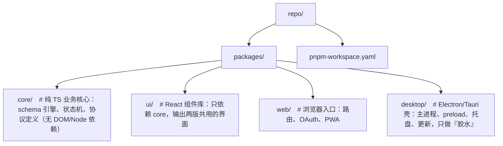
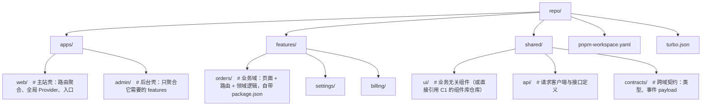

## D. 大型应用架构

A/B/C 三族难在"单点场景做到极致"（编辑器、协同、图形），D 族难在**系统边界**：当一个产品大到需要第三方扩展、多团队并行、嵌入别人页面、甚至离开浏览器运行时，难点就从"某个交互怎么实现"变成"两段互不信任的代码如何共存"。按本篇开头的 React 相关度过滤视图：D1 插件化属于 ② 混合层（架构模式框架无关，但扩展点常用 React context/注册表实现），D2–D6 属于 ③ 基本与 React 无关层——React 只是 UI 壳，这里的知识（沙箱、进程模型、Service Worker、postMessage 协议）换任何框架原样保值。职业匹配上，这一族是"前端基建/平台组"的核心能力栈（D1+D2+D4+E1），也是独立开发者产品交付闭环（D5+E2+D6）的必经之路。

---

### D1. 插件化架构（★★★★☆）

#### 是什么

宿主（host）提供稳定的核心能力与扩展点（extension points），第三方在不动宿主源码的前提下编写插件（extension/plug-in）注入功能——VSCode 的语言支持与主题、Grafana 的自定义面板、Chrome 的扩展，全是这个模式。对你的低代码平台而言，这是注册表模式（《react-进阶大纲-复杂场景.md》§1.2）的架构级放大：注册表解决"平台内部模块怎么解耦"，插件化解决"外部开发者怎么给平台加东西"。

#### 为什么难

难的不是"写插件"，而是"定义边界"：

1. **API 稳定性**：一旦第三方依赖你暴露的接口，任何改动都是破坏性变更，你得像维护开源库一样维护宿主 API。
2. **信任问题**：插件代码质量不可控，一个插件抛异常不能拖死宿主；恶意插件不能拿到宿主的全部能力。
3. **版本组合爆炸**：插件 A 兼容宿主 1.x，插件 B 兼容 2.x，市场里同时存在——你需要一套协议版本机制。
4. **动态性**：插件要能不重新发宿主版本地热插拔，就要解决从哪里加载、如何隔离、如何回滚。

#### 核心技术逐项拆解

**1. 从注册表到 contribution points（声明式扩展点）**

注册表模式的初级形态是命令式 API：插件主动调用 `registry.register('panel', myPanel)`。它能解耦，但有三个致命问题：插件必须**执行代码**才能注册（无法静态分析它做了什么）；宿主无法在加载前**校验**贡献物是否合法；无法基于"是否用到"做惰性加载。

进化答案是 **contribution points（贡献点）声明**：插件用一个静态清单（manifest）声明"我贡献什么"，宿主声明"我接受哪些贡献点"，注册行为由宿主代劳。VSCode 的 `package.json` 就是最经典实现：

```json
{
  "name": "todo-highlight",
  "engines": { "vscode": "^1.75.0" },
  "activationEvents": ["onCommand:todo.openPanel"],
  "main": "./out/extension.js",
  "contributes": {
    "commands": [{ "command": "todo.openPanel", "title": "打开 TODO 面板" }],
    "views": {
      "explorer": [{ "id": "todo.tree", "name": "TODO 列表" }]
    },
    "configuration": {
      "properties": { "todo.keywords": { "type": "array", "default": ["TODO", "FIXME"] } }
    }
  }
}
```

读法：`contributes` 下每个键（commands/views/configuration/menus…）就是一个**扩展点**；值必须符合该扩展点定义的 JSON Schema，宿主装插件时先 schema 校验、再逐点注册；`activationEvents` 声明何时才真正执行 `main`（`onCommand:` 表示用户第一次触发该命令才激活）——不用的插件零成本。

Grafana 同理，每个插件的 `plugin.json` 里 `type: "panel"` 声明自己贡献的是"面板"扩展点，`dependencies.grafanaVersion` 声明兼容的宿主版本：

```json
{
  "type": "panel",
  "id": "acme-barchart",
  "name": "Acme Bar Chart",
  "info": { "version": "1.2.0" },
  "dependencies": { "grafanaVersion": ">=10.0.0", "plugins": [] }
}
```

对比一下两代方案的能力差异：

| 维度 | 命令式注册表 | contribution points |
|---|---|---|
| 注册时机 | 插件代码执行时 | 安装时由宿主读取清单 |
| 静态校验 | 做不到 | JSON Schema 校验贡献物 |
| 惰性激活 | 做不到（必须先执行才能注册） | activationEvents 按需激活 |
| 市场审核/搜索 | 无法机器识别插件能力 | 清单即机器可读的能力描述 |
| 安全 | 插件一运行就拿到运行时 | 可先审清单再决定放行 |

**2. 宿主 API 暴露与能力权限模型**

铁律：插件永远不直接接触宿主内部对象（不暴露 window 上的任意属性、不传 React context 原始对象）。宿主暴露的是一个**命名空间化、按权限裁剪的 API 面**：插件在清单里声明要什么权限（如 `"permissions": ["storage", "network"]`），宿主按声明注入子集——没申请的能力在插件里 `undefined`。这与浏览器扩展、Android App 的权限模型同构。最小实现思路：

```ts
function createHostAPI(permissions: Permission[]): HostAPI {
  const has = (p: Permission) => permissions.includes(p);
  // 返回的对象冻结，且未授权能力直接不存在，而不是抛错——让越权代码尽早 TypeError
  return Object.freeze({
    log: console.log,
    ...(has('storage') ? { storage: createStorageNamespace() } : {}),
    ...(has('network') ? { fetch: limitedFetch } : {}),
    ...(has('notify') ? { notify: showNotification } : {}),
  });
}
```

**3. 生命周期钩子**

标准三段：`activate`（激活，收到 PluginContext）/ `deactivate`（卸载，清理副作用）/ 中间所有注册物挂到 `ctx.subscriptions`，卸载时统一 dispose——这是 VSCode `context.subscriptions` 的做法，把"清理"从插件的自觉变成宿主的机制：

```ts
ctx.subscriptions.push(api.registerMaterial(meta, comp));
// deactivate 时宿主遍历 subscriptions 逐个 dispose，插件忘了清也不泄漏
```

**4. 插件动态加载：CDN ESM vs 构建期动态 import**

| 方案 | 做法 | 优点 | 缺点 |
|---|---|---|---|
| 构建期动态 `import()` | 插件代码在宿主仓库里，`import('./plugins/chart')` | 类型完整、无网络问题 | 加新插件必须重发宿主，第三方无法参与 |
| CDN ESM | 清单里给 `entry: 'https://cdn.acme.com/chart-panel@1.2.0/index.js'`，运行时 `import(/* @vite-ignore */ url)` | 真正的开放生态，热更新插件 | 版本漂移、CDN 可用性、供应链安全（需 SRI/域名白名单） |

```ts
function withTimeout<T>(p: Promise<T>, ms: number, msg: string): Promise<T> {
  return Promise.race([p, new Promise<never>((_, rej) => setTimeout(() => rej(new Error(msg)), ms))]);
}

export async function loadPlugin(manifest: PluginManifest): Promise<PluginModule> {
  // @vite-ignore：告诉打包器别在构建期解析这个 URL，它是运行时才确定的
  const mod = await withTimeout(
    import(/* @vite-ignore */ manifest.entry),
    8000,
    `插件 ${manifest.id} 加载超时`,
  );
  if (typeof mod.activate !== 'function') throw new Error(`${manifest.id} 缺少 activate 导出`);
  return mod;
}
```

**5. 插件失败降级**

四层防线，一层层兜：加载层超时（上面的 `withTimeout`）；激活层 try/catch，单个插件激活失败只记录、不阻断宿主启动；渲染层给每个"插件贡献的 React 组件"包 Error Boundary，崩了只是那块区域消失；运营层留 kill switch——市场下架 + 宿主远程配置拉黑，已安装的插件也加载不进来。

```tsx
import { Component, type ReactNode } from 'react';

export class PluginBoundary extends Component<{ name: string; children: ReactNode }, { failed: boolean }> {
  state = { failed: false };
  static getDerivedStateFromError() {
    return { failed: true }; // 渲染降级：不再渲染这个插件的贡献物
  }
  componentDidCatch(err: unknown) {
    console.error(`[plugin:${this.props.name}]`, err); // 真实场景：上报插件市场，自动禁用
  }
  render() {
    return this.state.failed ? null : this.props.children;
  }
}
```

**6. 插件市场与版本兼容（与协议版本迁移的关系）**

关键认知：**清单里的 contributes 结构本身就是一份协议**（与低代码 Schema 协议同地位）。宿主给扩展点加一个必填字段，等价于 Schema 协议的 breaking change——处理手法完全复用协议版本迁移那套：宿主引擎版本 `semver` 化，插件清单用 `engine` 字段声明兼容范围，安装期校验：

```ts
import { satisfies } from 'semver';

const HOST_VERSION = '1.4.2';
export function assertCompatible(manifest: PluginManifest) {
  if (!satisfies(HOST_VERSION, manifest.engine)) {
    throw new Error(`插件 ${manifest.id} 声明兼容宿主 ${manifest.engine}，当前 ${HOST_VERSION}`);
  }
}
```

升级时提供 `migrate(manifest, fromVersion)` 迁移函数 + 市场侧按宿主版本过滤可装列表，避免"新宿主装旧插件静默坏掉"。

**7. 一个迷你插件系统接口设计（可直接当低代码平台的起点）**

```ts
import type { ComponentType } from 'react';

/** 插件清单：声明"我是谁、我贡献什么、我要什么权限、从哪加载" */
export interface PluginManifest {
  id: string;                 // 全局唯一，如 'com.acme.chart-panel'
  name: string;
  version: string;            // semver
  engine: string;             // 兼容的宿主版本范围，如 '^1.2.0'
  entry: string;              // ESM 入口 URL（CDN）
  activationEvents: string[]; // 惰性激活条件，如 ['onView:dashboard']
  permissions: Permission[];  // 能力权限申请
  contributes: Contributions; // 声明式扩展点贡献
}

export type Permission = 'storage' | 'network' | 'notify';

/** 插件可贡献的扩展点（低代码语境：物料/面板/Setter/命令/菜单） */
export interface Contributions {
  materials?: MaterialMeta[];   // 新物料（组件 + 物料描述协议）
  panels?: PanelMeta[];         // 新面板（编辑器左侧/右侧区域）
  setters?: SetterMeta[];       // 新属性设置器（进阶大纲 §3 的 Setter 体系）
  commands?: CommandMeta[];     // 命令面板项
  menu?: MenuItemContribution[];
}

/** 扩展点定义：宿主声明"我接受哪些贡献"，带 schema 校验与注册逻辑 */
export interface ContributionPointDefinition {
  id: string; // 如 'panels'
  jsonSchema: object;
  register(target: unknown, contribution: unknown, ctx: PluginContext): Disposable;
}

/** 宿主暴露给插件的 API 面（按 permissions 裁剪后注入，Object.freeze） */
export interface HostAPI {
  registerMaterial(meta: MaterialMeta, comp: ComponentType): Disposable;
  log(level: 'info' | 'warn' | 'error', msg: string): void;
  storage: { get<T>(key: string): Promise<T | undefined>; set(key: string, value: unknown): Promise<void> };
  fetch: typeof fetch;
}

export interface Disposable { dispose(): void }

/** 激活时注入的上下文 */
export interface PluginContext {
  pluginId: string;
  api: HostAPI;
  subscriptions: Disposable[]; // deactivate 时宿主统一 dispose
}

/** 插件模块：唯一的代码级约定 */
export interface PluginModule {
  activate(ctx: PluginContext): void | Promise<void>;
  deactivate?(): void | Promise<void>;
}

/** 宿主管理器：装清单、管生命周期、收错误 */
export interface PluginHost {
  registerPoint(def: ContributionPointDefinition): void;
  install(manifest: PluginManifest): Promise<void>;   // 校验 engine + schema → 存清单（可能不激活）
  activate(id: string): Promise<void>;                // 触发条件满足时才 import(entry)
  deactivate(id: string): Promise<void>;              // dispose 全部 subscriptions + 调 deactivate
  onPluginError(cb: (id: string, err: unknown) => void): Disposable;
}
```

#### 代表

VSCode（插件市场的天花板）、Grafana（面板/数据源两类扩展点）、Obsidian（社区插件 1000+）；国内低代码平台（宜搭、简道云）的"自定义组件/插件"生态同构。

#### 入手路径

给第 6 章低代码平台做插件系统：先做"第三方可注册新物料与新面板"——清单只声明 `materials` 和 `panels` 两个扩展点就够第一版；跑通后再加 permissions、activationEvents 与市场审核。

#### 常见坑

- 一上来就把宿主所有内部函数塞给插件（`api: window`）——之后每一次内部重构都是生态灾难。
- 忘了 activationEvents，装了 50 个插件启动全量 import，宿主首屏被拖垮。
- 扩展点结构没 schema 校验，一个插件写了 `{ title: 123 }`，渲染时才炸，排查到怀疑人生。
- deactivate 不 dispose：热卸载插件后事件监听还在，越用越卡——subscriptions 机制就是防这个的。
- CDN 插件无版本锁定（`entry` 不带精确版本号），第三方今天发版你的平台今天就变灰。

---

### D2. 微前端（★★★☆☆ 概念多、踩坑多）

#### 是什么

把一个大前端应用拆成多个可**独立开发、独立部署、独立技术栈**的子应用，运行时由主应用（基座）组合成一个整体。与 monorepo 的区别：monorepo 解决"源码组织"，微前端解决"运行时集成与团队自治"。

#### 为什么难

难在"多个本该独立运行的完整应用被塞进同一个页面"：它们共享同一个 `window`、同一个 DOM 树、同一个地址栏——全局变量互相覆盖、样式互相污染、路由互相打架、React 版本冲突，每一项都要靠沙箱机制硬隔离出来。

#### 核心技术逐项拆解

**1. qiankun 的 proxy JS 沙箱：为什么直接跑子应用会污染 window**

子应用本质是一段假定"整个页面只有我"的 JS。直接 `eval` 执行它，污染立刻发生：

- 子应用打包器把公共库挂全局：`window.$ = jQuery`。子应用 A 卸载后，宿主或子应用 B 读 `window.$`，拿到的是**A 遗留的那个版本**。
- 子应用写 `window.__APP_STATE__ = {...}`，两个子应用用了同一个变量名，后装的覆盖先装的。
- 最隐蔽的一类：子应用通过 `window.__POWERED_BY_QIANKUN__` 判断运行环境（qiankun 约定的注入标记），如果沙箱没把这个变量伪装好，子应用会按"独立运行"打包出**第二份 React**——两个 React runtime 同页，hooks 直接报 "Invalid hook call"。
- `document.querySelector('#app').innerHTML = ...`、卸载后仍在跑的 `setInterval`，是 DOM 与定时器维度的同类污染。

**第一代：快照沙箱（SnapshotSandbox）**——给不支持 `Proxy` 的老浏览器用，思路是"先拍照，卸载时 diff 还原"：

```ts
// 简化自 qiankun 的 SnapshotSandbox：只能单实例（一个时刻只有一个子应用激活）
class MiniSnapshotSandbox {
  private rawSnapshot = new Map<PropertyKey, unknown>(); // 宿主 window 原始状态
  private modifyMap = new Map<PropertyKey, unknown>();  // 子应用本轮的修改

  activate() {
    // 1) 激活前拍全量快照
    for (const k of Object.getOwnPropertyNames(window)) this.rawSnapshot.set(k, (window as any)[k]);
    // 2) 回放上次修改：恢复这个子应用的"世界观"
    this.modifyMap.forEach((v, k) => ((window as any)[k] = v));
  }

  deactivate() {
    // 3) diff：凡与快照不一致的都是子应用的修改——记下来，并把 window 还原给宿主
    for (const k of Object.getOwnPropertyNames(window)) {
      if ((window as any)[k] !== this.rawSnapshot.get(k)) {
        this.modifyMap.set(k, (window as any)[k]);
        (window as any)[k] = this.rawSnapshot.get(k);
      }
    }
  }
}
```

缺陷显而易见：每次切换要遍历整个 window（O(全部属性)）、无法多实例（两个子应用同时激活时快照互相覆盖）、子应用读不到"宿主没改过的属性属于谁"。中间还有一代 LegacySandbox（单实例但用 Proxy 记录新增/修改集合，减少 diff 成本），真正成熟的是：

**第二代：代理沙箱（ProxySandbox）**——给每个子应用发一个"假 window"：

```ts
// 简化自 qiankun 的 ProxySandbox：支持多实例，每个子应用一个 fakeWindow
class MiniProxySandbox {
  private fakeWindow: Record<PropertyKey, unknown> = {};
  proxy: WindowProxy;

  constructor() {
    const fakeWindow = this.fakeWindow;
    this.proxy = new Proxy(fakeWindow, {
      set(target, prop: string, value) {
        target[prop] = value; // 子应用写 window.xxx —— 全部落进 fakeWindow，真实 window 纹丝不动
        return true;
      },
      get(target, prop: string) {
        if (prop in target) return target[prop]; // 先读自己的
        const raw = (window as any)[prop];       // 再只读穿透到真实 window（读宿主的 React、document）
        return typeof raw === 'function' && !raw.prototype ? raw.bind(window) : raw; // 防 this 丢失
      },
      has(target, prop) {
        return prop in target || prop in window; // 让 'xxx' in window、with 语法正常工作
      },
    });
  }
}
```

子应用代码怎么"以为"自己在用真 window？qiankun 在 `getExecutableScript` 里把子应用入口代码包一层再 eval（简化版）：

```ts
// (function(window, self, globalThis){ 子应用代码 }).call(proxy, proxy, proxy, proxy)
// —— 子应用里所有裸的 window/self/globalThis 引用，实际拿到的都是 proxy
const wrapped = `(function(window, self, globalThis){\n${appCode}\n}).call(proxy, proxy, proxy, proxy);`;
(0, window.eval)(wrapped);
```

两代对比与适用场景：

| | SnapshotSandbox | ProxySandbox |
|---|---|---|
| 依赖 | 无（兼容 IE 等老环境） | `Proxy`（现代浏览器标配） |
| 隔离方式 | 事后还原（污染了再擦） | 事前拦截（根本碰不到真 window） |
| 实例数 | 只能单实例 | 每个应用独立 fakeWindow，**多实例并存**（同屏两个子应用互不可见对方的写入） |
| 性能 | 每次切换 O(window 全量 key) | 激活/卸载零成本（记录天然存在 fakeWindow 里，还能跨卸载保留状态） |

多实例不只是"同屏两个应用"：还有"同一个应用 keep-alive 式卸载重挂"——ProxySandbox 的 fakeWindow 在卸载后保留，重挂时子应用的全局状态还在，这是快照沙箱做不到的体验。

**2. qiankun 的样式隔离**

- `strictStyleIsolation: true`：把子应用容器套进 Shadow DOM，最强隔离；但 antd 的 Modal/Tooltip 这类 `createPortal` 到 `document.body` 的弹层会逃出 Shadow 根、瞬间裸奔（样式全丢），实战几乎不敢开。
- `experimentalStyleIsolation: true`：运行时给子应用样式规则改写选择器加作用域前缀（`div[data-qiankun="app-name"] .btn { ... }`），同时给容器加 `data-qiankun` 属性；解决"子应用污染宿主"，但解决不了"宿主的全局 reset 污染子应用"，且对 `@keyframes`、动态插入样式的改写有遗漏场景。

**3. qiankun 基本使用（看清沙箱开关在哪）**

```ts
import { registerMicroApps, start } from 'qiankun';

registerMicroApps(
  [
    {
      name: 'react-app',
      entry: '//localhost:7101',      // 子应用独立部署的地址
      container: '#subapp',           // 挂载点
      activeRule: '/react',           // 路由匹配规则：qiankun 拦截路由做分发
      props: { token: 'xxx' },        // 主→子通信：注入 props
    },
    { name: 'vue-app', entry: '//localhost:7102', container: '#subapp', activeRule: '/vue' },
  ],
  {
    beforeLoad: [(app) => console.log(`${app.name} 加载前`)],
    afterUnmount: [(app) => console.log(`${app.name} 已卸载`)],
  },
);

start({
  sandbox: { experimentalStyleIsolation: true }, // JS 沙箱默认开启（Proxy 优先，降级快照）
  prefetch: 'all',                               // 空闲时预取子应用资源，切换秒开
});
```

子应用侧只需导出三个生命周期（以 React 为例）：

```tsx
import ReactDOM from 'react-dom/client';
import App from './App';

let root: ReactDOM.Root | null = null;

export async function bootstrap() {}
export async function mount(props: { container?: HTMLElement }) {
  const el = props.container?.querySelector('#root') ?? document.getElementById('root');
  root = ReactDOM.createRoot(el!);
  root.render(<App />);
}
export async function unmount() {
  root?.unmount(); // 卸载必须干净：不留 DOM、不留监听，配合沙箱不留全局
  root = null;
}
```

**4. wujie：iframe + WebComponent 的另一条路**

qiankun 用 Proxy "骗"子应用，wujie 换思路：**JS 跑在真 iframe 里**（浏览器原生最强 JS 隔离，window/history/定时器全是自己独立的，天然多实例、天然支持不规范的老代码），**DOM 渲染到 WebComponent（自定义元素 + Shadow DOM）里**——iframe 内的 document 与 Shadow 容器之间由 wujie 做投递渲染，用户看到的 DOM 树仍在主文档中（可调试、可 SEO 相对友好）。代价是 iframe 与主文档之间的一切交互（事件、路由、样式变量）都要经过一层桥接，心智成本在"通信协议"而非"沙箱补丁"。React 基座里的用法：

```tsx
import WujieReact from 'wujie-react';

// alive: keep-alive 模式，切换回来不重挂；degrade: 浏览器不支持时降级为纯 iframe
<WujieReact name="vue-app" url="//localhost:7102" alive degrade />
```

**5. Module Federation：运行时共享依赖**

qiankun/wujie 解决"隔离"，Module Federation（webpack 5 内置）解决**共享**：A 应用在运行时 import B 应用构建产物里的模块，且双方声明 `shared` 的依赖（react/react-dom）只加载一份：

```ts
// 子应用 dashboard 的 webpack 配置：把自己暴露出去
import { ModuleFederationPlugin } from 'webpack';

new ModuleFederationPlugin({
  name: 'dashboard',
  filename: 'remoteEntry.js', // 构建产物入口，部署到 CDN
  exposes: { './Dashboard': './src/Dashboard' },
  shared: { react: { singleton: true, requiredVersion: '18' }, 'react-dom': { singleton: true, requiredVersion: '18' } },
});

// 主应用：声明远端与同样的 shared
new ModuleFederationPlugin({
  remotes: { dashboard: 'dashboard@https://cdn.example.com/dashboard/remoteEntry.js' },
  shared: { react: { singleton: true, requiredVersion: '18' }, 'react-dom': { singleton: true, requiredVersion: '18' } },
});
```

运行时机制：`remoteEntry.js` 加载后把自己注册进共享作用域（`__webpack_share_scopes__`）；主应用消费远端模块前先初始化共享作用域，双方**协商** react 版本——`singleton: true` 表示全页只允许一份 React（第二份直接复用不加载），这正是避免 "Invalid hook call" 的关键；版本不满足 requiredVersion 时会告警并按语义降级。

**6. 路由分发、应用通信、公共依赖治理、部署独立**

- 路由分发：基座监听路由变化，按 `activeRule` 加载/卸载子应用；子应用内部路由要约定"带前缀"（`/react/xxx`），避免互相覆盖。hash 与 history 模式的监听劫持策略不同，qiankun 已代劳。
- 通信——事件总线 vs 共享 store：

```ts
// 方案 A：qiankun 内置的全局状态（本质是发布订阅）
import { initGlobalState } from 'qiankun';
const actions = initGlobalState({ user: null });
actions.onGlobalStateChange((state, prev) => console.log('变化', state));
actions.setGlobalState({ user: { name: 'yd' } }); // 主子通用，跨技术栈

// 方案 B：框架无关事件总线（CustomEvent，React/Vue/原生子应用都能用）
const bus = new EventTarget();
bus.dispatchEvent(new CustomEvent('user:login', { detail: { name: 'yd' } }));
bus.addEventListener('user:login', (e) => console.log((e as CustomEvent).detail));
```

取舍：事件总线松耦合但"谁在监听、何时触发"全靠约定，链路长了不可追踪；共享 store（qiankun 全局状态或直接把 Redux/Zustand 实例通过 props 注入）数据可观测，但制造了运行时耦合，子应用脱离基座单跑时要 mock。实践：**高频共享状态（用户/主题）用注入 props，一次性通知用事件**。
- 公共依赖治理：目标"同页只有一份 react/react-dom"。手段排序：MF shared singleton > externals + CDN（import maps 统一地址，见 D4）> qiankun 配 `excludeAssetFilter` 放行公共 CDN 脚本。版本不齐时（子 A 用 React 17、子 B 用 18）接受双份并存，但绝不能让一份 React 被两个应用共享 DOM 渲染上下文。
- 部署独立：每个子应用独立仓库/流水线/CDN 目录，基座只依赖 `remoteEntry.js`/entry HTML 的**稳定 URL**；基座发版与子应用发版解耦，这才是微前端的组织收益。

**7. 反向知识：什么时候不该用微前端（反决策清单）**

1. **前端团队 ≤ 2 个**：微前端的核心收益是"组织并行"，没有多团队自治的诉求，付出的复杂度全是纯损耗。
2. **技术栈统一且没打算换**：统一栈下 monorepo + 路由级懒加载（`React.lazy(() => import('./routes/heavy'))`）已经拿到"按需加载、模块边界清晰"的全部好处，且无沙箱成本。
3. **想解决"构建太慢"**：那是构建工具问题——上 Rspack/Turbopack、远程缓存、增量编译；拆运行时是治错了病。
4. **想解决"代码太乱"**：代码乱靠模块边界与 lint 治理；微前端只会把烂代码连人一起分装进黑盒，跨应用排查更痛。
5. **应用间状态/组件高度共享**（仪表台、同一产品的多页签）：共享边界越多，沙箱越是反向阻力——每个共享物都要设计跨应用协议，等于自建分布式系统的通信成本。
6. **不能接受首屏瀑布**：基座 → 子应用 entry → 子应用 chunk 三级串行加载，即使有 prefetch，弱网下白屏时间显著高于单体。

什么时候该用：≥3 个团队各自有发版节奏、技术栈异构（React + Vue + 遗留 jQuery）、需要把巨型遗留系统增量迁移（新功能用新栈写、老页面按路由逐个搬）。**先证明 monorepo + 路由分包不够用，再上微前端。**

#### 代表

qiankun（蚂蚁，国内事实标准）、wujie（腾讯）、Module Federation（webpack 5 / rspack / vite 对应生态 federation 实现）、无界与 single-spa（qiankun 底层）。

#### 入手路径

主应用 + 两个子应用（React/Vue 各一），打通四件事：路由分发、initGlobalState 通信、MF shared 的 react 单例、独立 `npm run deploy` 各发各的。做完刻意制造一次"全局变量污染"（子应用里裸写 `window.foo`），观察两种沙箱下卸载后的表现差异。

#### 常见坑

- 子应用 `publicPath` 没改，静态资源 404——qiankun 注入 `window.__INJECTED_PUBLIC_PATH_BY_QIANKUN__`，子应用构建时需把 `__webpack_public_path__` 指到它。
- antd 弹层在 `strictStyleIsolation` 下裸奔（见上文），最终都退回 `experimentalStyleIsolation`。
- 两个子应用各带一份 React 但共用了同一个 DOM 容器做 Portal，事件系统错乱——共享必须显式设计，不会"自动没事"。
- 忘了处理子应用卸载后的 `setInterval`/全局监听，内存随切换次数线性上涨。
- 把微前端当"架构洁癖"引入小团队，三个月后没人说得清路由分发规则——先过反决策清单。

---

### D3. 嵌入式第三方 Widget（★★★☆☆）

#### 是什么

把你的产品以一小块 UI 的形式嵌进**别人的任意网页**：Intercom 的客服气泡、Stripe 的支付按钮、Disqus 评论框。宿主页面技术栈未知（可能是 jQuery 老站、可能是 Vue），你只有一个 `<script>` 标签的机会。

#### 为什么难

你的一段代码要进入一个完全不受控的环境：宿主 CSS 可能污染你（全局 `* { margin:0 }`、`!important` 满天飞），你的 CSS 也可能污染宿主；宿主可能与你的 Widget 跨域，一切通信只能 postMessage；同一页面可能被嵌入多个实例；还要面对"宿主页面本身就慢/挂了/断网"的现实。

#### 核心技术逐项拆解

**1. `<script>` 注入与渐进初始化时序**

标准做法是"一行安装码 + 命令队列"：安装码极小（同步内联，不阻塞页面），先把用户调用排进队列，异步拉起真正的 SDK 后再重放——analytics.js 系的经典套路：

```html
<script>
  // 1) 暴露一个"假 API"：SDK 未就绪时只入队
  window.AcmeWidget = window.AcmeWidget || function () {
    (window.AcmeWidget.q = window.AcmeWidget.q || []).push(arguments);
  };
  window.AcmeWidget('init', { appId: 'app_123', theme: 'dark' }); // 立刻可调用，不报错

  // 2) 异步注入真正的 SDK（defer 语义，不阻塞宿主首屏）
  (function (d, t) {
    var s = d.createElement(t);
    s.async = true;
    s.src = 'https://widget.acme.com/v1/boot.js';
    s.onload = function () {
      // 3) SDK 就绪：重放队列，并把 AcmeWidget 替换成真实现
      var q = window.AcmeWidget.q || [];
      window.AcmeWidget = AcmeWidgetSDK.default;
      q.forEach(function (args) { window.AcmeWidget.apply(null, args); });
    };
    d.body.appendChild(s);
  })(document, 'script');
</script>
```

要点：假 API 必须在 SDK 之前定义且签名一致；SDK 失败时队列保留（弱网降级一节会用到）；所有初始化参数（appId/theme/回调）都从这行 script 或队列传入，宿主不需要任何构建工具。

**2. Shadow DOM 样式隔离：能隔离什么、不能隔离什么**

Widget UI 渲染进 `element.attachShadow({ mode: 'open' })` 里，自定义元素作为边界。能隔离的：**选择器互不穿透**——宿主的 `.btn { }`、`* { box-sizing }` 进不来（外部只能命中 `:host` 元素本身），你的 `.btn` 也跑不出去污染宿主。不能隔离的，必须心里有数：

- **可继承属性会穿透进来**：宿主 `body { color: red; font-size: 12px }` 会一路继承到 Shadow 内部所有未显式声明的元素。解法：`:host { all: initial; }` 先切断全部继承，再按需重建。
- **CSS 自定义属性穿透**：`--x` 定义在宿主 `:root`，Shadow 内 `var(--x)` 读得到——"挡不住"在这里反而是特性：用它做宿主换肤通道（下文）。
- 宿主对 Widget **容器元素**本身的操作：直接给你的 host 元素设 `display:none`、改 `zoom`、监听它的事件，Shadow DOM 管不了。
- 焦点/tab 顺序/表单提交仍属于整份文档，无法独立。

```ts
class AcmeChat extends HTMLElement {
  connectedCallback() {
    const shadow = this.attachShadow({ mode: 'open' });
    const style = document.createElement('style');
    style.textContent = `
      /* all: initial 切断宿主可继承样式；具体值显式重建 */
      :host { all: initial; display: block; font: 14px/1.5 var(--widget-font, system-ui, sans-serif); }
      .bubble { background: var(--widget-primary, #1677ff); color: var(--widget-on-primary, #fff);
                border-radius: 12px; padding: 8px 12px; }
    `;
    const panel = document.createElement('div');
    panel.className = 'bubble';
    panel.textContent = '你好';
    shadow.append(style, panel);
  }
}
customElements.define('acme-chat', AcmeChat);
```

**3. postMessage 协议设计（origin 白名单、握手、token 流转）**

Widget 主体跑在自家域的 iframe 里（JS 沙箱 + Cookie 隔离），与宿主页只剩 postMessage 一条通道。裸发字符串必然演化成灾难，必须一开始就定**带版本的信封协议**：

```ts
interface Envelope<T extends string, P> {
  v: 1;          // 协议版本：破坏性变更升 v，新旧协议可判定不兼容
  type: T;       // 消息类型字面量联合
  payload: P;
  seq?: number;  // 请求-响应配对号
}

type WidgetToHost =
  | Envelope<'handshake:init', { widgetId: string; protocol: 1 }>
  | Envelope<'handshake:ready', { instanceId: string }>
  | Envelope<'unread:change', { count: number }>
  | Envelope<'resize', { height: number }>;   // iframe 高度自适应

type HostToWidget =
  | Envelope<'handshake:ack', { theme: Record<string, string>; token: string }>
  | Envelope<'token:refresh', { token: string; expiresIn: number }>
  | Envelope<'theme:update', { theme: Record<string, string> }>
  | Envelope<'command:open', { conversationId: string }>;
```

宿主侧收消息，**第一行永远是 origin 校验**，不做校验等于把消息面暴露给任意页面：

```ts
const WIDGET_ORIGIN = 'https://widget.acme.com'; // 私有部署场景的白名单可以是数组

window.addEventListener('message', (e: MessageEvent<Envelope<string, unknown>>) => {
  if (e.origin !== WIDGET_ORIGIN) return;      // 1) origin 白名单
  if (e.data?.v !== 1) return;                 // 2) 协议版本过滤
  switch (e.data.type) {
    case 'handshake:init':                     // 3) 握手：确认对面是我们创建的那个 iframe
      if (e.source !== iframeEl.contentWindow) return;
      iframeEl.contentWindow?.postMessage(
        { v: 1, type: 'handshake:ack', payload: { theme: readCssVars(), token: issueSessionToken() } },
        WIDGET_ORIGIN,                          // 4) 发送也永远带目标 origin，不用 '*'
      );
      break;
    case 'resize': iframeEl.style.height = `${(e.data.payload as any).height}px`; break;
  }
});
```

token 流转链路：宿主页持有长期凭证（apiKey），iframe 加载 URL 时把一次性短期 token 放 **URL fragment**（`https://widget.acme.com/v1/frame#t=xxx`——fragment 不会出现在服务端日志与 Referer 中）；iframe 内用该 token 换会话；过期前由宿主经 `token:refresh` 消息续期。iframe 里**永不存储**长期密钥。开放嵌入（任意网站可装）与私有嵌入（仅自家域名）的区别在第一步：后者直接 origin 白名单硬校验；前者白名单不适用（宿主 origin 无限集），改为 token 里携带注册时绑定的域名声明，由 Widget 后端校验请求方 Referer/origin 与之一致。

**4. 多实例**

同一页面嵌两个 Widget（售前聊天 + 订单查询）：每个实例独立 `instanceId`（安装码生成 `Math.random().toString(36).slice(2)` 传入）；iframe 的 name 与 postMessage 的 seq 都带 instanceId 命名空间；宿主侧用一个 manager 按实例分发消息；Shadow DOM 自定义元素天然支持多实例（每个元素自己的 shadow root）。

**5. 宿主样式变量注入换肤**

利用"CSS 自定义属性能穿透 Shadow DOM"这一规则，把主题定义为变量契约，宿主只需声明变量即完成换肤，无需重新加载 Widget：

```html
<!-- 宿主页 -->
<style>
  :root {
    --widget-primary: #722ed1;
    --widget-font: Georgia, serif;
  }
</style>
<!-- 换肤 = 改变量；iframe 场景则由宿主发 theme:update，iframe 内 setProperty -->
<script>
  AcmeWidget('setTheme', { 'widget-primary': '#13c2c2' }); // 走协议消息，iframe 内 document.documentElement.style.setProperty(k, v)
</script>
```

契约（变量名清单 + 默认值）要写进接入文档，且 Widget 内每个 `var()` 都带 fallback（`var(--widget-primary, #1677ff)`），保证零配置也不裸奔。

**6. 弱网与宿主异常降级**

- SDK script 加载设 5s 超时：超时后重试一次（指数退避），再失败则渲染一个普通 `<a>`（mailto 链接或跳转兜底页），保证功能可达。
- iframe 内首帧给骨架屏；`navigator.connection.saveData === true` 时不加载头像等非关键图。
- 一切对外回调包 try/catch：宿主的回调抛异常不能中断 Widget 主流程。
- 队列（第 1 步的 `q`）持久化到 `sessionStorage`：宿主 SPA 路由切换重装 Widget 时，未完成的初始化指令不丢。

#### 代表

Intercom、Stripe（Payment Element/按钮）、Disqus、各类地图/表单/客服挂件。

#### 入手路径

做一个可嵌任意网站的聊天挂件 npm 包：安装码 → 自定义元素 + Shadow DOM 渲染 UI → iframe 加载真实会话逻辑 → 定信封协议（handshake/resize/theme 三条消息起步）→ 用一个"故意全局样式很脏"的测试页验证隔离。

#### 常见坑

- 收 message 不校验 `e.origin`、发送用 `'*'`——任何第三方页面都能伪造 Widget 消息驱动你的 UI。
- token 放 query string：进日志、进 Referer，泄露面失控；应走 fragment 或 postMessage。
- 忘了 `all: initial`，Widget 在"宿主全局改了 line-height"的页面上排版崩坏，用户以为是你坏了。
- iframe 高度写死，内容溢出被裁——必须有 `resize` 消息做自适应。
- 安装码同步拉 SDK（没走队列 + async），拖慢宿主首屏，接入方直接卸载你。

---

### D4. 浏览器内构建与运行（★★★★★）——在线 IDE 的底座

#### 是什么

CodeSandbox / StackBlitz 这类产品把"写代码 → 装依赖 → 编译 → 预览"整个前端工程链路搬进浏览器：不租服务器、毫秒级启动、天然多租户隔离。它是在线 IDE、组件文档 playground、低代码"实时预览用户自定义逻辑"的共同底座，也是进阶大纲 §5 JSON 编辑器与 §6.7"安全执行用户 JS"的集大成延伸——那里解决"单段代码的编辑与沙箱"，这里解决"整个工程在浏览器里的构建与运行"。

#### 为什么难

浏览器没有 npm、没有 Node、没有磁盘：`import App from './App'` 这个裸说明符浏览器不认识；TSX 必须编译；node_modules 动辄几十 MB；编译结果要能互相引用；预览的任意代码必须被关进笼子；编译错误还要精准透传回编辑器。每一环都要自建机制。

#### 核心技术逐项拆解

**1. sandpack：CodeSandbox 的开源方案及其能力边界**

sandpack（`@codesandbox/sandpack-react`）把"编辑器 + 编译 + 预览 iframe"封装成组件，是做 playground 性价比最高的起点：

```tsx
import { Sandpack } from '@codesandbox/sandpack-react';

export default function Playground() {
  return (
    <Sandpack
      template="react"                          // 预置模板：react/vite/react-ts 等
      files={{ '/App.js': { code: 'export default () => <h1>hi</h1>' } }}
      options={{ showNavigator: false, editorHeight: 420 }}
    />
  );
}
```

能力边界要认清：依赖预编译依赖 CodeSandbox 官方 bundler 服务（首次联网编译 npm 依赖，之后浏览器缓存），所以完全离线/私有化场景不成立；只支持其运行时能模拟的包——依赖 Node 原生模块、需要执行任意构建插件（自定义 webpack loader、postcss 配置全家桶）的工程跑不了；模板之外的复杂工程结构（monorepo、SSR）超出设计目标。结论：组件 playground/教学/demo 足够，做"真 IDE"就要往下看自研链路。

**2. esbuild-wasm：浏览器里的编译器**

esbuild 编译成 WASM 后可在浏览器执行（比 Go 原生版慢一个量级，但仍是 JS 系编译器里最快的梯队）。`transform` 做单文件转译，`build` + 虚拟插件做整包打包：

```ts
import * as esbuild from 'esbuild-wasm';

// 一次性初始化：加载 wasm 二进制（建议自托管并锁定版本）
await esbuild.initialize({ wasmURL: 'https://cdn.acme.com/esbuild-wasm@0.25.0/esbuild.wasm' });

// 单文件转译：TSX → 浏览器可直接执行的 ESM
const out = await esbuild.transform('const x: number = 1', { loader: 'tsx', format: 'esm' });
console.log(out.code);
```

**3. 虚拟文件系统（VFS）**

用内存里的 `Map<path, code>` 代替磁盘，提供 `write/read/resolve` 三原语；`resolve` 负责 `'./Button'` → `'/src/Button.tsx'` 的裸路径补全（目录拼接 + 扩展名探测）：

```ts
interface VFile { code: string }

class VirtualFS {
  private files = new Map<string, VFile>();

  write(path: string, code: string) { this.files.set(path, { code }); }
  read(path: string) { return this.files.get(path); }

  // from '/src/App.tsx' 引用 './Button' → 依次探测 /src/Button、/src/Button.tsx、/src/Button/index.tsx
  resolve(from: string, spec: string): string | null {
    if (this.files.has(spec)) return spec; // 绝对路径直接命中
    const dir = from.slice(0, from.lastIndexOf('/'));
    const joined = new URL(spec, `http://vfs${dir}/`).pathname;
    for (const cand of [joined, `${joined}.tsx`, `${joined}.ts`, `${joined}/index.tsx`]) {
      if (this.files.has(cand)) return cand;
    }
    return null;
  }
}
```

**4. esbuild-wasm + VFS 打通：把工程打成浏览器可执行的一个 bundle**

```ts
import * as esbuild from 'esbuild-wasm';

async function bundle(vfs: VirtualFS, entry: string): Promise<string> {
  const result = await esbuild.build({
    entryPoints: [entry],
    bundle: true,
    format: 'esm',
    write: false, // 产物留在内存，不落盘（也没有盘可落）
    plugins: [{
      name: 'vfs',
      setup(build) {
        // http(s) 依赖走 external，交给 import maps（下一步）在浏览器里解析
        build.onResolve({ filter: /^https?:\/\// }, (args) => ({ path: args.path, external: true }));
        // 其余说明符全部解析进 VFS 命名空间
        build.onResolve({ filter: /.*/ }, (args) => {
          if (args.namespace === 'vfs') {
            const resolved = vfs.resolve(args.importer, args.path);
            return resolved ? { path: resolved, namespace: 'vfs' } : { errors: [{ text: `找不到模块: ${args.path}` }] };
          }
          return { path: args.path, namespace: 'vfs' };
        });
        build.onLoad({ filter: /.*/, namespace: 'vfs' }, (args) => {
          const file = vfs.read(args.path);
          return file ? { contents: file.code, loader: 'tsx' } : { errors: [{ text: `文件不存在: ${args.path}` }] };
        });
      },
    }],
  });
  return result.outputFiles[0].text;
}
```

**5. import maps：是什么、为什么关键**

import maps 是浏览器原生的"裸说明符映射表"：`<script type="importmap">` 声明 `react` → 某个具体 URL。它关键的三个原因：

- 没有它，浏览器遇到 `import 'react'` 直接报错——不认识的说明符只能由打包器改写，import maps 让"无打包执行"成为可能。
- **单实例保证**：工程里 50 个模块都 `import react`，只要映射到同一个 URL，浏览器只加载一份 React——这是"多模块共享依赖"最朴素的正确性基础。
- 它是虚拟路径 → 真实资源（blob: URL）的官方翻译层。

```html
<script type="importmap">
{
  "imports": {
    "react": "https://esm.sh/react@18.3.1",
    "react-dom/client": "https://esm.sh/react-dom@18.3.1/client",
    "scheduler": "https://esm.sh/scheduler@0.23.0"
  }
}
</script>
<!-- 之后任何模块里 import 'react' 都解析到同一份；注意 importmap 必须出现在第一个 module script 之前 -->
```

（与第 4 步衔接：bundle 里被 external 的 `react` 保持原样，由 import maps 在浏览器侧解析——"本地代码打进 bundle、依赖走 CDN 共享"，在线 playground 的标准分工。）

**6. iframe 沙箱预览与错误透传**

预览必须放进 `sandbox="allow-scripts"` 的 iframe（无 allow-same-origin，获得唯一 opaque origin：脚本可跑、但读不到宿主任何同源数据——这就是 §6.7 安全沙箱的 iframe 形态）。编译后的 bundle 注入 srcDoc 执行，同时注入一段"错误探针"，把运行时错误 postMessage 回宿主渲染 overlay：

```ts
const ERROR_PROBE = `
<script>
  window.addEventListener('error', (e) => {
    parent.postMessage({ v: 1, type: 'preview:error', payload: { message: e.message, line: e.lineno, col: e.colno } }, '*');
  });
  window.addEventListener('unhandledrejection', (e) => {
    parent.postMessage({ v: 1, type: 'preview:error', payload: { message: String(e.reason) } }, '*');
  });
</script>`;

function renderPreview(bundleUrl: string) {
  const html = `<!DOCTYPE html><html><head>${ERROR_PROBE}</head>
    <body><div id="root"></div>
    <script type="module" src="${bundleUrl}"></script></body></html>`;
  return `<iframe sandbox="allow-scripts" srcDoc="${html.replace(/"/g, '&quot;')}"></iframe>`;
}

// 宿主侧：只信自己创建的 iframe 发来的错误（校验 e.source），透传到编辑器 overlay
window.addEventListener('message', (e) => {
  if (e.source !== previewIframe.contentWindow) return;
  if (e.data?.type === 'preview:error') showOverlay(e.data.payload); // 类 CRA 红色错误浮层
});
```

**7. WebContainers：浏览器里跑 Node 的原理与意义**

StackBlitz 的 WebContainers 把 Node API（fs/process/child_process/http）编译为浏览器内运行时：`boot()` 时注册一个 Service Worker **拦截虚拟域名下的所有请求**，文件系统、npm 安装、进程树全部在内存中由这套运行时解释执行——于是 `npm install`、`node server.js` 在浏览器里真实发生。意义：前端工程链路彻底本地化（零服务器成本、零冷启动、离线可用、代码不出浏览器即私有），这是"在线 IDE"与"云端开发环境"的分水岭。概念级 API：

```ts
import { WebContainer } from '@webcontainer/api';

const wc = await WebContainer.boot();            // 注册拦截请求的 Service Worker
await wc.mount({                                 // 挂载内存文件树
  'index.js': { file: { contents: "console.log('hello from node-in-browser')" } },
  'package.json': { file: { contents: '{"name":"demo"}' } },
});
const proc = await wc.spawn('node', ['index.js']); // 起一个"Node 进程"
proc.output.pipeTo(new WritableStream({ write: (chunk) => console.log(chunk) }));
await proc.exit;
```

#### 代表

CodeSandbox（sandpack 开源 + 在线 bundler）、StackBlitz（WebContainers，vscode.dev/bolt.new 的底座）。

#### 入手路径

两级跳：先用 sandpack 给《react-组件库实战大纲》的组件库做"文档实时 playground"（每个组件文档页嵌一个可编辑示例，替代部分 Storybook 场景）；再自研极简链路：esbuild-wasm + VFS + import maps + sandbox iframe，跑通"编辑 TSX → 500ms 内预览更新 + 编译错误高亮"，此时你就理解了 sandpack 内部做了什么。

#### 常见坑

- importmap 放在第一个 module script 之后——整张映射表被忽略且无报错。
- esm.sh 上 react 与 react-dom 版本不配套（react 18.3 + react-dom 17），hooks 报 invalid hook call；CDN 依赖必须整套锁版本。
- 给预览 iframe 同时开 `allow-scripts` 和 `allow-same-origin`：sandbox 形同虚设（可移除自身 sandbox 属性），永远别这么写。
- 编译错误只看 build 报错不看 warnings，用户 import 了不存在的模块却在运行时才白屏——onResolve 的 errors 要提前暴露。
- 每次按键都全量重打包：必须按"入口依赖图 + 变更文件"做增量，否则 10 万字符文件打字都卡。

---

### D5. 桌面端（★★★☆☆）

#### 是什么

用 Web 技术（React）写界面、用系统能力（文件、托盘、快捷键、自动更新）做壳，交付一个桌面 App。两大阵营：Electron（Chromium + Node 全家桶）与 Tauri（系统 WebView + Rust 后端）。

#### 为什么难

不在 UI（就是 React），而在**进程模型与安全边界**：桌面 App 的渲染进程会加载不可信内容（远程页面、用户文档里的任意 HTML），一旦把完整 Node 能力泄漏给渲染层，XSS 就升级为"攻击者在你电脑上执行任意命令"。另一难是工程组织：同一产品要出 Web 版 + 桌面版，代码怎么共享才不会两头漂移。

#### 核心技术逐项拆解

**1. Electron 主/渲染进程模型**

Electron = 1 个主进程（main，Node 环境，掌管窗口/菜单/系统 API/生命周期）+ N 个渲染进程（renderer，Chromium 环境，只负责页面）。为什么这样分：操作系统窗口与系统能力必须有唯一权威入口（主进程），而页面崩溃/卡死不该拖垮整个 App（进程级隔离，一个窗口崩了其他窗口还在）；同时把"有 Node 的部分"与"执行不可信内容的 Chromium 部分"在进程层面分开，安全模型才立得起来。主进程代码：

```ts
// main.ts（主进程）
import { app, BrowserWindow, ipcMain } from 'electron';
import fsp from 'node:fs/promises';
import path from 'node:path';

const createWindow = () => {
  const win = new BrowserWindow({
    width: 1280,
    height: 800,
    webPreferences: {
      preload: path.join(__dirname, 'preload.js'),
      contextIsolation: true, // 隔离 preload 与页面 JS（Electron 12+ 默认 true，别关）
      nodeIntegration: false, // 渲染进程禁 Node —— 见下方安全反例
      sandbox: true,          // Electron 20+ 默认 true：preload 也拿不到完整 Node
    },
  });
  win.loadFile(path.join(__dirname, 'dist/index.html')); // React 构建产物
};

app.whenReady().then(createWindow);
app.on('window-all-closed', () => process.platform !== 'darwin' && app.quit());

// IPC 的 handle 端：渲染进程 invoke，主进程应答（对话式，比 send/on 好管理）
ipcMain.handle('fs:readText', async (_e, filePath: string) => {
  const allowed = path.normalize(filePath).startsWith(app.getPath('documents'));
  if (!allowed) throw new Error('路径越权'); // 主进程是权限闸门：再信任的渲染层也要校验参数
  return await fsp.readFile(filePath, 'utf8');
});
```

**2. contextBridge 安全 IPC：为什么必要（配安全反例）**

危险写法——让渲染进程直接摸到 Node：

```ts
// 危险：渲染进程 = 不可信内容 + 完整 Node 能力
const win = new BrowserWindow({
  webPreferences: { nodeIntegration: true, contextIsolation: false },
});
// preload 里再把 ipcRenderer 整个暴露出去：
contextBridge.exposeInMainWorld('ipc', ipcRenderer);
// 后果：页面被 XSS 注入一行脚本即可执行
// window.ipc.send('fs:readText', '/Users/yidafu/.ssh/id_ed25519')
// 甚至 require('child_process').exec('rm -rf ~')
// 渲染进程加载的内容必须默认"敌意"，Node 能力给它是桌面安全的第一大忌。
```

正确写法——contextBridge 只暴露**最小、白名单化、参数可校验**的方法面：

```ts
// preload.ts（隔离层：唯一能同时碰两个世界的位置）
import { contextBridge, ipcRenderer } from 'electron';

contextBridge.exposeInMainWorld('electronAPI', {
  // 页面只能调这个函数，拿不到 ipcRenderer 本体；能读什么由主进程 decide
  readDocumentText: (name: string) => ipcRenderer.invoke('fs:readText', name),
  openFilePicker: () => ipcRenderer.invoke('dialog:open'),
});
```

```ts
// 渲染进程（React 代码，与普通 Web 代码无异）
async function loadDoc(name: string) {
  const text = await window.electronAPI.readDocumentText(name);
  setText(text);
}
```

**3. Tauri：Rust 后端与体积优势**

Tauri 不捆绑 Chromium，用系统自带 WebView（macOS WKWebView / Windows WebView2 / Linux WebKitGTK），后端用 Rust 实现（窗口、IPC、文件、更新）。体积与内存优势的来源正是这两点：安装包从 Electron 的 ~80MB+ 降到 ~5–10MB。代价是 WebView 的跨平台一致性不如捆绑的 Chromium（字体、API 行为有差异，需回归测试）。前端代码不变，调后端用 `invoke`：

```ts
// React 渲染层：调 Rust 命令就是一次 RPC
import { invoke } from '@tauri-apps/api/core';

const version = await invoke<string>('get_app_version');
```

```text
// src-tauri/src/main.rs（Rust 侧命令，示意）
// #[tauri::command]
// fn get_app_version() -> String { app_version().to_string() }
// 权限模型：命令默认不开放，需要在 capabilities 配置里显式授权给前端
```

Tauri v2 的权限粒度（capabilities：哪个窗口能调哪些插件哪些命令）比 Electron 的"contextBridge 自觉收敛"更成体系。

**4. React 复用：monorepo 共享代码的组织**

Web 版与桌面版共享一切非平台代码，用包边界固化依赖方向：



两条纪律：**依赖方向单向**（desktop → ui → core，core 永不 import ui）；**平台能力接口化**——`interface FileSystem { readText(p: string): Promise<string> }`，web 实现走 fetch/OPFS，desktop 实现走 ipc invoke/Tauri fs，在入口处注入（依赖注入而非环境 if/else 满天飞）。

**5. 托盘 / 全局快捷键 / 自动更新（概念）**

托盘（Tray）：常驻菜单入口（Electron `new Tray(icon)` + `setContextMenu`；Tauri tray 插件）。全局快捷键：系统级（不聚焦 App 也生效）注册（Electron `globalShortcut.register('CommandOrControl+Shift+D', cb)`，注意退出时 unregister，否则快捷键泄漏占坑）。自动更新：Electron 用 electron-updater（feed URL + 差量更新 + 签名校验）；Tauri v2 用 updater 插件（签名公钥内置 + endpoint 返回 latest 版本清单）。共同要点：**更新必须验签**，否则更新服务器被攻破 = 给所有用户推恶意版本。

#### 代表

VSCode（Electron 标杆）、Slack/Notion 桌面版（Electron）；1Password 8 / 部分 Rust 系工具（Tauri）。

#### 入手路径

把低代码平台包成桌面 App（Tauri 优先——体感现代打包链：`pnpm create tauri-app` 选 React 模板，把 web 构建产物指进去），加三件事：托盘"打开设计器"、全局快捷键唤起、updater 接一个静态 JSON endpoint 跑通签名更新。

#### 常见坑

- 为了图省事 `nodeIntegration: true` + 暴露 ipcRenderer——把桌面安全模型整个拆掉（见反例）。
- 主进程 IPC handler 不校验参数（路径/命令直接用），渲染层 XSS 直接穿透到系统层。
- 共享代码里混入 `window.` / `process.env`，桌面/Web 一边编译挂；平台差异必须走注入的接口。
- 自动更新不验签 / 不处理"更新失败回滚"，灰度变成全量事故。
- 忘了 macOS `window-all-closed` 的约定（不退出 App 等快捷键再激活），被审核拒。

---

### D6. 浏览器扩展（★★★☆☆）

#### 是什么

寄生在浏览器里的"合法外挂"：能在任意网页注入脚本与 UI（content script）、有独立的后台逻辑（background）、有弹窗（popup）、能跨域请求与本地存储。划词翻译、密码管理、RPA、页面标注都靠它。React 开发者的机会：popup/options/注入面板都可以用 React 写，等于"用 React 给整个互联网做 UI"。

#### 为什么难

它同时跨三个信任域：网页（不可信）、扩展后台（可信）、浏览器 API（高权）——每对域之间的通信与权限都要显式声明；MV3 的后台改成 Service Worker 后有生命周期约束（随时被杀）；注入的 UI 要与宿主页面的任意样式/框架共存（D3 同款问题）。

#### 核心技术逐项拆解

**1. Manifest V3 结构**

`manifest.json` 是扩展的总纲——权限、入口、资源全在这里声明（未声明的没有，与 D1 的权限模型同构）：

```json
{
  "manifest_version": 3,
  "name": "划词翻译",
  "version": "1.0.0",
  "action": { "default_popup": "popup.html" },
  "background": { "service_worker": "background.js" },
  "content_scripts": [
    {
      "matches": ["<all_urls>"],
      "js": ["content.js"],
      "run_at": "document_idle"
    }
  ],
  "permissions": ["storage", "activeTab", "contextMenus"],
  "host_permissions": ["https://api.translate.example.com/*"]
}
```

三个权限层不要混：`permissions` 是浏览器 API 能力；`host_permissions` 是"能跨域访问哪些站点"（fetch 跨域的放行依据）；`content_scripts.matches` 是"注入哪些页面"。最小化申请是过审与用户信任的关键。

**2. content script 的隔离世界与主世界**

content script 默认跑在**隔离世界（isolated world）**：与页面 JS 是两个独立的 JS 上下文，**共享 DOM 但不共享变量**——你的 `window.__myState` 页面脚本看不到，页面的变量你也读不到（这正是扩展不被页面脚本篡改的根基），但 `document.querySelector` 操作的是同一棵树。什么时候需要**主世界（main world）**：要 hook 页面函数（拦截页面的 `fetch`、读取页面框架挂的 `window.__NEXT_DATA__`）。MV3 两种方式：

```json
{ "content_scripts": [{ "matches": ["<all_urls>"], "js": ["hook.js"], "world": "MAIN" }] }
```

```ts
// 或运行时注册（Chrome 111+），同样 world: 'MAIN'
// chrome.scripting.registerContentScripts([{ id: 'hook', js: ['hook.js'], matches: ['<all_urls>'], world: 'MAIN' }])
```

主世界代码与页面同上下文，能互相读写，也意味着页面可以检测/覆盖你——所以标准姿势是"隔离世界放业务与通信，主世界只放最小 hook，两者 postMessage 桥接"。

**3. background service worker（与 MV2 的变化）**

MV2 的 background page 是常驻页面（有 DOM、有 window、永远活着）；MV3 换成 event-driven 的 Service Worker：**无 DOM**（不能用 window/alert）、**空闲约 30 秒被终止**、事件来了再唤醒。三条迁移铁律：所有 `chrome.*` 事件监听必须在顶层同步注册（唤醒后靠它们重新接事件，异步注册的监听会丢）；状态不能存内存变量（被杀即丢），存 `chrome.storage`；定时任务用 `chrome.alarms` 而非 `setInterval`。网络请求用 `fetch`（Service Worker 无 XMLHttpRequest）。

**4. 三方消息通信链路（content ↔ background ↔ popup）**

content script 能直接 fetch 跨域（需 host_permissions），但 API key 与状态不能放在每个页面的 content 里（页面不可信环境待太久）——正确链路：content 只做"采集与渲染 UI"，翻译请求经 background 代理（key 集中、可缓存、可限流），popup 向 background 要状态：

```ts
// content.js（隔离世界）：选中即问 background 要翻译
chrome.runtime.onMessage.addListener((msg, _sender, sendResponse) => {
  if (msg.type === 'show-result') renderBubble(msg.payload); // background 算完推回来
});
window.addEventListener('mouseup', async () => {
  const text = getSelectionText();
  if (text) chrome.runtime.sendMessage({ type: 'translate', text });
});

// background.js（service worker）：唯一持有 API key 的地方
const API_KEY = (await chrome.storage.local.get('apiKey')).apiKey ?? '';

chrome.runtime.onMessage.addListener((msg, sender, sendResponse) => {
  if (msg.type !== 'translate') return;
  fetch(`https://api.translate.example.com/v1?q=${encodeURIComponent(msg.text)}`, {
    headers: { Authorization: `Bearer ${API_KEY}` },
  })
    .then((r) => r.json())
    .then((payload) => chrome.tabs.sendMessage(sender.tab!.id!, { type: 'show-result', payload }))
    .catch((e) => chrome.tabs.sendMessage(sender.tab!.id!, { type: 'show-result', payload: { error: String(e) } }));
  return true; // 异步 sendResponse 必须返回 true，否则通道立刻关闭
});

// popup（React 应用）：读缓存状态即可，不重复请求
const stats = await chrome.runtime.sendMessage({ type: 'stats' });
```

**5. 与页面 React 应用共存（shadow DOM 注入 UI）**

划词气泡/侧边面板这类 UI 注入到任意页面，用 Shadow DOM 包住（同 D3 的理由：双向样式隔离），React 18 直接 `createRoot` 到 shadow root：

```tsx
import ReactDOM from 'react-dom/client';
import { StrictMode } from 'react';
import Panel from './Panel';

let root: ReactDOM.Root | null = null;

export function mountPanel() {
  const host = document.createElement('div');
  host.id = 'acme-translator-host';
  document.documentElement.appendChild(host);
  const shadow = host.attachShadow({ mode: 'open' });

  const style = document.createElement('style');
  style.textContent = ':host{all:initial} .panel{position:fixed;top:16px;right:16px;z-index:2147483647}';
  shadow.appendChild(style);

  root = ReactDOM.createRoot(shadow); // ShadowRoot 是合法容器
  root.render(<StrictMode><Panel /></StrictMode>);
  // 注意：Panel 里若用 Portal（弹层/tooltip），container 必须也指向 shadow 内的节点，
  // 默认 document.body 会逃出 Shadow 边界导致样式全丢 —— 与 D2 qiankun 弹层问题同源。
}

export function unmountPanel() {
  root?.unmount();
  document.getElementById('acme-translator-host')?.remove();
  root = null;
}
```

（宿主页面自己可能是 React 应用，两棵 React 树只要不在同一容器、不共享模块实例，互不干扰——扩展代码打包自包含即可。）

#### 代表

uBlock Origin（性能天花板）、Immersive Translate（划词/整页翻译）、React DevTools（把 React 面板注入 DevTools 的官方范本）、Grammarly（页面内 UI 注入）。

#### 入手路径

做"划词翻译 + 页面标注"扩展：popup 用 React 起一个 Vite 多入口工程（popup/content/background 三个 entry）；划词 → content 抓文本 → background fetch 代理 → shadow DOM 气泡渲染；标注数据存 `chrome.storage.local` 并支持导出。装上 Chrome/Edge 的"加载已解压的扩展程序"即可调试。

#### 常见坑

- background 里把状态放模块级变量，Service Worker 30 秒被杀后全丢——状态必须 `chrome.storage`。
- `onMessage` 异步处理后忘了 `return true`，`sendResponse` 永远不触发，调用方一直 pending。
- 在主世界注入了全部业务代码，页面方一行 `window.fetch = ...` 就把你 hook 逻辑换掉了。
- popup 与 content 各自持有一份状态且直接互相 fetch 通知，数据分叉——以 background 为唯一事实源。
- 弹层 Portal 到 `document.body`，在注入 UI 的 Shadow 隔离下裸奔（同 D2/D3 的坑，三处同源）。

### 补充：模块边界与依赖规则——eslint-boundaries 与公开 API

#### 是什么

D1–D6 讲的都是"应用与外部世界"的边界（插件、子应用、宿主页面、进程）；本节补的是"应用内部"的边界：当单个应用超过十万行、五人以上并行开发，"谁能 import 谁"必须从口头约定升级为工具强制。三个构件：**分层模型**（依赖方向单向）、**公开 API**（每个 feature 只通过 `index.ts` 暴露能力，内部文件对外不可见）、**执行工具**（eslint-plugin-boundaries 在编辑器实时报错，dependency-cruiser 在 CI 兜底）。可以把这一节理解为 D1 插件化的前传——内部边界立不住，对外边界（贡献点、权限模型）只会把混乱放大。

#### 为什么难

JS/TS 的模块系统**没有访问控制**：任何文件可以 import 任何路径，语言层面不设防。于是边界的敌人全部来自"图省事"：

- 深导入：`import { useOrderList } from 'features/orders/hooks/useOrderList'`——一次重构 `hooks/` 目录就炸掉三个团队；
- feature 互相 import：订单列表直接 import 用户中心的组件，"只是复用一下"，半年后删谁都不敢删；
- 循环依赖：A 引 B、B 引 A，打包能过、运行时按加载顺序拿到 `undefined`，只在特定入口页面复现；
- shared 变垃圾桶：两个 feature 要共享一段代码，"先放 shared"，直到 shared 里出现订单号格式校验；
- 类型即耦合：`import type` 共享领域类型看似零成本，实际上类型定义一改照样波及对方。

症状是慢性病而非报错：编译越来越慢、一次改动的影响面没人说得清、新人不敢动任何目录。边界治理就是治这个。

#### 关键机制

**1. 分层模型：依赖方向只有"向下"**

```text
apps/web（应用壳：入口、Provider、路由聚合、全局样式）
   │ 只能向下
features/orders、features/settings…（业务域：页面、业务组件、领域逻辑）
   │ 只能向下                ✗ feature 之间禁止互相 import
shared/ui、shared/lib、shared/api（与具体业务无关的公共层）
```

三条铁律：上层可以 import 下层；**同层 feature 之间禁止互相 import**（要通信，把组合点上提到 app 层，或走显式契约：事件、Context、shared/contracts 里的接口定义）；shared 永远不知道 feature 的存在（反向依赖是架构性事故）。

**2. 公开 API：index.ts 是 feature 的全部**

每个 feature 根下一个 `index.ts`（或 `mod.ts`），只导出"被外部消费的东西"：页面组件、该域的 hook、领域类型。feature 内部的 `hooks/`、`components/`、`constants/` 一律视为私有。判断标准很朴素：**你愿意为它写文档、承诺稳定，它才能进 index**——这与 D1 宿主暴露 API 的铁律同构，只是消费者从"第三方插件"换成了"隔壁团队"。

**3. eslint-plugin-boundaries：规则进编辑器**

```js
// eslint.config.mjs —— flat config（eslint-plugin-boundaries v4）
import boundaries from 'eslint-plugin-boundaries';

export default [
  {
    files: ['src/**/*.{ts,tsx}'],
    plugins: { boundaries },
    settings: {
      boundaries: {
        elements: [
          { type: 'app', mode: 'full', pattern: 'apps/*' },
          // capture：匹配到的目录名成为 element 的"实例名"，供下面 $1 式规则使用
          { type: 'feature', mode: 'full', pattern: 'src/features/([^/]+)/*', capture: ['featureName'], entryPoints: ['index.ts'] },
          { type: 'shared', mode: 'full', pattern: 'src/shared/*', entryPoints: ['index.ts'] },
        ],
      },
    },
    rules: {
      // 谁能 import 谁：默认全禁，白名单放行
      'boundaries/element-types': ['error', {
        default: 'disallow',
        rules: [
          { from: ['app'], allow: ['feature', 'shared'] },
          { from: ['feature'], allow: ['shared'] },
          { from: ['shared'], allow: ['shared'] },
        ],
      }],
      // 只能从 entryPoints 声明的入口导入：深导入直接红线
      'boundaries/entry-point': ['error'],
      // 不属于任何已声明 element 的文件被 import：报警，防止规则因路径写错而静默失效
      'boundaries/no-unknown': ['error'],
    },
  },
];
```

三条规则各管一件事：`element-types` 管"层与层"（含 feature 互斥）；`entry-point` 管"只能走公开 API"；`no-unknown` 管"规则自身的健康度"。

还有第四条常用规则 `boundaries/external`，管**第三方依赖的分层准入**——依赖治理与模块边界是同一件事：

```js
// 续上：feature 只能用 shared/api 封装的请求客户端，禁止直接 import axios/fetch 裸用
'boundaries/external': ['error', {
  default: 'allow',
  rules: [
    { from: ['feature'], disallow: ['axios', 'node-fetch'], message: '请求一律走 @acme/shared-api 的客户端（含鉴权/重试/埋点）' },
    { from: ['shared'], disallow: ['react-router-dom'], message: 'shared 不感知路由——需要跳转的组件不属于 shared（React 学习大纲 §4.4 的路由知识留在 feature 层）' },
  ],
}],
```

这类规则的价值在评审前就把"为什么这里不能直接用 axios"从口头争论变成红线报错。

**4. dependency-cruiser：CI 兜底与循环依赖**

lint 管增量（写代码时），cruiser 管全局（提交时）——尤其是 lint 不擅长捕捉的**循环依赖**：

```js
// .dependency-cruiser.cjs
module.exports = {
  forbidden: [
    {
      name: 'no-circular',
      comment: '循环依赖：运行时按加载顺序可能拿到 undefined',
      severity: 'error',
      from: {},
      to: { circular: true },
    },
    {
      name: 'features-not-to-each-other',
      comment: 'feature 之间不允许互相依赖',
      severity: 'error',
      from: { path: '^src/features/([^/]+)/' },
      to: { path: '^src/features/([^/]+)/', pathNot: '^src/features/$1/' }, // $1 引用 from 捕获的目录名
    },
    {
      name: 'no-deep-import',
      comment: 'feature 只能从 index.ts 被导入',
      severity: 'error',
      from: { path: '^(apps|src/(?!features/([^/]+)/)[^ ]*)' },
      to: { path: '^src/features/([^/]+)/(.+)$', pathNot: '^src/features/([^/]+)/index\\.ts$' },
    },
  ],
};
```

```bash
# package.json scripts：本地校验 + CI 卡点
npx depcruise src apps --config .dependency-cruiser.cjs
```

**5. 适应度函数心态**：架构规则不进 CI 等于没有。上面的 depcruise 命令挂在 pre-push 或 CI 流水线第一位，违反即红——规则的存在感来自"它真的会拦下提交"。

#### 最小可行实现

拿任意一个已有项目，两小时落地版：

1. 建目录骨架（哪怕 features 下先只有两个域），把 `src/features/<name>/index.ts` 空文件放上；
2. 贴上面 eslint 配置，故意写一次违规，确认编辑器红线：

```ts
// features/settings/src/pages/General.tsx 里写：
import { useOrderList } from '../../orders';        // ← element-types 红线：feature → feature
import { formatMoney } from '../../orders/lib/money'; // ← entry-point 红线：绕过公开 API
```

3. 贴 depcruise 配置跑一遍存量代码——通常第一轮会爆出几十条历史违规，按"是否跨 feature"分优先级修，先把 `no-circular` 清零，其余进"技术债清单"分批消化（存量不豁免规则，只豁免时间）。

#### 选型与学习路径

- 单仓单应用：eslint-plugin-boundaries + dependency-cruiser（本节方案）；
- monorepo：**包边界比 lint 更硬**（没声明依赖直接 import 不到，pnpm 严格 node_modules 天然防幽灵依赖），lint 只补"包内分层"——见《react-组件库实战大纲》C1 的 pnpm workspace 讲解，那是组件库视角的同一件事；
- 想要现成方法论：Feature-Sliced Design（FSD）取其分层思想即可，目录命名不必教条照搬；
- Nx 自带 module boundaries（tags + enforce-module-boundaries），用 Nx 的团队不必再拼装本节工具。

#### 常见坑

- **症状**：接了 boundaries 后主包体积悄悄变大。**根因**：公开 API 用 `export *` 把 feature 内部全部 re-export，barrel 把不被消费的重模块也拉进依赖图，tree-shaking 遇到副作用模块失效。**修法**：index 只显式导出被消费项；workspace 包在 package.json 声明 `"sideEffects": false`；对大而独立的子模块开第二个入口（`./charts`）而不是塞进主入口。
- **症状**：违规导入不报错，规则"装了个寂寞"。**根因**：element 的 `pattern` 与真实路径差一段（`features/*` vs `src/features/*`），glob 不匹配等于规则不存在。**修法**：开 `boundaries/no-unknown`，再用 depcruise 交叉验证——两套工具互相印证配置没写瞎。
- **症状**：shared 里出现"订单列表格式化金额"这类明显业务代码。**根因**：两个 feature 共享时图省事直接下沉。**修法**：先问"第三个 feature 会用吗"——不会就上提到 app 层组合，或把契约（类型/接口）放 `shared/contracts`、实现留在各自 feature。
- **症状**：某页面偶发渲染错乱、组件值为 `undefined`，换个入口又正常。**根因**：循环依赖下模块初始化顺序不稳定。**修法**：depQuery `no-circular` 清零；解法只有两种——把共享部分下沉，或把"运行时才需要对方"的依赖改成事件/回调注入。
- **症状**：开发者用 `import type` 从隔壁 feature 拿类型，认为"类型不算依赖"。**根因**：类型耦合也是耦合，改类型照样波及对方。**修法**：eslint-plugin-boundaries 对 type-only import 同样拦截（这是特性不是误报）；跨域共享的类型进 `shared/contracts`。

### 补充：应用级 monorepo 与多团队路由联邦

#### 是什么

把"主站 + 管理后台 + 移动 H5"等多个应用与几十个业务域（feature）放进同一个仓库统一管理，应用壳只负责入口与布局，**路由表由各 feature 包自带、壳只做聚合**——团队各管一段路由，构建期合成完整应用。这就是"路由联邦"：D2 微前端要解决的"多团队各管一摊"在这里用**构建期合并**实现，没有运行时沙箱、没有样式隔离、没有跨应用通信协议。《react-组件库实战大纲》C1 已把 pnpm workspace + turbo 的机制讲透（组件库视角），本节只讲应用侧的差异与路由联邦本身。

#### 为什么难

应用 monorepo 与组件库 monorepo 的关注点几乎相反：组件库要**发版**（semver、changesets、双格式产物），应用域要**直发**（一次提交跨包同时生效，永远不做版本协商）。落到工程上是三件事：路由聚合要类型安全且不破坏懒加载边界（一行静态 import 就能让分包失效）；CI 必须只跑"受影响的"任务，否则几十个包的全量流水线把迭代速度拖死；以及最难的决策——什么时候构建期联邦不够用、必须升级到 D2 的运行时微前端。

#### 关键机制

**1. 应用 monorepo vs 组件库 monorepo**

| 维度 | 组件库 monorepo（C1） | 应用 monorepo（本节） |
|---|---|---|
| 版本策略 | workspace 协议占位 + changesets 发布 | 不发版，`workspace:*` 内部直接消费源码 |
| 依赖方向 | components → hooks → tokens → utils | apps → features → shared |
| 缓存重点 | 构建/测试产物缓存（发布链路长） | 受影响检测（哪些包要重跑任务） |
| 发布物 | npm 包（ESM/CJS/d.ts） | 部署产物（每个 app 一个 dist） |

**2. 目录结构**



```yaml
# pnpm-workspace.yaml
packages:
  - 'apps/*'
  - 'features/*'
  - 'shared/*'
```

feature 是"内部源码包"：不构建、不发布，exports 直接指向 TS 源文件，由消费它的 app 统一打包（Turborepo 称为 internal packages，省掉整条构建链）：

```json
// features/orders/package.json
{
  "name": "@acme/feature-orders",
  "private": true,
  "exports": {
    ".": "./src/index.ts",
    "./routes": "./src/routes.ts"
  }
}
```

**3. 路由联邦：feature 自带路由，壳做聚合**

每个 feature 暴露一个 `routes` 入口，只描述"我占用哪些路径段"，**页面组件一律用路由级 lazy**（这是分包边界，见坑 1）：

```tsx
// features/orders/src/routes.tsx —— 本团队的路由自治范围
import type { RouteObject } from 'react-router-dom'; // v7 亦可从 'react-router' 导入

export const routes: RouteObject[] = [
  {
    path: 'orders',
    lazy: () => import('./pages/OrdersPage'), // 页面模块导出 Component（学习大纲 §4.4 的数据路由）
    // lazy 让"路由模块本身"与"页面实现"分离：聚合 routes.ts 不触发页面代码打包
  },
  { path: 'orders/:orderId', lazy: () => import('./pages/OrderDetailPage') },
];
```

壳应用聚合——一个团队接入只改这一处（或用构建脚本扫描自动生成这份数组）：

```tsx
// apps/web/src/router.tsx —— 路由聚合点：唯一的"跨团队协调文件"
import { createBrowserRouter, Navigate } from 'react-router-dom';
import { routes as ordersRoutes } from '@acme/feature-orders/routes';
import { routes as settingsRoutes } from '@acme/feature-settings/routes';
import { routes as billingRoutes } from '@acme/feature-billing/routes';
import AppLayout from './AppLayout';

export const router = createBrowserRouter([
  {
    path: '/',
    element: <AppLayout />, // 布局路由：切子路由外壳不卸载（学习大纲 §4.4）
    children: [
      { index: true, element: <Navigate to="/orders" replace /> },
      ...ordersRoutes,
      ...settingsRoutes,
      ...billingRoutes,
    ],
  },
]);
```

三个纪律：feature 的 `path` 只写相对段（前缀由聚合位置决定）；路径段即团队命名空间，重复即冲突（见坑 4）；`admin` 壳只 import 它需要的 features——**同一个 feature 被两个应用复用**是 monorepo 相对微前端最大的红利。

**4. 构建缓存与受影响检测**

turbo 基础（拓扑构建、输入哈希、远程缓存）C1 已讲，这里补应用侧两件：

```json
// turbo.json（v2）：把环境差异纳入哈希，避免"同哈希不同结果"
{
  "$schema": "https://turbo.build/schema.json",
  "tasks": {
    "build": {
      "dependsOn": ["^build"],
      "inputs": ["src/**", "public/**", "!.env.local", "$TURBO_DEFAULT$"],
      "env": ["VITE_API_BASE", "NODE_ENV"],
      "outputs": ["dist/**"]
    },
    "test": { "dependsOn": ["build"], "outputs": [] }
  }
}
```

```bash
# CI 只跑"自基点以来变过的包及其下游"：...[sha] 语法 = 变更包 + dependents
turbo run lint test build --filter=...[origin/main]
```

`--filter=...[origin/main]` 的三点前缀表示"变更的包 **以及依赖它们的包**"——shared/api 改了一行，所有 feature 的测试都会跑，这正是"受影响"的完整语义。

**5. 构建期联邦 vs 运行时微前端（D2）**

| 维度 | 路由联邦（本节，构建期） | 微前端（D2，运行时） |
|---|---|---|
| 集成时机 | 打包时合入 | 浏览器里动态加载 |
| 独立部署 | ✗ 各应用整体出包 | ✓ 每个子应用独立发版 |
| 技术栈异构 | ✗ 统一构建链 | ✓ React/Vue/遗留并存 |
| 隔离成本 | 零（同一份 React、同一次打包） | 沙箱/样式隔离/公共依赖治理全套 |
| 首屏 | 单体最优 | 基座→子应用瀑布 |
| 适用 | 同栈多团队、共享大量领域代码 | 团队发版节奏冲突、异构、遗留增量迁移 |

决策次序与 D2 的反决策清单一致：**先证明路由联邦不够用（要独立部署节奏？要异构栈？），再上微前端**。多数"觉得需要微前端"的团队，要的其实只是本节的多仓合一。

#### 最小可行实现

新团队接入的完整动作（两步、三个文件）：

```bash
# 1) 脚手架：拷贝任一现有 feature 的骨架
cp -r features/settings features/reports && pnpm install
```

```tsx
// 2) features/reports/src/routes.tsx
import type { RouteObject } from 'react-router-dom';
export const routes: RouteObject[] = [{ path: 'reports', lazy: () => import('./pages/ReportsPage') }];
```

```tsx
// 3) apps/web/src/router.tsx 聚合数组里加一行
import { routes as reportsRoutes } from '@acme/feature-reports/routes';
// ...children: [...ordersRoutes, ...reportsRoutes]
```

验证两件事：`pnpm --filter web build` 后产物里 `reports` 页面是独立 chunk（懒加载边界没破）；改 reports 一个文件后 `turbo run test --filter=...[HEAD~1]` 只跑 reports 与 web（受影响检测没漏）。

#### 选型与学习路径

- 工具链：pnpm workspace + Turborepo（本节）是当前主流；Nx 把这套（含受影响检测、模块边界）打包成一体化框架，团队大时值得评估；
- 学习顺序：先读 C1（workspace/turbo 机制）→ 本节（应用侧差异）→ D2（何时升级运行时联邦）；
- 指路：路由本身的知识（数据路由、lazy、布局路由）在学习大纲 §4.4；包边界的 lint 治理见上一节"模块边界与依赖规则"。

#### 常见坑

- **症状**：路由聚合后所有页面进了主包，首屏 chunk 暴涨。**根因**：routes.tsx 顶部写了 `import OrdersPage from './pages/OrdersPage'`——聚合文件被壳同步加载，静态 import 把整个 feature 拖进主 chunk。**修法**：routes.ts 里只允许 `lazy: () => import(...)` 这种"函数引用"，配 lint 规则（`no-restricted-syntax` 拦截 routes 文件里的静态组件 import）。
- **症状**：CI 缓存命中但产物行为不对，本地却复现不了。**根因**：任务输入没包含 `.env` 或环境变量，两个环境同哈希不同结果（C1 坑 2 的应用版）。**修法**：turbo.json 里 `inputs`/`env` 显式声明，敏感配置用 CI 密钥注入并同样声明。
- **症状**：feature 里 import 了没声明的依赖，本地能跑、别人拉代码就挂。**根因**：幽灵依赖，pnpm 严格 node_modules 下"蹭"不到——这是保护不是故障，见 C1 坑 1。
- **症状**：两个 feature 都注册了 `path: 'settings'`，路由匹配时后者静默覆盖前者，无任何报错。**根因**：路由数组只是普通数组，`createBrowserRouter` 不查重。**修法**：聚合处加一段开发期断言（收集所有全路径，`new Set` 查重，重复直接 throw），或让每个 feature 的路径段强制带命名空间前缀。
- **症状**：改了 shared/api 一行，CI 只跑了 shared/api 自己的测试，下游 feature 的回归全漏。**根因**：CI 用"git diff 文件路径"判断影响面，不懂 workspace 依赖图。**修法**：一律用 `--filter=...[sha]`（含 dependents），别手写路径匹配。
- **症状**：应用壳越来越厚，AppLayout 里堆满了各 feature 的监听与初始化。**根因**：跨 feature 组合逻辑没有归属，全塞进唯一的公共层。**修法**：约定 feature 暴露 `setup()`/`Provider` 的公开 API，壳只做装配循环，不写具体业务。

### 补充：大型应用的状态分层——服务端状态 / URL 状态 / 本地状态三分

#### 是什么

给应用里每一条状态问一个终极问题——**它的"真相"住在哪**——然后归入三层：**服务端状态**（服务器数据的客户端缓存快照：订单列表、用户资料，会过期、会与他人并发冲突）；**URL 状态**（会话位置：筛选、分页、排序、Tab、弹窗入口，可分享、可刷新恢复）；**本地状态**（客户端独有真相：输入草稿、展开折叠、编辑器画布）。每层配不同工具与治理规则。《react-学习大纲》阶段 5 讲的是"状态放哪个**容器**"（组件内/Context/Zustand/URL 的选型决策树），本节讲的是更高一层的"状态属于哪**层**"——容器选型解决"放哪"，分层解决"谁负责它的生命周期"。

#### 为什么难

状态放错层的代价是慢性的、复利式的：

- 服务端数据进 Redux/Zustand：等于手写缓存——loading/error 三态、请求去重、失效重取、翻页垫底全要自己造，这正是 TanStack Query 存在的理由（学习大纲 §4.2 开篇就把"两者混放"列为老项目失控的头号来源）；
- 筛选分页不进 URL：用户刷新丢状态、分享出来的链接打开是默认视图、浏览器前进后退行为诡异——这三个 bug 的根因同一个；
- 本地状态全局化：一个输入框击键触发全页订阅者重渲染，性能问题查到 React 层，病根在分层。

更麻烦的是三层会**互相渗透**：编辑器场景里"未保存草稿"是本地状态、"已保存文档"是服务端状态、"光标所在节点"值得进 URL——一条业务数据在生命周期里换层，边界没想清楚就会出现"保存后界面不刷新"这类经典 bug。大型应用里状态分层还是模块边界（见上一节）的投影：跨 feature 被共享的状态，十有八九是放错了层。

#### 关键机制

**1. 户口检查清单**——对任何一条新状态，按序问六个问题：

1. 它是服务器已知事实的副本吗？→ 服务端状态（RQ 缓存，绝不复制进全局 store）；
2. 刷新页面后它应该恢复吗？分享链接给别人应该带上它吗？→ URL 状态；
3. 它只在这个组件交互期间有意义吗？→ 组件内 state；
4. 多组件要读写、但纯客户端？→ 提升到最近公共祖先或 Context；
5. 高频变更、跨路由、组件外也要读写？→ Zustand（本地状态层的顶配容器）；
6. 它是"别的状态算出来的"吗？→ 派生状态，不存储（useMemo / store selector）。

问题 1 和 2 是分层判据，3–5 是容器判据（学习大纲阶段 5 的领域），6 是"不要存冗余"的戒律。

**2. 服务端状态层：TanStack Query 是唯一读写通道**

规范三条（机制本身在学习大纲 §4.2 已展开）：

```ts
// ① queryKey 层级化：从粗到细，失效时才能按前缀批量作废
useQuery({
  queryKey: ['orders', { page, status }], // 域 → 查询参数对象（参数变化 = 新缓存条目）
  queryFn: () => fetchOrders({ page, status }),
});

// ② mutation 之后按前缀失效，绝不手动 setQueryData 补缓存（除非做乐观更新）
const qc = useQueryClient();
await qc.invalidateQueries({ queryKey: ['orders'] }); // 该域所有分页/筛选全作废，后台统一补

// ③ 全局 store 里禁止出现"从接口来的数据"——code review 一票否决项
```

**3. URL 状态层：searchParams 的 schema 化**

URL 是唯一"免费"获得分享/恢复/前进后退的容器，但裸用 `useSearchParams` 会遇到类型丢失（URL 只有字符串）与默认值混乱。方案：给每个参数配一个编解码适配器：

```ts
// shared/url-state/useQueryState.ts —— URL 查询参数状态化：类型安全 + 默认值 + replace 语义
import { useCallback, useMemo } from 'react';
import { useSearchParams } from 'react-router-dom'; // v7 亦可从 'react-router' 导入
import { z } from 'zod';

export interface UrlParamAdapter<T> {
  /** URL 字符串 → 值；raw 为 null 表示键不存在（返回默认值） */
  parse(raw: string | null): T;
  /** 值 → URL 字符串；返回 null 表示"等于默认值，从 URL 移除该键"，保持 URL 干净 */
  serialize(value: T): string | null;
}

export function useQueryState<T>(
  key: string,
  adapter: UrlParamAdapter<T>,
  strategy: 'replace' | 'push' = 'replace', // 筛选类用 replace（不产生历史堆栈），导航类用 push
): [T, (next: T) => void] {
  const [searchParams, setSearchParams] = useSearchParams();

  const value = useMemo(() => adapter.parse(searchParams.get(key)), [searchParams, key, adapter]);

  const setValue = useCallback(
    (next: T) => {
      setSearchParams(
        (prev) => {
          const params = new URLSearchParams(prev);
          const serialized = adapter.serialize(next);
          if (serialized === null) params.delete(key);
          else params.set(key, serialized);
          return params;
        },
        { replace: strategy === 'replace' },
      );
    },
    [key, adapter, setSearchParams, strategy],
  );

  return [value, setValue];
}

// 适配器工厂：zod 兜底非法输入（手改 URL 的人永远存在），非法值回落默认而不是抛错
export function intParam(defaults: number, min: number, max: number): UrlParamAdapter<number> {
  const schema = z.coerce.number().int().min(min).max(max).catch(defaults);
  return {
    parse: (raw) => (raw === null ? defaults : schema.parse(raw)),
    serialize: (v) => (v === defaults ? null : String(v)),
  };
}

export const enumParam = <T extends string>(values: readonly T[], defaults: T): UrlParamAdapter<T> => ({
  parse: (raw) => (raw !== null && (values as readonly string[]).includes(raw) ? (raw as T) : defaults),
  serialize: (v) => (v === defaults ? null : v),
});
```

**4. 本地状态层：升级路径与复杂状态的 store**

组件内 state → Context → Zustand 的升级判据在学习大纲阶段 5（不再重复）。本层的大型应用特有话题是**编辑器类复杂状态**（画布、文档树、多面板布局）：节点数量大、更新频率高，必须用扁平结构 + selector 精确订阅——《react-进阶大纲-复杂场景》§1.7（大 Schema 树性能）的 `nodes 表 + childIds 表` 是标准形态，zustand selector 只订阅自己那棵子树。

**5. 跨层联动：URL 驱动服务端层，派生不复制**

```tsx
// 三层各就各位的订单列表页（骨架）
export function OrdersPage() {
  const [page, setPage] = useQueryState('page', intParam(1, 1, 10_000));       // URL 层
  const [status, setStatus] = useQueryState('status', enumParam(['all', 'paid', 'refunded'] as const, 'all'));
  const [selectedIds, setSelectedIds] = useState<Set<string>>(new Set());        // 本地层：纯 UI 选择

  const { data, isPending } = useQuery({                                        // 服务端层
    queryKey: ['orders', { page, status }],  // URL 状态直接成为缓存键的组成部分——
    queryFn: () => fetchOrders({ page, status }), // 用户分享链接 = 打开同一缓存视角
    placeholderData: keepPreviousData,        // 翻页不闪 loading（大纲 §4.2）
  });

  // 派生状态不存储：从服务端数据算出来的东西每次渲染重算（或 useMemo）
  const totalAmount = useMemo(
    () => (data?.items ?? []).reduce((sum, o) => sum + o.amount, 0),
    [data],
  );
  // ...
}
```

联动规则一句话：**URL 是输入，服务端缓存是投影，本地状态管瞬态**——`useQuery` 的 key 由 URL 状态拼出，反向永远不发生（接口数据不改 URL）。

#### 最小可行实现

上文的 `useQueryState` + `OrdersPage` 就是可运行的最小集（依赖 react-router-dom ≥ 6.4、@tanstack/react-query v5、zod）。验收三条：改筛选 URL 同步变化且可分享恢复；手改 `?page=abc` 回落第 1 页不白屏；DevTools 的 React Query 面板里能看到 `['orders', {...}]` 键随 URL 变化。

#### 选型与学习路径

本节不引入新库，只立规则；支撑知识四处指路：服务端状态与 RQ 全集在学习大纲 §4.2，容器选型决策树在阶段 5，路由与 searchParams 在 §4.4，复杂编辑器状态在进阶大纲 §1.7。库层面只有两个补充：URL 状态若在 Next.js 语境可用 `nuqs`（schema 化 searchParams 的成品库，思路与上面的 adapter 相同）；表单草稿这类"本地但要求久"的状态，按 E2 的 IndexedDB 方案落盘（本地状态层的延伸）。

#### 常见坑

- **症状**：接口数据先 set 进 state 再 set 进界面，偶发"旧数据闪一下"或状态慢一拍。**根因**：用 effect 把 props/查询结果"同步"进本地 state——复制状态反模式（学习大纲 useEffect 章的头号案例）。**修法**：删掉镜像 state，直接消费 RQ 返回值；确要本地编辑副本，用 key 重挂载或显式"开始编辑"事件创建。
- **症状**：列表页无限重渲染，Network 面板请求连环发。**根因**：在渲染过程中调用 `setSearchParams`（比如 `useEffect` 里依赖了每次都是新引用的 params 对象）。**修法**：URL 只在事件回调里写；parse 结果用 useMemo 包住（上面代码已示范）。
- **症状**：Zustand store 里躺着一份"接口返回的用户信息"，刷新时机不定、偶尔与服务端不一致。**根因**：服务端状态错放本地层，手写缓存必然漏失效。**修法**：迁回 RQ，全局只留真正客户端真相（主题、权限快照另议）。
- **症状**：URL 里出现几百字符的 base64——把表格数据整个塞进了查询串。**根因**：URL 状态层的边界失守，URL 只该存"定位符"（id、页码、枚举），不该存"数据"。**修法**：数据回服务端（按 id 取）或 RQ 缓存，URL 只留 `?view=xyz`。
- **症状**：编辑器"保存后标题没更新/放弃编辑没回滚"。**根因**：同一条业务数据横跨本地层（草稿）与服务端层（原文），没有明确的状态机。**修法**：显式建模 `dirty` 标志与迁移事件（开始编辑=复制快照、保存=提交服务端并失效缓存、放弃=丢弃快照），两条层的同步只有这几个单向事件，绝不用 effect 隐式同步。
- **症状**：queryKey 里放了行内对象/函数，缓存永远不命中或莫名失效。**根因**：RQ 对 key 做结构化序列化，不稳定引用（每次渲染新建的对象字面量没问题，含函数就不行）。**修法**：key 只用字面量与原始值，参数对象写到 key 里而不是闭包外。

---

## 附:ASCII 图替换清单

本文档图形化改版,原 ASCII 字符图与 Mermaid 图表对应关系如下:

| 原图位置 / 标题 | 处理结果 |
| --- | --- |
| D5「React 复用：monorepo 共享代码的组织」:repo/packages 目录树(core/ui/web/desktop) | 替换为 flowchart TD |
| 补充「应用级 monorepo 与多团队路由联邦」关键机制 2:repo 目录树(apps/features/shared) | 替换为 flowchart TD |

