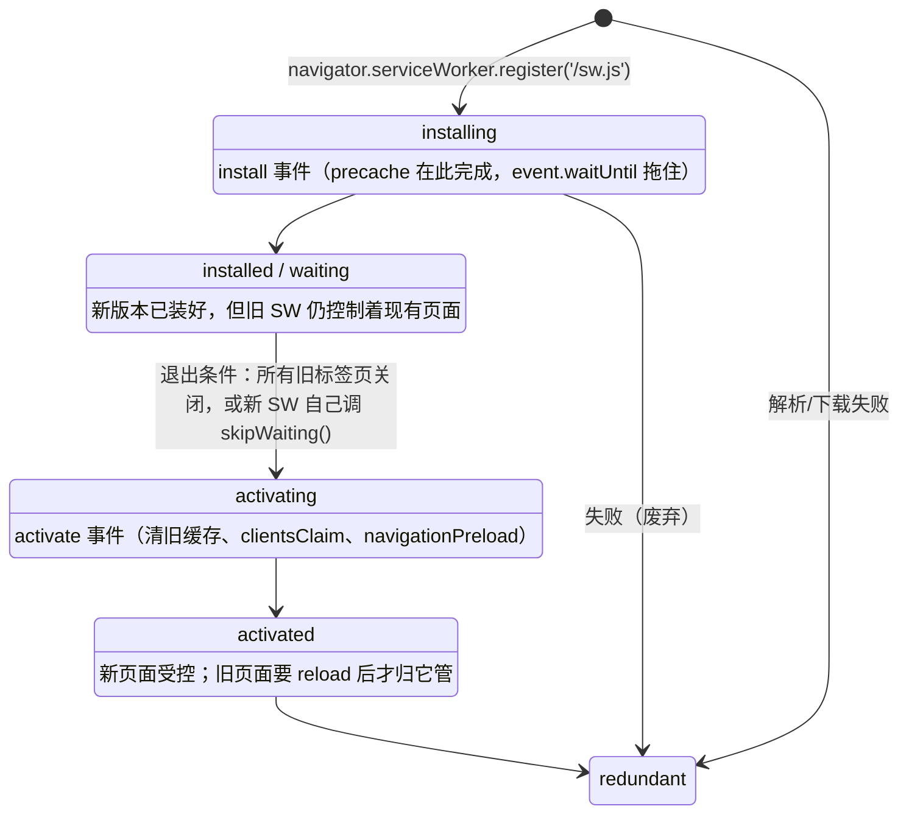

## E. 极端性能与离线

D 族解决"应用怎么变大"，E 族解决"用户侧的两个物理极限"：一是浏览器的渲染与主线程极限（百万级数据还要交互不卡）；二是网络的可有可无（断网也能用、恢复自动同步）。E1 是面试与实战双重硬通货——按本篇开头 React 相关度视图，E1 处于 ② 混合层：虚拟滚动算法框架无关，但 React 并发（memo/useTransition/Profiler）与调度是它的另一半；E2 则几乎全在 ③ 层（Service Worker/IndexedDB/冲突解决，与框架无关）。两条线还有交叉：离线缓存的大 JSON 解析、队列重放，用的正是 E1 的 Worker 与切片技术。

---

### E1. 百万级数据渲染（★★★★☆）——面试硬通货

#### 是什么

表格 100 万行 × 20 列、日志查看器实时滚动、行情流刷屏——DOM 数量级远超浏览器舒适区（浏览器全量渲染 1 万个节点就会明显卡顿，100 万个节点直接假死），但用户仍要求搜索、排序、多选、编辑全部流畅。

#### 为什么难

三个瓶颈叠加：**渲染瓶颈**（DOM 节点数爆炸，布局/绘制成本线性涨）；**主线程瓶颈**（100 万条数据的排序/过滤/聚合，一次同步计算就是几百毫秒长任务，期间输入无响应）；**内存瓶颈**（数据本身几百 MB，处理不当反复克隆直接 OOM）。且三者互相纠缠：虚拟化解决渲染却放大计算占比，Worker 解决计算却带来数据传输拷贝。

#### 核心技术逐项拆解

**1. 虚拟滚动自研三部曲**

**第一部：定高公式**。行高固定时，一切皆除法——由 `scrollTop` 推可视区间，由总行数撑总高度（空容器占位），行绝对定位到 `index * 行高`：

```tsx
import { useEffect, useRef, useState } from 'react';

const ITEM_H = 36;   // 定高：每个元素高度已知且恒定
const VIEW_H = 720;
const OVERSCAN = 6;  // 上下多渲染几行，盖住快速滚动的空白

export function FixedList({ items }: { items: string[] }) {
  const scrollerRef = useRef<HTMLDivElement>(null);
  const [scrollTop, setScrollTop] = useState(0);

  useEffect(() => {
    const el = scrollerRef.current!;
    const onScroll = () => setScrollTop(el.scrollTop);
    el.addEventListener('scroll', onScroll, { passive: true }); // passive：不阻塞滚动合成线程
    return () => el.removeEventListener('scroll', onScroll);
  }, []);

  // 核心三公式：可视区起点 / 终点 / 总占位高度
  const start = Math.max(0, Math.floor(scrollTop / ITEM_H) - OVERSCAN);
  const end = Math.min(items.length, Math.ceil((scrollTop + VIEW_H) / ITEM_H) + OVERSCAN);
  const totalH = items.length * ITEM_H;

  return (
    <div ref={scrollerRef} style={{ height: VIEW_H, overflow: 'auto' }}>
      {/* 占位 div 撑出真实滚动条长度；只渲染 [start, end) */}
      <div style={{ height: totalH, position: 'relative' }}>
        {items.slice(start, end).map((text, i) => {
          const idx = start + i;
          return (
            <div key={idx} style={{ position: 'absolute', top: idx * ITEM_H, height: ITEM_H }}>
              {text}
            </div>
          );
        })}
      </div>
    </div>
  );
}
```

**第二部：动高测量缓存**。真实行高不一（文本换行数不同）后除法失效，改用"估算 + 测量缓存 + 前缀和"：未测量的行用估算高度 `EST_H`（误差只影响滚动条长度，不影响正确性），渲染出来的行用 ref 回调测真实高度写入缓存，位置由前缀和数组 `offsets`（`offsets[i]` = 第 i 行顶部 y 坐标）维护，查找起点从除法换成**二分**：

```tsx
import { useCallback, useEffect, useRef, useState } from 'react';

const EST_H = 44; // 估算行高：误差只影响滚动条长度与初次跳变，不影响渲染正确性
const VIEW_H = 700;
const OVERSCAN = 5;

interface Row { id: number; text: string }

export function DynamicList({ rows }: { rows: Row[] }) {
  const scrollerRef = useRef<HTMLDivElement>(null);
  const heights = useRef<number[]>(rows.map(() => EST_H)); // 测量缓存：先全部用估算值
  const offsets = useRef<number[]>([0]);                   // 前缀和：offsets[i+1] = offsets[i] + heights[i]
  const [scrollTop, setScrollTop] = useState(0);

  const recompute = useCallback(() => {                    // O(n) 重建前缀和（优化：树状数组可 O(log n) 点更新）
    const acc = [0];
    for (let i = 0; i < heights.current.length; i++) acc.push(acc[i] + heights.current[i]);
    offsets.current = acc;
  }, []);

  useEffect(() => {
    heights.current = rows.map(() => EST_H);
    recompute();
  }, [rows, recompute]);

  useEffect(() => {
    const el = scrollerRef.current!;
    const onScroll = () => setScrollTop(el.scrollTop);
    el.addEventListener('scroll', onScroll, { passive: true });
    return () => el.removeEventListener('scroll', onScroll);
  }, []);

  // 二分找起点：最小的 i 使 offsets[i+1] > scrollTop（第一行还没滚出可视区）
  const findStart = (st: number) => {
    let lo = 0, hi = heights.current.length - 1;
    while (lo < hi) {
      const mid = (lo + hi) >> 1;
      if (offsets.current[mid + 1] > st) hi = mid;
      else lo = mid + 1;
    }
    return lo;
  };

  // 测量回调：真实高度 != 缓存时更新缓存，并做 scrollTop 校正
  const measure = (index: number, el: HTMLDivElement | null) => {
    if (!el) return;
    const real = el.getBoundingClientRect().height;
    const guess = heights.current[index];
    if (Math.abs(real - guess) <= 1) return;
    heights.current[index] = real;
    recompute();
    // 第三部的校正逻辑见下
    if (index < findStart(scrollTop)) {
      const diff = real - guess;
      scrollerRef.current!.scrollTop += diff; // 校正：防止视口上方行高变化"偷走"滚动位置
      setScrollTop((prev) => prev + diff);
    }
  };

  const start = Math.max(0, findStart(scrollTop) - OVERSCAN);
  let end = start;
  while (end < rows.length && offsets.current[end] < scrollTop + VIEW_H) end++; // 前缀和推进终点
  end = Math.min(rows.length, end + OVERSCAN);

  return (
    <div ref={scrollerRef} style={{ height: VIEW_H, overflow: 'auto' }}>
      <div style={{ height: offsets.current[rows.length] ?? 0, position: 'relative' }}>
        {rows.slice(start, end).map((row, i) => {
          const idx = start + i;
          return (
            <div key={row.id} ref={(el) => measure(idx, el)}
                 style={{ position: 'absolute', top: offsets.current[idx], width: '100%' }}>
              {row.text}
            </div>
          );
        })}
      </div>
    </div>
  );
}
```

**第三部：scrollTop 校正**。为什么必须校正：可视区**上方**的行被测出与估算不同的高度时，总高度变化会使后续所有行整体位移，但浏览器不会替你调 `scrollTop`，用户看到的内容会突然跳动/重影。规则是：`被测行 < 当前首个可视行` 时，把差值 `real - guess` 补进 `scrollTop`（上面 `measure` 内的最后几行），视口内容即视觉上原地不动。这是动高虚拟列表"丝滑"与否的分水岭，也是 react-window/react-virtuoso 内部的核心细节之一。三个已知局限与工业级对策：上方未渲染行的测量缺失（双向虚拟化/向上预渲染缓冲）、快速滚动时测量跟不上（滚动期间用估算、停止后再校正）、数据变更后缓存要按 key 失效（不能按 index——插入一行后全错位）。

**2. Canvas 自绘表格（自绘文本、滚动合成）**

当单元格数量再上一个量级（20 列 × 可视 40 行 = 800 个 DOM 单元格仍然重）或需要行内迷你图时，把"行"从 DOM 降级为**像素**：一个 `<canvas>` 自绘所有可见单元格文本，滚动时只重绘：

```tsx
import { useEffect, useRef } from 'react';

const ROW_H = 30;
const COLS = [80, 200, 120, 140]; // 每列宽度（二维虚拟化的列维度）

export function CanvasTable({ rows }: { rows: string[][] }) {
  const canvasRef = useRef<HTMLCanvasElement>(null);
  const scrollRef = useRef(0);

  useEffect(() => {
    const canvas = canvasRef.current!;
    const dpr = window.devicePixelRatio || 1;   // 高分屏：画布物理像素 = css 像素 × dpr，否则发虚
    const W = COLS.reduce((a, b) => a + b, 0);
    const H = 720;
    canvas.width = W * dpr;
    canvas.height = H * dpr;
    canvas.style.width = `${W}px`;
    canvas.style.height = `${H}px`;
    const ctx = canvas.getContext('2d')!;

    const render = () => {
      const st = scrollRef.current;
      ctx.setTransform(dpr, 0, 0, dpr, 0, 0);  // 之后全部按 css 像素画
      ctx.clearRect(0, 0, W, H);
      ctx.font = '13px system-ui, sans-serif';
      ctx.textBaseline = 'middle';
      const first = Math.max(0, Math.floor(st / ROW_H));            // 行虚拟化：与 DOM 版同一公式
      const last = Math.min(rows.length, Math.ceil((st + H) / ROW_H));
      for (let r = first; r < last; r++) {
        const y = r * ROW_H - st;
        if (r % 2 === 0) { ctx.fillStyle = '#fafafa'; ctx.fillRect(0, y, W, ROW_H); } // 斑马纹
        ctx.fillStyle = '#333';
        let x = 0;
        for (let c = 0; c < COLS.length; c++) {
          ctx.save();                                  // 列内裁剪：文字超宽不越界
          ctx.beginPath();
          ctx.rect(x + 8, y, COLS[c] - 16, ROW_H);
          ctx.clip();
          ctx.fillText(rows[r][c], x + 8, y + ROW_H / 2); // 自绘文本：没有 DOM，只有字形
          ctx.restore();
          x += COLS[c];
        }
      }
    };

    // 滚动合成：wheel 事件改虚拟 scrollTop，rAF 合并同一帧内的多次触发（一帧只画一次）
    let raf = 0;
    const onWheel = (e: WheelEvent) => {
      const max = rows.length * ROW_H - H;
      scrollRef.current = Math.max(0, Math.min(max, scrollRef.current + e.deltaY));
      if (!raf) raf = requestAnimationFrame(() => { raf = 0; render(); });
    };
    canvas.addEventListener('wheel', onWheel, { passive: true });
    render();
    return () => canvas.removeEventListener('wheel', onWheel);
  }, [rows]);

  // 点击命中检测：像素坐标反算行列 —— 自绘最大的代价：一切交互都要自己做几何换算
  // const rect = canvas.getBoundingClientRect();
  // const row = Math.floor((e.clientY - rect.top + scrollRef.current) / ROW_H);
  // 累加 COLS 宽度即可得 col。
  return <canvas ref={canvasRef} />;
}
```

要点：DPR 缩放不做则文字糊；滚动必须 rAF 合帧；文本裁剪/省略号、行高亮、选中框全是 `fillText/fillRect` 的工作；选中/编辑这类富交互通常混合方案——Canvas 画格 + 一个绝对定位的真实 DOM input 覆盖在编辑格上。DOM 虚拟化与 Canvas 的取舍：交互密度高（编辑/复制/无障碍）选 DOM 虚拟化，纯展示密度高（日志/行情）选 Canvas。

**3. Web Workers：任务下沉、transferable 零拷贝、Comlink RPC**

**任务下沉**——100 万行排序放主线程一次 300ms 长任务，挪进 Worker 变成主线程零参与（Vite/webpack 都支持 `new Worker(new URL(...))` 语法）：

```ts
// sort.worker.ts
self.onmessage = (e: MessageEvent) => {
  const { rows, key, asc } = e.data as { rows: Row[]; key: keyof Row; asc: boolean };
  const sorted = [...rows].sort((a, b) => (asc ? a[key] > b[key] ? 1 : -1 : a[key] < b[key] ? 1 : -1));
  (self as unknown as Worker).postMessage(sorted);
};
```

```ts
// 主线程
const worker = new Worker(new URL('./sort.worker.ts', import.meta.url), { type: 'module' });
worker.onmessage = (e) => setRows(e.data as Row[]);
worker.postMessage({ rows: rawRows, key: 'amount', asc: true });
```

**transferable 零拷贝**——postMessage 默认结构化克隆（数据复制一份，100 万行 Float64 就是 8MB 的拷贝，双向共三次）；Transferable 对象（ArrayBuffer/OffscreenCanvas/ImageBitmap 等）传的是**所有权**，零拷贝但主线程从此不能再用它：

```ts
// 100 万个金额做聚合：克隆版要复制 8MB；transferable 版本只移交句柄
const amounts = new Float64Array(1_000_000);
worker.postMessage(amounts, [amounts.buffer]); // 第二个参数是转移列表
console.log(amounts.byteLength); // 0 —— 所有权已归 worker，主线程再读是空壳
```

**Comlink RPC**——手写 onmessage/postMessage 很快退化成自定义协议泥潭；Comlink 把 Worker 包成 Promise 化的"远程对象"，像调本地函数一样 await：

```ts
// aggregate.worker.ts
import * as Comlink from 'comlink';

export const api = {
  sum(values: Float64Array): number {
    let s = 0;
    for (const v of values) s += v;
    return s;
  },
  async sumTransfer(buf: ArrayBuffer): Promise<number> {
    const values = new Float64Array(buf); // 收到的就是被转移进来的 buffer，无拷贝
    return api.sum(values);
  },
};
Comlink.expose(api);
```

```ts
// 主线程：泛型直接复用 worker 文件的类型，接口契约编译期可查
import * as Comlink from 'comlink';

const worker = new Worker(new URL('./aggregate.worker.ts', import.meta.url), { type: 'module' });
const api = Comlink.wrap<typeof import('./aggregate.worker').api>(worker);

const total = await api.sum(new Float64Array(1_000_000));           // 克隆传输
const total2 = await api.sumTransfer(bigBuf.buffer);                // 转移传输（bigBuf 之后不可用）
```

React 结合：Worker 实例放 `useRef`（组件重渲染不重建），接收结果用 state；大数组跨渲染保留时注意 transferable 会"掏空"原引用。

**4. OffscreenCanvas：把 E1-2 的绘图也搬离主线程**

Canvas 2D 调用全部发生在主线程，主线程一旦忙（React 大更新），滚动绘制照样掉帧。OffscreenCanvas 让 Canvas 上下文整体进 Worker：

```ts
// 主线程：把 canvas 的控制权一次性移交给 worker（此后主线程不能再 getContext）
const offscreen = canvasEl.transferControlToOffscreen();
worker.postMessage({ type: 'init-canvas', canvas: offscreen, dpr: window.devicePixelRatio }, [offscreen]);
// 之后只需把数据/滚动增量发给 worker，绘制完全在 worker 侧完成
```

```ts
// table.worker.ts：绘图代码与主线程 Canvas 写法完全一致（fillText/fillRect），只是宿主变成了 worker
let ctx: OffscreenCanvasRenderingContext2D | null = null;

self.onmessage = (e: MessageEvent) => {
  if (e.data.type === 'init-canvas') {
    const canvas = e.data.canvas as OffscreenCanvas;
    ctx = canvas.getContext('2d');
    ctx!.scale(e.data.dpr, e.data.dpr);
  }
  if (e.data.type === 'scroll') {
    const scrollTop: number = e.data.scrollTop;
    // render(scrollTop) —— 与上文 CanvasTable 的 render 相同的可见区计算 + fillText
  }
};
```

限制：DOM 事件不进 worker（命中检测仍在主线程做几何换算后发消息），且 canvas 控制权移交不可逆。

**5. 长任务切片：scheduler.yield 与 rAF 分帧**

有些活离不开主线程（React 状态更新、大量同步计算），只能**切片让路**：干一小段就让出主线程，把输入响应与动画的优先级还给浏览器。`scheduler.yield()`（Chrome 129+）是为此生的标准 API；《react-源码复刻大纲》里复刻的 React Scheduler 时间切片（可中断、按优先级调度）与它是同一思想在框架层的实现：

```ts
// 通用让出函数：新 API 优先，旧浏览器退化为 setTimeout（粒度粗但行为正确）
function yieldToMain(): Promise<void> {
  if ('scheduler' in window && typeof (window as any).scheduler?.yield === 'function') {
    return (window as any).scheduler.yield();
  }
  return new Promise((resolve) => setTimeout(resolve, 0));
}

// 切片处理 100 万行的同步加工：每 5000 行让一次
async function processInChunks<T>(items: T[], fn: (item: T) => void, chunkSize = 5000) {
  for (let i = 0; i < items.length; i += chunkSize) {
    for (let j = i; j < Math.min(i + chunkSize, items.length); j++) fn(items[j]);
    await yieldToMain(); // 让出：期间用户输入、rAF 动画得以插队执行
  }
}
```

纯绘制任务用 **rAF 分帧**（保证切片与渲染帧对齐，避免"渲染前一微秒才做完"的浪费）：批量绘制 N 个区块时每帧画 K 个，`requestAnimationFrame` 递归直到完成；低优先级兜底还有 `requestIdleCallback`（帧内空闲时间执行）。React 侧对应物：大 setState 拆 `startTransition`/`useDeferredValue`，让输入类更新插队——这正是 React 相关度视图里"B2/E1 长列表重渲染与并发调优"说的那一半。

**6. INP / LCP 治理实战**

**指标是什么**：LCP（Largest Contentful Paint，最大内容绘制）衡量加载体验——视口内最大元素（大图/大文本块）完成渲染的时刻，good ≤ 2.5s，poor > 4s。INP（Interaction to Next Paint，交互到下次绘制）在 2024 年 3 月正式取代 FID 成为 Core Web Vitals——取页面所有点击/按键/指针交互中（近似最差的）延迟分位：从 input 事件触发到**下一帧绘制**的全程，good ≤ 200ms，poor > 500ms。它比 FID 狠在 FID 只测首次交互的输入延迟、不管处理多久，INP 则把"处理 + 渲染"整段算上。

**常见坏因**：INP——交互处理器里巨型同步 setState（一个输入框 onChange 重渲染整页十万行列表）、长任务（同步排序/JSON.parse 几 MB 数据）、强制同步布局（循环里读写 offsetHeight 触发 layout thrashing）、水合期间整页不可交互、第三方脚本长任务；LCP——服务器 TTFB 慢、渲染阻塞 CSS/JS、首屏大图没有预加载/低优先级加载（`` 用在了 LCP 图上是最经典自伤）、纯客户端渲染导致内容等待 JS。

**怎么定位**：

```ts
import { onINP, onLCP } from 'web-vitals'; // v4，RUM 上报必备

onINP((m) => reportToMonitor({ metric: 'INP', value: m.value, attribution: m.attribution }));
onLCP((m) => reportToMonitor({ metric: 'LCP', value: m.value, attribution: m.attribution }));
```

现场排查用 DevTools Performance 面板：录制 → 复现慢交互/慢加载 → 看 Interactions 轨道（INP）与 LCP 标记线；长任务在主线程轨道上表现为红色三角块，点开 Bottom-Up 找元凶函数；LCP 按其四段分解（TTFB → 资源加载延迟 → 资源加载时长 → 元素渲染延迟）看哪段超标（`performance.getEntriesByType('largest-contentful-paint')` 或 attribution 里直接给出）。React 场景再加 React DevTools Profiler 看一次交互触发了哪些组件重渲染、各commit 耗时。修法对应上文各节：重渲染失控用 memo/拆 state/并发特性；长计算下沉 Worker 或切片；LCP 图加 `fetchpriority="high"` + `<link rel="preload">`、去渲染阻塞资源、关键内容 SSR/SSG。

**7. 内存泄漏排查（heap snapshot、Detached DOM、监听器/echarts 未清理）**

操作步骤（DevTools Memory 面板）：

1. 选 Heap snapshot，拍快照 A（操作前基线）。
2. 执行疑似泄漏操作 N 次（如开关某个大弹窗 10 次），让泄漏特征被放大 N 倍。
3. 点面板上的强制 GC 图标（垃圾桶），把"没泄漏的垃圾"清干净，避免误判。
4. 拍快照 B；视图切到 **Comparison**、Base 选 A，按 Delta 排序看哪些对象只增不减。
5. 类名筛选 `Detached`：出现 **Detached HTMLDivElement / Detached Document** 即实锤——节点已离开 DOM 树，但 JS 仍引用着它，整棵子树都无法回收。
6. 选中泄漏对象看 **Retainers（保留链）**：从根到该对象的引用路径直接指出"是谁抓着它"（某个数组/闭包/定时器回调/全局 Map）。
7. 进阶三快照法：A（操作前）→ B（操作中）→ C（强制 GC 后），比对 B→C 仍存活的分配，可同时定位"分配过多"与"无法回收"。

Detached DOM 的最小复现，一行之差决定泄漏与否：

```ts
const detached: HTMLElement[] = []; // 模块级集合 —— 常见真身：缓存 Map、事件回调闭包、Promise 链
function openPanel() {
  const el = document.createElement('div');
  document.body.appendChild(el);
  el.remove();          // 已离开 DOM，但下一行还持有引用 → Detached，永不回收
  detached.push(el);
}
```

React 场景两大惯犯——**effect 里加了监听没移除**、**echarts 等实例 init 了没 dispose**（且 React 18 StrictMode 下 dev 环境 effect 会执行两次，缺清理的代码当场翻车，这是最好的免费泄漏检测器）：

```tsx
import { useEffect, useRef } from 'react';
import * as echarts from 'echarts';

export function TrendChart({ option }: { option: echarts.EChartsOption }) {
  const ref = useRef<HTMLDivElement>(null);

  useEffect(() => {
    const chart = echarts.init(ref.current!);       // init 两次（StrictMode/路由重挂）就是两个 canvas 实例
    const onResize = () => chart.resize();
    window.addEventListener('resize', onResize);    // 监听器挂在 window：组件销毁也常驻，经典泄漏
    chart.setOption(option);
    return () => {
      window.removeEventListener('resize', onResize); // 两件事都要清：监听器
      chart.dispose();                                //            实例（echarts 自身持 canvas/动画定时器）
    };
  }, [option]);

  return <div ref={ref} style={{ width: '100%', height: 320 }} />;
}
```

识别特征：内存曲线随操作次数**阶梯上涨且强制 GC 不回落**；heap snapshot 里 `ECharts`/`HTMLCanvasElement`/`EventListener` 类对象只增不减；Performance Monitor 面板（Cmd+Shift+P 输入 Performance Monitor）开 DOM Nodes 与 JS Heap Size 实时看，比反复拍快照快。

#### 代表

react-window/react-virtuoso（虚拟滚动）、TanStack Virtual（框架无关虚拟化）、AG Grid（百万行 Canvas 模式）、echarts 大数据模式。

#### 入手路径

10 万行 × 20 列数据：搜索/排序/多选/行内编辑全部不卡——DOM 虚拟化一版 + Canvas 一版对比 Profiling（动手清单就是上面 7 项技术：定高 → 动高校正 → Worker 排序 → Comlink → OffscreenCanvas → 切片 → heap snapshot 前后对比）。G 族的"虚拟滚动自研"（本篇 G3）与 B2 IM 的两级虚拟化是同一算法的另外两个练习场。

#### 常见坑

- 动高列表不做 scrollTop 校正，快速向上滚动时内容疯狂跳动——"能用但极其难受"的根源都在这。
- 用 index 当 key 又允许数据插入：测量缓存整体错位，行高全乱。
- Worker 里 postMessage 传大对象不看是不是 transferable，排序 100 万行有 200ms 算力 400ms 拷贝。
- transferable 转移后主线程还引用原 buffer 读出空数据（`byteLength === 0`），且不报错。
- echarts/监听器只清一半（dispose 了忘 removeEventListener，或反之），泄漏减半不是不泄漏。
- 优化 LCP 先去压缩 JS bundle，结果 LCP 元素是首屏大图——先看 attribution 四段分解再动手，别猜。

---

### E2. 离线优先 / Local-first（★★★★☆）

#### 是什么

Notion/Linear 式体验：断网照常增删改查（读写都走本地），网络恢复后自动同步合并到服务端，多端最终一致。Local-first 更进一步把"本地数据库"当作 first-class 数据源，云端只是同步副本——网络从"前提条件"降级为"优化项"。

#### 为什么难

HTTP 的心智模型是"请求-响应"，断网即功能全灭，这不是 UI 问题而是数据流架构问题：读要改走本地（IndexedDB），写要改走"本地即成功 + 后台同步"，于是引出三座大山：缓存体系（App Shell 与数据分开治理）、冲突（两个端各自离线改了同一条数据）、以及"用户已看到成功但同步失败"时的补偿 UX。

#### 核心技术逐项拆解

**1. Service Worker 缓存策略矩阵（Workbox：precache/runtime/SWR）**

Service Worker 是页面与网络之间的可编程代理（独立线程、有生命周期、可拦截 fetch），Workbox 是它的"策略库"。先建立策略矩阵——**不同资源配不同策略**是唯一正确姿势：

| 策略 | 行为 | 适用 | Workbox |
|---|---|---|---|
| precache（预缓存） | 构建期生成完整资源清单，install 时一次性缓存，activate 时清旧版本 | App Shell（index.html/JS/CSS 等构建产物，URL 带 hash） | `precacheAndRoute` |
| CacheFirst | 查缓存命中即返回，未命中取网络并回填 | 字体、带 hash 的图片等永不变资源 | `CacheFirst` |
| NetworkFirst | 先网络，超时/失败回退缓存 | 关键数据（余额、今天日程） | `NetworkFirst` |
| StaleWhileRevalidate | 立即回缓存，同时后台取新版更新缓存（下次生效） | 非关键但最好新鲜（配置、列表） | `StaleWhileRevalidate` |
| NetworkOnly | 永远走网络 | 支付/鉴权等不可缓存接口 | `NetworkOnly` |

```ts
// sw.ts（由 workbox-build 注入 precache 清单后构建为 sw.js）
import { precacheAndRoute, cleanupOutdatedCaches } from 'workbox-precaching';
import { registerRoute } from 'workbox-routing';
import { StaleWhileRevalidate, NetworkFirst, CacheFirst, NetworkOnly } from 'workbox-strategies';
import { ExpirationPlugin } from 'workbox-expiration';
import { BackgroundSyncPlugin } from 'workbox-background-sync';
import { Queue } from 'workbox-background-sync';

// ① precache：App Shell —— 构建产物全量预缓存，清单由构建工具注入（self.__WB_MANIFEST）
precacheAndRoute(self.__WB_MANIFEST);
cleanupOutdatedCaches(); // 清理旧版本 precache 缓存

// ② SWR：非关键数据 —— 秒开，后台更新下次生效
registerRoute(
  ({ url }) => url.pathname.startsWith('/api/looks'),
  new StaleWhileRevalidate({ cacheName: 'api-swr' }),
);

// ③ 网络优先：关键数据 —— 3 秒超时兜底旧缓存，弱网不白屏
registerRoute(
  ({ url }) => url.pathname.startsWith('/api/critical'),
  new NetworkFirst({ cacheName: 'api-critical', networkTimeoutSeconds: 3 }),
);

// ④ 缓存优先 + 容量治理：图片 —— 7 天/最多 200 项
registerRoute(
  ({ request }) => request.destination === 'image',
  new CacheFirst({
    cacheName: 'img',
    plugins: [new ExpirationPlugin({ maxEntries: 200, maxAgeSeconds: 7 * 24 * 60 * 60 })],
  }),
);

// ⑤ 变更类请求：NetworkOnly + BackgroundSync 失败排队（见第 4 小节的队列）
registerRoute(
  ({ url, request }) => url.pathname.startsWith('/api/mutations') && request.method === 'POST',
  new NetworkOnly({
    plugins: [new BackgroundSyncPlugin('mutation-queue', { maxRetentionTime: 24 * 60 })], // 保留 24h
  }),
);
```

```ts
// 注册（应用入口）：必须在 HTTPS 或 localhost 下
if ('serviceWorker' in navigator) {
  navigator.serviceWorker.register('/sw.js', { scope: '/' });
}
```

两个机制性认知：**版本更替**——新 SW 安装后进入 waiting，旧 SW 继续控制页面，直到所有标签页关闭（或新 SW 内 `self.skipWaiting()` + 客户端 `clientsClaim()`，但要接受"新旧资源混用"的风险，precache 清单天然缓解）；**存储持久性**——浏览器可能在全球存储压力下清除站点数据，重要数据请求 `navigator.storage.persist()`，并在设置页告知用户。

**2. IndexedDB 事务与索引（Dexie）**

IndexedDB 是浏览器唯一的异步结构化本地库，原生 API 是回调时代的产物（`onsuccess/onsuccess/onsuccess`），且有两个易踩的事务规则：**事务在创建它的任务栈结束（微任务队列清空）时自动提交**，之后发起新请求会抛 `TransactionInactiveError`；**索引只能在 `versionchange`（升级）事务里建**，线上改 schema 必须升版本。Dexie 把这些包成 Promise + 类 ORM：

```ts
import Dexie, { type Table } from 'dexie';

export interface Todo {
  id?: number;
  text: string;
  done: boolean;
  updatedAt: number; // 同步字段：冲突解决要用
}

class TodoDB extends Dexie {
  todos!: Table<Todo, number>;

  constructor() {
    super('todo-offline');
    // schema 字符串：'主键, 索引1, 索引2'；++id 自增主键；&title 唯一索引
    this.version(1).stores({ todos: '++id, done, updatedAt' });
    this.version(2).stores({ todos: '++id, done, updatedAt, text' }).upgrade((tx) => {
      // 版本升级事务：给旧数据补默认值，等价于 SQL 的 migration
      return tx.table('todos').toCollection().modify((t) => { t.text ??= ''; });
    });
  }
}

export const db = new TodoDB();

// 事务：done 与 updatedAt 要么同时写入，要么都不写（原子性）
await db.transaction('rw', db.todos, async () => {
  const todo = await db.todos.get(id);
  if (!todo) throw new Error(`todo ${id} 不存在`); // 抛错 → 整个事务回滚
  await db.todos.update(id, { done: !todo.done, updatedAt: Date.now() });
});

// 索引查询：走 updatedAt 索引范围扫描，而非全表过滤
const recent = await db.todos.where('updatedAt').above(Date.now() - 86_400_000).toArray();
```

Dexie 的 `liveQuery` 还能订阅查询结果——本地库变更自动推送 UI 重渲染，这正是 Local-first "UI 即本地数据库的投影" 的实现基石。

**3. 后台同步与冲突解决（LWW → CRDT 升级路径）**

后台同步：`sync` 事件（Service Worker 侧）在浏览器认为网络恢复时触发（由 Background Sync API 保证，见第 4 小节代码）；也可以简单依赖页面侧 `window.addEventListener('online', ...)`——两者都要有，`navigator.onLine` 只代表网卡状态（连上无网 WiFi 仍为 true）。

冲突解决的三级演进：

- **LWW（last-write-win）**：每条记录带 `updatedAt`，同步时"最后写的覆盖先写的"。实现一行，代价是丢更新——A、B 离线各自改同一条，后同步者覆盖前者，前者的修改静默消失。时钟不可靠（客户端时间可被篡改/漂移）时用**服务器时间或 HLC（混合逻辑时钟）**裁决。适用：字段语义独立、覆盖可接受的场景（笔记的"最后修改时间"、设置项）。
- **字段级 LWW + 操作日志**：把整行覆盖缩小到字段覆盖，同步单元从"记录"变"操作"（`{ op: 'set', field: 'done', value: true, ts }`），各自操作幂等重放、按 ts 逐字段合并——同一行不同字段的离线修改不再互杀。代价：要设计操作协议与幂等键。
- **CRDT**：操作本身可交换、可合并（数学上保证收敛），离线双方**并发编辑都能保留**。Yjs 的用法形状：

```ts
import * as Y from 'yjs';

const doc = new Y.Doc();
const text = doc.getText('content');
text.insert(0, 'hello');          // 本地编辑：插入操作而非快照
const remoteUpdate: Uint8Array = receiveFromPeer();
Y.applyUpdate(doc, remoteUpdate); // 对端离线期间的编辑直接合并进来，无需裁决胜负
const full = Y.encodeStateAsUpdate(doc); // 可持久化（配 y-indexeddb）、可传输（配 y-websocket）
```

升级路径总结：**能用 LWW 的（业务上覆盖可接受）不上 CRDT；字段/记录一旦进入"多人并发编辑同一内容"（文档、表格、白板、任务描述），CRDT 是终点**——这正是 B1 协同编辑那一族的领地，E2 与 B1 在这里合流。

**4. 乐观 UI + 断网队列重放（配队列实现思路）**

乐观 UI：写操作**先改本地（IndexedDB + UI 立即反映）即视为成功**，真正的网络请求进队列后台执行；失败（含断网）留在队列，恢复后按序重放；服务端确认后用服务端状态（含最终 `updatedAt`）覆盖本地。核心是三件套：幂等键（服务端按 key 去重，重放不产生重复数据）、按序重放（同一记录的先后操作不能乱序）、永久失败的人工兜底（重试耗尽进死信，提示用户）。

```ts
// mutation-queue.ts：队列本体（持久化在 IndexedDB，刷新/崩溃不丢）
import { db, type OutboxItem } from './db';

export class MutationQueue {
  private draining = false;

  async enqueue(item: Omit<OutboxItem, 'id' | 'retries' | 'createdAt'>) {
    await db.outbox.add({ ...item, id: crypto.randomUUID(), retries: 0, createdAt: Date.now() });
    void this.drain(); // 入队即尝试排空（在线时近乎直发）
  }

  async drain() {
    if (this.draining) return;
    this.draining = true;
    try {
      while (true) {
        const [item] = await db.outbox.orderBy('createdAt').limit(1).toArray(); // 按入队序重放
        if (!item) break;
        try {
          const serverState = await fetch('/api/mutations', {
            method: 'POST',
            headers: { 'content-type': 'application/json', 'idempotency-key': item.id }, // 幂等键
            body: JSON.stringify({ name: item.name, payload: item.payload }),
          }).then((r) => r.json());
          await db.transaction('rw', db.todos, db.outbox, async () => {
            await applyServerState(serverState);   // 服务端状态落地（含最终 updatedAt）
            await db.outbox.delete(item.id);       // 确认后才出队：at-least-once
          });
        } catch (err) {
          if (isPermanentError(err) || item.retries >= 5) {
            await markDeadLetter(item);            // 死信：进 UI 提示，不再自动重试
            await db.outbox.delete(item.id);
            break;
          }
          await db.outbox.update(item.id, { retries: item.retries + 1 });
          await backoff(item.retries);            // 指数退避：1s/2s/4s...
          break;                                  // 网络类失败：本轮终止，等 online/sync 再来
        }
      }
    } finally {
      this.draining = false;
    }
  }
}

async function backoff(retries: number) {
  await new Promise((r) => setTimeout(r, 1000 * 2 ** retries));
}
function isPermanentError(err: unknown): boolean {
  return err instanceof HttpError && err.status >= 400 && err.status < 500; // 4xx 重试无意义，5xx 值得再试
}
```

触发排空的三个钩子：入队时（在线直发）、页面 `online` 事件、Service Worker 的 Background Sync 事件（页面已关闭也能由浏览器唤醒 SW 排空队列）：

```ts
// sw.ts 内：注册的后台同步 tag 与 BackgroundSyncPlugin 的队列名配合
self.addEventListener('sync', (event: ExtendableEvent) => {
  if ((event as SyncEvent).tag === 'mutation-queue') {
    event.waitUntil(drainOutboxAndReport());
  }
});
```

页面主线程注册：

```ts
const reg = await navigator.serviceWorker.ready;
await (reg as ServiceWorkerRegistration & { sync: { register(tag: string): Promise<void> } })
  .sync.register('mutation-queue');
```

UX 关键：乐观更新在 UI 上要有"待确认"态（小转圈），确认后落定；死信要显式告警并允许用户编辑重发——**不能假装一切都会成功**。

**5. 数据层选型认知：RxDB / ElectricSQL / PowerSync**

自建到一定规模就该换成品，三者的定位差异要能一句话说清：

- **RxDB**：浏览器/Node 的响应式本地数据库（底层可插 IndexedDB），查询是 RxJS Observable（数据一变 UI 自动推），自带 replication 协议（可对接自建 GraphQL/REST/CouchDB），冲突策略可插拔。适合：自己掌控后端、要深度定制同步协议的团队。
- **ElectricSQL**：Postgres 专用同步层——读写全走本地（SQLite/WASM），后台与 Postgres 做部分复制（partial replication，按规则只同步用户该看的分片），冲突由其同步引擎合并。适合：后端就是 Postgres、想把 API 层省掉、数据分片复杂的产品。
- **PowerSync**：同步引擎 + 客户端 SQLite 离线库，后端无关（Postgres/Mongo/Firebase 都有连接器），同步规则用声明式 SQL 配置分片，写路径走"在线写 API + 同步回拉"。适合：已有后端服务与权限体系、只想加离线能力的存量 App。

选型口诀：**要控制权选 RxDB，全栈 Postgres 选 ElectricSQL，存量后端加离线选 PowerSync**；验证任何一家前，先用本节的手写版（Dexie + 队列 + LWW）跑通业务闭环，你会更清楚成品替你解决了什么。

#### 代表

Notion、Linear（断网可用、多端一致的标杆）、Figma（本地渲染 + 服务端同步的极端案例）；工具侧 Workbox、Dexie、RxDB。

#### 入手路径

给 IM 或 Todo 做离线可用：Workbox 三策略（precache + SWR + NetworkFirst）让外壳与只读数据离线可开；Dexie 存全量数据、liveQuery 驱动 UI；所有写操作走乐观更新 + outbox 队列；断网操作一批 → 恢复后自动重放 → 服务端 LWW 合并 → 断网期间另一端的改动按字段级规则保得住。做完顺手验证 B2 的衔接：IM 的"乐观发送/撤回"正是同一队列的两个操作类型。

#### 常见坑

- 所有接口一个策略（全 SWR）：余额/库存这类关键数据离线给旧值且无提示；或全 NetworkFirst：断网即死。策略必须按资源分。
- SW 更新不处理 waiting 态：用户永远跑旧版本，直到某天所有标签关闭"突然换新版"。
- 乐观 UI 只改内存 state 不落库：刷新页面"已成功的操作"消失——本地必须先持久化。
- 队列重放不做幂等键：网络超时但服务端已成功，重试产生重复数据（最常见的生产事故）。
- IndexedDB schema 改动不升版本/不写 upgrade：老用户升级后首次打开即崩。
- 忽略浏览器存储回收（尤其移动端隐身模式配额更小）：大数据不做 `persist()` 与容量规划，用户数据被静默清空。

### 补充：Web Worker 通信范式进阶——结构化克隆、Transferable 与共享缓冲

#### 是什么

E1.3 从"把重活搬出主线程"的应用视角用过 Worker（postMessage 下沉、transferable 转移、Comlink RPC）；本节把"主线程 ↔ Worker 之间怎么传数据"本身当主题系统化：三种传输语义（**克隆 / 转移 / 共享**）的适用条件与陷阱、多任务并发的 **Worker 池**、高频场景的**背压**策略。兄弟篇：《react-进阶大纲-复杂场景》§5 的"补充：超大 JSON 的加载策略深化"已经讲了"解析搬进 Worker 与分级降级"的完整实战，本节是它的通信层地基。

#### 为什么难

三个现实矛盾：

1. **传输成本常常倒挂计算成本**：E1.3 算过账——排序 100 万行 200ms、结构化克隆却要 400ms。选错传输范式，Worker 把主线程的计算负担换成了通信负担，白干；
2. **三种语义各有硬约束**：克隆对不可克隆对象直接抛 `DataCloneError`；转移（Transferable）是"所有权搬家"，主线程从此读空壳；共享（SharedArrayBuffer）要求整站跨源隔离（COOP/COEP 响应头），与第三方资源、嵌入场景（D3）天然冲突；
3. **高频与并发**：持续流式数据（行情、传感器、解析进度）每秒成千上万条消息，"每条消息一次 postMessage"会把两个线程的调度全打满；多任务并发时 Worker 的创建销毁、请求响应配对、超时回收都要自己管。

#### 关键机制

**1. 三种传输语义对比**（选型先看这张表）：

| | 结构化克隆（默认） | Transferable（转移） | SharedArrayBuffer（共享） |
|---|---|---|---|
| 语义 | 值拷贝，双方各一份 | 所有权搬家，发送方变空壳 | 同一块内存两线程直读直写 |
| 成本 | 与数据体积成正比 | 近零（传句柄） | 零（建立后读写无消息） |
| 发送方此后 | 照常使用 | `byteLength === 0`，不可再用 | 照常使用 |
| 适合 | 小对象、低频 | 大缓冲一次性交出（排序/解析结果） | 高频流式、持续更新的数据面 |
| 硬约束 | 函数/DOM 节点/组件实例抛 `DataCloneError` | 只对 ArrayBuffer 等白名单类型有效 | 需 COOP+COEP 响应头；读写要 Atomics 同步 |

**2. 共享缓冲的分工原则：消息做信号面，SAB 做数据面**。SharedArrayBuffer 不是用来替代 postMessage 的，而是把"数据"从消息里剥离出来：postMessage 只发"第 N 批已就绪"这类轻信号，数据本体在共享内存里原地可读。这样消息数量与数据体积解耦——高频场景的核心优化。

**3. SPSC 环形缓冲协议**（单生产者单消费者，Worker 通信的标配结构）：头部两个 int32 作读写指针，数据区放定长槽位；**指针单调递增、真实下标取模**——避免"写指针绕一圈后与读指针相等导致的空/满歧义"；先写数据、再推进指针，顺序即协议。

**4. Worker 池**：`navigator.hardwareConcurrency` 给出逻辑核数，池大小取"核数 − 1"（留一个给主线程）；任务队列 + 空闲复用；请求-响应用自增 id 配对；超时的 Worker 直接 terminate 换新（防一个毒任务卡死整个池）。

**5. 背压**：消费者跟不上时（队列长度超阈值），生产端必须丢帧/合并/降频——否则内存与延迟一起失控。环形缓冲"满了返回 false"就是最朴素的背压信号。

#### 最小可行实现

**共享缓冲环形队列**（主线程生产、Worker 消费，适合"主线程采集 → Worker 分析"的流式链路）：

```ts
// sab-producer.ts —— 主线程：写入样本，消息只做"有新数据"的信号
const HEADER_INTS = 2;          // [0] = 写指针（单调递增） [1] = 读指针
const CAP = 1024;               // 数据槽位数（两线程约定一致）
const sab = new SharedArrayBuffer(HEADER_INTS * 4 + CAP * 8); // 头部 int32 区 + 数据 float64 区
const header = new Int32Array(sab, 0, HEADER_INTS);
const slots = new Float64Array(sab, HEADER_INTS * 4);

let w = 0; // 本地写指针缓存（免得每写一个都 Atomic 读自己）

/** 写入一个样本；缓冲满返回 false —— 背压信号，调用方决定丢帧还是降频 */
export function pushSample(worker: Worker, v: number): boolean {
  const r = Atomics.load(header, 1);
  if (w - r >= CAP) return false;      // 满：消费者落后超过一圈
  slots[w % CAP] = v;                  // ① 先写数据
  w += 1;
  Atomics.store(header, 0, w);         // ② 再推进写指针（顺序即协议：读者看到 w 前进一步时，数据必已就位）
  worker.postMessage({ type: 'wake' }); // ③ 信号面：只告诉 worker"有活"，不带数据
  return true;
}
export { sab };
```

```ts
// sab-consumer.worker.ts —— 消费端：收到 wake 就把队列追平
let header: Int32Array | null = null;
let slots: Float64Array | null = null;
let cap = 0;

self.onmessage = (e: MessageEvent) => {
  if (e.data.type === 'init') {
    const sab = e.data.sab as SharedArrayBuffer;
    header = new Int32Array(sab, 0, 2);
    slots = new Float64Array(sab, 8);
    cap = slots.length;
    Atomics.store(header, 1, 0);
  }
  if (e.data.type === 'wake') drain();
};

function drain() {
  for (;;) {
    const w = Atomics.load(header!, 0);
    const r = Atomics.load(header!, 1);
    if (r === w) break;                       // 追平：本轮消费完，等下一个 wake
    const value = slots![r % cap];            // 数据面：直接读共享内存，零拷贝
    consume(value);                           // 业务：累加/滤波/聚合……
    Atomics.store(header!, 1, r + 1);         // 先处理再推进读指针
  }
}

function consume(v: number) { /* 实际分析逻辑 */ }
```

**Worker 池**（同一 worker 模块的多实例，吃任务队列）：

```ts
// workerPool.ts —— 固定大小 Worker 池：id 配对 + 超时换新 + 队列复用
type Responder = { resolve: (v: unknown) => void; reject: (e: unknown) => void };

export class WorkerPool {
  private nextId = 1;
  private pending = new Map<number, Responder & { timer: ReturnType<typeof setTimeout> }>();
  private idle: Worker[] = [];
  private queue: Array<{ payload: unknown; transfer: Transferable[]; timeoutMs: number } & Responder> = [];

  constructor(
    private workerUrl: URL,
    size = Math.max(2, (navigator.hardwareConcurrency ?? 4) - 1), // 留一核给主线程
  ) {
    for (let i = 0; i < size; i++) this.spawn();
  }

  private spawn() {
    const w = new Worker(this.workerUrl, { type: 'module' });
    w.addEventListener('message', (e: MessageEvent) => {
      const { id, ok, data, error } = e.data as { id: number; ok: boolean; data?: unknown; error?: string };
      const p = this.pending.get(id);
      if (!p) return; // 超时后迟到的响应：丢弃
      this.pending.delete(id);
      clearTimeout(p.timer);
      ok ? p.resolve(data) : p.reject(new Error(error));
      this.release(w);
    });
    w.addEventListener('error', (err) => { // worker 本体崩溃：在途请求全部失败并补员
      for (const [id, p] of this.pending) { clearTimeout(p.timer); p.reject(new Error(`worker 崩溃: ${err.message}`)); this.pending.delete(id); }
      this.idle = this.idle.filter((x) => x !== w);
      this.spawn();
    });
    this.idle.push(w);
  }

  run<T>(payload: unknown, opts?: { transfer?: Transferable[]; timeoutMs?: number }): Promise<T> {
    return new Promise<T>((resolve, reject) => {
      this.queue.push({ payload, transfer: opts?.transfer ?? [], timeoutMs: opts?.timeoutMs ?? 10_000, resolve: resolve as (v: unknown) => void, reject });
      this.drain();
    });
  }

  private drain() {
    while (this.idle.length > 0 && this.queue.length > 0) {
      const worker = this.idle.pop()!;
      const task = this.queue.shift()!;
      const id = this.nextId++;
      const timer = setTimeout(() => {
        const p = this.pending.get(id);
        if (!p) return;
        this.pending.delete(id);
        p.reject(new Error(`任务 ${id} 超时`));
        worker.terminate(); // 超时的 worker 可能已卡死：直接换新，防毒任务占池
        this.idle = this.idle.filter((x) => x !== worker);
        this.spawn();
        this.drain();
      }, task.timeoutMs);
      this.pending.set(id, { ...task, timer });
      worker.postMessage({ id, payload: task.payload }, task.transfer);
    }
  }

  private release(w: Worker) { this.idle.push(w); this.drain(); }

  destroy() { for (const w of this.idle) w.terminate(); this.pending.clear(); this.queue.length = 0; }
}
```

worker 侧配一个统一的协议包装（业务只写 `handleTask`）：

```ts
// task.worker.ts —— 协议包装：收 { id, payload }，回 { id, ok, data | error }
self.onmessage = async (e: MessageEvent<{ id: number; payload: unknown }>) => {
  const { id, payload } = e.data;
  try {
    const data = await handleTask(payload); // 业务逻辑：排序/解析/聚合（E1.3 的 sort.worker 换壳即可）
    (self as unknown as Worker).postMessage({ id, ok: true, data });
  } catch (err) {
    // 注意：Error 对象可被结构化克隆，但子类化后挂在实例上的自定义字段可能丢失——转成字符串最稳
    (self as unknown as Worker).postMessage({ id, ok: false, error: String(err) });
  }
};

async function handleTask(payload: unknown): Promise<unknown> { /* ... */ return payload; }
```

#### 选型与学习路径

按场景选范式：单发大任务 → E1.3 的 Comlink（RPC 语义最省心）；一次性大缓冲 → transferable（`postMessage(buf, [buf])`）；持续高频流 → 本节 SAB + 信号消息；多任务并发 → Worker 池。学习路径建议：先把 E1.3 的 Comlink 用熟 → 手写一遍上面的池（理解 Comlink 内部做的事）→ 最后上 SAB（先配好 COOP/COEP，见坑 1）。

#### 常见坑

- **症状**：`new SharedArrayBuffer(...)` 直接 `ReferenceError` 或长度为 0。**根因**：SAB 只在**跨源隔离**环境可用，页面响应头必须同时有 `Cross-Origin-Opener-Policy: same-origin` 与 `Cross-Origin-Embedder-Policy: require-corp`，且所有跨源子资源都要配 CORP——第三方嵌入（D3 的 iframe、别人家的统计脚本）经常因此加载失败。**修法**：服务端配头 + `crossorigin` 属性补齐子资源；确认无法满足时退回 transferable 方案（每次转移一块新 buffer）。
- **症状**：transfer 后读 TypedArray 全是 0，且不报错。**根因**：转移的是 `buffer`，所有共享该 buffer 的视图（TypedArray/DataView）一起失效——E1.3 踩过 `byteLength === 0`，这里是它的视图版。**修法**：转移前把结果复制到新 buffer，或干脆只让 Worker 单向产出（每轮新建 buffer 转出，主线程消费）。
- **症状**：`Atomics.wait` 调用直接抛错。**根因**：主线程禁止 `Atomics.wait`（会阻塞渲染）。**修法**：主线程用消息/轮询消费；确需等待语义用 `Atomics.waitAsync`（Promise 化，不阻塞），或把等待方放在 Worker。
- **症状**：postMessage 抛 `DataCloneError: ... could not be cloned`。**根因**：消息里混了函数、DOM 节点、类实例（尤其 React 组件/回调）。**修法**：消息只传纯数据（POJO/TypedArray）；回调语义改为传 id、由对面回消息时带上 id 再分发（WorkerPool 的配对表就是这么来的）。
- **症状**：Worker 长跑后内存持续上涨。**根因**：每条消息里 new 大对象（decoder/临时数组）从不复用，且 `onmessage` 闭包持有了上轮大结果。**修法**：复用解码器与缓冲区；处理完即置空引用；用 DevTools Memory 面板按 Worker 隔离排查（E1.7 的快照对比法原样适用）。
- **症状**：每秒上万条消息，两边线程占用都接近 100%，但实际计算量不大。**根因**：消息频率失控——每条消息的序列化、事件派发、微任务排队都是双线程共同成本。**修法**：合帧（攒 16ms 一批再发）或换 SAB 数据面 + 低频信号面（本节范式 2）。

### 补充：Service Worker 工程化——生命周期、更新治理与消息通道

#### 是什么

E2.1 把 Service Worker 当"缓存策略的执行器"（Workbox 策略矩阵）；本节讲 SW 作为**一段独立于页面生命周期的代码**本身的工程问题：install/waiting/activate 的状态机、新版发布后如何让用户无感或知情地切换（更新治理）、页面与 SW 之间的双向通信。这三件事决定了离线方案上线后最常见的两类工单："用户说修复没生效"（更新没送达）与"页面和 SW 各说各话"（通信没设计）。

#### 为什么难

SW 的版本替换本质是"**两代代码共存**"问题：旧 SW 还控制着打开的标签页，新 SW 已安装完在 waiting 排队。处理得太保守——用户永远跑旧版（缓存的幽灵 bug）；太激进——`skipWaiting()` 一声令下，旧页面拿着旧 chunk 去请求新 precache 里的资源，404 或白屏（E2.1 提过一句"新旧资源混用"，本节给完整机理与决策）。加上 SW 无 DOM、生命周期事件异步、调试依赖 DevTools，出问题时"用户手机上发生了什么"基本是盲区——所以观测与通信协议要提前建。

#### 关键机制

**1. 生命周期状态机**（所有更新问题的地图）：



两个关键事实：**waiting 是默认状态**——规范刻意让旧页面跑完生命周期，这是"保守正确"的默认；**controllerchange 只对新页面发生**——已打开的页面仍被旧 SW 控制，除非 reload。

**2. 更新检测时机与 sw.js 自身的缓存**。浏览器在这些时刻检查 sw.js 是否更新：导航到 SW 作用域内的页面、sync/push 事件唤醒、再次 `register()`、以及 `registration.update()` 手动触发（同源缓存下**每 24 小时至少强制绕过 HTTP 缓存检查一次**）。最大工程陷阱是 sw.js 本身被缓存：浏览器对 sw.js 默认忽略超过 24h 的 HTTP 缓存，但 24h 内遵守 `Cache-Control`——CDN 若给 sw.js 配了长缓存，更新就永远检测不到。铁律：**sw.js 响应头 `Cache-Control: no-cache`（或 max-age=0），precache 的带 hash 资源才配长缓存**；`register()` 可传 `updateViaCache: 'none'` 彻底绕开 HTTP 缓存。

**3. 更新治理的标准 UX**（介于"永远旧版"与"无脑 skipWaiting"之间的第三条路——**知情刷新**）：页面检测到 waiting → 提示"新版本可用" → 用户点击 → 页面向 waiting SW 发 `SKIP_WAITING` → 监听 `controllerchange` → `location.reload()`。旧页面这次加载仍完整跑在旧资源上，reload 后才切新版，新旧混用窗口最小化。

**4. 消息通道**：页面 → SW 的 `controller.postMessage` 是单向 fire-and-forget；要做请求-响应，用 `MessageChannel` 把一个一次性端口随消息转移给 SW；SW → 页面用 `clients.matchAll()` 广播（如"队列已排空，请刷新列表"——E2 的 outbox 排空后通知 UI 就是这个用法）。

**5. navigationPreload**：SW 冷启动（被杀后重新拉起）要几十到几百毫秒，NetworkFirst 的导航请求 traditionally 得等 SW 醒来才发出。开启导航预加载后，浏览器在唤醒 SW 的**同时**并行发出网络请求，`event.preloadResponse` 直接取用——SW 启动税被并行掩盖。

#### 最小可行实现

**更新提示 hook**（React 侧完整实现）：

```ts
// useSWUpdate.ts —— 检测 waiting 新版本，暴露"立即更新"；reload 只在用户确认后触发一次
import { useCallback, useEffect, useRef, useState } from 'react';

export function useSWUpdate() {
  const [updateReady, setUpdateReady] = useState(false);
  const waitingRef = useRef<ServiceWorker | null>(null);
  const reloadArmedRef = useRef(false); // 门闩：未确认过更新绝不因 controllerchange 刷新

  useEffect(() => {
    if (!('serviceWorker' in navigator)) return;
    let registration: ServiceWorkerRegistration | undefined;

    const checkWaiting = () => {
      // 首次安装（页面还没有 controller）不打扰用户——那是"装上了"，不是"有新版"
      if (registration?.waiting && navigator.serviceWorker.controller) {
        waitingRef.current = registration.waiting;
        setUpdateReady(true);
      }
    };

    navigator.serviceWorker.getRegistration().then((reg) => {
      registration = reg;
      checkWaiting(); // 打开页面时可能早已有 waiting 的版本
      reg?.addEventListener('updatefound', () => {
        const installing = reg.installing;
        installing?.addEventListener('statechange', () => {
          if (installing.state === 'installed') checkWaiting();
        });
      });
    });

    const onControllerChange = () => { if (reloadArmedRef.current) window.location.reload(); };
    navigator.serviceWorker.addEventListener('controllerchange', onControllerChange);
    return () => navigator.serviceWorker.removeEventListener('controllerchange', onControllerChange);
  }, []);

  const applyUpdate = useCallback(() => {
    reloadArmedRef.current = true;
    waitingRef.current?.postMessage({ type: 'SKIP_WAITING' });
  }, []);

  return { updateReady, applyUpdate };
}
```

SW 侧（放 sw.ts 顶部，Workbox 工程同样适用）：

```ts
// sw.ts —— 接收跳过等待 + 开启导航预加载
self.addEventListener('message', (event: ExtendableMessageEvent) => {
  if (event.data?.type === 'SKIP_WAITING') self.skipWaiting();
});

self.addEventListener('activate', (event: ExtendableEvent) => {
  event.waitUntil(
    (async () => {
      if (self.registration.navigationPreload) await self.registration.navigationPreload.enable();
      // 注意：这里刻意不配 clientsClaim()——采用"知情刷新"策略时让旧页面自然跑完，
      // reload 后的新页面才被新 SW 接管（策略三选一，见"选型"）
    })(),
  );
});
```

页面消费：

```tsx
function UpdateBanner() {
  const { updateReady, applyUpdate } = useSWUpdate();
  if (!updateReady) return null;
  return (
    <div className="update-banner">
      新版本已就绪
      <button onClick={applyUpdate}>立即更新</button>
    </div>
  );
}
```

**请求-响应式通信**（页面问 SW 拿 outbox 状态）：

```ts
// 页面侧：MessageChannel 借一个一次性端口收回信
export function askSW<T>(request: unknown): Promise<T> {
  const sw = navigator.serviceWorker.controller;
  if (!sw) return Promise.reject(new Error('当前页面不受 SW 控制（首次加载），刷新后可用'));
  const { port1, port2 } = new MessageChannel();
  return new Promise<T>((resolve, reject) => {
    const timer = setTimeout(() => { port1.close(); reject(new Error('SW 响应超时')); }, 3000);
    port1.onmessage = (e: MessageEvent) => { clearTimeout(timer); port1.close(); resolve(e.data as T); };
    sw.postMessage({ type: 'req', payload: request }, [port2]); // port2 随消息转移给 SW
  });
}
```

```ts
// sw.ts 侧：从 event.ports[0] 回信
self.addEventListener('message', (event: ExtendableMessageEvent) => {
  const [port] = event.ports;
  if (event.data?.type === 'req' && port) {
    event.waitUntil(
      handleRequest(event.data.payload).then(
        (result) => port.postMessage({ ok: true, result }),
        (err) => port.postMessage({ ok: false, error: String(err) }),
      ),
    );
  }
});
```

#### 选型与学习路径

更新策略三选一，按产品容忍度排：**保守**（什么都不做，等旧标签页自然关闭——工具类站点可接受）→ **知情刷新**（本节实现，绝大多数应用的最佳实践）→ **激进**（`skipWaiting()+clientsClaim()`，挂一个 `window.location.reload()`——只在"资源强一致"场景用，且必须接受 reload 打断用户）。工具选型：Workbox 全家桶覆盖本节所有需求（`workbox-window` 的 `messageSkipWaiting` 就是上面的消息封装），自研 SW 才需要手写全部。学习路径：先把 E2.1 的策略矩阵跑通 → 加本节的更新治理 → 最后补 navigationPreload 与观测（`updatefound`/`controllerchange` 事件上报 RUM，线上统计"多少用户停在旧版本"）。

#### 常见坑

- **症状**：发了新版，部分用户永远拿不到，工单说"没修"。**根因**：CDN/网关给 sw.js 配了长 `Cache-Control`，24h 内浏览器读到的一直是缓存的旧文件。**修法**：sw.js 走 `no-cache`；或 `register('/sw.js', { updateViaCache: 'none' })`；CDN 层给 sw.js 单独配规则。
- **症状**：开启 `skipWaiting()+clientsClaim()` 后，热更新用户偶发白屏/加载旧 chunk 404。**根因**：旧页面拿着旧的 index.html 引用的旧 hash chunk 去请求，activate 里 `cleanupOutdatedCaches()` 已把旧 precache 清掉——新旧混用窗口没有任何保护。**修法**：换"知情刷新"策略（代码在最小实现里）；或保留上一版缓存两代再清。
- **症状**：页面陷入无限刷新。**根因**：`controllerchange` 监听里无条件 `reload()`，而 reload 后 SW 又可能因更新触发新的 controllerchange。**修法**：加"用户已确认"门闩（代码里的 `reloadArmedRef`），且 reload 前先移除监听。
- **症状**：`SKIP_WAITING` 消息发出去没反应。**根因**：消息发给了 `navigator.serviceWorker.controller`（旧 SW），而 skipWaiting 要由 **waiting 的新 SW** 调用。**修法**：拿 `registration.waiting.postMessage(...)`（代码里的 `waitingRef`）。
- **症状**：开发环境改了 sw.ts 完全不生效，或一刷新 SW 就 unregister，控制台日志错乱。**根因**：SW 生命周期的开发态行为与生产不同（默认沿用旧实例、waiting 不自动激活）。**修法**：DevTools → Application → Service Workers 勾选 **Update on reload**（每次刷新重装）与 **Bypass for network**（临时绕开 SW 排查缓存问题）；改完逻辑先手动 Unregister 再刷新。
- **症状**：`postMessage` 发给 SW，SW 里 `event.waitUntil` 报错或行为诡异。**根因**：普通 `message` 事件的 `waitUntil` 只在 SW 处理事件期间有效，异步链太长（等 fetch）会失效。**修法**：短任务直接同步回；长任务开新事件（如 sync）或把状态落 IndexedDB（E2 的 outbox 模式），别指望 message 事件拖住 SW 生命周期——SW 随时可能被杀。

### 补充：长任务治理专项——LoAF 观测与优先级调度

#### 是什么

E1.5 给了切片工具（`scheduler.yield` / rAF 分帧），E1.6 给了 INP 指标与定位流程；本节补齐治理体系的最后两块拼图：**LoAF（long-animation-frame）**——比 longtask 更强的长任务观测，能把"哪个脚本哪个函数"直接归因出来；**scheduler.postTask**——浏览器原生的优先级调度器，把"用户输入优先、后台分析靠后"从约定变成 API。三者关系：E1.6 的 INP 告诉你"用户的交互慢了"，本节的 LoAF 告诉你"是哪段代码"，postTask 则是修它的手段之一。

#### 为什么难

1. **观测盲区**：`PerformanceObserver('longtask')` 只报时长，不报内容——"有个 180ms 的任务"，是埋点、React 渲染还是 JSON.parse？没有归因就只能猜，而猜优化是负优化；
2. **主线程是共享资源**：React 的调度（并发特性）、三方脚本（统计/客服，D3 嵌入的 widget）、业务代码抢同一条线程；`setTimeout(0)` 实际最小 4ms 且无优先级，rAF 与输入事件竞争——"谁先谁后"长期没有原生表达；
3. **指标 ≠ 归因**：INP 的 attribution 给出"慢在哪个阶段"（E1.6），但从阶段到具体函数还差一层脚本级证据，这正是 LoAF 补的位。

#### 关键机制

**1. LoAF 与 longtask 的差异**：LoAF（Chrome 123+ 稳定，Chromium 系支持；Safari/Firefox 走 longtask 降级）观测的是"超过 50ms 的渲染帧"，除时长外还带：

- `scripts` 数组：帧内执行的每个脚本条目——`sourceURL`、`sourceFunctionName`、`sourceCharPosition`（精确定位到源码位置）、`invoker`（触发入口，如 `BUTTON.onclick`、`Promise.then`）、`executionDuration`；
- 帧级分解：`styleAndLayoutStart` 等时间戳，把脚本执行与强制重排分开（E1.6 说的 layout thrashing 有了直接证据）。

**2. 长任务预算表**（治理先有预算，再有观测）：交互的"好"标准是 INP ≤ 200ms（E1.6），倒推到处理段：单个任务预算 50ms（超出即进观测视野），一次交互的处理逻辑 ≤ 100ms。常见超预算项参考：`JSON.parse` 10MB 约 100–300ms（进阶大纲 §5 补充的处理对象）、全量 markdown 重渲（F1.2 的 O(N²) 教训）、同步排序/过滤十万级数据（E1.3 下沉 Worker）、同步读写布局属性的循环（E1.6）。

**3. scheduler.postTask 三级优先级**（Chrome 94+）：`'user-blocking'`（立即，输入响应链路）> `'user-visible'`（默认）> `'background'`（空闲才跑）。与 E1.5 的 `scheduler.yield()` 分工：**postTask 决定"这活什么时候开始"（优先级），yield 决定"干到一半让不让路"（协作式切片）**——两者组合成完整调度：后台任务用 `background` 优先级排队，跑起来后每片之间 `yield`。

**4. 治理闭环**：RUM 上报 LoAF top 榜（按脚本 URL 聚合）→ 定位到库/函数 → 三选一处置（下沉 Worker / 切片 / 调低优先级）→ web-vitals 的 INP attribution 验证回归（E1.6 的流程收尾）。

#### 最小可行实现

**LoAF 观测与上报**：

```ts
// loaf-observer.ts —— 带脚本归因的长帧观测：每 5s 只报最差的一帧，线上采样 1%
interface LoAFScript {
  name: string;
  invoker?: string;
  sourceURL?: string;
  sourceFunctionName?: string;
  executionDuration: number;
}
interface LoAFEntry extends PerformanceEntry {
  duration: number;               // 帧总时长
  blockingDuration: number;
  scripts: LoAFScript[];
}

export function observeLongAnimationFrames(report: (e: LoAFEntry) => void) {
  if (typeof PerformanceObserver === 'undefined') return () => {};
  let worst: LoAFEntry | null = null;
  let bucketStart = performance.now();

  const flush = () => {
    if (worst) report(worst); // 每 5s 上报桶内最差帧：控制上报量，避免观测本身变成负担
    worst = null;
  };

  let po: PerformanceObserver;
  try {
    po = new PerformanceObserver((list) => {
      for (const entry of list.getEntries() as LoAFEntry[]) {
        if (!worst || entry.duration > worst.duration) worst = entry;
        if (performance.now() - bucketStart > 5000) { bucketStart = performance.now(); flush(); }
      }
    });
    po.observe({ type: 'long-animation-frame', buffered: true } as PerformanceObserverInit);
  } catch {
    return () => {}; // 不支持 LoAF：降级方案见"选型"
  }
  const timer = setInterval(flush, 5000);
  return () => { po.disconnect(); clearInterval(timer); };
}

// 接入：把归因压成一行可聚合的日志（线上按 url 聚合出 top 榜）
observeLongAnimationFrames((e) => {
  const top = [...e.scripts].sort((a, b) => b.executionDuration - a.executionDuration)[0];
  reportToMonitor({
    metric: 'loaf',
    duration: Math.round(e.duration),
    script: top?.sourceURL ?? top?.name ?? 'unknown',
    fn: top?.sourceFunctionName ?? '',
    invoker: top?.invoker ?? '',
  });
});
```

**统一优先级调度封装**（带降级链）：

```ts
// priority.ts —— postTask 优先 → scheduler.yield 切片 → setTimeout 兜底
type Priority = 'user-blocking' | 'user-visible' | 'background';

interface SchedulerLike {
  postTask?: <T>(cb: () => T, opts?: { priority?: Priority; signal?: AbortSignal }) => Promise<T>;
  yield?: () => Promise<void>;
}

export function schedule<T>(fn: () => T, priority: Priority, signal?: AbortSignal): Promise<T> {
  const schedulerObj = (window as { scheduler?: SchedulerLike }).scheduler;
  if (typeof schedulerObj?.postTask === 'function') {
    return schedulerObj.postTask(fn, { priority, ...(signal ? { signal } : {}) });
  }
  // 不支持 postTask 的浏览器：background 粗略映射到 setTimeout（无抢占，但至少让出当前栈）
  return new Promise<T>((resolve, reject) => {
    setTimeout(() => {
      try { signal?.throwIfAborted(); resolve(fn()); } catch (err) { reject(err); }
    }, priority === 'background' ? 0 : 0);
  });
}

/** 切片执行长任务：每 chunkSize 个元素让路一次（E1.5 的 processInChunks 换用原生优先级） */
export async function runChunked<T>(
  items: T[],
  fn: (item: T) => void,
  chunkSize = 5000,
  priority: Priority = 'background',
): Promise<void> {
  for (let i = 0; i < items.length; i += chunkSize) {
    await schedule(() => {
      for (let j = i; j < Math.min(i + chunkSize, items.length); j++) fn(items[j]);
    }, priority);
  }
}
```

使用形态（React 场景）：输入框的即时过滤用默认优先级同步跑（小数据）或 `user-blocking`；打开页面后的十万行预处理、报表聚合用 `runChunked(..., 'background')`——用户打字时它们自动让路；配合 `useTransition` 把"大 setState 的渲染"也标为可打断（React 调度与本节浏览器调度在这里叠加，思路同《react-源码复刻大纲》的 Scheduler）：

```tsx
// FilterableTable.tsx —— 浏览器调度（后台预处理）+ React 调度（可打断渲染）的双层配合
import { useDeferredValue, useMemo, useState } from 'react';
import { runChunked } from './priority';

export function FilterableTable({ rows }: { rows: string[] }) {
  const [query, setQuery] = useState('');
  const deferredQuery = useDeferredValue(query); // React 层：输入框同步更新，列表渲染可打断、慢慢跟上

  const filtered = useMemo(() => {
    const q = deferredQuery.trim();
    return q === '' ? rows : rows.filter((r) => r.includes(q));
  }, [rows, deferredQuery]);

  // 若过滤本身超预算（十万级、含复杂匹配），再下沉：小输入同步算，大预处理进 background 队列
  // useEffect(() => { void runChunked(heavyIndex, buildIndex, 5000, 'background'); }, [heavyIndex]);

  return (
    <>
      <input value={query} onChange={(e) => setQuery(e.target.value)} /> {/* 输入永远即时响应 */}
      <table>{filtered.slice(0, 100).map(/* 渲染 */ (r) => <tr key={r}><td>{r}</td></tr>)}</table>
    </>
  );
}
```

这一层的判据回到 E1 的老问题"瓶颈在哪"：渲染跟不上 → React 并发特性；计算跟不上 → postTask/切片；计算大且独立 → Worker（E-补充 1）。

#### 选型与学习路径

观测选型：Chromium 用户用 LoAF（归因直达函数），其余用 longtask + `PerformanceObserver` 兜底（只知时长，靠 E1.6 的 Performance 面板现场补归因）；两者写法同构（上面 try/catch 已示范降级）。调度选型：能上 postTask 就别再手写 `setTimeout` 轮询；`scheduler.yield`（E1.5，Chrome 129+）负责切片让路，postTask 负责排队优先级，不是二选一。学习路径：先给现有应用接 LoAF 观察一周（不动代码）→ 从 top 榜挑第一名处置 → 处置手段按序尝试"降频/延后（postTask）→ 切片（yield）→ 下沉（Worker，E1.3/E-补充 1）"。

#### 常见坑

- **症状**：接了 LoAF 后，长帧反而更多了。**根因**：观测回调里做重活（序列化大对象、同步上报），观测者自己制造长任务。**修法**：回调只记录最小信息（上面的桶内最差帧 + 五个字段），上报走 `sendBeacon` 或攒批发送。
- **症状**：Safari/Firefox 上观测代码抛错或静默无效。**根因**：`po.observe({ type: 'long-animation-frame' })` 在不支持的浏览器抛异常。**修法**：try/catch 包裹 observe（代码已示范）并降级 `longtask`；特性探测别依赖 `entryTypes` 数组旧写法。
- **症状**：`postTask` 的 `background` 任务在用户连续输入时仍造成卡顿。**根因**：postTask 只影响任务开始时机，**单个任务一旦同步跑起来就不可抢占**——background 任务本体太大照样堵线程。**修法**：大任务必须自己切片（`runChunked`），调度优先级与协作式切片缺一不可；这是 `isInputPending`（已废弃的提案）想解决而没能解决的问题，别再学旧方案。
- **症状**：封装的 `schedule` 在旧 Safari 全部同步执行，优先级"看起来没用"。**根因**：降级链末端的 `setTimeout(fn, 0)` 无优先级语义，只是让出当前调用栈。**修法**：接受降级版只有"不阻塞当前交互入口"的效果；对优先级强依赖的场景（输入链路）本身就该写同步小任务，别依赖调度器兜底。
- **症状**：三方脚本（统计/客服 widget，D3 场景）的 LoAF 条目占了榜首，但你改不了它的代码。**根因**：主线程共享，三方不受你调度。**修法**：能推动供应商就推动（异步加载 + 限频）；推不动的重脚本用 iframe 隔离（独立线程），或至少在 LoAF 上报里按 `script` 域名分类，向管理层量化"三方成本"。
- **症状**：上报量爆炸，监控账单翻倍。**根因**：每帧都报、全量用户采样。**修法**：桶内最差一帧 + 1% 采样 + 阈值（只报 >100ms），本地开发再开全量。

---

## 附:ASCII 图替换清单

本文档图形化改版,原 ASCII 字符图与 Mermaid 图表对应关系如下:

| 原图位置 / 标题 | 处理结果 |
| --- | --- |
| 补充「Service Worker 工程化」关键机制 1:SW 生命周期状态机(register → installing → waiting → activating → activated,失败/替代入 redundant) | 替换为 stateDiagram-v2 |

