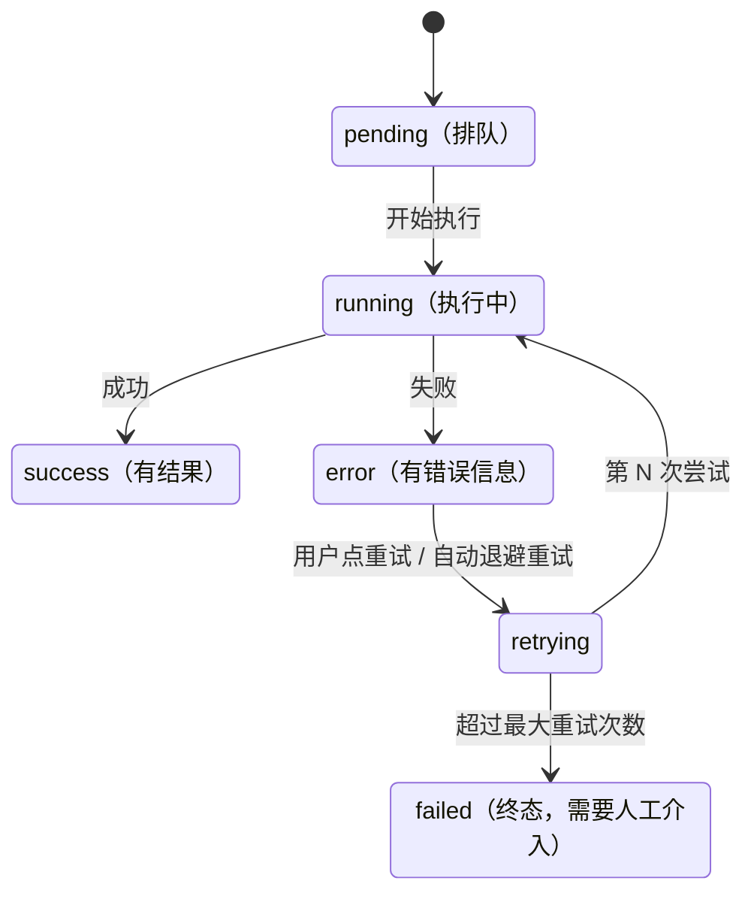

## F. AI 原生前端（当下最热，且与你的 Schema 线天然衔接）

F 族只有两个场景，却是当前招聘需求增长最快的一族。先说清楚"AI 原生前端"和"给 AI 产品套个壳"的区别：后者是把现成组件库拼成聊天页，前者要自己解决**流式数据的渲染问题**（增量解析、未闭合语法、中断恢复）、**LLM 输出的结构化消费问题**（JSON Schema 约束、schema 渲染器复用）、以及**长会话与高频更新的性能问题**（消息虚拟化、节点画布的 rAF 合并）。这三类问题恰好都落在你的既有技能延长线上：流式渲染是"列表性能"的新变体，生成式 UI 就是进阶大纲的 schema 渲染器换了个数据生产者，Agent 画布是 A4 节点编排 + Setter 面板的组合。这也是本族难度标"★★★☆☆ 入门，做好极难"的原因——做出 demo 一小时，做到生产级要吃透本节每一个小节。

### F1. 流式对话 / 生成式 UI（★★★☆☆ 入门，做好极难）

- **核心技术**：
  - 流式：fetch ReadableStream / SSE / Vercel AI SDK（useChat 抽象）；**流式 Markdown 的"未闭合代码块"渲染坑**（增量解析/分段渲染）；打字机与平滑滚动；中断（AbortController）/重新生成/编辑重发；token 速度与用量展示
  - 长会话性能：消息流虚拟化（动态高度）、可视区外 markdown 不渲染、图片/代码块懒渲染
  - **生成式 UI：LLM 结构化输出（JSON Schema 约束）→ 动态组件渲染**——本质就是你进阶大纲的 schema 渲染器，直接复用！
  - 工具调用/思考过程可视化（步骤折叠、状态流转、失败重试）；RAG 引用溯源（高亮跳转）；敏感内容遮罩
- **代表**：ChatGPT、Claude、Dify、Coze
- **入手**：做一个支持流式渲染/中断重发/工具调用折叠的聊天界面，再加一个"LLM 输出 schema → 页面实时渲染"的生成式 UI demo

以上是骨架，下面按"流式 → 渲染 → 交互 → 性能 → 结构化"的顺序逐个击破。

---

#### F1.1 流式的三条路：fetch ReadableStream / SSE / Vercel AI SDK

**是什么**：LLM 接口不会等全文生成完再返回，而是把回答切成小块（delta）边生成边推送。前端拿到的是一条 HTTP 长响应， body 是持续增长的字节流。所谓"三条路"，是把这条字节流变成 React state 的三种工程选择：自己解析（fetch + ReadableStream）、用浏览器内置协议（SSE + EventSource）、用官方抽象（Vercel AI SDK 的 useChat）。

**为什么需要**：如果用普通 `await res.json()`，用户要盯着空白等 10–60 秒——对话产品的体感生死线就在这里。流式把"首字节时间"从几十秒压到 1 秒内，后续内容持续到达。而理解三条路的差异，决定了你在"快速出 demo"和"深度定制"之间怎么选。

##### 路线一：fetch + ReadableStream 手动解析（必学底层）

这是最裸的一条路：POST 请求、读字节流、自己按 SSE 格式切事件、自己维护缓冲。所有上层封装（包括 useChat）内核都是这套逻辑，出了问题（中文乱码、事件粘包、中断异常）只有读过这条路的人能修。

怎么做，机制分四步：

1. `fetch` 拿到 `Response`，`res.body` 是 `ReadableStream<Uint8Array>`；
2. `getReader()` 循环 `read()`，每次拿到一个网络分片（一个分片可能含半个事件，也可能含三个事件）；
3. `TextDecoder` 把字节解成字符串——注意必须用 `stream: true` 模式，否则一个多字节中文字符恰好被网络包从中间切开时会解出乱码；
4. 按 SSE 协议切事件：事件以**空行**（`\n\n`）结尾，数据行以 `data: ` 开头，OpenAI 风格用 `data: [DONE]` 表示流结束。

完整代码：

```ts
// streamChat.ts —— 手动解析 SSE 格式的流式对话响应（生产可用的骨架）
export type ChatMessage = { role: 'user' | 'assistant' | 'system'; content: string }

export async function streamChat(options: {
  url: string
  body: unknown
  onDelta: (text: string) => void // 每收到一段增量文本就回调
  onDone?: () => void
  signal?: AbortSignal // 中断信号，见 F1.4
}): Promise<void> {
  const res = await fetch(options.url, {
    method: 'POST',
    headers: { 'Content-Type': 'application/json' },
    body: JSON.stringify(options.body),
    signal: options.signal, // abort() 后 fetch/read() 会抛 AbortError
  })

  // 注意：流式接口的错误体也可能是 JSON，不能只 throw，先尝试读出来给上层展示
  if (!res.ok) {
    const text = await res.text().catch(() => '')
    throw new Error(`HTTP ${res.status}: ${text.slice(0, 200)}`)
  }
  if (!res.body) throw new Error('当前环境不支持流式响应')

  const reader = res.body.getReader()
  const decoder = new TextDecoder('utf-8')
  let buffer = '' // 事件可能跨网络分片，必须留缓冲

  for (;;) {
    const { done, value } = await reader.read()
    if (done) break
    // stream:true 让 decoder 记住上一片的"半个字符"，多字节中文不乱码
    buffer += decoder.decode(value, { stream: true })

    // SSE 事件以空行分隔；最后一段可能不完整，pop 出来留到下一轮
    const events = buffer.split('\n\n')
    buffer = events.pop() ?? ''

    for (const evt of events) {
      // 一个事件内可能有多行 data:，按协议拼接
      const data = evt
        .split('\n')
        .filter((line) => line.startsWith('data:'))
        .map((line) => line.slice(5).trimStart())
        .join('\n')
      if (!data || data === '[DONE]') continue
      const json = JSON.parse(data) as {
        choices?: Array<{ delta?: { content?: string } }>
      }
      const delta = json.choices?.[0]?.delta?.content
      if (delta) options.onDelta(delta)
    }
  }
  options.onDone?.()
}
```

在组件里消费它（状态设计先给最简版，完整状态机见 F1.4）：

```tsx
import { useRef, useState } from 'react'
import { streamChat, type ChatMessage } from './streamChat'

export function useChatSimple() {
  const [messages, setMessages] = useState<ChatMessage[]>([])
  const abortRef = useRef<AbortController | null>(null)

  async function send(text: string) {
    const history = [...messages, { role: 'user' as const, content: text }]
    setMessages([...history, { role: 'assistant', content: '' }]) // 先放一条空的 assistant 占位
    const controller = new AbortController()
    abortRef.current = controller
    try {
      await streamChat({
        url: '/api/chat',
        body: { messages: history },
        signal: controller.signal,
        onDelta: (delta) => {
          setMessages((prev) => {
            const next = [...prev]
            const last = next[next.length - 1]
            next[next.length - 1] = { ...last, content: last.content + delta }
            return next
          })
        },
      })
    } catch (err) {
      if (!controller.signal.aborted) throw err // 用户主动中断不算错误
    }
  }

  return { messages, send, stop: () => abortRef.current?.abort() }
}
```

常见坑：

- **症状**：中文偶尔出现"�"。**根因**：没开 `decoder.decode(value, { stream: true })`，一个 UTF-8 三字节字符被拆在两个分片里。**修法**：如上开 stream 模式，且 decoder 实例要跨分片复用（每次 new 一个等于白开）。
- **症状**：偶发丢 delta 或 JSON.parse 报错。**根因**：直接对单个分片 `split('\n\n')` 后把所有段都当完整事件解析，没把末段留缓冲。**修法**：`events.pop()` 留 buffer。
- **症状**：流到一半服务端报错，页面无感知地"卡住"。**根因**：有些网关在 200 已发出后用流内错误事件（如 `data: {"error": ...}`）表达失败。**修法**：在 parse 后检查错误字段，抛给上层状态机。
- `res.ok` 为 false 时 body 可能不是流，用 `res.text()` 读错误体，别直接 `getReader()`。

##### 路线二：SSE 与 EventSource（标准协议，能力受限）

SSE（Server-Sent Events）是把"服务端单向推流"标准化的协议：`Content-Type: text/event-stream`，事件格式就是上面手工解析的那套（`data:` 行 + 空行结束）。浏览器给了原生 `EventSource` API：

```tsx
// SSEClient.tsx —— EventSource 订阅服务端事件流
import { useEffect, useState } from 'react'

export function useCounter(): number {
  const [count, setCount] = useState(0)

  useEffect(() => {
    // 只能 GET；鉴权只能靠 Cookie（带自定义 Authorization 头做不到）
    const es = new EventSource('/api/events?channel=demo')

    es.onmessage = (e) => {
      // e.data 是单个 data: 行的内容字符串，需要自己 JSON.parse
      const payload = JSON.parse(e.data) as { type: string; value?: number }
      if (payload.type === 'count') setCount(payload.value ?? 0)
    }

    // EventSource 断线自动重连（这是它最大的便利）；服务端可用 `retry: 3000` 控制间隔
    es.onerror = () => {
      // 这里通常什么都不用做，浏览器会自动重连；想彻底停掉必须 close()
    }

    return () => es.close() // 组件卸载必须关，否则连接泄漏
  }, [])

  return count
}
```

为什么对话场景反而**很少**直接用 EventSource——它的四个硬限制：

1. **只支持 GET**：对话要 POST 一大坨 messages 历史，URL 塞不下；
2. **不能带自定义 Header**：`Authorization: Bearer ...` 加不进去，只能靠 Cookie 鉴权；
3. **自动重连无法关闭定制**：对话流断了重发整段请求，服务端会重新生成一遍，成本翻倍；
4. **无进度抽象**：onmessage 拿不到"这次连接对应哪次请求"的语义。

它的正确用途：通知中心、行情推送、任务进度广播这类"可重放的幂等订阅"。对话场景若想借 SSE 的标准格式，业界通行做法是路线一（fetch POST 手动解析 SSE 格式）或 `@microsoft/fetch-event-source`（支持 POST + 自定义头 + 手动重连控制的库），而不是 EventSource。

##### 路线三：Vercel AI SDK 的 useChat（官方抽象，快速上手）

`useChat` 把"发请求、解析流、维护 messages、中断、重试、乐观更新"全部封装掉，你只写 UI：

```tsx
// app/chat/page.tsx —— 客户端
'use client'
import { useChat } from '@ai-sdk/react' // AI SDK v5；v4 从 'ai/react' 导入
import { useEffect, useRef } from 'react'

export default function Chat() {
  const { messages, input, handleInputChange, handleSubmit, isLoading, stop, reload, error } =
    useChat({ api: '/api/chat' })

  const bottomRef = useRef<HTMLDivElement>(null)
  useEffect(() => {
    bottomRef.current?.scrollIntoView() // 最简跟随；平滑版见 F1.3
  }, [messages])

  return (
    <div className="chat">
      {messages.map((m) => (
        <div key={m.id} className={m.role}>
          {/* v5 里消息内容在 m.parts 数组（text/tool 等分块）；v4 直接用 m.content */}
          {m.parts?.map((p, i) => (p.type === 'text' ? <p key={i}>{p.text}</p> : null))}
        </div>
      ))}
      {error && <p className="error">{error.message}</p>}
      <form onSubmit={handleSubmit}>
        <input value={input} onChange={handleInputChange} />
        {isLoading ? <button onClick={stop}>停止</button> : <button type="submit">发送</button>}
        {!isLoading && messages.length > 0 && <button onClick={reload}>重新生成</button>}
      </form>
      <div ref={bottomRef} />
    </div>
  )
}
```

```ts
// app/api/chat/route.ts —— 服务端（Next.js App Router）
import { streamText } from 'ai'
import { openai } from '@ai-sdk/openai'

export async function POST(req: Request) {
  const { messages } = await req.json()
  const result = streamText({
    model: openai('gpt-4o-mini'),
    messages,
  })
  // 把文本流包装成 UI 消息流；v5 的方法名是 toUIMessageStreamResponse，v4 为 toDataStreamResponse
  return result.toUIMessageStreamResponse()
}
```

useChat 替你做了什么（也是评估"要不要自己写"的清单）：messages 状态与乐观 user 消息、流解析（含工具调用、推理内容等 part 类型）、`stop()`（内部就是 AbortController）、`reload()`（重新生成上一轮）、错误与重试、自定义请求头/请求体钩子。

**什么时候仍要退回路线一**：后端不是 AI SDK 的流格式（自研网关、gRPC 转 SSE 的私有协议）；需要在 delta 层做自定义处理（敏感词实时遮罩的流内检测、token 计速）；消息模型和它的 `UIMessage` 结构差异太大（如需要把每条消息拆成自己的 part 结构）。此时用路线一的 `streamChat` + F1.4 的状态机即可，工作量可控。

##### 三条路怎么选（决策表）

| 维度 | fetch + ReadableStream | SSE / EventSource | Vercel AI SDK useChat |
|---|---|---|---|
| 掌握后能修的层 | 全链路（字节→事件→状态） | 协议层 | 抽象层，协议被封装 |
| 请求方式 | 任意（POST/头/体） | GET + Cookie | POST，可定制 |
| 开发速度 | 慢（自己写状态机） | 中 | 快（分钟级 demo） |
| 定制自由度 | 最高 | 低 | 中（钩子够用则高） |
| 适用 | 自研协议/深度定制/学习期 | 幂等推送类订阅 | Next.js 或 AI SDK 生态内的产品开发 |

结论：**先用 useChat 把产品跑起来，同时必须手写一遍路线一**——面试和线上排障考的都是后者。

---

#### F1.2 流式 Markdown 的"未闭合代码块"渲染坑（本节是 F1 的密度担当）

**是什么**：助手回复通常是 Markdown，流式期间页面要"边到边渲"。当代码块的开始围栏 ` ``` ` 已经到达、而结束围栏还没到达时，naive 的渲染方案会出各种诡异现象。这是流式对话 UI 的第一大坑，几乎所有自研聊天前端都在这里翻过车。

**为什么需要专门处理**——先看两种典型症状的根因。

症状 A：**整段文本"变成代码"再"跳回正文"**。LLM 输出：

````text
先看示例：

```python
def add(a, b):
    return a + b
```

上面函数返回两数之和。
````

流式到达 ` ```python ` 和函数体之后、结束围栏之前，文档处于"围栏未闭合"状态。CommonMark 规范规定：**未闭合的代码围栏会一直吞到文档末尾**。所以此时"上面函数返回两数之和"还没到达没关系；真正难受的是——结束围栏到达前的任何后续普通文本（比如 LLM 在代码后继续写的说明）都会先以等宽代码字体渲染，结束围栏到达瞬间再整段跳回正常排版。用户看到的是：文字先是代码样式，突然"啪"一下整块重排、宽度变化、闪烁。

症状 B：**未闭合内容整段消失**。很多自研方案为了性能会把 markdown 按"块"切分、逐块渲染；如果切块逻辑不认识未闭合围栏，就会把 ` ```python ... `（无闭合）这一段当成"非法块"丢弃或原样输出反引号——于是代码内容忽隐忽现，闭合时又突然出现，观感就是闪烁 + 跳变。

**为什么不能每个 token 全量重渲**（性能层面的第二重坑）：

1. 每个到达的 delta 都让 `content` 变成新字符串；`<ReactMarkdown>{content}</ReactMarkdown>` 会**重新解析整篇文档**。一篇 N 字符的回复、按平均 3 字符一个 delta 到达，就是 O(N) 次解析、每次 O(N) 工作量，总成本 O(N²)。回答到几千字符时，主线程开始被解析占满，打字动画掉帧、输入框卡顿。
2. memo 全部失效：所有块的 props（同一棵 AST 或同一字符串）每次都是新引用，整条消息的所有子块每 token 重渲一次。
3. 代码高亮是重灾区：若对代码块逐 token 跑语法高亮（shiki/Prism），一个 30 行代码块会触发上百次全文高亮，而高亮本身是毫秒级操作，乘上去就是灾难。

**怎么做（解法）**：按块分段渲染 + 稳定 key + memo 冻结前缀块 + 尾块特殊处理（未闭合围栏自动补一个虚拟闭合围栏，让它立刻按代码块渲染成型）。核心洞察是：**流式追加只可能改变最后一个块，前面的块一旦完整就永远不变**——利用这一点把 O(N²) 降为 O(N)，同时消灭症状 A/B。

第一步，切块器（识别围栏状态机的完整实现）：

```ts
// splitMarkdownBlocks.ts —— 把流式 markdown 切成"稳定块"
// 规则：闭合的代码块、空行分隔的段落都是完整块；文档末尾允许存在一个未完成块
export type Block = {
  key: string
  content: string
  kind: 'code' | 'text'
  closed: boolean // false = 可能还在生长（流式尾部）
}

export function splitMarkdownBlocks(md: string): Block[] {
  const lines = md.split('\n')
  const blocks: Block[] = []
  let current: string[] = []
  let inFence = false
  let fenceMark = '```' // 记录开围栏的符号与长度：闭合围栏必须不短于它

  const flush = (kind: 'code' | 'text', closed: boolean) => {
    if (current.length === 0) return
    // key 用"序号 + 首行前缀"：前缀块内容不变则 key 不变，memo 与列表 diff 都吃到稳定 key
    blocks.push({
      key: `${blocks.length}|${current[0].slice(0, 24)}`,
      content: current.join('\n'),
      kind,
      closed,
    })
    current = []
  }

  for (const line of lines) {
    const fence = line.match(/^\s*(`{3,}|~{3,})/)
    if (fence) {
      if (!inFence) {
        flush('text', true) // 围栏开始前，把累积的普通段落先切出去（完整）
        inFence = true
        fenceMark = fence[1]
        current.push(line)
      } else if (line.trim().length >= fenceMark.length && line.trim().startsWith(fenceMark[0].repeat(3))) {
        current.push(line)
        inFence = false
        flush('code', true) // 完整闭合的代码块：从此进入"冻结区"，永远不再变
      } else {
        current.push(line) // 代码内容里出现的 ``` 字符串，原样保留在块内
      }
      continue
    }
    if (!inFence && line.trim() === '') {
      flush('text', true) // 空行 = 段落边界（含标题/列表/引用的粗粒度切分）
      continue
    }
    current.push(line)
  }
  // 收尾：围栏外 → 段落可能没写完；围栏内 → 代码块未闭合
  flush(inFence ? 'code' : 'text', !inFence)
  return blocks
}
```

第二步，流式渲染组件（memo 冻结 + 尾块特殊处理）：

```tsx
// MarkdownStream.tsx —— 流式 markdown 渲染：只有最后一个块在重渲
import { memo, useMemo } from 'react'
import ReactMarkdown from 'react-markdown'
import remarkGfm from 'remark-gfm'
import { splitMarkdownBlocks } from './splitMarkdownBlocks'

// 单个稳定块：内容不变（引用相等）就跳过重渲 —— O(N²) 降到 O(N) 的关键
const StableBlock = memo(function StableBlock({ content }: { content: string }) {
  return (
    <div className="md-block">
      <ReactMarkdown remarkPlugins={[remarkGfm]}>{content}</ReactMarkdown>
    </div>
  )
})

export function MarkdownStream({ content, streaming }: { content: string; streaming: boolean }) {
  const blocks = useMemo(() => splitMarkdownBlocks(content), [content])
  const last = blocks.length - 1

  return (
    <div className="md-stream">
      {blocks.map((b, i) => {
        // 尾块且是未闭合代码块：补一个虚拟闭合围栏，让它立刻按代码块渲染成型
        // —— 这一步同时消灭"整段消失"（症状 B）和"闭合瞬间跳变"（症状 A 的主要来源）
        const isTail = i === last && streaming
        const tailContent =
          isTail && !b.closed && b.kind === 'code' ? b.content + '\n```' : b.content
        return (
          <div key={b.key} className={isTail && !b.closed ? 'md-tail' : undefined}>
            <StableBlock content={tailContent} />
            {isTail && !b.closed && <span className="md-caret" aria-hidden />}
          </div>
        )
      })}
    </div>
  )
}
```

机制分步总结（对照上面代码）：

1. **切块**：状态机扫行，围栏内不按空行切，保证代码块整体性；
2. **冻结**：所有 `closed: true` 的块用 `memo` + 稳定 key，流式期间零重渲；
3. **尾块成型**：未闭合代码块补虚拟 ` ``` `，渲染结果与最终闭合后一致，用户看到的代码块从第一行代码到达时就"长对了"；
4. **打字指示**：尾块挂一个光标符号，闭合/流结束后移除。

常见坑：

- **高亮时机**：别在尾块上跑语法高亮（每 token 全文高亮）。正确做法：`StableBlock` 接收 `closed`，代码块 `closed === true` 才走高亮（配合 F1.6 的懒高亮组件），尾块渲染纯 `<pre>` 即可——视觉上几乎无差别，性能差一个数量级。
- **表格是同款坑**：Markdown 表格需要"表头行 + 分隔行"才成立。流式中表头先到、分隔行未到时，remark 会把它当普通段落渲染，分隔行到达时跳变为表格。用同样的"尾块特殊处理"思路：尾块若以 `|` 开头就按表格进行时渲染（或暂时按纯文本），完成后再切回。
- **行内代码跨 chunk**：`` `code `` 的一半先到，remark 当普通文本渲染，另一半到达时跳变。这个问题只存在于尾块且幅度小，通常可接受；追求极致可以对尾块延迟 1–2 个 delta 再渲。
- **key 别用内容 hash**：内容 hash 对"前缀块不变"没有帮助（hash 稳定但 memo 比较的是 props 引用），用上面的"序号 + 首行前缀"就够了。
- **`remark-gfm` 与纯 remark 的差异**：GFM 开启后表格/删除语法/任务列表的"未完成态"表现不同，切块器只需处理围栏，其余交给尾块策略兜底。

---

#### F1.3 打字机效果与平滑滚动

**是什么**：打字机效果指界面不是 delta 一到就整段刷出，而是以接近恒定的视觉速度逐字浮现；平滑滚动指新内容到达时视口始终"钉"在底部，用户上滚阅读时立即停止跟随。

**为什么需要**：LLM 的 delta 到达节奏极不均匀——网络抖动时半秒没动静，然后一口气来 200 字符。直接渲染的观感是"卡住→爆出一段→又卡住"。打字机本质是一个**消费缓冲队列**：到达速度的抖动被队列吸收，输出速度恒定。平滑滚动则解决"我正在往上翻历史，新内容到达把视口拽到底部"的经典骚扰。

**怎么做（打字机）**——rAF 追赶式打字（比 setInterval 逐字更顺滑，且自适应落后程度）：

```tsx
// useSmoothText.ts —— 追赶式打字机：落后越多每帧吐得越多
import { useEffect, useRef, useState } from 'react'

export function useSmoothText(target: string, active: boolean) {
  const [shown, setShown] = useState(active ? '' : target)
  const shownRef = useRef(shown)

  useEffect(() => {
    if (!active) {
      // 非流式状态（历史消息/流已结束）：直接显示全文，不播动画
      shownRef.current = target
      setShown(target)
      return
    }
    let raf = 0
    const step = () => {
      const pending = target.length - shownRef.current.length
      if (pending > 0) {
        // 自适应步长：落后 40 字符以内每帧 1 字（约 60 字/秒的"打字感"）；
        // 落后更多则加速追赶，避免"越落越远"永远播不完
        const n = pending > 40 ? Math.ceil(pending / 6) : 1
        shownRef.current = target.slice(0, shownRef.current.length + n)
        setShown(shownRef.current)
      }
      raf = requestAnimationFrame(step)
    }
    raf = requestAnimationFrame(step)
    return () => cancelAnimationFrame(raf)
  }, [target, active])

  return shown
}
```

使用方式：`const shown = useSmoothText(assistantMessage.content, status === 'streaming')`，把 `shown` 喂给 F1.2 的 `MarkdownStream`。注意打字机 hook 与分段渲染天然兼容——`shown` 是 `content` 的前缀，切块器照样工作。

**怎么做（平滑滚动）**——stick-to-bottom（贴底跟随）三件套：

```tsx
// useStickToBottom.ts —— 视口贴底：用户上滚即脱钉，滚回底部重新钉住
import { useEffect, useRef, useState } from 'react'

export function useStickToBottom<T extends HTMLElement>() {
  const ref = useRef<T>(null)
  const [pinned, setPinned] = useState(true) // 是否贴底跟随

  // 1. 滚动监听：判定"用户是否在底部附近"
  useEffect(() => {
    const el = ref.current
    if (!el) return
    const onScroll = () => {
      const distance = el.scrollHeight - el.scrollTop - el.clientHeight
      setPinned(distance < 80) // 阈值 80px：容掉 iOS 橡皮筋与亚像素误差
    }
    el.addEventListener('scroll', onScroll, { passive: true })
    return () => el.removeEventListener('scroll', onScroll)
  }, [])

  // 2. 每次渲染（内容增长都会触发渲染）时，钉住则贴底
  useEffect(() => {
    const el = ref.current
    if (pinned && el) el.scrollTop = el.scrollHeight // 直接设置，不用 smooth，原因见下
  })

  return { ref, pinned }
}
```

配套 UI：`pinned === false` 时右下角浮出"回到底部"按钮（顺带显示"↓ 3 条新消息"）：

```tsx
import { useStickToBottom } from './useStickToBottom'

export function ChatScroll({ children }: { children: React.ReactNode }) {
  const { ref, pinned } = useStickToBottom<HTMLDivElement>()
  return (
    <div className="chat-scroll-wrap">
      <div ref={ref} className="chat-scroll">
        {children}
      </div>
      {!pinned && (
        <button
          className="jump-bottom"
          onClick={() => {
            const el = ref.current
            if (el) el.scrollTop = el.scrollHeight // 点击回底，下一帧会重新钉住
          }}
        >
          回到底部
        </button>
      )}
    </div>
  )
}
```

常见坑：

- **别用 `scrollIntoView({ behavior: 'smooth' })` 做流式跟随**。流式期间每秒触发十几次，多个 smooth 动画互相打断、视口来回"抽搐"。流式跟随用 `scrollTop` 直赋；smooth 只用在"回到底部"按钮这类单次动作上。
- **打字机 + 表格/公式**：逐字渲染表格尾块会持续重排，配合 F1.2 的尾块策略（未完成表格暂按文本渲）可接受；对延迟敏感的场景可以直接跳过打字机（`active=false`），ChatGPT 早期就是这么做的。
- **脱钉判定要 passive 监听**：scroll 回调里不要做重活，否则滚动掉帧；判定只需读三个属性做减法。
- **虚拟化列表的贴底**（F1.6）不能读 `scrollHeight` 死值——条目动态测量时它会变，改为在测量完成后由虚拟器回调里补一次贴底。

---

#### F1.4 中断、重新生成、编辑重发的状态设计

**是什么**：对话产品的三个高频动作——中断（用户点"停止生成"）、重新生成（对答案不满意，重掷一次）、编辑重发（改自己之前的问题，从那个分叉点重跑）——共享同一套状态机。

**为什么需要**：这三个动作都会打破"消息数组只追加"的简单模型：中断要在半截内容上停、重新生成要"删掉重来"、编辑重发要**截断历史**（ChatGPT 编辑旧消息后会产生新分支，旧分支可切换）。状态设计没做好，典型 bug 是：中断后点重新生成，页面上出现两条半截回答；或编辑重发后旧回答还挂在列表里。

**怎么做**：一个 reducer 管消息数组与运行状态，一个"唯一的发起入口"管流。三条铁律：

1. **运行状态只有一份**：新一轮开始前必须 abort 上一轮（编辑重发时尤其容易漏）；
2. **中断不是错误**：abort 保留半截内容（用户可能就想看前半段），错误则要给出重试入口；
3. **重新生成 = 弹出尾部 assistant 消息再跑；编辑重发 = 截断到目标 user 消息前、替换内容再跑**。

完整状态机代码：

```tsx
// useConversation.ts —— 对话状态机：发送 / 流式追加 / 中断 / 重新生成 / 编辑重发
import { useCallback, useReducer, useRef, useState } from 'react'
import { streamChat } from './streamChat'

type Message = { id: string; role: 'user' | 'assistant'; content: string }
type Status = 'idle' | 'streaming' | 'error'

type State = { messages: Message[]; status: Status; error: string | null }

type Action =
  | { type: 'reset'; messages: Message[] }                      // 截断/重置（编辑重发、清空）
  | { type: 'append'; message: Message }                        // 追加（user 提问 / assistant 占位）
  | { type: 'delta'; id: string; text: string }                 // assistant 增量
  | { type: 'status'; status: Status; error?: string | null }

function reducer(state: State, action: Action): State {
  switch (action.type) {
    case 'reset':
      return { ...state, messages: action.messages }
    case 'append':
      return { ...state, messages: [...state.messages, action.message] }
    case 'delta':
      return {
        ...state,
        messages: state.messages.map((m) =>
          m.id === action.id ? { ...m, content: m.content + action.text } : m,
        ),
      }
    case 'status':
      return { ...state, status: action.status, error: action.error ?? null }
  }
}

export function useConversation() {
  const [state, dispatch] = useReducer(reducer, { messages: [], status: 'idle', error: null })
  const abortRef = useRef<AbortController | null>(null)
  const messagesRef = useRef<Message[]>([])
  messagesRef.current = state.messages // 渲染时同步一份 ref，回调里永远读到最新值（防闭包旧值）

  // 唯一的"跑一轮"入口：所有动作（发送/重发/编辑）最终都归约到它
  const run = useCallback(async (history: Message[]) => {
    abortRef.current?.abort() // 铁律 1：掐掉上一轮，任何入口进来都先执行
    const controller = new AbortController()
    abortRef.current = controller
    const assistantId = `a-${Date.now()}-${Math.random().toString(36).slice(2, 7)}`

    dispatch({ type: 'append', message: { id: assistantId, role: 'assistant', content: '' } })
    dispatch({ type: 'status', status: 'streaming' })

    try {
      await streamChat({
        url: '/api/chat',
        body: { messages: history },
        signal: controller.signal,
        onDelta: (text) => dispatch({ type: 'delta', id: assistantId, text }),
      })
      dispatch({ type: 'status', status: 'idle' })
    } catch (err) {
      // 铁律 2：用户主动中断 → 保留半截内容，回到 idle（不算 error）
      if (controller.signal.aborted) {
        dispatch({ type: 'status', status: 'idle' })
        return
      }
      dispatch({ type: 'status', status: 'error', error: String(err) })
    }
  }, [])

  // 发送新消息
  const send = useCallback(
    (text: string) => {
      const userMsg: Message = { id: `u-${Date.now()}`, role: 'user', content: text }
      dispatch({ type: 'append', message: userMsg })
      run([...messagesRef.current, userMsg])
    },
    [run],
  )

  // 重新生成：弹掉尾部所有 assistant 消息（含被中断的半截），从最后一条 user 重跑
  const regenerate = useCallback(() => {
    const msgs = [...messagesRef.current]
    while (msgs.length && msgs[msgs.length - 1].role === 'assistant') msgs.pop()
    if (msgs.length === 0) return
    dispatch({ type: 'reset', messages: msgs }) // 铁律 3 前半：先删再跑，UI 不会出现双份
    run(msgs)
  }, [run])

  // 编辑重发：截断到 index 之前，替换 user 内容，从该分叉点重跑
  const editResend = useCallback(
    (index: number, newText: string) => {
      const head = messagesRef.current.slice(0, index) // 丢弃被编辑消息及其后全部消息
      const userMsg: Message = { id: `u-${Date.now()}`, role: 'user', content: newText }
      dispatch({ type: 'reset', messages: [...head, userMsg] })
      run([...head, userMsg])
    },
    [run],
  )

  // 中断：abort 会让 streamChat 的 fetch/read 抛 AbortError，走 run 里的 aborted 分支
  const stop = useCallback(() => abortRef.current?.abort(), [])

  return { ...state, send, stop, regenerate, editResend }
}
```

编辑入口 UI 的最小示意（hover 历史消息出现"编辑"，渲染列表时把消息下标传进来）：

```tsx
function EditableUserMessage({
  msg,
  index,
  onResend,
}: {
  msg: Message
  index: number
  onResend: (index: number, text: string) => void
}) {
  const [editing, setEditing] = useState(false)
  const [draft, setDraft] = useState(msg.content)
  if (!editing)
    return (
      <div className="msg user">
        {msg.content}
        <button onClick={() => setEditing(true)}>编辑</button>
      </div>
    )
  return (
    <div className="msg user editing">
      <input value={draft} onChange={(e) => setDraft(e.target.value)} />
      {/* 把消息自身在数组中的下标传给 editResend：截断语义以它为锚点 */}
      <button onClick={() => onResend(index, draft)}>保存并重发</button>
      <button onClick={() => setEditing(false)}>取消</button>
    </div>
  )
}
```

常见坑：

- **闭包旧值**：`send` 里如果直接读 `state.messages` 而不用 `messagesRef`，连续快速点发送会丢消息——两次点击共用同一个旧的 `messages` 快照。用 ref 镜像或函数式更新解决。
- **"中断后重新生成出现两条回答"**：根因是重新生成没有先 `reset` 弹掉半截 assistant，而是直接 `run` 追加了一条新占位。务必先删后跑。
- **编辑重发后的"分支历史"**：产品要 ChatGPT 式的分支切换（编辑保留旧分支可回看），需要把 `messages` 存成树（每条消息带 `parentId`，UI 沿 active 叶子回溯成链）。没有这个需求就不要上树，线性数组 + 截断即可。
- **AbortError 的类型判断**：不要 `catch (e) { if (e.name === 'AbortError') }` 了事——有的环境抛 DOMException、有的抛普通 Error，用 `controller.signal.aborted` 判断最稳（代码里已用）。

---

#### F1.5 token 速度与用量展示

**是什么**：流式期间展示 tok/s（生成速度）与累计 token 用量；流结束展示本轮/本次会话消耗。小功能，但它是用户感知"模型快慢、成本几何"的唯一窗口，也是调试提示词（输出过长）的仪表。

**为什么需要**：tok/s 是流式体验的客观指标（同一模型不同部署差 3–5 倍很常见）；用量展示在企业场景是刚需（按 token 计费，用户要知道这轮花了多少钱）。

**怎么做**，机制三步：

1. **速度**：滑动窗口统计——记录每个 delta 的 `{ chars, t }`，每 500ms 汇总最近 2 秒窗口内的字符数，按"约 4 字符 ≈ 1 token（英文）"估算；中文大约 1 字符 ≈ 0.6–1 token（不同 tokenizer 差异大，估算仅供展示）。
2. **精确用量**：OpenAI 兼容接口在流模式下通过 `stream_options: { include_usage: true }` 让最后一个 chunk 带上 `usage: { prompt_tokens, completion_tokens, total_tokens }`；以它为准覆盖估算值。
3. **展示**：流式中显示 `12.4 tok/s · 约 356 tokens`，结束后显示 `本轮 482 tokens（输入 320 / 输出 162）`。

```tsx
// useStreamRate.ts —— 滑动窗口 token 速率估算
import { useEffect, useRef, useState } from 'react'

type Sample = { chars: number; t: number }

export function useStreamRate() {
  const samplesRef = useRef<Sample[]>([])
  const [rate, setRate] = useState(0) // 估算 tok/s
  const [totalChars, setTotalChars] = useState(0)

  // 组件里把它接到 onDelta：record(delta.length)
  const record = (chars: number) => {
    samplesRef.current.push({ chars, t: performance.now() })
    setTotalChars((c) => c + chars)
  }

  useEffect(() => {
    const timer = setInterval(() => {
      const now = performance.now()
      const windowStart = now - 2000 // 只统计最近 2 秒
      samplesRef.current = samplesRef.current.filter((s) => s.t >= windowStart)
      const chars = samplesRef.current.reduce((sum, s) => sum + s.chars, 0)
      const charPerSec = chars / 2
      setRate(charPerSec / 4) // 4 字符 ≈ 1 token 的粗估，仅展示用
    }, 500)
    return () => clearInterval(timer)
  }, [])

  return { record, rate, totalTokens: Math.round(totalChars / 4) }
}
```

服务端开精确用量（OpenAI 兼容接口）：

```ts
// 服务端转发请求时带上 stream_options，最后一个 chunk 会包含 usage
await fetch('https://api.openai.com/v1/chat/completions', {
  method: 'POST',
  headers: { 'Content-Type': 'application/json', Authorization: `Bearer ${key}` },
  body: JSON.stringify({
    model: 'gpt-4o-mini',
    stream: true,
    stream_options: { include_usage: true }, // 关键：流模式也要 usage
    messages,
  }),
})
```

前端解析处加一个分支：`if (json.usage) dispatch({ type: 'usage', usage: json.usage })`。

常见坑：

- 估算值和真实值可能差 30%+（中英混排、代码、表情符的 token 密度完全不同），UI 上标注"约"，流结束用 `usage` 覆盖。
- 别每个 delta 都 `setState` 计速——采样窗口本身就该低频（500ms），高频 setState 会和打字机 hook 抢渲染。
- 重连/重新生成后要清零 `samplesRef` 与 `totalChars`，否则速率虚高。

---

#### F1.6 长会话性能：消息虚拟化、可视区外不渲染、懒高亮

**是什么**：会话超过几百条消息后，朴素的全量渲染会遇到三类成本：DOM 数量（每条消息几十到几百个节点，千条消息就是十万级 DOM）、markdown 解析（历史消息每次会话打开都要重新 parse）、代码块高亮（shiki 一块就要拉语法 + WASM）。解法分别是：消息流虚拟化（动态高度）、可视区外降级渲染、代码块/图片懒渲染。

**为什么需要**：虚拟化的动机与 B2 IM 完全一致（回指 B2 的"两级列表虚拟化"）——聊天记录只增不减，性能必须与总长度无关。动态高度是难点：消息高度依赖内容（一行文本 vs 一个 40 行代码块差 20 倍），且流式期间最后一条消息的高度持续变化。

**怎么做**——三层方案逐层叠加：

第一层：`@tanstack/react-virtual` 动态高度虚拟化。它按 `estimateSize` 先估、渲染后用 `measureElement` 实测修正，key 稳定时测量结果跨滚动复用：

```tsx
// MessageList.tsx —— 动态高度的消息流虚拟化
import { useEffect, useRef } from 'react'
import { useVirtualizer } from '@tanstack/react-virtual'
import { MarkdownStream } from './MarkdownStream'
import { useStickToBottom } from './useStickToBottom'
import type { Message } from './useConversation'

export function MessageList({
  messages,
  streamingId,
}: {
  messages: Message[]
  streamingId: string | null
}) {
  const { ref: scrollRef, pinned } = useStickToBottom<HTMLDivElement>()

  const rowVirtualizer = useVirtualizer({
    count: messages.length,
    getScrollElement: () => scrollRef.current,
    // 估算值只是初值，实测后自动修正；给个偏中性的 96
    estimateSize: () => 96,
    // key 必须是消息 id：重新生成/编辑重发导致数组截断时，测量缓存才能正确复用
    getItemKey: (i) => messages[i].id,
    overscan: 6, // 上下多渲染 6 条，滚动时不露白
  })

  // 流式期间最后一条消息高度持续增长，触发重新测量即可，虚拟器自己处理
  useEffect(() => {
    if (pinned && scrollRef.current) scrollRef.current.scrollTop = scrollRef.current.scrollHeight
  })

  return (
    <div ref={scrollRef} className="chat-scroll" style={{ height: '100%', overflowY: 'auto' }}>
      <div style={{ height: rowVirtualizer.getTotalSize(), position: 'relative' }}>
        {rowVirtualizer.getVirtualItems().map((vi) => {
          const msg = messages[vi.index]
          return (
            <div
              key={vi.key}
              data-index={vi.index}
              ref={rowVirtualizer.measureElement} // 实测高度回写，修正 estimate 的误差
              style={{
                position: 'absolute',
                top: 0,
                left: 0,
                width: '100%',
                transform: `translateY(${vi.start}px)`, // 用 transform 而非 top，走合成层
              }}
            >
              <div className={`msg ${msg.role}`}>
                {/* 历史消息 streaming=false，MarkdownStream 内部全部命中 memo，零解析成本 */}
                <MarkdownStream
                  content={msg.content}
                  streaming={msg.id === streamingId}
                />
              </div>
            </div>
          )
        })}
      </div>
    </div>
  )
}
```

第二层：可视区外不渲染 markdown。虚拟化本身已经不渲染视口外的行，但"上滚回看"会让离开视口的消息重新进入渲染——`MarkdownStream` 的 memo 让重进视口的开销变成"React 创建一遍 DOM"，而不必重新 parse markdown（parse 结果随组件实例销毁了）。要连 DOM 重建也省掉，用**内容快照降级**：离开视口较远的消息渲染纯文本快照（一个 `<div>{plain}</div>`），只有 overscan 范围内才挂 markdown 组件。写法是对比当前可视范围首尾 index 与该行 index 的距离：

```tsx
const items = rowVirtualizer.getVirtualItems()
const first = items[0]?.index ?? 0
const last = items[items.length - 1]?.index ?? 0
// ...
const nearViewport = vi.index >= first - 3 && vi.index <= last + 3
return (
  <div key={vi.key} data-index={vi.index} ref={rowVirtualizer.measureElement} style={rowStyle}>
    {nearViewport ? (
      <MarkdownStream content={msg.content} streaming={msg.id === streamingId} />
    ) : (
      // 降级：纯文本快照，结构与高度一致，重进视口再换回 markdown
      <div className="msg-plain">{msg.content}</div>
    )}
  </div>
)
```

（注意：降级块与 markdown 块高度要接近，否则来回切换引起测量抖动；`measureElement` 会在两种块之间修正，短暂抖动可接受。）

第三层：代码块懒高亮 + 图片懒加载。shiki 这类高亮器为了质量会带 Oniguruma WASM 和语法文件，不能为首屏的一块代码全量引入。模式：**先出纯文本 `<pre>`，进入视口前 200px 再动态 import 高亮器替换**：

```tsx
// LazyCodeBlock.tsx —— 进入视口前 200px 才加载高亮器
import { useEffect, useRef, useState } from 'react'

export function LazyCodeBlock({ code, lang }: { code: string; lang: string }) {
  const [html, setHtml] = useState<string | null>(null)
  const [near, setNear] = useState(false)
  const ref = useRef<HTMLPreElement>(null)

  // 1. 视口探测：rootMargin 提前 200px 预热
  useEffect(() => {
    const el = ref.current
    if (!el) return
    const io = new IntersectionObserver(
      (entries) => {
        if (entries[0].isIntersecting) {
          setNear(true)
          io.disconnect() // 一次即可
        }
      },
      { rootMargin: '200px' },
    )
    io.observe(el)
    return () => io.disconnect()
  }, [])

  // 2. 到达预热区才动态 import shiki（不进主包）
  useEffect(() => {
    if (!near || html) return
    let cancelled = false
    ;(async () => {
      const { codeToHtml } = await import('shiki')
      const out = await codeToHtml(code, { lang: lang === 'text' ? 'txt' : lang, theme: 'github-dark' })
      if (!cancelled) setHtml(out)
    })()
    return () => {
      cancelled = true
    }
  }, [near, code, lang, html])

  return html ? (
    <div className="shiki-host" dangerouslySetInnerHTML={{ __html: html }} />
  ) : (
    <pre ref={ref}>
      <code>{code}</code>
    </pre>
  )
}
```

图片懒加载用原生属性即可：``；聊天场景里图片最好再限高（`max-height: 320px; object-fit: contain`），避免一张长图把后续消息顶出屏幕。

常见坑：

- **`getItemKey` 不给 id 用下标**：编辑重发截断数组后，下标错位导致测量缓存张冠李戴，滚动时高度乱跳。这是虚拟化列表的第一戒律（进阶大纲 §1.3 的"key 用 nodeId 绝不用 index"同源）。
- **流式最后一条的测量抖动**：内容每 delta 增长一次，`measureElement` 修正一次总高度，若组件挂了打字机（F1.3）则每帧都在变。保持 `pinned` 贴底即可掩盖抖动；脱钉状态用户在看历史，不受影响。
- **overscan 过大 = 白虚拟**：overscan 20 在千条会话里等于常驻渲染几十条 markdown。6 左右足够。
- **首屏反着滚的 IM 特例**（最新消息在底部）：@tanstack/react-virtual 支持 `initialOffset` 与 `observeElementRect` 之外还有 `scrollMargin` 处理"列表从底部开始"的需求；简单做法是初始时 `scrollRef.current.scrollTop = scrollHeight`。

---

#### F1.7 生成式 UI：LLM 结构化输出 → schema 渲染器（最小可跑 demo）

**是什么**：生成式 UI（Generative UI）指 LLM 不输出 markdown 文本，而是输出一份**描述界面的 JSON**（组件类型 + 属性 + 嵌套结构），前端用一个 schema 渲染器把它变成真实组件。用户问"给我看下上周销售"，模型直接"画"出一张统计卡 + 一个趋势图，而不是一段文字。

**为什么需要**：文本对话的天花板是"读"，生成式 UI 把天花板提到"操作"——卡片上的按钮、表单、图表都是活的。而对 React 开发者，这里有个结构性利好：**LLM 结构化输出的消费端，就是你在进阶大纲 §1.2（组件注册表）/§1.3（递归渲染器）已经写过的东西**。低代码是"人拖出 schema"，生成式 UI 是"LLM 吐出 schema"，渲染内核一字不改。

**怎么做**，机制四步：

1. **定义 UI 协议**：与低代码协议同构——可序列化、声明式、discriminated union、节点带稳定 id（进阶大纲 §1.1 的设计原则原样适用）；
2. **约束 LLM 输出**：用 JSON Schema 做硬约束。OpenAI 的 `response_format: { type: 'json_schema', strict: true }` 会保证输出严格符合 schema（拒绝不合规则的生成）；Anthropic 走 tool use 的 `input_schema` 达到同等效果。**永远不要**指望"提示词里求它输出 JSON"——无约束时模型有概率输出带注释/尾逗号/前后闲话的非法 JSON；
3. **校验**：渲染前用 ajv 或 zod 校验一遍。即便接口承诺 strict，自建网关/换模型时这层是保命符；
4. **渲染**：注册表 + 递归渲染器，复用进阶大纲 §1.2/§1.3。

先看服务端的约束调用长什么样（真实接口）：

```ts
// api/generate-ui/route.ts —— 用 JSON Schema 硬约束 LLM 输出 UI 协议
import { openai } from '@ai-sdk/openai'
import { generateObject } from 'ai'
import { z } from 'zod'

// 1. 协议用 zod 定义（与前端 UI 节点类型一一对应，见下）
// 注意：strict 模式要求所有字段 required、additionalProperties: false，
// 可选语义用 union 里加 null 值表达，zod 4 的 z.toJSONSchema() 会处理这些细节
const UiSchema = z.union([
  z.object({
    id: z.string(),
    type: z.literal('heading'),
    props: z.object({ text: z.string(), level: z.union([z.literal(2), z.literal(3)]) }),
  }),
  z.object({
    id: z.string(),
    type: z.literal('paragraph'),
    props: z.object({ text: z.string() }),
  }),
  z.object({
    id: z.string(),
    type: z.literal('stat'),
    props: z.object({
      label: z.string(),
      value: z.string(),
      trend: z.union([z.literal('up'), z.literal('down')]),
    }),
  }),
  z.object({
    id: z.string(),
    type: z.literal('columns'),
    props: z.object({ gap: z.number() }),
    children: z.array(z.lazy(() => UiSchema)), // 递归结构：列容器
  }),
])

export async function POST(req: Request) {
  const { prompt } = await req.json()
  // 2. generateObject：AI SDK 的结构化输出封装，
  //    底层等价于 response_format json_schema strict（OpenAI）或 tool use（Anthropic）
  const { object } = await generateObject({
    model: openai('gpt-4o-mini'),
    schemaName: 'ui_tree',
    schema: z.array(UiSchema), // 顶层是一个节点数组（页面 = 节点列表）
    prompt: `为以下需求生成一页 UI（营销周报场景，可用 heading/paragraph/stat/columns）：${prompt}`,
  })
  return Response.json({ nodes: object })
}
```

前端的最小可跑 demo（**模拟 LLM 返回 schema → 注册表渲染**，无后端也能跑，直接复制进任意 React 项目）：

```tsx
// GenerativeUIDemo.tsx —— 生成式 UI 最小 demo：mock LLM + 注册表 + 递归渲染
import { memo, useEffect, useState, type ComponentType, type ReactNode } from 'react'

// ── 1. UI 协议（与进阶大纲 §1.1 的低代码协议同构）──────────────────────
export type UiNode =
  | { id: string; type: 'heading'; props: { text: string; level: 2 | 3 } }
  | { id: string; type: 'paragraph'; props: { text: string } }
  | { id: string; type: 'stat'; props: { label: string; value: string; trend: 'up' | 'down' } }
  | { id: string; type: 'columns'; props: { gap: number }; children: UiNode[] }

// ── 2. 注册表：type → 组件（进阶大纲 §1.2 原样复用）───────────────────
// 每个组件只依赖自己那类节点的 props，类型安全由映射表保证
type WidgetMap = {
  [K in UiNode['type']]: ComponentType<
    Extract<UiNode, { type: K }> extends { children: infer C }
      ? { node: Extract<UiNode, { type: K }>; children: C }
      : { node: Extract<UiNode, { type: K }> }
  >
}

function Heading({ node }: { node: Extract<UiNode, { type: 'heading' }> }) {
  const Tag = node.props.level === 2 ? 'h2' : 'h3'
  return <Tag>{node.props.text}</Tag>
}
function Paragraph({ node }: { node: Extract<UiNode, { type: 'paragraph' }> }) {
  return <p>{node.props.text}</p>
}
function Stat({ node }: { node: Extract<UiNode, { type: 'stat' }> }) {
  const { label, value, trend } = node.props
  return (
    <div className="stat-card">
      <div className="stat-label">{label}</div>
      <div className="stat-value">
        {value} <span className={trend === 'up' ? 'trend-up' : 'trend-down'}>{trend === 'up' ? '↑' : '↓'}</span>
      </div>
    </div>
  )
}
function Columns({
  node,
  children,
}: {
  node: Extract<UiNode, { type: 'columns' }>
  children: ReactNode
}) {
  return (
    <div className="columns" style={{ display: 'flex', gap: node.props.gap }}>
      {children}
    </div>
  )
}

const registry: WidgetMap = {
  heading: Heading,
  paragraph: Paragraph,
  stat: Stat,
  columns: Columns,
}

// ── 3. 递归渲染器（进阶大纲 §1.3 原样复用：memo + key 用节点 id）───────
const RenderNode = memo(function RenderNode({ node }: { node: UiNode }) {
  const Widget = registry[node.type]
  if (node.type === 'columns') {
    // 布局容器：递归 children
    return (
      <Widget node={node}>
        {node.children.map((child) => (
          <RenderNode key={child.id} node={child} />
        ))}
      </Widget>
    )
  }
  // 原子组件：终止递归
  return <Widget node={node} />
})

// ── 4. mock LLM：模拟"按 JSON Schema 约束返回 UI 协议"的延迟与产出 ────
function mockGenerateUI(prompt: string): Promise<UiNode[]> {
  return new Promise((resolve) => {
    setTimeout(() => {
      // 真实场景里这份数组来自 LLM；此处模拟"销售周报"意图的输出
      resolve([
        { id: 'h1', type: 'heading', props: { text: `销售周报：${prompt.slice(0, 12)}`, level: 2 } },
        {
          id: 'c1',
          type: 'columns',
          props: { gap: 12 },
          children: [
            { id: 's1', type: 'stat', props: { label: '本周 GMV', value: '¥2,431 万', trend: 'up' } },
            { id: 's2', type: 'stat', props: { label: '客单价', value: '¥386', trend: 'down' } },
            { id: 's3', type: 'stat', props: { label: '退款率', value: '1.9%', trend: 'down' } },
          ],
        },
        {
          id: 'p1',
          type: 'paragraph',
          props: { text: 'GMV 环比上升 12%，主要由华南大促带动；客单价小幅下滑，建议关注搭售策略。' },
        },
      ])
    }, 600)
  })
}

// ── 5. 页面：输入 → 生成 → 渲染 ────────────────────────────────────────
export function GenerativeUIDemo() {
  const [prompt, setPrompt] = useState('上周销售情况')
  const [nodes, setNodes] = useState<UiNode[] | null>(null)
  const [loading, setLoading] = useState(false)

  useEffect(() => {
    let cancelled = false
    setLoading(true)
    mockGenerateUI(prompt).then((result) => {
      if (!cancelled) {
        setNodes(result)
        setLoading(false)
      }
    })
    return () => {
      cancelled = true
    }
  }, [prompt])

  return (
    <div>
      <input value={prompt} onChange={(e) => setPrompt(e.target.value)} />
      {loading && <p>生成中…</p>}
      {nodes?.map((n) => <RenderNode key={n.id} node={n} />)}
    </div>
  )
}
```

这份 demo 与低代码渲染器的**唯一区别是 schema 的生产者**：低代码里是人拖出来的（进阶大纲 §3 的设计器），这里是 LLM 生成的。注册表、递归渲染、memo、key 策略全部照搬——这就是"生成式 UI 本质 = schema 渲染器"的具体含义。

进阶两个方向（有真实模型接口后再做）：

1. **流式生成 UI**：LLM 流式吐 JSON 时无法整段 parse。做法是流式累积字符串，用"容错 JSON 解析"（如 `partial-json` 这类库）边流边解析出已完整的子树，`RenderNode` 天然支持渐进渲染——子树完整一个渲染一个。协议设计时要让重要的摘要类节点（标题/统计卡）排在 children 前面，先出的先渲染。
2. **组件市场**：注册表做成可插拔的（进阶大纲 §1.2 的"注册表带物料元信息"），LLM 能用的组件越多，生成能力越强——这就与 D1 插件化合流了。

常见坑：

- **strict 模式下 zod schema 的限制**：OpenAI strict 要求所有属性 `required` 且 `additionalProperties: false`，`z.optional()` 会被拒绝——可选语义要用 `z.union([z.string(), z.null()])` 表达。`generateObject`/`z.toJSONSchema`（zod 4）会自动处理。
- **递归 schema 的深度**：限制 `columns` 嵌套层数（prompt 或 schema 里约束），LLM 偶尔会生成自嵌套 runaway 结构，渲染器最好加一个 maxDepth 保险（超过按纯文本渲染）。
- **id 生成**：让 LLM 顺带输出 id（schema 里要求），别渲染时用数组下标——LLM 修正输出（重生成）时下标会漂移，React 状态错乱。
- **危险组件白名单**：注册表是封闭集合，LLM 只能"选"，不能"造"（比如输出 `{ type: 'script' }` 时 registry 查不到，直接降级渲染成错误占位）。永远不要把"任意 HTML 渲染"当生成式 UI。

---

#### F1.8 工具调用与思考过程可视化

**是什么**：现代对话应用里，一条 assistant 回复常常不止文本：先是"思考过程"（reasoning），中间夹着若干次工具调用（tool call：查数据库、调搜索、执行代码），最后才是答案。UI 要把这条"执行轨迹"可视化：步骤折叠、状态流转、失败重试。

**为什么需要**：用户对"卡住 20 秒"的容忍度取决于透明度——看得见"正在搜索 → 正在读取第 3 个文件"就愿意等；调试 Agent 也依赖这个面板定位"哪一步的参数错了"。这是 Dify/Coze 类产品的标配组件。

**怎么做**——先定状态机，再做组件。

状态机（工具步骤的完整生命周期）：



数据模型与流转函数：

```ts
// toolSteps.ts —— 工具步骤的数据模型与纯函数流转
export type ToolStatus = 'pending' | 'running' | 'success' | 'error' | 'retrying' | 'failed'

export type ToolStep = {
  id: string
  name: string // 如 web_search / query_db / run_code
  args: unknown // 调用参数（LLM 生成）
  result?: unknown // 成功结果
  error?: string // 失败原因
  status: ToolStatus
  attempts: number // 已尝试次数（重试计数）
  startedAt?: number
  endedAt?: number
}

export const MAX_RETRIES = 2

// 纯函数：事件 → 新状态。所有流转集中在此，组件只管映射渲染
export function transition(step: ToolStep, event: ToolEvent): ToolStep {
  switch (event.type) {
    case 'start':
      return { ...step, status: 'running', startedAt: Date.now() }
    case 'success':
      return { ...step, status: 'success', result: event.result, endedAt: Date.now() }
    case 'error':
      return {
        ...step,
        status: step.attempts >= MAX_RETRIES ? 'failed' : 'error',
        error: event.message,
        endedAt: Date.now(),
      }
    case 'retry':
      if (step.status !== 'error') return step // 只有 error 态可重试，防止 success 后误触发
      return { ...step, status: 'retrying', attempts: step.attempts + 1 }
    case 'retry_started':
      return { ...step, status: 'running', error: undefined, startedAt: Date.now(), endedAt: undefined }
    default:
      return step
  }
}

type ToolEvent =
  | { type: 'start' }
  | { type: 'success'; result: unknown }
  | { type: 'error'; message: string }
  | { type: 'retry' }
  | { type: 'retry_started' }
```

组件（折叠 + 状态色 + 重试按钮）：

```tsx
// ToolStepView.tsx —— 单个工具步骤：可折叠、状态可视、失败可重试
import { useState } from 'react'
import type { ToolStep } from './toolSteps'

const STATUS_META: Record<ToolStep['status'], { label: string; className: string }> = {
  pending: { label: '排队中', className: 'st-pending' },
  running: { label: '执行中', className: 'st-running' },
  success: { label: '成功', className: 'st-success' },
  error: { label: '失败', className: 'st-error' },
  retrying: { label: '重试中', className: 'st-retrying' },
  failed: { label: '已失败', className: 'st-failed' },
}

export function ToolStepView({
  step,
  onRetry,
}: {
  step: ToolStep
  onRetry: (stepId: string) => void
}) {
  const [open, setOpen] = useState(false)
  const meta = STATUS_META[step.status]
  const duration =
    step.startedAt && step.endedAt ? `${((step.endedAt - step.startedAt) / 1000).toFixed(1)}s` : null

  return (
    <div className={`tool-step ${meta.className}`}>
      <button className="tool-head" onClick={() => setOpen((v) => !v)} aria-expanded={open}>
        <span className="chevron">{open ? '▾' : '▸'}</span>
        <span className="tool-name">{step.name}</span>
        <span className="tool-status">{meta.label}</span>
        {duration && <span className="tool-dur">{duration}</span>}
        {step.attempts > 0 && <span className="tool-attempts">第 {step.attempts + 1} 次</span>}
      </button>

      {open && (
        <div className="tool-body">
          <section>
            <h4>参数</h4>
            <pre>{JSON.stringify(step.args, null, 2)}</pre>
          </section>
          {step.result != null && (
            <section>
              <h4>结果</h4>
              <pre>{JSON.stringify(step.result, null, 2)}</pre>
            </section>
          )}
          {step.error && (
            <section>
              <h4>错误</h4>
              <pre className="tool-error">{step.error}</pre>
            </section>
          )}
        </div>
      )}

      {/* 只有 error 态展示重试入口；failed 是终态（超过次数上限），提示人工介入 */}
      {step.status === 'error' && (
        <button className="tool-retry" onClick={() => onRetry(step.id)}>
          重试此步骤
        </button>
      )}
      {step.status === 'failed' && <span className="tool-manual">重试次数用尽，请检查参数或权限</span>}
    </div>
  )
}
```

失败重试的链路说明：单步重试需要后端支持"从某个 toolCallId 重新执行并接续对话"——请求体里带 `retryToolCallId`，服务端从该步骤起重放（Agent 框架的执行器普遍支持按步骤重放）。前端做的只是把用户意图（retry）翻译成请求 + 把该步骤状态置回 `retrying → running`。自动退避重试（网络类错误 500ms/2s 两挡）在 `onDelta` 事件循环里加一个 setTimeout 递归即可，但要设置 MAX_RETRIES 上限并在 UI 上如实显示尝试次数——静默重试会让用户误以为"模型很慢"。

**思考过程（reasoning）可视化**与工具步骤同构：把 reasoning 也当成一种 step（`name: 'thinking'`），默认折叠、流式期间展示末尾两行 + 呼吸动画。差别只在两点：思考内容通常整段替换而非追加（部分模型会输出多轮思考），折叠态要保留高度下限避免展开时跳动。

常见坑：

- **状态与消息分离**：工具步骤挂在 assistant 消息的 parts 里（`message.parts: [{type:'text'...}, {type:'tool-step', step}]`），不要放进全局 store 单独管理——编辑重发（F1.4）截断历史时，步骤要跟着消息一起被丢弃，挂在消息上天然正确。
- **折叠态别渲染大 JSON**：折叠时只渲染头部一行，`open` 才渲染参数/结果 JSON。几百 KB 的工具结果（如整页搜索返回）必须虚拟化或截断展示（"显示前 5KB"）。
- **错误信息要提纯**：把原始异常直接给用户看（含堆栈、内部 URL）既不友好也泄漏信息。`error.message` 做一层映射（网络错误/超时/权限/参数非法四类）。

---

#### F1.9 RAG 引用溯源（高亮跳转交互）

**是什么**：RAG（检索增强生成）场景下，回答里的每个论断都来自检索到的文档片段。UI 要做两件事：**行内引用角标**（`……同比增长 12%【1】`，可点击）与**溯源面板跳转**（点击后右侧原文卡片滚动定位到对应片段并高亮，反向可从原文跳回引用处）。

**为什么需要**：没有溯源的 RAG 回答无法核验，用户信任度断崖式下跌；企业知识库场景里"引用可点击"是验收标准而不是加分项。

**怎么做**，机制三步：

1. **数据模型**：回答不再是纯字符串，而是 parts 数组——文本片段与引用标记交错；引用的 `citationId` 关联到 sources 集合（含文档标题与原文片段）。这些结构由服务端在生成 RAG 回答时一并产出；
2. **行内渲染**：文本 part 照常渲染，引用 part 渲染成 `<sup>` 角标按钮；
3. **跳转高亮**：点击角标 → 右侧面板 `scrollIntoView` 定位到 source 卡片 → 加一个 CSS 动画类（背景闪两下）。

```tsx
// RagAnswer.tsx —— 引用角标 + 溯源面板的高亮跳转
import { useRef, useState } from 'react'

type Source = { id: string; docTitle: string; snippet: string }
type Part = { type: 'text'; text: string } | { type: 'citation'; citationId: string }

// 服务端产出的消息结构示例：
// parts: [
//   { type: 'text', text: '第三季度营收 ' },
//   { type: 'citation', citationId: 'src-1' },
//   { type: 'text', text: '，同比增长 12%，主要由企业级订阅带动' },
//   { type: 'citation', citationId: 'src-2' },
// ]
export function RagAnswer({ parts, sources }: { parts: Part[]; sources: Source[] }) {
  const [activeId, setActiveId] = useState<string | null>(null)
  const panelRef = useRef<HTMLDivElement>(null)

  // 点击角标：记录激活 + 滚动定位 + 触发高亮动画
  const jumpToSource = (id: string) => {
    setActiveId(id)
    requestAnimationFrame(() => {
      // rAF 下一帧再查 DOM：确保新渲染的 active 类已挂上
      const el = panelRef.current?.querySelector(`[data-source-id="${id}"]`)
      el?.scrollIntoView({ behavior: 'smooth', block: 'center' })
    })
  }

  return (
    <div className="rag-layout">
      <div className="rag-answer">
        {parts.map((p, i) =>
          p.type === 'text' ? (
            <span key={i}>{p.text}</span>
          ) : (
            <sup key={i} className={`cite ${activeId === p.citationId ? 'cite-active' : ''}`}>
              <button onClick={() => jumpToSource(p.citationId)}>
                {sources.findIndex((s) => s.id === p.citationId) + 1}
              </button>
            </sup>
          ),
        )}
      </div>

      <div className="rag-sources" ref={panelRef}>
        <h4>引用来源（{sources.length}）</h4>
        {sources.map((s, idx) => (
          <div
            key={s.id}
            data-source-id={s.id}
            className={`source-card ${activeId === s.id ? 'source-flash' : ''}`}
          >
            <div className="source-title">
              [{idx + 1}] {s.docTitle}
            </div>
            <p className="source-snippet">{s.snippet}</p>
          </div>
        ))}
      </div>
    </div>
  )
}
```

配套的高亮动画 CSS（进入视口后闪两下黄底）：

```css
/* source-flash：跳转定位后的高亮闪烁 */
.source-flash {
  animation: source-flash 1.6s ease-out;
}
@keyframes source-flash {
  0% { background: rgba(250, 204, 21, 0.45); }
  60% { background: rgba(250, 204, 21, 0.45); }
  100% { background: transparent; }
}
.cite-active button {
  background: #2563eb; /* 激活的角标染主色，双向可见"当前在看哪条引用" */
  color: #fff;
}
```

反向跳转（从原文卡片跳回引用处）：给每个角标加 `data-cite-id`，卡片上加"定位引用"按钮，`querySelector` + `scrollIntoView` 对称实现，此处逻辑与上面同构。

常见坑：

- **引用标记别让 LLM 输出成裸文本**：如果模型直接输出 `【1】` 字符串，前端只能靠正则猜——引用与文本的边界经常错。正确做法是结构化 parts（服务端在检索命中位置切分文本插入 citation part），或让模型按协议输出特殊 token（如 `<cite id="src-1"/>`）再由前端解析切分。
- **长片段折叠**：source 卡片的 snippet 默认 3 行 + "展开全文"；溯源面板本身超过 20 条也要虚拟化（复用 F1.6 的方案）。
- **流式期间角标闪烁**：引用 part 到达前，文本 part 里"同比增长 12%"后面紧跟着可能是半个角标 token。parts 模型天然规避（每个 part 原子到达），这也是坚持结构化 parts 的第二个理由。

---

#### F1.10 敏感内容遮罩

**是什么**：回答里可能包含不适合直接可见的内容——用户手机号/邮箱（PII）、内部价格、未过审的推理细节。UI 上表现为一段模糊（blur）文本，点击"显示"并确认后可见，展示行为要留痕。

**为什么需要**：合规红线（个人信息保护、企业数据分级）+ 产品信任。注意遮罩的**检测**必须在服务端做（客户端正则既不可靠也可被绕过——打开 devtools 就能看到明文），前端只负责"按服务端给的区间渲染遮罩 + 控制揭示交互"。

**怎么做**，机制三步：

1. 服务端在流式转发时对累计文本做检测（PII 正则/分类器），输出 `maskSpans: [{ start, end, reason }]`（字符区间）。**区间基于全量累计文本计算**，追加式更新下旧区间永不变位；
2. 前端渲染时把 `content` 按 spans 切成交错的明文段与遮罩段；
3. 遮罩段渲染 blur + 揭示按钮；揭示状态按 span 索引记录（用户揭示第 2 段不影响第 1 段）。

```tsx
// MaskedAnswer.tsx —— 按服务端区间渲染敏感内容遮罩
import { useState } from 'react'

type MaskSpan = { start: number; end: number; reason: 'pii' | 'confidential' }

// 把全文切成 [明文, 遮罩, 明文, 遮罩, ...] 的段序列
function splitBySpans(text: string, spans: MaskSpan[]) {
  const segments: Array<{ text: string; masked: boolean; reason?: string }> = []
  let cursor = 0
  for (const span of spans) {
    if (span.start > cursor) segments.push({ text: text.slice(cursor, span.start), masked: false })
    segments.push({ text: text.slice(span.start, span.end), masked: true, reason: span.reason })
    cursor = span.end
  }
  if (cursor < text.length) segments.push({ text: text.slice(cursor), masked: false })
  return segments
}

export function MaskedAnswer({
  content,
  spans,
  onReveal,
}: {
  content: string
  spans: MaskSpan[]
  onReveal?: (spanIndex: number) => void // 揭示留痕：审计要求记录谁在何时看了敏感段
}) {
  const [revealed, setRevealed] = useState<Set<number>>(new Set())
  const segments = splitBySpans(content, spans)

  return (
    <p className="masked-answer">
      {segments.map((seg, i) =>
        !seg.masked ? (
          <span key={i}>{seg.text}</span>
        ) : revealed.has(i) ? (
          <span key={i} className="masked revealed">
            {seg.text}
          </span>
        ) : (
          <span key={i} className="masked blur" data-reason={seg.reason}>
            {seg.text}
            <button
              className="reveal-btn"
              onClick={() => {
                setRevealed((prev) => new Set(prev).add(i))
                onReveal?.(i) // 上报揭示事件
              }}
            >
              显示{seg.reason === 'pii' ? '个人信息' : '敏感内容'}
            </button>
          </span>
        ),
      )}
    </p>
  )
}
```

配套样式（blur 遮罩 + 揭示按钮悬浮）：

```css
.masked.blur {
  filter: blur(6px);           /* 用 blur 而非 ■■■：保留长度与排版形状，阅读节奏不破 */
  user-select: none;           /* 遮罩期禁止选中复制 */
  position: relative;
  cursor: pointer;
}
.masked.blur .reveal-btn {
  position: absolute;
  inset: 0;
  opacity: 0;                  /* 按钮透明铺满，点击整段即可揭示 */
}
.masked.revealed {
  background: #fef9c3;         /* 揭示后淡黄底，提醒"这段是敏感的" */
}
```

常见坑：

- **遮罩区间跨 delta 的正确性**：不要在每个 delta 到达时对"本 delta"单独检测后把区间相对化——一律对全量累计文本计算绝对区间，前端渲染时按绝对区间切。追加更新下这个模型永不错位；若服务端会"改写"已输出文本（罕见，如自动纠错），区间必须整体重算并 reset 揭示状态。
- **blur 会防住截屏吗**：不会，devtools 里就是明文。blur 是"交互层提醒"不是"安全层"，真正的脱敏（打码后再下发）在服务端对高密级场景仍是必须的。两层的取舍要在评审时讲清楚。
- **别用 `-webkit-text-security` 或 `color: transparent`**：前者兼容性差且形状语义不对；后者用户一划选就能复制。`filter: blur` + `user-select: none` 是当前通行做法。
- **无障碍**：读屏用户会被 blur 内容困惑，遮罩段要加 `aria-label="已遮罩的敏感内容，按回车显示"`（button 本身天然可聚焦，Enter 揭示），揭示后恢复正常朗读。

---

#### F1 小结与练习路径

把 F1 的十个小节串成一条实现顺序（也是"入手"任务拆解）：

1. 用 useChat 或 F1.1 的 `streamChat` 跑通最小流式（半天）；
2. 引入 F1.2 的 `MarkdownStream`，造一个会输出长代码块的真实 prompt 复现并修复"未闭合"坑（1 天）；
3. 加 F1.3 打字机与贴底滚动、F1.4 中断/重新生成/编辑重发（2 天）；
4. 加 F1.8 工具步骤折叠与重试、F1.9 引用溯源、F1.10 遮罩（2–3 天）；
5. 用 500 条 mock 消息压测，做 F1.6 虚拟化与懒高亮（2 天）；
6. 最后做 F1.7 生成式 UI demo，接真实模型替换 mock（2 天）。

**代表**：ChatGPT、Claude、Dify、Coze——建议精读 Vercel AI SDK 的 chat 模板（官方 streamChat/generative UI 示例代码量小、结构正，是 F1 的"标准答案"级参考）。

✍️ **入手（验收标准升级版）**：做一个支持流式渲染/中断重发/工具调用折叠的聊天界面，再加一个"LLM 输出 schema → 页面实时渲染"的生成式 UI demo。验收：流式期间打开 Performance 面板录 10 秒，无长任务（>50ms）超标；中断后重新生成不产生重复消息；mock 500 条消息滚动如丝。

---

### F2. Agent 工作流画布（★★★★☆）

- **画像**：Dify/Coze 的编排页 = A4 节点画布 + 你的低代码 Setter
- **核心技术**：React Flow 节点编排 + 节点运行态流式更新（高频 setNode 的性能合并）、调试面板（单节点输入输出）、版本对比（monaco diff 复用）
- **入手**：接 F1 的项目：画布编排"搜索→总结→生成"三步，运行时节点实时高亮

**为什么说 F2 = A4 + Setter（组合论证）**。拆开 Dify 的编排页看，它由三块组成，每块都在你已学的地图上：

1. **中间的画布**：拖节点、连线、校验连接合法性、自动布局、小地图——这就是 A4 节点编排的全部内容（React Flow 的自定义节点/边、`isValidConnection` 类型校验、dagre 自动布局）。F2 在画布机制上几乎没有新知识；
2. **右侧的属性面板**：选中一个"LLM 节点"，面板里出现模型选择、温度滑杆、system prompt 多行文本、变量绑定——这就是进阶大纲 §3 表单设计器的属性区（Setter 体系）：节点协议里声明 `paramsSchema`，面板用 schema 动态表单渲染（进阶大纲 §2 的成果直接复用）。换句话说，**Agent 节点 = 低代码物料的运行态亲戚**：低代码物料的 props 由设计者配置，Agent 节点的 params 由编排者配置，配置界面的实现是同一套 schema 驱动表单；
3. **运行态与调试**：这是 F2 真正的新增内容——画布从"静态编辑"变成"实时执行的监控面板"，节点状态高频流式更新（下面重点展开）、单节点输入输出可查（调试面板）、两个版本的 DSL 可 diff（版本对比）。

一句话：**画布复用 A4，属性面板复用 Setter，新增的只有"运行态"这一层**。这也是为什么 F2 难度标 ★★★★☆ 而不是五星——它的两大件你都已经有了。

#### F2.1 React Flow 节点编排（回指 A4，只讲增量）

画布本身按 A4 的路线做即可（自定义节点/边、`isValidConnection` 连线校验、dagre 自动布局、小地图）。F2 对 A4 的增量只有三点：

1. **节点协议要带 paramsSchema**，供 Setter 面板消费：

```ts
// agentDsl.ts —— Agent 工作流 DSL 的节点定义
import type { Node, Edge } from '@xyflow/react'

export type AgentNodeData = {
  title: string
  // 该节点属性面板的 schema（复用进阶大纲 §2 动态表单的协议）
  paramsSchema: {
    type: 'object'
    properties: Record<string, { type: string; title: string; enum?: string[] }>
  }
  params: Record<string, unknown> // 编排者填的参数值
  run?: RunState // 运行态（只在运行时存在，序列化 DSL 时剥离）
}

export type RunState = {
  status: 'idle' | 'queued' | 'running' | 'success' | 'error'
  outputPreview?: string
  durationMs?: number
}

export type AgentFlow = { nodes: Node<AgentNodeData>[]; edges: Edge[] }
```

2. **边上有变量引用语义**：上游节点的输出（如 `{{search_1.result}}`）可以在下游节点的 params 里引用。实现上用进阶大纲 §1.4 的表达式引擎，求值上下文注入各节点输出：`{ $nodes: { search_1: { result: '...' } } }`；
3. **连线类型校验更严**：LLM 节点不能直接连向量库输出等约束，用 A4 的 `isValidConnection`（回指 A4 的"连线规则校验（类型约束）"）。

#### F2.2 节点运行态流式更新：为什么必须 rAF 合并（100 节点卡死的机理）

**是什么**：工作流运行时，后端通过 SSE/WebSocket 推送每个节点的状态变化（queued → running → success、流式输出的预览片段、耗时）。前端要把这些变化实时反映到画布节点上。本节回答：为什么"收到事件就 setNodes"在 100 节点规模下会卡死，以及 rAF 合并为什么是标准解法。

**卡死机理分四层拆解**：

1. **事件频率远超渲染预算**。一次 10 节点 Chain 的运行，LLM 节点逐 token 推 preview，三个 LLM 节点并发，事件流轻松达到每秒 60–120 条。100 节点的大工作流调试回放（时间倍速）时，事件频率再乘几倍。
2. **每次 setNodes 都换整个数组**。`setNodes(nds => nds.map(...))` 产生新数组引用——哪怕只改了一个节点的 `data.status`。React Flow 的 store（内部基于 zustand）随之通知所有订阅"nodes 数组"的消费者：节点坐标系组件、边计算、小地图、以及所有自定义节点的外层 wrapper。
3. **React 18 自动批处理救不了跨任务的高频更新**。自动批处理合并的是**同一个任务里**的多次 setState；而每条 SSE/WebSocket 事件都是独立的宏任务——事件 A 触发的一次 setNodes 已经完成渲染提交，事件 B 的 setNodes 是下一轮完整渲染。也就是说每秒 120 条事件 = 每秒最多 120 次完整 render + commit，而屏幕只有 60 帧，一半的渲染白做，主线程被 reconciler 和 React Flow 的节点测量占满，输入事件（拖画布、滚轮缩放）排队超时——用户观感就是"卡死"。
4. **自定义节点重渲放大成本**。每个节点组件里有状态徽章、耗时计算、输出预览的 markdown（F1.2 的组件）。100 个节点里哪怕只有 1 个的数据真的变了，如果组件没被 `memo` 且 props 引用全变（常见错误：inline 传对象 `data={{...}}`），就是 100 个组件全量重渲。

**解法：rAF 合并（每帧最多一次提交）**。把"事件到达"与"状态提交"解耦：事件只写入一个待处理队列（Map，天然去重合并同一节点的多次更新），调度一个 `requestAnimationFrame`，在下一帧统一 flush 一次。这样无论事件多密集，渲染频率被钳制在 60fps，每次 flush 还把同一节点同帧内的多次 patch 合并成一次。

```tsx
// useNodePatches.ts —— 高频节点运行态更新的 rAF 合并器
import { useCallback, useEffect, useRef } from 'react'
import { useReactFlow, type Node } from '@xyflow/react'

type NodeDataPatches = Map<string, Record<string, unknown>> // nodeId → 待合并的 data 补丁

export function useNodePatches() {
  const { setNodes } = useReactFlow()
  const queueRef = useRef<NodeDataPatches>(new Map())
  const rafRef = useRef(0)

  // flush：每帧最多执行一次，把队列里的补丁合并进 nodes
  const flush = useCallback(() => {
    rafRef.current = 0
    const queue = queueRef.current
    if (queue.size === 0) return
    queueRef.current = new Map() // 先换新队列：flush 期间新到的事件进下一帧
    setNodes((nds) =>
      nds.map((n) => {
        const patch = queue.get(n.id)
        // 未被 patch 的节点保持原引用 —— memo 才能跳过它们（见下方注意点）
        return patch ? ({ ...n, data: { ...n.data, ...patch } } as Node) : n
      }),
    )
  }, [setNodes])

  const patch = useCallback(
    (nodeId: string, dataPatch: Record<string, unknown>) => {
      const queue = queueRef.current
      // 同一节点同帧多次 patch 直接合并：最后写入覆盖前面的键
      queue.set(nodeId, { ...(queue.get(nodeId) ?? {}), ...dataPatch })
      if (rafRef.current === 0) {
        // 只在没有待执行帧时调度：事件风暴下也只跑每帧一次
        rafRef.current = requestAnimationFrame(flush)
      }
    },
    [flush],
  )

  useEffect(() => () => cancelAnimationFrame(rafRef.current), []) // 卸载清理
  return patch
}
```

使用（运行事件 → patch → 节点徽章变色；演示用定时器模拟事件流，真实接入换成 SSE/WebSocket，解析复用 F1.1 的 `streamChat`）：

```tsx
// AgentCanvas.tsx —— 运行事件驱动节点状态
import { useEffect } from 'react'
import { ReactFlow, type NodeProps, type Node } from '@xyflow/react'
import { useNodePatches } from './useNodePatches'
import type { AgentNodeData, AgentFlow } from './agentDsl'

function AgentNode({ data }: NodeProps<Node<AgentNodeData>>) {
  const run = data.run // 只在自己的 data 变化时重渲（配合外层 memo）
  return (
    <div className={`agent-node st-${run?.status ?? 'idle'}`}>
      <div className="agent-title">{data.title}</div>
      {run?.status === 'running' && <span className="pulse-dot" />}
      {run?.durationMs != null && <span>{run.durationMs}ms</span>}
    </div>
  )
}

const nodeTypes = { agent: AgentNode }

type RunEvent = {
  type: 'node_status'
  nodeId: string
  status: 'queued' | 'running' | 'success' | 'error'
  preview?: string
  durationMs?: number
}

export function AgentCanvas({ initialFlow }: { initialFlow: AgentFlow }) {
  const patch = useNodePatches()

  // 演示：定时器按 10ms 间隔发出事件风暴（比真实 SSE 更狠），验证 rAF 合并是否扛得住。
  // 生产接入：把这里的 setTimeout 序列换成 F1.1 的 streamChat，onDelta 里 JSON.parse 出 RunEvent。
  useEffect(() => {
    const nodeIds = initialFlow.nodes.map((n) => n.id)
    const timers: ReturnType<typeof setTimeout>[] = []
    nodeIds.forEach((nodeId, i) => {
      timers.push(setTimeout(() => patch(nodeId, { run: { status: 'queued' } }), i * 100))
      timers.push(setTimeout(() => patch(nodeId, { run: { status: 'running' } }), i * 100 + 300))
      timers.push(
        setTimeout(
          () => patch(nodeId, { run: { status: 'success', durationMs: 400 + i * 50 } }),
          i * 100 + 900,
        ),
      )
    })
    return () => timers.forEach(clearTimeout)
  }, [initialFlow, patch])

  return (
    // 非受控画布（defaultNodes）：useReactFlow().setNodes 生效的前提，见 @xyflow/react 文档受控/非受控说明
    <ReactFlow defaultNodes={initialFlow.nodes} defaultEdges={initialFlow.edges} nodeTypes={nodeTypes} fitView />
  )
}
```

两个配套注意点：

- **自定义节点必须 memo 且未变更节点引用必须稳定**。上面 flush 里"未被 patch 的节点保持原引用"是前提，React Flow 对节点组件有内部 memo，引用不变即可跳过。若你给自定义节点 inline 传了函数/对象 props，memo 全部失效——这是"为什么合并了还卡"的第一嫌疑。
- **更新粒度能小则小**。流式 preview 别把整段输出塞进 `data`（每次都是大字符串，比较与重渲都贵）：节点上只放"最新 120 字符摘要"，完整输出进调试面板的数据源（F2.3）。这条与 F1.6"可视区外降级渲染"是同一哲学：**高频通道上只走最小必要数据**。

补充一个进阶选项：React Flow 的 store 是 zustand，高频更新也可以完全绕开 React Flow 的 `setNodes`，自定义节点内部用 `useStore(selector)` 直接订阅独立的外部 store（把运行态放在一个独立的 zustand store，节点组件按 nodeId selector 订阅自己的状态）。这样连"nodes 数组换引用"都不发生，只有状态真正变化的节点重渲。rAF 合并方案胜在简单直观、先做先赢；selector 订阅方案是规模上去（几百节点 + 多路并发流）后的第二级火箭。

#### F2.3 调试面板（单节点输入输出查看）

**是什么**：点击画布上的节点，右侧抽屉展示该节点**本轮运行的输入（上游变量解析后的实参）、参数快照、输出全文、耗时与 token 消耗**。相当于给每个节点挂了一个"断点查看器"。

**为什么需要**：Agent 工作流的调试痛点是"链路黑盒"——最终结果不对时，需要定位是哪个节点的输入解析错了（变量引用打错名）还是模型输出不合格。没有单节点 IO 查看，调试只能靠加日志节点绕圈。

**怎么做**：

```tsx
// DebugPanel.tsx —— 单节点输入输出调试面板
import { useEffect, useState } from 'react'
import { useOnSelectionChange, type Node } from '@xyflow/react'
import type { AgentNodeData, AgentFlow } from './agentDsl'
import type { NodeRunRecord } from './runStore' // 运行记录：{ nodeId, input, output, params, durationMs, tokens }

export function DebugPanel({ flow, records }: { flow: AgentFlow; records: Map<string, NodeRunRecord> }) {
  const [selected, setSelected] = useState<Node<AgentNodeData> | null>(null)

  // React Flow 官方选中钩子：画布点选节点 → 面板切换
  useOnSelectionChange({
    onChange: ({ nodes }) => setSelected((nodes[0] as Node<AgentNodeData>) ?? null),
  })

  if (!selected) return <aside className="debug-panel empty">点击节点查看运行详情</aside>

  const rec = records.get(selected.id)
  return (
    <aside className="debug-panel">
      <h3>{selected.data.title}</h3>
      <section>
        <h4>参数快照</h4>
        <pre>{JSON.stringify(selected.data.params, null, 2)}</pre>
      </section>
      <section>
        <h4>输入（变量已解析）</h4>
        {/* 大结果截断展示，完整内容点"在新窗口打开"（避免面板内渲染 500KB JSON） */}
        <pre>{rec ? truncate(JSON.stringify(rec.input, null, 2), 5_000) : '本轮未运行'}</pre>
      </section>
      <section>
        <h4>输出</h4>
        <pre>{rec ? truncate(rec.output, 5_000) : '—'}</pre>
      </section>
      {rec && (
        <footer>
          耗时 {rec.durationMs}ms · {rec.tokens} tokens
        </footer>
      )}
    </aside>
  )
}

function truncate(s: string, max: number): string {
  return s.length <= max ? s : `${s.slice(0, max)}\n…（已截断，共 ${s.length} 字符）`
}
```

实现要点：运行记录（`NodeRunRecord`）来自 F2.2 的事件流，按 `nodeId` 存在一个普通 zustand store 里（面板低频更新，不需要 rAF 合并）；面板里的 JSON 长期用 `<pre>` 即可，若要做可折叠树再复用进阶大纲 §5 JSON 编辑器的只读模式。数据契约上，**输入要存"变量解析后"的实参**而不是原始 `{{search_1.result}}` 引用——后者在 params 快照里已经有了，调试恰恰要看的是解析结果对不对。

#### F2.4 版本对比（monaco diff 复用）

**是什么**：工作流 DSL 是 JSON（`AgentFlow` 序列化）。产品需要"对比当前版本与上一版本"：改了哪个节点的参数、删了哪条边。实现直接复用进阶大纲 §5 JSON 编辑器选定的 monaco，用它的 `DiffEditor`。

```tsx
// FlowVersionDiff.tsx —— 工作流版本对比（monaco diff 复用）
import { DiffEditor } from '@monaco-editor/react'
import type { AgentFlow } from './agentDsl'

export function FlowVersionDiff({ prev, curr }: { prev: AgentFlow; curr: AgentFlow }) {
  // 先序列化再 diff：直接 diff 对象无意义，diff 文本才能行级对齐
  const prevJson = JSON.stringify(prev, null, 2)
  const currJson = JSON.stringify(curr, null, 2)
  return (
    <div className="version-diff">
      <DiffEditor
        original={prevJson}
        modified={currJson}
        language="json"
        theme="vs-dark"
        options={{
          readOnly: true, // 对比视图只读
          renderSideBySide: true, // 左右并排；false 为行内差异（窄屏友好）
          renderOverviewRuler: false,
          minimap: { enabled: false },
          scrollBeyondLastLine: false,
        }}
      />
    </div>
  )
}
```

体验增强（按需）：序列化前做一个**键排序**（`nodes`/`edges` 按 id 排），避免无关的顺序变化淹没真正的 diff；节点内 `params` 保持对象键序（人改参数的顺序有语义）。再进一步可以把 diff 结果结构化（用 `fast-json-patch` 生成补丁列表，展示"节点 LLM-1 的 temperature: 0.2 → 0.7"的人话摘要），monaco diff 作为"看原始证据"的折叠页。这里再次体现 DSL = JSON 的好处：**版本管理的全部基础设施（diff/patch/回滚）都是 JSON 生态现成的**。

**入手（验收标准升级版）**：接 F1 的项目：画布编排"搜索→总结→生成"三步，运行时节点实时高亮。验收：三节点运行事件以 10ms 间隔回放 100 轮（mock 事件风暴），画布拖拽/缩放不掉帧；调试面板能查到中间节点"总结"的输入（含搜索结果的变量解析）；改一版 DSL 后 diff 面板正确高亮参数变化。

### 补充：结构化输出校验与失败重试——让 LLM 的 JSON 真正可用

#### 是什么

F1.7 用 `generateObject` + zod 跑通了"约束 LLM 输出 UI 协议"的最小闭环，坑一节也提了 strict 模式的 schema 限制；本节把生产化的两块硬骨头展开：**校验层**——即便接口承诺 strict，也要在自己系统边界再校验一遍；**失败处理**——模型/网关不守约、输出半截 JSON、字段超界时，怎么修复、怎么重试、怎么降级，而不是把 500 概率的错误直接甩给用户。

#### 为什么难

- **strict 是服务商的承诺，不是数学保证**：换模型、自建网关转发、代理层"好心"改写响应、温度上采样，任何一环都可能破坏约束；你的系统必须假设"上游总有一天会给我不合法的 JSON"；
- **流式场景拿到的是半个 JSON**：F1.7 的进阶方向提过 partial-json 容错解析——整段校验与流式渐进是两套策略，都要有；
- **校验失败直接 throw = 把内部错误变成用户可见事故**：结构化输出的失败应该是"可恢复的普通业务分支"，有降级路径（回退到 Markdown 文本渲染）；
- **重试会烧钱**：每次重试是完整计费的请求，没有护栏的重试循环比报错更糟。

#### 关键机制

**1. 校验分三层**：传输层（`JSON.parse`，语法合法）、结构层（zod schema，形状正确）、语义层（业务规则：枚举取值、数值范围、跨字段约束、引用存在性——F2 的"LLM 节点不能直连向量库输出"就是语义层规则）。只做第一层等于没校验——语法对≠结构对。三层可以全部收进一个 zod 定义（`refine` 表达跨字段约束），语义层示例：

```ts
// uiSchema.semantic.ts —— 结构合法之后，还要"业务上成立"
import { z } from 'zod';

export const DashboardSpec = z.object({
  range: z.object({
    start: z.string().date(),
    end: z.string().date(),
  }).refine((r) => new Date(r.start) <= new Date(r.end), { message: 'start 不能晚于 end' }), // 跨字段约束
  panels: z.array(z.object({
    id: z.string(),
    sourceId: z.string(),
    refreshMs: z.number().int().min(1000), // 语义边界：低于 1s 的刷新在业务上不允许（打爆下游）
  })).min(1).refine(
    (panels) => new Set(panels.map((p) => p.id)).size === panels.length,
    { message: 'panels 的 id 必须唯一' }, // 唯一性：结构层管不了的存在性规则
  ),
}).refine(
  (spec) => spec.panels.every((p) => p.sourceId === 'default' || spec.range.start <= spec.range.end),
  { message: '引用了不存在的数据源' }, // 引用存在性：真实的实现会对照数据源注册表校验
);
```

**2. 失败分类与策略表**（先分类再处理，别一把重试）：

| 失败类型 | 识别 | 策略 |
|---|---|---|
| 可修复的包装污染 | JSON 前后有闲话/代码围栏 | 本地修复（提取 JSON 边界），不重试 |
| 语法残缺 | JSON.parse 失败（截断/引号不闭合） | 重试一次；流式场景等下一个 delta |
| 结构不符 | zod safeParse 失败 | **带错误反馈重试**：把 zod issues 塞回 prompt |
| 反复失败 | 重试耗尽 | 降级：按普通文本渲染（F1.2 的 MarkdownStream）+ 错误占位 |

**3. 带反馈重试**是核心杠杆：把校验错误翻译成对模型的修正指令（"路径 children[1].props.level: 值必须是 2 或 3"），模型第二次的正确率远高于盲目重掷；同时降温度、收紧 maxTokens 之外的采样参数。

**4. 护栏**：最大重试次数（建议 2）、退避、**重试预算**（本次任务允许的额外 token 上限，超了直接降级——成本意识见本篇"Token 成本"补充节）。

**5. schema 单一来源**：prompt 里的 schema 描述、API 的 `json_schema` 参数、前端 zod 类型，三处必须同源生成——从 zod 定义出发用 `z.toJSONSchema()`（zod 4）产出 JSON Schema，prompt 里贴同一份，漂移在源头消灭。

#### 最小可行实现

```ts
// structuredOutput.ts —— 校验 + 修复 + 带反馈重试 + 降级 的完整骨架
import type { ZodType } from 'zod';

export type StructuredResult<T> =
  | { ok: true; data: T; attempts: number }
  | { ok: false; reason: 'unparseable' | 'budget' | 'exhausted'; error: string; rawText?: string };

const MAX_RETRIES = 2; // 共 attempts 次（首次 + 2 次重试），每多一次都是真金白银

export async function requestStructured<T>(opts: {
  callLLM: (prompt: string) => Promise<string>;        // 底层调用：返回原始文本（generateObject 之外的裸通道）
  schema: ZodType<T>;                                   // 结构层校验
  buildPrompt: (input: string, feedback?: string) => string;
  input: string;
}): Promise<StructuredResult<T>> {
  let feedback: string | undefined;

  for (let attempt = 0; attempt <= MAX_RETRIES; attempt++) {
    const raw = await opts.callLLM(opts.buildPrompt(opts.input, feedback));
    const jsonText = extractJson(raw);
    if (jsonText === null) {
      feedback = '上一次输出中找不到 JSON。只输出 JSON 本身，不要任何解释文字与代码围栏。';
      continue;
    }

    let parsed: unknown;
    try {
      parsed = JSON.parse(jsonText);
    } catch (err) {
      feedback = `上一次输出不是合法 JSON（${(err as Error).message.slice(0, 120)}）。检查引号、逗号与括号闭合后重新输出完整 JSON。`;
      continue;
    }

    const result = opts.schema.safeParse(parsed); // safeParse：失败不抛错，错误是数据
    if (result.success) return { ok: true, data: result.data, attempts: attempt + 1 };

    // zod issues → 人类（和模型）可读的修正指令；只取前 5 条，别把 prompt 撑爆
    const issues = result.error.issues
      .slice(0, 5)
      .map((i) => `路径 ${i.path.join('.') || '(根)'}：${i.message}`)
      .join('；');
    feedback = `上一次输出违反 schema：${issues}。请严格修正后重新输出完整 JSON，不要解释。`;
  }

  return { ok: false, reason: 'exhausted', error: `重试 ${MAX_RETRIES} 次仍未通过校验` };
}

/** 提取 JSON：先信整体，再剥代码围栏与前后闲话（围栏用 {3} 量规避特殊字符） */
function extractJson(text: string): string | null {
  try { JSON.parse(text); return text; } catch { /* 整体不是 JSON，继续提取 */ }

  const fenced = text.match(/(`{3})[a-z]*\s*([\s\S]*?)\1/); // 代码围栏包裹（```json ... ```）
  const candidate = fenced ? fenced[2] : text;

  const objStart = candidate.indexOf('{');
  const objEnd = candidate.lastIndexOf('}');
  const arrStart = candidate.indexOf('[');
  const arrEnd = candidate.lastIndexOf(']');
  if (objStart !== -1 && objEnd > objStart && (arrStart === -1 || objStart < arrStart)) {
    return candidate.slice(objStart, objEnd + 1);
  }
  if (arrStart !== -1 && arrEnd > arrStart) return candidate.slice(arrStart, arrEnd + 1);
  return null;
}
```

前端消费侧——降级是普通 UI 分支，不是异常：

```tsx
// StructuredView.tsx —— 结构化成功走注册表渲染（F1.7），失败降级 Markdown（F1.2）
import { MarkdownStream } from './MarkdownStream';
import { RenderNode, type UiNode } from './GenerativeUIDemo'; // F1.7 的注册表渲染器

export function StructuredView({ result }: { result: StructuredResult<UiNode[]> }) {
  if (result.ok) {
    return <>{result.data.map((n) => <RenderNode key={n.id} node={n} />)}</>;
  }
  // 降级链：结构化失败 → 若拿到原始文本就按 markdown 渲染；否则错误占位
  if (result.rawText) return <MarkdownStream content={result.rawText} streaming={false} />;
  return (
    <div className="gen-ui-fallback">
      生成结构化结果失败（{result.reason}），请重试或换个问法。
    </div>
  );
}
```

#### 选型与学习路径

底层优先用 **AI SDK 的 `generateObject` / `streamObject`**（F1.7 的路线）：strict 约束与部分重试逻辑它已内置，本节方案是它的"裸通道加强版"，适用于自研网关、私有协议、或需要在校验层做统一风控（语义层规则全部收敛在一处）的团队。流式渐进解析用 **partial-json** 类库（F1.7 进阶方向已指路），与本文的重试管线互补：流式期间容错渲染、流结束后走完整校验。学习路径：先在 F1.7 demo 上故意破坏（把 prompt 里的约束删掉）复现三类失败 → 加校验与反馈重试 → 最后把降级 UI 接上。

#### 常见坑

- **症状**：生产环境偶发白屏，错误边界捕获到 zod 的 `Error`。**根因**：用了 `schema.parse`（失败即抛）且没有降级分支。**修法**：边界内一律 `safeParse`，失败走 `StructuredResult` 数据流（上面代码的形态），错误是值不是异常。
- **症状**：重试三次全错，且每次错得一模一样。**根因**：盲重试（不带 feedback）——模型每次采样到同样的错误路径。**修法**：把 zod issues 拼进重试 prompt（本节核心机制 3）；必要时显式要求"输出前自检 children 的 level 只能是 2 或 3"。
- **症状**：prompt 里的 schema 与代码里的 zod 定义不一致，模型"按 prompt 的旧版"输出被新版校验打回。**根因**：两份 schema 手工维护，改了代码忘了改 prompt。**修法**：zod 为唯一事实源，`z.toJSONSchema()` 生成后注入 prompt（机制 5）；CI 里加一个"schema 快照 diff"测试。
- **症状**：流式生成 UI 时每来一个 delta 就全量 parse 一次，越到后面越卡。**根因**：O(N²)——与 F1.2 全量重渲 markdown 是同一个病。**修法**：partial-json 增量解析已完成的子树 + `RenderNode` 的 memo 让完整子树不再重渲；结构上让摘要类节点排在 children 前面（F1.7 的协议设计建议）。
- **症状**：`extractJson` 把回答正文里"顺便示例"的 JSON 块当成了输出主体。**根因**：模型在 JSON 前后输出了示例代码块，提取器取了围栏内容而不是真正的输出。**修法**：先尝试整体 parse（代码已做）；约定输出协议里禁止围栏；多候选时取"能通过 schema 校验的那一个"而不是"第一个"。
- **症状**：一次生成任务烧了五倍的钱。**根因**：重试没有预算护栏，加上每次 feedback 把历史错误越滚越长。**修法**：`MAX_RETRIES` 硬上限 + feedback 只保留最近一轮 + 统计 `attempts` 均值进监控——重试率本身就是提示词质量与模型路由（见 Token 成本补充节）的健康指标。

### 补充：消息树与分支会话——把线性对话历史升级成树

#### 是什么

F1.4 的状态机管的是**线性**消息数组（中断/重生成/编辑重发都靠"截断再跑"）；生产对话产品的历史其实是**树**：每条消息带 `parentId`，同一个父节点可以有多个子回复（重生成的兄弟答案、编辑旧问题产生的分叉），UI 沿"当前激活的叶子"回溯出一条链来渲染。ChatGPT 的"编辑后出现 ‹ 2/3 › 切换器"、Claude 的 edit 分支，背后都是这个模型。F1.4 的坑一节预告过它（"把 messages 存成树"），本节完整展开数据结构、路径投影与三个操作的树版语义。

#### 为什么难

- **渲染要链、数据是树**：`MessageList`（F1.6）消费的是数组，必须做"路径投影"且保持引用稳定，否则虚拟化测量缓存全废；
- **三个操作的语义在树上各不相同**：重生成 = 给当前叶子**添加兄弟**；编辑重发 = 在中间节点**分叉**；中断 = 叶子就地截断——沿用 F1.4 的"截断数组"语义会把树剪坏；
- **切换分支的滚动锚定**：分叉点以上的消息完全相同，切换时视口必须"原地不动"，只有分叉点以下变化（B2 的滚动锚定思想再次出场）；
- **发给 LLM 的上下文 = 路径，不是全树**：组装请求时必须投影，且要与渲染投影共享同一份逻辑，否则"看到的"和"发给模型的"不一致。

#### 关键机制

**1. 数据模型**：`nodes` 扁平表（id → 消息）+ `children` 索引（parentId → 子 id 列表，按创建序）+ `activeLeafId`。扁平结构选型与《react-进阶大纲-复杂场景》§1.7 的"nodes 表 + childIds 表"同源——树形数据直接嵌套存储（children 内联）在更新时是灾难。

**2. 路径投影**：从 `activeLeafId` 沿 `parentId` 回溯到根再 reverse。关键性质：`appendDelta` 只替换叶子节点的引用，**分叉点之前的所有节点引用不变**——F1.6 虚拟化的 `getItemKey`（消息 id）+ F1.2 的 memo 就能吃到这个稳定性，切换分支时只有分叉点以下的行重渲。

**3. 操作语义对照**（与 F1.4 的线性版逐条对应）：

| 操作 | F1.4 线性版 | 树版 |
|---|---|---|
| 发送 | append 两条（user + assistant 占位） | attach：新 user 挂当前叶子下，assistant 挂 user 下 |
| 重生成 | 弹掉尾部 assistant 再跑 | 给当前 assistant 叶子**加一个兄弟**（同 parentId），激活它并流式写入 |
| 编辑重发 | 截断到 index 前替换再跑 | 在被编辑 user 处**分叉**：新 user 挂它的 parentId 下，旧分支保留可切回 |
| 中断 | 保留半截内容回 idle | 同左（叶子就地截断，无树结构变化） |

**4. 分支 UI**：叶子（或分叉 assistant）上挂 `‹ 2/3 ›` 切换器——`childrenOf(parentId)` 计数，切换即 `switchBranch(兄弟子树的最深叶子)`。

**5. 持久化**：整树 + `activeLeafId` 落库（IndexedDB 走 E2 的 Dexie 方案）；会话恢复时从存的是树，任何分支都能回看。

#### 最小可行实现

```ts
// treeConversation.ts —— 树形会话：数据结构、路径投影与三个树操作（纯函数，可直接配 useReducer）
export interface TreeMessage {
  id: string;
  parentId: string | null; // null = 根
  role: 'user' | 'assistant';
  content: string;
  createdAt: number;
}

export interface TreeState {
  nodes: Record<string, TreeMessage>;
  children: Record<string, string[]>; // parentId → 子 id（创建序）；根用 ROOT 键
  activeLeafId: string | null;
}

export const ROOT = '__root__';

export const emptyTree = (): TreeState => ({ nodes: {}, children: { [ROOT]: [] }, activeLeafId: null });

export function childrenOf(state: TreeState, parentId: string | null): TreeMessage[] {
  return (state.children[parentId ?? ROOT] ?? []).map((id) => state.nodes[id]);
}

/** 路径投影：激活叶子回溯到根 —— 渲染数组与 LLM 上下文共用这一个函数 */
export function projectPath(state: TreeState): TreeMessage[] {
  const chain: TreeMessage[] = [];
  let cur = state.activeLeafId ? state.nodes[state.activeLeafId] : undefined;
  while (cur) {
    chain.push(cur);
    cur = cur.parentId ? state.nodes[cur.parentId] : undefined;
  }
  return chain.reverse();
}

/** 挂载新节点并激活为叶子（attach 是唯一改变树形状的入口，其余操作都经由它） */
function attach(state: TreeState, msg: TreeMessage): TreeState {
  const key = msg.parentId ?? ROOT;
  return {
    nodes: { ...state.nodes, [msg.id]: msg },
    children: { ...state.children, [key]: [...(state.children[key] ?? []), msg.id] },
    activeLeafId: msg.id,
  };
}

/** 发送：user 挂当前叶子下（或作为根），随后 run() 再 attach assistant 占位（F1.4 的流程） */
export function appendUserMessage(state: TreeState, text: string): TreeState {
  return attach(state, {
    id: crypto.randomUUID(),
    parentId: state.activeLeafId,
    role: 'user',
    content: text,
    createdAt: Date.now(),
  });
}

/** 重新生成：为当前叶子添加一个空的兄弟 assistant，流式内容写进它 —— 旧答案保留，可切回 */
export function regenerateSibling(state: TreeState): TreeState | null {
  const leaf = state.activeLeafId ? state.nodes[state.activeLeafId] : undefined;
  if (!leaf) return null;
  return attach(state, {
    id: crypto.randomUUID(),
    parentId: leaf.parentId, // 兄弟：与旧答案同父
    role: 'assistant',
    content: '',
    createdAt: Date.now(),
  });
}

/** 编辑重发：在被编辑 user 的位置分叉 —— 新 user 是它的兄弟，旧分支完整保留 */
export function forkAt(state: TreeState, targetId: string, newText: string): TreeState | null {
  const target = state.nodes[targetId];
  if (!target) return null;
  return attach(state, {
    id: crypto.randomUUID(),
    parentId: target.parentId,
    role: 'user',
    content: newText,
    createdAt: Date.now(),
  });
}

/** 流式增量：只替换目标叶子的 content —— 分叉点之前引用全部不变（虚拟化友好的关键） */
export function appendDelta(state: TreeState, leafId: string, text: string): TreeState {
  const leaf = state.nodes[leafId];
  if (!leaf) return state;
  return { ...state, nodes: { ...state.nodes, [leafId]: { ...leaf, content: leaf.content + text } } };
}

/** 取某节点子树中"最新的叶子"（沿每层最后一个子节点下行）—— 切分支的默认落点 */
export function newestLeafOf(state: TreeState, nodeId: string): string {
  let cur = nodeId;
  for (;;) {
    const kids = state.children[cur] ?? [];
    if (kids.length === 0) return cur;
    cur = kids[kids.length - 1];
  }
}

/** 切换分支：激活另一个叶子（配合 newestLeafOf 使用） */
export function switchBranch(state: TreeState, leafId: string): TreeState {
  return { ...state, activeLeafId: leafId };
}

/** 组装 LLM 上下文：路径投影 + 剥离树字段 —— 与渲染严格同源 */
export function toLLMContext(path: TreeMessage[]): Array<{ role: 'user' | 'assistant'; content: string }> {
  return path.map(({ role, content }) => ({ role, content }));
}
```

```tsx
// BranchSwitcher.tsx —— 分叉点上的兄弟切换器：‹ 2/3 ›
import { childrenOf, newestLeafOf, switchBranch, type TreeState, type TreeMessage } from './treeConversation';

export function BranchSwitcher({
  state,
  message,
  onChange,
}: {
  state: TreeState;
  message: TreeMessage;
  onChange: (next: TreeState) => void;
}) {
  const siblings = childrenOf(state, message.parentId);
  if (siblings.length <= 1) return null; // 独生子不渲染
  const index = siblings.findIndex((s) => s.id === message.id);

  const jump = (dir: -1 | 1) => {
    const next = siblings[Math.min(siblings.length - 1, Math.max(0, index + dir))];
    if (next && next.id !== message.id) {
      onChange(switchBranch(state, newestLeafOf(state, next.id))); // 落到该分支最新叶子
    }
  };

  return (
    <span className="branch-switcher" aria-label={`分支 ${index + 1} / ${siblings.length}`}>
      <button onClick={() => jump(-1)} disabled={index === 0} aria-label="上一个分支">‹</button>
      {index + 1} / {siblings.length}
      <button onClick={() => jump(1)} disabled={index === siblings.length - 1} aria-label="下一个分支">›</button>
    </span>
  );
}
```

与 F1 部件的接法：`projectPath(state)` 的结果直接喂 F1.6 的 `MessageList`（key 仍是消息 id）；流式时 `appendDelta` 只动叶子，配合 `useMemo(() => projectPath(state), [state])` 即可——投影每次重建的成本是 O(路径长)，而稳定性由"未变节点引用不变"保证，这正是树版与 F1.4 线性版在性能上打平的原因。

#### 选型与学习路径

不需要新库：树状态用 `useReducer` + 上面的纯函数（或迁入 zustand，照进阶大纲 §1.7 的扁平 store）。什么时候**不要**上树：产品没有"回看旧分支"诉求时，F1.4 的线性版更简单——树的每个能力都是额外复杂度，先确认产品要（切换器 UI、持久化结构、服务端历史同步协议都会跟着变复杂）再动手。练习路径：在 F1.4 项目上加 `parentId` 字段但先保持单链跑通（退化验证）→ 实现重生成为兄弟 → 实现编辑分叉 + 切换器 → 最后接 F1.6 虚拟化压测切分支时的滚动表现。

#### 常见坑

- **症状**：切到旧分支后，上一分支的流式内容还在"偷偷"写进来。**根因**：`run()` 的 `onDelta` 持有目标 leafId，但用户中途切走了分支——写入目标没变，写到"看不见"的节点上；切回来发现内容长串了。**修法**：`onDelta` 回调里先判 `leafId === state.activeLeafId`（用 ref 镜像最新状态，F1.4 同款手法），不匹配就丢弃或终止本轮。
- **症状**：多次重生成后切换器序号乱跳。**根因**：`children` 顺序靠 `createdAt`，同毫秒创建的消息排序不稳定。**修法**：加单调递增 `seq` 字段排序（Date.now() 不做唯一序用）。
- **症状**：长会话切分支越来越卡。**根因**：树无限生长——每次编辑/重生成都是新增节点，旧分支永不回收。**修法**：设每分叉点最大分支数（超过淘汰最旧/最少访问的），或会话级总量上限；被淘汰分支进"归档"而非硬删（用户可能正看着它，删除前查 activeLeaf 所在路径）。
- **症状**：发给模型的上下文里混进了别的分支的内容。**根因**：上下文组装没有复用 `projectPath`（服务端拼了一份"全树拉平"的历史）。**修法**：渲染与 LLM 上下文严格共用 `projectPath` + `toLLMContext`，一处定义两处消费；服务端只存树，组装永远在客户端（或服务端实现同一投影函数并加测试对齐）。
- **症状**：切换分支时列表疯狂闪烁、滚动跳顶。**根因**：虚拟化的 `getItemKey` 用了数组下标——切分支后同一下标对应不同消息，React 全部重挂。**修法**：key 一律消息 id（F1.6 第一戒律的树版体现）；分叉点以上 id 不变 → 测量缓存命中，只有分叉以下的行重新挂载。
- **症状**：持久化恢复后 activeLeaf 指向的分支"不对"。**根因**：只存了 nodes 没存 activeLeafId，恢复时默认取根链。**修法**：会话持久化单位 = 树 + activeLeafId（缺一不可）；schema 升级时按 E2 的版本迁移思路处理（老数据是线性数组的，逐条 attach 成单链树即可无损迁移）。

### 补充：前端 Token 成本治理与缓存策略

#### 是什么

F1.5 回答了"这轮用了多少 token"（用量展示）；本节回答"怎么少花"：三条主要杠杆——**上下文管理**（历史裁剪与摘要压缩，砍输入 token）、**提示词缓存**（prefix caching，稳定前缀命中缓存价，通常只有原价的一到两成）、**模型分级路由**（简单意图走便宜模型）。前端在这三条里都不是旁观者：会话 UI 决定"发什么历史出去"、缓存命中要求前端组装消息的协议稳定、路由器甚至可以就长在前端。

#### 为什么难

- **成本与质量是连续谱**：裁剪多了丢上下文（模型"失忆"）、路由错了质量崩——每条杠杆都有反作用力，没有免费的优化；
- **长会话成本是线性的**：第 N 轮的输入 token ≈ 全部历史 + system + 工具定义，会话越长每轮越贵，而用户对"聊得越久越贵"毫无感知；
- **缓存规则各家不同且在变**：OpenAI 自动前缀缓存（通常要求前缀 ≥1024 token 才生效）、Anthropic 需显式 `cache_control` 标记；命中价约为原价 5%–25%（不同模型差异大），缓存有分钟级 TTL——**具体数字以当期官方文档为准**，工程上要把握的是"结构稳定才命中"这个不变的原则；
- **流式不能中途换模型**：一轮回答开始就得选定模型，升级路由要设计"接龙"协议而不是热切换。

#### 关键机制

**1. 成本结构**：一次请求计费四项——input（新输入）、output（生成）、cache read（命中缓存的前缀，大幅折扣）、cache write（写入缓存，部分厂商略贵于原价）。长会话里 input 占大头，所以治理主战场在输入侧。会话级成本估算：`Σ 每轮 (input + output)`，其中第 N 轮 input 随历史线性增长——这就是下面三条杠杆共同作用的位置。

**2. 上下文管理策略**（按性价比排序）：

- **滑动窗口**：只带最近 K 轮原文 + 永久保留 system 与首轮关键设定；实现零成本，先做；
- **工具结果截断**：工具/检索返回的大 JSON 只留摘要进历史（F2.3 的 `truncate` 思想用在历史里）——这是最容易被忽略的大头，一次 50KB 的搜索结果会在此后每一轮重复计费；
- **摘要压缩**：后台把滑出窗口的旧轮摘要成一段（摘要本身是一次小模型调用的成本，换来的是其后每轮的持续节省，长会话稳赚、短会话亏）。

**3. 提示词缓存工程**：命中的唯一条件是**前缀逐字节一致**。工程规则：稳定内容排前（system prompt → 工具定义 → 历史前缀），每轮变化的内容排后（当前输入）；历史消息**只追加、不改写**（树形会话恰好满足：路径前缀天然稳定，见上一节）；system prompt 里不放时间戳、随机 id、个性化字段。Anthropic 侧用 `cache_control` 在消息数组上标缓存断点，OpenAI 侧自动生效但要注意 1024 token 起步门槛。

**4. 模型分级路由**：意图分类决定档位——改写/翻译/格式化走小模型，推理/架构/分析走大模型；关键在于**升级路径**：小模型答得差时（用户点"重新生成"或分类置信度低），下一轮换大模型并把已有输出作为上下文"接龙"，而不是让用户从头等。

**5. 预算与观测**：会话级 token 预算（超限提示而非硬断）；用量上报按"会话/用户/意图"三个维度聚合（数据来自 F1.5 的 usage 通道），成本看板让"哪个功能在烧钱"可见。

```ts
// useTokenBudget.ts —— 会话级预算：累计 usage（来自 F1.5 的精确通道），超限提示不硬断
import { useCallback, useRef, useState } from 'react';

export interface Usage { promptTokens: number; completionTokens: number }

export function useTokenBudget(limit: number) {
  const usedRef = useRef<Usage>({ promptTokens: 0, completionTokens: 0 });
  const [state, setState] = useState<{ used: number; over: boolean }>({ used: 0, over: false });

  // 每轮请求结束时调用（流式的最后一个 chunk 带 usage；估算口径见 F1.5 的坑）
  const record = useCallback(
    (usage: Usage, cacheReadTokens = 0) => {
      usedRef.current = {
        promptTokens: usedRef.current.promptTokens + usage.promptTokens,
        completionTokens: usedRef.current.completionTokens + usage.completionTokens,
      };
      const used = usedRef.current.promptTokens + usedRef.current.completionTokens - cacheReadTokens; // 缓存命中部分打折，简单起见按"有效消耗"计
      setState({ used, over: used >= limit });
    },
    [limit],
  );

  return { ...state, ratio: Math.min(1, state.used / limit), record };
}
```

预算组件的 UX：进度条 + 超限后提示"本会话用量较大，新开对话可继续"——**永远不要在生成中途硬断**（那是用户最愤怒的时刻），预算是引导不是闸刀。

#### 最小可行实现

```ts
// contextBuilder.ts —— 上下文组装：滑动窗口 + 摘要占位 + 工具结果截断
export interface ContextMessage {
  role: 'system' | 'user' | 'assistant' | 'tool';
  content: string;
}

export interface ContextPolicy {
  maxRecentTurns: number;       // 保留最近 K 轮原文（一轮 ≈ user + assistant 两条）
  maxToolResultChars: number;   // 单条工具结果截断阈值
  summary?: ContextMessage;     // 旧轮摘要（后台任务产出，可能为空）
}

export function buildContext(full: ContextMessage[], policy: ContextPolicy): ContextMessage[] {
  // ① 工具结果先截断：最新轮也要截——大 JSON 从进历史的那一刻起就该瘦身
  const truncated = full.map((m) =>
    m.role === 'tool' && m.content.length > policy.maxToolResultChars
      ? { ...m, content: `${m.content.slice(0, policy.maxToolResultChars)}\n…[工具结果已截断，原长 ${m.content.length} 字符]` }
      : m,
  );

  // ② 三段式：system（永留）+ 摘要占位（旧轮的浓缩）+ 最近 K 轮原文
  const system = truncated.filter((m) => m.role === 'system');
  const rest = truncated.filter((m) => m.role !== 'system');
  const recentCount = Math.min(rest.length, policy.maxRecentTurns * 2);
  const recent = rest.slice(-recentCount);
  const older = rest.slice(0, rest.length - recentCount);
  const middle = older.length > 0 && policy.summary ? [policy.summary] : [];

  return [...system, ...middle, ...recent];
}
```

缓存友好的组装（顺序即命中率）：

```ts
// assembleRequest.ts —— 稳定在前、易变在后：前缀缓存命中率的最大化
import { buildContext, type ContextMessage } from './contextBuilder';

export function assembleRequest(
  systemPrompt: string,
  history: ContextMessage[],
  policy: Parameters<typeof buildContext>[1],
  currentInput: string,
): ContextMessage[] {
  return [
    // 第 1 段：system —— 千锤百炼不变（放时间戳/用户名进来的那一刻，全缓存作废）
    { role: 'system', content: systemPrompt },
    // 第 2 段：历史 —— 只追加不改写，前缀天然稳定，缓存沿会话持续命中
    ...buildContext(history, policy),
    // 第 3 段：本轮输入 —— 每轮唯一的新增字节，缓存边界到此为止
    { role: 'user', content: currentInput },
  ];
}
```

```ts
// modelRouter.ts —— 意图分级路由 + 升级路径
type ModelId = 'small-cheap' | 'large-strong';

const ROUTES: Array<{ match: RegExp; model: ModelId }> = [
  { match: /^(翻译|改写|润色|总结|提取|格式化)/, model: 'small-cheap' },
  { match: /^(分析|设计|推理|对比|为什么|架构)/, model: 'large-strong' },
];

export function pickModel(input: string, preferStrong: boolean): ModelId {
  if (preferStrong) return 'large-strong'; // 升级信号：用户点了"重新生成"或明确要求"认真想想"
  return ROUTES.find((r) => r.match.test(input))?.model ?? 'small-cheap';
}

/** 接龙协议：小模型已生成的半成品作为前缀交给大模型续写，用户不必从头等 */
export function buildEscalationPrompt(originalInput: string, partialOutput: string): string {
  return [
    `原始问题：${originalInput}`,
    '下面是一份质量不佳的回答开头，请接续并改进它（可以重写，但保持已完成部分的语义）：',
    partialOutput.slice(0, 2000), // 前缀也截断：接龙上下文同样要算成本
  ].join('\n\n');
}
```

#### 选型与学习路径

不引入新库：三条杠杆全部是"组装消息的纪律"而非基础设施。落地顺序建议：先做观测（F1.5 的 usage 上报补上"按意图/会话聚合"两维，跑一周看成本分布）→ 通常工具结果截断 + 滑动窗口就能砍掉三到七成输入 → 再做缓存友好的消息排序（对照文档确认自己厂商的缓存规则与 TTL）→ 最后上路由与接龙（风险最高，需要灰度评估质量回归）。相关指路：用量解析与展示在 F1.5；工具结果的产生端（为什么会有 50KB 结果）在 F2.3；流式与中断的状态机在 F1.4（接龙协议建立在中断能力上）。

#### 常见坑

- **症状**：缓存命中率永远为 0，账单没有变化。**根因**：system prompt 里有 `new Date()`、随机 few-shot、按用户名拼的问候语——第一段就不稳定，后面全部 miss。**修法**：动态内容一律移到消息末尾（assembleRequest 的三段式）；灰度期对比 cache read 计费项验证。
- **症状**：裁剪历史后模型开始"忘了"用户十分钟前说的话，用户骂街。**根因**：滑动窗口把关键约束轮（业务规则、用户身份设定）滑出去了。**修法**：首轮与"含明确指令的轮次"打标记永留；或摘要任务显式提取"约束清单"进占位段。
- **症状**：接口直接 400，报 tool call 相关错误。**根因**：裁剪把 assistant 的 tool_calls 与对应的 tool 结果拆开了——协议要求成对出现，裁一半必炸。**修法**：裁剪以"轮"为原子单位（同一轮的 assistant 调用与所有工具结果要么都在要么都不在），不是按条数切。
- **症状**：摘要任务完成后，会话里新旧内容错乱。**根因**：异步摘要完成前用户又发了两轮，旧摘要按过时的历史生成，直接替换占位段会丢中间内容。**修法**：摘要携带"覆盖到哪条消息"的版本水位，仅当水位衔接当前窗口起点才生效，否则重做。
- **症状**：小模型路由"省钱"了，总成本反而涨。**根因**：质量差 → 用户反复重新生成/换问法，重试的 input+output 全额计费，抵消了单价差。**修法**：路由收益要按"意图完成成本"评估（含重试），对低通过率意图直接关掉小模型；把 pickModel 的升级信号（用户重掷次数）纳入观测。
- **症状**：前端成本看板与厂商账单对不上，差距 30%+。**根因**：F1.5 已提的估算误差（tokenizer 差异），加上缓存计费项前端拿不全（部分网关不回传 cache 明细）。**修法**：看板数字标注"估算口径"，账单对账用厂商导出；工程决策看趋势不看绝对值。

---

## 附:ASCII 图替换清单

本文档图形化改版,原 ASCII 字符图与 Mermaid 图表对应关系如下:

| 原图位置 / 标题 | 处理结果 |
| --- | --- |
| F1.8 工具调用与思考过程可视化:工具步骤状态机(pending → running → success/error → retrying → failed) | 替换为 stateDiagram-v2 |

