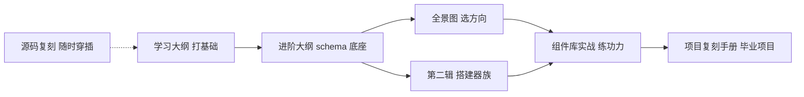

import Callout from '@site/src/components/Callout';

# 写作指南：MDX 与在线代码块

本站启用的写作增强能力，写新章节时按需选用：

| 能力 | 载体 | 渲染时机 | 适用场景 |
|------|------|----------|----------|
| **在线代码块**（`@docusaurus/theme-live-codeblock`） | ```` ```jsx live ```` / ```` ```js live ```` | 浏览器运行时，可交互 | 教学 demo：读者直接改代码看效果 |
| **静态嵌入**（MDX） | `.mdx` 文件（或 `.md` 加 front matter `format: mdx`） | 构建时渲染成 HTML，零运行时 | 复用组件：提示框、场景卡片、对比表等 |
| **Mermaid 图表**（`@docusaurus/theme-mermaid`） | ```` ```mermaid ```` 代码块 | 构建时渲染成 SVG | 流程、架构、时序、状态机 |
| **文档关系图**（`docusaurus-graph`） | front matter `sources` / `references` 标签 | 构建时生成图数据 | 站点右上角图视图入口，看全站知识图谱 |

## 在线代码块：直接运行

给代码块的语言标记加 `live`，代码就会变成可编辑、可运行的 Playground（React 已自动在作用域内，**不需要也不能写 import**）。

**最简单的形式——单个表达式**。inline 模式下整段代码作为一个表达式求值，求值结果直接渲染：

````md
```jsx live
<button
  style={{
    padding: '6px 16px',
    borderRadius: 8,
    border: '1px solid var(--ifm-color-primary)',
    color: 'var(--ifm-color-primary)',
  }}
>
  JSX 表达式直接渲染
</button>
```
````

实际效果：

```jsx live
<button
  style={{
    padding: '6px 16px',
    borderRadius: 8,
    border: '1px solid var(--ifm-color-primary)',
    color: 'var(--ifm-color-primary)',
  }}
>
  JSX 表达式直接渲染
</button>
```

**定义组件、多语句逻辑**：加 `noInline` 标记，写完任意语句后用 `render()` 指定渲染目标：

````md
```jsx live noInline
function Counter() {
  const [n, setN] = React.useState(0);
  return (
    <div style={{ display: 'flex', gap: 12 }}>
      <button onClick={() => setN(n + 1)}>点了 {n} 次</button>
      <button onClick={() => setN(0)}>重置</button>
    </div>
  );
}
render(<Counter />)
```
````

实际效果：

```jsx live noInline
function Counter() {
  const [n, setN] = React.useState(0);
  return (
    <div style={{ display: 'flex', gap: 12, alignItems: 'center' }}>
      <button onClick={() => setN(n + 1)}>点了 {n} 次</button>
      <button onClick={() => setN(0)}>重置</button>
    </div>
  );
}
render(<Counter />)
```

纯 JS 计算包成 IIFE 跑，注意**求值结果必须是 React 元素**——react-live 只渲染元素，返回字符串/数字会得到空白：

```jsx live
(() => {
  const fib = (n) => (n <= 1 ? n : fib(n - 1) + fib(n - 2));
  return <strong>fib(10) = {fib(10)}</strong>;
})()
```

react-live 4.x 的三条硬规则（违反即 SyntaxError 或空白）：

- **inline 模式（默认）**：整段代码 = 一个表达式。`function` 声明、`const` 等语句会直接报错，需要时用 IIFE 包住（定义 + `return <组件 />`）。
- **noInline 模式**：可写任意语句，但必须显式调用 `render(...)`，否则报 `No-Inline evaluations must call render`。
- **结果必须是 React 元素**：`return` 的值（或 `render()` 的参数）是元素才显示；纯字符串、数字不渲染，包一层 JSX 即可。

## MDX：静态嵌入 React 组件

`.md` 文件按纯 Markdown 解析（存量 153 个文件不受影响）；需要嵌组件时用 **`.mdx` 扩展名**（本页即是一例），MDX 会在构建时把 JSX 编译成静态 HTML——读者看到的是成品标签，没有客户端运行时。

在文件顶部 import，正文里像写 JSX 一样使用：

```mdx
import Callout from '@site/src/components/Callout';

<Callout type="tip" title="来自组件的提示框">
  这段文字在 **构建时** 由 React 组件渲染，支持 `行内代码`。
</Callout>
```

实际效果：

<Callout type="tip" title="tip：构建时渲染">
  这段文字由 <code>&lt;Callout&gt;</code> 组件在构建时渲染——查看页面源码只能看到 HTML，没有 React 运行时参与。
</Callout>

<Callout type="warning" title="warning：四种类型可用">
  <code>info / tip / warning / danger</code>，主题跟随明暗模式。
</Callout>

`@site/` 前缀指向站点根目录。以后沉淀通用组件（场景卡片、里程碑时间线、API 对照表……）就放 `src/components/`，任何 `.mdx` 都能 import。

## Mermaid 图表：文字画图

```` ```mermaid ```` 代码块会渲染成图表（这是 Markdown 层能力，`.md` 和 `.mdx` 都可用，不需要 front matter）：

````md

````

实际效果：


适合画：里程碑流程、架构分层、状态机、时序图（`sequenceDiagram`）、组件依赖。语法参考 [mermaid 官方文档](https://mermaid.js.org/)。

## 文档关系图（docusaurus-graph）

站内右上角有 **图视图** 入口：构建时插件扫描 `docs/` 全部文档生成节点，节点的**边只来自 front matter 的 `sources` / `references` 标签**（正文里的 markdown 链接不参与建边）。七份大纲的 README 已注入 `references:`（指向各章文件名），所以章节在图里都挂在对应大纲节点上。

想给两篇文档显式连边，在 front matter 声明，值为目标**文件名（去掉 .md）**：

```md
---
title: 某章节
references:          # 本文参考了谁（本文 → 目标）
  - 目标章节文件名
sources:             # 本文的内容来自谁（目标 ← 本文）
  - 来源章节文件名
---
```

已知限制：节点 id 取文件名（basename），七份大纲的 `README` 会合并为一个节点；这是上游插件的设计，介意的话等上游支持目录前缀。

## 怎么选

<Callout type="info" title="决策规则">
  要<strong>可交互</strong>（读者改代码试效果）→ live codeblock；要<strong>展示结构化 UI</strong> 且不需要交互 → MDX 组件；两者都不需要 → 维持普通代码块（语言标记不带 live）。
</Callout>

- **写新章节**：默认继续用 `.md`；只有真的要嵌组件时才建 `.mdx`，或在该 `.md` 的 front matter 加 `format: mdx`（单文件切换解析器）。
- **注意 MDX 语法限制**：`.mdx` 里正文的花括号 `{}`、裸露的 `<标签>` 会被当 JSX 解析，文字内容请放进行内代码或代码块。
- **live 代码块自包含**：不能 import，依赖一律用全局 `React.*` 或在块内定义。
