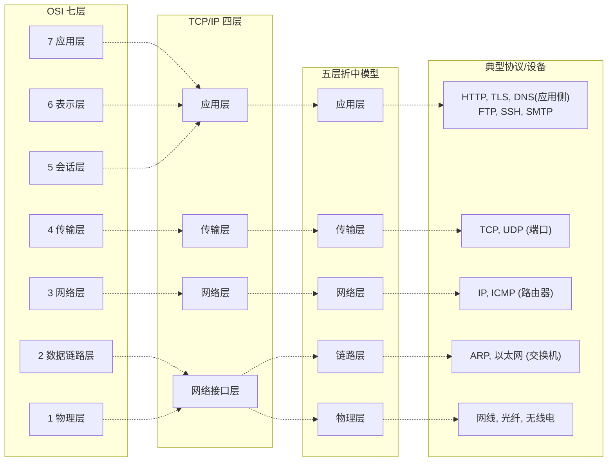
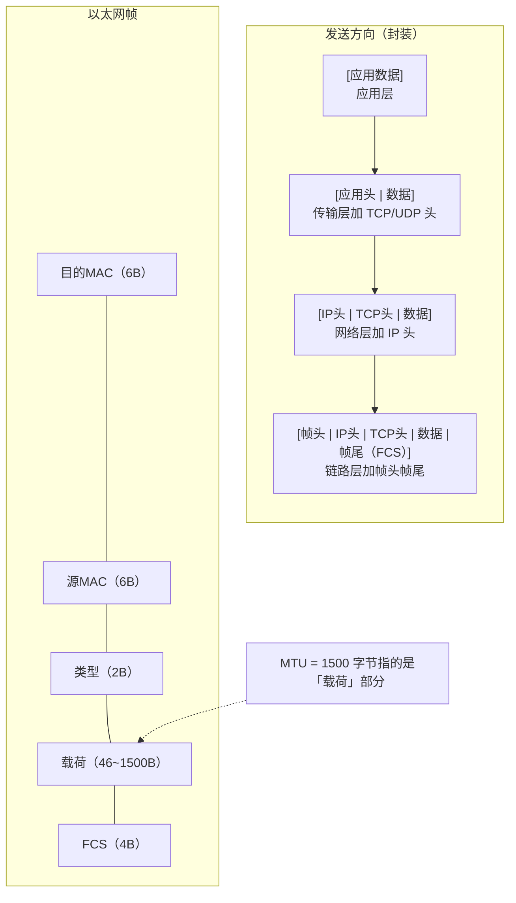
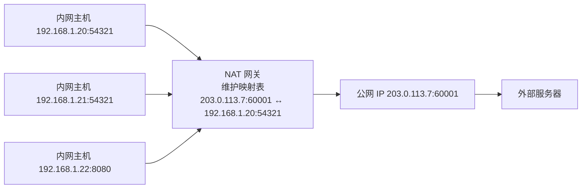
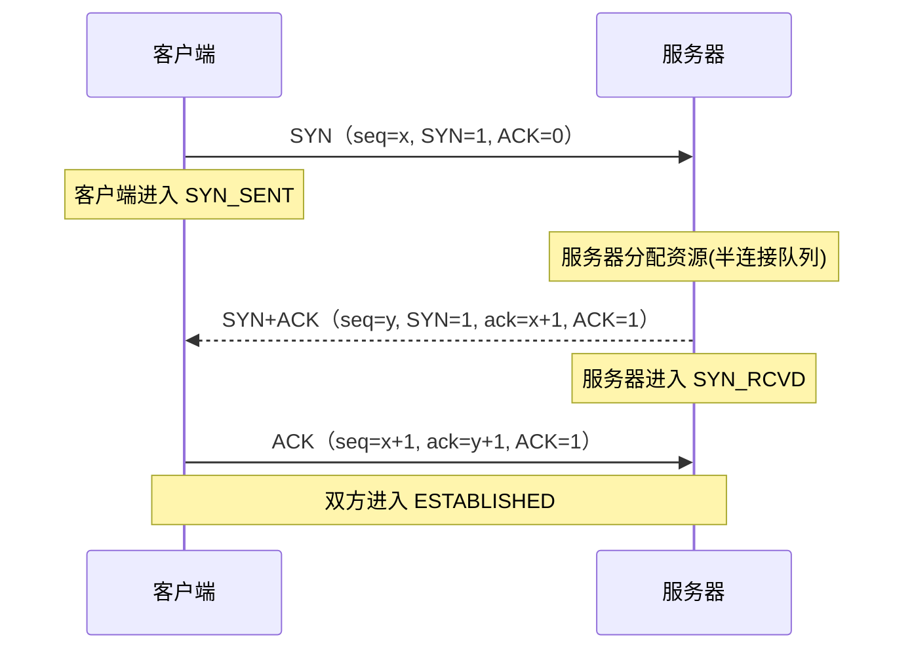
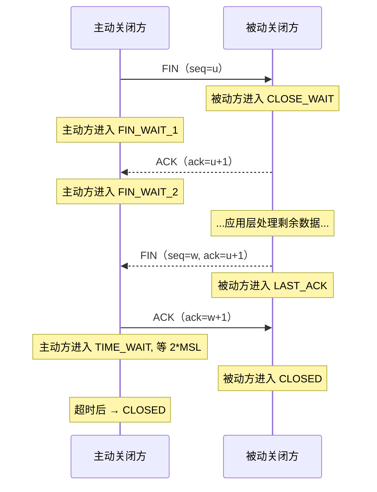
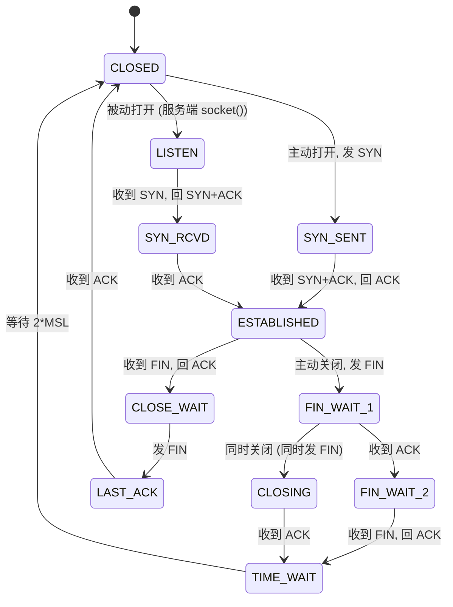
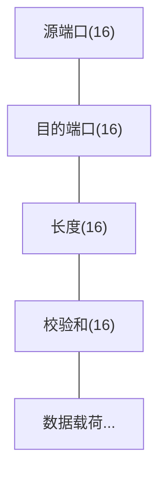
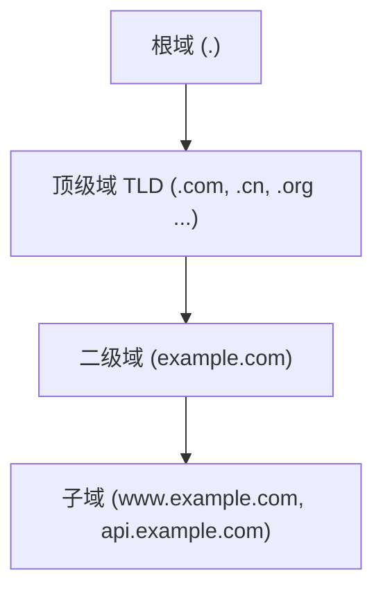

# 计算机网络基础：TCP/IP 协议栈详解

> 日期：2026-11-04
> 所属大纲阶段：1. 基础
> 参考资料：
> - RFC 791 — Internet Protocol (IPv4)
> - RFC 793 — Transmission Control Protocol
> - RFC 1034 / 1035 — Domain Names（DNS）
> - RFC 1918 — Address Allocation for Private Internets
> - W. Richard Stevens,《TCP/IP 详解 卷 1：协议》（TCP/IP Illustrated, Volume 1）
> - Kurose & Ross,《计算机网络：自顶向下方法》（Computer Networking: A Top-Down Approach）

---

## 0. 本篇定位

网络是几乎所有 Web 攻击面与防御手段的载体。本篇从分层模型出发，逐层拆解 **IP、TCP、UDP、DNS、ARP、ICMP** 的报文结构与工作机制，并给出抓包实操。所有「攻击」描述均以理解原理、部署防御为目的，实操仅限本地靶场。

---

## 1. 分层模型：OSI 七层 vs TCP/IP 四层

**开放系统互连模型（Open Systems Interconnection, OSI）** 是 ISO 提出的理论七层模型；**TCP/IP 模型**是互联网实际运行的协议族。学习时常用折中的五层模型。



### 1.1 为什么要分层

- **解耦**：每层只依赖下层的抽象服务（如传输层只管「端口到端口」，不管走的是光纤还是 Wi-Fi）。
- **封装（Encapsulation）**：发送时自上而下加头部，接收时自下而上剥头部。这是理解抓包输出的关键。



### 1.2 安全视角：攻击者同样按层思考

渗透测试方法论（如 PTES）中「信息收集 → 漏洞利用」的每一步都对应某一层的可控点：链路层的 ARP、网络层的 IP/ICMP、传输层的端口与 TCP 标志、应用层的协议语义。防御侧的设备也按层部署：交换机端口安全（链路层）、防火墙（网络/传输层）、WAF（应用层）。

---

## 2. IP 协议（IPv4）

**网际协议（Internet Protocol, IP）** 提供无连接、不可靠、尽力而为（best-effort）的数据包交付。不可靠不等于没用——可靠性由上层的 TCP 补齐。

### 2.1 IPv4 报文结构

```
 0                   1                   2                   3
 0 1 2 3 4 5 6 7 8 9 0 1 2 3 4 5 6 7 8 9 0 1 2 3 4 5 6 7 8 9 0 1
+ - - - - - - - - - - - - - - - - - - - - - - - - - - - - - - - +
|版本(4)=4 |IHL(4)|  服务类型 ToS(8)  |        总长度(16)         |
+ - - - - - - - - - - - - - - - - - - - - - - - - - - - - - - - +
|       标识(16)         |标志(3)      |     片偏移(13)           |
+ - - - - - - - - - - - - - - - - - - - - - - - - - - - - - - - +
|  生存时间 TTL(8)  | 协议(8)         |       首部校验和(16)      |
+ - - - - - - - - - - - - - - - - - - - - - - - - - - - - - - - +
|                       源 IP 地址(32)                          |
+ - - - - - - - - - - - - - - - - - - - - - - - - - - - - - - - +
|                     目的 IP 地址(32)                          |
+ - - - - - - - - - - - - - - - - - - - - - - - - - - - - - - - +
|                    选项(可变, 0~40B) + 填充                    |
+ - - - - - - - - - - - - - - - - - - - - - - - - - - - - - - - +
```
> 注：此图保留 ASCII 原样 —— Mermaid 无位域（bit-field）图类型，转换会丢失比特偏移与对齐信息（0-31 bit 标尺与各字段位宽划分）。

关键字段与安全关联：

| 字段 | 作用 | 安全关联 |
| --- | --- | --- |
| **TTL**（Time To Live） | 每经过一个路由器减 1，归零丢弃 | 防环；`traceroute` 依赖它；TTL 异常可指示路由欺骗 |
| **协议** | 标识上层协议（6=TCP，1=ICMP，17=UDP） | 防火墙按此字段过滤 |
| **标识/标志/片偏移** | 分片（Fragmentation）与重组 | 经典的 **Ping of Death**、分片绕过防火墙（先发分片骗过检测） |
| **源地址** | 无任何认证，可任意填写 | **IP 欺骗（IP Spoofing）** 的根源：反射型 DDoS、盲扫描 |

**核心认知：IP 头部的源地址不验证合法性**。任何主机都可以发出源地址为别人的包。这是大量攻击（Smurf、DNS 放大、SYN Flood 伪造源）的网络层基础，也是 BCP 38（入口过滤）存在的原因。

### 2.2 地址与子网划分（CIDR）

IPv4 地址 32 位 = 网络位 + 主机位。**无类别域间路由（Classless Inter-Domain Routing, CIDR）** 用 `a.b.c.d/prefix` 表示网络位长度。

```
192.168.1.130/26 的计算：
  192.168.1.130 → 11000000.10101000.00000001.10000010
  /26 → 前 26 位为网络位，主机位 6 位
  网络地址   = 192.168.1.128   (主机位全 0)
  广播地址   = 192.168.1.191   (主机位全 1)
  可用主机数 = 2^6 - 2 = 62
```

环境：macOS / Ubuntu 22.04，均可使用 `ipcalc`（`brew install ipcalc` 或 `apt install ipcalc`）：

```bash
ipcalc 192.168.1.130/26
# Address:   192.168.1.128        11000000.10101000.00000001.10 000010
# Netmask:   255.255.255.192 = 26 11111111.11111111.11111111.11 000000
# Wildcard:  0.0.0.63
# Network:   192.168.1.128/26
# HostMin:   192.168.1.129
# HostMax:   192.168.1.190
# Broadcast: 192.168.1.191
# Hosts/Net: 62
```

常用子网对照：

| 前缀 | 掩码 | 可用主机数 | 常见场景 |
| --- | --- | --- | --- |
| /24 | 255.255.255.0 | 254 | 传统 C 类局域网 |
| /26 | 255.255.255.192 | 62 | 小部门 |
| /30 | 255.255.255.252 | 2 | 路由器点对点链路 |
| /16 | 255.255.0.0 | 65534 | 大型企业内网 |

### 2.3 私有地址段与 NAT

**RFC 1918 私有地址**（不可在公网路由）：

| 段 | 范围 | 默认常见于 |
| --- | --- | --- |
| 10.0.0.0/8 | 10.0.0.0 – 10.255.255.255 | 企业内网 |
| 172.16.0.0/12 | 172.16.0.0 – 172.31.255.255 | Docker 默认（172.17.x）、部分云 |
| 192.168.0.0/16 | 192.168.0.0 – 192.168.255.255 | 家用路由器 |

另有 `127.0.0.0/8`（环回 loopback）、`169.254.0.0/16`（链路本地，DHCP 失败时自动配置）。

**网络地址转换（Network Address Translation, NAT）** 让多台私网主机共享一个公网 IP：



- **NAPT（端口转换）**：最常见的形态，靠端口区分内网主机。
- **安全两面性**：NAT 顺带挡掉了「外部主动发起」的连接（无映射则丢弃），类似防火墙；但它**不是防火墙**——出站连接建立的映射期间，回程流量会被放行，UPnP 等机制还能让内网应用自行开洞。不要把「有 NAT」当作安全策略。

### 2.4 IPv6 速览

- 地址 128 位，如 `2001:db8::1`；链路本地地址以 `fe80::` 开头。
- **无 NAT**（端到端可达是设计目标），安全边界完全依赖防火墙——家里有 IPv6 的读者应检查路由器是否默认放行入站。
- 扩展头部代替了选项字段；扫描整个 /64 子网不可行，攻击者转而利用 **SLAAC** 与 **NDP**（IPv6 的 ARP 等价物）做欺骗。

---

## 3. TCP：传输控制协议

**传输控制协议（Transmission Control Protocol, TCP）** 提供面向连接、可靠、有序、全双工、基于字节流的传输。

### 3.1 报文段结构（TCP Segment）

```
 0                   1                   2                   3
 0 1 2 3 4 5 6 7 8 9 0 1 2 3 4 5 6 7 8 9 0 1 2 3 4 5 6 7 8 9 0 1
+----------------------------+-------------------------------+
|        源端口(16)           |        目的端口(16)            |
+----------------------------+-------------------------------+
|                        序号 seq(32)                          |
+--------------------------------------------------------------+
|                      确认号 ack(32)                          |
+-----+----------+----+--+---+-------+------------------------+
|数据偏移|保留(3)|NS|CWR|ECE|URG|ACK|PSH|RST|SYN|FIN| 窗口大小(16) |
+-----+----------+----+--+---+-------+------------------------+
|      校验和(16)            |     紧急指针(16, URG=1 时有效)    |
+--------------------------------------------------------------+
|                     选项(如 MSS, window scale, SACK)          |
+--------------------------------------------------------------+

标志位（从安全角度最重要的部分）:
  SYN  同步序号, 建立连接           → 半开连接扫描的依据
  ACK  确认号有效                   → 区分「建立」与「确认」
  FIN  发送完毕, 请求关闭           → FIN 扫描的依据
  RST  强制复位连接                 → 端口关闭时回 RST; 也用于劫持/注入
  PSH  推送, 尽快交给应用层
  URG  紧急指针有效
```
> 注：此图保留 ASCII 原样 —— Mermaid 无位域（bit-field）图类型，转换会丢失比特偏移与对齐信息（0-31 bit 标尺、标志位逐比特布局及下方标志位说明的对齐）。

三个核心字段：

- **序号（Sequence Number, seq）**：本报文段数据第一个字节在字节流中的编号。初始序号（ISN）随机化是为了防止**序号预测攻击（TCP Sequence Prediction）**——老系统 ISN 可预测，攻击者可盲注数据劫持会话（Kevin Mitnick 1994 年对 Shimomura 的攻击即此原理）。
- **确认号（Acknowledgment Number, ack）**：期望收到的下一个字节编号，隐含确认此前所有字节。
- **窗口大小（Window）**：滑动窗口流量控制；窗口缩放选项（window scale）可到 1GB。

### 3.2 三次握手（Three-way Handshake）逐字段解析



逐条解释：

1. **第一次（SYN）**：客户端随机选 ISN `x`，置 SYN=1。此时不携带应用数据（可携带选项）。
2. **第二次（SYN+ACK）**：服务器随机选 ISN `y`，确认 `ack=x+1`（SYN 消耗一个序号）。**服务器此刻就要为该连接分配内存**（半连接队列）——这就是 **SYN Flood** 的攻击原理：伪造源地址发大量 SYN，服务器等待永不到来的 ACK，半连接队列占满后拒绝服务。防御：SYN Cookie（把状态编码进 ISN 而不存内存）、`tcp_syncookies=1`（Linux 默认开启）。
3. **第三次（ACK）**：客户端确认 `ack=y+1`。**注意：客户端此时已可发数据**（第三次握手的 ACK 报文允许捎带数据；而 **TCP Fast Open（TFO）** 更进一步——持有有效 TFO cookie 时，数据可随首个 SYN 直接发送，节省这个往返）。

为什么必须三次？核心是**双方都要确认「我的发送和接收能力都正常」，且 ISN 需要双向同步**。两次握手无法防止历史重复的 SYN（旧连接请求）被误当作新连接。

### 3.3 四次挥手（Connection Termination）

TCP 全双工，两个方向要分别关闭：



- **TIME_WAIT（2×MSL，约 60~120 秒）** 的意义：保证最后一个 ACK 若丢失可重传；让旧连接的报文在网络中自然死亡，避免污染相同四元组的新连接。
- **安全要点**：
  - `CLOSE_WAIT` 堆积 = 应用代码没调用 `close()`，是应用层 bug 的运维信号（常被误当攻击）。
  - **RST 注入/劫持**：攻击者若能猜测 `seq`（或通过旁路嗅探得知），可伪造 RST 掐断连接——历史上 Great Firewall 的 RST 注入即利用此。防御：ISN 随机化（抬高盲猜序号的成本）、防火墙 ACL 丢弃伪造源的包、TCP-AO（TCP Authentication Option，为 TCP 头部附加 MAC 认证）。注意 **TLS 不防 TCP 层 RST**——RST 作用于传输层，在 TLS 的加密与认证范围之外。

### 3.4 TCP 状态机



安全关联：

- **SYN Flood** 目标态是 `SYN_RCVD` 堆积；**RST 攻击**让状态机异常跳转到 CLOSED。
- 端口扫描的状态指纹：开放端口回 SYN+ACK，关闭端口回 RST——nmap 的 `SYN 扫描` 就是只发 SYN、收到 SYN+ACK 后立即 RST，不完成握手，因而隐蔽（半开扫描）。

### 3.5 端口（Port）与套接字（Socket）

- 端口 16 位（0–65535）：0–1023 知名端口（Well-known，Unix 下绑定需特权），1024–49151 注册端口，49152–65535 动态/临时端口。
- **四元组** `{源IP, 源端口, 目的IP, 目的端口}` 唯一标识一条 TCP 连接。
- 知名端口表（安全工程师应背下）：

| 端口 | 协议 | 备注 |
| --- | --- | --- |
| 20/21 | FTP | 明文、主动模式开反向连接，尽量弃用 |
| 22 | SSH | 加密管理通道 |
| 23 | Telnet | 明文，永不应暴露 |
| 25 | SMTP | 邮件投递 |
| 53 | DNS | UDP/TCP 皆可，放大攻击滥用对象 |
| 80 / 443 | HTTP / HTTPS | Web 主战场 |
| 445 | SMB | WannaCry 等蠕虫的入口 |
| 3306 / 5432 / 6379 | MySQL / PostgreSQL / Redis | **绝不应对公网暴露**（尤其未认证的 Redis） |

### 3.6 TCP 可靠性机制速览

- **超时重传（RTO）** 与**快速重传**（连续 3 个重复 ACK）。
- **滑动窗口**：流量控制（接收方公告）；**拥塞控制**（发送方自治）：慢启动 → 拥塞避免 → 快速恢复。
- 拥塞控制与安全的关系：**RST/FIN 注入**之外，攻击者可伪造重复 ACK 触发降速（TCP 恶意拥塞控制攻击），这是「TCP 脆弱性」研究的经典话题，了解即可。

---

## 4. UDP：用户数据报协议

**用户数据报协议（User Datagram Protocol, UDP）** 无连接、不可靠、无序，头部仅 8 字节：



- 适合实时性优先的场景：DNS（单问单答）、DHCP、NTP、VoIP、游戏、QUIC（HTTP/3 基于 UDP）。
- **安全特性（要点）**：
  - **无连接** = 无握手 = 伪造成本极低。**UDP 反射放大攻击（DNS 放大、NTP monlist、Memcached 放大）**：伪造受害者源 IP 向开放的服务器发小请求，服务器把大响应发给受害者。防御：出口过滤（BCP 38）+ 关闭开放的递归解析/监控器。
  - 无序/丢包由应用层处理；应用层协议（如早期 QUIC 之前自制协议）的漏洞很常见。

TCP vs UDP 对比：

| 维度 | TCP | UDP |
| --- | --- | --- |
| 连接 | 面向连接（握手） | 无连接 |
| 可靠性 | 确认+重传 | 尽力而为 |
| 有序性 | 保证 | 不保证 |
| 头部开销 | ≥20 字节 | 8 字节 |
| 伪造难度 | 需猜测 seq | 极易（无状态） |
| 典型攻击 | SYN Flood、RST 注入、劫持 | 反射放大、洪水 |

---

## 5. DNS：域名系统

**域名系统（Domain Name System, DNS）** 是「互联网的电话簿」，把域名解析为 IP。它是一个分布式、分层、有缓存的数据库。

### 5.1 层级结构



### 5.2 完整解析流程（递归与迭代）

以浏览器请求 `www.example.com` 为例：

```
浏览器/操作系统
  1. 检查本地缓存 & /etc/hosts
        | 未命中
        v
  2. 向配置的递归解析器 (如 8.8.8.8 / 运营商 DNS) 发查询   ← 递归查询
        | 递归解析器代替你完成后续全部工作
        v
  3. 递归器 → 根服务器:  "www.example.com 的 IP?"            ← 迭代查询
        根服务器: "不知道, 但 .com 归这些 TLD 服务器管" (返回 .com NS)
        v
  4. 递归器 → .com TLD 服务器:  "www.example.com?"
        TLD: "example.com 的权威 NS 是 ns1.example.com" (返回 NS + glue)
        v
  5. 递归器 → ns1.example.com (权威服务器):  "www.example.com?"
        权威: "A 记录 = 93.184.216.34"   (示例值; example.com 实际解析随其 DNS 配置变化, 以实际输出为准)
        v
  6. 递归器缓存结果(TTL 内有效) 并返回给客户端
```

- **递归查询（Recursive）**：客户端→递归器，「你务必给我最终答案」。
- **迭代查询（Iterative）**：递归器→各级服务器，「没有就告诉我去哪问」。
- **TTL（Time To Live）**：缓存秒数。安全上，短 TTL 是攻击者「快速切换」的基础，也是防御方切流（换 IP 摘除故障）需要的灵活性。

### 5.3 常见记录类型

| 类型 | 含义 | 示例/安全用途 |
| --- | --- | --- |
| A / AAAA | 域名 → IPv4 / IPv6 地址 | 解析主记录 |
| CNAME | 别名指向另一域名 | 链式解析，CDN 常用 |
| MX | 邮件交换服务器 | **SPF 之外的邮件路由** |
| NS | 该域的权威服务器 | 劫持 NS = 劫持整个域 |
| TXT | 任意文本 | SPF、DKIM、**域所有权验证**（攻击者伪造 TXT 验证可申请证书） |
| SOA | 起始授权（主 NS、序列号等） | 区域传送（AXFR）信息来源 |
| PTR | IP → 域名（反向解析） | 日志可读性；**不应作认证依据** |
| CAA | 允许哪些 CA 为本域签发证书 | 限制证书签发面 |

### 5.4 DNS 安全问题（防御导向）

1. **DNS 劫持（DNS Hijacking）**：控制解析路径（改路由器 DNS、入侵注册商改 NS 记录）。防御：注册商开启双因素、锁转移（registrar lock）、监控 NS 记录变更。
2. **DNS 污染/投毒（DNS Cache Poisoning）**：攻击者抢在真实响应前伪造应答（源端口与 16 位查询 ID 需猜中）。2008 年 Kaminsky 漏洞把此问题推到台前。防御：**源端口随机化**（Kaminsky 后强制）、**DNSSEC**、0x20 编码随机化。
3. **DNSSEC**：用数字签名（RRSIG 记录）逐级签名验证应答真实性，根的信任锚自 2010 年部署。缺陷：只保证「完整性+来源认证」，**不加密查询内容**，也不防「 NXDOMAIN 域存在性泄露」。补充方案：DoT（853/TCP）、**DoH（DNS over HTTPS, RFC 8484）**。
4. **DNS Rebinding（预告，Web 章节详述）**：攻击者域名 TTL=1，第一解析返回公网 IP（通过同源检查加载恶意 JS），第二解析返回 `127.0.0.1` 等内网地址，绕过浏览器同源策略访问内网服务。防御：pin 记忆、内网服务强制 Host 校验、DNS 重绑定防护解析器（如 `unbound` 的 `private-address` 配置）。

### 5.5 dig 实操

环境：macOS / Ubuntu 22.04（`dig` 来自 bind-utils/dnsutils）。

```bash
# 基本查询，显示完整解析链
dig www.example.com

# 只看精简答案
dig +short www.example.com

# 指定用 8.8.8.8 查询，并追踪完整递归过程（本地伪造一次完整解析）
dig @8.8.8.8 www.example.com +trace

# 查询特定记录类型
dig example.com MX +short
dig example.com TXT +short        # 查看 SPF/DKIM/验证记录
dig example.com NS +short
dig -x 8.8.8.8                    # 反向解析 PTR

# 查看是否支持 DNSSEC（AD 标志 = 已验证）
dig dns.google +dnssec
# >> flags: qr rd ra ad;  ← ad (Authenticated Data) 表示 DNSSEC 验证通过

# 观察响应是否被劫持的经典手法：查询一个随机不存在的域
# 若返回了 IP（通常是广告/钓鱼页 IP）而不是 NXDOMAIN，说明被劫持了
dig this-domain-should-not-exist-9x8y7z.com
```

---

## 6. ARP 与 ARP 欺骗

**地址解析协议（Address Resolution Protocol, ARP）** 解决「已知同网段目标 IP，求其 MAC 地址」，仅存在于以太网链路层（IPv6 中等价物是 NDP）。

### 6.1 工作机制

```
主机A (192.168.1.10) 想发包给 192.168.1.20:
  1. A 查本地 ARP 缓存 → 未命中
  2. A 广播 ARP Request: "谁是 192.168.1.20? 告诉 192.168.1.10"
     (目的MAC = ff:ff:ff:ff:ff:ff)
  3. 全网主机收到; 192.168.1.20 单播回复 ARP Reply:
     "192.168.1.20 的 MAC 是 aa:bb:cc:dd:ee:ff"
  4. A 缓存该映射, 开始通信
```

查看 ARP 缓存：`ip neigh`（Linux）/ `arp -a`（macOS，或 `ndp -a` 看 IPv6）。

### 6.2 ARP 欺骗（ARP Spoofing）原理（防御视角）

ARP 协议**没有任何认证机制**：任何主机都可以发送「 gratuitous ARP（无偿 ARP）」宣布「某 IP 在我这」。攻击者周期性广播 `网关IP → 攻击者MAC`，受害者流量的下一跳就变成攻击者，攻击者再转发到真网关，形成**中间人（Man-in-the-Middle, MITM）**位置——可窃听明文流量、篡改 HTTP 内容。

**防御**（重点，原理了解即可，实操仅限自己搭建的靶场网段）：

- 交换机启用 **动态 ARP 检测（DAI）**、DHCP Snooping + 端口安全（绑定 MAC/限制数量）。
- 静态 ARP 条目（小型环境）。
- 根本防御：**全链路加密（HTTPS/TLS）**，让中间人只能看到密文。
- 检测：`arpwatch` 监控映射变化告警；观察网关 MAC 是否频繁漂移。

靶场环境（如自己用 GNS3/Packet Tracer 或两台虚拟机 + `arpspoof` 所属的 dsniff 包）中可以观察欺骗前后 `ip neigh` 的网关 MAC 变化，**切勿在办公网/家庭网之外的环境尝试**。

---

## 7. ICMP

**互联网控制报文协议（Internet Control Message Protocol, ICMP）** 传递网络层的控制与差错信息。

| 类型/代码 | 名称 | 用途 |
| --- | --- | --- |
| 0/0 | Echo Reply | ping 应答 |
| 8/0 | Echo Request | ping 请求 |
| 3/x | Destination Unreachable | 不可达（端口/主机/协议） |
| 11/0 | Time Exceeded | TTL 耗尽 —— **traceroute 的核心** |
| 5/x | Redirect | 告知更优路由（可被滥用做流量劫持，默认应禁用接受） |

安全关联：

- **Ping of Death**（超长 ICMP 分片重组溢出，1996 年，早已修复）→ 理解「分片重组无上限」类漏洞的祖型。
- **Smurf 攻击**：伪造受害者源地址向广播地址 ping，全网应答涌向受害者 → 现代「放大攻击」祖型；防御：不响应定向广播、BCP 38。
- 运维实践：边界设备常限制入站 ICMP 类型（只放行需要的），但**不建议全禁**——PMTUD（路径 MTU 发现）依赖 ICMP 3/4「分片需要但 DF 置位」报文，全禁会导致「小包通、大包卡」的诡异故障。

---

## 8. 诊断命令实操

### 8.1 连通性与路径

```bash
# 环境: macOS / Ubuntu 22.04

ping -c 4 1.1.1.1          # ICMP 连通性 (-c 计数)
ping -c 4 dns.google       # 顺带验证 DNS

# macOS 与 Linux 的 traceroute 实现不同:
traceroute -n 1.1.1.1       # Linux 默认 UDP 探测; -n 不做反向 DNS
traceroute -I -n 1.1.1.1    # 用 ICMP 探测(某些网络只放行 ICMP)
# 原理: 发 TTL=1 的包 → 第一跳路由器回 ICMP Time Exceeded;
#       TTL=2 → 第二跳... 直到目的主机回 Echo Reply / 端口不可达
```

### 8.2 查看本机连接与端口

```bash
ss -tulpen     # Linux: 所有监听 TCP/UDP + 进程 + 信息 (netstat 的现代替代)
# -t tcp  -u udp  -l listening  -p process  -e extended  -n numeric
ss -tan state established '( dport = :443 or sport = :443 )'

lsof -i -P -n              # macOS/Linux: 哪个进程占用了哪个端口
lsof -i :22                # 只看 22 端口
```

**安全习惯**：拿到任何一台机器（尤其是自建靶机），先 `ss -tulpen` / `lsof -i` 看清「谁在监听」。多余的监听端口 = 多余的攻击面。

### 8.3 tcpdump 抓三次握手（重点实战）

环境：Ubuntu 22.04 或 macOS（自带 tcpdump）。对公网抓包只看自己的流量；更稳妥的是本地靶场（如本机起 `python3 -m http.server 8000` 再访问）。

```bash
# 1. 终端 A: 抓包（只抓与 8000 端口相关的 TCP 包, 打印 ASCII 摘要）
sudo tcpdump -i any -n -A 'tcp port 8000'

# 2. 终端 B: 起一个本地 HTTP 服务并访问
python3 -m http.server 8000 &
curl -v http://127.0.0.1:8000/

# 期望在终端 A 看到类似输出（握手 → 数据 → 挥手全过程）:
# IP 127.0.0.1.54321 > 127.0.0.1.8000: Flags [S], seq 1234567890, ...   ← SYN
# IP 127.0.0.1.8000 > 127.0.0.1.54321: Flags [S.], seq 987654321,       ← SYN+ACK
#        ack 1234567891, ...
# IP 127.0.0.1.54321 > 127.0.0.1.8000: Flags [.], ack 987654322, ...    ← ACK (纯 '.' = ACK)
# IP 127.0.0.1.54321 > 127.0.0.1.8000: Flags [P.], seq 1:80: ...        ← PSH+ACK 带数据 (HTTP GET)
# ...
# IP 127.0.0.1.54321 > 127.0.0.1.8000: Flags [F.], ...                  ← FIN
# IP 127.0.0.1.8000 > 127.0.0.1.54321: Flags [F.], ...                  ← FIN
# IP 127.0.0.1.54321 > 127.0.0.1.8000: Flags [.], ...                   ← 最后的 ACK

# 3. 只抓握手第一个 SYN 包（观察陌生主机扫描的经典过滤器）
sudo tcpdump -i any -n 'tcp[tcpflags] & tcp-syn != 0 and tcp[tcpflags] & tcp-ack == 0'

# 4. 保存为 pcap 用 Wireshark 打开
sudo tcpdump -i any -w /tmp/handshake.pcap 'tcp port 8000'
```

读 tcpdump 输出的要点：`Flags [S]`、`[S.]`、`[.]`、`[P.]`、`[F.]`、`[R]` 分别对应 SYN、SYN+ACK、ACK、PSH+ACK、FIN+ACK、RST。能在脑中把一串 Flags 还原成状态机迁移，是网络排查与流量分析的基本功。

### 8.4 MTU/分片观察

```bash
# 发大于 MTU 的 ICMP 载荷观察分片 —— 注意目标选局域网主机:
# 环回接口 MTU 是 65536, ping 127.0.0.1 永远观察不到分片
ping -c 2 -s 2000 192.168.1.1    # 换成你的网关/同网段另一台主机
sudo tcpdump -i eth0 -n 'ip[6:2] & 0x3fff != 0'   # 只看分片: 大包被拆成 frag 0 与 frag>0 多片
# 区分两个概念: "frag needed"(ICMP Type 3/Code 4) 不是普通分片, 而是 DF 置位时
# 路由器因路径 MTU 不够而退回的差错报文(PMTUD 的依据); ping 加 -D 置 DF 可复现
```

---

## 9. 各层典型攻击面与防御总结表

| 层 | 典型攻击 | 核心成因 | 防御手段 |
| --- | --- | --- | --- |
| 链路层 | ARP 欺骗、MAC 泛洪、恶意 Wi-Fi 热点 | ARP 无认证、交换机 CAM 表有限 | DAI、端口安全、DHCP Snooping、全链路 TLS |
| 网络层 | IP 欺骗、ICMP 放大、分片绕过、路由劫持 | 源地址无验证 | BCP 38 入/出口过滤、ACL、RPKI、禁 ICMP Redirect |
| 传输层 | SYN Flood、RST 注入、UDP 反射放大、端口扫描暴露 | TCP 状态消耗资源、UDP 无状态 | SYN Cookie、限速、防火墙最小暴露面、BCP 38 |
| 应用层（DNS 举例） | 缓存投毒、劫持、Rebinding、放大 | 明文、无认证、UDP 易伪造 | DNSSEC、DoH/DoT、 registrar 加固、rebinding 防护 |

一条贯穿全篇的主线：**协议的原始设计假设「参与者诚实」，而安全来自后来叠加的认证与加密**。理解每个协议「哪些字段可被伪造、哪些状态可被消耗」，就理解了对应攻击与防御的位置。

---

## 10. 常见误区

1. **「HTTPS 没普及前，交换机比路由器安全」** —— 错。层不重要，重要的是「该层有无认证/加密机制」。链路层整个是明文的。
2. **「NAT 就是防火墙」** —— NAT 提供的是「意外的不对称路由阻断」，不是策略控制；出站连接的回程、UPnP 开洞都能被利用。安全边界应显式配置防火墙规则。
3. **「ping 不通 = 主机不在线/服务不存在」** —— 错。ICMP 可能被禁、防火墙 DROP（而非 REJECT）时 TCP 也会静默丢包。nmap 中 `filtered` 与 `closed` 的区别正是为此。
4. **「四次挥手是四个包必然顺序到达」** —— 实际存在同时关闭（simultaneous open/close）、半关闭等边角情况；抓包时见到交错 FIN 属正常。
5. **「DNS 用了 8.8.8.8 就安全」** —— 客户端到递归器这一段仍是明文（除非 DoH/DoT），本地链路上的劫持/污染对 53 端口 UDP 依旧有效。
6. **「TCP 是加密的」** —— TCP 只保证可靠传输，加密是 TLS 的事。telnet 与 SSH 同走 TCP，安全性天差地别。

---

## 11. 小结与自测

### 小结

- 分层与封装是分析一切网络问题的地图；抓包输出就是封装的逆向展示。
- IP 无认证 → 欺骗与放大；TCP 有状态 → 状态耗尽与注入；UDP 无状态 → 反射伪造；DNS 明文无认证 → 投毒与劫持；ARP 广播无验证 → 局域网中间人。
- 每个攻击都对应协议设计的一个「信任假设」，每个防御都是对该假设的修补（随机化、加密、过滤、最小暴露）。

### 自测问题

1. 画出三次握手的每个报文，标出 SYN/ACK 标志与 seq/ack 值的变化；说明为什么 SYN 和 FIN 各消耗一个序号。
2. SYN Flood 为什么能造成拒绝服务？SYN Cookie 如何在不保存半连接状态的情况下完成握手？
3. 给定 `10.1.1.37/27`，求网络地址、广播地址、可用主机范围与数量。
4. 递归查询与迭代查询分别发生在 DNS 解析的哪两段？Kaminsky 攻击利用了什么条件？
5. 为什么 UDP 更容易被用于反射放大攻击？放大倍数由什么决定？
6. 在自己搭建的靶场中用 tcpdump 抓一次完整的 HTTP 访问，指出握手、PSH 数据、挥手各自的 Flags 标记。
7. NAT 与防火墙的区别是什么？为什么「内网服务不应监听 0.0.0.0」是一条好的默认实践？

（完）


---

## 附：ASCII 图 → Mermaid 替换清单

| 原 ASCII 图（小节 · 内容） | 替换后类型 |
| --- | --- |
| 「1. 分层模型：OSI 七层 vs TCP/IP 四层」节 · OSI 七层/TCP-IP 四层/五层折中模型对照 | flowchart LR |
| 「2.1 IPv4 报文结构」节 · IPv4 报文头位域图 | 保留 ASCII（位域图，Mermaid 无对应类型） |
| 「2.3 私有地址段与 NAT」节 · NAT 端口映射 | flowchart LR |
| 「3.1 报文段结构（TCP Segment）」节 · TCP 报文头位域图与标志位说明 | 保留 ASCII（位域图，Mermaid 无对应类型） |
| 「3.2 三次握手（Three-way Handshake）逐字段解析」节 · 三次握手时序 | sequenceDiagram |
| 「3.3 四次挥手（Connection Termination）」节 · 四次挥手时序 | sequenceDiagram |
| 「4. UDP：用户数据报协议」节 · UDP 头部字段图 | flowchart TD |
| 「5.1 层级结构」节 · DNS 域名层级树 | flowchart TD |
| 「1.1 分层思想」节 · 封装（Encapsulation）过程 + 以太网帧字段图 | flowchart TD |
