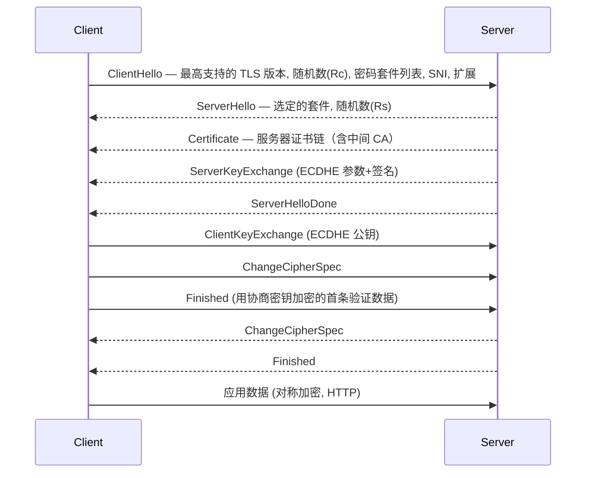
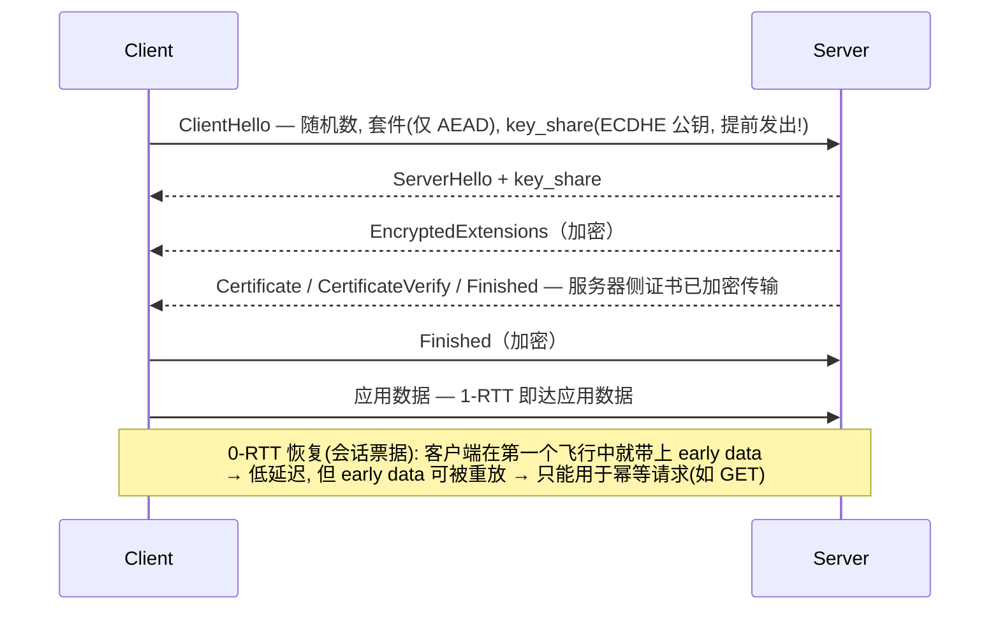
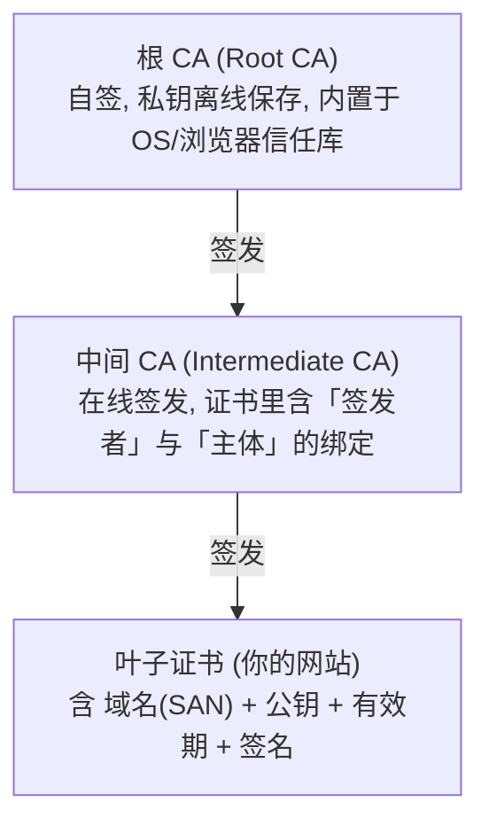

# HTTP 与 HTTPS 协议详解

> 日期：2026-11-04
> 所属大纲阶段：1. 基础
> 参考资料：
> - RFC 9110 — HTTP Semantics（HTTP 语义，取代 7231）
> - RFC 9112 — HTTP/1.1（报文语法）
> - RFC 8446 — TLS 1.3
> - MDN Web Docs — HTTP / HTTP Headers（developer.mozilla.org）
> - OWASP Secure Headers Project（owasp.org/www-project-secure-headers）
> - 《图解 HTTP》（上野宣）入门、《High Performance Browser Networking》（Ilya Grigorik）进阶

---

## 0. 本篇定位

HTTP 是 Web 安全的主战场：XSS、CSRF、SSRF、点击劫持、请求走私，无一不在「请求/响应/首部/ Cookie」的语义缝隙里发生。本篇把协议机制讲透，为第 3 阶段（Web 安全）打地基。所有攻击描述均为理解原理与防御服务。

---

## 1. HTTP 报文结构

**超文本传输协议（HyperText Transfer Protocol, HTTP）** 是请求-响应式无状态文本协议。HTTP/1.1 报文：

```http
POST /login HTTP/1.1            ← 请求行: 方法 SP 路径 SP 版本 CRLF
Host: example.com               ← 首部字段: 名: 值 CRLF（Host 在 1.1 中必填）
Content-Type: application/x-www-form-urlencoded
Content-Length: 30
Cookie: session=abc123
                                ← 空行 CRLF（首部与主体的分界，必须存在）
username=admin&password=secret  ← 消息主体（可选）
```

```http
HTTP/1.1 200 OK                 ← 状态行: 版本 SP 状态码 SP 原因短语
Content-Type: text/html; charset=utf-8
Content-Length: 15
Set-Cookie: session=abc123; HttpOnly; Secure; SameSite=Lax

<html>hi</html>
```

要点：

- **行结束符是 CRLF（`\r\n`）**，不是 LF。这个「看似无关紧要」的差异是**请求走私（Request Smuggling）** 的根源之一（见 §10）。
- **Content-Length 与 Transfer-Encoding: chunked** 二选一，同时出现（或被两端不同解读）就是走私经典场景。
- HTTP 本身无状态，「会话」完全靠 Cookie 等机制外挂在应用层。

---

## 2. 方法语义与幂等性

| 方法 | 语义 | 幂等（Idempotent） | 安全（Safe，只读） | 典型安全陷阱 |
| --- | --- | --- | --- | --- |
| GET | 获取资源 | 是 | 是 | **绝不应有副作用**：用 GET 改数据 → 被 ``/爬虫/预加载触发 |
| HEAD | 同 GET 但只要首部 | 是 | 是 | 常被误配置为执行完整逻辑 |
| POST | 提交数据/触发处理 | 否 | 否 | CSRF 主目标；非幂等导致重复提交 |
| PUT | 整体替换资源 | 是 | 否 | 重复执行结果一致（覆盖），但未授权 PUT = 任意文件写入 |
| DELETE | 删除资源 | 是 | 否 | 同上，需鉴权+CSRF 防护 |
| PATCH | 部分更新 | 通常否 | 否 | 语义各异，注意 JSON Patch 注入 |
| OPTIONS | 查询支持的方法 | 是 | 是 | 暴露 CORS 与服务器能力（信息收集面） |
| TRACE | 回显请求 | 是 | 是 | **XST（跨站追踪）**窃取 HttpOnly Cookie —— 现代服务器应禁用 |

**幂等性（Idempotency）**：同一请求执行一次与执行 N 次，服务器状态效果相同。这与**安全性（Safe）**不同：DELETE 幂等但不安全（有副作用）。安全设计含义：把「扣款」设计成幂等接口（带幂等键），网络重试才不会造成重复扣费。

---

## 3. 状态码

| 类 | 含义 | 安全相关常用码 |
| --- | --- | --- |
| 1xx | 信息 | 101 Switching Protocols（WebSocket/2 升级） |
| 2xx | 成功 | 200 / 201 Created / 204 No Content |
| 3xx | 重定向 | 301 永久 / 302 临时 / **304 缓存有效** / 307、308 不改方法的跳转 |
| 4xx | 客户端错误 | 401 未认证 / **403 已认证但无权限** / 404 / **405 方法不允许** / 413 / 429 限流 |
| 5xx | 服务器错误 | 500 / 502 / 503 / **501 未实现（说明方法被识别但服务器不支持）** |

细节与陷阱：

- **401 vs 403**：401 = 「你是谁？」（需携带 `WWW-Authenticate` 首部）；403 = 「我知道你，但你不行」。登录接口对「用户不存在」和「密码错误」都返回模糊的 401/统一提示，避免**用户名枚举（User Enumeration）**。
- **302 vs 307**：302 允许浏览器把 POST 改成 GET 跟随跳转；307 强制保持方法。登录后跳转若不当处理可能把凭据带到下一个 URL（部分老实现）。
- **开放重定向**：30x 的 `Location` 若取自用户输入（`?next=...`），可被构造成钓鱼跳转——第 3 阶段详述。
- **405 与 501**：渗透测试中方法枚举（PUT/TRACE/PATCH）的状态码回显是判断服务器行为的第一手信息。

---

## 4. 常见首部详解

### 4.1 Host（HTTP/1.1 必填）

```http
Host: api.example.com
```

- 一台服务器（一个 IP）上多个站点靠 **Host 区分（虚拟主机）**。
- 安全关联：**密码重置毒化（Host Header Injection）**——应用把 `Host` 拼进重置密码链接时未校验，攻击者构造 `Host: evil.com` 让重置链接指向自己。防御：白名单校验 Host、用配置里的绝对 URL。
- 反向代理后要正确设置 `X-Forwarded-Host` / `Host` 传递链，否则应用看到的 Host 不可信。

### 4.2 Content-Type / Content-Disposition

```http
Content-Type: text/html; charset=utf-8
Content-Type: multipart/form-data; boundary=----xyz
Content-Type: application/octet-stream        ← 未知二进制
Content-Disposition: attachment; filename="report.csv"   ← 强制下载
```

- 浏览器「嗅探（MIME Sniffing）」旧习：即使声明 `text/plain`，内容像 HTML 就按 HTML 渲染 → 存储型 XSS 的帮凶。防御：**`X-Content-Type-Options: nosniff`**（见 §8）。
- 文件上传场景：`Content-Type` 由客户端任意填写，**服务端绝不能信任它判断文件类型**（第 3 阶段文件上传篇）。

### 4.3 Cookie / Set-Cookie：见 §5（重点，单独成节）。

### 4.4 Referer 与 Origin

```http
Referer: https://good.com/page.html   ← 完整来源 URL（含路径，可能含敏感参数）
Origin: https://good.com              ← 仅 scheme + host + port
```

- `Origin` 由浏览器在**跨域请求与 POST** 等场景发送，不可被页面 JS 篡改，是 **CSRF 防御（校验 Origin）** 的可信信号源。
- `Referer` 历史更久但可能泄露 URL 中的查询参数（token、手机号）→ 用 `Referrer-Policy` 控制（§8）。注意：**两者都是客户端发来的，请求可被脚本伪造**——服务端把 Referer 当唯一鉴权是错误的，但「浏览器正常发出的跨站请求中它可信」这一性质足够用于 CSRF 判定。

---

## 5. Cookie 与会话机制（Web 安全的根）

HTTP 无状态，**Cookie** 是最主流的状态载体：服务器通过 `Set-Cookie` 下发，浏览器存储后对该域的每个请求自动回带。

### 5.1 Set-Cookie 全属性

```http
Set-Cookie: session=eyJhbGci...; Domain=example.com; Path=/;
            Expires=Wed, 11 Nov 2026 00:00:00 GMT; Max-Age=604800;
            Secure; HttpOnly; SameSite=Lax
```

| 属性 | 作用 | 安全含义 |
| --- | --- | --- |
| `Domain` | 生效域。缺省 = 仅当前 host（**host-only**）；设 `Domain=example.com` 则 `*.example.com` 全部带上 | 范围放大；子域被 XSS 时父域 Cookie 若在子域可见则连带风险（Cookie 没有子域隔离的「只发父域」开关，`__Host-` 前缀可强制 host-only） |
| `Path` | 生效路径（RFC 6265 path-match：请求路径须以该前缀开头且紧随 `/` 或到达串尾，故 `/app` 的 Cookie 不会发往 `/apple`） | 隔离强度低：同域页面可用子资源请求（如 ``）让浏览器照常携带；同域还能设同名 Cookie 干扰服务端读取（Cookie 覆盖/cookie tossing），不能当访问控制用 |
| `Expires` / `Max-Age` | 持久化 Cookie 的有效期 | 都缺省 = **会话 Cookie**（浏览器关闭即失）；「记住我」要权衡失窃后的存活期 |
| `Secure` | 仅 HTTPS 传输 | 防**明文泄露**；HTTP 端口也能被中间人注入 Set-Cookie 覆盖（见 HSTS 的意义） |
| `HttpOnly` | JS 无法通过 `document.cookie` 读取 | 直接缓解 **XSS 窃取会话**（但不能阻止 XSS 本身发请求） |
| `SameSite` | 跨站请求是否携带（见下表） | 现代浏览器默认 Lax；是 CSRF 的第一道结构性防御 |

### 5.2 SameSite 三个取值

| 取值 | 顶层导航 GET | 跨站子资源/iframe | 跨站 POST 表单 |
| --- | --- | --- | --- |
| `Strict` | 不带 | 不带 | 不带 |
| `Lax`（默认） | 带 | 不带 | 不带 |
| `None` | 带 | 带 | 带（必须同时 `Secure`） |

- `Lax` 默认值挡住了经典 CSRF（跨站 POST 不带 Cookie），但**顶层 GET 导航仍带**——若应用用 GET 改状态（违反 §2 语义），Lax 保护失效。
- 需要 iframe/第三方场景必须 `SameSite=None; Secure`，等于放弃该 Cookie 的 CSRF 结构性防御，需补 Token 方案。

### 5.3 Cookie 前缀

```http
Set-Cookie: __Host-session=xyz; Secure; Path=/; (无 Domain)
```

- `__Host-` 前缀：浏览器强制该 Cookie 必须 Secure、Path=/、无 Domain（host-only）、仅 HTTPS 设置。防「子域或中间人污染同名 Cookie」。
- `__Secure-` 前缀：仅要求 Secure。用于可信域内隔离。

### 5.4 会话安全的配套实践

- 会话标识符必须**服务端生成的高熵随机数**（≥128 bit），不可用可预测值（自增、用户名哈希）。
- 登录、提权后**轮换会话 ID**（防 **会话固定攻击 Session Fixation**：攻击者先把已知会话 ID 植入受害者浏览器）。
- 服务端提供登出（销毁会话）、闲置与绝对超时。
- 配合 `Cache-Control: no-store` 防止含敏感页面的响应被代理/浏览器缓存。

---

## 6. 缓存与代理

HTTP 缓存由两类首部控制：

```http
Cache-Control: no-store                          ← 绝不缓存（敏感页面必备）
Cache-Control: no-cache                          ← 可存, 用前必须再验证
Cache-Control: private, max-age=60               ← 仅浏览器缓存 60s
Cache-Control: public, max-age=31536000, immutable  ← 静态资源指纹文件
ETag: "v33-abcd"                                 ← 协商缓存指纹
Last-Modified: Mon, 02 Nov 2026 10:00:00 GMT
```

- 请求 `If-None-Match: "v33-abcd"` → 命中则回 `304 Not Modified`（省带宽不省往返）。
- **共享缓存（CDN/代理）缓存了个性化页面**是经典事故：`Cache-Control: private` 缺失时，A 用户的账户页被 CDN 缓存后返回给 B。**规则：动态且含身份的响应一律 `no-store`**。
- 反向代理/负载均衡引入的 `Via`、`X-Forwarded-For`（客户端 IP 链）、`X-Real-IP`：**XFF 可被客户端伪造**（直接连进来的请求自己加 XFF 首部），可信边界必须从「第一跳可信代理」开始计数，否则基于 IP 的风控/限流会被绕过。

---

## 7. HTTPS 与 TLS

**超文本传输安全协议（HTTP Secure, HTTPS）** = HTTP over **传输层安全协议（Transport Layer Security, TLS）**。TLS 提供：机密性（加密）、完整性（防篡改）、服务器身份认证（证书），可选客户端认证（mTLS）。

### 7.1 TLS 1.2 握手（经典，2-RTT 完整握手）



### 7.2 TLS 1.3 握手（1-RTT，且 0-RTT 恢复）



### 7.3 1.2 与 1.3 对比表

| 维度 | TLS 1.2 | TLS 1.3 |
| --- | --- | --- |
| 完整握手往返 | 2-RTT | 1-RTT（恢复可 0-RTT） |
| 密钥交换 | RSA / 静态 DH / **ECDHE** | **仅(EC)DHE 前向保密**，移除 RSA 密钥传输 |
| 套件中含的 KX 算法 | 是（可协商出弱组合） | 否（密钥交换与套件解耦，砍掉弱算法） |
| 证书传输 | 明文 | 加密（隐藏证书细节，SNI 仍明文→ECH 解决中） |
| 弱算法 | RC4/3DES/CBC 套件可用 | 移除，仅 AEAD（GCM/ChaCha20-Poly1305） |
| 重协商 | 有（曾被利用做攻击） | 移除 |
| 已知大坑 | CBC 填充预言（POODLE 类）、降级攻击 | 0-RTT 重放需应用层注意 |

**前向保密（Forward Secrecy）**：每个连接用临时密钥（ephemeral），服务器私钥日后泄露也解不开历史抓包。TLS 1.2 用 ECDHE 套件才有；RSA 密钥交换没有——这是 1.3 强制 DHE 家族的原因。

### 7.4 证书链与 PKI

**公钥基础设施（Public Key Infrastructure, PKI）** 的信任链：



服务器发送 `Certificate` 时通常发送「叶子 + 中间证书」整条链（不含根，根在本地）。浏览器验证：逐级验签名 → 检查有效期与吊销（CRL/OCSP，现多为 OCSP Stapling）→ 检查域名匹配（**Subject Alternative Name, SAN**；CN 字段已废弃）→ 到达一个**自己信任库中的根**。

### 7.5 根证书信任机制与中间人风险

- 你的 HTTPS 安全性最终锚定在「**操作系统/浏览器预置的 100+ 根 CA**」。任何一个 CA 被入侵或作恶（参考 2011 DigiNotar 事件），都可以给任意域名签出「合法」证书。
- **中间人（MITM）与证书**：网络中间人替换证书时，若其证书链不在你的信任库 → 浏览器告警（`curl` 报 `SSL certificate problem`）。**用户点击「忽略警告继续访问」是 MITM 得手的最常见路径**。
- **企业/恶意根证书**：往你系统装一个根证书（公司代理、某些「加速/抢票」软件、家长监控），持有者即可透明解密你所有 HTTPS 流量。检查方法：

```bash
# 环境: macOS
security find-certificate -a -p /Library/Keychains/System.keychain | \
  grep -c 'BEGIN CERTIFICATE'   # 数一数系统钥匙串里有多少证书
# Linux 环境下检查信任库:
ls /usr/local/share/ca-certificates/    # 管理员额外添加的根证书 (Ubuntu)
```

- **证书固定（Certificate Pinning）**：应用层写死允许的证书/公钥（移动 App、HSTS preload 类比），CA 被入侵也难解。浏览器对普通网站已弃用静态 pin（HPKP 已死），但自研客户端可用。
- **CA 验证域名的弱点**：DNS 邮件验证（谁控制域名邮箱谁就能拿证书）→ 攻击者劫持 MX/TXT 即可申请证书，这是「域名安全=证书安全」的原因之一；防御用 CAA 记录限制 + DNSSEC。

---

## 8. HTTP 安全响应头大全

| 首部 | 作用 | 推荐值与说明 |
| --- | --- | --- |
| `Strict-Transport-Security` | 强制 HTTPS（**HSTS**） | `max-age=31536000; includeSubDomains; preload`。浏览器收到过该头后即防 SSLStrip 降级；但**首次访问**（还没见过该头）不设防，需提交 `preload` 进入浏览器内置列表兜底 |
| `Content-Security-Policy` | **CSP**，限制资源加载与脚本执行 | `default-src 'self'; script-src 'self' 'nonce-xxx'; object-src 'none'; frame-ancestors 'none'; base-uri 'none'`。XSS 的结构性缓解；避免 `unsafe-inline` |
| `X-Frame-Options` | 控制被 iframe 嵌套（点击劫持） | `DENY` 或 `SAMEORIGIN`。CSP `frame-ancestors` 是现代替代，两者可并存 |
| `X-Content-Type-Options` | 禁 MIME 嗅探 | `nosniff` |
| `Referrer-Policy` | 控制 Referer 泄露 | `strict-origin-when-cross-origin`（默认）或 `no-referrer` |
| `Permissions-Policy` | 控制浏览器能力（摄像头/定位/全屏） | `camera=(), microphone=(), geolocation=()` |
| `Cross-Origin-Opener-Policy`（**COOP**） | 隔离跨源窗口引用 | `same-origin`，缓解 XS-Leaks 与窗口篡改 |
| `Cross-Origin-Embedder-Policy`（**COEP**） | 要求被嵌入资源显式授权 | `require-corp`，与 COOP+CORP 组成「跨源隔离」，是 Spectre 类侧信道防御与 `SharedArrayBuffer` 的前提 |
| `Cross-Origin-Resource-Policy`（CORP） | 声明资源可被谁嵌入 | `same-origin` / `cross-origin` |
| `Cache-Control` | 敏感响应防缓存 | `no-store` |

自检：OWASP Secure Headers Cheat Sheet 对照打分；`securityheaders.com` 扫描线上站点。

```bash
# 环境: macOS / Ubuntu 22.04, 用 curl 快速查看响应头
curl -sI https://example.com | grep -iE 'strict|content-security|frame|nosniff|referrer|permissions'
```

---

## 9. HTTP/1.1 vs HTTP/2 vs HTTP/3

| 维度 | HTTP/1.1 (1997) | HTTP/2 (RFC 9113) | HTTP/3 (RFC 9114) |
| --- | --- | --- | --- |
| 传输层 | TCP，文本协议 | TCP，**二进制分帧** | **QUIC over UDP** |
| 并发 | 一连接一请求；队头阻塞（管线化失败） | 多路复用（Stream），单 TCP 连接 | 多路复用，无 TCP 层队头阻塞 |
| 头部 | 明文重复 | **HPACK 压缩** | QPACK 压缩 |
| 服务器推送 | 无 | 有（实践少用，Chrome 已移除） | 无 |
| 握手延迟 | TCP+TLS 叠加 | 同 1.1 | QUIC 合并传输+加密握手，1-RTT/0-RTT |
| 加密 | 可选（HTTPS） | 事实强制 TLS 1.2+ | 强制内建 TLS 1.3 语义 |

安全视角：

- **HTTP/2 的请求走私换了个形态**：二进制分帧后不再有「两个 body 长度首部」的经典歧义，但 **Content-Length 帧 vs DATA 帧长度不一致**、Huffman 解码差异、`:method` 伪首部处理差异仍会造成 CL.TE 类似的「前端(2.0)↔后端(1.1)」走私。结论不变：**不要让不信任的流量经层层代理到达后端，代理间语义要对齐**。
- HTTP/2 多路复用 + HPACK 使某些防火墙/WAF 解析能力下降（曾有 WAF 只检第一个请求的漏洞教训）。
- QUIC 全加密使得传统 TCP 层的中间盒（基于明文头部做过滤/限速）失效，网络可见性下降，需新的可见性方案。

---

## 10. 请求走私（Request Smuggling）成因简介

当前端代理（A）与后端服务器（B）对「请求边界在哪里」判断不一致时，攻击者可让 B 把「第二个请求的开头」当成「第一个请求的尾部」：

```http
POST / HTTP/1.1
Host: example.com
Content-Length: 30                      ← A 按此认为主体 30 字节
Transfer-Encoding: chunked              ← B 按此解析 chunked
                                       （规范规定 TE 优先, 但实现各异）
0
GET /admin HTTP/1.1
X: 
```

- 类型：CL.TE、TE.CL、TE.TE（混淆头部）。后果：**队列投毒**（毒化下一位用户的请求前缀，劫持其会话）、缓存投毒、绕过前端访问控制。
- 成因一句话：**规范允许两种定界方式 + 各实现处理差异 + 前后端串联**。
- 防御：代理间使用 HTTP/2 全链路或单一实现；拒绝同时含 CL 与 TE 的请求（多数现代代理已做）；WAF 规则检测异常分块；`Connection: close` 规范化。详见第 3 阶段 Web 安全笔记。

---

## 11. curl 实操

环境：macOS / Ubuntu 22.04（curl 7.7x+）。

```bash
# 1. 查看完整请求/响应交互过程（含 TLS 握手信息）
curl -v https://example.com -o /dev/null
# 输出注释:  > 是发出, < 是收到; TLS 段会显示证书主体/SSL 版本/ALPN

# 2. 只看响应头
curl -sI https://example.com

# 3. 发送自定义首部 / 方法 / 数据
curl -v https://httpbin.org/post \
     -X POST \
     -H "Content-Type: application/json" \
     -H "X-Custom: demo" \
     -d '{"user":"admin"}'

# 4. 指定解析（把域名钉到某个 IP 测试, 不改 /etc/hosts）
#    常用于: 验证新证书部署、绕过本地 DNS 污染测试源站
curl -v --resolve example.com:443:93.184.216.34 https://example.com/

# 5. 查看证书详情（有效期/签发者/SAN）
curl -vI https://example.com 2>&1 | grep -E 'subject|issuer|expire|SSL'
echo | openssl s_client -connect example.com:443 -servername example.com 2>/dev/null | openssl x509 -noout -dates -issuer -subject -ext subjectAltName

# 6. 强制 TLS 版本与套件测试（评估服务器配置）
curl -v --tlsv1.2 --tls-max 1.2 https://example.com/ -o /dev/null   # 只用 1.2
curl -v --tlsv1.1 --tls-max 1.1 https://example.com/ -o /dev/null   # 1.1 应当失败(现代站点)

# 7. 测试 HTTP→HTTPS 降级与 HSTS
curl -sI http://example.com | head -n 5          # 看 301 与是否带 HSTS

# 8. 跟随重定向并显示每一跳（找开放重定向链）
curl -sIL "https://example.com/redirect?url=https://evil.example"

# 9. 携带 Cookie 测试会话
curl -v -c cookies.txt -b cookies.txt https://httpbin.org/cookies/set/token/abc123
cat cookies.txt    # 观察 domain/path/secure/httponly 标志位
```

配置评估补充（服务器侧视角）：

```bash
# 用 testssl.sh 全面评估 TLS 配置（环境: 装有 git 与 openssl 的 Linux/macOS）
git clone --depth 1 https://github.com/drwetter/testssl.sh   # 仅对自己拥有/授权的站点使用
cd testssl.sh && ./testssl.sh https://your-own-site.example/
```

---

## 12. 与后续 Web 安全章节的衔接

本篇建立的模型在下一阶段直接展开为攻击/防御面：

| 本篇机制 | 对应的攻击 | 对应的防御章节 |
| --- | --- | --- |
| Cookie 属性与会话 | 会话固定、会话劫持、CSRF | SameSite + CSRF Token + 会话轮换 |
| 首部语义（Origin/Referer/Host） | Host 注入、CSRF、开放重定向 | 白名单校验、Referrer-Policy |
| Content-Type/嗅探 | 存储型 XSS、文件上传绕过 | nosniff、CSP、类型白名单 |
| TLS/证书体系 | MITM、SSLStrip、证书伪造 | HSTS、证书监控（crt.sh）、CAA |
| 缓存与代理 | 缓存投毒、Web 缓存欺骗 | no-store、代理链最小化 |
| 请求边界（CL/TE） | 请求走私 | 代理语义对齐 |
| 浏览器隔离（COOP/COEP） | XS-Leaks、Spectre 类侧信道 | 跨源隔离配置 |

---

## 13. 常见误区

1. **「上了 HTTPS 就不怕 XSS/CSRF」** —— TLS 只管传输层机密性与完整性，XSS 在应用语义层、CSRF 在浏览器自动携带 Cookie 的机制里发生，与传输是否加密无关。
2. **`Secure` 标记 = Cookie 内容加密** —— 不是。Secure 只限制「不经明文信道发送」，Cookie 值本身仍是明文（DevTools 里看得到）。签名/加密要靠服务端方案。
3. **`SameSite=Lax` 万事大吉** —— 顶层 GET 导航仍带 Cookie；旧浏览器与 `None` 需求会打洞。CSRF Token 仍是标准纵深防御。
4. **`HttpOnly` 防住 XSS** —— 只防「窃取」，不防 XSS 里直接 `fetch()` 发请求（cookie 自动回带）。HttpOnly 是纵深防御的一层，不是替代 CSP/输出编码。
5. **证书有效（绿锁）= 网站可信** —— 证书只证明「域名控制权」，DV 证书不验证组织身份；钓鱼站也有合法证书。
6. **HTTP/2 二进制了就不存在走私** —— 见 §9/§10，形态变了但「前后端解析不一致」的根因仍在。
7. **`Cache-Control: private` 就安全** —— private 只排除共享缓存；笔记本本地缓存、企业终端 DLP 场景仍可能留存敏感数据，最严格用 `no-store`。

---

## 14. 小结与自测

### 小结

- HTTP 的每个语义缝隙（方法副作用、状态码差异、首部可伪造性、Cookie 携带规则、请求边界歧义）都是一类漏洞的坐标。
- HTTPS 解决的是「传输信道」问题；浏览器同源策略、Cookie 属性、安全响应头解决的是「应用与浏览器行为」问题，两层正交互补。
- 现代防御思路：能用结构性缓解（CSP、SameSite、HSTS、COOP）就不要只依赖点状补丁。

### 自测问题

1. 幂等与安全的区别是什么？为什么「GET 改状态」在 SameSite=Lax 下仍有 CSRF 风险？
2. 写出一条尽量严格的 `Set-Cookie`，并解释每个属性防的是什么。
3. 画出 TLS 1.2 与 1.3 的握手流程差异，说明 1.3 为什么强制前向保密，以及 0-RTT 的重放风险如何约束使用。
4. 浏览器验证证书链的五个步骤是什么？为什么「安装一个根证书」等价于「授权该 CA 解密你的所有 HTTPS 流量」？
5. 用 curl 验证你自己的博客/服务的 HSTS、CSP、nosniff 是否生效。
6. 请求走私的根因是什么？为什么 HTTP/2 时代依然存在？
7. COOP/COEP 解决什么问题？为什么 Spectre 之后浏览器要推跨源隔离？

（完）


---

## 附：ASCII 图 → Mermaid 替换清单

| 原 ASCII 图（小节 · 内容） | 替换后类型 |
| --- | --- |
| 「7.1 TLS 1.2 握手（经典，2-RTT 完整握手）」节 · TLS 1.2 握手时序 | sequenceDiagram |
| 「7.2 TLS 1.3 握手（1-RTT，且 0-RTT 恢复）」节 · TLS 1.3 握手与 0-RTT 恢复说明 | sequenceDiagram |
| 「7.4 证书链与 PKI」节 · CA 证书链（根 CA → 中间 CA → 叶子证书） | flowchart TD |
