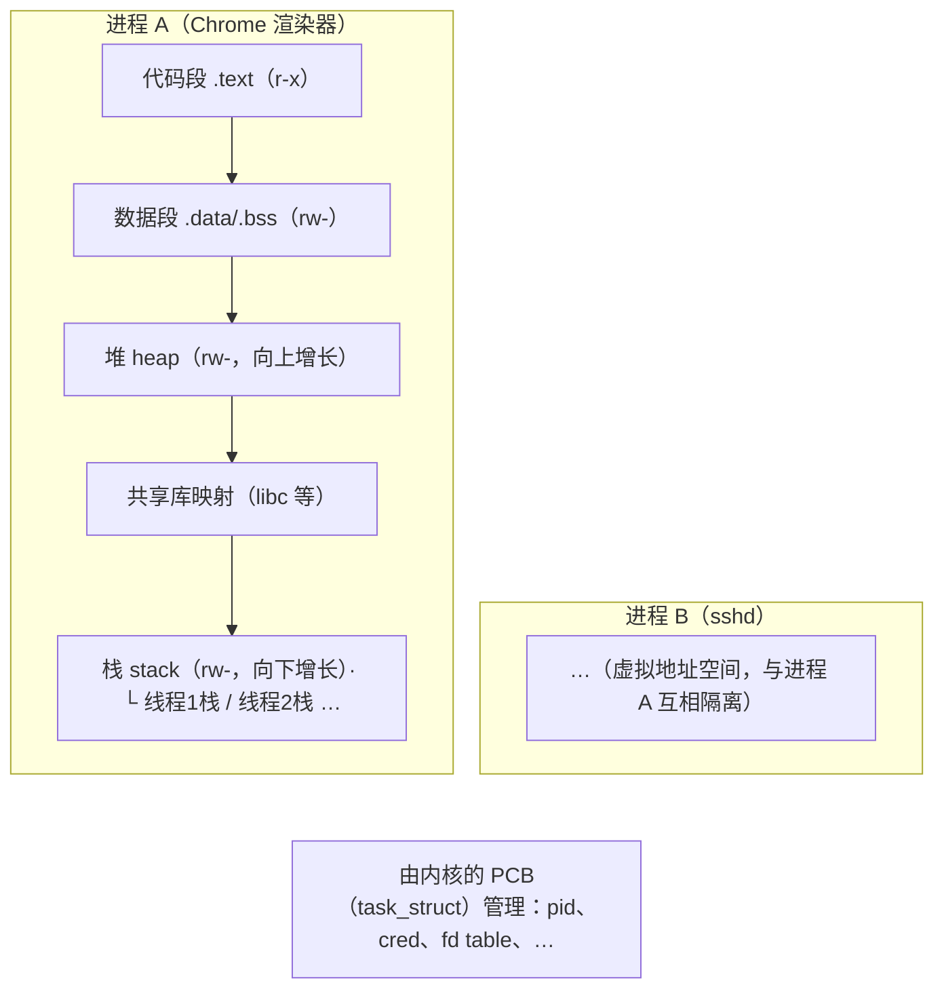
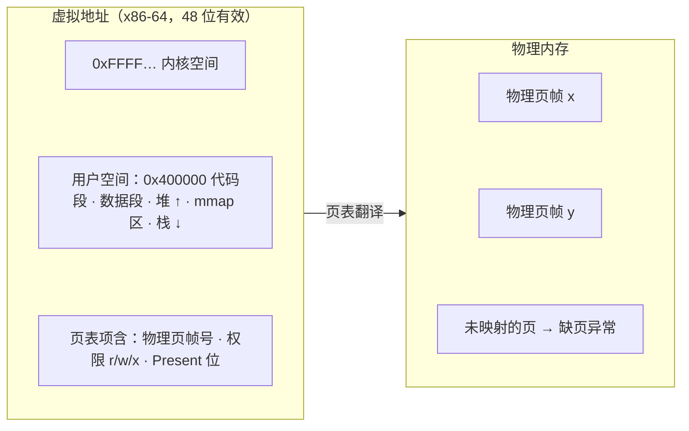
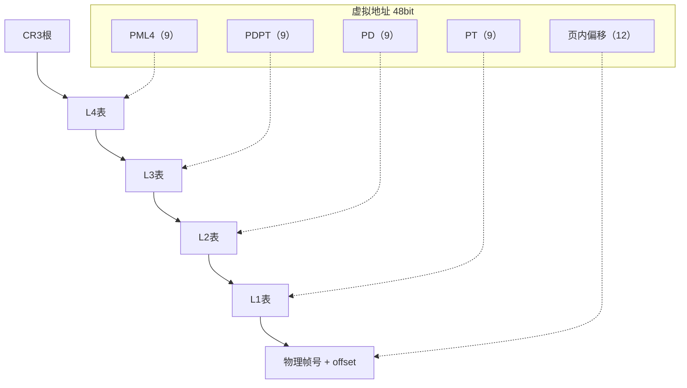
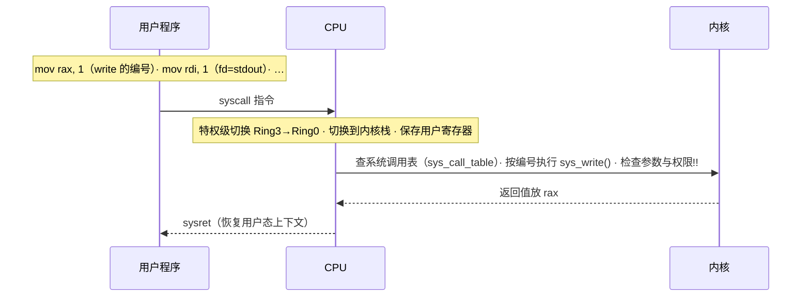
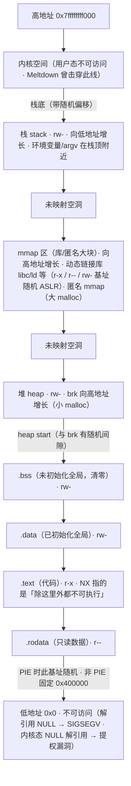

# 操作系统基础：进程、内存与权限

> 日期：2026-11-04
> 所属大纲阶段：1. 基础
> 参考资料：
> - 《操作系统导论》（Operating Systems: Three Easy Pieces, OSTEP），Remzi 夫妇
> - 《深入理解计算机系统》（Computer Systems: A Programmer's Perspective, CSAPP）第 3、9 章
> - Michael Kerrisk, The Linux Programming Interface
> - man 手册：`mmap(2)`、`execve(2)`、`capabilities(7)`
> - OWASP Cheat Sheet Series — Immutable infrastructure / Least privilege 相关条目

---

## 0. 本篇定位

操作系统是权限与内存边界的「裁判」。理解**进程隔离、虚拟内存、用户态/内核态、权限位**这四件事，就理解了：攻击者为什么梦寐以求「逃逸进程边界」、提权为什么是漏洞利用的终点、以及二进制安全章节里 NX/ASLR/CANARY 到底在防什么。

---

## 1. 进程与线程

**进程（Process）** 是资源分配的基本单位：一个独立的虚拟地址空间 + 打开的文件描述符 + 凭据（uid/gid）+ 信号处理表等。**线程（Thread）** 是调度的基本单位，同一进程内的线程共享地址空间与资源，仅各自拥有栈和寄存器上下文。



进程 vs 线程的安全含义：

- **进程是安全边界，线程不是**。一个线程被攻破（如缓冲区溢出拿到执行流），整个进程沦陷——因为线程间无隔离，可以直接读其他线程的内存（包括同进程里持有的密钥）。
- 浏览器「每个标签页独立进程」（站点隔离）就是典型的纵深防御：渲染引擎漏洞只沦陷一个沙箱进程。这也解释了为什么容器逃逸、虚拟机逃逸是高价值漏洞：**边界越硬，逃逸越值钱**。

fork / exec 模型（Unix 创建进程的两步）：

```c
// fork() 复制当前进程(写时复制 Copy-On-Write), 返回值区分父子
// execve() 丢弃当前地址空间, 换入新程序 —— 但继承 fd 与(默认)权限
pid_t pid = fork();
if (pid == 0) {
    execl("/usr/bin/whoami", "whoami", (char *)NULL);  // 子进程变身
}
wait(NULL);  // 父进程等待
```

安全关联：`execve` 继承文件描述符与权限，历史漏洞常因「子程序继承了不该有的 fd（如 /etc/shadow 的读句柄）」造成信息泄露——现代代码应设 `FD_CLOEXEC`。

---

## 2. 虚拟内存与页表

每个进程看到的都是「自己独占的、从 0 开始的连续地址空间」，即**虚拟内存（Virtual Memory, VM）**。由 **内存管理单元（Memory Management Unit, MMU）** 通过**页表（Page Table）** 把虚拟地址翻译为物理地址，粒度为**页（Page，通常 4KB）**。



### 2.1 多级页表

x86-64 使用 4 级页表（部分新硬件 5 级）：虚拟地址按 9+9+9+9+12 位拆分，逐级查表：



为什么多级？线性页表对 48 位地址空间需要 2^36 个表项（巨大浪费）；多级允许「整个子树不存在就不分配」——稀疏地址空间才存得下。

### 2.2 TLB

**转换旁视缓冲区（Translation Lookaside Buffer, TLB）** 是页表翻译的硬件缓存。缺页与 TLB miss 都昂贵，这解释了两件事：

- 大页（2MB/1GB Huge Pages）能减少 TLB miss，同时**也是侧信道攻击（TLB 时序）的素材**——了解即可。
- 进程切换要刷 TLB（除非用 ASID 标记），是上下文切换成本的来源之一。

### 2.3 虚拟内存与安全的四条主线

1. **隔离**：进程 A 无法直接寻址进程 B 的内存——一切跨进程读写都需要内核仲裁（ptrace、/proc/pid/mem、共享内存）。
2. **权限**：页表带 r/w/x 位。**W^X（Writable XOR Executable）** 原则：一页不可同时可写可执行——DEP/NX 的硬件基础（§5）。
3. **缺页异常（Page Fault）**：访问未映射/权限不符的页触发异常。**空指针解引用**在用户态是段错误，在**内核态**则是本地提权漏洞的常客（如著名的 NULL pointer dereference 提权）。
4. **侧信道**：共享物理页（同核 L1D 缓存、DRAM 行）+ 访问时间差 = Spectre/Meltdown 类攻击的物理基础。Meltdown 正是「推测执行越过权限检查读内核页」的直接后果（补丁 KPTI：内核页表与用户隔离）。

---

## 3. 用户态、内核态与系统调用

CPU 至少有两个特权级：**用户态（Ring 3）** 与**内核态（Ring 0）**。用户代码不能直接操作硬件或页表，必须通过**系统调用（System Call, syscall）** 请求内核代办。

### 3.1 一次 syscall 的完整流程



关键安全点：

- **syscall 是用户与内核之间唯一的窄门，也是内核攻击面的入口**。内核必须验证每一个来自用户态的指针与长度——历史上大量内核提权漏洞本质是「内核信任了不该信任的输入」（缺校验的 `copy_from_user` 等）；另一大类是竞态条件，如 CVE-2016-5195 Dirty COW：写时复制（COW）竞态让只读映射变得可写（详见 §7）。
- `strace` 可以完整观察进程的 syscall（§8 实操），是分析未知二进制行为、排查恶意样本的基础工具（应在隔离环境）。
- seccomp（secure computing mode）可以按白名单**过滤进程可用的 syscall**——容器与 Chrome 沙箱的关键组件：即使进程被 RCE，也调不了 `execve`。

### 3.2 中断与异常

两类事件会把 CPU 打断进入内核：

| 类型 | 来源 | 例子 |
| --- | --- | --- |
| **中断（Interrupt）** | 异步，硬件 | 网卡收包、时钟节拍、键盘中断 |
| **异常（Exception）** | 同步，当前指令引发 | 缺页异常、除零、非法指令、断点 INT3 |

信号（Signal）是内核把异步事件「翻译」给用户态的机制：`SIGSEGV`（段错误）、`SIGKILL`（不可捕获的强杀）、`SIGCHLD` 等。安全关联：处理不可信输入时的崩溃（SIGSEGV）应当「快速失败」，而不是被 catch 后带病运行。

---

## 4. 文件系统权限

### 4.1 Unix rwx 与 umask

每个文件有属主（owner）、属组（group）、其他人（others）三组 rwx：

```
$ ls -l /etc/passwd
-rw-r--r-- 1 root root ... /etc/passwd
│└┬┘└┬┘└┬┘
│ │  │  └─ others: r-x → 此处 r-- (只读)
│ │  └──── group: r--
│ └─────── owner: rw-
└───────── 文件类型: - 普通文件 d 目录 l 链接 ...

r=4, w=2, x=1 → rwxr-x--- ≙ 0750
```

> 注：此图保留 ASCII 原样 —— 这是命令输出样例叠加字段注解（│└┬┘ 对位线与 r=4/w=2/x=1 数字换算），注解直接叠在原始输出行上，转成 Mermaid 图会丢失注解与原文的逐字符对照关系。

目录的 x 语义特殊：不是「执行」，而是「穿过」（进入该目录、访问其中条目需要 x；仅列出文件名只需要 r——有 r 无 x 时能列名却打不开条目，有 x 无 r 时列不了名但凭已知路径仍能访问）。

**umask**：新文件权限 = 模板 AND (NOT umask)。

```bash
umask            # 常见 022 → 新文件 666&~022=644, 新目录 777&~022=755
umask 077        # 安全实践: 私人目录/文件不给组与其他人任何权限
```

### 4.2 SUID / SGID / Sticky Bit（安全重点）

| 特殊位 | 对文件的效果 | 典型例子与风险 |
| --- | --- | --- |
| **SUID**（Set User ID, `4000`） | 执行时 euid 临时变为文件属主 | `/usr/bin/sudo`、旧版 `/usr/bin/passwd`。**攻击者提权的首要猎物**：任何 SUID root 程序的逻辑漏洞（参数注入、路径注入、缓冲区溢出）直接等于 root |
| **SGID**（`2000`） | 执行时 egid 变为属组；对目录：新文件继承目录属组 | 团队协作目录；风险类似 SUID |
| **Sticky**（`1000`） | 对目录：只有文件属主/目录属主可删除其中文件（即便对目录有 w） | `/tmp` 是 `1777`：人人可写，但互不删文件 |

```bash
# 环境: Ubuntu 22.04
ls -l /usr/bin/sudo
# -rwsr-xr-x 1 root root ... /usr/bin/sudo   ← 属主 x 位变 s = SUID

# 全盘搜索 SUID 文件(取证/加固必做):
sudo find / -xdev -perm -4000 -type f 2>/dev/null

# 冒号形式(更可读):
stat -c '%a %n' /usr/bin/sudo    # 4755 → 带 SUID
```

防御视角：

- 最小化 SUID 面积：不需要的（如 `chsh`、`mount`、`pkexec` 有过著名漏洞 CVE-2021-4034）`chmod u-s` 或卸载。
- 部署时用包管理器的 `dpkg --verify` / `rpm -Va` 对比权限基线，发现新增 SUID 文件 = 强烈入侵信号。

### 4.3 Linux Capabilities

把 root 的「全能」拆成约 40 项**能力（Capabilities）** 的细粒度授权，从而避免「为了绑定 80 端口而整个程序以 root 运行」：

```bash
# 常见能力:
# CAP_NET_BIND_SERVICE  绑定 <1024 端口
# CAP_NET_RAW           使用原始套接字(tcpdump 需要)
# CAP_SYS_PTRACE        调试其他进程
# CAP_DAC_READ_SEARCH   绕过文件读权限检查

# 给二进制单独授权绑定低端口(而非整体 root):
sudo setcap 'cap_net_bind_service=+ep' /usr/local/bin/myserver
getcap -r / 2>/dev/null      # 取证: 全盘查看被授权的二进制(等价于"变相SUID"清单)

# 文件能力同样是提权猎物: 一个带 CAP_DAC_READ_SEARCH 的 vim
# ≈ 可以读任意文件的 vim。审计思路与 SUID 相同。
```

### 4.4 ACL（访问控制列表）

`rwx` 只有三主体，**POSIX ACL** 允许为具体用户/组追加条目：

```bash
# 环境: Ubuntu 22.04 (需安装 acl 包, 大多数发行版自带)
setfacl -m u:alice:rw /srv/shared/report.txt   # 给 alice 单独授权
getfacl /srv/shared/report.txt
# user::rw-
# user:alice:rw-
# group::r--
# mask::rw-        ← ACL 的有效上限
# other::r--

ls -l /srv/shared/report.txt    # 权限末尾出现 + 表示存在 ACL: -rw-rw-r--+
```

安全注意：ACL 容易被遗忘——审计「谁能读这个文件」时只看 `ls -l` 会漏掉 ACL 条目，务必 `getfacl`。NFSv4 ACL 与 POSIX ACL 语义不同，迁移时要重新验证。

### 4.5 最小权限原则（Principle of Least Privilege, PoLP）

每个主体（进程/用户/服务）只拥有完成其功能所必需的最小权限集合。落地手段速查：服务专用用户（`User=appuser` in systemd unit）、Capabilities 替代 root、文件权限最小化 + umask 077、seccomp/AppArmorSELinux 限制、容器只读根文件系统。

---

## 5. 内存保护机制总览（二进制安全铺垫）

第 4 阶段「系统与二进制安全」会逐一利用/绕过这些机制，此处建立「防御什么」的地图：

| 机制 | 防御的攻击 | 原理一句话 | 绕过思路（预告） |
| --- | --- | --- | --- |
| **ASLR**（Address Space Layout Randomization） | 固定地址利用（栈/堆/libc 地址写死） | 每次运行随机化各段基址 | 信息泄露（泄露一个地址即可推算）、partial overwrite |
| **DEP / NX**（Data Execution Prevention / No eXecute） | 向栈/堆注入 shellcode 并执行 | 页表 W^X，数据页不可执行 | **ROP**（返回导向编程，用已有代码片段拼装逻辑） |
| **Stack Canary**（栈保护，`-fstack-protector`） | 栈溢出覆盖返回地址 | 函数入口在返回地址前放随机金丝雀值，返回前校验 | 泄露 canary、逐字节爆破（fork 型服务）、改写不经过 canary 的函数指针 |
| **PIE**（Position Independent Executable） | 程序本体固定地址利用 | 主程序也随机加载（等价于对 .text 的 ASLR） | 需要先泄露程序基址；与 ASLR 绕过同源 |
| **RELRO**（Relocation Read-Only） | GOT 覆写劫持控制流 | `Partial`：重定位完成后 `.got` 只读，但延迟绑定用的 `.got.plt` 保持可写——GOT 覆写攻击正因此可行；`Full`（`-z now`）：启动即解析全部符号，整个 GOT（含 `.got.plt`）只读 | Full 下 GOT 不可写，转攻其他可写目标（函数指针/钩子等） |
| **CET**（Control-flow Enforcement Technology） | ROP/JOP（间接跳转劫持） | 影子栈（返回地址备份）+ ENDBR 分支目标检查 | 需 CPU+OS+编译器三端支持，生态仍在铺开 |

这些机制的叠加效果：把「一次栈溢出 = 直接 getshell」变成需要「泄露 + 构造 + 绕过多层」的链条。**理解每个机制精确防哪一步，才能理解为什么利用一个现代漏洞需要「信息泄露原语 + 控制流劫持原语」两步走。**

---

## 6. Linux 与 macOS 差异要点

| 维度 | Linux | macOS |
| --- | --- | --- |
| 内核 | Linux（monolithic，syscall 表 ABI 稳定） | XNU = Mach 微内核 + BSD 层 |
| 系统调用 | `syscall` 指令，编号稳定，strace 完整可用 | Mach trap + BSD syscall 混合，`dtruss`（需关闭 SIP 或用 `sc_usage`） |
| 权限模型 | rwx + capabilities + SELinux/AppArmor | rwx + **SIP**（System Integrity Protection，锁定系统文件与运行时）+ 沙箱（`sandbox-exec`，描述语言未文档化） + TCC（应用权限弹窗） |
| 代码签名 | 可选（内核模块需签名） | 强制：所有可执行代码需签名/公证，ARM 版 Mac 更严格 |
| 加固 | 发行版各异，默认开 ASLR/NX/RELRO-部分 | 强制 ASLR（含系统库）、_HARDENED_RUNTIME |
| 提权面 | sudo/suid/capabilities | sudo/suid + TCC 数据库 |

对安全学习者的含义：pwn 靶机几乎全是 Linux；macOS 逆向需要处理 Mach-O 与代码签名；SIP 让「在 macOS 上做内核级实验」门槛更高——实验建议用 Linux 虚拟机。

---

## 7. 进程隔离失效的真实案例（为什么这些概念重要）

- **Dirty COW（CVE-2016-5195）**：写时复制（COW）竞态缺陷 → 只读映射可写 → 普通用户改写 root 拥有的文件 → 提权。对应本篇「虚拟内存 + 权限位」。
- **POODLE 时代的 Linux ptrace 插桩**、容器 `CAP_SYS_ADMIN` 泛滥导致的逃逸：对应「capabilities 不是免费的」。
- **SUID `pkexec`（CVE-2021-4034 PwnKit）**：SUID 程序对环境变量处理不当 → 注入 → 以 root 身份执行。对应「SUID 面 = 提权面」。
- **Rowhammer**：物理内存扰动翻转邻近位 → 跨进程破坏。对应「虚拟隔离不等于物理隔离」。

---

## 8. 实操命令一：进程与内存观察

环境：Ubuntu 22.04（macOS 大部分类似）。

```bash
# 进程树与线程
ps auxf                       # 树状全量进程
ps -eLf                       # 显示线程 (LWP)
top -H                        # 按线程查看 CPU
cat /proc/self/status | grep -E 'Threads|Uid|Gid'   # Uid 行 4 个值: real/effective/saved/fsuid

# 谁打开了什么(定位泄露句柄/敏感文件访问)
lsof -p <PID>                 # 某进程打开的全部文件/socket/管道
lsof +D /var/log              # 谁在用日志目录
```

### /proc 文件系统浏览

`/proc` 是内核把进程/内核状态暴露成文件的伪文件系统——也是取证金矿：

```bash
cd /proc/<PID>
cat cmdline        # 启动命令行(\0分隔, 原样保留参数 → 取证看真实命令)
cat environ        # 环境变量(常含密钥泄露!)
cat maps           # 内存映射布局: 各段地址区间 + 权限 + 映射文件
                   # ← pwn 题里判断 ASLR/PIE 的直观途径
cat status         # 状态、Uid/Gid、Seccomp、NoNewPrivs
ls fd/             # 打开的文件描述符(符号链接)
cat /proc/self/maps | head
# 典型输出(开了 PIE 时地址每次不同):
# 55d3e8a00000-55d3e8a08000 r--p 00000000 08:01 ... /usr/bin/ls
# ...                                              ← 程序段
# 7f4a2c000000-7f4a2c028000 r--p 00000000 ...      ← libc 等共享库
# 7ffc1a2a000-7ffc1a2c1000 rw-p 00000000 ... [stack]
```

### strace：观察 syscall

```bash
strace -f ls /tmp                  # 跟踪(含子进程)所有 syscall
strace -e openat,read,write cat /etc/passwd   # 只看关键文件/IO调用
strace -c curl -s http://localhost > /dev/null # 统计各 syscall 次数/耗时
# 安全用途: 在隔离环境中分析未知二进制「到底做了什么」
# (打开哪些文件、连接哪个地址、有没有 execve)
```

---

## 9. 实操命令二：查看二进制保护（checksec）

环境：Ubuntu 22.04，`pip install pwntools` 或单文件版 checksec.sh。

```bash
# 方法一: pwntools 自带
checksec --file=/bin/ls

# 典型输出(Ubuntu 22.04 的发行版程序, 包构建默认全加固):
# RELRO         STACK CANARY    NX          PIE          FORTIFY
# Full RELRO    Canary found    NX enabled  PIE enabled  Yes
#
# 对比: 用默认选项自行编译的产物(gcc 未加 -z now)常见 Partial RELRO / Canary / NX / PIE

# 方法二: 纯手工验证(理解 checksec 在看什么):
file /bin/ls                       # "pie executable" ↔ PIE; "LSB executable" ↔ no PIE
readelf -l /bin/ls | grep -i gnu_relro    # 有 GNU_RELRO 段 = 至少 Partial
readelf -d /bin/ls | grep -iE 'now|bind'  # 出现 BIND_NOW(或 FLAGS 含 NOW) = Full RELRO
readelf -s /bin/ls | grep __stack_chk_fail  # 有该符号 = 插入了 canary
readelf -lW /bin/ls | grep GNU_STACK       # 栈段应 RW (无E) = NX 开
```

逐项对照第 5 节的表：`checksec` 输出的五行就是第 5 节五种机制的开关状态。pwn 靶机拿到题目二进制，第一步永远是 checksec——它决定了利用路线（无 canary 才直接打返回地址；Full RELRO 就别想 GOT 覆写；无 PIE 则 ROP gadget 地址固定）。

---

## 10. 进程地址空间全景（x86-64 Linux）

把前面零散的段拼成一张完整地图（与 `cat /proc/<pid>/maps` 输出逐行对应）：



对照 `maps` 输出的阅读方法：每行 `区间 权限 偏移 设备 inode 路径`；`[stack]`、`[heap]`、`[vdso]`（内核提供的快速系统调用垫片）、无路径的匿名段各就各位。做 pwn 题时，**先 `checksec` 再 `cat /proc/pid/maps`**：前者告诉你哪些段随机，后者告诉你此刻它们在哪。

### 与本篇主题的回环

- 每一行的权限位就是 §2 说的页表 rwx —— W^X 在这张图上的体现是「可执行段（.text、vdso）不可写，可写段（栈、堆）不可执行」。
- ASLR 打乱的正是图中的「栈底、mmap 基址、堆起点、（PIE 时）程序基址」四个随机量。
- 攻击者需要的「信息泄露」泄露的通常也是这四个基址之一。

---

## 11. 常见误区

1. **「线程之间互相隔离」** —— 完全相反，同进程线程共享全部地址空间；一个线程的缓冲区溢出=全进程沦陷。
2. **「虚拟内存是隐私保护」** —— 虚拟内存提供的是**进程间的地址空间隔离**；同一物理页的共享（库、缓存）不减少，侧信道照样跨「虚拟隔离」工作。
3. **「root 才能提权出事，普通用户无所谓」** —— 多用户系统/容器里，普通用户 shell 是提权链的起点；云上元数据服务滥用的初始权限往往就是低权 Web 进程。
4. **「chmod 777 /tmp 是惯例所以安全」** —— /tmp 依赖 sticky bit 防互删；应用把带密钥的临时文件放 /tmp 且 666 是事故标配：应该 `mktemp`（随机名 + 600）。
5. **「NX 时代栈溢出没用了」** —— NX 只杀了「直接执行栈上 shellcode」，催生了 ROP；溢出依然是内存破坏类漏洞的第一因（现实中还叠加逻辑漏洞，如参数注入 SUID 程序）。
6. **「macOS 有 SIP 就不需要关注权限」** —— SIP 保护系统区域，不保护你的用户数据与用户态漏洞利用；TCC 数据库本身也出现过绕过。

---

## 12. 小结与自测

### 小结

- 进程是安全边界（线程不是）；虚拟内存 + 权限位 + 特权级是边界的三大实现支柱。
- syscall 是唯一窄门，内核必须验证一切来自用户态的输入；seccomp 把门再收窄。
- SUID/SGID/capabilities/ACL 都是「给少数人开小门」的机制——每一扇小门都是提权攻击面，必须最小化与审计。
- ASLR/NX/Canary/PIE/RELRO 是针对「控制流劫持」的纵深防御链，checksec 是检查这条链的听诊器。

### 自测问题

1. 为什么「一个线程被攻破等于整个进程沦陷」？浏览器为什么坚持每个站点一个进程？
2. 画出一次 `write(1, buf, len)` syscall 的特权级切换流程，说明为什么内核必须验证 `buf` 指针。
3. 解释多级页表为什么存在；TLB 与上下文切换成本、ASLR 有什么关系？
4. `/usr/bin/passwd` 为什么需要 SUID？如果它存在参数注入漏洞，攻击者能做什么？如何审计一台机器上这类文件？
5. Sticky bit 在 `/tmp` 上防的是什么攻击？没有它 `/tmp` 会出什么问题？
6. Stack Canary、NX、ASLR 分别破坏「经典栈溢出利用」的哪一步？哪个机制可以被「信息泄露」一次性绕过？
7. 动手：`checksec /bin/sudo`，逐行解释每一项输出对应什么防护、防什么攻击。
8. `cat /proc/<pid>/maps` 中 `[stack]` 段的权限应该是什么？如果看到可执行的栈段说明什么？

（完）

---

## 附：ASCII 图 → Mermaid 替换清单

| 原 ASCII 图（小节 · 内容） | 替换后类型 |
| --- | --- |
| 「1. 进程与线程」节 · 进程 A/进程 B 地址空间与内核 PCB 管理图 | flowchart TB |
| 「2. 虚拟内存与页表」节 · 虚拟地址→页表→物理内存翻译图 | flowchart LR |
| 「3.1 一次 syscall 的完整流程」节 · 用户程序/CPU/内核三列时序图 | sequenceDiagram |
| 「4.1 Unix rwx 与 umask」节 · ls -l 输出权限位注记图 | 保留 ASCII（附注说明） |
| 「10. 进程地址空间全景（x86-64 Linux）」节 · 用户/内核地址空间布局图 | flowchart TD |
| 「2.1 多级页表」节 · 虚拟地址 9+9+9+9+12 拆分与四级查表图 | flowchart TD |
