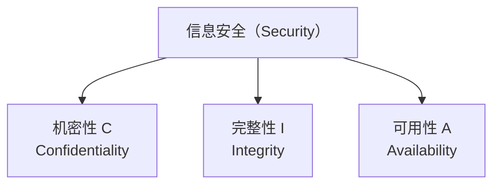
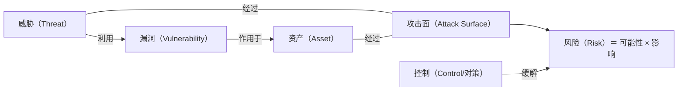
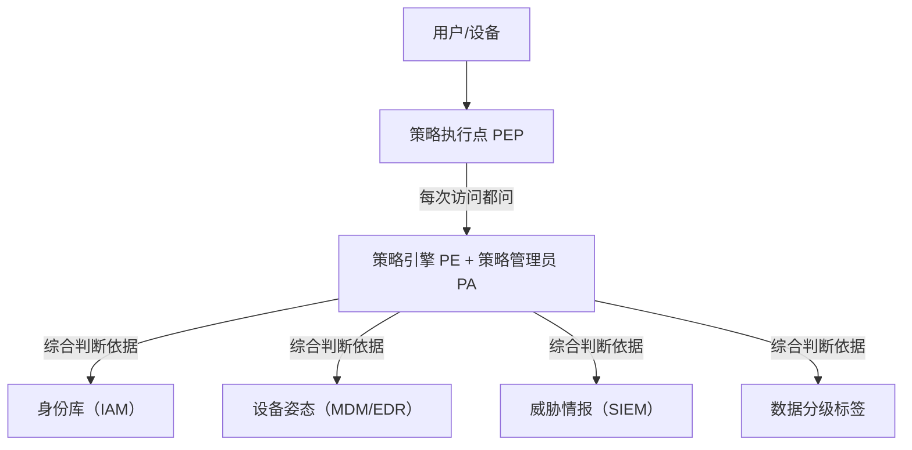

# CIA 三元组与经典安全原则

> 日期：2026-11-04
> 所属大纲阶段：2. 安全基础概念
> 参考资料：
> - NIST SP 800-12 Rev.1《An Introduction to Information Security》
> - Saltzer, J.H. & Schroeder, M.D. (1975). *The Protection of Information in Computer Systems*. Proceedings of the IEEE
> - NIST SP 800-207《Zero Trust Architecture》
> - ISO/IEC 27000:2022《Information security, cybersecurity and privacy protection — Vocabulary》
> - OWASP Security by Design Principles
> - FTC v. Equifax, Case 1:19-cv-02989 (N.D. Ga.) 起诉书与和解公告

---

## 1. 为什么从 CIA 三元组开始

所有安全话题最终都可以归结为一个问题：**你要保护什么，不被谁，在什么情况下破坏？**「中央情报系统三元组」（Confidentiality, Integrity, Availability，CIA Triad，又称 CIA 三元组）是信息安全最基础的模型，它把「安全」这个模糊词拆解为三个可度量、可讨论的属性：

| 属性 | 英文 | 一句话定义 | 反问句 |
|------|------|-----------|--------|
| **机密性** | Confidentiality | 信息只被授权者读到 | 「不该看的人看到没有？」 |
| **完整性** | Integrity | 信息不被未授权修改，且授权修改可追溯 | 「数据被偷偷改过没有？」 |
| **可用性** | Availability | 授权者在需要时能访问到信息与服务 | 「要用的时候用得上吗？」 |



> **开发者视角**：CIA 不是「三选一」，而是三组独立的测试用例。做代码评审时，对每一个数据流问三遍：谁能读？谁能写？挂了会怎样？

---

## 2. 机密性（Confidentiality）

### 2.1 定义

机密性指信息**不被未授权的主体访问或披露**的属性。注意两个关键词：

- **未授权**：不是「不让任何人看」，而是「不让没被授权的人看」。
- **访问或披露**：不只是直接读取数据，还包括**推断性披露**（如聚合统计泄露个体信息，即差分隐私要解决的问题）。

### 2.2 破坏方式举例

| 破坏方式 | 机制 | 真实案例 |
|---------|------|---------|
| 拖库（数据泄露） | SQL 注入导出全表 | 2019 年 Facebook 5.33 亿用户数据被爬取并公开 |
| 配置错误 | 对象存储/数据库公网无鉴权 | 每年 Capital One（2019，1 亿人）级别的 S3/桶策略事故 |
| 日志泄露 | 敏感字段（token、身份证号）打进日志 | 各大厂商内部红蓝队最常报的问题之一 |
| 传输窃听 | 明文 HTTP、弱 TLS | 公共 Wi-Fi 下的流量嗅探 |
| 权限蔓延 | 内部人员越权访问 | 2018 年特斯拉内部人员将数据外传 |
| 软件缺陷 | 反序列化、SSRF 读取云元数据 | Capital One：SSRF 打 EC2 元数据服务拿 IAM 凭证 |

### 2.3 保护手段

1. **加密**：静态加密（at rest，磁盘/数据库加密）与传输加密（in transit，TLS）。
2. **访问控制（Access Control）**：基于角色（RBAC）或属性（ABAC）的授权；默认拒绝。
3. **数据分类分级**：公开 / 内部 / 秘密 / 机密，不同级别不同控制强度——这是大多数团队缺失的一环。
4. **最小化收集**：不存的字段永远不会泄露。字段级拆分（如手机号单独加密存储）。
5. **脱敏与令牌化（Tokenization）**：日志打印 `138****5678`；支付行业用令牌替代卡号。
6. **DLP（Data Loss Prevention，数据泄露防护）**：出口侧检测（邮件、外发流量）。

> **工程细节**：机密性的失效常常不是密码学被破，而是**控制平面失效**——IAM 策略写错、缓存层返回了别人的数据（如 2017 年 Cloudflare "Cloudbleed" 缓存泄露）、GitHub 提交里带走了 `.env`。

---

## 3. 完整性（Integrity）

### 3.1 定义

完整性包含两层：

1. **数据完整性**：信息未被未授权方篡改（或篡改可被检测）。
2. **来源完整性（Origin Integrity）/ 真实性**：数据确实来自声称的来源，没有被伪造。

### 3.2 破坏方式举例

| 破坏方式 | 机制 | 真实案例 |
|---------|------|---------|
| 供应链投毒 | 构建流程或依赖被植入恶意代码 | 2020 SolarWinds：攻击者在 Orion 构建环境中注入后门，随签名更新分发给约 1.8 万客户 |
| 中间人篡改 | 无完整性保护的传输 | 软件下载镜像被替换（历史上的 Linux ISO 事件） |
| 依赖混淆（Dependency Confusion） | 内部包名被公共仓库抢注 | 2021 年 Alex Birsan 利用 npm/pypi 注册内部同名包打进多家公司构建 |
| 未经校验的反序列化 | 对象被构造触发逻辑执行 | Apache Struts、Java 反序列化系列 RCE |
| 越权修改（IDOR/水平越权） | 修改接口不校验资源归属 | OWASP A01 的核心场景 |
| 审计数据被删 | 攻击者清日志抹痕迹 | 几乎所有 APT 事件的标准动作 |

### 3.3 保护手段

1. **密码学校验**：哈希（检测意外损坏）、HMAC/数字签名（检测恶意篡改）。
2. **签名与来源验证**：代码签名、镜像签名（如 cosign/sigstore）、包校验和（npm `package-lock.json` 的 integrity 字段）。
3. **不可变基础设施与版本控制**：Git 的内容寻址哈希本身就是完整性机制；基础设施用声明式配置 + 审计历史。
4. **数据库约束与事务**：外键、唯一约束、乐观锁（版本号）防并发篡改。
5. **审计日志（Audit Log）**：append-only，异地复制，操作者、时间、前后值全记录。
6. **二进制/构建可复现（Reproducible Build）**：让投毒无处遁形。

---

## 4. 可用性（Availability）

### 4.1 定义

授权实体在**需要时**能够及时、以可接受的质量访问信息和功能。安全上常被轻视，但业务上往往最痛——数据没丢但服务宕机，损失同样是真金白银。

### 4.2 破坏方式举例

| 破坏方式 | 机制 | 真实案例 |
|---------|------|---------|
| DDoS（Distributed Denial of Service，分布式拒绝服务） | 海量流量/请求耗尽带宽或资源 | 2016 年 Mirai 僵尸网络攻击 Dyn DNS，Twitter/GitHub/Netflix 大面积不可用 |
| 勒索软件（Ransomware） | 加密数据并索赎 | 2021 Colonial Pipeline 停输油管，美国东南部油荒 |
| 资源耗尽 | 算法复杂度攻击、慢连接 | ReDoS、Slowloris |
| 依赖性单点 | 证书过期、云区域故障 | 2021 年 Facebook BGP 撤回 + DNS 下线，全球宕机约 6 小时（内部工具也跟着挂，连恢复都变难） |
| 删库跑路 / 误操作 | 备份缺失或备份也在同一权限域 | 某些创业公司数据全毁事件 |

### 4.3 保护手段

1. **冗余**：多可用区部署、异地多活、DNS failover。
2. **备份 3-2-1 原则**：3 份副本、2 种介质、1 份异地；并且**要演练恢复**——没验证过的备份等于没有备份。
3. **限流与配额**：令牌桶/漏桶、连接数限制、WAF。可用性与「防滥用」是一体的。
4. **降级与熔断**：非核心功能可关闭（feature flag），保住核心链路。
5. **容量规划与混沌工程**：主动注入故障验证韧性。
6. **运营连续性**：带外访问通道（out-of-band）——Facebook 事件教训：内部工具与生产系统要有独立通路。

---

## 5. DAD：从攻击者视角看 CIA

CIA 描述「我们要保住什么」，DAD（Disclosure, Alteration, Destruction/Denial）是 CIA 的镜像，描述「攻击者达成什么」：

| CIA（防御目标） | DAD（攻击结果） |
|----------------|----------------|
| Confidentiality | **D**isclosure（泄露） |
| Integrity | **A**lteration（篡改） |
| Availability | **D**estruction / Disruption（破坏/拒绝服务） |

**为什么要有反面视角**：防御者的清单永远列不全，而攻击者只需要在你的清单外找到一个洞。做威胁建模（见 `07-威胁建模.md`）时，用 DAD/STRIDE 从「攻击者想达成什么」倒推，比正向罗列控制项更不容易漏。

---

## 6. 超越 CIA：扩展属性

CIA 是骨架，真实系统还需要以下属性（ISO 27000 与 NIST 均有定义）：

| 属性 | 英文 | 定义 | 工程体现 |
|------|------|------|---------|
| **真实性** | Authenticity | 一个实体或信息如其声明的那样 | 证书、数字签名、MFA |
| **不可否认性** | Non-repudiation | 行为发生后，行为者无法抵赖 | 审计日志 + 签名（如电子合同签名）；注意：仅有密码本身无法提供不可否认——口令可能被窃取，需要结合硬件/CA 体系 |
| **可问责性** | Accountability | 行为可被唯一追溯到责任主体 | 每个请求有唯一请求 ID + 操作者身份贯穿全链路 |
| **可靠性** | Reliability | 行为持续符合预期 | 测试、SLO |

> **真实性 vs 完整性**常被混淆：完整性回答「内容没被改」，真实性回答「发送者确实是它声称的那位」。HMAC 只能证明「持有共享密钥的一方」生成过消息（双方都能生成，故无不可否认性）；数字签名才能绑定性个体身份。

---

## 7. AAA：认证、授权与审计

**AAA（Authentication, Authorization, Accounting）**是把 CIA 落到系统接口上的三大机制：

```text
        请求 →  [1 认证: 你是谁?]  →  [2 授权: 你能干什么?]  →  执行  →  [3 审计: 你干了什么被记录]
                MFA/密码/证书          RBAC/ABAC/ACL            业务逻辑    日志/SIEM
```

### 7.1 认证（Authentication）

验证主体身份。因子（factor）分三类：所知（密码）、所有（令牌/证书）、所是（生物特征）。多因素认证（MFA）取不同类别的两个因子，而非两个密码。现代实践：WebAuthn/FIDO2 抗钓鱼密钥优先于短信验证码（SIM swap 风险）。

### 7.2 授权（Authorization）

验证「该主体能否对该资源执行该操作」。关键点：

- 授权必须在**服务端每个入口**执行（见后文「完全调解」原则）。
- 默认拒绝（default deny），白名单式策略。
- 常见模型：ACL、RBAC（角色）、ABAC（属性）、ReBAC（关系，如 Google Zanzibar）。

### 7.3 审计（Accounting / Auditing）

记录「谁在何时对何资源做了什么」，用于事后追溯与检测。审计日志自身是需要保护的对象（机密性 + 完整性 + 可用性都用得上——日志被删、被改、被淹没都是事故放大器）。

> **常见误区**：把 Authentication 当 Authorization 用。「登录了」不等于「这条数据是他的」。水平越权（IDOR）本质就是只做了认证、跳过了对**资源归属**的授权检查。

---

## 8. Saltzer-Schroeder 经典安全设计原则

1975 年 Saltzer 与 Schroeder 在《The Protection of Information in Computer Systems》中提出 8 条原则，50 年后依然是安全设计评审（Security Design Review）的检查单。**逐条解释 + 工程实例：**

### 8.1 最小权限（Least Privilege）

**含义**：每个主体只持有完成任务所需的最小权限，且只在需要的时间窗口内持有。

- 正例：服务用只读数据库账号跑查询；运维平时无生产写权限，操作时通过 JIT（Just-In-Time）临时提权并留痕。
- 反例：微服务用 root 账号连数据库「图省事」；CI 凭证是管理员长期密钥。
- 落地：IAM 按角色拆分、短时效凭证（STS）、`sudo` 白名单。

### 8.2 机制经济性（Economy of Mechanism）

**含义**：机制（设计与实现）保持尽可能小而简单——复杂度是安全的天敌：状态与边界条件的组合爆炸使验证不充分、测试覆盖不全，漏洞正藏在里面。

- 正例：能用操作系统的文件权限与内置鉴权解决，就不自研访问控制中间件；用成熟密码库的高层 API 而非自研协议。
- 反例：自研加密算法、「可配置一切」的万能权限引擎——复杂到没人能证明它没有洞。
- 落地：设计评审常问「这个方案能不能更简单」；削减代码量、配置项与特权接口数，都是实打实的安全收益。

### 8.3 故障安全默认（Fail-Safe Defaults）

**含义**：默认拒绝；出错时进入「安全态」而不是「敞开态」。

- 正例：授权服务超时 → 网关返回 403 而不是放行；防火墙 panic 时 fail-closed。
- 反例：`catch (Exception e) { return true; }` 式的权限判断；鉴权服务挂了，网关「先放行保证可用性」。
- 权衡：fail-closed 可能伤可用性（如 Facebook 式全站宕锁），要为「安全态」设计逃生通道（break-glass 流程）而不是绕过它。

### 8.4 完全调解（Complete Mediation）

**含义**：**每一次**对受保护对象的访问都必须经过权限检查，不能「检查一次、缓存结果、永久信任」。

- 经典反模式：登录时校验角色并塞进前端隐藏字段，后续接口信任该字段；URL 直接引用 `admin=true` 参数。
- 正确做法：每个 API 在服务端基于**服务器侧会话/令牌**重新鉴权；缓存权限时要考虑失效策略。
- 与缓存性能冲突时，选择「短 TTL 缓存 + 主动失效」而非「免检」。

### 8.5 开放设计（Open Design / Kerckhoffs 原则）

**含义**：系统的安全性不应依赖于对设计或实现的保密；秘密只应存在于密钥中。

- Kerckhoffs 原则（1883）：密码系统的全部细节公开也不影响安全，前提是密钥保密。
- 实例：AES、TLS 全部公开规范并经全球审查；反例：私有加密算法、混淆式安全（security through obscurity）一次又一次被击穿（DVD CSS、GSM A5 算法逆向）。
- 注意边界：开源≠安全，闭源≠不安全。原则说的是「不要把安全性**押注**在保密设计上」。

### 8.6 权限分离（Separation of Privilege）

**含义**：敏感操作要求多个条件/多个主体同时满足，单点沦陷不致失守。

- 实例：转账要「密码 + 短信/硬件密钥」；生产发布要「代码评审批准 + CI 签名」；金库双人规则；Git 分支保护 + 必需评审。
- 与最小权限互补：最小权限限制「权限的量」，分离限制「权限的集中度」。

### 8.7 最少公共机制（Least Common Mechanism）

**含义**：尽量减少所有用户共享的机制，因为共享路径是公共的攻击面与单点故障。

- 实例：多租户系统中，把噪声邻居/故障隔离到独立队列与连接池；某服务挂了不应拖垮共享的同一份缓存；超级管理员共享账号是典型违例（无法问责）。

### 8.8 心理可接受性（Psychological Acceptability）

**含义**：安全机制必须易于使用，否则用户会绕过它——最弱的一环变成人。

- 实例：密码复杂度规则过度 → 用户写 `Passw0rd!1` 贴显示器；改为长度优先 + 泄露密码黑名单（NIST SP 800-63B 思路）。SSO + MFA 推送一键批准比硬件令牌数字抄录采用率高。
- 推论：**被绕过的控制等于没有控制**，安全设计要和 UX 一起设计。

> 原论文除八条设计原则外还讨论了两条附加考虑：**工作量因素（Work Factor）**——比较攻破机制所需的代价（时间、技能、资源）与攻击者的收益，目标是让攻击「不划算」；**妥协记录（Compromise Recording）**——便于记录信息已被攻破的事实与影响范围，利于事后追溯与恢复。

> **现代附加原则：纵深防御（Defense in Depth / Layered Defense）**——多层异构控制叠加，单层失效不致全局失守（如 WAF → 网络分段 → 主机防火墙 → 输入校验 → 参数化查询 → 最小权限 DB 账号 → 数据加密 → 审计告警，任意一层被绕过，后面仍有拦截与检测机会）。它不在 Saltzer-Schroeder 1975 年八原则之列，而是现代安全体系结构的通用补充，常与八原则并列用作检查单；工程上即使应用都打了 SQL 注入补丁，数据库仍不应暴露公网——即使 DLP 失效，磁盘加密仍在。

---

## 9. 攻击面、威胁、漏洞、风险：概念辨析

这四个词日常被混用，精确定义如下：

| 概念 | 英文 | 定义 | 例子 |
|------|------|------|------|
| **资产** | Asset | 要保护的东西 | 用户数据库、订单服务、品牌信誉 |
| **威胁** | Threat | 潜在的、可能造成损害的事件来源（谁/什么想干什么坏事） | 勒索团伙、内部恶意员工、脚本小子 |
| **攻击面** | Attack Surface | 攻击者可以与之交互的所有点总和 | 对外端口、API、网页表单、文件解析器、员工邮箱 |
| **漏洞** | Vulnerability | 可被利用的弱点 | CVE-2021-44228（Log4Shell）、弱口令、缺失授权检查 |
| **风险** | Risk | 威胁利用漏洞造成资产损失的可能性与后果的组合 | Log4Shell 存在 + 暴露公网 + 无 WAF → 高风险 |

**关系图**：



一句话串联：**风险**是「坏人（威胁）可能通过我们暴露的门（攻击面）里的坏锁（漏洞）偷走值钱的东西（资产）」这一完整事件的度量；**控制**用来收窄攻击面、修补漏洞、检测威胁、降低影响。

---

## 10. 风险量化：可能性 × 影响

### 10.1 基本公式

**风险（Risk）= 可能性（Likelihood/Probability）× 影响（Impact）**

定性版本常用 5×5 矩阵（可能性、影响各分 5 级，乘积落在低/中/高/严重色块）。定量版本如年度化损失期望（ALE，Annualized Loss Expectancy）：

```text
ALE = SLE × ARO
SLE（单次损失期望）= 资产价值 × 暴露因子
ARO（年发生率）    = 该事件一年内预期发生次数

例：数据库泄露单次损失估计 200 万元，同类事件按行业基线年发生率 0.05
    → ALE = 200万 × 0.05 = 10 万元/年
    → 若缓解措施年成本 2 万、能把 ARO 降到 0.01（ALE=2 万），则净收益 10-2-2=6 万/年
```

### 10.2 注意事项

- **数字的错觉**：ARO 常拍脑袋，量化用于**排序与论证**而非精确预测。
- **风险应对四选一**：接受（低风险/成本过高）、缓解（加控制）、转移（保险/外包合同）、规避（不做该功能）。
- **风险登记册（Risk Register）**：每项风险记录所有者、当前处置、复评日期——没有 owner 的风险清单是装饰品。

---

## 11. 安全是过程，不是产品

Bruce Schneier 的名言 "Security is a process, not a product"。含义：

1. **没有一劳永逸**：补丁、依赖、业务、攻击技术都在变。今天的安全明天就过期（OpenSSL Heartbleed 存在了两年才被发现）。
2. **产品只是过程中的工具**：买 WAF/防火墙不等于安全，运营（规则调优、告警响应）才是核心。
3. **持续迭代**：安全 SDLC（需求 → 设计评审 → 编码规范 → SAST/DAST → 渗透测试 → 上线监控 → 应急响应 → 复盘）是一个循环，与 DevOps 的持续交付同构（DevSecOps）。

---

## 12. 零信任架构（Zero Trust）概览

### 12.1 传统边界模型的失效

传统「城堡模型」：外有防火墙护城河，内网互信。问题：VPN 一旦被打穿、一台内网机器沦陷，攻击者横向移动畅通无阻（正是很多勒索软件的打法）。

### 12.2 核心原则（NIST SP 800-207）

1. **所有数据源与计算服务都是资源**，都要保护。
2. **所有通信必须保护**，不论网络位置——内网不等于可信。
3. **每次访问按会话授权**：信任是动态的，访问前、访问中持续评估（不因为「在内网」就免检——打破「完全调解」的豁免）。
4. **访问策略由动态上下文决定**：设备健康状态、身份、行为、时间、地理位置。
5. **持续监控与评估**：资产状态、用户行为，随时收紧权限。

### 12.3 参考架构示意



工程落地关键词：身份是新的边界（Identity as Perimeter）、微隔离（Micro-segmentation）、SDP/替代 VPN、mTLS 服务间认证（如 SPIFFE/SPIRE）。

> **误区**：零信任 ≠ 某个产品，也不是「不信任何人所以全堵死」。它是**消除隐式信任、显式化每次访问决策**的一套架构风格，落地是渐进的。

---

## 13. 完整案例分析：Equifax 2017 数据泄露（CIA 视角）

### 13.1 事件回顾

2017 年 5 月至 7 月，攻击者利用 Apache Struts2 的 **CVE-2017-5638**（文件上传头导致的远程代码执行，该漏洞 2017 年 3 月已公开补丁）攻入 Equifax（美国三大征信所之一）的**面向公众的 Web 争端门户**，横向移动数月，最终窃取约 **1.47 亿**人的姓名、社会安全号（SSN）、出生日期、地址，部分驾照号与信用卡号。

### 13.2 用 CIA 三元组拆解

| 维度 | 事件中的表现 |
|------|-------------|
| **机密性破坏（核心损失）** | 1.47 亿人 PII 被拖走。原因链：Struts 漏洞未修补（漏洞管理失效）→ RCE → 拿到数据库凭证 → 未加密的敏感字段整表可读 |
| **完整性缺失（促成因素）** | 攻击者修改了系统文件植入后门（Webshell）未被检测；内网横向移动未被发现——缺少文件完整性监控（FIM）与异常行为检测 |
| **可用性（幸运未失）** | 服务未宕机，因此事件潜伏 76 天才被边界设备流量异常「顺带」发现——检测能力几乎缺位 |
| **扩展属性** | **可问责性崩溃**：事后美国国会听证中「谁负责补丁」说不清——资产清单与责任人缺失；审计日志不足以还原完整攻击链 |

### 13.3 从原则角度复盘（哪些经典原则被违反）

1. **最小权限**：Web 门户应用竟能访问海量核心征信数据库。
2. **纵深防御**：RCE 之后一路无阻，内网无分段、无出站流量检测（数据外传走了 76 天）。
3. **故障安全默认 / 补丁管理**：公开高危漏洞 2 个月未修，且「已打补丁」的内部结论是错的——变更验证缺失。
4. **最少公共机制**：争端门户（外部可访问）与核心数据存储网络未隔离。
5. **完全调解**：内部数据访问缺少统一的权限调解点。

### 13.4 防御要点（我们学到的）

- **漏洞 SLA**：公开可利用的高危漏洞（尤其面向互联网资产）要有硬性修复时限与例外审批。
- **资产清单**：你无法修补你不知道存在的服务器。维护互联网暴露面清单（可用 censys/shodan 类被动枚举对照自检）。
- **敏感数据加密与字段级隔离**：即使被拖库，密文 + 密钥分离也能降低损失。
- **出站流量管控与检测**：数据渗出通道（exfiltration）是最后拦截机会。
- **事后**：Equifax 和解金额约 5.75 亿至 7 亿美元——安全投入与事故成本的 ROI 在此一目了然。

---

## 14. 常见误区小结

| 误区 | 事实 |
|------|------|
| 「安全 = 加密」 | 加密只覆盖机密性一角；授权错误、日志缺失、可用性失控都不是加密问题 |
| 「内网是可信的」 | 零信任的核心就是反对这句；蠕虫/勒索软件在内网横向移动是常态 |
| 「CIA 三选一，先保最重要的」 | 三者是正交维度，多数系统需要三者兼得，只是**权重**不同（如工控系统往往 A>I>C） |
| 「过等保/ISO 认证 = 安全」 | 合规是底线快照，安全是持续过程（Schneier 原则） |
| 「出事一定是被黑客攻击」 | 内部误操作（完整性/可用性事故）占比极高；威胁建模要包含内部与意外 |
| 「加了 MFA 就高枕无忧」 | MFA 疲劳轰炸、SIM swap、反向代理钓鱼（Evilginx 类）都在打 MFA 本身 |

---

## 15. 自测问题

1. 用一句话分别定义 C、I、A，并各举一个**不涉及外部攻击者**的破坏例子。
2. HMAC 与数字签名在「不可否认性」上的差异是什么？为什么？
3. 「完全调解」原则与水平越权（IDOR）漏洞之间的关系是什么？
4. Kerckhoffs 原则是否意味着所有系统都应该开源？请说明边界。
5. 你的服务鉴权模块超时会怎样？这个行为是 fail-open 还是 fail-closed？应该怎么选、怎么配套？
6. 用 风险 = 可能性 × 影响，为「依赖中混入恶意包」这一风险做一次定性打分，并列出两条缓解措施。
7. Equifax 案例中，如果只能增加**一项**控制，你选什么？说明理由。
8. 零信任架构中「隐式信任」都藏在哪里？（提示：内网服务间调用、CDN 回源、CI/CD 凭证）

---

## 16. 小结

- CIA 三元组是拆解「安全」的最小框架；DAD 是其攻击者镜像。
- 真实系统还要补上真实性、不可否认性、可问责性；AAA 是把身份体系落到接口的三件套。
- Saltzer-Schroeder 八原则是 50 年不过时的设计评审检查单：机制经济性、故障安全默认、完全调解、开放设计、权限分离、最小权限、最少公共机制、心理可接受性（另有工作量因素、妥协记录两条附加考虑；纵深防御则是现代常用的补充原则）。
- 攻击面/威胁/漏洞/风险四概念串联成「风险 = 可能性 × 影响」，控制是降低任一因子的手段。
- 安全是过程不是产品；零信任是对「内网互信」范式的系统性纠偏。
- 下一步：`07-威胁建模.md` 会把本章的原则变成可操作的方法论（STRIDE、DFD、信任边界）。

---

## 附：ASCII 图 → Mermaid 替换清单

| 原 ASCII 图（小节 · 内容） | 替换后类型 |
| --- | --- |
| 「1. 为什么从 CIA 三元组开始」节 · CIA 三元组构成图 | flowchart TD |
| 「9. 攻击面、威胁、漏洞、风险：概念辨析」节 · 威胁/漏洞/资产/攻击面/风险关系图 | flowchart LR |
| 「12.3 参考架构示意」小节 · 零信任参考架构 | flowchart TD |
