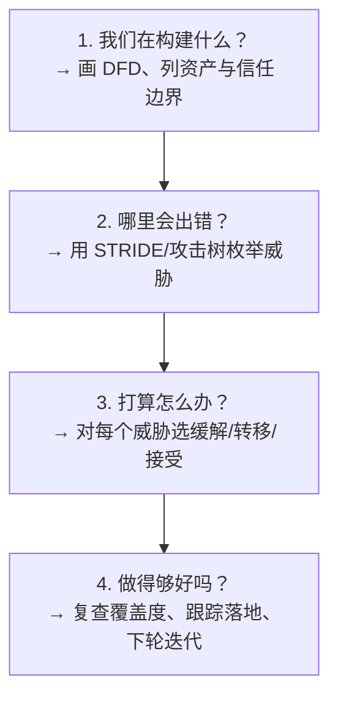
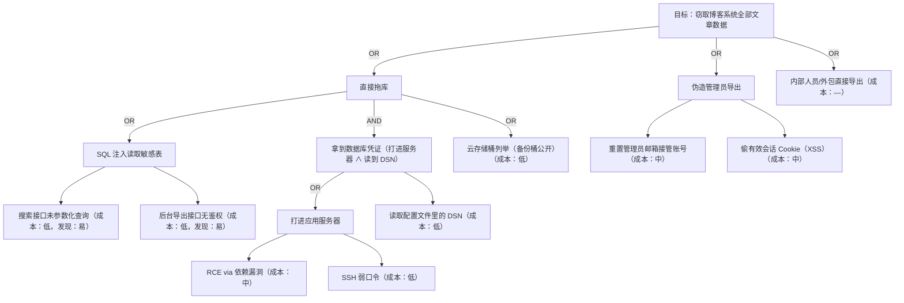
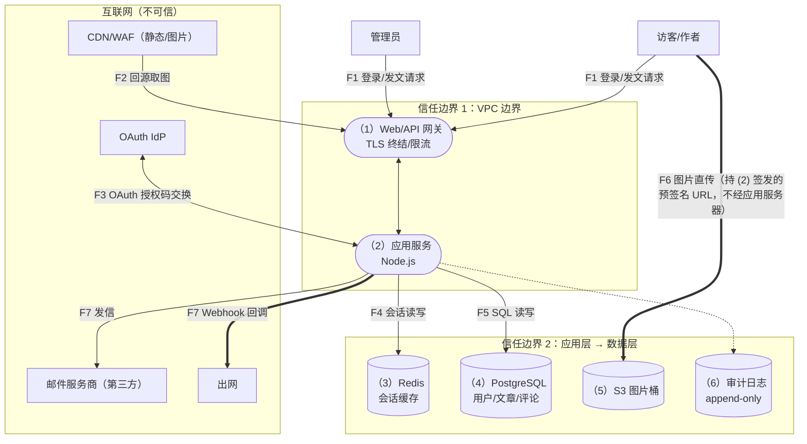
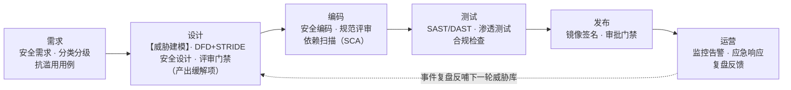

# 威胁建模：STRIDE、攻击树与数据流图实操

> 日期：2026-11-04
> 所属大纲阶段：2. 安全基础概念
> 参考资料：
> - Adam Shostack《Threat Modeling: Designing for Security》(Wiley, 2014)
> - Microsoft Learn: Threat modeling security applications（STRIDE 官方文档）
> - OWASP Threat Modeling Cheat Sheet
> - OWASP Threat Dragon 官方文档（threatdragon.github.io）
> - UcedaVélez, T. & Morrow, D.《Risk Centric Threat Modeling: Computer Security》(Wiley, 2015；PASTA 方法论出处，2012 年首次提出)
> - Deng, M., Wuyts, K., Preneel, B., Joosen, W.（KU Leuven）：《LINDDUN Privacy Threat Modeling》系列论文与教程（linddun.org）

---

## 1. 什么是威胁建模

**威胁建模（Threat Modeling）**是一种工程活动：系统地回答「这个系统可能出什么安全问题、我们打算怎么办、做得够不够」。它不是一次性的文档作业，而是**结构化的安全头脑风暴 + 设计评审**。

一句话定位：**代码扫描（SAST/DAST）找的是「实现错误」，威胁建模找的是「设计错误」。**设计层面的缺陷（比如「管理后台和应用共享同一个数据库超级用户」）扫描器永远扫不出来，但一旦失守影响面更大。

### 1.1 核心产出物

1. 系统的数据流图（DFD）与信任边界标注；
2. 威胁清单（每条含：威胁描述、攻击路径、影响、缓解措施、负责人、状态）；
3. 缓解措施落回设计/任务清单的追踪记录。

### 1.2 什么时候做

| 时机 | 说明 |
|------|------|
| **设计阶段（最佳时机）** | 新系统/新模块设计评审时。改图纸比改房子便宜一个数量级 |
| **迭代/需求变更时** | 新增第三方登录、新开放一个 API、接入新数据流——增量建模，只画变化部分 |
| **重大安全事件复盘后** | 攻击路径补进威胁库，反哺模型 |
| **遗留系统补课** | 起点不全也没关系，先画现状 DFD（"as-is"），本身就常常暴露问题 |

频率参考：每个迭代 1-2 小时的轻量评审（增量），比一年一次 3 天的大会有用得多。

> **常见误区**：把威胁建模做成「写完文档交差」。判断标准不是文档厚度，而是**有没有发现设计问题并改变了设计**。

---

## 2. 四问框架（Shostack's Four Questions）

Adam Shostack 把威胁建模压缩为四个问题，顺序执行：



这四问对应了本文第 4-6 节与第 8 节实操的全部内容。

---

## 3. STRIDE 逐类详解

**STRIDE** 是微软提出的六类威胁的首字母缩写，每类都直接映射到 CIA 及扩展属性（承接 `06-CIA-三元组与安全原则.md`），这是它最大的优点——**可检查、不靠灵感**。

### 3.1 S — 电子欺骗（Spoofing，身份伪造）

- **定义**：冒充其他人/其他系统身份。
- **对应属性**：真实性（Authenticity）。
- **典型手法**：钓鱼凭据、伪造 JWT、IP 伪造、窃取的 API key、无认证的服务间调用。
- **缓解措施**：强认证（MFA、WebAuthn）、证书/mTLS 服务间认证、防重放（时间戳+nonce）、会话固定防护、签名的 JWT + 正确的算法白名单校验。

### 3.2 T — 篡改（Tampering）

- **定义**：未授权修改数据或代码。
- **对应属性**：完整性（Integrity）。
- **典型手法**：中间人改包、修改请求参数（改价格/改 user_id）、依赖投毒、篡改日志。
- **缓解措施**：TLS、HMAC/数字签名、参数服务端校验与归属校验、锁文件 + 校验和、append-only 日志、WORM 存储。

### 3.3 R — 抵赖（Repudiation）

- **定义**：行为人否认自己做过某操作，且系统无法证明。
- **对应属性**：不可否认性（Non-repudiation）、可问责性。
- **典型手法**：共享账号操作后不认账；删除自己的操作痕迹；客户端「我点了取消」服务端无凭证。
- **缓解措施**：完整审计日志（谁/何时/何操作/对象/来源 IP）、时间戳签名或日志异地 hash 链、关键操作双方确认凭证、避免共享账号。

### 3.4 I — 信息泄露（Information Disclosure）

- **定义**：信息被未授权方获取。
- **对应属性**：机密性（Confidentiality）。
- **典型手法**：错误信息带堆栈/SQL、目录遍历、公开的对象存储、日志打印 PII、IDOR 枚举他人数据。
- **缓解措施**：加密（传输/静态）、脱敏日志、最小化返回字段、错误页统一、权限的数据级过滤、DLP。

### 3.5 D — 拒绝服务（Denial of Service, DoS）

- **定义**：使服务对授权用户不可用。
- **对应属性**：可用性（Availability）。
- **典型手法**：大流量 DDoS、应用层慢速攻击（Slowloris）、ReDoS、触发昂贵计算的接口（报表导出无配额）。
- **缓解措施**：限流/配额、CDN+抗 DDoS、超时与连接数上限、异步队列削峰、降级开关、容量预案。

### 3.6 E — 权限提升（Elevation of Privilege, EoP）

- **定义**：获得超出授权的能力（普通用户→管理员、容器→宿主机）。
- **对应属性**：授权（Authorization）的全面失守（往往伴随 C/I/A 全破坏）。
- **典型手法**：注入后 RCE、反序列化 gadget、内核/容器逃逸、JWT 的 `alg:none`/弱密钥、未鉴权管理接口（如早期各产品的 `/actuator`、debug 端点）。
- **缓解措施**：输入校验+参数化查询、最小权限运行（非 root、seccomp）、管理面隔离与鉴权、依赖加固与 SBOM、WAF。

### 3.7 STRIDE × 缓解速查表

| STRIDE | 违反的属性 | 首选缓解（技术） | 检测（运营） |
|--------|-----------|------------------|--------------|
| Spoofing | 真实性 | MFA / mTLS / 签名令牌 | 异地登录告警、凭证滥用检测 |
| Tampering | 完整性 | TLS / HMAC / 签名 / 服务端校验 | 文件完整性监控（FIM）、diff 审计 |
| Repudiation | 不可否认性/可问责性 | 审计日志 + 时间同步 + 日志保护 | 日志异常中断告警 |
| Info Disclosure | 机密性 | 加密 / 脱敏 / 字段最小化 | DLP、异常量导出告警 |
| DoS | 可用性 | 限流 / 队列 / 弹性伸缩 / CDN | SLO 监控、容量水位 |
| EoP | 授权 | 输入校验 / 最小权限 / 管理面收敛 | 特权操作告警、容器逃逸特征 |

> **STRIDE-per-element**：STRIDE 还可以套到 DFD 元素上系统化提问——外部实体易受 S/R；数据流易受 T/I/D；数据存储易受 T/I/R/D；进程易受全部六类。这正是第 8 节实操的方法。

---

## 4. DREAD 威胁评分

**DREAD** 是微软早期的定性评分法，每个维度 1-10 分，总分（或均值）越高越优先处理：

| 字母 | 维度 | 问题 |
|------|------|------|
| D | Damage（损害） | 攻破后损害多大？ |
| R | Reproducibility（可复现性） | 稳定复现的难度？ |
| E | Exploitability（可利用性） | 需要什么技能/权限？ |
| A | Affected users（影响范围） | 波及多少用户/系统？ |
| D | Discoverability（可发现性） | 攻击者容易找到吗？ |

示例：SQL 注入登录接口打分 Damage=10, Reproducibility=9, Exploitability=8, Affected=10, Discoverability=9 → 46/50，最高优先级。

**现状评价**：微软内部已基本弃用（主观分不稳定、求和掩盖短板），业界更多用简单的 **高/中/低** 或 CVSS（针对有 CVE 对应的漏洞）、或可能性×影响矩阵（见 `06` 篇第 10 节）。DREAD 仍适合威胁建模工作坊里快速排序讨论。

---

## 5. 攻击树（Attack Tree）

**攻击树（Attack Tree）**由 Bruce Schneier 推广：把「攻击者的目标」作为根节点，逐步分解为子目标，**AND/OR** 两种关系组合。

画法规则：
- 根节点 = 攻击者最终目标（用攻击者视角措辞：「获得管理员权限」而不是「防止提权」）；
- 子节点 = 实现父目标的手段；
- **OR**：任一子路径达成即达成（默认关系）；
- **AND**：所有子路径须同时达成（图中用弧线连接标注）；
- 可给叶子标注成本/概率，累加做半定量分析。



读法举例：「拿到数据库凭证」是 AND 节点：必须先「打进应用服务器」**并且**「读到配置里的 DSN」两条都成立。防御显然：配置中心/密钥管理（KMS/Vault）+ 最小权限数据库账号可以让 AND 的第二支难度暴涨。

**适用场景**：深度分析单个高价值目标、红队规划、给管理层讲攻击路径。不擅长全覆盖枚举（那是 DFD+STRIDE 的活）。

---

## 6. 数据流图（DFD）与信任边界

### 6.1 DFD 四元素（威胁建模约定）

| 元素 | 图形约定 | 例子 | STRIDE 重点 |
|------|---------|------|-------------|
| 外部实体（External Entity） | 矩形 | 用户、第三方支付 | S, R |
| 进程（Process） | 圆形/圆角矩形 | Web 应用、鉴权服务 | 全部六类 |
| 数据存储（Data Store） | 双横线/开口矩形 | MySQL、Redis、S3 | T, I, R, D |
| 数据流（Data Flow） | 带箭头线 | HTTPS 请求 | T, I, D |

### 6.2 信任边界（Trust Boundary）

**信任边界（Trust Boundary）**是「信任级别发生改变」的位置——数据/控制权从一个信任域进入另一个信任域的地方。**几乎所有威胁都发生在数据跨越信任边界的时刻**，因为那是「一方构造的数据被另一方信任地处理」的位置。

典型边界：
- 互联网 ↔ 你的 VPC（最外层）；
- 前端 BFF ↔ 内部微服务；
- 应用 ↔ 数据库/缓存；
- 你的系统 ↔ 第三方系统（回调、 webhook）；
- 内核 ↔ 用户态、宿主机 ↔ 容器；
- **代码 ↔ 配置/数据**（常被忽略：日志、备份文件、反序列化的对象也是数据跨入「执行域」）。

画法：通常用虚线框/有色框把高信任域圈出来，数据流**每次穿线都要标注**，穿线处逐条做 STRIDE 提问。

---

## 7. PASTA、LINDDUN 与方法论对比

### 7.1 PASTA（Process for Attack Simulation and Threat Analysis）

**风险导向**的七阶段方法论，把威胁建模和业务风险分析对齐：

```text
1. 定义业务目标        （这个系统赚钱/合规靠什么）
2. 定义技术范围        （组件、依赖、数据分类）
3. 分解应用            （DFD、信任边界）
4. 威胁分析            （攻击者画像、犯罪动机、攻击面枚举）
5. 漏洞与弱点分析      （对照 CVE/SAST 结果）
6. 攻击建模与模拟      （攻击树/攻击路径推演）
7. 风险分析与对策      ← 输出：按业务风险排序的缓解计划
```

适合金融/医疗等需要论证「为什么这些控制足够」的强合规行业；代价是重、慢、需要多方参与。

### 7.2 LINDDUN（隐私威胁建模）

面向**隐私**的 STRIDE 类似物，七个字母对应《通用数据保护条例》（GDPR）语境下的隐私威胁：
- **L**inkability（可关联性）、
- **I**dentifiability（可识别性）、
- **N**on-repudiation（不可否认，隐私语境=无法否认操作涉隐私）、
- **D**etectability（可探测性，主体的活动可被察觉）、
- **D**isclosure of information（信息披露）、
- **U**nintended purposes（目的外使用：数据被用于收集时声明之外的用途）、
- **N**on-compliance（不合规：违反法律/政策/约定）；
- 数据最小化、匿名化（k-匿名、差分隐私）是其核心缓解。

### 7.3 方法论对比表

| 方法 | 视角 | 强项 | 弱项 | 适用场景 |
|------|------|------|------|---------|
| **STRIDE** | 资产/元素 | 简单、可教、有速查表 | 不排序、不谈业务影响 | 敏捷团队常态建模、设计评审 |
| **STRIDE-per-interaction** | 数据流交叉点 | 精确到交互 | 略繁琐 | API -heavy 系统 |
| **Attack Tree** | 攻击者目标 | 深入单目标、好沟通 | 覆盖不全 | 高价值资产深挖、红蓝对抗 |
| **PASTA** | 业务风险 | 与合规/业务对齐、可模拟 | 重流程、耗时 | 金融、医疗、大型平台 |
| **LINDDUN** | 隐私 | 覆盖 GDPR 类威胁 | 领域窄 | 处理 PII 的系统 |
| **DREAD** | 评分 | 快速排序 | 主观、已被弃用 | 工作坊辅助排序 |
| **CIA 轴审** | 属性 | 最小成本入门 | 太粗 | 评审时的补充提问 |

### 7.4 工具

| 工具 | 类型 | 说明 |
|------|------|------|
| **OWASP Threat Dragon** | 开源 Web/桌面 | 画 DFD、自动生成 STRIDE 威胁清单、规则引擎可自定义；项目 JSON 可进 Git |
| **Microsoft Threat Modeling Tool (TMT)** | 免费 Windows 桌面 | 内置大量 .NET/Azure 模板与 STRIDE 规则，自动生成威胁报告 |
| **IriusRisk / SD Elements** | 商业 | 结构化问卷 + 合规映射（SOC2/ISO），适合大型组织 |
| **Excalidraw / draw.io** | 通用画图 | 没有自动化，但零门槛；配合手工威胁表也完全可行 |

---

## 8. 完整实操：博客系统威胁建模（核心章节）

目标系统是一个**多用户博客平台**，先描述功能，再走完四问框架全程。

### 8.0 系统描述

功能与技术栈假设：

- 用户可注册/登录（邮箱+密码，支持第三方 OAuth 登录）、写文章（Markdown）、上传图片、评论；
- 管理员可下架文章、封禁用户、查看审计日志；
- 访客可浏览公开文章与评论；
- 技术栈：Next.js 前端 + Node.js API + PostgreSQL + Redis（会话/缓存）+ S3 兼容对象存储（图片）+ CDN；
- 部署：云上 VPC，API 经网关对外，图片走 CDN 回源；
- 第三方：OAuth 身份商、邮件服务商（通知/找回密码）、Webhook 推送到作者自己的回调地址。

### 8.1 第一问：我们在构建什么 —— 画 DFD



**信任边界标注**（数据流穿线处就是提问点）：

| 边界 | 位置 | 穿越的数据 | 为什么关键 |
|------|------|-----------|-----------|
| TB-1 | 互联网 ↔ CDN/网关 | 所有 HTTP 请求、用户上传内容 | 不可信输入的入口；含「数据被当代码」风险（如 SVG 上传 XSS） |
| TB-2 | 网关/应用 ↔ 数据层 | SQL、会话、对象存储凭证 | 应用沦陷后横向移动的必经之路 |
| TB-3 | 应用 ↔ 第三方 | OAuth code、发信内容、Webhook 出网 | 出网通道 = 数据渗出面 + SSRF 跳板 |
| TB-4 | 管理员 ↔ 普通用户功能面 | 管理操作请求 | EoP 的目标终点 |
| （隐含）TB-5 | CDN 缓存 ↔ 源站内容 | 缓存的页面/接口响应 | 缓存键污染可造成跨用户串号（Web Cache Deception） |

### 8.2 第二问：哪里会出错 —— STRIDE 威胁清单（按元素枚举）

> 方法：对每个 DFD 元素套用其易受的 STRIDE 类别，逐条生成威胁。下表是**节选后的完整度示意**（实际工作坊产出通常 30-60 条，此处覆盖关键 25 条，已足够展示方法）。

**威胁编号规则**：`T-<STRIDE字母><序号>`；缓解状态：☐ 计划 / ☑ 已设计 / — 待讨论。

#### 8.2.1 威胁表（节选核心 25 条）

| 编号 | 威胁（攻击者视角） | 涉及元素/边界 | 影响 | 缓解措施（设计决策） | 状态 |
|------|------------------|--------------|------|---------------------|------|
| T-S1 | 伪造他人身份登录（撞库、密码喷洒） | TB-1, (2)(3) | 账户接管 | 登录限速+失败锁定；密码用 Argon2id 存储（见 `09` 篇）；异地/新设备登录邮件提醒；逐步引入 WebAuthn | ☑ |
| T-S2 | 伪造会话：窃取/预测 session id | F1/F4 | 账户接管 | 128bit 随机 id（CSPRNG）；HttpOnly+Secure+SameSite Cookie；会话与 UA/登录地绑定；登出与改密即失效 | ☑ |
| T-S3 | OAuth 回调伪造（code 拦截/重放） | TB-3, F3 | 账户接管 | state 参数一次性随机数；redirect_uri 白名单精确匹配；code 一次性+短时效 | ☑ |
| T-S4 | 应用服务间无认证，内网直连冒充 | TB-2 | 越权调用 | 内部服务 mTLS 或签名的服务令牌（SPIFFE/内部 JWT）；数据层仅监听内网 | ☐ |
| T-S5 | Webhook 接收端冒充第三方回调（伪造签名头） | TB-3 | 数据投毒 | Webhook 携带 HMAC 签名 + 时间戳，接收端验签（见 `10` 篇 HMAC） | ☐ |
| T-T1 | 请求参数篡改：改 `user_id`/`post_id` 越权改他人文章 | F1, (2) | 越权写（IDOR） | 服务端从会话取身份，资源操作校验归属（完全调解原则） | ☑ |
| T-T2 | Markdown 注入存储型 XSS → 篡改他人页面/偷会话 | TB-1, CDN | 会话窃取 | 服务端 sanitize 白名单；CSP 限制脚本源；图片域与主域隔离（沙箱域） | ☑ |
| T-T3 | 上传文件伪装：`.jpg` 实为 SVG/HTML/PHP 执行 | F6, (5) | 存储型攻击 | 魔术字节校验；图片重编码（丢 payload）；Content-Type 固定；S3 不开执行、预签名 URL 直传 | ☑ |
| T-T4 | 缓存键污染：URL 变体让 CDN 缓存他人私有页 | TB-5 | 跨用户串号 | 私有路径 `Cache-Control: private,no-store`；规范化和鉴权后再判缓存键；不缓存带会话 Cookie 响应 | ☐ |
| T-T5 | 出网代理被利用：Webhook URL 指向内网元数据端点（SSRF） | TB-3 | 云凭证失窃 | 出网走独立代理白名单域名；禁私网 IP（解析后校验 + 防重绑定）；IMDSv2 | ☑ |
| T-T6 | 审计日志被删除/篡改掩盖痕迹 | (6) | 不可否认性失守 | 仅追加权限（应用无删权）；日志单独账号写、异地复制；定期外部校验和 | ☐ |
| T-R1 | 作者否认发文、管理员否认封禁 | (2)(6) | 纠纷无凭证 | 关键操作（发布、封禁、下架）全量审计：操作者/时间/对象/前后状态 | ☑ |
| T-R2 | 评论者通过删除本地证据否认骚扰行为 | (4) | 取证困难 | 评论含创建时间戳且修改产生新记录（不覆盖旧值） | ☐ |
| T-I1 | 错误页泄露堆栈、SQL、内部路径 | TB-1 | 侦察情报 | 统一错误处理返回脱敏信息；日志记详情；生产关 debug 模式 | ☑ |
| T-I2 | 访客枚举接口读取未公开（草稿）文章 | (4), F5 | 草稿泄露 | 草稿查询强制 `status=published AND owner=会话用户`；返回 404 而非 403（不确认存在性，按需权衡） | ☑ |
| T-I3 | 图片对象存储桶公开列举，遍历所有上传（含私密图） | (5), TB-2 | PII 图片泄露 | 桶禁 List 权限；私密图走预签名短时效 URL；密钥禁用 AK/SK 明文配置 | ☑ |
| T-I4 | 日志打印用户邮箱/密码重置 token | (2), (6) | 凭证/PII 泄露 | 结构化日志白名单字段；token 只打前后 4 位；日志侧 DLP 扫描 | ☑ |
| T-I5 | SQL 注入拖库（搜索框拼接 LIKE） | F5, (4) | 全库泄露 | 参数化查询/ORM 默认参数绑定；最小权限 DB 账号（应用账号无 DROP/FILE）；敏感字段加密 | ☑ |
| T-D1 | 注册接口短信/邮件轰炸（把别人邮箱当发信接口） | TB-1, TB-3 | 骚扰+成本 | 图形验证码/Proof-of-Work；同邮箱/同 IP 频控；邮件退订与投诉率监控 | ☐ |
| T-D2 | 搜索接口无分页上限，`?page=999999` 拖垮 DB | F5 | 服务不可用 | 强制分页上限；慢查询熔断；搜索走专用索引/限流 | ☑ |
| T-D3 | 图片上传超大文件打爆磁盘/带宽 | F6 | 服务不可用 | 前端+网关双重大小限制；直传 S3 预签名（不过应用服务器）；类型白名单 | ☑ |
| T-D4 | Markdown 渲染灾难回溯（ReDoS）打挂渲染服务 | (2) | 服务不可用 | 渲染库锁定版本并跟踪 CVE；正则加超时/换 safe-regex2；渲染放独立 worker 可水平扩 | ☐ |
| T-E1 | 普通用户调用管理接口（路由遗漏鉴权） | TB-4 | 全站沦陷 | 管理路由集中注册并强制中间件；默认全拒绝，白名单放开（fail-safe defaults） | ☑ |
| T-E2 | JWT `alg` 混淆/弱密钥伪造 admin 令牌 | F1, (2) | 全站沦陷 | 固定算法白名单（RS256/EdDSA）；公钥分发走 JWKS；密钥轮换机制 | ☑ |
| T-E3 | 容器内 RCE → 逃逸到宿主机/云凭证 | TB-2 | 云账号沦陷 | 容器非 root + 只读文件系统 + seccomp；IAM 角色最小化；节点级凭证隔离（K8s SA 逐服务） | ☐ |

#### 8.2.2 按 STRIDE 汇总

```text
S 电子欺骗: 5 条   T 篡改: 6 条   R 抵赖: 2 条
I 信息泄露: 5 条   D 拒绝服务: 4 条   E 权限提升: 3 条
高优先（须在上线前完成设计）: T-S3, T-T5, T-I3, T-E1, T-E2
```

### 8.3 第三问：打算怎么办 —— 处置决策

每条威胁四种处置（与风险管理衔接，见 `06` 篇）：

- **缓解（Mitigate）**：上表多数条目即缓解设计，逐条落到 JIRA/需求单，**编号关联 T-xxx**，保证可追踪；
- **转移（Transfer）**：图片带宽风险 → CDN 厂商的抗 DDoS 能力；支付类风险 → 第三方支付承担；
- **接受（Accept）**：如 T-R2（评论取证）当前接受，记录理由与复审日期；
- **规避（Avoid）**：讨论后砍掉「支持任意 HTML 嵌入」功能 → 直接消灭 T-T2 的一半攻击面。

### 8.4 第四问：做得够好吗 —— 验证闭环

1. **覆盖度检查**：对照 STRIDE×元素矩阵逐格打勾，无空白格；每条数据流穿边界处至少被提问一次；
2. **落地验证**：缓解措施转成验收测试用例（如「用 B 用户 token 访问 A 的草稿 → 404」「Webhook 无签名 → 400」），进 CI 回归；
3. **攻击验证**：上线前用 DAST（ZAP）/依赖扫描/一次渗透测试抽查高风险项；
4. **复评触发器**：新增第三方回调、开放公网新端口、引入新数据类别（如手机号）时，增量重跑本节流程；
5. **度量化**：威胁总数、已缓解比例、逾期未处理高风险数——进安全季度报。

---

## 9. 与安全 SDLC 的衔接

威胁建模在**安全软件开发生命周期（Secure SDLC）**中的位置：



衔接要点：

1. **威胁模型即活文档**：与代码同仓库（Threat Dragon 的 JSON 可 review），设计 PR 改动涉及数据流时须同步更新 DFD；
2. **门禁而非仪式**：设计评审含安全会签，未过威胁建模的高风险模块不进开发；
3. **左右互证**：威胁建模产出「应测什么」（安全测试用例库），SAST/DAST 验证「实现是否符合设计假设」；
4. **反馈回路**：线上事件、新 CVE（对照自己的 SBOM）、渗透测试发现，回流为新一轮「第二问」的输入。

---

## 10. 常见误区

| 误区 | 事实 |
|------|------|
| 「威胁建模是安全团队的事」 | 最懂系统的是写代码的人；安全团队做引导（facilitator），开发/架构做主角 |
| 「一次做完就完了」 | 模型随架构腐化；增量更新比完美初版重要 |
| 「只画攻击者在外面的图」 | 内部实体（管理员、外包、CI 机器人）与出网流量（TB-3）同样是高发边界 |
| 「威胁列表越长越好」 | 目标是**驱动设计改进**，20 条有主的缓解 > 200 条没人看的清单 |
| 「有了 DFD 就等于建模」 | DFD 只是第一问；不问第二问（STRIDE）等于画了张架构图 |
| 「误把漏洞当威胁」 | 「存在 SQL 注入」是发现，「攻击者可注入读取任意表」是威胁路径；建模产出的是后者 |
| 「STRIDE 覆盖隐私」 | STRIDE 不覆盖可关联性等隐私威胁，处理 PII 要补 LINDDUN 视角 |

---

## 11. 自测问题

1. STRIDE 六类分别违反 CIA+扩展属性中的哪一个？试默写映射表。
2. 你的系统里，数据从 CDN 流到数据库共穿过了几层信任边界？每层给出一个代表性威胁。
3. 用攻击树表示「获得你公司生产服务器的 shell」，至少 6 个叶子节点，并标出一处 AND 关系。
4. STRIDE-per-element 中，为什么「数据存储」不适用 Spoofing，而「外部实体」不适用 EoP（从元素语义解释）？
5. DREAD 为什么被弃用？如果只保留三个维度做轻量排序，你保留哪三个，为什么？
6. PASTA 与 STRIDE 的根本取向差异是什么？各举一个更适合对方的项目场景。
7. 针对 8.2 节的博客系统：如果新增「文章付费订阅」功能（接入第三方支付），新的数据流和信任边界怎么画？新增哪些 STRIDE 威胁（至少 4 条）？
8. 「威胁建模做得够好吗」这一问，你会用哪些可量化的证据回答？

---

## 12. 小结

- 威胁建模 = 四问框架（在构建什么 / 哪里会出错 / 怎么办 / 够不够好），核心产出是**改变了设计**。
- STRIDE 给了不靠灵感的枚举法：六类威胁 ↔ 六个安全属性；套在 DFD 元素上可系统化穷举。
- DFD + 信任边界是建模的地图：**威胁集中在数据跨信任边界处**。
- 攻击树适合深挖单一高价值目标；PASTA 对齐业务风险；LINDDUN 补隐私维度。
- 博客系统实操展示了从系统描述到 DFD、边界、25 条威胁及缓解的全流程——可直接套用到自己的项目。
- 工具（Threat Dragon / MS TMT）只是加速器；一张白板 + STRIDE 表也能完成 80% 的价值。
- 延伸阅读：`06-CIA-三元组与安全原则.md`（原则层）、`08-漏洞分类-OWASP-Top10-CWE-CVE.md`（已发现漏洞的管理层）。

---

## 附：ASCII 图 → Mermaid 替换清单

| 原 ASCII 图（小节 · 内容） | 替换后类型 |
| --- | --- |
| 「2. 四问框架（Shostack's Four Questions）」节 · 四问顺序执行流程框图 | flowchart TD |
| 「5. 攻击树（Attack Tree）」节 · 博客系统「窃取全部文章数据」攻击树（OR/AND + 成本注记） | flowchart TD |
| 「8.1 第一问：我们在构建什么 —— 画 DFD」小节 · 博客系统 DFD 大图（互联网/网关/应用/数据层，F1-F7 数据流） | flowchart TD（subgraph 信任边界分区） |
| 「9. 与安全 SDLC 的衔接」节 · 安全 SDLC 六阶段流程（含事件复盘反哺回边） | flowchart LR |
