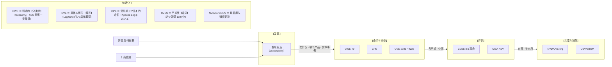
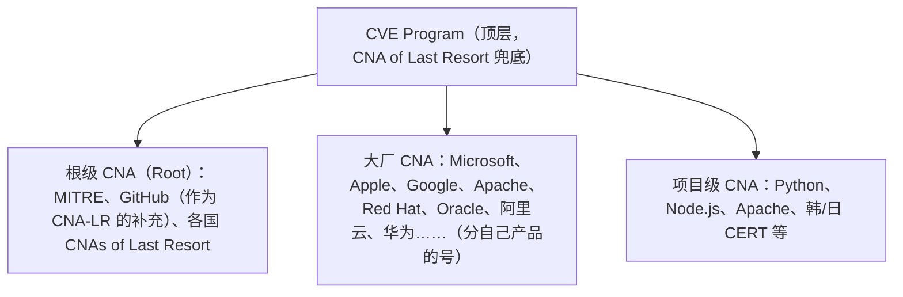
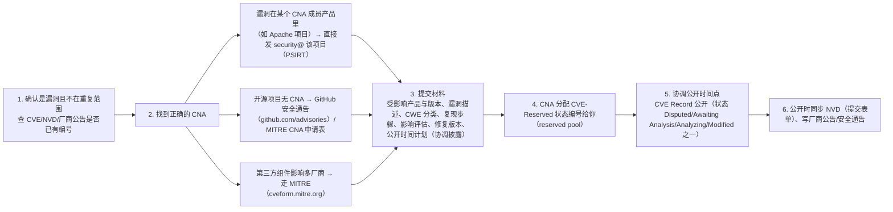
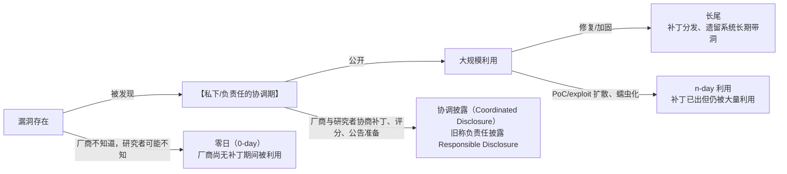

# 漏洞分类体系：OWASP Top 10、CWE 与 CVE 全景

> 日期：2026-11-04
> 所属大纲阶段：2. 安全基础概念
> 参考资料：
> - OWASP Top 10:2021 官方发布页与中文版（owasp.org/Top10）
> - MITRE CWE 官方（cwe.mitre.org）、CVE 官方（cve.org）
> - FIRST CVSS v3.1 Specification / User Guide（first.org/cvss）
> - NIST NVD（nvd.nist.gov）、CISA KEV（cisa.gov/known-exploited-vulnerabilities）
> - OSV（osv.dev）与 Google OSS-Fuzz 漏洞披露流程文档
> - 《Tangled Web / A Bug Hunter's Diary》关于报告规范的章节（报告质量参考）

---

## 1. 漏洞管理生态全景图

一堆缩写（CWE/CVE/CVSS/CPE/NVD/KEV）各司其职，先看全景再逐个拆：



| 问题 | 回答者 |
|------|--------|
| 这个漏洞属于哪类错误？ | **CWE**（Common Weakness Enumeration，通用弱点枚举） |
| 这个具体漏洞叫什么？ | **CVE**（Common Vulnerabilities and Exposures，通用漏洞披露）编号 |
| 哪些产品版本受影响？ | **CPE**（Common Platform Enumeration） |
| 它有多严重？ | **CVSS**（Common Vulnerability Scoring System，通用漏洞评分系统） |
| 有没有被实际利用？ | **CISA KEV**、厂商通告、威胁情报 |
| 我的项目依赖里有没有？ | **OSV** / SCA（Software Composition Analysis）工具 |

---

## 2. OWASP Top 10 (2021) 逐条详解

OWASP（Open Worldwide Application Security Project）每 4 年左右发布 Web 应用十大风险，是**意识教育与门禁基线**，不是「全部漏洞清单」。2021 版改为按**发生率+ exploiting 数据**排序，并引入类别映射。

### A01:2021 — 失效的访问控制（Broken Access Control）

- **定义**：用户越出其权限边界执行操作——水平越权（访问同权限级别他人资源）与垂直越权（普通用户执行管理员操作）。
- **典型场景**：修改 URL 中 `user_id`/`account_number`；缺失 API 端点级授权；JWT 未校验用户字段；CORS 配置成 `Access-Control-Allow-Origin: *` 且带凭据。
- **防御要点**：
  - 默认拒绝 + 服务端每个端点显式授权（除公开资源外）；
  - 资源访问统一走「归属校验」中间件（完全调解原则）；
  - 禁用目录列表、为对象存储/数据库配最小权限账号；
  - 自动化测试覆盖越权用例（用 B 用户 token 访问 A 资源应 403/404）。
- **CWE 映射**：CWE-22（路径遍历）、CWE-352（CSRF）、CWE-284（不当访问控制）、CWE-639（IDOR）等 34 项。
- **案例**：大量 SaaS 的「改 URL 看别人账单」事件；2021 年 LinkedIn API 越权抓取 7 亿用户数据（ scraped via flawed visibility）。

### A02:2021 — 加密机制失效（Cryptographic Failures）

- **定义**：敏感数据保护缺失或加密实现错误（原 A03 敏感数据泄露，2021 改名强调「因加密失败导致」）。
- **典型场景**：明文 HTTP 传输口令；用 MD5/SHA-1 存密码；弱 TLS 套件/过期证书；密钥硬编码在代码；用 ECB 模式加密（轮廓泄露，见 `09` 篇）。
- **防御要点**：传输层全站 TLS≥1.2（建议 1.3）；密码用 Argon2id/bcrypt 加盐慢哈希；数据分类分级后按级别加密；密钥进 KMS/HSM 不进代码库。
- **CWE 映射**：CWE-262/CWE-327（弱加密）、CWE-331（熵不足）等 29 项。

### A03:2021 — 注入（Injection）

- **定义**：不可信数据被解释器当作命令/查询执行。2017 年第一名，2021 因框架默认参数化而降为第三——证明**默认安全**的工程价值。
- **典型场景**：SQL 注入（拼接查询）、NoSQL 注入、OS 命令注入（`system("ping " + host)`）、LDAP/XPath 注入、表达式注入（OGNL/SpEL/模板注入 SSTI）。
- **防御要点**：
  - 参数化查询/预编译语句（SQL）、上下文感知的模板引擎（禁裸拼模板）；
  - 服务端白名单校验输入（长度、类型、字符集）；
  - 最小权限 DB 账号（无 FILE/DROP），错误信息脱敏；
  - WAF 作为纵深防御而非首选。
- **CWE 映射**：CWE-79（XSS）、CWE-89（SQL 注入）、CWE-73（外部控制系统）等 33 项。
- **案例**：CVE-2021-44228（Log4Shell，JNDI 注入，CVSS 10.0）。

### A04:2021 — 不安全设计（Insecure Design, 新增）

- **定义**：设计与架构层的缺陷——不是实现 bug，而是**方案本身**缺少安全控制（如「找回密码只凭『你知道的』问题」）。
- **典型场景**：电影票不限制单 IP 购买量（黄牛/刷票）；恢复流程可绕过 MFA；一次性口令无限次重试。
- **防御要点**：威胁建模（见 `07` 篇）与安全设计模式；滥用用例（abuse case）与业务限额；关键流程多因素+速率限制+人工审核分级。
- **CWE 映射**：CWE-209（错误信息泄露）、CWE-256（未受保护凭据存储）、CWE-501（违反信任边界）等 40 项。

### A05:2021 — 安全配置错误（Security Misconfiguration）

- **定义**：不安全的默认配置或不完整的配置。云时代最高频问题之一。
- **典型场景**：S3/存储桶公开；云上安全组 0.0.0.0/0 开 22/3389/3306/6379；调试端点暴露（`/actuator/*`、`/.env`、`/graphql` introspection）；过细的错误信息；默认口令。
- **防御要点**：基础设施即代码（IaC）+ 策略扫描（如 checkov/tfsec）；加固基线镜像；配置漂移检测；出网/入网最小化；定期外部暴露面审计（Shodan/Censys 自查）。
- **CWE 映射**：CWE-16（配置错误）等 208 项（最多的一类）。
- **案例**：Capital One 2019（SSRF + IAM 配置）1 亿人数据泄露。

### A06:2021 — 脆弱和过时的组件（Vulnerable and Outdated Components）

- **定义**：使用了含已知漏洞的依赖库/运行时（含 CVE 的旧版本、停止维护的组件）。
- **典型场景**：jQuery 老版本 DOM XSS；旧版 Log4j/OpenSSL/Struts；镜像里的系统包三年没升级。
- **防御要点**：SBOM（软件物料清单）持续维护；SCA 扫描（OSV-Scanner/Trivy/Dependabot）；订阅受影响组件通告；升级 SLA（KEV 列表内的优先）；移除不用的依赖。
- **CWE 映射**：无专属 CWE（以组件 CVE 计数）。
- **案例**：Equifax（Struts CVE-2017-5638，见 `06` 篇）。

### A07:2021 — 身份认证与会话管理失败（Identification and Authentication Failures）

- **定义**：身份验证或会话管理的实现错误（原「失效的身份认证」扩展改名）。
- **典型场景**：撞库无防护；多用户并发会话不失效；口令弱策略/默认口令；会话 ID 在 URL 中传递；MFA 缺失或可绕过（短信炸弹、SIM swap）。
- **防御要点**：对齐 NIST SP 800-63B（长度优先、泄露口令黑名单、无强制周期换密的证据主义）；服务器端会话管理；MFA 抗钓鱼（WebAuthn）；新设备/异常登录通知；统一登录网关限速。
- **CWE 映射**：CWE-287（不当认证）、CWE-384（会话固定）等 22 项。

### A08:2021 — 软件与数据完整性故障（Software and Data Integrity Failures, 新增）

- **定义**：在不验证完整性的情况下更新/反序列化/消费关键数据——面向供应链与不信任数据流。
- **典型场景**：未签名的自动更新；对象/属性反序列化（Java/PHP/Python pickle）；CI/CD 流水线凭证外泄；依赖混淆（dependency confusion）。
- **防御要点**：签名与验签（代码签名、sigstore/cosign、安全启动）；禁用不安全反序列化，改用 JSON 等纯数据格式 + schema 校验；私有内部包名注册/代理；CI 各步最小权限与产物签名。
- **CWE 映射**：CWE-502（不可信数据反序列化，连续多年 CWE Top25 前列）等。
- **案例**：SolarWinds 2020（更新通道投毒，见 `06` 篇）。

### A09:2021 — 安全日志与监控失败（Security Logging and Monitoring Failures）

- **定义**：缺少或不充分的日志/告警，使攻击无法被检测与追溯。
- **典型场景**：登录失败不记录；日志无用户上下文；只存本地且无保留策略；告警风暴致真正告警被忽略。
- **防御要点**：集中式日志（SIEM）+ 保留策略；关键事件清单（认证、授权失败、管理操作、批量导出）；日志脱敏（不打密码/token 全量）；注入「蜜罐账号/金丝雀令牌」验证检测有效性；定期红蓝对抗检验检测覆盖率（Purple Team）。
- **CWE 映射**：CWE-778（日志不足）等。

### A10:2021 — 服务端请求伪造（SSRF, Server-Side Request Forgery, 新增）

- **定义**：攻击者诱导服务端向其指定的（往往是内网的）地址发起请求。
- **典型场景**：URL 预览/缩略图功能请求 `http://169.254.169.254/`（云元数据服务）拿 IAM 凭证；Webhook/导入功能探测内网端口。
- **防御要点**：出网请求走白名单代理；解析后校验 IP 为公网（且防 DNS 重绑定：解析两次/TTL 锁定）；禁用重定向跟随或重定向后再校验；云上启用 IMDSv2；网络层禁止应用网段直连元数据/管理网。
- **CWE 映射**：CWE-918（SSRF）。
- **案例**：Capital One 2019（SSRF→元数据→S3 拖库）。

### Top 10 汇总速查表

| 编号 | 风险 | 一句话防御 | 核心 CWE |
|------|------|-----------|----------|
| A01 | 失效的访问控制 | 服务端每端点显式授权+归属校验 | CWE-284/639/22/352 |
| A02 | 加密机制失效 | TLS+Argon2+密钥管理 | CWE-327/331 |
| A03 | 注入 | 参数化+白名单校验 | CWE-89/79/78 |
| A04 | 不安全设计 | 威胁建模+滥用用例 | CWE-501 等 |
| A05 | 安全配置错误 | IaC 扫描+基线+暴露面审计 | CWE-16 |
| A06 | 脆弱组件 | SBOM+SCA+升级 SLA | （组件 CVE） |
| A07 | 认证与会话失败 | 800-63B+MFA+会话治理 | CWE-287/384 |
| A08 | 完整性故障 | 签名+禁危险反序列化 | CWE-502 |
| A09 | 日志监控失败 | 集中日志+关键事件+验证检测 | CWE-778 |
| A10 | SSRF | 白名单出网+私网 IP 封禁 | CWE-918 |

---

## 3. CWE 体系

### 3.1 是什么

**CWE（Common Weakness Enumeration，通用弱点枚举）**是 MITRE 维护的**软件安全弱点的分类字典**——它描述的是「一类错误模式」，不是具体漏洞实例。类比：CWE 是生物学的「种」，CVE 是「标本」。

关键结构概念：

- **视图（View）**：面向特定场景的 CWE 子集。最有名的两个：
  - **CWE-1000 Research View**（研究视图，全量体系）；
  - **CWE-1003/CWE-Top25**：按 CVE 数据统计出的年度最危险 25 个弱点。
- **层级关系**：CWE 是树状分类，如 CWE-707（输入校验不当）下有 CWE-20（不当输入验证）等子节点；每条 CWE 有 Parent/Child 关系与「基础/变体/复合」的抽象层级。

### 3.2 常用 CWE 清单（Top 25 常客节选）

| CWE 编号 | 名称 | 典型后果 |
|----------|------|---------|
| CWE-79 | 跨站脚本（XSS） | 会话窃取 |
| CWE-89 | SQL 注入 | 拖库/RCE（堆叠查询时） |
| CWE-78 | OS 命令注入 | 服务器沦陷 |
| CWE-434 | 不受限文件上传 | Webshell 落地 |
| CWE-502 | 不可信反序列化 | RCE |
| CWE-22 | 路径遍历 | 任意文件读取/写入 |
| CWE-352 | CSRF | 以受害者身份执行操作 |
| CWE-798 | 硬编码凭据 | 凭据泄露即沦陷 |
| CWE-306 | 关键功能缺少认证 | 未授权访问 |
| CWE-862 | 缺少授权 | 越权 |
| CWE-639 | IDOR（不安全的直接对象引用） | 水平越权 |
| CWE-918 | SSRF | 内网穿透/凭证窃取 |
| CWE-200 | 敏感信息暴露 | 侦察/泄露 |
| CWE-327 | 使用已破解/有风险的加密算法 | 机密性失守 |
| CWE-732 | 关键资源的权限分配不当 | 提权 |
| CWE-287 | 不当认证 | 账户接管 |
| CWE-125 / CWE-787 | 越界读取/越界写入（内存类） | 崩溃→RCE |

> **消费姿势**：SAST 工具报告按 CWE 分组统计趋势；代码规范按 CWE 配 lint 规则；培训用 Top 25 圈定高频模式。

---

## 4. CVE：编号规则与申请流程

### 4.1 CVE 是什么

**CVE（Common Vulnerabilities and Exposures）**是具体公开漏洞的**全球唯一编号**，格式：`CVE-<年份>-<序号>`。例如 `CVE-2014-0160`（Heartbleed）、`CVE-2021-44228`（Log4Shell）。年份是**公开/分配年份**，序号最低 4 位（现在常见 5-7 位，如 CVE-2021-44228）。

### 4.2 谁来分配：CNA 体系

CVE 由 **CVE Program**（cve.org，MITRE 起家，现移交 CVE 授权局）管理，具体编号由各级 **CNA（CVE Numbering Authority，CVE 编号授权机构）** 分配：



### 4.3 申请流程（研究者视角）



> 实务提示：报给厂商 PSIRT 通常比直接找 MITRE 快；编号在 **RESERVED** 状态会持续到细节公开，长期未公开的编号会被 CVE Program 回收/标记（防「占号炒作」，并无固定保留天数承诺）。

---

## 5. NVD / CNVD / CNNVD：数据库定位对比

| 数据库 | 运营方 | 定位 | 特点 |
|--------|--------|------|------|
| **NVD**（National Vulnerability Database） | 美国 NIST | CVE 的**富化数据库**：给 CVE 补充 CPE 映射、CVSS 评分、CWE 分类、参考链接 | 全球事实标准；数据可 API/Feed 批量获取；评分以 NVD 分析为准（厂商评分可不同） |
| **CVE.org** | CVE Program | 编号**注册表**本体 | Record 的权威源；含 CNA 分配的初始描述（丰富度低于 NVD） |
| **CNVD**（国家信息安全漏洞共享平台） | 中国 CNCERT/CCID | 中国国家漏洞库 | 收录 CVE 之外的中国软件/国内影响漏洞，发 CNVD 编号；报送有流程与通报机制 |
| **CNNVD**（中国国家信息安全漏洞库） | 中国信息安全测评中心 | 中国国家漏洞库（另一体系） | 同样跟踪 CVE 并有自主编号；政策合规场景常被引用 |
| **GHSA**（GitHub Security Advisories） | GitHub | 开源生态通告 | 与 OSV 打通，仓库级精准（commit 级 patch 链接） |
| **OSV** | Google 主导的开源社区 | **依赖级漏洞**查询 | 按 package 生态（npm/PyPI/Go…）组织，机器可读，适合 CI 集成 |

> **开发者重点**：查「这个 CVE 详细评分/受影响产品」用 NVD；查「我的依赖有没有中招」用 OSV/SCA 工具（见第 11 节实操）；国内合规报送走 CNVD/CNNVD。

---

## 6. CVSS 3.1 详解

### 6.1 概述

**CVSS（Common Vulnerability Scoring System）**由 FIRST 维护，3.1 是当前最通用版本。三组共 8 个指标：

- **Base（基础）**：漏洞固有属性，不随环境变化——本章重点；
- **Temporal（时间）**：随时间变化（exploit 成熟度、补丁有无、置信度）——用得少；
- **Environmental（环境）**：你在自己环境里的实际风险（如该服务是否对外）——**最该用而最少被用**。

评分区间：0.0-10.0。分级惯例（各组织可自定义阈值）：Low 0.1-3.9 / Medium 4.0-6.9 / High 7.0-8.9 / Critical 9.0-10.0。

### 6.2 八个基础指标逐个解释

**A. 可利用指标（Exploitability metrics）4 个：**

1. **AV — 攻击向量（Attack Vector）**：攻击从哪发起？
   - `N` Network 网络远程（互联网可达即可）→ 最危险；
   - `A` Adjacent 邻接网络（同内网/蓝牙/同一虚拟网络）；
   - `L` Local 本地（需本地账户/交互）；
   - `P` Physical 物理（需接触设备，如 BadUSB）。
2. **AC — 攻击复杂度（Attack Complexity）**：攻击条件苛刻吗？
   - `L` Low：直接可打，无特殊条件；
   - `H` High：需要竞态、特定配置、时序窗口、先收集密钥等。
3. **PR — 所需权限（Privileges Required）**：
   - `N` None 无需任何权限（匿名互联网用户）；
   - `L` Low 普通用户权限；
   - `H` High 管理员/系统级权限。
   - 注意：PR=L/H 时评分会随 **Scope** 变化打折（S=U 与 S=C 系数不同）。
4. **UI — 用户交互（User Interaction）**：
   - `N` None 无需任何用户配合；
   - `R` Required 需要受害者做事（点链接、打开文件——如 XSS/CSRF）。

**B. 范围与影响指标 5 个（其中影响 3 个）：**

5. **S — 范围（Scope）**：漏洞影响是否**跳出**了 vulnerable component 的安全授权范围（authority）？
   - `U` Unchanged：影响限于该组件自身权限域；
   - `C` Changed：漏洞导致**其他组件**的安全边界被波及（典型：应用漏洞导致 OS/其他租户受影响；JVM 内反序列化影响整机）。
   - 最难判断的指标，判据是「利用是否违反了组件之外的授权边界」。
6. **C — 机密性影响（Confidentiality）**：`H` High 完全读取 / `L` Low 部分读取 / `N` 无。（呼应 CIA，见 `06` 篇）
7. **I — 完整性影响（Integrity）**：`H` 完全或高保证的篡改 / `L` 有限篡改 / `N` 无。
8. **A — 可用性影响（Availability）**：`H` 完全拒绝服务（进程死/数据不可恢复）/ `L` 性能降级或间歇不可用 / `N` 无。

### 6.3 计算直觉（不必背公式）

- 影响三指标决定「天花板」：C/I/A 全 H 时，若 S=U 上限约 9.8——`AV:N/AC:L/PR:N/UI:N/S:U/C:H/I:H/A:H` 正是 9.8（BlueKeep，CVE-2019-0708 即此分）；只有把 AC 换成 H 才降到 8.1；满分 10.0 仅在 S=C 时可能（如 Zerologon CVE-2020-1472、Log4Shell）；
- AV/AC/PR/UI 是折扣因子：网络可打、无权限、无交互、低复杂度 → 几乎不打折；
- PR 有权限时打大折扣，且 S=C 时折扣更狠（跨域提权更值钱）。

### 6.4 Walkthrough：用 CVE-2021-44228（Log4Shell）一步步算

背景：Apache Log4j2 的 JNDI Lookup 功能，日志语句记录攻击者可控字符串时，会向攻击者指定的 LDAP/RMI 服务发起请求并**加载远程类**→ 远程代码执行。攻击者仅需能让目标把字符串写进日志（如 User-Agent），无需账号。

逐步取值：

| 指标 | 取值 | 理由 |
|------|------|------|
| AV | **N** | 任何能触发日志记录的网络入口（HTTP 头、聊天消息）即可 |
| AC | **L** | 无竞态、无特殊配置；默认配置可利用（<2.15 默认开启 lookup） |
| PR | **N** | 无需登录（例：把 `${jndi:...}` 塞进 User-Agent） |
| UI | **N** | 不需要受害者交互（区别于 XSS/CSRF） |
| S | **C** | 利用导致 JVM 之外受影响：RCE 可进一步控制主机与其他系统（授权域外） |
| C | **H** | RCE 可读任意数据 |
| I | **H** | RCE 可改任意文件/数据 |
| A | **H** | RCE 可删库/杀进程 |

向量串：`CVSS:3.1/AV:N/AC:L/PR:N/UI:N/S:C/C:H/I:H/A:H`

结果：**10.0 Critical**（NVD 与官方公告一致）。这也是理解 CVSS 的好例子：满分=「远程、无条件、无权限、无交互、可跨域、CIA 全毁」。

**再算一个对照**：CVE-2014-0160（Heartbleed，OpenSSL 心跳包越界读）：
- AV:N（远程）、AC:L、PR:N、UI:N；
- S:U（读取发生在同一 TLS 连接/进程内，未跨越其他组件授权域——官方取 U）；
- C:H（可读进程内存中的私钥/会话）、I:N、A:N（不篡改不宕机）；
- 向量：`AV:N/AC:L/PR:N/UI:N/S:U/C:H/I:N/A:N` → **7.5 High**。

> 同样「可怕」的两个漏洞分数差异巨大——这正是 CVSS 的本意：**衡量固有严重度**，而非「媒体热度」。也提醒我们：排修复优先级不能只看分数（见 KEV 与第 12 节）。

### 6.5 CVSS 4.0 简介

FIRST 于 2023 年发布 CVSS 4.0（v4.1 已在 2025 年推出微调），主要变化：

1. **指标重构**：基础部分拆为 **Exposure（暴露）** 与 **Exploitability（可利用性）**；危害维度细化为 **Vulnerable System Impact**（对被攻击系统）与 **Subsequent System Impact**（对下游系统，取代 Scope 的别扭表达）；
2. **新增威胁指标内置化**：报告可附 Exploit Maturity（EXP）等，使分数更贴近现实利用状态（弱化 Temporal 组）；
3. **补充指标**（Supplemental）：自动化（Automatable，如是否可蠕虫化）、恢复难度（Recovery）、价值密度、漏洞响应效率、安全绕过等——直接回应「勒索软件时代」的需求；
4. **兼容性**：4.0 不兼容 3.1 向量，二者将长期并存。作为使用者：读懂 3.1 仍是基本盘，关注 4.0 的 Automatable 与 Exploit Maturity 如何进入评分。

---

## 7. CPE：受影响产品标识

**CPE（Common Platform Enumeration）**是 NVD 用来命名「IT 产品/组件」的规范，格式（2.3）：

```text
cpe:2.3:part:vendor:product:version:update:edition:language:sw_edition:target_sw:target_hw:other

例：cpe:2.3:a:apache:log4j:2.14.1:-:*:*:*:*:*:*
     │      │ │     │      │
     │      │ │     │      └ version=2.14.1
     │      │ │     └ product=log4j
     │      │ └ vendor=apache
     │      └ part=a（application；o=操作系统，h=硬件）
     └ 固定前缀 cpe:2.3
```

> 注：此图保留 ASCII 原样 —— 字段注解（version=、product=、vendor=、part=）用竖线逐位对齐在 CPE 2.3 格式串原文下方，转成节点图会丢失「格式串字符位置与字段名」的逐位对照。

用途：NVD 上每个 CVE 附「受影响 CPE 列表」，SCA/资产管理工具据此做机器匹配（连同版本区间）。**注意**：CPE 匹配有著名坑——fork/改名包对不上（如某些 Linux 发行版改包名打补丁后版本号不变但已修复，导致误报）。OSV 用生态原生包名规避了部分问题，所以依赖场景优先 OSV。

---

## 8. CISA KEV 名单

**KEV（Known Exploited Vulnerabilities，已知被利用漏洞目录）**：美国 CISA 依据有实际利用证据（in-the-wild）的漏洞整理的清单，并据《BOD 22-01》强制联邦机构限期修复。

**为什么它比 CVSS 分数更该驱动你的修复优先级**：

- 统计上，**KEV 内漏洞被利用概率是同分非 KEV 的数倍**；
- 研究表明 KEV 的分数分布横跨低中高危——即「9.8 分但没人打」与「7.5 分但勒索团伙天天扫」并存；
- 实操策略：修复优先级 = **是否在 KEV / 是否有公开 PoC / 是否面向互联网 + 是否有凭据暴露**，其次才是 CVSS。

KEV 提供 JSON feed：`https://www.cisa.gov/sites/default/files/feeds/known_exploited_vulnerabilities.json`，可接入资产管理平台自动告警。

---

## 9. 漏洞生命周期



关键概念辨析：

- **协调披露（Coordinated Disclosure）**：研究者私下报告 → 各方约定时间同时公开详情与补丁（一般 90 天窗口，可延长）。当前主流（Google Project Zero 的 90 天政策是范本）。
- **全披露（Full Disclosure）**：不经协调直接公开全部细节。支持者的理由：迫使拖延的厂商行动；风险：补丁空窗期放大伤害。
- **零日（Zero-day）**：对厂商来说「修补天数=0」——补丁存在前就被利用。注意与「0-day 漏洞（私藏未公开）」与「0-day 攻击（实际使用中）」的混用。
- **In the wild（野外利用）**：在真实攻击中被观察到（区别于实验室 PoC）——进 KEV 的门槛。
- **N-day**：补丁已存在，但存量系统没打——**历史上大多数重大事故是 n-day 而非 0-day**（WannaCry 打的是已修补的 SMB 漏洞 CVE-2017-0144；Equifax 是已修补的 Struts）。教训：补丁管理比追 0-day 新闻更值得投入。

---

## 10. 漏洞赏金与 SRC

**漏洞赏金（Bug Bounty）**是厂商用现金激励外部研究者负责任报告漏洞的机制。主要平台与渠道：

| 平台/渠道 | 说明 |
|-----------|------|
| **HackerOne** | 全球最大商业赏金平台；客户含美国国防部、各大厂；同步运营 CVD（协同漏洞披露）咨询 |
| **Bugcrowd** | 主要竞争者；有公开赏金表（VRT 分类法）与私测项目分级 |
| **各厂 SRC（Security Response Center）** | 阿里 SRC、腾讯 SRC、字节 SRC、美团 SRC 等；国内合规报送常同时要求 CNVD/CNNVD 证书 |
| **GitHub Security Advisories / bug bounty（GitHub Security Lab）** | 开源生态报告首选，可拿 GHSA + CVE 双编号 |

**计划设计要素（防御视角，若你要开赏金）**：范围（in-scope 域名/资产）、奖励矩阵（严重度×质量）、重复规则（首报优先还是都奖）、响应 SLA（首次响应/修复/公开时间）、法律安全港（good-faith 条款）、评级标准（建议用 CVSS+ 自定义影响矩阵，而非凭感觉）。

---

## 11. 实操：查 CVE、扫依赖

### 11.1 在 NVD 查询 CVE

运行环境：任何现代浏览器/终端。

```text
1. 网页：https://nvd.nist.gov/vuln/detail/CVE-2021-44228
   可见：Description / CWE-502 / *CVSS 3.1: 10.0 CRITICAL* / CPE 配置 / References（含厂商公告、PoC 链接）
2. API：
   curl -s "https://services.nvd.nist.gov/rest/json/cves/2.0?cveId=CVE-2021-44228" | jq '.vulnerabilities[0].cve.metrics'
   —— 无 key 限速 5 req/30s，申请 API key 后 50 req/30s
3. 关键词搜索：NVD 搜索框支持 "log4j jndi" 等关键词，可按 CVSS 分段/CWE 过滤
```

### 11.2 用 OSV 查依赖漏洞

OSV（osv.dev）按**包生态**组织漏洞数据（聚合 GHSA/PyPA/Go/Rust 通告），对 CI 极友好。

```bash
# 运行环境：macOS / Linux，Go 1.18+ 或直接下载二进制
# 工具：osv-scanner（Google 开源）

# 安装
brew install osv-scanner          # macOS
# 或 go install github.com/google/osv-scanner/v2/cmd/osv-scanner@latest

# 扫描当前项目（自动识别 lockfile：package-lock.json / poetry.lock / go.sum 等）
osv-scanner --lockfile=./package-lock.json
osv-scanner -r /path/to/project   # 递归扫描目录下所有清单文件

# 扫描镜像/系统依赖（如 Debian 包）
osv-scanner --docker image-name:tag

# 输出（节选示意）：
# Scanning /path/package-lock.json
# ┌────────────────────┬────────┬──────────┬──────┬─────────────┐
# │ PACKAGE            │ VERSION│ CVE/GHSA │ SEV  │ FIXED IN    │
# ├────────────────────┼────────┼──────────┼──────┼─────────────┤
# │ lodash             │ 4.17.15│ GHSA-35jh...(CVE-2021-23337)│ HIGH│ 4.17.21 │
# └────────────────────┴────────┴──────────┴──────┴─────────────┘
```

```bash
# 直接查询某包某版本的已知漏洞（API）
curl -s -X POST https://api.osv.dev/v1/query \
  -d '{"package":{"name":"log4j-core","ecosystem":"Maven"},"version":"2.14.1"}' \
  | jq '.[].id, .[].aliases'    # 返回 OSV-ID 与对应 CVE-2021-44228 等

# CI 中作为门禁（有漏洞即退出码非 0）
osv-scanner --lockfile=package-lock.json --fail-on-high=true
```

配套：GitHub Dependabot / Renovate 自动开升级 PR；`grype`/`trivy` 扫镜像层；SBOM 用 `syft` 生成（`syft dir:. -o spdx-json > sbom.json`）。

---

## 12. 有效 vs 无效漏洞报告

无论你在赏金平台报洞，还是在内部给安全团队提单，报告质量决定处置效率：

| 维度 | 无效报告（会被关闭/降级） | 有效报告 |
|------|--------------------------|----------|
| 复现 | 「应该可以越权」猜测、无步骤 | 前置条件 → 逐步请求（method/URL/headers/body）→ 期望 vs 实际 |
| 证据 | 截图涂改严重、无报文 | 原始 HTTP 报文/响应、时间戳、测试账号标识 |
| 影响 | 「可能危害巨大」泛泛 | 具体攻击链：以该漏洞为起点能拿到的数据/权限（越权到谁的什么记录） |
| 范围 | 打测试范围外资产、社工员工、DoS 实战 | 严格遵守项目 scope 与规则 |
| 误报 | 把自反射 XSS 报成高危、把 404 枚举当注入 | 自查过：参数化了吗？是否需要用户交互？是否仅自身影响？ |
| 重复 | 不查已有报告/公开 CVE | 先搜索平台与 NVD，注明「未检索到重复」 |
| 态度 | 逼问奖金、威胁全披露 | 遵守 SLA、配合验证、接受重复判定 |

**常见「看似漏洞实为不是」**：自 XSS（打不了别人）、无影响的信息泄露（版本号——多数计划 out-of-scope）、需要物理接触的场景、自动化扫描器原始输出未人工确认、`alg:none` 在库已禁用时的报告。

**报告模板（防御方也用它做分诊）**：

```markdown
标题：[A01/越权-IDOR] api.example.com/v1/orders/{id} 可横向读取任意订单
影响版本/资产：v1.23.0, prod
前置条件：任意有效登录用户（免费注册）
复现步骤：
 1. 登录用户 B，记 session
 2. GET /v1/orders/100234 (B 的订单为 100999) → 200 返回用户 A 的订单（含收货地址）
 报文：[完整请求/响应粘贴]
影响：水平越权读取全平台订单 PII（姓名/电话/地址）；未测试写入越权（避免破坏数据）
建议：服务端校验订单归属（A01 完全调解）；补充自动化越权用例
自查：NVD/平台未检索到重复报告
```

---

## 13. 常见误区

| 误区 | 事实 |
|------|------|
| 「CVE 编号 = 严重漏洞」 | 编号只保证唯一性；严重度看 CVSS/KEV，有的 CVE 是 Low |
| 「CVSS 分高就要立刻修」 | 修复优先级要叠加：是否 KEV、是否互联网暴露、是否需认证、资产重要性；环境分（Environmental）才是你的真实分 |
| 「OWASP Top 10 = 漏洞全集」 | 它是风险类别意识清单；完整分类在 CWE，具体实例在 CVE |
| 「没 CVE 的漏洞不存在」 | 大量内部/未公开/厂商自修复漏洞无编号；供应链投毒常用 GHSA/OSV 甚至无编号 |
| 「0-day 是最大威胁」 | 绝大多数入侵用的是 n-day（补丁已存在）；补丁纪律 > 追新 |
| 「CPE 匹配 = 精确影响面」 | fork/回移补丁导致大量误报；以版本区间 + vendor 公告为准 |
| 「报了洞就有奖金」 | 赏金计划有 scope、重复判定、质量分级；低质量报告常 zero bounty |

---

## 14. 自测问题

1. CWE、CVE、CPE、CVSS 四者分别回答什么问题？各举一例（可都用 Log4Shell）。
2. OWASP 2021 有哪三类是新增的？各自针对什么新趋势？
3. CVSS 3.1 的 Scope（S）指标判断标准是什么？Log4Shell 为什么取 C 而 Heartbleed 取 U？
4. 给「漏洞需要管理员权限才能触发、但触发后可以读全库、网络可达、无需交互」写出向量串（S=U），并预估分数段。
5. KEV 与 CVSS 谁更适合排你的修复队列？给出三者组合的优先级公式。
6. 零日与 n-day 的区别？为什么说补丁管理比追零日更重要？用 WannaCry 说明。
7. 你在 npm 依赖里发现一个 7.5 分漏洞，但该依赖只在构建期使用，不进生产运行时——如何用 CVSS 环境指标调整它的实际优先级？
8. 一份有效的漏洞报告必须包含哪五个部分？
9. CVSS 4.0 相比 3.1 新增了哪些「勒索时代」指标？

---

## 15. 小结

- 生态分工口诀：**CWE 分类、CVE 命名、CPE 定产品、CVSS 定严重度、NVD/OSV 做分发、KEV 定利用**。
- OWASP Top 10 (2021) 十大风险要能默写并各给一条防御——它是设计评审与培训的公共语言。
- CVSS 3.1 八指标（AV/AC/PR/UI/S/C/I/A）读懂即可手算大概分数段；Log4Shell 10.0 与 Heartbleed 7.5 的对照说明了模型逻辑。
- 修复优先级 = KEV/公开 PoC/暴露面/资产价值 的组合，CVSS 只是输入之一。
- 漏洞生命周期中协调披露是主流；多数真实伤害来自没打补丁的 n-day。
- 把 OSV-Scanner/Dependabot 接进 CI，是本章对工程实践最直接的落地动作。
- 延伸：`07-威胁建模.md`（发现设计层问题）、`09/10`（A02 加密失效的深挖）。

---

## 附：ASCII 图 → Mermaid 替换清单

| 原 ASCII 图（小节 · 内容） | 替换后类型 |
| --- | --- |
| 「1. 漏洞管理生态全景图」节 · 发现→命名与分类→评估→共享与消费 四环节全景图 | flowchart LR（各环节 subgraph） |
| 「4.2 谁来分配：CNA 体系」小节 · CNA 层级树 | flowchart TD |
| 「4.3 申请流程（研究者视角）」小节 · CVE 申请 6 步流程（第 2 步含三路分支） | flowchart LR |
| 「7. CPE：受影响产品标识」节 · CPE 2.3 格式串字段注解 | 保留 + 注释（注解逐位对齐格式串，转图丢失对照） |
| 「9. 漏洞生命周期」节 · 漏洞披露时间线（零日/协调披露/n-day 分支） | flowchart LR |
