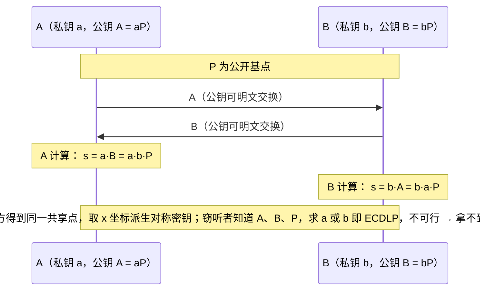
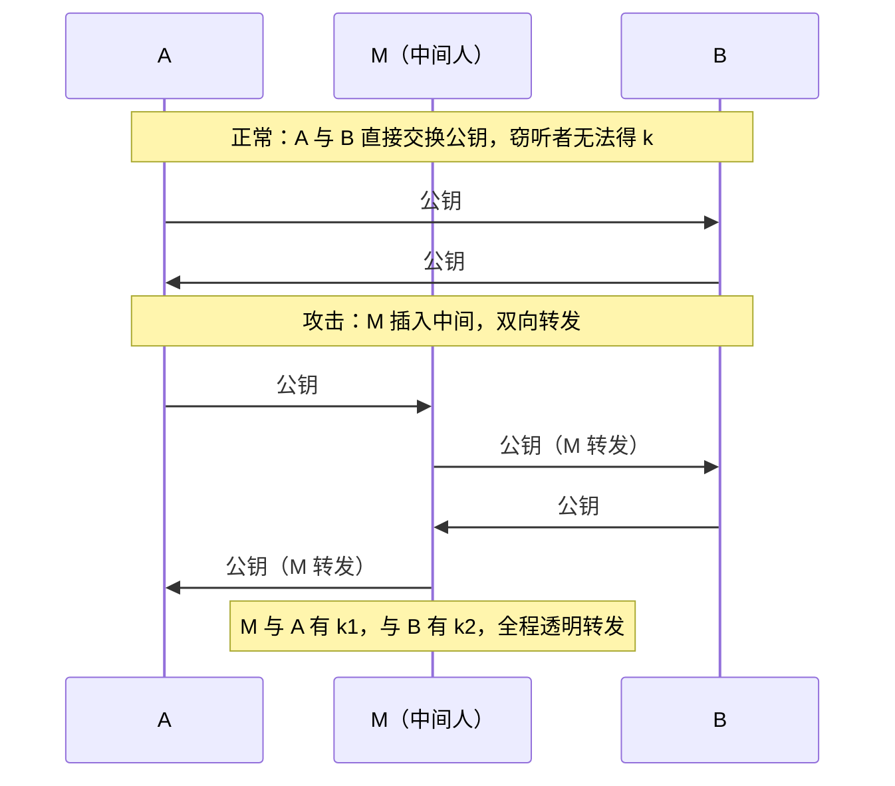

# 密码学基础：对称与非对称加密

> 日期：2026-11-04
> 所属大纲阶段：2. 安全基础概念
> 参考资料：
> - Jean-Philippe Aumasson《Serious Cryptography》(No Starch Press, 2017/2023 2nd ed.)
> - NIST FIPS 197（AES）、SP 800-38D（GCM）、SP 800-57（密钥管理建议）、SP 800-63B（数字身份认证）
> - RFC 8439（ChaCha20-Poly1305）
> - OpenSSL 官方文档与密码学备忘单（Latacora/Aumasson 等）
> - Luciano & Trevisan 关于 Debian OpenSSL PRNG 熵灾难的分析（2008 事件）
> - Python cryptography 库官方文档（cryptography.io）

---

## 1. 三个常被混淆的概念：编码、加密、哈希

开发者面试和安全评审里最常见的概念错误：

| 概念 | 目的 | 密钥 | 可逆性 | 例子 | 「Base64 加密」？ |
|------|------|------|--------|------|------------------|
| **编码（Encoding）** | 让数据适配传输/存储格式（不是安全！） | 无 | **任何人**可逆 | Base64、URL 编码、UTF-8、Hex | 不是。Base64 只是编码，任何人都能解 |
| **加密（Encryption）** | 机密性：只有持密钥者能读 | **有** | 持密钥者可逆 | AES-GCM、ChaCha20、RSA-OAEP | —— |
| **哈希（Hashing）** | 完整性/指纹：检测变化 | 无（MAC 除外） | **不可逆**（单向） | SHA-256、BLAKE3 | —— |

```text
明文 "attack at dawn"
 ├─ Base64 编码 → "YXR0YWNrIGF0IGRhd24="   （任何人 base64 -d 即还原，零安全价值）
 ├─ AES-256-GCM 加密(密钥k) → "9f3a…"      （无 k 不可还原）
 └─ SHA-256 哈希 → "d502810c…"（64 hex）   （谁都能算，但推不回原文；详见 10 篇）
```

> **误用现场**：把 Base64 当「加密」放在前端藏 API key（等于明文）；把「MD5 一下」当加密存密码（哈希不是加密，且 MD5 已不安全）。第一原则：**判断一个变换是不是加密，问「有没有密钥」**。

---

## 2. 密码学的目标

现代密码学试图在**敌手模型**（adversary model，通常是「计算能力有限的攻击者可任意选择输入」）下保证以下目标——全部建立在「密钥保密、算法公开」（Kerckhoffs 原则，见 `06` 篇）之上：

| 目标 | 保证 | 实现者 |
|------|------|--------|
| **机密性** | 看不到内容 | 对称/非对称加密 |
| **完整性** | 内容未被改 | 哈希、MAC |
| **真实性** | 对方是声称的那位 | 签名、MAC、证书 |
| **不可否认性** | 不能抵赖 | 数字签名 |
| （额外）**密钥交换** | 双方在公开信道建立共享秘密 | DH/ECDH |

一个健壮方案通常**组合**多个原语（如 TLS = 非对称交换 + 对称加密 + MAC/AEAD + 证书签名）。

---

## 3. 对称加密

**对称加密（Symmetric Encryption）**：加密与解密用**同一密钥**（或可互相推导）。速度快，适合大量数据；难题是**密钥分发**（双方如何安全拿到同一把钥匙）。

### 3.1 DES 退场史与 3DES

- **DES（Data Encryption Standard，数据加密标准）**：1977 年 NIST 采纳，基于 IBM Lucifer 方案（被 NSA 修改 S 盒），**56 位密钥、64 位分组**。
- 退场原因：**密钥太短**。1998 年 EFF「Deep Crack」专用机器 56 小时暴力破解；如今 FPGA/GPU 集群数小时内可破。分组 64 位也太小（生日界限下 ~32GB 数据内可遇分组碰撞）。
- **3DES（Triple DES）**：`E(k1, D(k2, E(k1, m)))` 等组合三次 DES，等效密钥约 112 位——作为过渡标准存活至今（银行/POS 磁条时代遗产），但：
  - 慢（是 AES 的百分之一量级）；
  - Sweet32 攻击（CVE-2016-2183）：64 位分组在长会话中可被生日碰撞式攻击还原明文片段；
  - NIST SP 800-131A 已于 2023 年正式禁用 3DES 加解密。
- 教训：**密码算法有寿命**，依赖清单要定期对照标准淘汰表（SP 800-131A / RFC 7525）。

### 3.2 AES 内部结构概览

**AES（Advanced Encryption Standard，高级加密标准）**：2001 年 NIST 从 15 个候选中选定 Rijndael。**128 位分组**，密钥 128/192/256 位，轮数 10/12/14。

- 基于代换-置换网络（**SPN**，Substitution-Permutation Network），不是 Feistel 结构；
- 每轮四步：**SubBytes**（S 盒字节代换，非线性来源）→ **ShiftRows**（行移位，扩散）→ **MixColumns**（列混合，GF(2⁸) 乘法扩散；最后一轮省略）→ **AddRoundKey**（轮密钥异或）；
- 轮密钥由**密钥扩展（Key Schedule）**从主密钥派生；
- 直觉：**混淆（confusion）+ 扩散（diffusion）**——Shannon 提出的两条设计准则：改 1 位明文/密钥应让密文各位以约 1/2 概率翻转（雪崩效应）。


硬件速度：现代 CPU 有 **AES-NI** 指令集，AES-GCM 吞吐可达数 GB/s——「加密太慢」通常不是拒绝加密的理由。

> 理论安全性：目前对完整 AES 只有边缘攻击（biclique 对 AES-128 降为 2^126），实践上安全；**现实威胁几乎都在模式与密钥管理，而非算法本体**。

### 3.3 分组密码模式详解（重灾区）

分组密码一次只加密固定 16 字节，真实数据要靠**工作模式（mode of operation）**串起来。模式选错=全盘皆输。

#### ECB（Electronic Codebook，电子密码本）——为什么危险

**原理**：把明文切成块，每块独立加密：`C_i = E(K, P_i)`。同明文块 → 同密文块。

**致命缺陷**：泄露**明文的模式（轮廓）**。若明文相邻区域重复，密文也重复。经典演示「企鹅图」：对位图做 AES-ECB 加密，密文图里**仍能看出企鹅轮廓**——因为大片相同颜色的像素块被映射成相同密文块。文字描述原理：ECB 是「确定性的块到块映射」，等价于一张可被统计分析的密码本。

**代码演示**（环境：Python 3.9+，`pip install cryptography pillow`；本地实验）：

```python
# ecb_demo.py — ECB 轮廓泄露演示（防御研究用，仅本地）
from cryptography.hazmat.primitives.ciphers import Cipher, algorithms, modes
from PIL import Image
import os

key = os.urandom(32)                      # 演示用随机密钥
img = Image.open("penguin.png").convert("RGB")   # 任意黑白轮廓明显的图片
data = img.tobytes()

# 填充到 16 字节倍数（PKCS7 手工实现，仅演示）
padlen = 16 - len(data) % 16
padded = data + bytes([padlen]) * padlen

enc = Cipher(algorithms.AES(key), modes.ECB()).encryptor()
ct = enc.update(padded) + enc.finalize()

Image.frombytes("RGB", img.size, ct[:len(data)]).save("penguin_ecb.png")
# 打开 penguin_ecb.png：企鹅剪影仍然清晰可辨 —— ECB 没有隐藏"模式"
```

正确做法：**永远不要用 ECB**（OpenSSL 已默认不提供、各大 lint 都会报）。

#### CBC（Cipher Block Chaining，密码分组链接）

```text
C_i = E(K, P_i XOR C_{i-1})，首块用 IV：C_0 = IV
解密：P_i = D(K, C_i) XOR C_{i-1}
```

- IV（Initialization Vector，初始向量）必须**不可预测（随机）**且每次加密唯一，否则受「Chosen-Plaintext 区分攻击」（BEAST 类，见 `10` 篇）；
- 缺点：加密不可并行；还需额外完整性机制（纯 CBC **不防篡改**——攻击者翻转密文位，解密端恰好翻转对应明文位，即「位翻转攻击」，配合填充错误差异可演化出**填充预言攻击 Padding Oracle**，见下）；
- **填充预言（Padding Oracle）原理简述**：CBC + PKCS7 填充时，若服务端对「填充不合法」与「MAC 不匹配」返回**不同错误/时延**，攻击者可逐字节修改密文块探测填充合法性，最终**无需密钥**解出任意明文（POODLE、ASP.NET 的 MS10-070 都是同族）。教训：**错误响应必须统一 + 先验 MAC 再解密（Encrypt-then-MAC）或直接用 AEAD**。

#### CTR 与 GCM

- **CTR（Counter，计数器模式）**：把分组密码变成**流密码**：`keystream_i = E(K, nonce||counter_i)`，`C_i = P_i XOR keystream_i`。可并行、无需填充；**但同样不提供完整性**，且 nonce 复用即灾难（两密文异或=两明文异或，见 3.4）。
- **GCM（Galois/Counter Mode）**：CTR 加密 + **GHASH**（GF(2¹²⁸) 上的多项式 MAC）认证标签（tag）。即 **AEAD（Authenticated Encryption with Associated Data，带关联数据的认证加密）**——一次调用同时拿到机密性+完整性+真实性：

```python
# AEAD 一次调用：密文 + 16字节 tag；additional_data 参与 MAC 但不加密（如协议头）
ct_with_tag = AESGCM(key).encrypt(nonce, plaintext, aad)
pt          = AESGCM(key).decrypt(nonce, ct_with_tag, aad)   # tag 错抛 InvalidTag
```

#### 模式对比表

| 模式 | 类型 | 完整性 | IV/Nonce 要求 | 并行 | 现代建议 |
|------|------|--------|---------------|------|----------|
| ECB | 分组 | 无 | —— | 是 | **禁用** |
| CBC | 分组 | 无（需配 HMAC） | 随机不可预测 | 加密否/解密是 | 遗留兼容才用 |
| CTR | 流式化 | 无 | 计数器**绝不复用** | 是 | 仅作构建块 |
| **GCM** | AEAD | **有（GHASH tag）** | 同 key 下 **nonce 绝不复用** | 是 | **首选**（有 AES-NI 时） |
| **ChaCha20-Poly1305** | AEAD | 有 | 同上 | 是 | 无硬件加速时的首选（移动端） |

### 3.4 IV/Nonce 复用的灾难（AEAD 时代头号错误）

- GCM 的 nonce 96 位；**同一密钥下复用 nonce** 后果：
  1. CTR 部分：两段密文异或=两段明文异或 → 已知一处明文即可解另一处（WEP 的 IV 24 位复用导致全面崩溃是历史教材）；
  2. GHASH 部分：复用 nonce 允许**恢复认证密钥 H**，之后可伪造任意 tag——认证彻底失效。
- 实践对策：
  - 每次加密用 `os.urandom(12)` 新随机 nonce（生日界限内安全：同 key 加密次数 ≪ 2^32 也建议换 key）；
  - 或**密钥分离**：每次会话派生新密钥（HKDF，见 `10` 篇），nonce 从 0 计数；
  - 库层面：`AESGCM.generate_key()` + 每次 `os.urandom(12)`，nonce 与密文一起存（nonce 无需保密）。

### 3.5 流密码：RC4 退场与 ChaCha20

- **RC4**：1987 年 RSA 公司流密码，曾被用于 WEP/WTLS/SSL。密钥流存在统计偏差（首字节偏置等），2015 年被 RFC 7465 在 TLS 中**彻底禁用**；WEP 因 IV 24 位 + RC4 弱点被破解到分钟级。教训同 DES：**算法老化没有豁免权**。
- **ChaCha20**（+Poly1305 MAC，RFC 8439）：Salsa 家族，纯软件实现极快（ARM 无 AES-NI 时优势巨大），常量时间执行（侧信道友好）。Google 在 TLS 与 Android 全线采用。20 轮 ARX（模加/循环移位/异或）运算，直觉：把密钥/nonce/计数器搅进 512 位状态做 20 轮扩散。

---

## 4. 非对称加密（公钥密码学）

**非对称加密（Asymmetric Encryption）/ 公钥密码学（Public-Key Cryptography）**：密钥成对——**公钥**可分发、**私钥**保密。解决对称密码的两大痛点：密钥分发与不可否认。

### 4.1 RSA 数学原理直觉

RSA 建立在「**大整数分解难题**」上：`n = p×q`（两个大素数，各约 1024+ 位），已知 n 求 p、q 在计算上不可行（经典计算机）。

```text
密钥生成：随机大素数 p, q → n = p·q；φ(n)=(p-1)(q-1)
          选 e（常 65537）；算 d ≡ e⁻¹ (mod φ(n))
公钥 = (n, e)   私钥 = (n, d)   【p,q,φ,d 全部保密】

加密： c = m^e mod n          解密： m = c^d mod n
签名： s = m^d mod n          验签： m' = s^e mod n（对比 m' 与消息哈希）
```

正确性来自欧拉定理（m^(e·d) ≡ m mod n）。攻击面全在**实现**：小指数 e 与无填充（教科书 RSA 可被 `m=0,1` 等直接测试）、共模攻击、时序侧信道（Blinding 缓解）、量子 Shor 算法（未来威胁）。**必须使用标准填充方案 OAEP（加密）/ PSS（签名）**，任何「自己设计 RSA 用法」都是灾难。

### 4.2 加密与签名流程对照

```text
【加密：保证只有 B 能读】
A：随机生成会话密钥 k（如 32B）
A：c1 = RSA-OAEP(pk_B, k)              # 用 B 的公钥包住对称密钥
A：c2 = AES-GCM(k, 大文件)              # 真正数据用对称加密
B：k  = RSA-OAEP-dec(sk_B, c1) → 解 c2  # 只有 B 的私钥能取回 k

【签名：证明出自 A 且未被改】
A：h = SHA-256(文件)                     # 先哈希
A：sig = RSA-PSS(sk_A, h)                # 用 A 的私钥签名哈希
任何人：verify(pk_A, h', sig)            # 用 A 的公钥验证
```

> 直觉：**公钥加密→私钥解密（机密性）；私钥签名→公钥验签（真实性/不可否认）**。

### 4.3 ECC 与 ECDH

- **ECC（Elliptic Curve Cryptography，椭圆曲线密码学）**：基于椭圆曲线离散对数难题（ECDLP）。直觉：在曲线 `y² = x³ + ax + b (mod p)` 上定义点加法（几何上：连线交第三点取反射），反复自加得「标量乘」 `Q = kP`——知道 k、P 求 Q 容易，知道 P、Q 反求 k 极难。
- 优势：**同等安全强度密钥小得多**（256 位 ECC ≈ 3072 位 RSA）→ 签名快、证书小、省电，这也是 TLS 与移动端全面转向 ECC 的原因。
- 常用曲线：**NIST P-256/P-384**、**Curve25519**（djb 设计，实现难出错、常量时间友好，配 Ed25519 签名）。
- **ECDH（Elliptic Curve Diffie-Hellman，椭圆曲线迪菲-赫尔曼密钥交换）**：



### 4.4 Diffie-Hellman 与中间人问题

- 1976 年 DH（模乘版本）开创公钥密码学；ECDH 是其椭圆曲线版。
- **DH/ECDH 本身不认证对方身份**——中间人（MitM）可分别与 A、B 各建一条共享密钥，双向解密重加密：



**解法：给公钥绑定身份 = 证书（Certificate）/ PKI**——B 的公钥由 A 信任的 CA 签名背书（TLS 的根基，详见 `10` 篇），或在受限场景预共享公钥指纹（SSH `known_hosts` 的 TOFU 模型）。

---

## 5. 混合加密：为什么 TLS 两者结合

| | 对称 | 非对称 |
|---|------|--------|
| 速度 | GB/s（AES-NI） | 慢 2-3 个数量级 |
| 密钥分发 | 难（需要安全信道） | 易（公钥公开） |
| 适用 | 大量数据 | 小数据（密钥/哈希） |
| 不可否认 | 无（双方同钥） | 有（签名） |

**混合方案（Hybrid Encryption）**：非对称完成「认证 + 密钥协商」（ECDHE/证书），对称完成「批量数据加密」（AES-GCM/ChaCha20）。TLS 每次连接就是一次混合加密现场：握手用 ECDHE 建立会话密钥，记录层用 AEAD 传数据。现代封装如 HPKE（RFC 9180，ECDH+HKDF+AEAD 的标准信封）同理。

---

## 6. 数字签名

### 6.1 签名 vs MAC（常见混淆）

| 维度 | **MAC（消息认证码，如 HMAC）** | **数字签名（如 RSA-PSS/Ed25519）** |
|------|-------------------------------|-------------------------------------|
| 密钥 | 对称（共享一个密钥） | 非对称（私钥签、公钥验） |
| 谁能验证 | 只有持密钥方 | **任何人** |
| 不可否认性 | **无**（双方都能生成，可互赖账） | **有**（仅私钥持有者能生成） |
| 速度 | 快 | 慢 |
| 场景 | 服务间 API 认证、Webhook 验签、Cookie 完整性 | 证书、代码签名、软件发布、合同 |

选择口诀：**需要第三方裁决 → 签名；只有你我两方 → MAC 更简单高效**。

### 6.2 RSA-PSS / ECDSA / Ed25519

- **RSA-PSS**：随机化填充的 RSA 签名，安全性可证明归约到 RSA 假设；密钥大、验签快（e 小）签名慢。证书与代码签名仍大量使用。
- **ECDSA（Elliptic Curve Digital Signature Algorithm，椭圆曲线数字签名算法）**：基于 ECDLP；**每个签名需要全新随机数 k**——`k` 复用/偏置直接泄露私钥（索尼 PS3 2010 因固定 k 被还原私钥 master key；Android 比特币钱包 2013 因弱 PRNG 同理）。RFC 6979（确定性 ECDSA）用私钥+消息哈希派生 k 根治。
- **Ed25519**：EdDSA over Curve25519，**确定性签名（无随机数需求）**、常量时间实现、快且抗侧信道、公私钥仅 32/64 字节。**新项目默认推荐**（SSH 密钥、Signal、WireGuard、JWT 的 EdDSA）。

---

## 7. 密码存储（后端必修）

### 7.1 为什么不能存明文/可逆加密

- **明文**：拖库即全部沦陷；内部 DBA 直接可读；无法向监管交代。
- **可逆加密（对称加密存密码）**：解密密钥与数据同域（都在应用服务器/配置里）→ 攻击者拿到应用权限即可解密全部，**形同虚设**；且「能还原」意味着内部滥用通道存在。
- 正解：**单向慢哈希 + 盐**——验证时重算比对。攻击者拖库后只能对每个哈希**离线逐个猜测**，慢哈希把每次猜测成本提高几个数量级。

### 7.2 加盐（Salt）与 peppering

- **盐（Salt）**：每用户随机字节串（≥16B），与哈希一起存。作用：同密码不同哈希（防彩虹表预计算）、无法批量比对。
- **胡椒（Pepper）**：全局秘密混入哈希，**存在 KMS/HSM 而非数据库**——拖库（只拿走库）时连离线猜都没法开始。可选增强。
- 现代慢哈希自带盐与参数（bcrypt 的 cost、Argon2 的内存参数），**无需再手工"加盐"**。

### 7.3 bcrypt / scrypt / Argon2 对比

| 算法 | 抗 GPU | 抗 ASIC（内存难度） | 参数 | 备注 |
|------|--------|--------------------|------|------|
| **bcrypt**（1999） | 好（Blowfish 密钥扩展） | 弱（内存仅 ~4KB） | cost（2^cost 轮） | 老而弥坚；72 字节密码截断（老实现）是坑 |
| **PBKDF2**（RFC 8018） | **弱**（GPU 并行友好） | 无 | 迭代次数+HMAC | FIPS 合规遗产系统常见；OWASP 建议迭代 ≥ 600,000（SHA-256）仅作底线 |
| **scrypt**（2009） | 好 | 好（内存参数） | N,r,p | 中间立场 |
| **Argon2id**（2015 密码哈希竞赛冠军） | **优** | **优**（时间+内存双参数，id 模式混合抗侧信道） | m(内存 KiB), t(迭代), p(并行度) | **NIST SP 800-63B 与 OWASP 首选** |

OWASP 起始参数参考（按硬件校准到 ~200ms/次）：Argon2id m=19MiB,t=2,p=1（交互式）或 m=46MiB,t=1,p=1；bcrypt cost≥10。

> 补充策略（NIST SP 800-63B）：密码长度优先（≥8，建议允许 64）；对照**已泄露密码黑名单**（haveibeenpwned 的 k-匿名查询 API）；**不要**强制周期性换密（除非有泄露证据）；错误提示不区分「用户不存在/密码错误」。

---

## 8. 随机数：一切的根

- **伪随机数生成器（PRNG，PseudoRandom Number Generator）**：确定性算法生成统计随机序列；常规用途（模拟、测试）足够。
- **密码学安全伪随机数生成器（CSPRNG，Cryptographically Secure PRNG）**：**不可预测性**——即使看到前面的输出也无法预测下一位。密钥/IV/nonce/session id **必须**用 CSPRNG。

| 语言/环境 | 正确（CSPRNG） | 错误（禁用于安全） |
|-----------|----------------|---------------------|
| Python | `secrets` 模块、`os.urandom` | `random`（梅森旋转，可预测，state 可由 624 输出还原） |
| Java | `SecureRandom` | `Random`/`Math.random` |
| Go | `crypto/rand` | `math/rand` |
| JavaScript(Node) | `crypto.randomBytes` | `Math.random` |
| Linux 系统级 | `getrandom(2)`/`/dev/urandom` | 自制 xorshift/LCG |

**著名事件：Debian OpenSSL 2008（CVE-2008-0166）**——开发者用 Valgrind 报警为由删掉了熵混入代码，导致 2006-09 至 2008-05 间 Debian/Ubuntu 生成的**所有** SSL/SSH 密钥空间坍缩到 32768 种可能，被脚本秒破，波及无数服务器。教训：**随机数缺陷=系统性密钥灾难**，且极难察觉。另有 2012 年后 Juniper ScreenOS 后门（被植入改 DUAL_EC 参数）说明「留后门的算法参数」风险。

---

## 9. Python cryptography 实操

环境前提：Python ≥ 3.9；`pip install cryptography`（示例基于 42.x+，API 稳定多年）；macOS/Linux/Windows 通用。

### 9.1 AES-256-GCM 加解密

```python
# aes_gcm_demo.py — 现代对称加密标准姿势
import os
from cryptography.hazmat.primitives.ciphers.aead import AESGCM

key = AESGCM.generate_key(bit_key=256)          # 1) 密钥来自 CSPRNG
nonce = os.urandom(12)                           # 2) 每次加密新 nonce（96bit）
aes = AESGCM(key)

plaintext = b"design doc: launch at 2026-11-11"
aad = b"doc-id=42"                               # 关联数据：参与认证不加密

ciphertext = aes.encrypt(nonce, plaintext, aad)  # 返回 ct||tag(16B)

# —— 存储/传输 {nonce, ciphertext, aad} 三元组（nonce 无需保密）——
decrypted = aes.decrypt(nonce, ciphertext, aad)  # tag 或 aad 不符抛 InvalidTag
assert decrypted == plaintext

try:
    aes.decrypt(nonce, ciphertext, b"doc-id=43")
except Exception as e:
    print("AAD 被篡改 → 拒绝:", type(e).__name__)  # InvalidTag
```

### 9.2 RSA 签名与验签（含 Ed25519 对照）

```python
# rsa_sign_demo.py — 私钥签名、公钥验签
from cryptography.hazmat.primitives.asymmetric import rsa, padding
from cryptography.hazmat.primitives import hashes, serialization

# 密钥生成（实际系统：私钥入 HSM/KMS，这里演示落盘加密 PEM）
private_key = rsa.generate_private_key(public_exponent=65537, key_size=3072)
public_key = private_key.public_key()

message = b"release artifact v1.2.3"

# 签名：RSA-PSS + SHA-256（现代要求；弃用 PKCS1v15 新用途）
signature = private_key.sign(
    message,
    padding.PSS(mgf=padding.MGF1(hashes.SHA256()),
                salt_length=padding.PSS.DIGEST_LENGTH),
    hashes.SHA256(),
)

# 验签
try:
    public_key.verify(
        signature, message,
        padding.PSS(mgf=padding.MGF1(hashes.SHA256()),
                    salt_length=padding.PSS.DIGEST_LENGTH),
        hashes.SHA256(),
    )
    print("验签通过：消息确由私钥持有者签署且未篡改")
except Exception:
    print("验签失败：被篡改或来源不对")

# 序列化（PEM）——公钥可公开分发
pem_pub = public_key.public_bytes(
    serialization.Encoding.PEM,
    serialization.PublicFormat.SubjectPublicKeyInfo,
).decode()
# print(pem_pub)

# —— 更现代的选择：Ed25519（更快、密钥更小、无随机数坑）
from cryptography.hazmat.primitives.asymmetric.ed25519 import Ed25519PrivateKey
ed_priv = Ed25519PrivateKey.generate()
sig2 = ed_priv.sign(message)
ed_priv.public_key().verify(sig2, message)      # 异常即失败
```

### 9.3 密码存储（Argon2id）

```bash
pip install argon2-cffi        # 环境：同上
```

```python
from argon2 import PasswordHasher
from argon2.exceptions import VerifyMismatchError

ph = PasswordHasher()                       # 默认 Argon2id，参数可按硬件调优
h = ph.hash("correct horse battery staple") # 输出自带 salt+参数：
# '$argon2id$v=19$m=65536,t=3,p=4$<salt>$<hash>'

password = "correct horse battery staple"   # 登录场景：用户本次请求中重输的明文密码
try:
    ph.verify(h, password)                        # 验证成功
except VerifyMismatchError:
    print("密码错误")
if ph.check_needs_rehash(h):                # 参数升级时透明重哈希
    h = ph.hash(password)                   # 重哈希需要明文密码：取自用户本次登录请求中的重输值
```

---

## 10. 常见密码学误用自查表

上线前逐条打勾（每条背后都有真实事故）：

- [ ] 用了 Base64/Hex 自创「加密」（编码≠加密）
- [ ] AES 用了 ECB 模式（轮廓泄露）
- [ ] GCM/CTR 的 **nonce/IV 复用**（同密钥下）——包括「IV 全零写死」「用时间戳截断当 IV」
- [ ] 手工拼接 `SHA256(key||msg)` 当 MAC（长度扩展攻击，见 `10` 篇；应使用 HMAC）
- [ ] 加密了数据但没认证（只加密不校验 → 位翻转/填充预言）
- [ ] 用 `random`/`Math.random`/时间戳生成密钥、token、验证码
- [ ] MD5/SHA-1 用于安全用途（签名、完整性）——二者碰撞已实际化（见 `10` 篇）
- [ ] RSA 无填充（教科书 RSA）或新签名仍用 PKCS1v15
- [ ] ECDSA 随机数 k 复用或来自非 CSPRNG（私钥直接泄露）
- [ ] 密码明文/可逆加密/无盐快速哈希（MD5(pass) 甚至 MD5(pass+盐) 都不够——快哈希必被爆破）
- [ ] 密钥硬编码在代码/配置文件/镜像里（应 KMS/Secret Manager + 轮换）
- [ ] 自己设计加密协议/算法（「自研混淆」= 攻击者的礼物；用成熟库与标准协议）
- [ ] TLS 校验关闭（`verify=False` / 忽略证书错误——中间人的邀请函）
- [ ] 加密数据与密钥同域存储（同一数据库/同一服务器权限）

> 元原则（来自《Serious Cryptography》）：**不要自己造密码学。用成熟库的高层 API（AESGCM、Fernet、libsodium 的 secretbox/sign），让它替你处理 nonce、填充、时序。**低层原语是给库作者用的。

---

## 11. 常见误区汇总

| 误区 | 事实 |
|------|------|
| 「AES-256 无敌所以随便用」 | 模式错误（ECB/nonce 复用）可让最强算法裸奔；密钥管理是主战场 |
| 「哈希就是加密」 | 哈希不可逆；加密可逆；用途完全不同 |
| 「非对称更安全所以全用 RSA」 | 慢 2-3 个数量级；TLS/文件加密都是混合方案 |
| 「密钥越长越安全」 | 1024 位 RSA 已淘汰（可被国家级行动分解），3072 位或 ECC-256；但 256 位 AES 已足够——不同算法安全位不同 |
| 「HTTPS 了就不用管接口签名」 | HTTPS 保护传输，不防「持有合法证书的恶意客户端」重放/越权；业务仍需 HMAC/时间戳/nonce |
| 「随机数就是随机嘛」 | CSPRNG 的不可预测性与统计随机是两回事；`random` 模块输出再多也不安全 |
| 「量子计算让一切作废」 | 对称加密与哈希仅需加倍长度（Grover 折半）；受威胁的是 RSA/ECC（Shor）；后量子密码（PQC，如 ML-KEM）迁移已在标准化（NIST 2024 FIPS 203/204） |

---

## 12. 自测问题

1. 编码、加密、哈希的本质区别各用一个词概括；判断「URL 里的 JWT 做 Base64URL 是加密吗」。
2. 画出 AES-CBC 加密第 i 块的公式，解释为什么 CBC 需要随机 IV，而 GCM 的 nonce 只要求唯一。
3. 为什么 GCM 同密钥复用 nonce 会连认证一起崩（两个层面）？
4. 描述填充预言攻击成立的两个前提条件，以及用 AEAD 如何釜底抽薪。
5. 写出 ECDH 双方各自计算共享密钥的式子，解释窃听者为何算不出，以及 MitM 如何破解、如何防御。
6. 签名与 MAC 在不可否认性上的差异来自什么结构性原因？
7. ECDSA 的 k 复用如何泄露私钥（直觉即可）？Ed25519 为何免疫？
8. 为什么密码不能「加密存」而要慢哈希？Argon2id 的三个参数各控制什么资源？
9. Debian OpenSSL 事件中，为什么「看起来随机」的密钥只有 32768 种可能？
10. 自查表里哪三条你的项目当前命中了？怎么改？

---

## 13. 小结

- 分清**编码/加密/哈希**是第一道门槛；密钥的存在与否是判据。
- 对称侧：AES-GCM / ChaCha20-Poly1305（AEAD）是唯二正确答案；ECB 已死、CBC 是遗留、**nonce 唯一性是红线**。
- 非对称侧：RSA（分解难题）与 ECC（ECDLP）负责密钥协商与签名；ECDH 无认证，需要证书/PKI 补位；新签名优先 Ed25519。
- 混合加密是所有现实协议（TLS/SSH/Signal）的统一形态。
- 密码存储：Argon2id + 泄露黑名单 + NIST 800-63B 政策；随机数：一切密钥材料只从 CSPRNG 来。
- 最重要的工程纪律：**用库的高层 API，不发明协议**；误用自查表进 code review 检查单。
- 下一篇 `10-哈希-消息认证码与-TLS.md` 深入哈希、HMAC、长度扩展攻击，并把本章原语拼成完整的 TLS 协议。

---

## 附：ASCII 图 → Mermaid 替换清单

| 原 ASCII 图（小节 · 内容） | 替换后类型 |
| --- | --- |
| 「3.2 AES 内部结构概览」小节 · 一轮 AES 四步流水（SubBytes→ShiftRows→MixColumns→AddRoundKey） | flowchart LR |
| 「4.4 Diffie-Hellman 与中间人问题」小节 · DH 公钥交换正常/被中间人劫持两组示意 | sequenceDiagram |
| 「ECDH」节 · 椭圆曲线密钥交换消息图 | sequenceDiagram |
