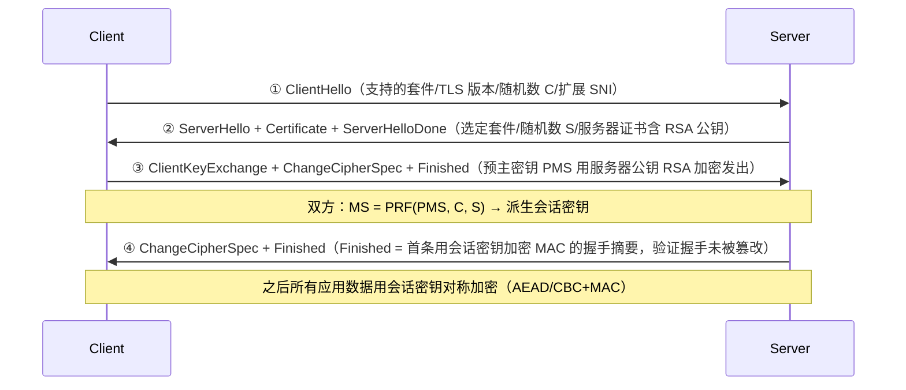
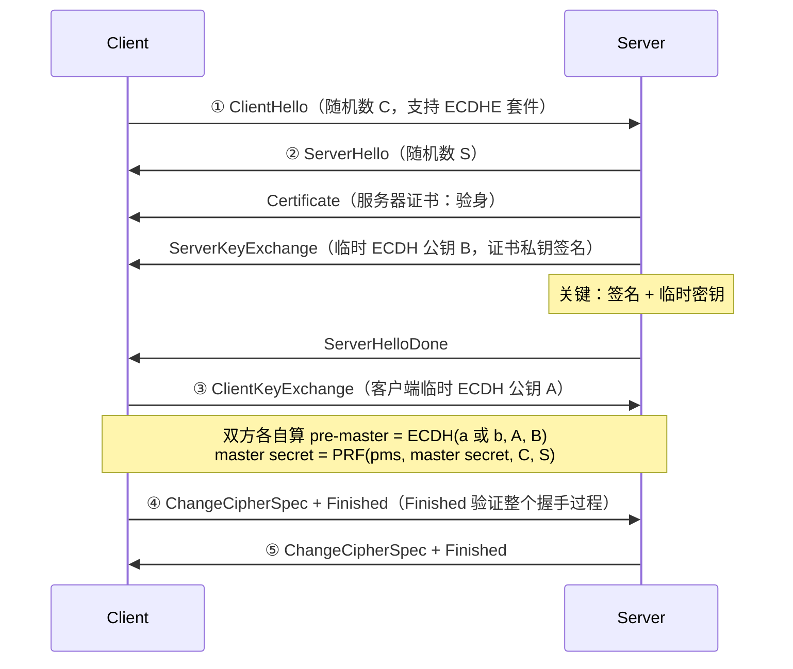
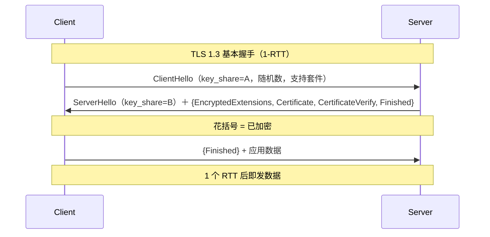
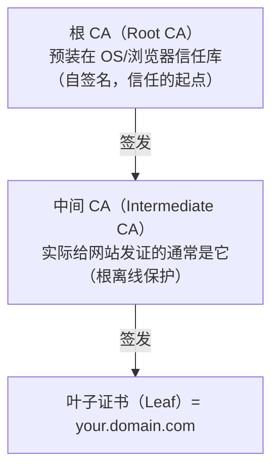

# 哈希、消息认证码与 TLS

> 日期：2026-11-04
> 所属大纲阶段：2. 安全基础概念
> 参考资料：
> - RFC 2104（HMAC）、RFC 5869（HKDF）、RFC 8018（PBKDF2）、RFC 8446（TLS 1.3）、RFC 5246（TLS 1.2）
> - NIST FIPS 180-4（SHA-2）、FIPS 202（SHA-3）
> - Wang Xiaoyun, Feng Dengguo, Lai Xuejia, Yu Hongbo: Collisions for Hash Functions MD4, MD5, HAVAL-128 and RIPEMD（CRYPTO 2004 快报）与 SHA-1 碰撞系列工作（CWI/Google SHAttered, 2017）
> - SSL Labs（ssllabs.com/ssltest）、testssl.sh（github.com/drwetter/testssl.sh）文档
> - OpenSSL s_client 官方手册

---

## 1. 密码学哈希函数的性质

**密码学哈希函数（Cryptographic Hash Function）**把任意长度输入映射为固定长度输出（如 256 位），设计目标是**单向且抗碰撞**。四条核心性质：

| 性质 | 英文 | 定义（对攻击者而言） | 破坏后果 |
|------|------|---------------------|----------|
| **确定性** | Deterministic | 同输入永远同输出（这不是攻击面，是可用性前提） | —— |
| **抗原像性** | Preimage resistance | 给定哈希值 h，找任意 m 使 H(m)=h 不可行（输出 2^n 次） | 密码哈希场景直接沦陷 |
| **抗第二原像性** | Second preimage resistance | 给定 m₁，找 m₂≠m₁ 使 H(m₁)=H(m₂) 不可行（约 2^n 次） | 文件签名可被「原文件替换为同哈希恶意文件」 |
| **抗碰撞性** | Collision resistance | 找**任意** m₁≠m₂ 使哈希相同不可行（**生日攻击**约 2^(n/2) 次） | 数字证书/签名体系整体动摇 |

> **生日攻击（Birthday Attack）**解释了为什么碰撞比原像容易得多：23 人中有两人同生日的概率已过半（√365≈19.1）。对 256 位哈希，碰撞只需约 2^128 次尝试——因此**输出长度至少 256 位**才有今天的碰撞安全边际（SHA-1 仅 160 位 → 2^80，落入可计算范围，这是它被攻破的数学背景）。

---

## 2. 主流哈希算法对比

| 算法 | 年代 | 输出 | 碰撞状态 | 现状 |
|------|------|------|----------|------|
| **MD5** | 1992 | 128 bit | 2004 年**王小云团队**宣布全碰撞；2008 年被用于伪造 CA 证书（Chosen-prefix collision， Flame 恶意软件 2012 年用它伪造微软代码签名） | **禁用**（遗留校验和除外，且不防恶意篡改） |
| **SHA-1** | 1995 | 160 bit | 2017 Google/CWI **SHAttered** 首个全碰撞（约 2^63 次，算力 6500 CPU 年）；2020 年 chosen-prefix 降到 2^63.4 且实际化（SHA-1 对 GitHub 的攻击成本预估约 4.5 万美元） | **弃用**（Git 已迁移可选 SHA-256 对象格式；浏览器 2017 起拒签 SHA-1 证书） |
| **SHA-2 家族** | 2001 | 224/256/384/512 | 无已知实际碰撞 | **主力**（SHA-256/512；注意结构上与 SHA-1 同为 Merkle-Damgård，故存在长度扩展问题，见第 4 节） |
| **SHA-3（Keccak）** | 2015（NIST 竞赛 2012 胜出） | 可变（SHA3-256 等 + SHAKE 可扩展输出 xof） | 无 | 备份方案（**海绵结构 sponge**，与 SHA-2 完全不同路线）；新设计或需要 128 位以上安全余量时选用 |
| **BLAKE3** | 2020 | 可变 | 无 | 极快（SIMD + 树结构，数 GB/s），适合非密码协议的完整性场景；生态尚新 |

**王小云团队的历史地位**：2004 年 CRYPTO 大会快报，王小云、冯登国、来学嘉、于鸿波宣布 MD4/MD5/HAVAL-128/RIPEMD 全碰撞，震动学界——此前 MD5 的「理论弱点」被普遍认为不可实际化。随后团队方法延伸到 SHA-1 弱化证明，直接推动了 SHA-3 竞赛的启动。教训：**「暂时没被破」不等于「安全」**；标准化机构据此确立了「提前一代准备替代算法」的机制。

---

## 3. 哈希的应用场景（正确姿势）

| 场景 | 用法 | 注意 |
|------|------|------|
| **文件完整性校验** | 发布物附 SHA-256，下载后比对 | 校验和必须从**独立可信信道**获取（同站同源下载的 checksum 文件与安装包可一起被改——供应链视角要签名） |
| **密码存储** | 指向 `09` 篇：普通哈希不够，用 Argon2id/bcrypt（慢哈希+盐） | 快哈希（SHA-256 直接存密码）= 离线爆破自助餐 |
| **去重/指纹** | CDN 分片去重、内容寻址 | MD5 也够用？恶意碰撞场景（攻击者故意造同哈希文件）必须用 SHA-256+ |
| **Merkle 树（默克尔树）** | 叶=数据块哈希，父=子哈希拼接再哈希；根哈希一个值代表全集 | 轻节点只需根即可验证某块存在（log 个中间哈希的证明路径） |
| **Git** | 对象内容（含类型/长度头）的 SHA-1（新支持 SHA-256）哈希即对象名——内容寻址存储，篡改自动改变 ID | 一句话：Git 的「不可篡改历史」本质是哈希链 |
| **区块链** | 区块头含前一区块哈希 → 链式结构；改历史块需重算其后所有块 | 一句话：把 Merkle 根放进区块头做交易集指纹 |
| **密钥派生/承诺** | 见第 6 节 HKDF；哈希承诺（先公布 H(x) 后揭示 x） | 承诺需抗碰撞性 |

```text
Merkle 树示意：
                 Root = H(H01 || H23)
                /                    \
        H01 = H(H0||H1)         H23 = H(H2||H3)
        /        \               /        \
   H0=H(块0)  H1=H(块1)    H2=H(块2)  H3=H(块3)
验证块2 ∈ 数据集：出示 H3 与 H01，计算 H(H2||H3)→H23，H(H01||H23) 与已知 Root 比对
```

---

## 4. 长度扩展攻击（Length Extension Attack）

### 4.1 为什么 MD5/SHA-1/SHA-2 有此问题

MD5、SHA-1、SHA-2 都基于 **Merkle-Damgård 构造**：内部维护一个**链式状态**（chaining value，初始为公开的 IV），把消息按块（512/1024 bit）吸收，**每处理一块输出当前状态**，最终状态直接作为哈希值。

```text
H(m) 的内部过程（n 块消息）：
  state = IV(公开常数)
  state = compress(state, m_block1)
  state = compress(state, m_block2)
  ...
  return state            ← 哈希值 = 最终内部状态！
```

**关键缺陷**：`H(m)` 的输出**就是**压缩函数的中间状态。于是攻击者拿到 `H(key || m)` 后，不需要知道 key，可以直接**从该状态继续压缩新的数据**：

```text
已知： digest = H(key || m)，|key||m| 填充后为 L bit
构造： digest' = compress_state(digest, padding(L) || suffix)
      这恰好等于 H(key || m || padding(L) || suffix)
即：攻击者能为「key||m||<填充>||suffix」这个新消息伪造出合法的哈希值，
    而从头到尾不知道 key！
```

（`padding(L)` 是 Merkle-Damgård 按总长度做的规范化填充，攻击者可自行计算——只需知道或猜测 key||m 的长度。）

### 4.2 SHA-256(key||msg) 为什么不安全

一个经典误用：自创 MAC = `SHA256(secret || message)`，服务端「重算比对」。攻击流程：

1. 观察到合法请求携带 `msg=action=read` 与 `mac=SHA256(secret||"action=read")`；
2. 攻击者猜测 key 长度 k（逐个试），计算 `新mac = 长度扩展(已知mac, k+len(msg), suffix=";action=admin")`；
3. 提交 `msg="action=read" + <填充字节> + ";action=admin"` 与 新mac；
4. 服务端重算 `SHA256(secret || 新msg)` 恰好等于 新mac——**校验通过，攻击者注入了指令却从未知道 secret**。

历史上大量框架中招（早期 Flickr API 签名、一些 WebSocket handshake、无数自研接口）。SHA-3 与 BLAKE 系列不受影响（非 Merkle-Damgård 状态外露），但**正确答案从来不是换算法，而是换构造**。

### 4.3 HMAC 如何解决

**HMAC（Hash-based Message Authentication Code，基于哈希的消息认证码）**（RFC 2104）：

```text
HMAC(K, m) = H( (K' ⊕ opad) || H( (K' ⊕ ipad) || m ) )
  K'：密钥先哈希到块长度（<B 时补零）
  ipad = 0x36 重复，opad = 0x5c 重复（固定常数）
```

两层嵌套使**内层哈希的输出不再对外暴露为中间状态**——长度扩展需要「当前状态 + 后续数据」，而攻击者拿不到内层 `H((K'⊕ipad)||m)` 的值（它被外层包裹）。HMAC 的安全性甚至**不依赖底层哈希的抗碰撞性**（HMAC-MD5 的长度扩展面也被堵住，尽管出于规范与合规仍应使用 HMAC-SHA256+）。

**结论口诀：`hash(key||msg)` 与 `hash(msg||key)` 都不安全（后者有碰撞嫁接风险），用 `HMAC(key, msg)`。** 现代语言一行：Python `hmac.new(k, m, "sha256")`、Node `crypto.createHmac("sha256", k)`。

---

## 5. MAC：消息认证码

**MAC（Message Authentication Code，消息认证码）**：用共享密钥生成固定长度认证标签，同时提供**完整性 + 真实性**（只有持钥方能生成），但不提供机密性、不可否认性（见 `09` 篇签名对比表）。

| 构造 | 代表 | 说明 |
|------|------|------|
| 基于哈希 | **HMAC-SHA256** | 通用首选 |
| 基于分组密码（CBC-MAC/CMAC） | AES-CMAC | 硬件/嵌入式常见 |
| 通用哈希 | Poly1305 | 极快，常配 ChaCha20（one-time key 下可证明安全） |

**MAC 三条使用纪律**：
1. **比较必须恒定时间**（`hmac.compare_digest`，防时序逐字节泄露）；
2. 加密与认证组合时遵循 **Encrypt-then-MAC**（先加密后对密文做 MAC，证明上最稳）或直接 AEAD；
3. Webhook/接口签名场景：签名覆盖**方法+路径+时间戳+body**，并校验时间窗（防重放）。

**实操：GitHub 风格 Webhook 验签**（环境：Python 3.9+ 标准库，无第三方依赖；框架无关的参考实现）：

```python
import hmac, hashlib, time

def verify_webhook(secret: bytes, headers: dict, body: bytes,
                   tolerance: int = 300) -> bool:
    """防御要点：恒定时间比较 + 覆盖时间戳与 body + 时间窗防重放"""
    ts = headers.get("X-Timestamp", "")
    got = headers.get("X-Signature", "")            # hex(HMAC(secret, ts||body))
    if not ts.isdigit():
        return False
    if abs(time.time() - int(ts)) > tolerance:      # 1) 重放窗口
        return False
    expected = hmac.new(secret, ts.encode() + b"." + body,
                        hashlib.sha256).hexdigest()
    return hmac.compare_digest(expected, got)        # 2) 恒定时间，防逐字节时序探测

# 发送方（本地联调用）：
# ts = str(int(time.time()))
# sig = hmac.new(secret, ts.encode()+b"."+body, hashlib.sha256).hexdigest()
# 审计注意：签名验证失败要记录来源 IP/时间/body 摘要（限流告警），但绝不回显"差多少位"
```

---

## 6. HKDF 与 PBKDF2：名字像，用途完全不同

| | **HKDF**（RFC 5869） | **PBKDF2**（RFC 8018） |
|---|---------------------|------------------------|
| 输入质量假设 | 输入已是**高熵**密钥材料（如 ECDH 共享秘密） | 输入是**低熵**的人类密码 |
| 目标 | 把均匀秘密「调整/拉长」为多个独立子密钥（extract-then-expand） | 用**大量迭代**人工拉高爆破成本（慢） |
| 强度来源 | 密码学抽取 | 计算耗时（迭代次数百万级） |
| 典型场景 | TLS 1.3 全程用它派生握手/应用密钥；为加密盘派生多个子密钥 | 遗留密码哈希（FIPS 环境）；新系统换 Argon2id |

一句话：**HKDF 用于「密钥 → 密钥」，PBKDF2/Argon2 用于「密码 → 密钥」**。给低熵输入用 HKDF 等于零保护。

---

## 7. 认证加密 AEAD（回顾与定位）

**AEAD（Authenticated Encryption with Associated Data）**= 加密 + 认证一次完成（AES-GCM / ChaCha20-Poly1305，见 `09` 篇 3.3）。与「加密+HMAC」手工组合相比：更不易出错（无组合顺序问题）、性能更好（GCM 硬件加速）、常量时间验证内建。**工程默认：需要加密的数据就选 AEAD，而不是裸 CBC/CTR。**

---

## 8. TLS：把前两篇的原语拼成协议

**TLS（Transport Layer Security，传输层安全）**承接 SSL（Secure Sockets Layer）。目标：在不可信网络上提供**机密性、完整性、服务器（可选双向）认证**。核心思路 = 混合加密（`09` 篇第 5 节）：握手用非对称完成认证与密钥协商，记录层用对称 AEAD 传数据。

### 8.1 TLS 1.2 经典握手：RSA 密钥交换（已被弃用的旧模样）



**RSA 交换的致命弱点**：会话密钥单向由客户端生成、用服务器公钥加密。**服务器私钥一旦日后泄露，过去录制的全部流量可被事后解密**（无**前向保密 Forward Secrecy, FS**）。

### 8.2 TLS 1.2 现代（临时）ECDHE 握手



前向保密来源：ECDH 每会话**临时密钥对**，用后即弃；证书私钥只用来**签名**握手（证明身份），不参与加密——私钥日后泄露也解不了历史流量。临时密钥签名同时防 MitM（呼应 `09` 篇 4.4）。

### 8.3 TLS 1.3（RFC 8446）：更快更安全

改动要点：

1. **握手 1-RTT**（1.2 是 2-RTT）：ClientHello 直接附上密钥共享（key_share，ECDHE 公钥），ServerHello 一次回完 → 一个 RTT 即出数据；
2. **砍掉一切遗留**：RSA 密钥交换、CBC/RC4/静态 DH、压缩、重协商全部删除；只留 **AEAD（GCM/CCM/ChaCha20-Poly1305）+ ECDHE/DHE + HKDF**；
3. **握手消息加密**：ServerHello 之后的证书/扩展部分已加密（更少泄露、防中间盒干扰）；
4. **会话恢复 + 0-RTT**。



**0-RTT 及其风险**：客户端凭**之前会话的恢复密钥（PSK）**在第一个飞行包里直接带上应用数据（如 HTTP GET）。代价：

- **重放（Replay）风险**：0-RTT 数据没有新鲜 nonce 保证，攻击者原样重发，服务器可能重复执行（重复下单/转账）。因此规范要求 **0-RTT 只承载幂等请求**（GET/查询），且服务端实现限次/去重；Cloudflare 等按此限制；
- 不提供前向保密（依赖 PSK 未泄露）。

### 8.4 记录层（数据传输）

握手后的每个记录：`AEAD(会话密钥, 序列号||内容类型||数据)`。序列号与密钥一次性派生，防重放与重排序；内容类型内嵌使「格式解析在解密后进行」（消灭了一大类针对明文握手头的解析漏洞）。

---

## 9. 证书链校验逐步骤

服务器证书为什么可信？因为它挂在一条**信任链**上，浏览器/系统逐步验证：



客户端（如浏览器）验证步骤：

1. **链构建**：收到叶子证书 + 服务器提供的中间证书链（AIA 扩展可补链），逐级用上一级证书中的**公钥验签下一级证书的签名**，直至某个根；
2. **锚点校验**：该根（或其哈希）在本机信任库中存在；中间 CA 需具有 `CA:TRUE` 的 BasicConstraints 且 `pathlen` 未超限；
3. **有效期**：叶子与所有中间证书的 notBefore ≤ 当前时间 ≤ notAfter（过期是最常见事故——2019 年 Microsoft Teams、2020 年 SiriusXM/苹果服务都栽过 OCSP/过期问题）；
4. **域名匹配**：证书的 Subject Alternative Name（SAN，CN 已不够）包含请求的主机名（支持 `*.example.com` 通配符，但通配符只匹配一层）；
5. **吊销状态**：OCSP（在线查询）/ OCSP Stapling（服务器代取并附上 CA 签名响应）/ CRL（列表）；因 OCSP 隐私与性能问题，现代趋势是 **CAA 记录 + 短有效期证书（如 90 天/Let's Encrypt）+ must-staple**，逐步替代慢速吊销检查；
6. **用途/密钥用法**：KeyUsage 扩展含 digitalSignature（RSA 密钥交换型服务器证书还需 keyEncipherment），服务器用途由 Extended Key Usage（EKU）扩展中的 serverAuth 声明，算法合规（SHA-1 拒收）；
7. （可选）HSTS 缓存确认、证书透明度（**CT**：证书须出现在公开 CT 日志，可被 Monitor/CT log 检索发现误签发——crt.sh 可查某域名全部签发记录）。

---

## 10. TLS 历史攻击博物馆（协议演进史）

每个攻击一段：成因 + 教训。它们串起来就是 TLS 设计逐年被毒打后进化的历史。

| 攻击 | 年代 | 打的目标 | 成因一句话 | 教训/后果 |
|------|------|----------|-----------|-----------|
| **BEAST** | 2011 | TLS 1.0 CBC IV 可预测（IV=上一密文块） | 选择明文攻击逐字节恢复 Cookie | TLS1.1+ 随机 IV；推动 1.2 部署潮 |
| **CRIME** | 2012 | TLS **压缩**泄露秘密（压缩比随重合度变化） | 攻击者注入猜测内容，比较密文长度判对错 | TLS 压缩被移除；同理 TIME/BREACH 打 HTTP 压缩+反 CSRF token（响应禁压缩或随机化 token） |
| **Lucky13** | 2013 | CBC+MAC 的**解密时间差** | 填充合法与否导致处理时间不同 | 常量时间补丁极难写对 → 推动弃 CBC 转 AEAD |
| **POODLE** | 2014 | SSL 3.0 CBC 填充无 MAC 覆盖 | 降级回 SSL3 后逐字节猜会话 Cookie | 彻底禁 SSLv3（POODLE TLS 变体同样打击 CBC 实现）；「先加密后认证」的结构性缺陷 |
| **FREAK** | 2015 | 出口级 512 位 RSA（出口管制时代弱套件） | 中间人迫使协商弱 RSA 密钥交换，分解后解密 | 删除出口套件；密钥交换强度必须对等（OpenSSL/各栈清库） |
| **Logjam** | 2015 | 出口级 512 位 DH 组 | 同 FREAK 思路打 DHE；**共享素数**使预计算可复用 | 每连接唯一临时密钥（DHE/ECDHE）+ ≥2048 位 DH 组；Oakley 全局组弃用 |
| **Heartbleed** | 2014 | OpenSSL 心跳扩展（CVE-2014-0160） | 长度字段未校验，越界**读**进程内存（私钥/会话可被捞） | **实现 bug 而非协议**；内存安全语言/模糊测试/双实现分权（LibreSSL/BoringSSL 分叉）；证书+私钥全换 |
| **SLOTH** | 2016 | 握手签名用 MD5/SHA-1 | 转录签名可碰撞伪造 → 降级/身份伪造 | 握手转录签名强制 SHA-256+；又一例「旧哈希不死就害人」 |
| **ROBOT** | 2017 | RSA PKCS#1 v1.5 填充预言（Bleichenbacher 1998 的回归） | 错误响应差异允许逐字节解密会话密钥 | 现代要求 RSA-OAEP/PSS；各厂商 20 年间修了又犯（返祖现象警示实现统一库的重要性） |

> 纵向规律：**① CBC+MAC 结构性缺陷**（BEAST/Lucky13/POODLE）→ TLS 1.3 只留 AEAD；**② 弱密码遗留**（FREAK/Logjam/SLOTH）→ 套件白名单收紧；**③ 实现级 bug**（Heartbleed/ROBOT）→ 成熟库、模糊测试、代码审计。协议演进 = 把「容易做错的自由度」直接删掉。

---

## 11. openssl s_client 实操

运行环境：macOS/Linux 自带 OpenSSL 3.x（macOS 用 `openssl` 或 brew 的 `openssl@3`）。对**自己的域名**做检查是标准运维动作。

```bash
# 1) 查看证书链与握手细节（Ctrl+C 或 Q 退出交互）
openssl s_client -connect example.com:443 -servername example.com -showcerts

# 输出要点解读：
#  * Verification: 证书链验证结果（ok / self-signed / unable to verify）
#  * depth=0/1/2...: 链上各级证书（subject/issuer/有效期）
#  * Protocol  : TLSv1.3
#  * Cipher    : TLS_AES_256_GCM_SHA384
#  * Peer signing digest / Server Temp Key: X25519 → 前向保密的 ECDHE

# 2) 强制测试特定协议版本（验证旧协议是否已禁）
openssl s_client -connect example.com:443 -servername example.com -tls1_2   # 应成功
openssl s_client -connect example.com:443 -servername example.com -tls1_1   # 应失败：no protocols available / handshake failure
openssl s_client -connect example.com:443 -servername example.com -tls1    # 应失败

# 3) 查看证书完整字段（含 SAN、有效期、算法）
openssl s_client -connect example.com:443 -servername example.com 2>/dev/null \
  | openssl x509 -noout -subject -issuer -dates -ext subjectAltName

# 4) 导出服务器证书为 PEM（配合做 pinning/CT 检查）
openssl s_client -connect example.com:443 -servername example.com -showcerts \
  </dev/null 2>/dev/null | awk '/BEGIN CERT/,/END CERT/{print}' > server-chain.pem

# 5) 本地解析证书文件
openssl x509 -in server-chain.pem -noout -text | grep -E "Signature Algorithm|Not After|DNS:"
# Signature Algorithm: sha256WithRSAEncryption（若是 sha1With... → 立即换证）

# 6) 验证一条证书链（含中间证书，-CAfile 指定信任锚）
openssl verify -CAfile ca-bundle.crt -untrusted intermediates.pem leaf.pem

# 7) 快速自检是否有心脏滴血式的老版本 OpenSSL（本地）
openssl version -a   # 1.0.1 系列 = Heartbleed 高危区，应 3.x
```

---

## 12. TLS 部署最佳实践清单

依据 RFC 8446/9325（原 7525bis）、Mozilla SSL Configuration Generator：

**协议与套件**

- [ ] 只开 **TLS 1.2 与 1.3**；禁 SSLv2/v3、TLS 1.0/1.1（PCI DSS 已强制）
- [ ] TLS 1.3 全默认即可；TLS 1.2 套件白名单：`ECDHE+AES-GCM`、`ECDHE+CHACHA20-POLY1305`（移动友好），可加 `ECDHE+AES-SHA256` 兼容旧客户端
- [ ] 禁：RC4/3DES/CBC 套件、`RSA`（非 ECDHE）密钥交换、NULL/EXPORT/匿名套件、SHA-1 签名套件
- [ ] 前向保密（ECDHE）必须；DH 参数 2048+ 或直接不用静态 DH

**证书**

- [ ] SAN 全覆盖域名；通配符只在一级子域生效，别滥用
- [ ] 有效期监控 + **自动续期**（Let's Encrypt + cert-manager/acme.sh；告警提前 30 天）
- [ ] 启用 **OCSP Stapling**；发布 **CAA** DNS 记录限定可签发 CA（防 CA 误签）
- [ ] 监控 **证书透明度日志**（crt.sh / Cert Spotter 告警，发现非你签发的证书即应急）
- [ ] 私钥不落配置仓库（K8s Secret 加密/云 KMS），证书轮换演练过

**HTTP 层与头部**

- [ ] 80 端口 301 到 https；上 **HSTS**（`max-age=31536000`，子域加 `includeSubDomains`，成熟后 `preload` 提交）
- [ ] TLS1.3 需要 0-RTT 时，仅允许幂等方法（nginx `ssl_early_data on` + 应用层去重）
- [ ] 关闭 TLS 压缩（新版默认无）；HTTP 响应对含敏感 token 的页面禁压缩（BREACH 缓解）

**评分工具**

```bash
# SSL Labs 在线评分（A+ 为目标；关注：协议、套件强度、链完整性、HSTS、OCSP stapling）
#   https://www.ssllabs.com/ssltest/analyze.html?d=example.com

# testssl.sh 本地/内网全量体检（环境：bash + git clone；对内网主机也能测）
git clone --depth 1 https://github.com/drwetter/testssl.sh
cd testssl.sh
./testssl.sh example.com                     # 全量：协议/套件/漏洞(POODLE/ROBOT/等)/证书
./testssl.sh --quiet --severity HIGH example.com   # 只输出高危
./testssl.sh -T --openssl /opt/openssl/bin/openssl 10.0.0.5:443   # 内网服务经跳板检查
```

- [ ] 每季度复扫一次 + 基线进 CI（`testssl.sh --json` 输出接 diff）

---

## 13. 常见误区

| 误区 | 事实 |
|------|------|
| 「HTTPS = 端到端安全」 | TLS 是**跳到跳**（每个代理/负载均衡终结点都可能解密）；企业内 TLS 终结点后的明文段同样要保护 |
| 「校验和用 MD5 防篡改」 | MD5 碰撞可造「恶意版与官方版同哈希」；防恶意篡改必须签名（SHA-256 + 签名/官方可信源） |
| 「hash(key+data) 就是个 MAC」 | 长度扩展攻击专打这种构造（SHA-2 系全部中招）；用 HMAC |
| 「HMAC 里的哈希必须抗碰撞才安全」 | HMAC 的安全证明不依赖底层抗碰撞性（但仍用 HMAC-SHA256 出于惯例与审计） |
| 「TLS 1.3 自动就没漏洞」 | 协议层大幅收敛，但实现 bug（如 RSA/ECDSA 私钥运算侧信道、Raccoon 类）与配置（0-RTT 重放）仍需盯 |
| 「证书没过期就没问题」 | 吊销（密钥泄露）、CT 日志里出现「不是你签的证书」、SAN 覆盖缺口都是独立风险 |
| 「上了 WAF 就不用管 TLS 配置」 | 弱套件是握手层问题，WAF 不参与；Logjam/FREAK 是谈判层面被降级 |
| 「PBKDF2 和 HKDF 都是派生函数可互换」 | 前者治低熵密码、后者治高熵密钥，互换即失效 |

---

## 14. 自测问题

1. 写出抗碰撞性与抗第二原像性的区别，并用生日攻击解释为何 SHA-1 的 160 位输出注定危险。
2. 为什么 MD5「只是校验和用途」在对抗恶意篡改时也不够？（提示：Flame/CA 伪造）
3. 描述长度扩展攻击的两个前提（Merkle-Damgård 结构 + 输出即内部状态），并说明 HMAC 的双层层级各挡住了什么。
4. TLS 1.2 的 RSA 交换为什么没有前向保密？ECDHE 中证书私钥的角色发生了什么变化？
5. TLS 1.3 为什么把 CBC、RSA 交换、压缩全部删除？各对应博物馆里哪些攻击？
6. 0-RTT 的重放风险如何发生？给出两类安全使用 0-RTT 的请求与两类禁止的请求。
7. 浏览器验证证书链共哪几步？中间证书丢失时客户端会怎样？CA 与 CT 各解决什么问题？
8. BEAST、CRIME、POODLE、FREAK、Heartbleed 分别攻击「协议结构/协议扩展/旧版本/弱参数/实现」中的哪一类？
9. 你的网关如何用一条 openssl 命令验证 TLS 1.1 已禁用？testssl.sh 报 ROBOT 风险时先检查什么？
10. 设计 Webhook 验签时为什么必须包含时间戳且用恒定时间比较？给出 Python 实现要点。

---

## 15. 小结

- 哈希四性质（确定/抗原像/抗第二原像/抗碰撞）对应不同攻击场景；生日攻击决定输出下限 256 位。
- MD5/SHA-1 已死于实际碰撞（王小云团队 2004 是转折点）；主力 SHA-2，备胎 SHA-3（海绵结构），快枪 BLAKE3。
- **自创 `hash(key||msg)` 是长度扩展攻击的免费靶子，HMAC 是唯一正确答案**；HKDF（密钥→密钥）与 PBKDF2/Argon2（密码→密钥）不要混用。
- AEAD（GCM/ChaCha20-Poly1305）是加密的默认答案；组合原语时优先选库的 AEAD 高层 API。
- TLS = 混合加密的工程范本：1.2 时代靠 ECDHE 补前向保密，1.3 用「删自由度」根治了 CBC/弱交换/压缩的历史包袱；0-RTT 用幂等约束换性能。
- 证书链校验、CT、CAA、自动续期是证书运营四件套；`openssl s_client` + SSL Labs + testssl.sh 构成日常体检三板斧。
- 至此第 2 阶段（安全基础概念）完结：CIA 与原则（`06`）→ 威胁建模（`07`）→ 漏洞生态（`08`）→ 密码学（`09`/`10`）。下一步进入第 3 阶段：Web 安全靶场实操。

---

## 附：ASCII 图 → Mermaid 替换清单

| 原 ASCII 图（小节 · 内容） | 替换后类型 |
| --- | --- |
| 「8.1 TLS 1.2 经典握手：RSA 密钥交换（已被弃用的旧模样）」小节 · TLS 1.2 RSA 握手时序 | sequenceDiagram |
| 「8.2 TLS 1.2 现代（临时）ECDHE 握手」小节 · TLS 1.2 ECDHE 握手时序（①-⑤ 含双 ChangeCipherSpec） | sequenceDiagram |
| 「8.3 TLS 1.3（RFC 8446）：更快更安全」小节 · TLS 1.3 1-RTT 握手时序 | sequenceDiagram |
| 「9. 证书链校验逐步骤」节 · CA 信任链签发图 | flowchart TD |
